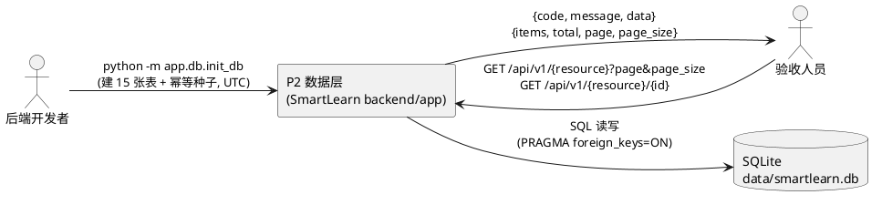
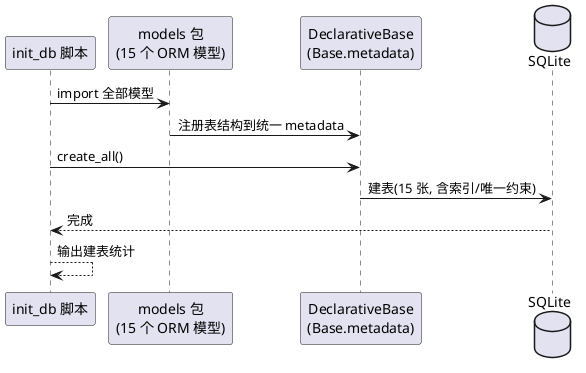
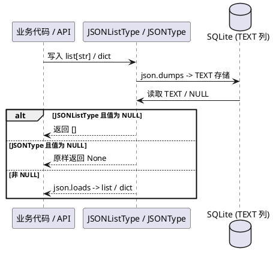
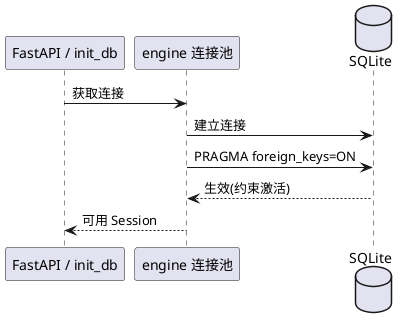
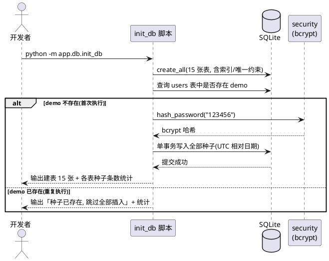
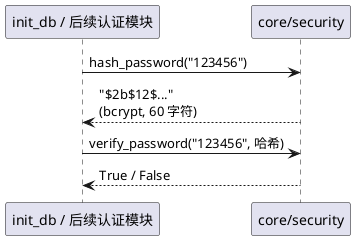
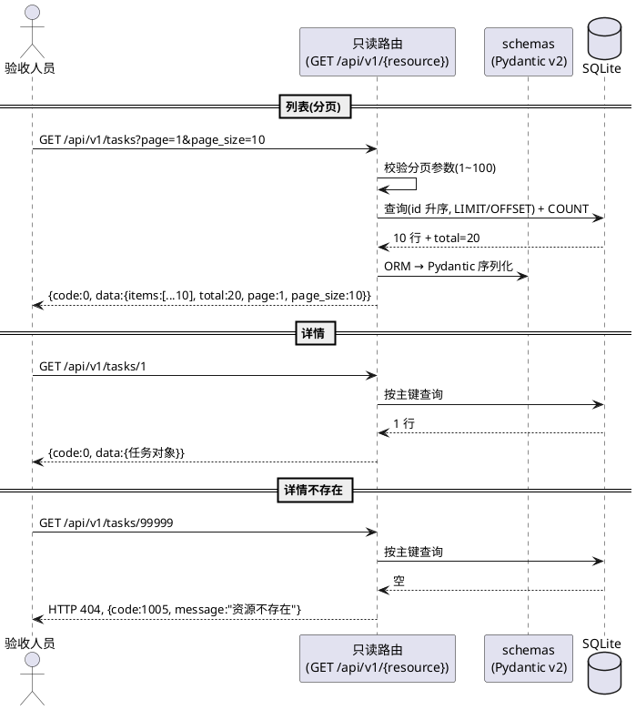
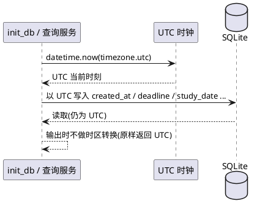

# P2「数据层实现」需求规格（SPEC_P2_DATALAYER）

| 项目 | 内容 |
|---|---|
| 所属项目 | 彭城智学 SmartLearn Agent |
| 阶段 | P2 数据层实现（Data Layer） |
| 文档状态 | 已批准（R2 修订版）——总体方向 R1 已批，3 点修订意见已落实并预先确认，可直接进入编码 |
| 上游依据 | `docs/PROJECT_CONTEXT.md`（唯一技术契约）、P1 工程骨架现状、P2 阶段任务书 |
| 下游文档 | design.md（技术设计，另行生成） |
| 验收方式 | 命令行执行 + HTTP 只读接口调用，逐条核对第 8 章可量化验收标准 |

> **修订记录**：
> - **R1（初版）**：完成 10 处冲突裁决与完整规格；用户通读并批准总体方向，同时提出 3 点修订意见。
> - **R2（本版）**：
>   ① **撤销 R1 裁决 5「表名式路径」方案**——P2 只读端点直接采用 PROJECT_CONTEXT 7.2 已定义的正式路径（7.2 未定义的 8 张表用表名 kebab-case），并写入「路径演进契约」：P2 只读端点即为最终路径，P3+ 同路径同文件扩展写方法，禁止并行双路径（见 5.6.1 条 1/2 与裁决 5）。
>   ② **PROJECT_CONTEXT 契约同步确认**——smartlearn.db 三处修订已完成（技术栈表、目录树、init_data.py 注释），本规格引用最新契约（见 4.5 条 1 与裁决 4）。
>   ③ **两项补充验收**——鉴权 TODO 留痕（15 个业务路由文件逐一核对，见 5.6.1 条 9 与验收 D7）；种子脚本分工（init_db.py 唯一入口，scripts/init_data.py 留待 P13，见 5.4.1 条 9 与验收 D8）。

> **裁决总纲**：本阶段任务书与 `PROJECT_CONTEXT.md` 存在 10 处冲突，已全部裁决并记录于**第 7 章**（其中裁决 4、5 已按用户 R2 评审意见修订）。裁决依据链：① 用户当前明确指令（验收契约）优先；② 其余冲突依 PROJECT_CONTEXT 第 5 行声明「开发提示词与本文件冲突时以本文件为准」；③ 用户个人偏好作为佐证。凡本规格未覆盖的细节，以 PROJECT_CONTEXT 为准。

---

# **1. 组件定位**

## **1.1 核心职责**

本组件负责承建 SmartLearn 后端的全部持久化能力（15 张 ORM 表）与只读验证接口，实现「数据可建、可种、可查」的数据层底座。

## **1.2 核心输入**

1. 开发者执行 `python -m app.db.init_db` 的命令行触发信号（来源：开发者终端）。
2. 验收人员对 `/api/v1/*` 只读接口的 HTTP GET 请求（列表分页、详情两类，来源：浏览器 / curl / Apifox）。
3. PROJECT_CONTEXT 第 6 章锁定的 15 张表字段契约（来源：项目文档，作为模型定义的唯一蓝本）。
4. `.env` 中的 `DATABASE_URL` 覆盖配置（来源：运行环境，保持 P1 机制）。

## **1.3 核心输出**

1. SQLite 数据库文件 `data/smartlearn.db`（15 张表 + 全量演示种子数据，UTC 时间存储）。
2. 统一响应体 `{code, message, data}` 的分页 / 详情 JSON 数据（30 个只读端点，见 5.6）。
3. bcrypt 密码哈希能力（`hash_password` / `verify_password`，供 init_db 与后续认证阶段复用）。
4. 终端执行摘要（建表张数、种子条数统计），供人工核对。

## **1.4 职责边界**

本组件**不负责**以下事项（防止职责蔓延）：

1. **不做任何写接口**：在 P2 建立的正式路径上仅提供 GET（列表分页 + 详情）；POST / PUT / PATCH / DELETE 由 P3+ 在**同一路径、同一路由文件**上扩展实现（路径演进契约，见 5.6.1 条 2），本阶段不新建任何并行路径。
2. **不做认证鉴权**：`get_current_user` 依赖留待认证阶段实现（P1 deps.py 注释已声明）；本阶段只读接口公开访问。
3. **不调用 LLM / Embedding**：不对知识库文档向量化；`roadmap`、`tool_calls`、报告 `content` 等 AI 产物字段以预置种子数据呈现。
4. **不做 Chroma 向量库集成与 RAG 解析**：RAG 属后续阶段；`embedding_id` 留空、由 RAG 阶段回填。
5. **不做掌握度聚合计算、Dashboard 统计、Agent 编排**：analytics / agent 属后续阶段。
6. **不改动 P1 骨架结构**：仅允许第 7 章裁决 4、裁决 8 声明的两处最小必要修改（config.py 默认 DATABASE_URL 一行 + session.py 增加 PRAGMA 事件监听），另含 session.py docstring 指向 smartlearn.db 的注释级同步；除此之外零改动。
7. **不涉及前端**：前端骨架已就绪，本阶段零改动。
8. **不创建 scripts/init_data.py**：建表与种子的唯一入口是 `app/db/init_db.py`；演示数据重置脚本 `scripts/init_data.py` 留待 P13 实现，本阶段禁止在任何位置另写一套种子逻辑（见 5.4.1 条 9）。

---

# **2. 领域术语**

**数据层（Data Layer）**
: 本规格定义的组件统称，覆盖 ORM 模型、JSON 类型装饰器、数据库会话、初始化脚本与只读验证接口五部分。

**ORM 模型**
: 以 SQLAlchemy 2.x 声明式风格（`Mapped[T]` + `mapped_column`）定义、与数据库表一一对应的 Python 类。

**幂等种子（Idempotent Seed）**
: init_db 脚本可重复执行而不报错、不重复插入数据的特性；以演示用户 `demo` 是否已存在为写入开关。

**mastery_score（掌握度）**
: `knowledge_mastery` 表中系统聚合出的知识点掌握程度（0–100），是掌握度计算的**输出**。
: 备注：与 `mastery_level` 严格区分，禁止混用（PROJECT_CONTEXT 6.12）。

**mastery_level（自评掌握度）**
: `learning_records` 表中学生本次学习后自评的掌握程度（0–100 整数），是掌握度计算的**输入**。

**roadmap（知识树）**
: `learning_goals.roadmap` 中 AI 拆解出的树形知识结构（JSON，形如 `{"name":"机器学习","children":[...]}`，最多 4 层）；值为 `null` 表示「从未拆解过」。

**计划版本（Plan Version）**
: `learning_plans` 中每次生成 / 调整都新建的版本记录；旧版本置 `archived`，禁止原地修改。

**JSONListType / JSONType**
: `app/models/types.py` 中的两个自定义类型装饰器；数据库侧均以 TEXT 存 JSON 字符串，Python 侧分别为 `list[str]` 与 `Any`；读到 NULL 时前者返回 `[]`、后者原样返回 `None`。

**UTC 时间约定**
: 所有时间类（DATETIME）字段统一以 UTC 时区存储；禁止以本地时间（Asia/Shanghai, UTC+8）落库。

**演示用户（demo）**
: 种子数据预置的演示账号 `demo / 123456`，密码仅存 bcrypt 哈希；为徐州工程学院计算机专业大二学生的完整学习画像。

**公共知识库（scope=public）**
: 系统预置、只读、对所有用户可见的知识库文档；此类记录 `user_id` 为 NULL。

**PRAGMA foreign_keys**
: SQLite 的外键约束开关；SQLite 默认关闭，必须显式开启后 ForeignKey 与级联删除才生效。

**路径演进契约（Path Evolution Contract）**
: 本阶段只读端点的路径即为最终正式路径：P2 在 PROJECT_CONTEXT 7.2 已定义的路径（7.2 未定义的表用表名 kebab-case）上仅实现 GET（列表分页 + 详情）；P3+ 在同一路径、同一路由文件上补齐 POST / PUT / PATCH / DELETE。禁止重命名、禁止为同一资源并行新建第二条路径、禁止留下废弃路由（见 5.6.1 条 2 与裁决 5）。

**表名 kebab-case 路径**
: PROJECT_CONTEXT 7.2 未定义路径的表所采用的命名规则：取数据库表名的 kebab-case 形式（如 `learning_plan_items` → `/api/v1/learning-plan-items`），该路径同样是最终路径，P3+ 直接在其上扩展写方法。

---

# **3. 角色与边界**

## **3.1 核心角色**

- **后端开发者**：执行 init_db 完成建表与种子灌入；基于 ORM 模型与 schemas 开发后续阶段业务。
- **验收人员**：调用 30 个只读端点，逐条核对第 8 章验收标准（本阶段的最终用户）。

## **3.2 外部系统**

- **SQLite 数据库文件（data/smartlearn.db）**：被动接收建表 DDL 与种子写入、响应只读查询；无任何主动交互。
- **FastAPI（P1 骨架）**：承载新增路由的挂载与统一响应体 / 全局异常处理（复用 P1，零改动）。
- **无 LLM、无 Chroma、无前端交互**：本阶段全部排除（见 1.4）。

## **3.3 交互上下文**



---

# **4. DFX 约束**

## **4.1 性能**

1. 任一只读接口（列表 / 详情）本地响应时间 ≤ 500ms（SQLite、种子量级 ≤ 100 行/表）。
2. `python -m app.db.init_db` 首次全量建表 + 种子写入总耗时 ≤ 10 秒；二次幂等执行 ≤ 3 秒。

## **4.2 可靠性**

1. init_db 幂等：任意次数重复执行退出码均为 0，全部表数据条数不随重复执行增加。
2. SQLite 外键约束必须实际生效（PRAGMA foreign_keys=ON），级联删除行为可被验证。
3. 种子写入必须在单一事务内完成，任一步失败则整体回滚，不得留下半成品数据。
4. 只读接口不得因单条脏数据导致 500（JSON 字段解析失败需按 5.2 语义兜底）。

## **4.3 安全性**

1. 数据库中禁止出现任何明文密码；`users.hashed_password` 必须为 bcrypt 格式（`$2b$` 前缀、60 字符）。
2. 本阶段只读接口公开访问（无鉴权）是**阶段性决定**，规格明确声明：认证阶段必须为全部业务接口补挂 `get_current_user`（见 7 章裁决 7）；且每个业务路由文件顶部必须以 `# TODO(P3): 认证阶段为全部业务端点补挂 get_current_user` 注释留痕（可验收项，见 5.6.1 条 9 与验收 D7）。
3. 种子数据中的演示密码 `123456` 仅用于开发演示，须在执行摘要中提示其演示性质。

## **4.4 可维护性**

1. 全部 Python 代码必须写全 type hints 与 docstring（PROJECT_CONTEXT 8.1）。
2. 枚举取值、状态值必须集中常量定义，禁止散落硬编码字符串。
3. 响应体、错误码、异常处理完全复用 P1 `core/response.py`，禁止另行造轮子。
4. init_db 执行结束输出统计摘要（各表条数），供人工与第 8 章核对表比对。

## **4.5 兼容性**

1. 不改 P1 骨架结构；仅两处最小必要修改 + 一处注释级同步：① `core/config.py` 默认 `DATABASE_URL` 改为 `sqlite:///data/smartlearn.db`（一行默认值，裁决 4）；② `db/session.py` 增加外键 PRAGMA 事件监听（裁决 8）；③ `db/session.py` docstring 同步指向 smartlearn.db（注释级）。**PROJECT_CONTEXT.md 契约同步已完成**（第 2 章技术栈表改为「SQLite（data/smartlearn.db）」、第 3 章目录树 `app.db` → `smartlearn.db`、scripts/init_data.py 注释改为「演示数据重置脚本（P13 实现；建表与种子统一走 app/db/init_db.py）」），本规格按同步后的最新契约执行，无残留文档漂移。
2. `DATABASE_URL` 保持可被 `.env` 覆盖（P1 机制不变）；覆盖时一切行为以覆盖值为准。
3. 环境契约：Python 3.10+、SQLAlchemy ≥ 2.0 < 3.0、Pydantic v2、passlib[bcrypt]（requirements.txt 已含，不新增依赖）。
4. `data/` 目录全部为运行时产物；数据库父目录不存在时自动创建（延续 P1 session.py 行为）。
5. 种子入口唯一（R2 新增）：`app/db/init_db.py` 是本阶段**唯一**的建表与种子入口；`scripts/init_data.py` 本阶段不创建、留待 P13 作为演示数据重置脚本实现，禁止两处各写一套种子逻辑（见 5.4.1 条 9）。

---

# **5. 核心能力**

## **5.1 ORM 模型定义（15 张表）**

### **5.1.1 业务规则**

1. **表清单全覆盖**：The 数据层 shall 定义 PROJECT_CONTEXT 第 6 章定稿的全部 15 张表：`users`、`user_profiles`、`learning_goals`、`learning_plans`、`learning_plan_items`、`courses`、`tasks`、`learning_records`、`knowledge_items`、`knowledge_chunks`、`mistakes`、`knowledge_mastery`、`agent_conversations`、`agent_messages`、`learning_reports`。
   a. 验收条件：执行 init_db 后查询 `sqlite_master` → 15 张表全部存在（不含 sqlite_sequence）。
2. **新式声明写法**：The 数据层 shall 以 SQLAlchemy 2.x 声明式风格（`Mapped[T]` + `mapped_column`）定义全部模型，禁止 1.x 旧式 `Column` 写法。
   a. 验收条件：`grep -r "mapped_column" backend/app/models/` 命中全部模型文件；模型源码无裸 `Column(` 声明。
3. **统一元数据**：The 数据层 shall 将全部模型注册到同一 DeclarativeBase 元数据，保证一次 `create_all` 建齐 15 张表。
   a. 验收条件：init_db 单次执行后 15 张表齐备，无需二次运行。
4. **主键与时间戳**：The 数据层 shall 为每张表提供自增主键 `id`，并按第 6 章各表规定提供 `created_at` / `updated_at`（值非空、UTC）。
   a. 验收条件：抽查任一表任意行 → `id` 非空自增；带时间戳的表 `created_at ≤ updated_at`。
5. **外键与关系**：The 数据层 shall 为每个外键字段声明 `ForeignKey`，并配置对应 `relationship`；父记录删除时的级联行为遵循第 6 章各表「级联要求」（可空外键 → SET NULL，从属数据 → CASCADE）。
   a. 验收条件：删除一条 `agent_conversations` 记录 → 其下 `agent_messages` 同步消失（级联生效验证）。
6. **索引**：The 数据层 shall 为全部外键列建立索引，且 `tasks.status`、`tasks.deadline`、`learning_records.study_date` 必须建索引；所有唯一约束自动形成唯一索引。
   a. 验收条件：`PRAGMA index_list` / `sqlite_master` 查询 → 上述索引存在。
7. **枚举取值约束**：The 数据层 shall 在数据层强制以下枚举取值（超界值写入被拒绝）：
   - `tasks.status` ∈ {`todo`, `in_progress`, `done`, `review`}，默认 `todo`
   - `tasks.priority` ∈ {`low`, `medium`, `high`}，默认 `medium`
   - `tasks.source` ∈ {`manual`, `agent`}
   - `learning_goals.status` ∈ {`active`, `completed`, `archived`}，默认 `active`
   - `learning_plans.status` ∈ {`active`, `archived`}；`learning_plans.source` ∈ {`agent`, `manual`}
   - `learning_plan_items.status` ∈ {`planned`, `done`, `skipped`}，默认 `planned`；`priority` ∈ {`low`, `medium`, `high`}
   - `knowledge_items.scope` ∈ {`personal`, `public`}，默认 `personal`；`status` ∈ {`pending`, `parsing`, `indexed`, `failed`}，默认 `pending`；`source_type` ∈ {`pdf`, `md`, `txt`, `docx`, `pptx`, `note`}
   - `knowledge_mastery.source` ∈ {`self_report`, `record`, `quiz`, `goal_breakdown`, `agent`}（`quiz` 为 V2 预留，本阶段不写入）
   - `agent_messages.role` ∈ {`user`, `assistant`, `tool`, `system`}
   - `learning_reports.report_type` ∈ {`daily`, `weekly`, `monthly`}
   a. 验收条件：向 `tasks` 写入 `status='not_started'` → 写入失败（约束拒绝）。
8. **UTC 时间约定**：The 数据层 shall 将全部时间类字段以 UTC 存储；种子数据中的「当前时间」基准取 UTC，禁止以本地时间（UTC+8）落库。
   a. 验收条件：任一 `created_at` 与北京时间 `now` 的差值 ≈ 8 小时（时区差）。
9. **禁止项**：The 数据层 shall 禁止在模型层编写业务逻辑、外部 IO、掌握度聚合公式（模型只描述结构）。
   a. 验收条件：`backend/app/models/` 下源码仅含结构声明、类型、关系与索引，无网络 / LLM / 复杂计算调用。

### **5.1.2 交互流程**



### **5.1.3 异常场景**

1. **模型未全部注册**
   a. 触发条件：某模型未被 import，metadata 缺表。
   b. 系统行为：create_all 只建已注册表，缺表在后续接口查询时报错。
   c. 用户感知：init_db 摘要中表数 < 15，验收即失败（第 8 章条款 A1）。
2. **外键目标表不存在**
   a. 触发条件：建表顺序错误或模型拼写错误导致 ForeignKey 指向不存在的表。
   b. 系统行为：create_all 抛出 `NoReferencedTableError`，事务回滚。
   c. 用户感知：终端输出异常堆栈，退出码非 0。

---

## **5.2 JSON 类型装饰器（JSONListType / JSONType）**

### **5.2.1 业务规则**

1. **双装饰器定义**：The 数据层 shall 在 `app/models/types.py` 定义 `JSONListType` 与 `JSONType` 两个 `TypeDecorator`。
   a. 验收条件：模块存在且可被 `from app.models.types import JSONListType, JSONType` 导入。
2. **存储行为**：两个装饰器 shall 在数据库侧以 TEXT 存 JSON 字符串（写入 `json.dumps`、读取 `json.loads`）。
   a. 验收条件：`tasks.knowledge_points` 列在 SQLite 中的存储值为合法 JSON 数组字符串。
3. **JSONListType 语义**：`JSONListType` 的 Python 侧类型 shall 为 `list[str]`；When 读到的数据库值为 NULL/None, the 数据层 shall 统一返回 `[]`（空数组是自然默认）。适用字段：`tasks.knowledge_points`、`learning_records.knowledge_points`、`user_profiles.interest_directions`。
   a. 验收条件：API 返回的 `knowledge_points` 恒为数组（永不为 null）。
4. **JSONType 语义**：`JSONType` 的 Python 侧类型 shall 为 `Any`（`dict` / `list[dict]`）；When 读到的数据库值为 NULL/None, the 数据层 shall 原样返回 `None`，禁止强行返回 `{}`。适用字段：`learning_goals.roadmap`、`learning_reports.content`、`agent_messages.tool_calls`。
   a. 验收条件：未拆解的目标 `roadmap` 在 API 中返回 `null`（可区分「从未拆解」与「拆解结果为空」）。
5. **层间禁令**：services / schemas / api 各层 shall 禁止对上述字段再手动 `json.loads` / `json.dumps`（类型装饰器统一承担序列化）。
   a. 验收条件：`grep -rn "json.loads\|json.dumps" backend/app/{api,schemas,services}/` 对这些字段无命中。
6. **声明方式**：上述字段统一声明为 `Mapped[...] = mapped_column(JSONListType / JSONType)`。
   a. 验收条件：模型源码中 6 个适用字段全部使用对应装饰器。

### **5.2.2 交互流程**



### **5.2.3 异常场景**

1. **TEXT 列内容非法 JSON**
   a. 触发条件：历史数据或人工改库导致存储值不是合法 JSON 字符串。
   b. 系统行为：`json.loads` 抛 `JSONDecodeError`；只读接口按 JSONType 语义兜底返回 None / 按 5000 兜底，不得崩溃。
   c. 用户感知：该字段返回 null 或统一错误体，服务不中断。

---

## **5.3 数据库会话与外键生效**

### **5.3.1 业务规则**

1. **PRAGMA 开启**：When 任一 SQLite 连接建立, the 数据层 shall 通过 SQLAlchemy connect 事件监听执行 `PRAGMA foreign_keys=ON`，使 ForeignKey 约束与级联删除实际生效。
   a. 验收条件：通过任一会话查询 `PRAGMA foreign_keys` → 返回 1。
2. **P1 机制保留**：The 数据层 shall 完整保留 P1 session.py 的既有行为：`check_same_thread=False`、SQLite 文件父目录自动创建、`SessionLocal` 参数（autocommit/autoflush/expire_on_commit 配置）、`get_db` 依赖签名。
   a. 验收条件：diff 审查仅见新增事件监听代码，既有行为零变更。
3. **动态 URL**：While `DATABASE_URL` 被 `.env` 覆盖为非 SQLite 连接串, the 数据层 shall 跳过 SQLite 专属配置（PRAGMA、connect_args），保证机制不报错。
   a. 验收条件：覆盖为 `sqlite:///data/other.db` 时一切正常（MVP 不验证 MySQL/PG，但不得因非 sqlite 前缀崩溃）。
4. **禁止项**：禁止在本模块编写任何业务规则（db 层红线）。
   a. 验收条件：session.py 仅含会话与连接基础设施。

### **5.3.2 交互流程**



### **5.3.3 异常场景**

1. **PRAGMA 未生效**
   a. 触发条件：事件监听未注册（遗漏实现）。
   b. 系统行为：外键约束静默失效，级联删除不执行，形成孤儿数据。
   c. 用户感知：验收第 8 章条款 D3（级联验证）失败。

---

## **5.4 数据库初始化与幂等种子数据**

### **5.4.1 业务规则**

1. **首次执行建库建种**：When 开发者执行 `python -m app.db.init_db` 且数据库中无 `users` 表, the 数据层 shall 创建全部 15 张表并写入下表全部种子数据，生成 `data/smartlearn.db`。
   a. 验收条件：命令执行后 `data/smartlearn.db` 存在，各表条数符合 5.4.1 条 3 的统计表。
2. **重复执行幂等**：When 开发者重复执行 `python -m app.db.init_db` 且演示用户 `demo` 已存在, the 数据层 shall 跳过全部种子插入、不报错、以退出码 0 结束，且所有表条数保持不变。
   a. 验收条件：连续执行两次后 `users` 仍为 1 行、`tasks` 仍为 20 行、`learning_records` 仍为 30 行（全表核对见第 8 章 B 表）。
3. **种子数据统计（量化契约）**：The 数据层 shall 写入以下种子数据：

   | 表 | 条数 | 关键要求 |
   |---|---|---|
   | users | 1 | `demo` / `123456`（bcrypt 哈希），`is_active=true` |
   | user_profiles | 1 | 徐州工程学院 / 计算机科学与技术 / 大二；目标方向为机器学习（`current_goal_type` 取枚举值如「考研」，`interest_directions` 含「机器学习」） |
   | courses | 3 | 如：机器学习、Python 程序设计、数据结构与算法分析；含教师姓名与学期（2025-2026-1） |
   | learning_goals | 5 | 含「掌握机器学习」主线目标（`roadmap` 为 3~4 层知识树 JSON）；status 覆盖 active（≥3）/ completed（≥1）/ archived（≥1） |
   | learning_plans | 1 | `active`、`version=1`、`source=agent`、起止日期覆盖执行日所在周 |
   | learning_plan_items | 7~10 | 属上述计划；`plan_date` 为本周日期、含明确 `start_time`/`end_time`（联合唯一不冲突）；topic 与任务知识点呼应（如「线性代数：特征值」） |
   | tasks | 20 | 四种 status 各 ≥1（建议 todo 7 / in_progress 4 / done 7 / review 2）；deadline 有近有远且 ≥3 个已逾期（早于执行日）；priority 三档各 ≥1；source 覆盖 manual 与 agent；`knowledge_points` 为真实知识点数组 |
   | learning_records | 30 | `study_date` 为执行日前 30 天连续逐日；`duration_minutes` 每天 30~180（0.5~3 小时）；覆盖 Python / 机器学习 / 数学 / 算法四类知识点；**最近 5 天时长严格递减**（由远及近逐日减少，用于演示学习风险预警）；`mastery_level` 取 0–100 |
   | knowledge_items | 3~5 | 全部 `scope=public`、`user_id=NULL`、`status=indexed`；主题如机器学习基础 / 线性代数要点 / 概率论公式表 / 数据结构速查；`source_type` 覆盖 ≥3 种 |
   | knowledge_chunks | 3~5 | 为其中 ≥1 篇文档的预置分块（真实文本内容、`chunk_index` 从 0 递增）；`embedding_id=NULL`（本阶段不向量化，RAG 阶段回填）；对应文档 `chunk_count` 与实际分块数一致 |
   | mistakes | 8 | 分散在 ≥4 个知识点（呼应概率论 / 线性代数 / 机器学习 / 数据结构）；`question` / `user_answer` / `correct_answer` / `analysis` 为真实课程题目与解析，禁止 test1/test2 式占位 |
   | knowledge_mastery | 10 | 必含：概率论=40、线性代数=50、机器学习=60、数据结构=80、Python=90；另 5 个自定（如深度学习=30、动态规划=45、SQL=55、计算机网络=70、英语阅读=50），分数均 0–100；`(user_id, knowledge_point)` 无重复；source 覆盖 record / self_report / goal_breakdown ≥2 种 |
   | agent_conversations | 1 | 有标题（如「最近学习状态分析」） |
   | agent_messages | 6~8 | 属上述会话；role 覆盖 user / assistant / tool；≥1 条 assistant 消息带 `tool_calls` JSON（OpenAI 格式，含调用参数如 `get_learning_statistics(days=7)`）；对应 tool 消息的 `tool_call_id` 与之关联 |
   | learning_reports | 1 | `report_type=weekly`；`period_start`/`period_end` 为执行日前一周；`summary` 为中文摘要；`content` 为结构化 JSON（学习时长 / 任务完成率 / 薄弱点等） |

4. **相对日期生成**：The 数据层 shall 以「执行日（UTC）」为基准动态生成全部种子日期字段（学习记录为执行日前 30 天、逾期任务 deadline 在过去、计划与周报覆盖本周/上周），禁止硬编码固定日期。
   a. 验收条件：任意日期执行 init_db → `GET /api/v1/records` 均返回「最近 30 天」记录（验收标准 3 恒成立）。
5. **真实感要求**：The 数据层 shall 保证种子数据像真实大学生数据：课程名 / 教师名 / 任务标题（如「学习 Transformer 的 Self-Attention 机制」）/ 错题内容（如贝叶斯公式计算题）/ 学习记录 content 与 problems 均为具体真实的中文内容；禁止 test1、test2、测试数据 式占位。
   a. 验收条件：人工抽查 tasks / mistakes / learning_records 各 3 条 → 内容具体、无占位文本。
6. **事务完整性**：The 数据层 shall 在单一事务内完成全部种子写入；If 任一环节失败, then the 数据层 shall 整体回滚并报错退出，不留部分数据。
   a. 验收条件：模拟失败（如临时约束冲突）后重启 → 库中无半成品种子。
7. **密码哈希落库**：The 数据层 shall 对演示密码 `123456` 调用 `hash_password`（bcrypt）后落库，禁止明文。
   a. 验收条件：`users.hashed_password` 以 `$2b$` 开头且 `verify_password("123456", 哈希)` 为 True。
8. **执行摘要输出**：When init_db 执行完成, the 数据层 shall 输出各表建表与种子条数统计（含「种子已存在，跳过」提示的幂等分支）。
   a. 验收条件：终端可见 15 张表的条数统计，可直接与第 8 章 B 表比对。
9. **种子脚本唯一入口（R2 新增）**：The 数据层 shall 以 `app/db/init_db.py` 作为**唯一**的建表与种子入口；`scripts/init_data.py` 本阶段**不创建**，留待 P13 作为演示数据重置脚本实现（届时统一复用 init_db 的建表与种子机制）；禁止在任何其他位置再写一套种子逻辑。
   a. 验收条件：P2 交付物中仓库内不存在 `scripts/init_data.py`；建表与种子代码仅存在于 `backend/app/db/init_db.py`（验收 D8）。

### **5.4.2 交互流程**



### **5.4.3 异常场景**

1. **重复执行重复插入**
   a. 触发条件：幂等开关缺失（未按 demo 用户存在性判断）。
   b. 系统行为：唯一约束（username 等）触发 IntegrityError。
   c. 用户感知：终端报错、退出码非 0；验收标准 1 失败。
2. **种子日期硬编码过期**
   a. 触发条件：学习记录日期写死为开发日，验收在数日后进行。
   b. 系统行为：`/api/v1/records` 返回的学习记录不再覆盖「最近 30 天」。
   c. 用户感知：验收标准 3 失败（total < 30 或日期超窗）。
3. **事务中途失败**
   a. 触发条件：种子写入过程中断（磁盘满 / 约束冲突）。
   b. 系统行为：整体回滚，数据库保持空表状态。
   c. 用户感知：终端异常堆栈，重跑可恢复。

---

## **5.5 密码哈希能力（bcrypt）**

### **5.5.1 业务规则**

1. **能力提供**：The 数据层 shall 在 `app/core/security.py` 提供 `hash_password(plain) -> str` 与 `verify_password(plain, hashed) -> bool` 两个函数（passlib + bcrypt）。
   a. 验收条件：`verify_password("123456", hash_password("123456"))` 为 True；错误密码校验为 False。
2. **只做哈希**：Where 本阶段（P2）范围内, the 数据层 shall 仅实现密码哈希能力；JWT 签发 / 校验函数留待认证阶段实现，本阶段不预留占位函数（遵循 P1 deps.py 先例）。
   a. 验收条件：security.py 不含 JWT 相关代码、无空壳占位。
3. **禁止明文**：The 数据层 shall 禁止在任何日志、输出、响应中暴露明文密码。
   a. 验收条件：init_db 摘要与 API 响应中无 `123456` 字样（库中仅哈希）。

### **5.5.2 交互流程**



### **5.5.3 异常场景**

1. **bcrypt 版本告警**
   a. 触发条件：passlib 与 bcrypt 4.x 兼容性告警（已知生态问题）。
   b. 系统行为：哈希功能正常，仅日志告警；如影响功能则锁定 bcrypt 版本区间。
   c. 用户感知：功能不受影响；验收 7 条款通过。

---

## **5.6 只读验证接口（列表分页 + 详情）**

### **5.6.1 业务规则**

1. **端点全覆盖**：The 数据层 shall 为每张主表提供两个只读端点（列表 + 详情），共 30 个；路径**直接采用 PROJECT_CONTEXT 7.2 已定义的正式路径**，7.2 未定义路径的 8 张表采用表名 kebab-case（该路径即最终路径）：

   | 表 | 列表端点（P2 只读 = 最终路径） | 详情端点 | 路径来源 |
   |---|---|---|---|
   | tasks | `GET /api/v1/tasks` | `GET /api/v1/tasks/{id}` | 7.2 已定义 |
   | learning_goals | `GET /api/v1/goals` | `GET /api/v1/goals/{id}` | 7.2 已定义 |
   | learning_plans | `GET /api/v1/plans` | `GET /api/v1/plans/{id}` | 7.2 已定义 |
   | learning_records | `GET /api/v1/records` | `GET /api/v1/records/{id}` | 7.2 已定义 |
   | knowledge_items | `GET /api/v1/knowledge/items` | `GET /api/v1/knowledge/items/{id}` | 7.2 已定义 |
   | agent_conversations | `GET /api/v1/agent/conversations` | `GET /api/v1/agent/conversations/{id}` | 7.2 已定义 |
   | learning_reports | `GET /api/v1/reports` | `GET /api/v1/reports/{id}` | 7.2 已定义 |
   | users | `GET /api/v1/users` | `GET /api/v1/users/{id}` | 表名 kebab-case |
   | user_profiles | `GET /api/v1/user-profiles` | `GET /api/v1/user-profiles/{id}` | 表名 kebab-case |
   | learning_plan_items | `GET /api/v1/learning-plan-items` | `GET /api/v1/learning-plan-items/{id}` | 表名 kebab-case |
   | courses | `GET /api/v1/courses` | `GET /api/v1/courses/{id}` | 表名 kebab-case |
   | knowledge_chunks | `GET /api/v1/knowledge-chunks` | `GET /api/v1/knowledge-chunks/{id}` | 表名 kebab-case |
   | mistakes | `GET /api/v1/mistakes` | `GET /api/v1/mistakes/{id}` | 表名 kebab-case |
   | knowledge_mastery | `GET /api/v1/knowledge-mastery` | `GET /api/v1/knowledge-mastery/{id}` | 表名 kebab-case |
   | agent_messages | `GET /api/v1/agent-messages` | `GET /api/v1/agent-messages/{id}` | 表名 kebab-case |

   a. 验收条件：30 个端点逐一 GET → 全部返回 HTTP 200 且 `code=0`（`tasks`、`records` 两条验收命令直接命中本表路径）。
2. **路径演进契约（R2 修订，禁止并行双路径）**：The 数据层 shall 视 P2 只读端点路径为**最终正式路径**——P3+ 阶段的 POST / PUT / PATCH / DELETE 等 CRUD 方法一律在**同一路径、同一路由文件**上扩展实现；禁止重命名、禁止为同一资源新建第二条路径（如为 learning_records 另建 `/learning-records` 与 `/records` 并行）、禁止留下任何废弃路由，确保最终提交包中同一资源只有一条路径、不出现孤儿接口。
   a. 验收条件：OpenAPI（/docs）中 15 个资源均只出现一条资源路径，不存在 `/learning-records`、`/learning-goals`、`/learning-plans`、`/learning-reports`、`/agent-conversations` 等并行别名路径。
3. **分页参数**：列表端点 shall 接受 `page`（默认 1，最小 1）与 `page_size`（默认 10，范围 1~100）；If `page < 1` 或 `page_size` 超出 1~100, then the 数据层 shall 返回 422 + code 1001（参数校验失败）。
   a. 验收条件：`GET /api/v1/tasks?page=0` → 422；`GET /api/v1/tasks?page_size=101` → 422。
4. **分页响应结构**：列表端点 shall 返回 `data = {items, total, page, page_size}`（PROJECT_CONTEXT 5.3），`total` 为满足条件的总记录数。
   a. 验收条件：`GET /api/v1/tasks?page=1&page_size=10` → `items` 长度 10、`total=20`、`page=1`、`page_size=10`（用户验收标准 2）。
5. **详情行为**：When 资源 id 存在, the 数据层 shall 返回 200 + `code=0` + 单对象；If 资源 id 不存在, then the 数据层 shall 返回 HTTP 404 + `code=1005`。
   a. 验收条件：`GET /api/v1/tasks/1` → 200；`GET /api/v1/tasks/99999` → 404 + `code=1005`。
6. **默认排序**：列表端点 shall 按 `id` 升序返回；`learning_records` 列表 shall 按 `study_date` 降序、`id` 降序（最近记录在前）。
   a. 验收条件：`GET /api/v1/records` 首条为最新日期记录。
7. **统一响应体与序列化**：全部端点 shall 返回 P1 统一响应体 `{code, message, data}`，且响应数据必须经 Pydantic v2 模型（schemas）序列化输出，禁止把 ORM 对象直接回传路由（PROJECT_CONTEXT 分层铁律）；JSON 字段按 5.2 语义输出（`knowledge_points` → 数组、`roadmap` → 对象或 null）。
   a. 验收条件：响应 JSON 中 `knowledge_points` 为数组、未拆解目标 `roadmap` 为 null、无 `_sa_instance_state` 之类内部字段。
8. **公开访问（阶段性）**：Where 本阶段（P2）范围内, 全部端点 shall 不挂任何鉴权依赖（`get_current_user` 未实现），公开供验证。
   a. 验收条件：无 Authorization 头直接 GET → 200。
9. **鉴权留痕（R2 新增，可验收项）**：每个业务路由文件（15 个，每表一个）顶部 shall 固定写一行注释：`# TODO(P3): 认证阶段为全部业务端点补挂 get_current_user`，作为认证阶段补挂鉴权的代码内留痕与承诺。
   a. 验收条件：对 15 个业务路由文件逐一 grep `TODO(P3): 认证阶段为全部业务端点补挂 get_current_user` → 全部命中、无一遗漏（验收 D7）。
10. **禁止项**：The 数据层 shall 禁止在只读路由上提供任何写方法（POST/PUT/PATCH/DELETE），且路由层禁止写 SQL、禁止业务逻辑（只做参数接收 → 调 service / 直接查询 → 包装响应）。
    a. 验收条件：OpenAPI（/docs）中 30 个端点全部为 GET。
11. **健康检查不变**：`GET /health`（P1）保持原样可用。
    a. 验收条件：`GET /health` → 200。

### **5.6.2 交互流程**



### **5.6.3 异常场景**

1. **分页参数越界**
   a. 触发条件：`page=0` / `page=-1` / `page_size=0` / `page_size=101`。
   b. 系统行为：Pydantic 查询参数校验拒绝，走 P1 全局校验异常处理。
   c. 用户感知：HTTP 422，`{code:1001, message:"参数校验失败: ..."}`。
2. **详情资源不存在**
   a. 触发条件：id 在库中不存在。
   b. 系统行为：service / 路由抛 `BizException(CODE_NOT_FOUND)` 或 404。
   c. 用户感知：HTTP 404，`{code:1005, message:"资源不存在"}`。
3. **JSON 字段序列化失败**
   a. 触发条件：库中 TEXT 列存了非法 JSON（人工改库等）。
   b. 系统行为：按 5.2.3 兜底，不影响同响应其他字段。
   c. 用户感知：该字段为 null，接口仍 200。
4. **路由未注册**
   a. 触发条件：api_router 未 include 新路由模块。
   b. 系统行为：FastAPI 返回 404。
   c. 用户感知：`{code:1005}`，验收条款 C1 失败。

---

## **5.7 统一时间约定（UTC）**

### **5.7.1 业务规则**

1. **UTC 存储**：The 数据层 shall 将全部 DATETIME 字段（created_at / updated_at / deadline / completed_at / roadmap_updated_at / study 相关时间戳等）以 UTC 存储。
   a. 验收条件：`users.created_at` 与「北京时间 now − 8h」差值 < 5 分钟。
2. **种子基准 UTC**：The 数据层 shall 以 UTC「当前时刻」为基准计算全部相对日期（30 天学习记录、逾期 deadline、本周计划、周报区间）。
   a. 验收条件：任意时区环境执行 init_db → 学习记录窗口均为「执行日前 30 天（UTC）」。
3. **DATE 字段约定**：`study_date` / `plan_date` / `period_start` / `period_end` / `start_date` / `end_date` 等纯日期字段 shall 按 UTC 日期取值。
   a. 验收条件：最新一条学习记录的 `study_date` 等于执行日（UTC 日期）或前一日（取决于执行时刻的 UTC 日期边界）。
4. **禁止本地时间**：The 数据层 shall 禁止以 `datetime.now()`（本地时区）落库；须使用 `datetime.now(timezone.utc)` 或等价 UTC 来源。
   a. 验收条件：`grep -rn "datetime.now()" backend/app/` 无裸调用命中。

### **5.7.2 交互流程**



### **5.7.3 异常场景**

1. **本地时间混入**
   a. 触发条件：某处使用 `datetime.now()` 落库。
   b. 系统行为：该字段比 UTC 快 8 小时，与其他行不一致。
   c. 用户感知：验收条款 D1（UTC 一致性）失败，`created_at` 超前。

---

# **6. 数据约束**

> 本章为 15 张表的字段级逻辑约束（字段业务含义、取值范围、必填性、唯一性），是 PROJECT_CONTEXT 第 6 章的规格化转写；物理实现（列类型 DDL、索引 DDL、存储方式）由 design.md 决定。通用约定：主键 `id` 自增；时间字段 UTC；外键命名 `<表名单数>_id`；枚举取值见 5.1.1 条 7；JSON 字段的类型装饰器映射见 5.2。

## **6.1 users（用户账号）**

1. **username**：必填；登录名，全局唯一；长度 ≤ 50。
2. **email**：可空；邮箱，唯一（可空时业务去重）。
3. **hashed_password**：必填；bcrypt 哈希（`$2b$` 前缀、60 字符）；禁止存明文。
4. **is_active**：必填；布尔；默认 true；禁用后不可登录。
5. **created_at / updated_at**：必填；UTC。

- 索引要求：`username` 唯一索引；`email` 唯一索引。
- 级联要求：被删除时，其档案 / 目标 / 计划 / 课程 / 任务 / 记录 / 错题 / 掌握度 / 会话 / 报告全部级联删除（CASCADE）。

## **6.2 user_profiles（用户学习档案）**

1. **user_id**：必填；外键 users.id；**唯一**（一人一档）。
2. **name**：可空；姓名。
3. **school**：可空；学校。
4. **major**：可空；专业。
5. **grade**：可空；年级（如「大二」）。
6. **current_goal_type**：可空；当前目标类型：考研 / 保研 / 就业 / 比赛。
7. **interest_directions**：可空；兴趣方向；`JSONListType`（Python 侧 `list[str]`，NULL → `[]`）。
8. **created_at / updated_at**：必填；UTC。

- 索引要求：`user_id` 唯一索引（+外键索引）。

## **6.3 learning_goals（学习目标）**

1. **user_id**：必填；外键 users.id。
2. **title**：必填；目标名称（如「6个月掌握机器学习」）；长度 ≤ 200。
3. **goal_type**：可空；目标类型。
4. **description**：可空；目标描述。
5. **start_date / end_date**：可空；开始 / 截止日期（保持可空，支持「先建目标、后补时间」）。
6. **status**：必填；active / completed / archived；默认 active。
7. **roadmap**：可空；AI 拆解的知识树；`JSONType`（`null` 表示「从未拆解」，禁止以 `{}` 顶替）；形如 `{"name":"机器学习","children":[...]}`，最多 4 层。
8. **roadmap_updated_at**：可空；最近一次拆解时间；UTC。
9. **created_at / updated_at**：必填；UTC。

- 索引要求：`user_id` 索引；`status` 索引。
- 级联要求：目标被删除时，`tasks.goal_id`、`learning_plans.goal_id` 置空（SET NULL）。

## **6.4 learning_plans（计划版本）**

1. **user_id**：必填；外键 users.id。
2. **goal_id**：可空；外键 learning_goals.id。
3. **title**：必填；计划标题。
4. **version**：必填；整数；每次重新规划自增。
5. **status**：必填；active / archived；默认 active。
6. **parent_plan_id**：可空；外键 learning_plans.id（自引用）；指向被调整的上一版，用于 diff 与回滚。
7. **source**：必填；agent / manual。
8. **adjust_reason**：条件必填；Agent 调整理由；`parent_plan_id` 非空时必填、`source=manual` 时为空。
9. **start_date / end_date**：必填（区别于 learning_goals 的可空）；必须 `end_date >= start_date`；是 active 判定（`start_date <= 今天 <= end_date`）与重叠判定的依据。
10. **created_at**：必填；UTC。

- 表级规则：同一用户下，日期区间与当前 active 计划重叠的计划最多一个；生成 / 调整一律新建版本、旧版本置 archived，禁止原地修改。
- 索引要求：`user_id` 索引；`(user_id, status)` 组合索引（可选）。
- 级联要求：计划被删除时，其条目级联删除（CASCADE）；`parent_plan_id` 置空（SET NULL）。

## **6.5 learning_plan_items（计划条目）**

1. **plan_id**：必填；外键 learning_plans.id。
2. **plan_date**：必填；安排在周几（具体日期）。
3. **start_time / end_time**：可空；开始 / 结束时间（如 19:00 / 20:30）。
4. **topic**：必填；本次学什么（如「线性代数：特征值」）。
5. **task_id**：可空；外键 tasks.id（「休息 / 复习」类条目可空）。
6. **estimated_minutes**：可空；预计时长（分钟）。
7. **priority**：可空；low / medium / high。
8. **status**：必填；planned / done / skipped；默认 planned。
9. **created_at**：必填；UTC。

- 表级规则：`(plan_id, plan_date, start_time)` 联合唯一（同一时间段不冲突）。
- 索引要求：联合唯一索引；`plan_id` 索引。
- 级联要求：随所属计划级联删除（CASCADE）；`task_id` 置空（SET NULL）。

## **6.6 courses（课程）**

1. **user_id**：必填；外键 users.id。
2. **name**：必填；课程名称（如「机器学习」）。
3. **description**：可空；课程描述。
4. **teacher**：可空；授课教师。
5. **semester**：可空；学期（如「2025-2026-1」）。
6. **created_at**：必填；UTC。

- 索引要求：`user_id` 索引。
- 级联要求：课程被删除时，`tasks.course_id`、`learning_records.course_id`、`mistakes.course_id` 置空（SET NULL）。

## **6.7 tasks（学习任务）**

1. **user_id**：必填；外键 users.id。
2. **goal_id**：可空；外键 learning_goals.id。
3. **course_id**：可空；外键 courses.id。
4. **title**：必填；任务名称；长度 ≤ 200。
5. **description**：可空；任务描述。
6. **knowledge_points**：可空；所属知识点；`JSONListType`（`list[str]`，如 `["Transformer","Attention"]`；一个任务可挂多个知识点）。
7. **priority**：必填；low / medium / high；默认 medium。
8. **estimated_minutes**：可空；预计耗时（分钟）。
9. **actual_minutes**：可空；实际花费（分钟，由学习记录回填）。
10. **deadline**：可空；截止时间；UTC。
11. **scheduled_date**：可空；计划执行日期（Agent 生成计划时写入）。
12. **status**：必填；**todo / in_progress / done / review**（不用 not_started / reviewing）；默认 todo。
13. **source**：必填；manual / agent。
14. **created_at / updated_at**：必填；UTC。
15. **completed_at**：可空；完成时间（状态置 done 时写入）；UTC。

- 索引要求：`user_id`、`goal_id`、`course_id`、`status`、`deadline` 索引。
- 级联要求：任务被删除时，`learning_records.task_id`、`learning_plan_items.task_id` 置空（SET NULL）。

## **6.8 learning_records（学习记录）**

1. **user_id**：必填；外键 users.id。
2. **task_id**：可空；外键 tasks.id。
3. **course_id**：可空；外键 courses.id。
4. **content**：必填；学习内容。
5. **duration_minutes**：必填；学习时长（分钟）；正整数。
6. **achievement**：可空；学习成果。
7. **problems**：可空；遇到的问题。
8. **knowledge_points**：可空；本次涉及的知识点；`JSONListType`（`list[str]`；后续阶段据此重算掌握度）。
9. **mastery_level**：可空；**用户自评掌握程度 0–100 整数**（掌握度聚合的输入，区别于 mastery_score）。
10. **study_date**：必填；学习日期（按天统计依据）。
11. **created_at**：必填；UTC。

- 索引要求：`user_id`、`study_date`、`task_id`、`course_id` 索引。
- 级联要求：随用户级联删除（CASCADE）。

## **6.9 knowledge_items（知识库文档）**

1. **user_id**：条件可空；外键 users.id；`scope=personal` 必填、`scope=public` 为 NULL。
2. **title**：必填；文档标题。
3. **source_type**：必填；pdf / md / txt / docx / pptx / note。
4. **file_path**：可空；原始文件路径（note 类型可空）。
5. **scope**：必填；personal / public；默认 personal。
6. **status**：必填；pending / parsing / indexed / failed；默认 pending。
7. **error_msg**：条件必填；失败原因；`status=failed` 时必填。
8. **chunk_count**：必填；切分后的分块数；默认 0。
9. **created_at / updated_at**：必填；UTC。

- 种子附加约定（本阶段）：公共库文档 `status=indexed` 且预置分块（见 5.4.1 条 3）；`embedding_id` 由 RAG 阶段回填。
- 索引要求：`user_id`、`scope` 索引。
- 级联要求：文档被删除时，其分块级联删除（CASCADE）。

## **6.10 knowledge_chunks（知识分块）**

1. **item_id**：必填；外键 knowledge_items.id。
2. **user_id**：可空；外键 users.id（冗余便于按用户过滤；public 为 NULL）。
3. **chunk_index**：必填；分块序号，从 0 开始。
4. **content**：必填；分块文本内容。
5. **embedding_id**：可空；Chroma 向量记录 id（本阶段 NULL，RAG 阶段回填）。
6. **created_at**：必填；UTC。

- 索引要求：`item_id`、`user_id` 索引。
- 级联要求：随所属文档级联删除（CASCADE）。

## **6.11 mistakes（错题）**

1. **user_id**：必填；外键 users.id。
2. **course_id**：可空；外键 courses.id。
3. **knowledge_point**：可空；关联知识点（**单数**；一题一知识点，跨知识点拆多条）。
4. **question**：必填；题目内容。
5. **user_answer**：可空；用户作答。
6. **correct_answer**：可空；正确答案。
7. **analysis**：可空；错因分析。
8. **created_at**：必填；UTC。

- 索引要求：`user_id`、`knowledge_point` 索引。
- 级联要求：随用户级联删除（CASCADE）；`course_id` 置空（SET NULL）。

## **6.12 knowledge_mastery（知识掌握度）**

1. **user_id**：必填；外键 users.id。
2. **knowledge_point**：必填；知识点名称（**单数**，与 tasks / learning_records 的复数 knowledge_points 区分）；长度 ≤ 200。
3. **mastery_score**：必填；掌握度 **0–100**（注意命名：不用 `mastery`）。
4. **source**：必填；self_report / record / quiz / goal_breakdown / agent（quiz 为 V2 预留，本阶段不写入）。
5. **updated_at**：必填；最近更新时间；UTC。

- 表级规则：`(user_id, knowledge_point)` 联合唯一（每用户每知识点一条）。
- 索引要求：联合唯一索引。
- 级联要求：随用户级联删除（CASCADE）。

## **6.13 agent_conversations（Agent 会话）**

1. **user_id**：必填；外键 users.id。
2. **title**：可空；会话标题（可由首条消息生成）。
3. **created_at / updated_at**：必填；UTC。

- 索引要求：`user_id` 索引。
- 级联要求：被删除时，其消息级联删除（CASCADE）。

## **6.14 agent_messages（Agent 消息）**

1. **conversation_id**：必填；外键 agent_conversations.id。
2. **role**：必填；user / assistant / tool / system。
3. **content**：必填；消息内容。
4. **tool_name**：可空；`role=tool` 时记录工具名。
5. **tool_calls**：可空；`role=assistant` 触发工具调用时的 OpenAI 格式 tool_calls JSON（含调用参数）；`JSONType`（NULL 原样返回 None）。
6. **tool_call_id**：可空；`role=tool` 时关联 assistant 消息 tool_calls 中的 id。
7. **created_at**：必填；UTC。

- 索引要求：`conversation_id` 索引。
- 级联要求：随所属会话级联删除（CASCADE）。

## **6.15 learning_reports（学习成长报告）**

1. **user_id**：必填；外键 users.id。
2. **report_type**：必填；daily / weekly / monthly。
3. **period_start / period_end**：必填；统计起止日期。
4. **summary**：可空；报告摘要（面向用户的结论）。
5. **content**：可空；结构化报告内容；`JSONType`。
6. **created_at**：必填；UTC。

- 索引要求：`user_id` 索引；`(user_id, report_type)` 组合索引（可选）。
- 级联要求：随用户级联删除（CASCADE）。

---

# **7. 冲突点裁决记录（10 项）**

> 裁决依据链：**① 用户当前明确指令（验收契约）优先**——验收标准与验收命令是硬性契约；**② PROJECT_CONTEXT 第 5 行**「开发提示词与本文件冲突时，一律以本文件为准；本文件未覆盖的细节，以提示词为准」；**③ 用户个人偏好**（data/smartlearn.db 等）作为佐证；**④ P1 现状**作为兼容性边界。

| # | 冲突点 | 裁决结论 | 依据与理由 |
|---|---|---|---|
| 1 | 表清单：任务书 13 张 vs PROJECT_CONTEXT 15 张（多 learning_plans、learning_plan_items） | **按 15 张全建** | 任务书自身声明「按 PROJECT_CONTEXT 的表清单」；PC 第 6 章定稿「MVP 表共 15 张」是唯一契约。少建 2 张将导致计划条目无表可落、后续周视图课表功能失效。 |
| 2 | tasks.status 枚举：任务书 not_started/in_progress/done/reviewing vs PC 锁定 todo/in_progress/done/review | **todo / in_progress / done / review，默认 todo** | PC 头部第 6 行显式锁定「不用 not_started / reviewing」，且第 5 行声明冲突时以 PC 为准。任务书「覆盖四种状态」的意图不受影响。 |
| 3 | knowledge_mastery 字段：任务书 mastery/topic/source(自评/记录/错题/测试) vs PC 锁定 mastery_score/knowledge_point/英文枚举 | **mastery_score + knowledge_point + source ∈ {self_report, record, quiz, goal_breakdown, agent}** | PC 头部第 7 行显式锁定命名（不用 mastery）；6.12 定义 source 为英文枚举（DB 层不存中文）；任务书的中文语义（自评/记录/错题/测试）由 self_report/record/错题扣分机制/goal_breakdown 对应承载，其中「测试」= quiz（V2 预留，本阶段不写入）。 |
| 4 | 数据库文件名：任务书验收要求 data/smartlearn.db vs PC 与 P1 config.py 默认 data/app.db | **data/smartlearn.db：将 config.py 默认 DATABASE_URL 改为 `sqlite:///data/smartlearn.db`（一行默认值修改，不动骨架结构），session.py docstring 同步** | **用户当前明确指令 + 个人偏好优先**：验收标准 1 直接绑定 data/smartlearn.db（不改则验收必然失败），用户偏好亦固定该路径。此修改仅一行配置默认值，.env 覆盖机制不变。**R2 更新：PROJECT_CONTEXT 契约同步已完成**——第 2 章技术栈表改为「SQLite（data/smartlearn.db）」、第 3 章目录树 `app.db` → `smartlearn.db`、scripts/init_data.py 注释改为「演示数据重置脚本（P13 实现；建表与种子统一走 app/db/init_db.py）」，文档漂移已消除，规格与 PROJECT_CONTEXT 现均为 smartlearn.db，无残留冲突。 |
| 5 | 学习记录路由：任务书验收命令 GET /api/v1/learning-records vs PC 7.2 的 /api/v1/records | **P2 直接采用 7.2 正式路径 `/api/v1/records`（GET 列表 + 详情）；验收命令以 `/api/v1/records` 为准（R2 修订，撤销 R1 的表名式路径方案）** | **用户最新明确指令优先**：R1 曾裁决「表名式路径错开」以迁就任务书验收命令原文；用户评审否决该方案——并行双路径（P2 建 /learning-records、P3 再建 /records）会使同一资源挂两条路径、一条只读一条全功能，最终提交包多出 6 条孤儿接口，评审无法解释。R2 定案：P2 只读端点直接用 7.2 已定义路径（/tasks、/goals、/plans、/records、/knowledge/items、/agent/conversations、/reports），7.2 未定义的 8 张表用表名 kebab-case（同样是最终路径）；P3+ 在同一路径、同一文件上补写方法（路径演进契约，见 5.6.1 条 2），不重命名、不新建、不留废弃路由。 |
| 6 | 种子是否覆盖 learning_plans / learning_plan_items / knowledge_items / knowledge_chunks / agent_conversations / agent_messages / learning_reports | **补充少量真实感种子，使 15 张表全部有数据可查**（1 个 active 计划 + 7~10 条目、3~5 篇公共库文档 + 3~5 分块、1 会话 + 6~8 消息、1 份周报，详见 5.4.1 条 3） | 既然 15 张表全建、每张主表须提供只读接口，空表将导致列表接口返回空 items，无法验证 Pydantic 序列化、JSON 字段（roadmap/tool_calls/content）与关系加载。RAG 向量化不在本阶段（不调 Embedding，embedding_id 留 NULL 由 RAG 阶段回填）。 |
| 7 | 鉴权：只读接口是否挂 get_current_user | **不挂，接口公开供验证（阶段性决定）** | P1 deps.py 注释明确「get_current_user 等鉴权依赖将在后续阶段实现，本阶段不预留占位」；P2 目标是数据层验证，无用户上下文概念。规格已在 4.3 / 5.6.1 条 8 声明：认证阶段必须补挂鉴权。 |
| 8 | SQLite 外键 PRAGMA：P1 session.py 未开启 foreign_keys=ON | **在 session.py 增加 connect 事件监听执行 PRAGMA foreign_keys=ON（最小必要改动）** | SQLite 默认关闭外键约束，不开启则第 6 章全部 ForeignKey 与级联删除（CASCADE/SET NULL）形同虚设；PC 未显式禁止，且这是「使 PC 契约实际生效」的必要措施。改动仅追加监听代码，不改变 engine/SessionLocal/get_db 结构。 |
| 9 | 密码哈希：PC 规划 core/security.py 含 JWT + bcrypt | **本阶段新建 core/security.py，仅实现 hash_password / verify_password（passlib bcrypt）；JWT 留待认证阶段，不预留占位函数** | init_db 种子需要 bcrypt 哈希（验收硬需求）；JWT 签发/校验依赖认证阶段设计（token 载荷、有效期策略），提前实现属越界。遵循 P1 deps.py「不预留占位、避免启动失败」的先例。 |
| 10 | models/types.py：JSON 类型装饰器 | **必须实现 JSONListType 与 JSONType 两个 TypeDecorator**（DB 侧 TEXT 存 JSON；Python 侧 list[str] / Any；NULL 分别返回 [] / None） | PC 8.1 强制要求（含 None 语义差异的完整理由：roadmap=None 表示「从未拆解」）。适用字段 6 个：JSONListType → tasks.knowledge_points、learning_records.knowledge_points、user_profiles.interest_directions；JSONType → learning_goals.roadmap、learning_reports.content、agent_messages.tool_calls。 |

---

# **8. 验收标准（可量化）**

## **8.1 A 组：建表与幂等（对应任务书验收标准 1）**

| # | 条款 | 通过判据 |
|---|---|---|
| A1 | 15 张表齐备 | 执行 init_db 后查询 `sqlite_master`，业务表数 = 15 |
| A2 | 数据库文件生成 | `data/smartlearn.db` 存在且非空 |
| A3 | 幂等重复执行 | 连续执行 `python -m app.db.init_db` 两次：两次均退出码 0、无异常输出；第二次后 `users=1`、`tasks=20`、`learning_records=30`（无重复插入） |

## **8.2 B 组：种子数据统计核对表（对应任务书验收标准 1 + 5.4.1 条 3）**

| # | 条款 | 通过判据 |
|---|---|---|
| B1 | users / user_profiles | 各 1 行；档案含徐州工程学院、计算机科学与技术、大二 |
| B2 | courses | 3 行，课程名真实 |
| B3 | learning_goals | 5 行；status 覆盖 ≥2 种；≥1 行 roadmap 为多层知识树 JSON |
| B4 | learning_plans / learning_plan_items | 1 行 active 计划；7~10 条条目且时间段不冲突 |
| B5 | tasks | 20 行；todo / in_progress / done / review 各 ≥1；≥3 个 deadline 已逾期；priority 三档各 ≥1；无占位文本 |
| B6 | learning_records | 30 行；study_date 覆盖最近 30 天连续逐日；duration_minutes ∈ [30, 180]；按 study_date 升序看最近 5 天时长严格递减；知识点覆盖 Python / 机器学习 / 数学 / 算法 |
| B7 | knowledge_mastery | 10 行；(user_id, knowledge_point) 无重复；概率论=40、线性代数=50、机器学习=60、数据结构=80、Python=90；全部 ∈ [0, 100] |
| B8 | mistakes | 8 行；分散在 ≥4 个知识点；题目为真实内容 |
| B9 | knowledge_items / knowledge_chunks | 公共文档 3~5 行（scope=public、user_id=NULL、source_type ≥3 种）；分块 3~5 行（embedding_id 为 NULL） |
| B10 | agent_conversations / agent_messages | 会话 1 行；消息 6~8 行；role 覆盖 user / assistant / tool；≥1 行 tool_calls 为 JSON |
| B11 | learning_reports | 1 行 weekly 报告；period 为执行日前一周；content 为 JSON |

## **8.3 C 组：只读接口（对应任务书验收标准 2、3）**

| # | 条款 | 通过判据 |
|---|---|---|
| C1 | 30 端点全通 | 15 张表的列表 + 详情端点全部 GET 200 且 code=0 |
| C2 | 任务分页（验收命令原样） | `GET /api/v1/tasks?page=1&page_size=10` → `data.items` 长度 10、`data.total=20`、`data.page=1`、`data.page_size=10` |
| C3 | 学习记录（正式路径，R2 修订） | `GET /api/v1/records?page_size=30` → `data.total=30`，items 按 study_date 降序、全部落在最近 30 天 |
| C4 | 分页参数校验 | `page=0` / `page_size=101` → HTTP 422 + code=1001 |
| C5 | 详情 404 | `GET /api/v1/tasks/99999` → HTTP 404 + code=1005 |
| C6 | 只读约束 | OpenAPI /docs 中本阶段全部端点均为 GET，无任何写方法 |
| C7 | 健康检查回归 | `GET /health` → 200（P1 行为不变） |

## **8.4 D 组：通用约束抽查**

| # | 条款 | 通过判据 |
|---|---|---|
| D1 | UTC 存储 | 任一新写入行 `created_at` ≈ 北京时间 now − 8h（偏差 < 5 分钟）；代码无裸 `datetime.now()` |
| D2 | bcrypt 哈希 | `hashed_password` 以 `$2b$` 开头、60 字符；`verify_password("123456", 哈希)` = True；库内与响应中无明文密码 |
| D3 | 外键级联生效 | 删除一条会话 → 其消息同步消失；`PRAGMA foreign_keys` 查询返回 1 |
| D4 | JSON 字段语义 | API 返回中 `tasks.knowledge_points` 为数组（永非 null）；`roadmap` 未拆解时为 null |
| D5 | 幂等统计输出 | init_db 终端输出各表条数摘要，与 B 表一致 |
| D6 | 骨架零破坏 | P1 既有文件 diff 审查：仅 config.py 默认 DATABASE_URL 一行变更 + session.py 新增 PRAGMA 监听 + session.py docstring 注释级同步；main.py / response.py / deps.py / health.py 零改动；服务正常启动（`uvicorn app.main:app`） |
| D7 | 鉴权留痕（R2 新增） | 15 个业务路由文件顶部均含 `# TODO(P3): 认证阶段为全部业务端点补挂 get_current_user`，逐一核对无一遗漏 |
| D8 | 种子入口唯一（R2 新增） | 仓库内不存在 `scripts/init_data.py`；建表与种子代码仅存在于 `app/db/init_db.py` |

## **8.5 验证命令清单（验收执行手册）**

```bash
# 0. 环境（backend 目录下）
cd backend && pip install -r requirements.txt

# 1. 建库 + 种子（可重复执行，验证幂等）
python -m app.db.init_db
python -m app.db.init_db        # 第二次：应跳过种子且退出码 0

# 2. 启动服务
uvicorn app.main:app --reload --port 8000

# 3. 验收命令（正式路径，R2 修订）
curl "http://localhost:8000/api/v1/tasks?page=1&page_size=10"        # 期望 total=20
curl "http://localhost:8000/api/v1/records?page_size=30"             # 期望 total=30, 最近 30 天

# 4. 抽查（正式路径）
curl "http://localhost:8000/api/v1/tasks/1"                          # 详情 200
curl "http://localhost:8000/api/v1/tasks/99999"                      # 404 + code=1005
curl "http://localhost:8000/api/v1/tasks?page=0"                     # 422 + code=1001
curl "http://localhost:8000/api/v1/goals"                            # 5 个目标(含 roadmap JSON)
curl "http://localhost:8000/api/v1/knowledge-mastery"                # 10 条掌握度
curl "http://localhost:8000/api/v1/mistakes"                         # 8 道错题
curl "http://localhost:8000/api/v1/knowledge/items"                  # 公共知识库文档
curl "http://localhost:8000/api/v1/agent/conversations"              # Agent 会话
curl "http://localhost:8000/health"                                  # P1 回归

# 5. R2 补充核对：鉴权留痕 + 种子入口唯一
grep -rl "TODO(P3): 认证阶段为全部业务端点补挂 get_current_user" backend/app/api/ | wc -l   # 期望 15
ls scripts/init_data.py 2>/dev/null || echo "OK: scripts/init_data.py 不存在(P13 才实现)"    # 期望输出 OK

# 6. 数据库直查（可选，sqlite3 CLI）
sqlite3 data/smartlearn.db "SELECT COUNT(*) FROM sqlite_master WHERE type='table' AND name NOT LIKE 'sqlite_%';"   # 期望 15
```

---

# **附：P2 完成后须输出的三项交付物（实现阶段要求）**

1. **表结构总览**：15 张表清单（表名 / 中文含义 / 关键约束 / 索引 / 级联策略一览表）。
2. **种子数据统计**：各表实际条数 + 与第 8.2 章 B 表逐条核对结果。
3. **验证命令与结果**：第 8.5 章命令清单的实际执行输出（含幂等二次执行证明、D7 鉴权留痕 15 文件核对与 D8 种子入口唯一性核对）。
4. **路由与路径对照表（R2 新增）**：15 个业务路由文件 × 最终路径 × 路径来源（7.2 已定义 / 表名 kebab-case）× TODO 留痕确认，作为路径演进契约的基线存档。