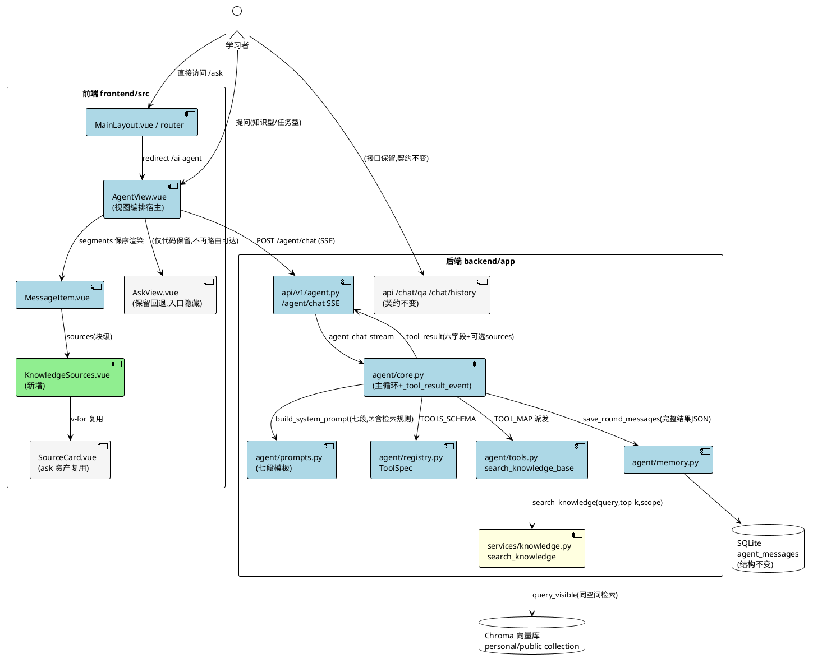
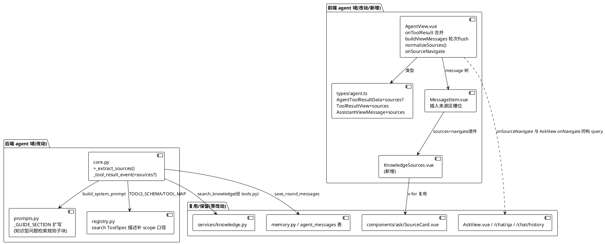
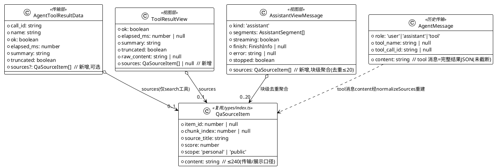

# L2 · Agent 吸收 Ask：自动知识库检索 + 来源展示 + 隐藏独立问答页 — 技术设计文档

- 输入规格：`.codeartsdoer/specs/agent_absorb_ask/spec.md`（294 行，含 5 处定点修订）
- 产物路径：`docs/designs/DESIGN_AGENT_ABSORB_ASK.md`（同步副本 `.codeartsdoer/specs/agent_absorb_ask/design.md`）
- 本轮边界：不合并两套会话存储/SSE（L3 范围）；不删除 `/chat/qa`、`/chat/history`、`AskView.vue`、`components/ask/*`；不新增依赖；不改库结构
- 代码事实核对基线：2026-10-24 工作区（下文所有「文件:行号」均经实际读取确认）

# 一、需求与存量功能关系分析

## 1.1 需求功能与存量功能对比

### 1.1.1 已实现功能

| 需求功能 | 存量功能 | 代码位置 | 匹配度 |
|---------|---------|---------|--------|
| 知识库语义检索（query/top_k/scope 三参，scope=personal/public/all 默认 all） | `search_knowledge_base` 工具直传 `search_knowledge`，scope 三档过滤在 collection 选择层 | `backend/app/agent/tools.py:461-480, 654-661`；`backend/app/services/knowledge.py:592-700` | 100% |
| 检索结果六字段（content/source_title/score/item_id/chunk_index/scope） | `KnowledgeSearchHit` 强类型校验组装，`{mode, results}` 出参；空库返回空 results 非错误；失败抛 BizException | `backend/app/services/knowledge.py:669-700`；`backend/app/schemas/knowledge.py` | 100% |
| 检索失败→error 信封（不抛穿主循环） | `@tool_endpoint` 装饰器一切失败转 `{"error": 中文提示}` 单键信封；core 第二道兜底 `_TOOL_EXECUTION_FAILED` | `backend/app/agent/tools.py:11`（模块 docstring）；`backend/app/agent/core.py:113, 526-533` | 100% |
| 工具结果完整 JSON 落库（历史还原数据源） | `save_round_messages` tool 消息 `content=json_dumps(item["result"])` 完整结果原样 | `backend/app/agent/memory.py:281-335`（核心行 321） | 100% |
| 历史消息全量读出（含 tool_name/tool_call_id/content） | `list_messages` 返回 MessageOut 全链，id 升序 | `backend/app/agent/memory.py:208-237` | 100% |
| 来源卡片视觉组件（标题/片段/归属徽章/相似度/折叠/跳转降级） | `SourceCard.vue`：props `{source: QaSourceItem, index}`，emit `navigate`；`canNavigate = item_id != null` 纯展示降级 | `frontend/src/components/ask/SourceCard.vue:1-145` | 100% |
| 来源跳转知识库 query 格式（item_id + 可选 chunk_index 字符串化） | `AskView.onNavigate`：`router.push({path:'/knowledge-base', query:{item_id:String, chunk_index?:String}})` | `frontend/src/views/AskView.vue:175-185` | 100% |
| 来源条目传输类型（item_id/chunk_index 可空防御） | `QaSourceItem`（item_id/chunk_index 可空、content/source_title/score/scope 必填），`KnowledgeScope='personal'|'public'` | `frontend/src/types/index.ts:419-420, 493-506` | 100% |
| tool_result 六字段 SSE 事件（call_id/name/ok/elapsed_ms/summary/truncated） | `_tool_result_event` 构造器 + `_summarize_result` ≤500 截断 | `backend/app/agent/core.py:139-158, 222-235` | 100%（作为兼容基线） |
| 路由 redirect 先例（保留资产、隐藏入口） | settings 路由：`{path:'settings', redirect:'/dashboard'}` + 注释说明 | `frontend/src/router/index.ts:85-90` | 100%（模式参照） |
| Prompt 单一事实来源与关键词断言机制 | 七段模板 + `test_agent_prompt.py` 锚点短语断言（含「全局仅 prompts.py 含『今天是』」单源断言） | `backend/app/agent/prompts.py:50-94`；`backend/tests/test_agent_prompt.py:104-229` | 100%（机制可挂新规则） |

### 1.1.2 需要扩展的功能

| 需求功能 | 存量功能 | 差异说明 | 扩展方向 |
|---------|---------|---------|---------|
| 知识型问题「先检索后作答」+ scope 判定 + 冲突以检索为准 + 个人库空不扩范围 + 两段式 + 空/失败话术 | `_GUIDE_SECTION` 仅一行「知识型问题：search_knowledge_base；」（`prompts.py:83`），无行为规则 | 输入：同（用户问题）；逻辑：缺 8 条行为规则（spec §5.1.1）；边界：默认 all 口径、personal 空不静默扩大未声明 | ⑦段内扩写「知识型问题检索作答规则」子块（静态常量，保持七段结构不变）；锚点短语供 `test_agent_prompt.py` 断言 |
| tool_result 事件可选携带 `sources` | `_tool_result_event` 六字段固定（`core.py:139-158`） | 输出：新增可选第 7 字段；逻辑：仅 `search_knowledge_base` 且 ok 时从 result 提取；边界：失败=键不出现，空命中=`[]` | 构造器加可选参数 `sources=None`，`None` 时键不出现（保护 `test_agent_chat_stream.py:216-224` 精确键集合断言）；新增 `_extract_sources` 纯函数（截断 240/限量 20） |
| `search_knowledge_base` ToolSpec 的 scope 填法口径 | description 已含三档取值与默认 all（`registry.py:215-232`），未含「措辞→scope」映射与「未指明默认 all 不可改」 | 逻辑：参数填法三要素缺判定映射；兼容：追加句子不改结构 | description 尾部追加一句 scope 判定口径（措辞映射 + 默认 all 红线），不动参数 schema |
| `AgentToolResultData` / `ToolResultView` / `AssistantViewMessage` 三类型 | 六字段传输类型 + 视图类型（`types/agent.ts:37-44, 140-147, 187-194`） | 输出：sources 可选属性；工具卡级与 assistant 块级两处挂载 | `AgentToolResultData` 加 `sources?: QaSourceItem[]`（import type 复用）；`ToolResultView` 加 `sources: QaSourceItem[] \| null`；`AssistantViewMessage` 加块级 `sources: QaSourceItem[]`（去重聚合后） |
| `onToolResult` 回调 | 按 call_id 配对写 `segment.call.result`（`AgentView.vue:181-216`） | 逻辑：新增「写 result.sources + 合并到 assistant 块级」两步；边界：多次检索去重 | 追加：data.sources 存在时写 `result.sources`，并调 `mergeAssistantSources` 按 `(item_id, chunk_index)` 去重合并、≤20 截断 |
| `buildViewMessages` 历史还原 | `cardIndex: Map<string, ToolCallView>` 只映射 call_id→card；单循环 user/assistant/tool 顺序遍历（`AgentView.vue:300-369`） | 逻辑：tool 消息解析出的 sources 需挂到「本轮最终回答」块而非拥有工具调用的块；边界：JSON 损坏降级 | 按用户轮次 flush：循环内维护 `pendingSources` 暂存与 `lastAssistant` 游标；tool 消息 `tool_name==='search_knowledge_base'` 且解析成功无 error 时经 `normalizeSources` 重建并入 pendingSources；遇下一条 user 消息或循环结束时 flush 合并到 `lastAssistant.sources`；解析失败 try/catch 跳过不崩 |
| `MessageItem.vue` assistant 块渲染 | 块末固定区顺序：finishHint→statsText→error→stopped（`MessageItem.vue:111-128`） | 结构：缺「segments 之后、finishHint 之前」的来源区槽位 | 在 segments v-for 结束与 finishHint 之间插入 `<KnowledgeSources>`（`v-if="assistant.sources.length"`），navigate 事件透传上抛 |
| 主导航菜单 | 行 35 含 `{index:'/ask', title:'AI 问答'}`（`MainLayout.vue:35`） | 输出：菜单少一项 | 删除该行（其余 9 项不动） |
| `/ask` 路由 | 行 67-72 注册 component AskView（`router/index.ts:67-72`） | 行为：直接访问需跳 `/ai-agent`；资产：AskView 文件保留 | 改为 `{path:'ask', redirect:'/ai-agent'}` + 注释（对齐 settings 先例行 85-90）；不删 import 之外的 AskView 文件 |
| AgentView 空态提示 | el-empty description「向 AI 助手提问，它会自动调用工具分析你的学习数据」（`AgentView.vue:551-554`） | 输出：缺「可问知识库并标注来源」轻提示（spec §5.2.1 规则 6） | 空态追加一行提示文案常量（不动 el-empty 主文案，快捷问题区上方加小字行） |

### 1.1.3 需要新增的功能或接口

**后端（`backend/app/agent/`）**

1. `_extract_sources(result: dict) -> list[dict] | None`（core.py 模块级纯函数）
   - 输入：search_knowledge_base 工具返回的完整 result dict
   - 输出：`None`（result 含 error 或结构不符）/ `[]`（检索成功空命中）/ 来源 dict 列表（每条六字段，content 截断 240，总量 ≤20）
   - 核心逻辑：校验 `results` 为 list → 逐条提取六字段（缺一罚整条跳过）→ content 超 240 截断 → 取前 20 条
   - 依赖：无新依赖；被 `_tool_result_event` 调用方（工具派发循环 `core.py:524-546`）以 `name == "search_knowledge_base"` 门控调用

**前端（`frontend/src/`）**

2. `components/agent/KnowledgeSources.vue` 新组件
   - 输入：props `{sources: QaSourceItem[]}`；输出：emit `(e:'navigate', source: QaSourceItem)`
   - 核心逻辑：标题行「参考来源」+ v-for 复用 `components/ask/SourceCard.vue`（index 从 1 连续编号）
   - 依赖：import SourceCard（Ask 资产跨域复用，非复制）；被 MessageItem.vue 消费

3. `normalizeSources(raw: unknown) -> QaSourceItem[]`（AgentView.vue 模块级纯函数）
   - 输入：未知结构（历史 tool 消息 content 解析结果或 SSE data.sources）
   - 输出：规范化来源数组（六字段校验、content ≤240 截断、`(item_id, chunk_index)` 去重、≤20 限量）
   - 核心逻辑：防御性逐条校验（scope 仅认 'personal'/'public'，score 强制 Number，title/content 强制 String），任一字段不合格整条丢弃；全坏返回 `[]`
   - 依赖：无；实时/历史两路径共用的单一口径函数（对 SSE 已截断数据再过一遍是幂等）

**文档**

4. README 口径确认与 DEMO_SCRIPT 改写（见 2.4 节）；`docs/designs/DESIGN_AGENT_CHAT.md` 补 optional sources 一句（可选，2 行）

## 1.2 存量功能详细分析

### 1.2.1 `_tool_result_event` 与精确键集合断言的兼容约束（core.py:139-158）

- **接口契约**：入参六值 → 出参 `{"type":"tool_result","data":{六字段}}`；无任何条件分支。
- **关键约束**：`test_agent_chat_stream.py:216-224` 对「我最近学习怎么样」用例（触发 get_learning_statistics/get_tasks/get_knowledge_mastery 三工具）断言 `set(r.keys()) == {call_id,name,ok,elapsed_ms,summary,truncated}` **精确相等**。
- **推论**：`sources` 不得以「恒在、默认 null」方式加入——必须「仅 search_knowledge_base 出现，其余工具键不出现」。该用例不含 search 工具，故「条件出现」方案下既有断言零影响；新增 search 用例须按七字段断言。
- **扩展点**：构造器加可选尾参 `sources=None`，`data` 组装时 `if sources is not None: data["sources"] = sources`。调用方（工具派发循环 core.py:538-540）在 name 门控后传入。

### 1.2.2 工具派发循环与失败语义（core.py:524-546）

- **业务规则**：`result = await TOOL_MAP[name](db, user_id, parsed_args)`；异常 → `_TOOL_EXECUTION_FAILED` 信封；`ok = isinstance(result, dict) and "error" not in result`。
- **推论**：检索失败（search_knowledge 抛 BizException → tool_endpoint 转 error 信封）时 `ok=False`、result 含 error → `_extract_sources` 返回 `None` → SSE 无 sources 键 → 前端无来源区。与 spec §6.3「检索失败不得出现来源集合」结构性对齐。
- **事务边界**：`save_round_messages`（memory.py:281-335）在轮收口把完整 result（含 results 全量、**未截断 240**）落库 tool 消息 content——历史回放的数据源是「完整 JSON」，240/20/去重控制由前端 `normalizeSources` 在历史路径补齐，保证实时/历史口径一致（spec §4.2 规则 2）。

### 1.2.3 `_GUIDE_SECTION` 与 Prompt 断言机制（prompts.py:77-90）

- **接口契约**：`build_system_prompt` 七段拼接，`sections.append(_GUIDE_SECTION)` 恒在（无降级分支）。
- **扩展点**：`_GUIDE_SECTION` 是静态字符串常量，扩写其内部「知识型问题」一行为多行规则子块，不改七段结构、不改 `build_system_prompt` 函数体——对既有 12 个 prompt 测试零破坏（它们断言的锚点均不在该行）。
- **约束**：`test_prompt_single_source_of_prompt`（test_agent_prompt.py:220-229）断言全局仅 prompts.py 含「今天是」——新增规则文案不得含该串；新锚点短语须选「稳定、不被其他段撞车」的句子（候选：「先检索再回答」「通用知识补充」「你的笔记里没有找到」「暂时无法读取笔记或资料」「未指明范围时默认检索全部」）。

### 1.2.4 `buildViewMessages` 两阶段配对与 cardIndex 局限（AgentView.vue:300-369）

- **业务规则**：第一阶段按 id 升序为 assistant(tool_calls) 建卡片骨架注册 `cardIndex`（call_id→ToolCallView）；第二阶段 tool 消息按 tool_call_id 回填 `card.result`（含 `raw_content=msg.content` 完整 JSON）；孤儿 tool 消息 continue 跳过。
- **局限**：cardIndex 只到卡片级，来源挂载目标是 **assistant 块级**（spec §5.2.1 规则 7「挂在最终回答下方，不只藏在工具卡内部」）；且一轮可能产生「assistant(工具调用) 块 + tool 消息 + assistant(最终回答) 块」多块序列——直接挂到拥有工具调用的块会使来源卡出现在最终回答上方。修法：不补块级索引，改为按用户轮次 flush（pendingSources 暂存 + lastAssistant 游标，见 2.1.3-C）。
- **容错**：tool 消息 content JSON.parse 已有 try/catch 先例（行 337-344）；sources 解析复用同款「parseOk 门控 + 失败跳过」模式，历史数据损坏降级为无来源展示（spec §5.2.3 场景 1）。

### 1.2.5 SourceCard 复用的边界（components/ask/SourceCard.vue）

- **接口契约**：props `{source: QaSourceItem, index: number}`；emit `navigate`；`canNavigate = item_id != null` 内部自治降级（按钮禁用、无 pointer）。
- **约束**：该组件属于「Ask 保留资产」，本特性对其 **import 复用、零改动**——Agent 侧新组件 KnowledgeSources.vue 包裹 v-for 并上抛 navigate，跳转执行（router.push）放在 AgentView 层（对齐 AskView.onNavigate 的视图层统一跳转惯例，AskView.vue:175-185）。
- **依赖方向**：`components/agent/*` → `components/ask/SourceCard.vue` 单向 import；ask 目录不被修改，回退能力完整（spec §5.3.1 规则 3）。
# 二、增量设计方案

## 2.1 实现模型

### 2.1.1 上下文视图



通信说明：SSE 单向推送（一次 POST 回答内 tool_result 事件 0..n 条）；sources 仅随 `search_knowledge_base` 的 tool_result 出现；历史还原走 `GET /agent/conversations/{id}/messages` 全量拉取后前端重建。

### 2.1.2 服务/组件总体架构



模块职责与配置策略：

| 模块 | 职责 | 本特性动作 |
|------|------|-----------|
| `prompts.py` `_GUIDE_SECTION` | ⑦段行为规则载体 | 扩写（静态常量，约 +30 行） |
| `core.py` | SSE 事件单一构造点 + 主循环 | 加 `_extract_sources` 纯函数 + `_tool_result_event` 可选尾参 + 派发循环门控接线（约 +45 行） |
| `registry.py` | ToolSpec 单一事实来源 | search description 尾部补一句（约 +4 行） |
| `types/agent.ts` | 传输/视图类型单一来源 | 三类型扩展（约 +15 行） |
| `AgentView.vue` | 视图状态编排宿主 | 合并/还原/去重/跳转/空态提示（约 +70 行） |
| `MessageItem.vue` | 渲染单元 | 槽位插入 + navigate 透传（约 +15 行） |
| `KnowledgeSources.vue` | 来源区容器（新增） | 约 80 行 |
| 常量（core.py 常量表风格） | `SOURCE_CONTENT_MAX_LEN=240` / `SOURCES_MAX_COUNT=20` / `SEARCH_TOOL_NAME="search_knowledge_base"` 模块级锁定 | 新增 3 个常量（对齐 O8 常量引用铁律：模块级定义、函数体引用常量名，测试可 monkeypatch） |

### 2.1.3 实现设计文档

#### A. Prompt 策略（对应任务书 4.1）

**插入位置**：`prompts.py` `_GUIDE_SECTION`（⑦段，行 77-90）——将现有「- 知识型问题：search_knowledge_base；」一行扩写为「知识型问题检索作答规则」子块。七段结构与 `build_system_prompt` 函数体零改动。

**规则子块内容大纲**（8 条，逐条对应 spec §5.1.1）：

1. 先检索再回答：知识型问题（知识点、概念、课程资料、笔记/文档内容）必须先调用 `search_knowledge_base` 再组织回答，禁止仅凭自身记忆直接回答知识型问题。
2. scope 判定映射：用户说「我的笔记 / 我上传的 / 资料里 / 文档里」→ `scope="personal"`；明确说「公共资料 / 公共课程资料」→ `scope="public"`；**未指明范围时默认 `scope="all"`**——即使问题看起来像公共概念也不得改变该默认口径。
3. 个人库为空的诚实红线：用户限定 personal 而检索无命中时，必须如实说「你的笔记里没有找到」，随后可给通用解释；**不得静默扩大为 public/all 重新检索并展示公共来源**。
4. 冲突优先级：检索到的笔记/资料与你的通用知识不一致时，**以检索内容为准**并在回答中说明差异，不得用通用知识覆盖或改写笔记事实。
5. 两段式回答结构：检索有命中时，先讲「检索到的内容」并以来源序号 [1][2] 标注，再以「通用知识补充」明确区分自有知识；禁止把通用知识标注为笔记/资料来源。
6. 任务型问题零检索：任务、计划、学习记录、掌握度、报告、目标管理类问题走对应工具，**不得调用 search_knowledge_base**。
7. 检索为空话术：检索成功但无命中 → 明确说明「你的笔记/资料里没有找到相关记录」，再给通用解释。
8. 检索失败话术：工具返回错误时 → 如实说「暂时无法读取笔记或资料」，再给通用解释；**禁止伪造来源、禁止假装检索成功**。

**测试可断言性保证**（spec §4.4 规则 2「关键词级」）：

- 每条规则含稳定锚点短语（上方加粗部分），`test_agent_prompt.py` 新增用例逐一 `assert ... in prompt`；
- 锚点不与既有段撞车：已核对「通用知识补充」「你的笔记里没有找到」「暂时无法读取笔记或资料」「未指明范围时默认检索全部」「先检索再回答」在现 `prompts.py` 全文零出现；
- 不触碰 `test_prompt_single_source_of_prompt` 的「今天是」单源约束（新文案不含该串）；
- 既有 12 个 prompt 测试断言的锚点（「直接调用工具完成任务，不要反问用户确认」等）全部保留不动。

**registry.py ToolSpec 是否同步**：**是，轻量同步**。`search_knowledge_base` description（registry.py:219-231）尾部追加一句 scope 判定口径：「scope 填法：用户说『我的笔记/我上传的/资料里/文档里』用 personal；明确说『公共资料/公共课程资料』用 public；未指明范围一律用默认 all（即使问题像公共概念）；用户限定 personal 无命中时直接据实回答，不得自行改用 public/all 重试」。理由：ToolSpec description 是 LLM「参数填法」决策点的最近载体（三要素结构：何时调用/参数填法/返回结构），prompt 段定行为规则、ToolSpec 定参数口径，两者互补不重复。**不改参数 schema**（SearchKnowledgeBaseParams 零改动）。

#### B. SSE 与后端数据（对应任务书 4.2）

**`_tool_result_event` 扩展签名**（core.py:139-158）：

```
_tool_result_event(call_id, name, ok, elapsed_ms, summary, truncated, sources=None) -> dict
```

- `sources` 为可选尾参（默认 `None`）；组装 `data` 时 `None` → 键不出现；非 `None`（含 `[]`）→ `data["sources"] = sources`。
- **六字段兼容**：非检索工具恒走 `None` 路径，`data` 键集合与现状逐字节一致——`test_agent_chat_stream.py:216-224` 精确键集合断言零影响（该用例无 search 工具）；既有字段名称、语义、序位不变（spec §4.5 规则 1）。

**`_extract_sources` 提取函数**（core.py 新增模块级纯函数）：

```
_extract_sources(result: dict) -> list[dict] | None
```

判定真值表：

| result 形态 | 返回 | SSE data 表现 | 语义（spec §6.3） |
|------------|------|--------------|------------------|
| 含 `"error"` 键 | `None` | sources 键**不出现** | 检索失败 → 不得出现来源集合 |
| 无 error，`results` 非 list / 缺失 | `None` | 不出现 | 结构异常防御（视为失败） |
| 无 error，`results == []` | `[]` | `"sources": []` | 检索成功空命中 → 空集合 |
| 无 error，results 非空 | 提取后列表 | `"sources": [...]` | 正常命中 |

提取规则（逐条）：仅取 `content/source_title/score/item_id/chunk_index/scope` 六字段白名单；`content` 超 `SOURCE_CONTENT_MAX_LEN`(240) 截断；整条字段缺失（content/source_title 非 str、scope 不在 {personal, public}）→ 丢弃该条；总量超 `SOURCES_MAX_COUNT`(20) 截前 20。`mode` 字段不进 sources（瞬时可降信号，对齐 knowledge.py「mode 不落库」论据，前端如需离线警示后续单独立项）。

**派发循环接线**（core.py:524-546 第二遍循环内）：`yield _tool_result_event(...)` 处改为先算 `sources = _extract_sources(result) if name == SEARCH_TOOL_NAME else None`，再传入构造器。仅此一处接线，主循环其余控制流（CP-2、轮收口、O5）零改动。

**历史还原数据源（不改库结构，确认）**：`memory.py:321` tool 消息 content 已是 `json_dumps(item["result"])` 完整结果 JSON（含 results 全量六字段，未截断 240）；`list_messages` 原样返回。前端 `buildViewMessages` 从 content 解析重建 sources（详见 C 节）。**库表零改动、迁移零新增**。

**空 vs 不出现的口径锁定**（spec §6.3 规则 2/3）：检索成功空命中 = `sources: []`（键在、值为空数组，前端渲染无来源区但语义可区分「查过没查到」）；检索失败 / 非检索工具 = 键不出现。该口径同时被 SSE 实时路径与 prompt 话术规则（7/8 条）约束。

**后端测试新增/修改清单**（实现阶段落 `backend/tests/`，本轮不写码）：

| 测试文件 | 用例 | 断言要点 |
|---------|------|---------|
| `test_agent_chat_stream.py`（新增用例） | search 命中 SSE | monkeypatch `TOOL_MAP["search_knowledge_base"]` 返回 `{mode:"online", results:[2条]}` → 断言该工具 tool_result 含 `sources` 键、长度 2、六字段齐、content ≤240；同事件内六旧字段仍在 |
| 同上 | search 空命中 | results=[] → `sources == []` 且键存在 |
| 同上 | search 失败 | 返回 `{"error":"..."}` → 无 `sources` 键，`ok is False` |
| 同上 | 截断与限量 | 构造 25 条、单条 content 300 字 → sources 恰 20 条、每条 content ≤240 |
| 同上 | 非 search 工具无 sources | 既有用例的精确键集合断言已结构性覆盖，无需新写 |
| `test_agent_prompt.py`（新增用例） | 检索规则锚点 | 断言 2.1.3-A 节 8 条规则的锚点短语逐一 `in prompt`；既有 12 用例不动 |
| 同上 | ToolSpec 描述口径 | 断言 registry description 含「未指明范围一律用默认 all」（直读 `TOOLS_SCHEMA` 中 search 条目 description，不经 LLM） |

#### C. 前端数据流与展示（对应任务书 4.3）

**类型扩展（types/agent.ts）**：

```
import type { QaSourceItem } from '@/types'   // type-only，零运行时产物

AgentToolResultData  += sources?: QaSourceItem[]        // 可选,与后端"键不出现"对齐
ToolResultView       += sources: QaSourceItem[] | null  // 该次检索来源;null=非检索/失败/历史缺
AssistantViewMessage += sources: QaSourceItem[]         // 块级聚合(去重后≤20),默认 []
```

复用策略决策：**`import type` 复用 `QaSourceItem`，不在 agent.ts 重定义**。理由：① 字段契约同源（后端 KnowledgeSearchHit 六字段是单一事实），双定义必漂移；② 不违反裁决 #2——该裁决约束「agent 类型独立文件、不被其他模块反向依赖」，type-only import 方向是 agent.ts → index.ts 单向，index.ts 不反向依赖 agent.ts，且编译后零运行时代码；③ `KnowledgeScope`（'personal'|'public'）随 QaSourceItem 一并复用。

**`AgentView.vue` 实时路径（onToolResult，行 181-216 内追加）**：

1. `data.sources` 存在（非 undefined）时：先经 `normalizeSources(data.sources)` 防御规范化（SSE 路径幂等），写入配对卡片的 `segment.call.result.sources`；未配对（hit=false 降级分支）同样写入新卡 result。
2. 随后执行块级合并 `mergeAssistantSources(assistant, normalized)`：
   - 去重键 = `item_id ?? 'x'` 与 `chunk_index ?? 'x'` 的冒号拼接（'x' 占位区分 null 与数值 0 的脏防御）；
   - 以 `Map<string, QaSourceItem>` 保序去重（首次出现位次保留——对齐 SourceCard「同文档多片段不去重、编号连续」的卡片惯例，此处去重仅针对**多次检索的重复命中**）；
   - 合并后总长超 `SOURCES_MAX_COUNT`（20，前端同名常量）截断；
   - 写回 `assistant.sources = [...map.values()]`。

**`AssistantViewMessage.sources` 创建点初始化**：两处创建点——`placeholderAssistant`（行 101-110）与 `buildViewMessages` 新建 assistant 块（行 310-317）——均追加 `sources: []` 初始化，杜绝 undefined；实时 onSend 的 reactive 包裹路径经 placeholderAssistant 自动获得初始化。

**`AgentView.vue` 历史路径（buildViewMessages，行 300-369 改造）——按用户轮次 flush 到本轮最终回答块**：

1. 循环开始前声明两个游标：`let pendingSources: QaSourceItem[] = []`（本轮暂存）、`let lastAssistant: AssistantViewMessage | null = null`（本轮最后一个 assistant 块）。
2. **assistant 分支**（行 309-332）：新建 block 初始化 `sources: []` 后，更新 `lastAssistant = block`——同轮多块（工具调用块/最终回答块）时后者覆盖前者，游标始终指向「当前轮最后一个 assistant 块」。
3. **tool 分支**（行 334-366）追加：`msg.tool_name === 'search_knowledge_base'` 且 parseOk 且 parsed 无 `error` 键时 → 对 parsed.results 调 `normalizeSources` → 写入 `card.result.sources`（卡片级，工具卡内可溯），同时并入 `pendingSources`（块级暂存，**不立即挂块**）。
4. **user 分支**（行 305-308）前置 flush：`pendingSources.length && lastAssistant` 时执行 `mergeAssistantSources(lastAssistant, pendingSources)` 并清空 `pendingSources`——新一轮开始即封存上一轮成果；push user 消息逻辑不变。
5. **循环结束后终态 flush**：同一 flush 逻辑再执行一次，覆盖「最后一轮无后继 user 消息」的收尾场景。
6. **损坏降级**：parse 失败 / 无 results / results 非数组 → `normalizeSources` 返回 `[]`，`card.result.sources = null`（历史缺源语义），`pendingSources` 不并入——页面正常渲染无来源区（spec §5.2.3 场景 1），单条 try/catch 不抛出。
7. **异常中断降级**：一轮里 tool 之后无最终回答块（流中断/落库残缺）时，flush 把来源挂到 `lastAssistant`（即拥有工具调用的块）——位置仍在该轮回答区，属可接受降级而非错块。
8. 既有 `cardIndex` 保留不动（卡片配对逻辑零变化）；不新增 blockIndex，游标方案为纯局部变量增量。

**`normalizeSources` 单一口径函数**（AgentView.vue 模块级）：六字段白名单校验（scope 仅认 'personal'/'public'、score 强制 `Number()`、NaN 置 0、title/content 强制 `String()`）、content 截 240、`(item_id, chunk_index)` 去重、≤20 限量；任一硬字段不合格整条丢弃。实时/历史两路径共用——**「实时 SSE 已截断、历史完整 JSON 未截断」的口径差由该函数抹平**，保证 spec §4.2 规则 2「实时与历史一致」。

**`MessageItem.vue` 渲染位置**（行 109-112 之间）：segments v-for 模板结束标签之后、`finish-hint` div 之前插入 KnowledgeSources 组件（`v-if="assistant.sources.length"`，navigate 事件经新增 emit `source-navigate` 透传上抛）。块末固定区其余（finishHint→statsText→error→stopped）顺序不变——来源区**严格位于 segments 之后、finishHint 之前**（spec §5.2.1 规则 7）。MessageItem 自身不持 router。

**新组件 `KnowledgeSources.vue`（components/agent/）契约**：

- Props：`{ sources: QaSourceItem[]; citedIndices?: number[] }`（父级已保证非空才渲染）。
- Emits：`(e: 'navigate', source: QaSourceItem)`。
- **引用过滤（实施补丁）**：只渲染 `citedIndices` 中的来源（1-based，原始序号保留）；`MessageItem` 从 assistant 的 text segments 用 `/\[(\d+)\]/g` 提取引用序号。回答未引用任何来源时，来源区不渲染——避免“回答说没找到、却展示低分噪声来源卡”的误导；未被引用的检索命中仍保留在工具调用卡中可审计。
- 结构：容器 div（「参考来源」小标题行，12px 灰字）+ v-for 渲染 SourceCard（index 从 1 连续编号，与回答中 [n] 引用序号对齐）。
- 复用方式：**import `@/components/ask/SourceCard.vue` 直接复用，零复制零改动 ask 资产**；容器仅加 6px 纵向堆叠间距与 4px 上外边距（对齐 MessageItem 块内 8px gap 节奏）。
- 降级：单条 item_id 为空由 SourceCard 内部 `canNavigate` 自治降级（纯展示、无跳转按钮）；sources 为空数组时父级 v-if 不渲染本组件。

**点击跳转（AgentView.onSourceNavigate）**：与 `AskView.onNavigate`（AskView.vue:176-185）**同构**：`router.push` 至 `/knowledge-base`，query 为 `item_id` 字符串化 + `chunk_index` 可空省略；守卫 `item_id == null` 直接 return（SourceCard 已前置拦截，此处双保险）。

**空态轻提示**（spec §5.2.1 规则 6）：`AgentView.vue` 空态区（行 550-566）el-empty 与快捷问题之间追加一行小字常量：「可以直接问知识库——我会自动检索你的笔记和公共资料，并在回答下方标注来源」。样式沿用 12px placeholder 灰字，不动 QUICK_QUESTIONS 四项。

**降级矩阵总览**：

| 场景 | 表现 |
|------|------|
| 实时 SSE 无 sources 键（非检索/失败） | 无来源区；工具卡正常 |
| 实时 sources=[] | 无来源区（v-if 拦截） |
| 历史 content JSON 损坏 | card.result.sources=null、块级无合并；其余消息正常 |
| 单条来源缺 item_id | 该卡纯展示（SourceCard 自治） |
| 全部来源字段损坏 | normalizeSources 返回 [] → 无来源区，不崩 |

#### D. 单一入口收敛（对应任务书 4.4）

**`MainLayout.vue`**：删除行 35 `{ index: '/ask', title: 'AI 问答', icon: 'ChatLineRound' }` 一项，其余 9 项与图标映射零改动。菜单渲染逻辑（v-for menus）无需任何分支。

**`router/index.ts`**：行 67-72 的 ask 路由改为 redirect 形态（对齐行 85-90 settings 先例）：`{ path: 'ask', redirect: '/ai-agent' }`，并保留紧邻注释「AI 问答入口已收敛至 AI 助手；AskView.vue 与 /chat/qa 链路完整保留作回退，仅不再路由可达」。

- 去掉 `component`/`name`/`meta`（redirect 路由不需要）；注释风格对齐 settings 先例。
- `AskView.vue`、`components/ask/*`、`/chat/qa`、`/chat/history` **全部保留**：SourceCard 被 agent 域复用后仍是活代码；AskView 本体变为「不可路由但可回退」资产（回退方式 = 恢复该路由 component 注册，一处改动）。
- 路由守卫（行 105-117）零改动：redirect 在守卫之后生效，`/ask` 访问先过 needsAuth 校验再跳转，未登录访问 `/ask` 仍先跳 `/login`（行为与现状一致）。

**全仓库文案替换点**（实现阶段逐项核对，需求文档 `.codeartsdoer/**` 不动）：

| 文件 | 位置 | 改前 | 改后 |
|------|------|------|------|
| `docs/DEMO_SCRIPT.md` | 行 41（第二幕口播词） | 「…是后面 AI 问答和分析的依据…」 | 「…是后面 AI 助手知识库问答和分析的依据…」 |
| `docs/DEMO_SCRIPT.md` | 行 72（常见问题 2） | 「走『AI 问答』页 `/ask`」 | 「在『AI 助手』页（`/ai-agent`）直接提问」 |
| `README.md` | 行 217 附近（数据集说明） | 「…RAG 问答演示」 | 口径保留可不改；若改动则为「…AI 助手知识库问答演示」 |
| `README.md` | 行 3（项目简介） | 经核对**无「AI 问答」菜单/页面表述**（README 无功能清单章节，仅简介与环境/启动章节） | 无需替换；如需补充，在简介句末追加「知识库问答能力已并入 AI 助手（`/ai-agent`）」一句（可选） |

DEMO_SCRIPT 第 3 幕（Agent 分析，行 43-49）建议补一句演示口径（非新增步骤）：口播词末尾补「它也能直接回答知识型问题——比如问『我的笔记里特征值分解在 PCA 里起什么作用』，它会先检索我的笔记再回答，并在回答下方给出可点击的来源卡片」，操作路径不变（第 3 幕结构不动，仅口播可选补充）。
## 2.2 接口设计

### 2.2.1 总体设计

本特性**不新增任何 HTTP 接口**；接口变更集中于一处 SSE 事件载荷的可选扩展与前端组件契约的新增。分类如下：

| 接口 | 类型 | 变更 | 稳定性 |
|------|------|------|--------|
| `POST /api/v1/agent/chat` → `tool_result` 事件 | SSE 事件载荷 | 可选新增 `sources` 字段（仅 search_knowledge_base） | 稳定（六字段兼容承诺不变） |
| `GET /api/v1/agent/conversations/{id}/messages` | REST | **零变更**（tool 消息 content 已含完整结果 JSON） | 稳定 |
| `/chat/qa`、`/chat/history` | REST/SSE | **零变更**（spec §1.4 边界） | 稳定 |
| 前端路由 `/ask` | 路由记录 | component → redirect `/ai-agent` | 稳定（对外行为：旧地址可访问、自动引导） |
| `KnowledgeSources.vue` props/emits | 组件契约 | 新增 | 实验（本特性引入） |
| `MessageItem.vue` emits | 组件契约 | 新增 `source-navigate` 透传事件 | 稳定 |

**变更策略**：SSE 载荷只加不改（可选字段、键可缺席）；路由只改记录不动资产；组件契约只增不删。所有既有字段名称/语义/序位冻结（spec §4.5）。

### 2.2.2 接口清单

#### (1) tool_result 事件（扩展）

```python
# 后端构造器签名（core.py）
def _tool_result_event(
    call_id: str, name: str, ok: bool,
    elapsed_ms: int, summary: str, truncated: bool,
    sources: list[dict[str, Any]] | None = None,   # 新增可选尾参
) -> dict[str, Any]
```

- **业务说明**：工具执行完成的摘要事件；`sources` 仅在 `name == "search_knowledge_base"` 且检索成功（result 无 error）时出现——空命中为 `[]`，失败/其余工具键不出现。
- **前置条件**：调用方已按 `SEARCH_TOOL_NAME` 门控并经 `_extract_sources` 判定。
- **后置条件**：前端实时路径据此合并来源到 assistant 块级；无 sources 键时前端零行为变化。
- **异常映射**：检索失败由 error 信封路径表达（`ok=false` + summary 为中文错误文案），sources 不承担错误表达。
- **载荷示例**：`{"type":"tool_result","data":{"call_id":"call_1","name":"search_knowledge_base","ok":true,"elapsed_ms":123,"summary":"...","truncated":true,"sources":[{"content":"...(≤240)","source_title":"线性代数要点笔记 » 第3章","score":0.83,"item_id":5,"chunk_index":2,"scope":"personal"}]}}`

#### (2) 来源提取函数（新增，后端内部）

```python
def _extract_sources(result: dict[str, Any]) -> list[dict[str, Any]] | None
```

- **业务说明**：从 search_knowledge_base 完整结果提取 SSE 来源载荷（真值表见 2.1.3-B）。
- **前置条件**：result 为工具返回 dict（成功业务结构或 error 信封）。
- **后置条件**：返回 `None`（失败/结构异常）或长度 ≤20、单条 content ≤240 的六字段 dict 列表（可为空列表）。
- **异常映射**：内部不抛异常——任何字段不合格整条丢弃，全坏返回 `None`（结构层坏）或 `[]`（results 为空列表）。**宁缺勿假**红线：任何情况下不构造占位条目。

#### (3) KnowledgeSources 组件（新增，前端）

```ts
// components/agent/KnowledgeSources.vue
defineProps<{ sources: QaSourceItem[] }>()
defineEmits<{ (e: 'navigate', source: QaSourceItem): void }>()
```

- **业务说明**：assistant 块末「参考来源」区容器，v-for 复用 SourceCard。
- **前置条件**：父级以 `v-if="assistant.sources.length"` 保证非空才挂载。
- **后置条件**：用户点击可跳转卡片时 emit navigate（item_id 为空的卡片由 SourceCard 内部拦截不 emit）。
- **异常映射**：无自身异常态；数据降级由父级 normalizeSources 与 SourceCard canNavigate 双层承担。

#### (4) MessageItem 透传事件（扩展，前端）

```ts
// MessageItem.vue emits 追加
(e: 'source-navigate', source: QaSourceItem): void
```

- **业务说明**：把 KnowledgeSources 的 navigate 透传给 AgentView（渲染单元不持 router，对齐现有 `card-toggle` 透传模式）。
- **调用链**：SourceCard → KnowledgeSources → MessageItem → AgentView.onSourceNavigate → router.push（与 AskView.onNavigate 同构 query）。

#### (5) normalizeSources / mergeAssistantSources（新增，前端内部纯函数）

```ts
function normalizeSources(raw: unknown): QaSourceItem[]
function mergeAssistantSources(block: AssistantViewMessage, incoming: QaSourceItem[]): void
```

- **normalizeSources**：防御规范化唯一入口（实时/历史共用）；输入任意未知结构，输出合法来源数组（可能为空）；逐条六字段校验 + content ≤240 + `(item_id, chunk_index)` 去重 + ≤20。
- **mergeAssistantSources**：块级聚合唯一入口；Map 保序去重（键 = item_id/chunk_index 可空占位拼接），超 20 截断，写回 `block.sources`。
- **后置条件**：任何输入下 block.sources 恒为合法数组（默认 `[]`），渲染层无需再判空合法性（只判空数组）。

## 2.3 数据模型

### 2.3.1 设计目标

1. 支撑来源卡片在**实时 SSE** 与**历史回放**两条路径的一致还原（spec §4.2 规则 2）；
2. 单条片段 ≤240 字符、单回答 ≤20 条的体积上限（spec §4.1 规则 1/2），SSE 单事件增量 ≤ 约 6KB（20×240 字符 + 结构开销）；
3. **零库表变更**：agent_messages 既有 content 列（完整结果 JSON）即历史数据源；
4. 多次检索的重复命中按 `(item_id, chunk_index)` 去重（spec §6.3 规则 6）。

### 2.3.2 模型实现



**生命周期与口径**：

- **创建**：实时路径由 `_extract_sources`（后端）产出 → 前端 normalizeSources 幂等复核；历史路径由 normalizeSources 从 tool 消息 content 直接重建。
- **聚合**：同一 assistant 块内多次 search 调用的来源经 mergeAssistantSources 按 `(item_id, chunk_index)` 去重合并，保序（首现位次）、≤20。
- **销毁**：随 ViewMessage 树销毁，无独立持久化（历史永远从 tool 消息 content 重算，无双写不一致风险）。
- **持久化策略**：**不新增任何持久化**——agent_messages.content（完整 JSON）即唯一事实来源；SSE sources 是传输层投影，展示层 sources 是视图层投影，两投影共用 normalizeSources 保证口径收敛。
## 2.4 测试策略

**后端**（`backend/tests/`，pytest，实现阶段编写）：

1. `test_agent_chat_stream.py` 新增 4 个用例（search 命中 / 空命中 / 失败 / 截断限量，详见 2.1.3-B 表格）；既有 12+ 用例零改动——**六字段精确键集合断言（行 216-224）在「条件出现」方案下天然不受新增字段影响**（该用例无 search 工具）。
2. `test_agent_prompt.py` 新增 1 个用例：8 条检索规则锚点短语逐一 `in prompt`；新增 1 个用例：TOOLS_SCHEMA 中 search 条目 description 含 scope 默认口径锚点。既有 12 用例零改动。
3. `test_plan_report_tools.py` 零改动（`_CONTRACT_TOOL_NAMES` 12 工具名单不变）。
4. 前端无单元测试设施（项目现状），前端正确性由「类型检查（tsc）+ 人工演示验收」承担——normalizeSources/mergeAssistantSources 设计为纯函数，如需可在后续阶段补 vitest（**本特性不新增依赖**，故本轮不引入）。
5. **多轮历史回放人工用例**（手工验收场景 5）：构造一轮「assistant(工具调用) → tool(search_knowledge_base) → assistant(最终回答)」消息序列落库后刷新重进会话 → 断言来源卡出现在**最终回答块下方**（segments 之后、finishHint 之前），而非工具调用块上方/工具卡内部；同轮多次 search 时来源去重合并仍挂在最终回答下方。

**验证命令（最终门禁，全量）**：

```bash
cd backend && ./.venv/Scripts/python.exe -m pytest -q    # 期望 0 failed（基线 206 + 新增用例）
cd frontend && npm run build                              # 期望 exit 0（含 vue-tsc 类型检查链路）
```

单文件调试期可用 `pytest backend/tests/test_agent_chat_stream.py backend/tests/test_agent_prompt.py -q` 与 `npx vue-tsc --noEmit` 快速迭代，但**收尾门禁必须是全量两条**。

## 2.5 验收映射表

| spec 验收 | 设计落点 |
|-----------|---------|
| §5.1.1-1 先检索后作答（笔记里 Transformer） | 2.1.3-A 规则 1（prompt 锚点「先检索再回答」）+ ToolSpec 何时调用口径 |
| §5.1.1-2a 措辞→personal | 2.1.3-A 规则 2 映射表 + ToolSpec description 补句 |
| §5.1.1-2b 未指明默认 all（Transformer 概念题） | 2.1.3-A 规则 2「未指明范围时默认 all」锚点；schema 默认值 all 既有（tools.py:477-480） |
| §5.1.1-2c 个人库空不静默扩大 | 2.1.3-A 规则 3「你的笔记里没有找到」+「不得静默扩大」锚点 |
| §5.1.1-3 两段式回答 | 2.1.3-A 规则 5「通用知识补充」锚点 |
| §5.1.1-4 冲突以检索为准 | 2.1.3-A 规则 4「以检索内容为准」锚点 |
| §5.1.1-5 检索为空诚实作答（量子纠缠） | 2.1.3-A 规则 7 + sources=[] 无卡片（2.1.3-B 真值表 + 2.1.3-C v-if） |
| §5.1.1-6 任务型零检索 | 2.1.3-A 规则 6；结构性旁证：既有「帮我安排下周学习」用例事件序列无 search（test_agent_chat_stream.py 既有覆盖模式） |
| §5.1.1-7 自然语言作答 | 2.1.3-A 规则 5 后半（来源由卡片承载） |
| §5.1.1-8 检索失败禁伪造 | 2.1.3-A 规则 8 + error 信封 → 无 sources 键（2.1.3-B） |
| §5.2.1-1 卡片完整性（标题/片段/归属） | SourceCard 复用（1.2.5）；scope→徽章既有 |
| §5.2.1-2 点击跳转定位 | 2.1.3-C onSourceNavigate 与 AskView 同构 query |
| §5.2.1-3 历史回放一致 | 2.1.3-C buildViewMessages 轮次 flush（pendingSources+lastAssistant）+normalizeSources 口径收敛；1.2.2 完整 JSON 落库既有 |
| §5.2.1-4 空结果不展示 | v-if + sources=[] 口径 |
| §5.2.1-5 数量长度受控 | 后端 _extract_sources（240/20）+ 前端 normalizeSources 双闸门 |
| §5.2.1-6 空态入口提示 | 2.1.3-C 空态小字常量 |
| §5.2.1-7 来源挂最终回答下方 | 2.1.3-C MessageItem 槽位（segments 后、finishHint 前）+ 历史路径按用户轮次 flush 到本轮最后一个 assistant 块（非工具调用块、非工具卡内） |
| §5.2.3-1 历史损坏降级 | normalizeSources 防御 + card.result.sources=null 路径 |
| §5.2.3-2 缺 item_id 降级纯展示 | SourceCard canNavigate 既有自治 |
| §5.3.1-1 导航唯一入口 | 2.1.3-D MainLayout 删行 35 |
| §5.3.1-2 /ask 自动引导 | 2.1.3-D redirect '/ai-agent' |
| §5.3.1-3 回退能力保留 | 零删除承诺：AskView/ask 组件//chat/qa//chat/history 全部保留（SourceCard 转活代码） |
| §5.3.1-4 文档口径同步 | 2.1.3-D 替换点表 + 2.6 文档章节 |
| §6.1 来源条目六字段 | 2.3.2 类图；QaSourceItem 复用 |
| §6.2 scope 取值与默认 | tools.py:477-480 既有 + prompt/ToolSpec 双锚点 |
| §6.3 来源集合可选/空/失败/上限/一致/去重 | 2.1.3-B 真值表 + 2.1.3-C mergeAssistantSources 去重 + 2.3.2 生命周期 |
| §4.5-1 tool_result 仅可选新增 | 2.2.2-(1) 可选尾参 + 键不出现策略 + 既有键集合断言兼容分析 |
| §4.1-3 任务型零开销 | prompt 规则 6；零代码路径变化（不调用即零开销） |

## 2.6 风险与未决点

| 风险 | 等级 | 缓解 |
|------|------|------|
| LLM 不主动调 search（prompt 是软约束，无法单测 LLM 行为） | 高 | 逐字指令锚点（规则 1「必须先调用…再组织回答」）+ ToolSpec「何时调用」既有口径；测试层只能断言 prompt 内容，行为验收靠演示口径（DEMO_SCRIPT 备用问题四个均与公共文档强相关，命中率高） |
| scope 误判（「资料里」被理解为公共） | 中 | 措辞映射表在 prompt 与 ToolSpec 双处锚定；误判方向收敛于默认 all（信息不丢失，个人库仍被覆盖） |
| SSE 体积膨胀 | 低 | 20×240 字符硬上限 ≈6KB；远小于既有 summary 500 字符 ×n 工具量级；CONTENT_LOG_WARN_CHARS(30000) 观测不受影响 |
| 历史解析失败/脏数据 | 低 | normalizeSources 全防御（任一字段坏丢整条，全坏空数组）；parse 失败沿用既有 parseOk 模式 |
| 来源卡布局挤压（气泡 max-width 86% 内多卡堆叠） | 中 | SourceCard 既有自绘样式在 P9 已验证；容器 gap 6px；演示前人工走查 20 条上限场景 |
| 工具失败降级话术不准（模型自由发挥） | 中 | 规则 8 给出逐字话术「暂时无法读取笔记或资料」；ok=false 时 summary 即中文错误文案，模型有可靠复述素材 |
| 多次检索来源序号与回答 [n] 对不齐 | 中 | 卡片 index 按去重后首现位次连续编号；prompt 规则 5 要求标注来源序号——模型看到的是完整 results（回灌 JSON），序号语义以卡片展示序为准，轻微错位可接受（卡片本身含标题可辨识） |
| 历史多 assistant 块导致来源挂错块（挂到工具调用块 → 来源卡出现在最终回答上方，违反 spec §5.2.1-7） | 中 | 轮次 flush 方案：pendingSources 暂存 + lastAssistant 游标在 assistant 分支持续覆盖、user 分支前置 flush + 循环末尾终态 flush；§2.4 用例 5「多轮历史回放」人工验收锁定；异常中断时降级挂到工具调用块（仍在该轮回答区，非错块） |

**未决点（不阻塞实现）**：

1. `mode`（online/offline）是否随 sources 透出供离线警示——本设计不透出（对齐 knowledge.py「mode 不落库」论据）；如后续需要，在 tool_result 增同级可选字段 `mode` 即可，不动 sources 结构。
2. 来源区是否加「全部来自公共库/个人库」汇总小字——暂不做，卡片徽章已逐条表达。
3. README 行 217「RAG 问答演示」是否改写——倾向保留（描述的是数据集用途而非入口），交由实现阶段确认。

**明确不做**（spec §1.4 复述锁定）：不做 L3；不合并两套会话存储与 SSE 协议；不删除 AskView.vue / components/ask/* / /chat/qa / /chat/history；不新增任何前后端依赖；不改数据库结构；不改 `/chat/qa`、`/chat/history` 契约。

## 2.7 文件清单与预估行数

| 文件 | 动作 | 预估变更 |
|------|------|---------|
| `backend/app/agent/prompts.py` | `_GUIDE_SECTION` 扩写检索规则子块 | +30 行 |
| `backend/app/agent/core.py` | 3 常量 + `_extract_sources` + `_tool_result_event` 可选尾参 + 派发处接线 | +50 行 |
| `backend/app/agent/registry.py` | search ToolSpec description 补 scope 口径 | +4 行 |
| `backend/tests/test_agent_chat_stream.py` | 4 个新用例 | +130 行 |
| `backend/tests/test_agent_prompt.py` | 2 个新用例 | +35 行 |
| `frontend/src/types/agent.ts` | 三类型扩展 + import type | +14 行 |
| `frontend/src/views/AgentView.vue` | normalizeSources + mergeAssistantSources + onToolResult 追加 + buildViewMessages 轮次 flush（pendingSources/lastAssistant）+ sources 创建点初始化 + onSourceNavigate + 空态提示 | +85 行 |
| `frontend/src/components/agent/KnowledgeSources.vue` | 新组件 | +85 行 |
| `frontend/src/components/agent/MessageItem.vue` | 槽位插入 + emit 透传 | +12 行 |
| `frontend/src/layouts/MainLayout.vue` | 删菜单项 | −1 行 |
| `frontend/src/router/index.ts` | ask → redirect + 注释 | −4/+3 行 |
| `docs/DEMO_SCRIPT.md` | 行 41/72 改写 + 第 3 幕口播补句 | ±8 行 |
| `README.md` | 简介补句（可选）/ 行 217 口径确认 | ±2 行 |
| `docs/designs/DESIGN_AGENT_CHAT.md` | tool_result 契约补 optional sources 一句（可选） | +2 行 |
| `docs/designs/DESIGN_AGENT_ABSORB_ASK.md` | 本文档 | 新增 |

合计：后端约 +219 行、前端约 +187 行、文档约 ±12 行；删除净 −1 行（菜单项）。零依赖新增、零库表变更、零删除既有资产。

---

**回链**：spec `.codeartsdoer/specs/agent_absorb_ask/spec.md` §5.1/§5.2/§5.3/§6；上游设计 `docs/designs/DESIGN_AGENT_CHAT.md`（SSE 六事件契约）、`docs/designs/DESIGN_AGENT_FRONTEND.md`（视图层类型体系）、`docs/designs/DESIGN_RAG_QA.md`（Ask 链路与 SourceCard 契约）。
