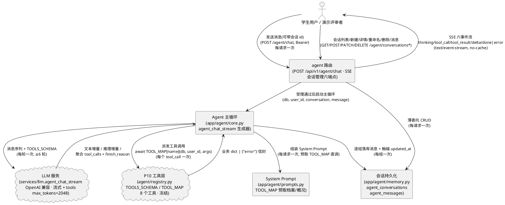
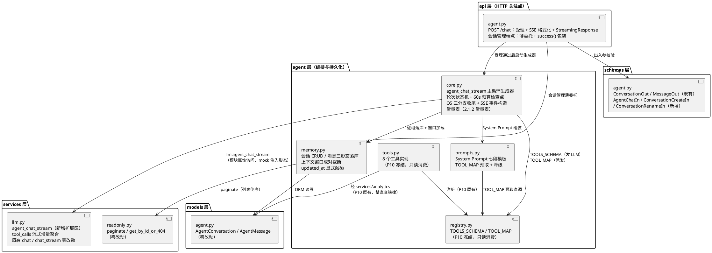
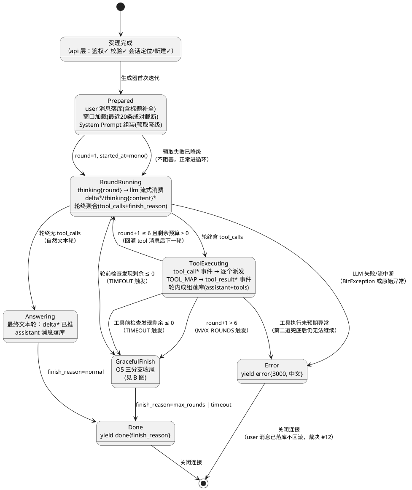
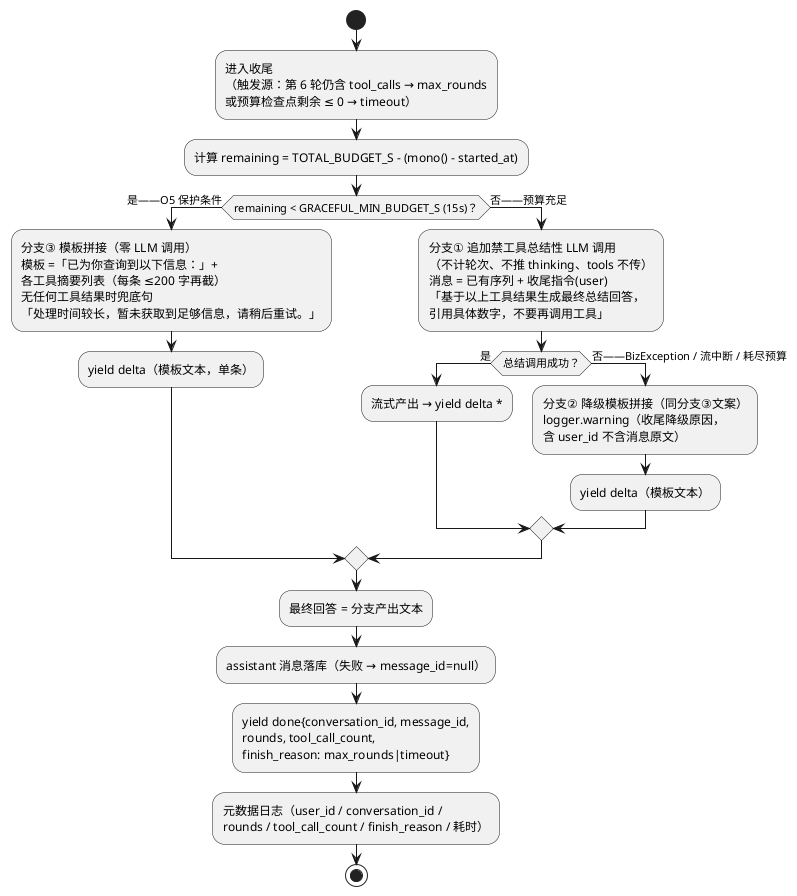
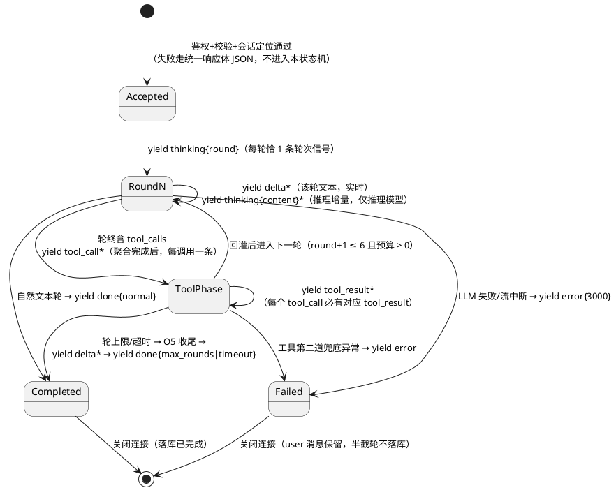
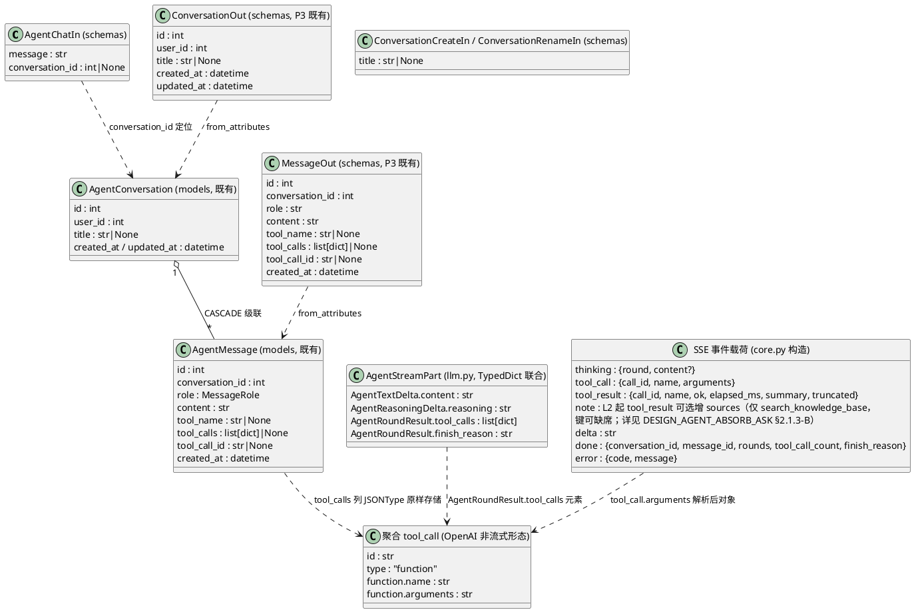

# Agent 对话主循环实现方案（DESIGN_AGENT_CHAT）

> feature: `agent_chat` ｜ 阶段：实现方案设计（spec-design-agent 产出）
> 上游输入：`docs/specs/SPEC_AGENT_CHAT.md`（**R2 裁定定稿**，12 项裁决 + 8 项开放决策点 O1–O8 全部裁定 + D1–D12 验收标准 + SSE 六事件契约 + §6 数据约束 + P10 实测背景四条）、`docs/PROJECT_CONTEXT.md`（全项目唯一技术契约，16 张表口径与分层铁律）
> 生成日期：2026-10-21 ｜ 状态：R2 裁定全部落实（第 9 章 O1–O8 + 2 条补充约束），可进入 tasks.md 阶段
> 落盘路径说明：沿用 P9 起确立的对偶惯例——规格在 `docs/specs/SPEC_AGENT_CHAT.md`、设计在 `docs/designs/DESIGN_AGENT_CHAT.md`（`SPEC_` ↔ `DESIGN_`）
> 已裁决事项继承（spec 第 7 章 + 第 9 章，不再重开）：#1 `app/agent/` 模块名按任务书（core.py / prompts.py / memory.py，交付时同步修 PROJECT_CONTEXT §3 目录树的 executor.py 滞后项）；#2 六端点（O1：纳入 POST 新建 + PATCH 重命名）；#3 列表 `updated_at` 倒序（O2）；#4 llm.py 以新增方法扩展（既有 `chat` / `chat_stream` 零改动）；#5 memory.py 直接操作会话 ORM（铁律边界收窄为「LLM 工具决策通道访问学习业务数据必须经 tools.py」）；#6 system 不落库；#7 tool 消息落库完整结果 JSON（SSE 才推 ≤500 摘要）；#8 60s 为**总预算**（非单轮）；#9 max_tokens=2048 锁定常量；#10/#11 预取经 TOOL_MAP 直调且不推 SSE；#12 error 终结时 user 消息不回滚；O5 含剩余预算 < 15s 模板兜底保护条件；补充约束 1（finish_reason 三值真实性）与补充约束 2（tool_call 携带解析后参数对象、tool_result 携带耗时与 ≤500 字摘要）已全量落实；**R3 补充约束 3（可观测性，不改行为）**：每轮调用 LLM 前统计本轮进入 messages 的总字符数并写 debug 日志，超过 30000 字符升 warning（conversation_id / round / chars 三字段）——**只观测不截断**，Agent 回灌完整性优先（落实于 2.1.2 常量表 `CONTEXT_LOG_WARN_CHARS`、2.1.3-F 观测点、2.4.1-B-2、2.5.2-C 用例组、决策 A11、2.8.3 对照表补充 3）
> 本阶段范围铁律：**只做后端**（Agent 主循环 + SSE 接口 + 会话持久化 + 测试），禁止创建任何前端文件；`tools.py` / `registry.py` 零改动（只消费 `TOOLS_SCHEMA` / `TOOL_MAP`）

---

# 一、需求与存量功能关系分析

> 本节所有代码位置均经实际读取核实（P10 / P9 / P3 交付现状），匹配度四档：100%（可直接复用）/ 75%（小改或参数化扩展）/ 50%（结构性扩展）/ 25%（仅有基础设施可借力）。
> 三个关键实测发现（设计输入）：
> ① `services/llm.py` 的 `chat_stream` **不带 `tools` 参数、不产出 tool_calls 聚合**——P10 工具层只能被 LLM 使用的唯一缺口在 LLM 调用侧，本阶段的核心新增工作项即此（裁决 #4：新增 Agent 专用方法，既有方法零改动）；
> ② P3 实际交付了**两个** Agent 路由文件（`api/v1/agent.py` 会话只读 + `api/v1/agent_messages.py` 全表验证），后者保留不动，前者是本阶段扩展宿主；
> ③ `AgentConversation.updated_at` 的 `onupdate=utc_now`（`models/base.py:78-81`）只在**该行自身被 UPDATE** 时触发——子消息 insert **不会**自动触碰会话行，`memory.py` 必须显式触碰（O2 倒序排序的正确性前提，见 2.4.4）。

## 1.1 需求功能与存量功能对比

### 1.1.1 已实现功能

| 需求功能 | 存量功能 | 代码位置 | 匹配度 |
|---------|---------|---------|--------|
| 8 个 Agent 工具（读 5 + 写 2 + 检索 1），统一签名 `(db, user_id, arguments) -> Awaitable[dict]` | `tool_endpoint` 装饰器产出 `ToolFunc`，全部 async；成功返回业务 dict、一切失败返回 `{"error": 中文}` 恰好单键信封 | `backend/app/agent/tools.py:51-57, 332-389, 569-716` | 100%（本阶段零改动，只消费） |
| TOOLS_SCHEMA（发 LLM 的 OpenAI function calling 描述）+ TOOL_MAP（名字→函数派发表） | `_TOOL_SPECS` 列表双推导，名集合相等是构造性事实 | `backend/app/agent/registry.py:117-274` | 100%（零改动） |
| 工具慢日志（> 300ms warning，`tool_name / user_id / elapsed_ms` 三字段） | 装饰器 finally 段既有实现，`SLOW_TOOL_MS=300` 锁定常量 | `backend/app/agent/tools.py:53-54, 377-385` | 100%（继承；耗时透出到 `tool_result.elapsed_ms` 由本设计新增） |
| 参数校验中文信封（ValidationError → 含参数名与合法值的中文提示，供 LLM 自纠） | `_validation_error_message` 映射表（extra_forbidden / literal / bounds / missing 等 10 类） | `backend/app/agent/tools.py:113-209` | 100%（错误信封回灌规则的机制底座） |
| LLM 客户端懒加载单例（对话组、timeout=90s、max_retries=1） | `get_chat_client()` 读 `LLM_*` 三项，配置缺失抛 3000 | `backend/app/services/llm.py:65-94`（常量 `:39-43`） | 100%（新方法直接复用该客户端） |
| 服务类异常统一捕获与包装（超时/连接/鉴权/限流/上游 4xx-5xx → `BizException(3000, "AI 服务暂时不可用，请稍后重试", 502)`） | `_SERVICE_ERRORS` 六类 openai 异常显式枚举 + 创建段包装 | `backend/app/services/llm.py:153-164, 186-196, 222-235` | 75%（清单与包装口径 100% 复用；**迭代段异常未包装**的现状是新方法设计输入，见 1.2.2） |
| SSE 分层模式（services 产出事件 dict → api 层 `data: {JSON}\n\n` 格式化 → `StreamingResponse` + 双响应头） | `qa_stream` 事件构造辅助（`_sources_event` 等）+ `_sse_format` 闭包 + `ensure_ascii=False` | `backend/app/services/chat.py:56-86` + `backend/app/api/v1/chat.py:43-88` | 100%（本设计逐层复刻到 agent 通道） |
| 受理阶段 vs 流内阶段错误口径（受理错误走统一响应体 JSON 不进 SSE；流内错误走 error 事件带内信令） | 「以流是否开始为分界」机制：`StreamingResponse` 构造发生在受理检查之后，全局异常处理器自动产出 401/1003、422/1001 | `backend/app/api/v1/chat.py:8-16`（裁决 #10 协调注释）+ `backend/app/core/response.py:152-228` | 100%（零额外代码，路由正常声明 Depends 与请求体即可） |
| agent_conversations / agent_messages ORM（表结构、CASCADE、`tool_calls` JSONType、`tool_call_id` 关联） | `AgentConversation`（TimestampMixin）+ `AgentMessage`（CreatedAtMixin，role 用 `sa_enum(MessageRole)`） | `backend/app/models/agent.py:20-91` | 100%（不改 DDL，spec §4.5 规则 5） |
| MessageRole 枚举（user/assistant/tool/system） | `MessageRole(str, Enum)` 落库 value | `backend/app/models/enums.py:109-116` | 100% |
| 会话出参模型（含 tool_calls / tool_name / tool_call_id 完整链字段） | `ConversationOut` / `MessageOut`（from_attributes） | `backend/app/schemas/agent.py:11-39` | 100%（零改动，满足前端工具卡片还原） |
| 会话列表 / 详情只读端点（鉴权 + user_id 过滤 + 统一响应体） | `GET /agent/conversations`（分页）+ `GET /agent/conversations/{id}` | `backend/app/api/v1/agent.py:26-80` | 75%（端点保留；列表排序 id 升序 → `updated_at` 倒序属行为变更，见 1.1.2） |
| 泛型查询助手（COUNT + 排序 + LIMIT/OFFSET + 404 语义 + Pydantic 序列化） | `paginate(db, model, schema, page, page_size, order_by, filters)` / `get_by_id_or_404(...)` | `backend/app/services/readonly.py:30-115` | 100%（列表倒序仅需换 `order_by` 参数） |
| 分页参数模型（page 1 起、page_size 1~100 默认 10；该端点仅此一组 query 参数，符合 §5.3 展开条件） | `PaginationParams`（extra="forbid"） | `backend/app/schemas/common.py:12-25` | 100% |
| JWT Bearer 鉴权依赖 | `get_current_user` + `get_db` | `backend/app/api/deps.py` | 100% |
| 统一响应体 / BizException / 错误码（1001/1003/1005/3000/5000） | 全局异常处理器四层拦截 | `backend/app/core/response.py:28-40, 84-228` | 100% |
| 测试基建（ASGI TestClient、临时 SQLite 每测试重建、双用户 fixture、沙箱 IPv6 补丁） | `app_client` / `user_a` / `user_b` / `_isolated_runtime`（autouse） | `backend/tests/conftest.py:36-122` | 100% |
| LLM mock 注入形态惯例（模块属性访问 + monkeypatch，捕获 messages） | `qa_stream` 内 `llm.chat_stream(...)` 属性访问；`_install_fake_llm` 捕获形态 | `backend/app/services/chat.py:174` + `backend/tests/test_rag_qa_stream.py:57-75` | 100%（新方法沿用同款注入形态） |

### 1.1.2 需要扩展的功能

| 需求功能 | 存量功能 | 差异说明 | 扩展方向 |
|---------|---------|---------|---------|
| LLM 流式 + function calling（携带 TOOLS_SCHEMA、max_tokens=2048，产出文本增量 + 聚合 tool_calls + finish_reason） | `chat_stream(messages)` 仅 `stream=True` 逐片 yield `delta.content` 字符串；无 `tools` / `tool_choice` / `max_tokens` 参数，不感知 `delta.tool_calls` / `delta.reasoning_content` / `finish_reason` | 输入差异：需传 `tools` + `max_tokens`；输出差异：产出结构化块（TypedDict 联合）而非裸 str；协议差异：需实现 OpenAI 兼容流式 tool_calls 的 index 分片增量聚合（存量完全没有）；边界差异：既有 `chat` / `chat_stream` 被 P9 问答与 P4 目标拆解依赖，**契约零改动**（spec §4.5 规则 1） | `services/llm.py` 新增 `agent_chat_stream` 方法 + `AgentStreamPart` 类型组 + 私有聚合器（详见 2.4.2）；既有两方法一行不动 |
| 会话列表按 `updated_at` 倒序（O2 裁定，对 P3 的 id 升序是行为变更） | `paginate` 不传 `order_by` 时默认主键 id 升序 | 业务规则差异：最近活跃在前（对齐 P9 历史倒序惯例）；边界差异：同秒并列需 id 倒序 tie-break 保证分页稳定 | `api/v1/agent.py` 的 `list_conversations` 追加 `order_by=[desc(updated_at), desc(id)]`（一处参数，`paginate` 已支持） |
| System Prompt 预取经 TOOL_MAP 直调 | `TOOL_MAP` 既有派发入口仅面向 LLM 决策调用 | 语义差异：预取不经 LLM 决策、不推 SSE 事件、失败降级不阻塞（裁决 #10/#11）；输入差异：`get_user_profile` 传 `{}`、`get_learning_statistics` 传 `{"days": 7}` | `prompts.py` 内直调 `TOOL_MAP[...]`，返回 `{"error"}` 信封即降级条件（详见 2.4.3） |
| PROJECT_CONTEXT §3 目录树滞后修正 | 目录树写的是 `executor.py`（无 memory.py、registry.py） | 文档差异：P10/P11 实际交付与树不一致（裁决 #1 要求交付时同步） | §3 目录树 `agent/` 小节改为 `tools.py / registry.py / core.py / prompts.py / memory.py`（纯文档改动） |
| 会话管理六端点中的四个新端点 | `api/v1/agent.py` 仅两个只读端点；路由已挂载（`api/v1/__init__.py:33,55`） | 新增 POST /chat（SSE）、POST /conversations、PATCH /conversations/{id}、DELETE /conversations/{id}、GET /conversations/{id}/messages 五个路由函数（详情端点既有保留） | 同文件扩展（详见 2.2.2）；`api/v1/__init__.py` 零改动 |
| `agent_messages.py` 全表验证端点（P3 交付） | `GET /agent-messages` + `GET /agent-messages/{id}`（id 升序分页） | 无需求差异——保留不动 | 零改动；D12 回归覆盖（消息落库后该端点可见性不变） |

### 1.1.3 需要新增的功能或接口

**（A）后端新增文件（3 个）**

| 功能点 | 输入 | 输出 | 核心逻辑 | 依赖 |
|-------|------|------|---------|------|
| `app/agent/core.py` —— Agent 主循环编排生成器 | db 会话、user_id、会话 ORM 对象、用户消息文本 | `AsyncIterator[dict]`（SSE 六事件 dict 流） | 轮次状态机（1..6）+ 60s 总预算检查点（轮前/工具前）+ O5 三分支优雅收尾（总结调用 / 15s 保护模板拼接 / 失败降级链）+ finish_reason 真实判定 + 工具派发与回灌 + SSE 事件构造（详见 2.4.1） | `services/llm.agent_chat_stream`（模块属性访问）、`agent/registry.TOOL_MAP / TOOLS_SCHEMA`、`agent/prompts.py`、`agent/memory.py` |
| `app/agent/prompts.py` —— System Prompt 单一事实来源 | db 会话、user_id | system 消息 content 字符串（+ 预取降级日志） | 七段模板组装（身份风格 / 日期 / 档案预取段 / 概况预取段 / 能力边界 / 禁止事项 / 场景引导 + 执行指令）；档案与概况经 TOOL_MAP 预取，信封或异常即整段省略（三要素中日期与逐字指令恒在）（详见 2.4.3） | `agent/registry.TOOL_MAP`（预取直调） |
| `app/agent/memory.py` —— 会话与消息持久化 | db 会话、user_id、会话对象 / 消息产物 | 会话 CRUD 结果、消息 ORM、上下文窗口消息序列 | 会话 CRUD（新建含标题补全 / 404 定位 / 重命名 / 级联删除 / 倒序分页）；消息三形态落库（user / assistant 含 tool_calls / tool 含完整结果 JSON）；落库失败不抛穿；最近 20 条成对边界截断窗口；updated_at 显式触碰（详见 2.4.4） | `models/agent.py`、`services/readonly.py` |

**（B）后端扩展文件（3 个）**

| 功能点 | 输入 | 输出 | 核心逻辑 | 依赖 |
|-------|------|------|---------|------|
| `services/llm.py` —— `agent_chat_stream` 新方法 | 消息序列（OpenAI 协议 dict 形态）、tools、max_tokens | `AsyncIterator[AgentStreamPart]`（文本增量 / 推理增量 / 轮终聚合块） | 复用 `get_chat_client` 与 `_SERVICE_ERRORS` 包装口径；`stream=True + tools + tool_choice="auto" + max_tokens`；tool_calls index 分片聚合算法（2.4.2）；finally close 释放上游连接 | openai SDK、`core/config`、`core/response` |
| `api/v1/agent.py` —— 四个会话管理端点 + SSE chat 端点 | 各端点出入参 + Bearer | SSE / 统一响应体 | 受理阶段（鉴权 / 校验 / 会话定位或新建）→ 启动 `core.agent_chat_stream` → `_sse_format` 格式化 → StreamingResponse；会话管理薄委托 memory.py + `success()` 包装（详见 2.2.2） | `agent/core.py`、`agent/memory.py`、`schemas/agent.py` |
| `schemas/agent.py` —— 三个入参模型 | — | — | `AgentChatIn`（message 1..2000 独立上限 + conversation_id 可选正整数）、`ConversationCreateIn`（title 可选 ≤200）、`ConversationRenameIn`（title 必填 1..200） | Pydantic v2 |

**（C）测试新增文件（3 个）**：`tests/test_agent_prompt.py`（Prompt 模板纯函数单测）、`tests/test_agent_memory.py`（memory.py 单测 + 隔离/级联/窗口截断）、`tests/test_agent_chat_stream.py`（SSE 契约 e2e：事件序列 / 轮上限 / 超时收尾 / 非法工具名 / 错误信封 / 落库链 / 受理错误）——mock 注入点与 D1–D12 映射详见 2.5。

**（D）文档修改（1 个）**：`docs/PROJECT_CONTEXT.md` §3 目录树 `agent/` 小节（executor.py → core.py / registry.py / memory.py 补齐，裁决 #1 的交付义务）。

**（E）明确不改动清单（防越界）**：

| 文件 | 不改动理由 |
|------|-----------|
| `backend/app/agent/tools.py` / `backend/app/agent/registry.py` | P10 冻结（spec §1.4 规则 1）；本阶段只消费 `TOOLS_SCHEMA` / `TOOL_MAP`；D12 验收要求 diff 为空 |
| `backend/app/services/llm.py` 的 `chat` / `chat_stream` / 客户端构造区 | spec §4.5 规则 1 契约零改动（P9 问答与 P4 目标拆解依赖）；扩展仅限文件末尾追加新方法区 |
| `backend/app/api/v1/agent_messages.py` | P3 全表验证端点，无需求触点；D12 回归覆盖 |
| `backend/app/models/agent.py` / 全部 DDL | spec §4.5 规则 5：表结构沿用 §6.13/6.14 不改 |
| `backend/app/api/v1/__init__.py` | agent_router 已挂载（`api/v1/__init__.py:33,55` 实测确认），新端点在既有 router 内扩展 |
| `backend/app/api/v1/chat.py` / `backend/app/services/chat.py` | P9 通道零触点（SSE 模式只是被复刻，不被修改） |
| 全部前端文件 | 本阶段禁止创建任何前端文件（spec 范围总则）；AgentView.vue / agent.ts 属后续阶段 |
| `backend/scripts/test_tools.py` | P10 工具测试套件（76 用例），回归直接跑，不修改 |

## 1.2 存量功能详细分析

### 1.2.1 P10 工具层（本阶段的工具调用唯一通道）

**接口契约**：`TOOL_MAP: dict[str, ToolFunc]`，`ToolFunc = Callable[[Session, int, dict[str, Any]], Awaitable[ToolResult]]`，`ToolResult = dict[str, Any]`（成功业务结构或 `{"error": str}` 恰好单键信封）。`TOOLS_SCHEMA: list[dict]` 为 OpenAI `tools=` 直传形态。**全部 async**——主循环必须 `await TOOL_MAP[name](db, user_id, arguments)`。

**业务规则（对主循环的约束）**：① 装饰器保证「不抛异常红线」——ValidationError / BizException / 未预期异常一律转 error 信封返回，**理论上 `await` 永不抛**；core.py 仍保留第二道兜底（对齐 spec 5.3.3 场景 2 的序列化异常防御）；② user_id 服务端注入红线由参数模型 `extra="forbid"` 结构性保证（LLM 传 user_id 会被拒绝并返回注入特例文案）；③ 慢日志在装饰器 finally 段（`elapsed_ms > 300` → warning 三字段），core.py 的 `tool_result.elapsed_ms` 与该计时**同值口径**（core 侧对派发整体计时，含装饰器开销，与慢日志误差毫秒级，语义一致）；④ 信封文案均为中文、面向 LLM 自纠——错误信封回灌规则（spec 5.1.1 规则 9）直接把信封 JSON 原样作为 tool 消息 content。

**扩展点与约束**：`registry.py` 的 `_TOOL_SPECS` 列表是 P12 扩展点（追加 4 个规划/报告工具）——本阶段 `prompts.py` 的能力边界声明与场景引导按「当前 8 个」撰写但**从 `TOOLS_SCHEMA` 名集合动态生成工具清单段**（P12 追加工具后 Prompt 工具清单自动跟进，只改边界声明文案，见 2.4.3）。

### 1.2.2 `services/llm.py` 既有能力与扩展边界（裁决 #4 落点）

**接口契约**：`chat(messages) -> str`（一次性）与 `chat_stream(messages) -> AsyncIterator[str]`（逐片 yield `delta.content`）；消息为 `ChatMessage` TypedDict（role + content 两字段，**无 tool_calls / tool_call_id 形态**）。

**行为细节（决定新方法的设计输入）**：① **创建阶段**（`create(stream=True)` 调用）异常已包装 `BizException(3000, "AI 服务暂时不可用，请稍后重试", 502)`；② **迭代阶段**（`async for chunk in stream`）异常**未包装**——上层必须同时兜住已包装 BizException 与原始 openai/httpx 异常（P9 qa_stream 的双兜模式，本设计 core.py 沿用）；③ `finally: await stream.close()` 保证客户端断开时安全释放——**新方法必须保留同款 finally**；④ 客户端 `timeout=90s`、`max_retries=1`（仅瞬态网络错误）——Agent 侧 60s 总预算以「检查点阻止新调用发起」的软预算方式先于 90s 触发（spec §4.1 规则 1，详见 2.4.1 检查点设计）。

**扩展边界**：新方法 `agent_chat_stream` 追加在文件「对话能力」区末尾；不触碰 `ChatMessage` / 客户端构造区 / 既有两方法。`reset_clients()` 既有测试钩子零改动。

### 1.2.3 P9 SSE 分层模式（本设计逐层复刻的模板）

**分层契约**：services（或等价的编排层）产出**事件 dict**（`{"type": ..., "data": ...}` 信封，事件构造辅助函数单一来源）；api 层 `_sse_format` 闭包把 dict 流格式化为 `data: {json.dumps(event, ensure_ascii=False)}\n\n`；`StreamingResponse(media_type="text/event-stream", headers={"Cache-Control": "no-cache"})`。**agent 通道的对应关系**：`core.agent_chat_stream`（编排生成器，产出事件 dict）↔ `api/v1/agent.py` 的 `_sse_format` + `StreamingResponse`——与 P9 的 `services/chat.qa_stream` ↔ `api/v1/chat.py` 完全同构（core.py 虽在 `app/agent/` 包，但其职责就是 P9 语境下的「业务编排层」，分层语义一致；`app/agent/` 在 PROJECT_CONTEXT §4 分层表中与 services 平级可被 api 调用，依赖方向合法）。

**受理/流内错误口径（裁决 #10）**：受理阶段（流未开始）错误由全局异常处理器自动产出统一 JSON（401/1003、422/1001、404/1005）——路由函数正常声明 `Depends` 与请求体模型即可零额外代码；流内阶段（HTTP 200 已发）错误走 SSE `error` 事件带内信令。**agent 通道差异点**：chat 端点的受理阶段多一步「会话定位 / 新建」（spec 5.1.1 规则 3）——404/1005 也在受理阶段以统一 JSON 返回（BizException 抛出时 StreamingResponse 尚未构造，全局处理器接管）。

**客户端断开语义**：生成器被取消 → `finally` 释放上游 LLM 连接；P9 无落库回滚（单轮仅 done 落库）。agent 通道的落库策略更细（逐组落库 + 半截自洽，见 2.4.1 事务设计）。

### 1.2.4 P3 会话只读端点与 ORM 模型（扩展宿主）

**接口契约**：`GET /agent/conversations`（`PaginationParams` 查询参数模型 + `paginate` 默认 id 升序）与 `GET /agent/conversations/{id}`（`get_by_id_or_404` + `user_id` 过滤）。路由 `prefix="/agent"`、`tags=["AI Agent"]`——新端点同前缀扩展。

**ORM 关键约束**：① `AgentConversation` 用 `TimestampMixin`——`updated_at` 的 `onupdate=utc_now` 只在**会话行自身 UPDATE** 时触发，insert 子消息**不会**触碰它（SQLAlchemy 的 onupdate 是行级 UPDATE 触发器语义，非父行联动）——O2 倒序的正确性要求 memory.py 在每组消息落库时**显式赋值** `conversation.updated_at = utc_now()`（确定性优于依赖 onupdate 副作用）；② `AgentMessage.content` 非空 TEXT（tool 轮存完整结果 JSON 字符串，user/assistant 存文本，`tool_calls` 轮的 assistant content 允许空串）；③ `tool_name` VARCHAR(50)（非法工具名照存但**须截断到 50**）、`tool_call_id` VARCHAR(64)（防御截断）；④ `messages` relationship 带 `cascade="all, delete-orphan"` + `passive_deletes=True`——**删除会话时 SQLite 侧靠 ORM cascade 逐条删消息**（`passive_deletes=True` 在无 DB 级 ON DELETE CASCADE 时由 SQLAlchemy 发 DELETE，级联删除语义成立）；⑤ `tool_calls` 列为 `JSONType`（Python 侧 `list[dict] | None`，NULL 原样返回 None，各层禁手动 json.loads/dumps——落库直接赋 list 结构）。

### 1.2.5 测试基建（mock LLM 方案的落点）

conftest 既有：`app_client`（ASGI TestClient 会话级单例）、`user_a` / `user_b`（双用户隔离断言）、`_isolated_runtime`（autouse 每测试 drop_all + create_all——16 张表含 agent 两表，测试库自动齐备）、沙箱 IPv6 socketpair 补丁（ASGI 直调不经网络）。**Agent 测试零新增基建**：LLM mock 沿用 P9 注入形态（`monkeypatch.setattr("app.services.llm.agent_chat_stream", fake)`——core.py 经 `from app.services import llm` 模块属性访问）；工具层走真实实现（SQLite 临时库真实读写，D1 工具链断言真实可信）；预算测试 monkeypatch `app.agent.core.TOTAL_BUDGET_S`（O8：仅测试可改）。
---

# 二、增量设计方案

## 2.1 实现模型

### 2.1.1 上下文视图



外部交互要点：① 前端（后续阶段）每问仅发一个 `POST /agent/chat`，多轮工具调用全部在后端主循环内完成（ReAct 不可见于 HTTP 语义，仅经 SSE 事件可视化）；② LLM 与工具均为后端内部调用，前端不感知；③ 预取（档案/概况）是 `core → prompts → TOOL_MAP` 的内部直调，不产生 SSE 事件（裁决 #10/#11）；④ 会话管理端点与 SSE 通道分离（统一响应体 vs 事件流）。

### 2.1.2 服务/组件总体架构



**模块职责与依赖方向（分层铁律落地）**：

| 模块 | 职责 | 关键约束 |
|------|------|---------|
| `api/v1/agent.py` | 鉴权注入、请求体解析、受理阶段会话定位/新建、SSE 文本格式化、StreamingResponse 头部、会话管理端点 `success()` 包装 | 禁业务规则；SSE 格式化必须在本层（services/agent 编排层禁止拼接 HTTP 响应，契约 §4） |
| `agent/core.py` | 主循环全链路编排：轮次状态机、预算检查点、工具派发与回灌、O5 收尾、finish_reason 判定、SSE 事件 dict 构造（事件构造辅助函数单一来源） | 不 import api；LLM 调用经 `llm.agent_chat_stream` 模块属性访问（测试注入形态）；不直接访问学习业务数据（业务数据只经 TOOL_MAP） |
| `agent/prompts.py` | System Prompt 模板常量与渲染（单一事实来源）；档案/概况预取（TOOL_MAP 直调）与降级 | 不 import api / services（预取经 TOOL_MAP 即 agent 包内依赖；北京时区常量本地定义，不跨层导入） |
| `agent/memory.py` | 会话/消息 ORM 读写事务、上下文窗口截断、updated_at 触碰 | **直接操作 AgentConversation / AgentMessage 的边界裁定（裁决 #5）**：会话日志是组件自有元数据（P3 的 api 层直查 ORM 先例）；「Agent 绝不直接访问数据库」铁律收窄为「LLM 工具决策通道访问**学习业务数据**必须经 tools.py / services」——模块 docstring 须注明该边界；仍禁触碰 tasks / learning_records 等业务表 |
| `services/llm.py`（扩展区） | OpenAI 兼容流式 + function calling 传输、tool_calls 增量聚合 | 纯基础设施：收协议 dict 发结构化块，不含业务语义；既有方法零改动 |
| `schemas/agent.py`（扩展） | AgentChatIn 等三个入参模型 | message 上限 2000 独立常量（O6：与 P9 chat 的 500 不得抽成共用常量） |

**常量表（core.py 模块级，全部锁定值 + 注释实测依据，禁止环境变量化）**：

| 常量 | 值 | 依据 |
|------|-----|------|
| `MAX_ROUNDS` | `6` | P10 实测：deepseek-flash 有过度调用倾向（建完任务后仍继续查两次确认）；spec §4.1 规则 3 锁定 |
| `TOTAL_BUDGET_S` | `60.0` | 循环总预算（裁决 #8：单轮 60s 最坏 6 轮 ≥360s 与「不空转」意图相悖）；模块常量仅测试可 monkeypatch（O8） |
| `GRACEFUL_MIN_BUDGET_S` | `15.0` | O5 保护条件：进入收尾时剩余预算 < 15s 则跳过总结 LLM 调用走模板拼接（第 6 轮结束后的总结调用很可能撞上 60s 上限） |
| `MAX_TOKENS` | `2048` | 裁决 #9：≥1024 红线 + 为最终长总结留余量；P10 实测 300 时 finish=length 截断、工具参数不完整 |
| `SUMMARY_TRUNCATE` | `500` | tool_result 摘要截断长度（字符，序列化后计；任务书 SSE 契约） |
| `CONTEXT_WINDOW` | `20` | O7 裁定：最近 20 条，成对边界截断禁孤儿 tool 消息 |
| `MESSAGE_MAX_LEN` | `2000` | O6 裁定：用户消息上限；**独立于 P9 /chat/qa 的 500（两处各自定义，刻意不共用常量——问答是一句话，Agent 指令常带上下文）**；schema 层同值锁定（见 2.2.2） |
| `TOOL_NAME_MAX_LEN` | `50` | agent_messages.tool_name 列宽；非法工具名照存须截断 |
| `TOOL_CALL_ID_MAX_LEN` | `64` | agent_messages.tool_call_id 列宽；防御截断 |
| `CONTEXT_LOG_WARN_CHARS` | `30000` | R3 补充约束 3：上下文体积观测阈值——每轮 LLM 调用前统计本轮进入 messages 的总字符数写 debug 日志，超过该值升 warning（conversation_id / round / chars 三字段）；**只观测不截断**（get_learning_records 单次最多 100 条记录 × 6 轮循环，上下文可能不知不觉膨胀，无此统计则「响应越来越慢」无法归因） |

配置项及取值策略：无新增 `.env` 配置（LLM 配置沿用 `LLM_*` 既有三项；全部行为常量锁定在 core.py——对齐 P10 `SLOW_TOOL_MS` 锁定惯例）；SSE 响应头沿用 P9 双头（`text/event-stream` + `Cache-Control: no-cache`）。

### 2.1.3 实现设计文档（主循环状态机 / 活动图 / 收尾分支）

**A. agent_chat_stream 主循环状态机（轮次 × 预算 × 收尾三分支）**：



不变量：① 每轮恰一条带 `round` 的 thinking（轮次信号）；② 终结事件与 error 互斥且恰一个（spec 4.2 规则 1）——优雅收尾（max_rounds / timeout）走 done 不走 error；③ 客户端断开（生成器被取消）不产生任何终结事件——已落库消息自洽（半截轮整轮不落，见事务设计 D）；④ 预算耗尽只阻止**新调用发起**（软预算），在途 LLM 调用由 SDK 90s 超时兜底（「Agent 侧预算先于 LLM 客户端既有 90s 超时触发」的语义：轮前/工具前检查点拦截下一轮，D7 验收「预算 + 单步容忍」与此一致）。

**B. O5 三分支优雅收尾（决策树，含 15s 保护与降级链）**：



**finish_reason 判定逻辑（补充约束 1：三值真实反映，禁止一律报 normal）**：

| 触发路径 | finish_reason | 判定依据（实现要点） |
|---------|--------------|--------------------|
| 最后一轮 LLM 返回纯文本（轮终块 `tool_calls == []`） | `normal` | 循环内自然退出分支，**不经 O5 收尾**——最后一轮文本本身就是回答，落库后直接 done |
| 第 6 轮轮终块仍含 tool_calls，工具执行回灌后下一轮将超 `MAX_ROUNDS` | `max_rounds` | 循环顶部判定 `round > MAX_ROUNDS` 进入收尾；收尾产物（总结 LLM 或模板）作为最终回答 |
| 任一预算检查点发现剩余 ≤ 0（轮前 CP-1 / 每个工具执行前 CP-2） | `timeout` | 超时触发时剩余必为 0（< 15s 保护线）→ **必走模板拼接收尾，不追加任何 LLM 调用**（spec §5.1.1 规则 6 后半句） |

**C. 60s 预算检查点时机（「轮间 + 工具前后」的落地）**：

| 检查点 | 位置 | 动作 |
|--------|------|------|
| CP-1 轮前 | 每轮 LLM 调用发起前（thinking 事件之前判定） | 剩余 ≤ 0 → 不发起本轮，进收尾（timeout）；剩余 > 0 → 推 thinking、发起调用 |
| CP-2 工具前 | 该轮每个工具执行前（逐个检查） | 剩余 ≤ 0 → **停止执行本轮剩余工具**（未执行的工具不派发、不产生对应 tool_result 事件——超时截断以 done(timeout) 收尾明示，正常执行路径下「每个 tool_call 必有对应 tool_result」的不变量不受影响）→ 进收尾（timeout，已执行工具结果进模板拼接） |
| CP-3 收尾保护 | O5 分支判定处 | 剩余 < 15s → 跳过总结调用走模板（O5 保护条件本体） |
| CP-4 工具后 | 每个工具执行完成时（重算剩余预算缓存） | 只更新缓存值，供 CP-2 / CP-1 复用，不单独产生动作 |

「正在执行中的轮次/工具不受硬中断」：检查点只在**调用发起边界**判定；在途 LLM 调用由 SDK 90s 超时兜底、在途工具由其自身执行完毕（P10 工具均为快速 SQLite 操作，最坏 search_knowledge_base 受向量化两层重试降级保护）——最坏总耗时 = 60s 预算 + 最后一个在途单步耗时，符合 D7「预算 + 单步容忍」验收口径。

**D. 事务设计（半截一致性，spec §4.2 规则 7）**：

落库按「组」划分，每组一次 commit：① **user 消息组**（流开始时）——独立事务，受理后立即落库，此后 error 终结也不回滚（裁决 #12）；② **每轮工具组**（该轮全部工具执行完后）——assistant(tool_calls) + 本轮全部 tool 消息**一次事务成组落库**（成对语义的最强实现：中断/失败时整组不出现，不产生孤儿 tool 消息）；③ **最终回答组**（收尾时）——assistant 纯文本消息独立事务。每组落库成功后显式触碰 `conversation.updated_at = utc_now()`（O2 排序正确性前提，1.2.4 约束①）。落库失败处理：组内 `db.rollback()` + `logger.warning`（user_id / conversation_id / 异常类型，**禁记消息原文与结果全文**）+ 不抛穿主链路——最终组失败 → `message_id=null` 照常 done（对齐 P9 裁定③「主链路不被辅链路拖垮」）；轮组失败 → 该轮消息缺失（历史可能缺该轮记录，spec 5.4.3 场景 2 同款语义），SSE 流照常。SQLite 写锁仅在各组 commit 瞬间短暂持有（最多 1 + 6 + 1 = 8 次毫秒级 commit），无争用风险。

**E. SSE 连接事件状态机（每连接的合法迁移）**：



轮内偏序固定：`thinking{round} → delta*（该轮文本，若有）→ thinking{content}*（若有）→ tool_call* → tool_result*`——**tool_call 必须等该轮流式聚合完成后推送**（arguments 完整性，契约细则 2）；跨轮按实际发生顺序。thinking 事件两形态说明：带 `round` 的轮次信号每轮恰 1 条（契约「每轮开始恰 1 次」所指）；带 `content` 的推理增量条仅推理模型（reasoning_content 通道）出现，deepseek-flash 无推理链——实际流中 thinking 总数 = 轮数，与契约「共 1..n 次」自洽；D6 断言「不出现第 7 个 thinking」按带 round 形态计数。

**F. 上下文体积观测点（OB-1，R3 补充约束 3——只观测不截断）**：

| 项 | 设计 |
|----|------|
| 位置 | 每轮 LLM 调用发起前（CP-1 预算检查通过后、`yield thinking` 之前）——`OB-1` 标签与 CP 系列刻意区分：**CP 拦截调用，OB 只记录**，观测点对控制流零影响 |
| 统计口径 | `total_chars = len(json.dumps(messages, ensure_ascii=False))`（一次性序列化总长，含 role 等结构开销——量级观测用途足够；每轮一次、30k 字符级序列化毫秒以内，开销可忽略） |
| 日志行为 | 常态 → `logger.debug`；`total_chars > CONTEXT_LOG_WARN_CHARS(30000)` → `logger.warning` 升级；**两种级别字段一致**：标签 `agent_context_size` + 三字段 `conversation_id / round / chars`（全为元数据，合规 spec 4.3 规则 4 日志脱敏） |
| 禁止事项 | **不得因此截断/修改回灌内容**——messages 原样发 LLM（Agent 完整性优先，R3 明示）；不得把观测写进 SSE 事件流（观测是服务端运维信号，非前端契约） |
| 观测目的 | 归因「响应越来越慢」是否上下文膨胀所致（膨胀路径：get_learning_records 单次 ≤100 条完整 JSON 回灌 + 6 轮累积）；供后续调参决策（如未来是否收紧窗口），本阶段不据此改变任何行为 |

## 2.2 接口设计

### 2.2.1 总体设计

| 接口 | 方法 | 鉴权 | 稳定性 | 说明 |
|------|------|------|--------|------|
| `/api/v1/agent/chat` | POST | Bearer JWT | 稳定（契约 §7.2 已登记） | Agent 对话主循环（SSE 通道，六事件契约 §5.6.2） |
| `/api/v1/agent/conversations` | GET | Bearer JWT | 稳定（P3 既有，**排序行为变更 O2**） | 会话列表（updated_at 倒序分页） |
| `/api/v1/agent/conversations` | POST | Bearer JWT | 稳定 | 显式新建（O1 裁定纳入） |
| `/api/v1/agent/conversations/{id}` | GET | Bearer JWT | 稳定（P3 既有，保留不动） | 会话详情 |
| `/api/v1/agent/conversations/{id}` | PATCH | Bearer JWT | 稳定 | 重命名（O1 裁定纳入） |
| `/api/v1/agent/conversations/{id}` | DELETE | Bearer JWT | 稳定 | 删除（级联消息） |
| `/api/v1/agent/conversations/{id}/messages` | GET | Bearer JWT | 稳定 | 会话消息全量（O3 裁定：不分页） |
| `llm.agent_chat_stream`（服务层内部） | — | — | 签名新增即冻结（本设计定稿） | Agent 专用流式 + function calling（非 HTTP） |
| `memory.*`（模块内部） | — | — | 内部函数 | 会话/消息持久化（非 HTTP） |

**接口变更策略**：SSE 六事件契约与 `done.data` 五字段、`tool_call.data` / `tool_result.data` 字段集为 R2 定稿，前端按此消费不做降级推断；事件类型与 finish_reason 枚举使用模块级字符串常量（`EVENT_THINKING = "thinking"` 等，core.py 单一来源——spec 4.4 规则 3 前后端共用同一套字面量）；列表排序变更是对 P3 端点唯一的行为变更（O2，回归覆盖）。

**chat 端点受理阶段 vs SSE 阶段错误口径（裁决 #10 沿用 + 会话定位）**：

| 阶段 | 载体 | 触发条件 | 形态 |
|------|------|---------|------|
| 受理阶段（流未开始） | HTTP JSON | 鉴权失败 / Pydantic 校验失败 / conversation_id 不存在或越权 | 401+`code=1003` / 422+`code=1001` / 404+`code=1005`——全局异常处理器自动产出（`StreamingResponse` 构造在受理检查之后，零额外代码） |
| SSE 阶段（流已开始） | SSE error 事件 | LLM 失败 / 流中断 | HTTP 200 已发，带内信令 `{"type":"error","data":{"code":3000,"message":"..."}}` |
| 非 error 路径 | — | 工具失败（error 信封）/ 非法工具名 / 落库失败 / 预取失败 / 总结调用失败 | **均不是流级 error**——分别走 tool_result(ok=false)、tool_result(ok=false)、done(message_id=null)、Prompt 降级、O5 分支②模板降级 |
### 2.2.2 接口清单

**（1）`POST /api/v1/agent/chat` —— Agent 对话主循环（SSE）**

- **接口签名**（路由处理函数形态）：

  ```python
  async def agent_chat(
      payload: AgentChatIn,
      db: Annotated[Session, Depends(get_db)],
      current_user: Annotated[User, Depends(get_current_user)],
  ) -> StreamingResponse
  ```

- **请求体 schema（`AgentChatIn`，Pydantic v2，新增于 `schemas/agent.py`）**：

  | 字段 | 类型 | 校验 | 说明 |
  |------|------|------|------|
  | `message` | `str` | `strip_whitespace=True` + 非空 + `max_length=2000` | 去首尾空白后判定（spec §6.1）；上限 2000 为**独立常量** `AGENT_MESSAGE_MAX_LEN`（O6：与 P9 `/chat/qa` 的 500 不得抽成共用常量——schema 层与 core.py 常量表各自定义同值锁定，两处行内注释互相指认） |
  | `conversation_id` | `int \| None` | `ge=1`，可选 | 未携带 → 自动新建会话；携带 → 校验存在且属本人（404/1005） |

- **前置条件**：有效 Bearer Token；请求体通过校验；conversation_id（若有）属当前用户。
- **后置条件**：SSE 流以 done 或 error 恰一事件收尾；user 消息已落库（error 终结亦保留）；done 场景最终 assistant 消息落库（失败为 null id）；会话 updated_at 已触碰。
- **受理阶段流程（路由函数体内，StreamingResponse 构造前）**：① `payload.conversation_id` 携带时 `memory.get_conversation_or_404(db, conversation_id, current_user.id)`（越权/不存在 → BizException 1005/404 → 全局处理器 → 统一 JSON，流未开始）；② 未携带时 `memory.create_conversation(db, current_user.id)`（title 先置 None，生成器内首条 user 消息落库时补截断标题，O4）；③ 启动 `core.agent_chat_stream(db, current_user.id, conversation, payload.message)` 生成器 → `_sse_format` 闭包（逐字复刻 P9：`data: {json.dumps(event, ensure_ascii=False)}\n\n`）→ `StreamingResponse(media_type="text/event-stream", headers={"Cache-Control": "no-cache"})`。
- **异常映射**：受理阶段 401/1003、422/1001、404/1005（统一 JSON）；SSE 阶段 3000/「AI 服务暂时不可用，请稍后重试」或「回答生成中断，请重试」（按是否已推过 delta 区分，对齐 spec 5.1.3 场景 1/2）。
- **调用示例**（curl，本机验收 V1–V6 消费）：

  ```bash
  curl -N -H "Authorization: Bearer <token>" -H "Content-Type: application/json" \
    -d '{"message": "我最近学习怎么样", "conversation_id": 3}' \
    http://localhost:8000/api/v1/agent/chat
  ```

**（2）`GET /api/v1/agent/conversations` —— 会话列表（分页，updated_at 倒序）**

- **接口签名**：`def list_conversations(page_params: Annotated[PaginationParams, Query()], db, current_user) -> dict`（P3 既有函数，仅改排序）。
- **行为**：`paginate(db, AgentConversation, ConversationOut, page, page_size, order_by=[desc(AgentConversation.updated_at), desc(AgentConversation.id)], filters=[user_id 过滤])`——**O2 行为变更**：id 升序 → updated_at 倒序（同秒并列按 id 倒序 tie-break，分页稳定，P9 历史列表同款惯例）；query 参数仅分页一组，`PaginationParams` 查询参数模型展开条件满足（PROJECT_CONTEXT §5.3）。
- **前置条件**：有效 Token；**后置条件**：无副作用（只读）；**异常映射**：401/1003；空列表返回 `{items: [], total: 0}` 不报错。

**（3）`POST /api/v1/agent/conversations` —— 显式新建（O1）**

- **接口签名**：`async def create_conversation(payload: ConversationCreateIn, db, current_user) -> dict`。
- **请求体（`ConversationCreateIn`）**：`title: str | None`（可选，≤200，strip）；空/缺省 → title=None，首条消息落库时按 O4 补截断标题。
- **行为**：`memory.create_conversation(db, user_id, payload.title)` → `success(data=ConversationOut 序列化)`。**后置条件**：新会话行产生（updated_at=created_at=now）。**异常映射**：401/1003、422/1001。

**（4）`GET /api/v1/agent/conversations/{conversation_id}` —— 会话详情（P3 既有，保留不动）**

- 零改动（`get_by_id_or_404` + user_id 过滤，D12 回归覆盖「行为不变」）。

**（5）`PATCH /api/v1/agent/conversations/{conversation_id}` —— 重命名（O1）**

- **接口签名**：`async def rename_conversation(conversation_id: int, payload: ConversationRenameIn, db, current_user) -> dict`。
- **请求体（`ConversationRenameIn`）**：`title: str`（必填 1..200，strip——空标题 422/1001）。
- **行为**：`memory.rename_conversation`（定位 404 语义同口径 + 更新 title + commit，updated_at 由赋值触碰）→ `success(data=更新后 ConversationOut)`。**异常映射**：401/1003、422/1001、404/1005。

**（6）`DELETE /api/v1/agent/conversations/{conversation_id}` —— 删除（级联消息）**

- **接口签名**：`async def delete_conversation(conversation_id: int, db, current_user) -> dict`。
- **行为**：`memory.delete_conversation`（404 定位 + ORM cascade 级联删消息 + commit）→ `success(data=None)`（硬删除，spec §5.4.1 规则 7）。**后置条件**：会话与全部消息消失，列表/消息端点随后 404。**异常映射**：401/1003、404/1005。

**（7）`GET /api/v1/agent/conversations/{conversation_id}/messages` —— 会话消息全量（O3）**

- **接口签名**：`def list_conversation_messages(conversation_id: int, db, current_user) -> dict`。
- **行为**：`memory.list_messages(db, conversation_id, current_user.id)`——**全量不分页**（O3：assistant(tool_calls)+tool 成对不可截断）、id 升序（对话还原顺序）、404 语义先于空列表判定（会话不存在/越权 → 404/1005；会话存在无消息 → `data: []`，spec 5.4.3 场景 3）→ `success(data=list[MessageOut])`。出参零新增字段（P3 `MessageOut` 已含 role/content/tool_name/tool_calls/tool_call_id 全链，spec §6.5 规则 2）。
- **路由顺序说明（本文件全部端点）**：FastAPI 按注册顺序匹配——固定路径（`/conversations`、`/chat`）先注册，参数路径（`/conversations/{id}`）后注册，`/conversations/{id}/messages` 与 `/conversations/{id}` 无前缀冲突（段数不同）；六端点 + P3 详情端点全部在既有 `router = APIRouter(prefix="/agent")` 内扩展，`api/v1/__init__.py` 零改动。

**（8）`llm.agent_chat_stream` —— Agent 专用流式 + function calling（服务层内部扩展，非 HTTP）**

- **接口签名**：

  ```python
  AgentTextDelta = TypedDict("AgentTextDelta", {"content": str})
  AgentReasoningDelta = TypedDict("AgentReasoningDelta", {"reasoning": str})
  AgentRoundResult = TypedDict(
      "AgentRoundResult",
      {"tool_calls": list[dict[str, Any]], "finish_reason": str},
  )
  AgentStreamPart: TypeAlias = AgentTextDelta | AgentReasoningDelta | AgentRoundResult

  async def agent_chat_stream(
      messages: Sequence[dict[str, Any]],
      tools: Sequence[dict[str, Any]] | None = None,
      max_tokens: int = 2048,
  ) -> AsyncIterator[AgentStreamPart]
  ```

- **业务说明**：OpenAI 兼容 `/v1/chat/completions` 流式 + function calling 传输层。`messages` 为 OpenAI 协议原生 dict 形态（system/user/assistant/tool 各形态，结构由 core.py 的消息构造函数单点保证——llm.py 保持纯传输层定位，不定义业务消息构造逻辑）；`tools` 直传 `TOOLS_SCHEMA`，`tools=None`（总结调用）时请求体不带 tools 键 → 模型协议上无法发起 tool_call；`max_tokens` 固定传 core 常量 `MAX_TOKENS=2048`（裁决 #9：不沿用 P4 不传默认）。
- **前置条件**：`LLM_*` 三项配置有效（`get_chat_client` 缺失即抛 3000）；**后置条件**：每轮流恰产出一次 `AgentRoundResult`（流末聚合块：无工具调用时 `tool_calls=[]`、`finish_reason ∈ {"stop","tool_calls","length"}`）；`finally: await stream.close()` 释放上游连接。
- **异常映射**：创建阶段沿用既有 `_SERVICE_ERRORS` 包装（BizException 3000/502，文案「AI 服务暂时不可用，请稍后重试」）；**迭代阶段异常不包装**（与既有 `chat_stream` 行为一致）——由 core.py 双兜（BizException → 用其 code/message；原始异常 → 3000 + 按 has_delta 区分文案，P9 同款）。
- **调用示例**（core.py 内消费形态，测试注入形态同源）：

  ```python
  from app.services import llm  # 模块属性访问——monkeypatch 注入形态（P9 惯例）

  async for part in llm.agent_chat_stream(
      messages, tools=TOOLS_SCHEMA, max_tokens=MAX_TOKENS
  ):
      if "content" in part:          # 文本增量 → yield delta 事件
          ...
      elif "reasoning" in part:      # 推理增量 → yield thinking{content} 事件
          ...
      else:                          # 轮终聚合块 → tool_calls 分派
          ...
  ```

**（9）`memory.py` 函数清单（模块内部接口，非 HTTP）**

| 函数 | 签名（要点） | 职责与关键行为 |
|------|------------|---------------|
| `create_conversation` | `(db: Session, user_id: int, title: str \| None) -> AgentConversation` | 新建会话行（title 可空；commit 后返回）；chat 自动新建与显式新建共用 |
| `get_conversation_or_404` | `(db: Session, conversation_id: int, user_id: int) -> AgentConversation` | 主键 + user_id 双过滤定位；不存在/越权统一抛 `BizException(CODE_NOT_FOUND, "资源不存在", 404)`（「不可见即不存在」） |
| `rename_conversation` | `(db: Session, conversation_id: int, user_id: int, title: str) -> dict` | 404 定位 + title 更新 + `updated_at` 触碰 + commit；返回 ConversationOut 序列化 |
| `delete_conversation` | `(db: Session, conversation_id: int, user_id: int) -> None` | 404 定位 + `db.delete(conversation)`（ORM `cascade="all, delete-orphan"` 级联删消息，1.2.4 约束④）+ commit |
| `list_conversations` | `(db: Session, user_id: int, page: int, page_size: int) -> dict` | 复用 `paginate`，`order_by=[desc(updated_at), desc(id)]`（O2）+ user_id 过滤 |
| `list_messages` | `(db: Session, conversation_id: int, user_id: int) -> list[dict]` | 404 定位（先校验会话归属）→ 全量消息按 id 升序 → `MessageOut` 序列化列表（O3 不分页） |
| `save_user_message` | `(db: Session, conversation: AgentConversation, content: str) -> None` | user 消息落库（独立事务）；**首条消息标题补全**：conversation.title 为空时置 `content[:20]`（O4 截断 20 字符）+ updated_at 触碰；落库失败 rollback + warning 不抛穿 |
| `save_round_messages` | `(db: Session, conversation: AgentConversation, assistant_content: str, tool_calls: list[dict], tool_results: list[tuple[str, str, str]]) -> None` | **轮内成组落库**（一次事务）：assistant(tool_calls) 消息 + 本轮全部 tool 消息（`tool_name` 截断 50 / `tool_call_id` 截断 64 / content 存完整结果 JSON 字符串）+ updated_at 触碰；组内失败整体 rollback 不抛穿（2.1.3-D 成对语义） |
| `save_final_message` | `(db: Session, conversation: AgentConversation, content: str) -> int \| None` | 最终 assistant 纯文本消息落库（独立事务）+ 触碰；失败 rollback + warning + 返回 `None`（→ done.message_id=null） |
| `load_context_window` | `(db: Session, conversation: AgentConversation, limit: int = CONTEXT_WINDOW) -> list[dict]` | **成对边界截断**（算法见 2.4.4）→ OpenAI 协议消息序列（user/assistant/tool 原序；tool_calls 原样、tool content 原样 JSON 字符串）；窗口含刚落库的本轮 user 消息（尾部对齐） |

**（10）`core.agent_chat_stream` —— 主循环编排生成器（模块内部接口）**

- **接口签名**：

  ```python
  async def agent_chat_stream(
      db: Session,
      user_id: int,
      conversation: AgentConversation,
      message: str,
  ) -> AsyncIterator[dict[str, Any]]
  ```

- **产出**：SSE 事件 dict 流（`{type, data}` 信封，六事件构造辅助函数 `_thinking_event / _tool_call_event / _tool_result_event / _delta_event / _done_event / _error_event` 单一来源——对齐 P9 services/chat.py 的事件构造模式）。db 为请求级会话（FastAPI 依赖 teardown 在响应发送完成后执行，流式期间有效——P9 已验证的同款前提）。
## 2.3 数据模型

### 2.3.1 设计目标

本阶段**不改 DDL**（spec §4.5 规则 5），数据模型工作集中在三处：① 流转中的协议对象（LLM 消息序列、聚合 tool_call、SSE 事件载荷）的类型契约；② 落库字段映射（消息三形态 → agent_messages 列）；③ 上下文窗口回放对象（落库行 → OpenAI 协议消息）。容量预估：单会话消息量受 6 轮上限约束（每请求最多 1 user + 6×(1 assistant + n tools) + 1 final ≈ 数十条），`CONTEXT_WINDOW=20` 回灌 + 本轮增量 ≈ 40 余条消息进 LLM——远小于上下文容量；`tool` 消息 content 存完整结果 JSON（get_learning_records 100 条上限 ≈ 数十 KB TEXT，SQLite 无压力）。

### 2.3.2 模型实现（协议对象类图）



**对象生命周期与持久化策略**：① `AgentChatIn` 等入参对象仅存在于受理阶段（Pydantic 校验后即拆解传参）；② 聚合 tool_call（`{id, type:"function", function:{name, arguments}}`）是**贯穿三处的同构结构**——SSE `tool_call.arguments` 为其 `function.arguments` 解析后的 dict、落库 `AgentMessage.tool_calls` 为该列表原样（JSONType 直存 list[dict]）、回灌 LLM 时原样（多轮上下文回灌协议合法性的来源）；③ tool 消息 content 的三份消费：**完整 JSON** 回灌 LLM + 落库（裁决 #7），**≤500 摘要**推 SSE（任务书契约）——同一数据的两个视图，摘要生成见 2.4.1；④ 会话 title 的状态流转：新建时 None/显式值 → 首条 user 消息落库时若仍为空则补 `content[:20]`（O4）→ PATCH 可改（1..200）；⑤ system 消息**永不落库**（动态组装，裁决 #6）——落库行 role 仅 user/assistant/tool（MessageRole.SYSTEM 枚举值保留不用）。

## 2.4 核心模块详细设计

### 2.4.1 `core.py` 主循环（常量表 / 检查点 / 事件生成器 / 收尾）

**A. 模块结构**：

| 区块 | 内容 |
|------|------|
| 模块 docstring | 职责声明 + 「不直接访问学习业务数据（只经 TOOL_MAP）」边界注明 |
| 常量表 | 2.1.2 全部常量（含实测依据注释）+ 事件类型字面量常量（`EVENT_*`）+ finish_reason 字面量常量（`FINISH_NORMAL / FINISH_MAX_ROUNDS / FINISH_TIMEOUT`） |
| 事件构造辅助 | `_thinking_event(round)` / `_thinking_content_event(content)` / `_tool_call_event(call_id, name, arguments)` / `_tool_result_event(call_id, name, ok, elapsed_ms, summary, truncated)` / `_delta_event(text)` / `_done_event(...)` / `_error_event(code, message)`（单一来源防散落拼 dict） |
| 主循环生成器 | `agent_chat_stream`（2.1.3 状态机的唯一实现） |
| 收尾子流程 | `_graceful_finish`（O5 三分支）与 `_build_template_summary`（模板拼接文案构造） |

**B. 主循环逐步设计（与 2.1.3 状态图逐弧对应）**：

1. **准备段**：`started_at = time.monotonic()`；`save_user_message`（含 O4 标题补全）；`history = load_context_window(conversation)`；`system_prompt = build_system_prompt(db, user_id)`（预取降级内嵌于 prompts.py）；`messages = [{"role": "system", "content": system_prompt}] + history`（窗口尾部即本轮 user 消息——先落库后加载，天然包含，无需重复拼接）。
2. **轮循环**（`round` 从 1 起）：CP-1 轮前预算检查（剩余 ≤ 0 → 收尾 timeout）→ **OB-1 上下文体积观测**（统计本轮 `messages` 总字符数 → debug 日志；`> CONTEXT_LOG_WARN_CHARS` → warning 升级（conversation_id / round / chars 三字段）；**只观测不截断**，2.1.3-F）→ `yield _thinking_event(round)` → 消费 `llm.agent_chat_stream(messages, tools=TOOLS_SCHEMA, max_tokens=MAX_TOKENS)`：
   - 文本增量 → `yield _delta_event(chunk)` + 累积本轮文本；
   - 推理增量 → `yield _thinking_content_event(chunk)`；
   - LLM 异常 → error 终结（双兜：BizException 用其 code/message；原始异常 → 3000 + 按「是否已推过 delta」区分「回答生成中断，请重试」/「AI 服务暂时不可用，请稍后重试」——P9 同款口径）；
   - 轮终块（`tool_calls` + `finish_reason`）→ 进入 3 或 4。
3. **自然结束分支（normal）**：`tool_calls == []` → 最终回答 = 本轮累积文本 → `save_final_message`（失败 message_id=null）→ `yield _done_event(conversation_id, message_id, rounds=round, tool_call_count, FINISH_NORMAL)` → 元数据日志 → 终结。
4. **工具执行段**：逐条 `yield _tool_call_event(call_id, name, parsed_arguments)`（**arguments 解析**：`json.loads(function.arguments)` 失败 → 置 `{}`（spec §6.2 规则 6——P10 校验信封兜底，无参工具场景照常执行，见 2.8 决策 A7））→ CP-2 工具前预算检查（剩余 ≤ 0 → 停止派发剩余工具 → 收尾 timeout，已执行结果进模板）→ 派发判定：
   - `name in TOOL_MAP` → `await TOOL_MAP[name](db, user_id, parsed_arguments)`（第二道 try/except 兜底：未预期异常 → `{"error": "工具执行失败，请稍后重试"}` 信封，spec 5.3.3 场景 2）；
   - `name not in TOOL_MAP`（非法工具名）→ 不派发，结果 = `{"error": "该工具不可用"}`（ok=false，elapsed_ms=0）；
   - 计时 `perf_counter` 包裹派发（`elapsed_ms` 与慢日志同值口径）；
   - `tool_result` 事件构造：`ok = "error" not in result`；`summary` 生成（**成功**：`json.dumps(result, ensure_ascii=False)` 超 `SUMMARY_TRUNCATE=500` 字符截断至 500 + `truncated=True`；**失败**：信封中文文案原样，`truncated=False`）；`yield _tool_result_event(...)`；
   - 回灌消息构造：`{"role": "tool", "tool_call_id": call_id, "content": json.dumps(result, ensure_ascii=False)}`（**完整结果**回灌，裁决 #7；非法工具名同款信封格式——LLM 自纠通道统一）；
   - `tool_call_count += 1`（含失败与非法调用，spec §6.2 规则 15）。
5. **轮收口**：全部工具执行完 → `save_round_messages`（成组落库，2.1.3-D）→ `messages` 追加 assistant(tool_calls) 消息（content=本轮文本，可为空串）+ 全部 tool 消息 → `round += 1` → 回到 2（下一轮顶部自然完成 CP-1 判定：`round > MAX_ROUNDS` → 收尾 max_rounds）。
6. **收尾（O5 三分支）**：`_graceful_finish`——`remaining = TOTAL_BUDGET_S - (mono() - started_at)`；`remaining < GRACEFUL_MIN_BUDGET_S` 或触发源为 timeout → 模板拼接分支（零 LLM 调用）；否则总结调用分支（tools 不传、不计轮次、不推 thinking；消息序列 + 收尾指令 user 消息「基于以上工具调用过程与结果，不要再调用任何工具，直接用中文分点生成最终总结回答，必须引用结果中的具体数字」）；总结调用异常（BizException / 原始异常 / 流中断）→ 降级模板拼接 + warning 日志。模板拼接文案：`「已为你查询到以下信息：\n- {tool_name}：{结果摘要 ≤200 字}\n...」`（结果摘要取各 tool_result 的 summary 再截 200）；**无任何工具结果时**兜底句「处理时间较长，暂未获取到足够信息，请稍后重试或换个问法。」；模板文本以单条 `delta` 事件推送（前端统一 delta 渲染路径）。
7. **收尾落库与终结**：`save_final_message(收尾文本)` → `yield _done_event(conversation_id, message_id, rounds=实际轮数, tool_call_count, finish_reason)`（触发源映射：max_rounds / timeout）→ 元数据日志（user_id / conversation_id / rounds / tool_call_count / finish_reason / 事件计数 / 耗时——**禁打印消息原文与回答全文**，spec 4.3 规则 4）。

**C. 常量 monkeypatch 生效性说明（O8）**：主循环内预算与轮次读取一律以模块常量名直接引用（`TOTAL_BUDGET_S` / `MAX_ROUNDS` / `GRACEFUL_MIN_BUDGET_S`）——Python 函数体对全局名的解析发生在**调用时**，`monkeypatch.setattr("app.agent.core.TOTAL_BUDGET_S", 1.0)` 即生效；**禁止**在函数签名默认参数或模块加载期捕获这些值（默认参数在 def 时求值，monkeypatch 失效——D7 测试正确性的静态前提）。

### 2.4.2 `services/llm.py` 扩展方法（tool_calls 流式增量聚合算法）

**A. 请求构造**：`get_chat_client().chat.completions.create(model=LLM_MODEL, messages=list(messages), stream=True, tools=tools, tool_choice="auto", max_tokens=max_tokens)`——`tools=None` 时**省略 tools / tool_choice 两键**（总结调用路径，模型无工具可调）；创建段异常沿用 `_SERVICE_ERRORS` 包装（1.2.2 行为①）。

**B. 聚合算法（OpenAI 兼容流式 tool_calls 的 index 分片增量拼接）**：

流式 function calling 的 chunk 形态：首个分片携带 `index` + `id` + `function.name`（arguments 常为空串），后续分片仅携带 `index` + `function.arguments` 增量片段，末个分片所在 chunk 的 `finish_reason="tool_calls"`。聚合器（方法内私有状态）：

```
pending: dict[int, dict] = {}   # index → {id: str|None, name: str|None, args_parts: list[str]}
last_index: int = 0             # 兼容不回 index 的端点：缺失时沿用最近 index（初始 0）

对每个 chunk 的 choices[0]：
  - delta.content 非空        → yield AgentTextDelta{content}
  - delta.reasoning_content 非空 → yield AgentReasoningDelta{reasoning}
  - delta.tool_calls（列表，逐分片）：
      idx = tc.index（缺失 → last_index），last_index = idx
      bucket = pending.setdefault(idx, {"id": None, "name": None, "args_parts": []})
      tc.id 非空 → bucket.id；tc.function.name 非空 → bucket.name
      tc.function.arguments 非空 → bucket.args_parts.append（增量累加）
  - finish_reason 非空 → 记录 final_finish（末次非空值覆盖）
流结束（含 finally close 前）：
  tool_calls = [
      {"id": b.id or "", "type": "function", "function": {"name": b.name or "", "arguments": "".join(b.args_parts)}}
      for idx, b in sorted(pending.items())          # 按 index 升序还原 LLM 的调用顺序
  ]
  yield AgentRoundResult{tool_calls, finish_reason: final_finish or "stop"}
```

**算法要点**：① **按 index 分桶**是正确性核心——一轮可含多个并行 tool_call（D1 场景 3 工具），各调用的 arguments 分片以 index 区分交错到达，同 index 累加、跨 index 不串；② `arguments` 是**字符串增量**的累加（OpenAI 协议流式形态），聚合完成后才是完整 JSON 字符串——**解析职责在上层**（core.py 的 `json.loads`，解析失败置 `{}`，2.4.1-B-4）；③ `sorted(pending.items())` 按 index 升序还原调用顺序（协议保证分片按调用序发送）；④ `finish_reason` 缺失防御：末 chunk 未携带时默认 `"stop"`（部分兼容端末包行为差异的兜底）；⑤ `id` 缺失防御：空串（上层回灌与落库照常，DeepSeek 实际必回 id）。

**C. 既有方法零改动的静态保证**：新方法与 `AgentStreamPart` 类型组追加在「对话能力」区末尾；`ChatMessage` / `get_chat_client` / `_SERVICE_ERRORS` / `reset_clients` / `chat` / `chat_stream` 一行不动（D12 以 git diff 审查验证）。

### 2.4.3 `prompts.py`（System Prompt 模板结构与预取降级）

**A. 七段模板结构（单一事实来源，spec 5.2.1 规则 8——全局唯一 Prompt 拼接点）**：

| 段 | 内容要点 | 来源 | 降级行为 |
|----|---------|------|---------|
| ① 身份与风格 | SmartLearn AI 学习助手身份；回复风格三条：中文回答、分点组织、给出可执行建议 | 静态常量 | 恒在 |
| ② 日期（三要素之一） | 「今天是 {YYYY-MM-DD}」（北京时区 `datetime.now(TZ_BEIJING).date().isoformat()`；TZ_BEIJING 本地定义 `timezone(timedelta(hours=8))`，不跨层导入） | 动态渲染 | 恒在（P10 实测：缺日期则模型先调两个工具确认上下文） |
| ③ 用户档案（三要素之二） | 姓名 {name} / 专业 {major} / 年级 {grade} / 每日可学习时长 {daily_study_minutes} 分钟 + 当前目标 {current_goal_type} + 兴趣方向 {interest_directions} | `TOOL_MAP["get_user_profile"](db, user_id, {})` 预取 | 返回 `{"error"}` 信封或抛异常 → **整段省略** + warning 日志（降级原因） |
| ④ 最近学习概况 | 近 7 天核心数字：累计学习 {total_minutes} 分钟 / 任务完成率 {task_completion_rate}% / 连续学习 {streak_days} 天 / 逾期任务 {overdue_task_count} 个（取 overview 层字段；trend 层数字量过大不进 Prompt） | `TOOL_MAP["get_learning_statistics"](db, user_id, {"days": 7})` 预取 | 同上整段省略 |
| ⑤ 能力边界声明 | 可用工具清单（**从 `TOOLS_SCHEMA` 名集合动态生成**，P12 追加工具自动跟进）+ 不可用能力：「学习计划的生成与调整、学习报告生成将在后续版本提供」+ 替代建议（如用 `create_task` 手工安排）+ 禁止编造一份计划 | 静态骨架 + 动态清单 | 恒在（边界声明是 D2 验收机制） |
| ⑥ 禁止事项 | 逐项三条：不编造数据（任何学习数字必须来自工具返回结果）；不做医疗或心理诊断；不越权（不执行账号操作、不代替用户流转任务状态、不访问他人数据） | 静态常量 | 恒在 |
| ⑦ 场景引导 + 执行指令（三要素之三） | 典型路径引导：分析学习状态 = `get_learning_statistics` + `get_tasks` + `get_knowledge_mastery` 组合（支撑 D1「≥3 工具连调」）；**逐字指令**「直接调用工具完成任务，不要反问用户确认」（P10 实测：缺此指令模型反问用户） | 静态常量 | 恒在 |

**B. 渲染函数签名**：`build_system_prompt(db: Session, user_id: int) -> str`——预取两次 TOOL_MAP 直调（async，`await`；裁决 #10/#11：不经 LLM 决策、不推 SSE）；任一预取失败（信封或异常）仅省略对应段，**三要素中②⑦恒在**（spec 5.2.3 场景 2「缺段不缺要素」）；档案从未填写时 P10 返回默认值结构（daily_study_minutes=60）按默认渲染，**不是降级**（spec 5.2.3 场景 1）。

**C. 测试锚点（D2 / spec 5.2.1 验收条件）**：渲染结果断言同时含——日期串（当日北京日期）、档案四要素字段名与值、逐字指令原文、「后续版本」边界声明、三条禁止声明、场景引导组合、身份与三条风格要求。

### 2.4.4 `memory.py`（成对截断算法 / 触碰 / 级联）

**A. 上下文窗口成对边界截断算法（O7——禁孤儿 tool 消息）**：

```
1. rows = 查询该会话全部消息（id 升序）——单会话消息量受 6 轮上限约束，全量取出成本毫秒级
2. window = rows[-CONTEXT_WINDOW:]          # 尾部对齐取最近 20 条（含刚落库的本轮 user 消息）
3. while window and window[0].role == TOOL:  # 头部连续孤儿 tool 剔除
       window.pop(0)                        # 其配对 assistant(tool_calls) 在窗口外（id 更小被截），
                                            # 保留即协议非法（tool 消息必须紧跟其 assistant）
4. 返回 [row → OpenAI 协议 dict]：
   - role=user/assistant(纯文本) → {role, content}
   - role=assistant(tool_calls)  → {role, content, tool_calls}（tool_calls 列原样，1.3.2 同构结构）
   - role=tool                   → {role, content, tool_call_id}（content 为完整结果 JSON 字符串原样）
```

**正确性论证**：截断只发生在**头部**（尾部对齐）——被截掉的是最旧消息；tool 消息在协议上必须紧跟其 assistant(tool_calls) 消息之后（id 更大），故头部的孤儿**只可能是 tool 消息**（assistant 的配对 tool 在其后、必在窗口内）；连续剔除头部 tool 直到首条非 tool 消息，即得合法边界。剔除后窗口 ≤ 20 条（宁少勿非法）。

**B. updated_at 显式触碰**：每次组落库 commit 前执行 `conversation.updated_at = utc_now()`（显式赋值——`onupdate` 只在该行自身 UPDATE 时触发、insert 子消息不触碰父行，1.2.4 约束①；显式赋值语义确定，不依赖 ORM 副作用）。O2 倒序排序的**数据正确性前提**：续聊会话的 updated_at 严格大于未活跃会话（同秒并列由 id 倒序 tie-break 兜底）。

**C. 级联删除**：`db.delete(conversation)` 触发 ORM `cascade="all, delete-orphan"` 逐条删除子消息（SQLite 无 DB 级 ON DELETE CASCADE，`passive_deletes=True` 下由 SQLAlchemy 发 DELETE——1.2.4 约束④已确认级联语义成立）；单会话消息量级（数十条）一次事务删除无性能风险。

**D. 消息三形态落库映射（spec §6.4 落库约束全量落实）**：

| 消息形态 | role | content | tool_name | tool_calls | tool_call_id |
|---------|------|---------|-----------|-----------|--------------|
| 用户消息 | user | 消息原文（≤2000） | null | null | null |
| 工具轮 assistant | assistant | 该轮文本（可为空串） | null | OpenAI 格式完整 tool_calls 列表（JSONType 直存） | null |
| 工具结果 | tool | **完整结果 JSON 字符串**（含 error 信封原样；非法工具名为「该工具不可用」信封） | 工具名（非法名照存，截断 50） | null | call_id（截断 64，与 assistant.tool_calls[].id 同值） |
| 最终回答 | assistant | 收尾文本（normal 或 O5 产物） | null | null | null |
## 2.5 验证方案

**分层策略**：沙箱内以 pytest + ASGI TestClient 直调覆盖全部可自动化验收点——**唯一外部 LLM 调用点 mock**（`agent_chat_stream` 注入假流，P9 `_install_fake_llm` 同款形态）；工具层走真实实现（临时 SQLite 真实读写）；真实 LLM 的智能体决策质量（工具选择、回答含真实数字、收尾自然度）留本机清单（spec §8.3 V1–V6）。

### 2.5.1 mock 注入点与注入形态

| 注入对象 | 形态 | 用途 |
|---------|------|------|
| `app.services.llm.agent_chat_stream` | `monkeypatch.setattr`（模块属性访问——core.py 内 `llm.agent_chat_stream(...)` 调用形态） | 假流工厂：按脚本序列产出 `AgentStreamPart`（文本增量 / 轮终聚合块），并**捕获收到的 messages**（D1 上下文断言、D6 总结调用断言「无第 7 次 LLM 调用」、参数断言 `max_tokens=2048` 与 tools 透传） |
| `app.agent.core.TOTAL_BUDGET_S` | `monkeypatch.setattr("app.agent.core.TOTAL_BUDGET_S", 1.0)` | D7：预算压到 1s（必然 < 15s 保护线）→ 慢 LLM 场景必走模板拼接 |
| `app.agent.core.GRACEFUL_MIN_BUDGET_S` | 同上（如调大到 61） | D6 补充场景：剩余预算 < 15s 时跳过总结调用（亦可不 patch、用假流累计耗时制造） |
| `TOOL_MAP`（dict 条目） | `monkeypatch.setitem(TOOL_MAP, "get_tasks", slow_fake)` | D8：慢工具（`asyncio.sleep(0.4)` 包真实或假实现）→ caplog 断言 `agent_tool_slow` |
| `app.agent.memory.save_*` | `monkeypatch.setattr` 抛异常 | 落库失败不拖垮主链路（done.message_id=null / 轮组缺失场景） |

**假流工厂核心形态**（`test_agent_chat_stream.py` 模块级辅助，示意非实现代码）：

```
fake_llm_script = [
    AgentRoundResult(tool_calls=[tc("call_1", "get_learning_statistics", {"days": 7}), ...]),  # 轮 1：3 工具
    AgentTextDelta(content="近 7 天共学习 320 分钟"),                                        # 轮 2：文本收尾
    AgentRoundResult(tool_calls=[], finish_reason="stop"),
]
调用计数 = len(captured_calls)  → D6 断言恰 6 轮（永远 tool_calls 脚本）或恰 2 轮（正常脚本）
```

### 2.5.2 pytest 用例 → D1–D12 验收映射（三个测试文件）

**A. `tests/test_agent_prompt.py`（纯函数单测，无 IO 除预取）**

| 用例组 | 断言要点 | 对应验收 |
|--------|---------|---------|
| 三要素齐备 | 渲染结果同时含北京日期串、档案四要素字段（mock 档案数据渲染）、逐字指令原文 | spec 5.2.1 规则 1 |
| 能力边界声明 | 含「后续版本」表述、8 工具清单（动态生成段与 TOOLS_SCHEMA 名集合一致）、禁止编造计划表述 | D2 / 规则 6 |
| 禁止事项 | 三条逐项（不编造 / 不诊断 / 不越权）各含锚点短语 | 规则 5 |
| 场景引导 | 含三工具组合引导串 | 规则 7 / D1（机制侧） |
| 身份与风格 | 身份串 + 三条风格要求 | 规则 4 |
| 当前目标 | 含 current_goal_type 渲染值 | 规则 3 |
| 预取降级 | monkeypatch TOOL_MAP 预取两项返回 `{"error"}` → 渲染缺档案/概况段、日期与逐字指令仍恒在、warning 已记 | 规则 2 / spec 5.2.3 场景 2 |
| 默认档案 | 无档案用户渲染默认值（daily_study_minutes=60），非降级 | spec 5.2.3 场景 1 |
| 集中管理 | `rg` 全局检索 Prompt 拼接点仅 prompts.py（tasks 阶段审查项） | 规则 8 |

**B. `tests/test_agent_memory.py`（memory.py 单测 + 端点行为）**

| 用例组 | 断言要点 | 对应验收 |
|--------|---------|---------|
| 会话 CRUD | 新建（title None / 显式值）；重命名（1..200 边界：空与 201 → 422/1001）；删除后列表不含、消息端点 404 | D10 / spec 5.4.1 规则 1、7、8 |
| 标题截断 | 首条 30 字符 user 消息 → title 为前 20 字符（O4）；显式新建空 title 同样在首条消息时补 | D10 / 规则 1 |
| updated_at 触碰 | 落库消息后会话 updated_at 严格增大（`freezegun` 或手动改时钟难——以「续聊会话在倒序列表升至首位」行为断言，spec 5.4.1 规则 4 验收原句） | D10 / 规则 4 |
| 列表倒序 | 多会话不同 updated_at → 倒序；同秒并列 id 倒序 tie-break | D10 / O2 |
| 隔离 | 双账号互查会话/消息 → 404/1005（user_a 建会话、user_b 读 → 404） | D9 |
| 窗口成对截断 | 构造 25 条历史（含 tool 链）→ `load_context_window` 返回 ≤20 条且首条非孤立 tool；历史轮 assistant(tool_calls)+tool 成对出现 | spec 5.4.1 规则 5 / O7 |
| 消息全量 | 多轮对话后消息端点全量返回、id 升序、含 tool_calls JSON 与 tool 消息（还原链完整） | D4 / 规则 6 |
| 空会话 | 显式新建后消息端点返回 `[]` 不报错 | spec 5.4.3 场景 3 |

**C. `tests/test_agent_chat_stream.py`（SSE 契约 e2e，mock LLM + 真实工具）**

| 用例组 | 断言要点 | 对应验收 |
|--------|---------|---------|
| 多工具事件序列 | 脚本「轮 1 三 tool_calls（statistics/tasks/mastery）→ 轮 2 文本含数字」→ SSE 序列 `thinking{1} → tool_call×3 → tool_result×3 → thinking{2} → delta* → done`；`tool_call.arguments` 为 JSON 对象且 call_id 与 tool_result 一一对应；done 五字段与统计一致（rounds=2、tool_call_count=3、finish_reason=normal、conversation_id 新建）；**captured messages 断言**：含 system + 历史 + user + assistant(tool_calls) + tool×3 回灌序列 | D1 / D3 / spec 5.1.1 规则 4 |
| 落库链 | 上例后读库：user → assistant(tool_calls) → tool×3 → assistant(最终) 成对有序，tool_calls 含 arguments、tool_call_id 可关联 | D4 / 规则 3 |
| 上下文回灌 | 第二次请求带 conversation_id → captured messages 首条（system 后）非孤立 tool、历史成对出现 | spec 5.4.1 规则 5 |
| max_tokens 断言 | captured 调用参数 `max_tokens == 2048` 且 `tools == TOOLS_SCHEMA`（D6 前置：审查 LLM 调用点常量，spec 5.1.1 规则 7） | 规则 7 |
| 6 轮上限 | 脚本永远返回 tool_calls（每轮 1 个）→ 带 round 的 thinking 恰 6 条（无第 7 条）；done.finish_reason="max_rounds"；无 error；LLM 调用计数=6（总结调用另计）；落库 6 轮链完整 | D6 / 规则 5 |
| O5 总结分支 | 预算充足场景（默认 60s）→ 第 6 轮后捕获到**第 7 次 LLM 调用**（tools 不传）且无对应 thinking；总结产出以 delta 推送；done.finish_reason="max_rounds" | D6 / O5 分支① |
| O5 保护条件 | `GRACEFUL_MIN_BUDGET_S` 调大（或慢流制造低剩余）→ 第 6 轮后**无总结 LLM 调用**（计数仍 6）、回答为模板文本（含「已为你查询到以下信息」）、finish_reason 仍 "max_rounds" | D6 / O5 分支③ |
| 60s 总预算 | `TOTAL_BUDGET_S=1.0` + 慢假流（每片 sleep）→ done.finish_reason="timeout"、无 error、无总结调用（模板拼接路径）、总耗时 ≤ 预算 + 单步容忍 | D7 / 规则 6 |
| 非法工具名 | 脚本轮 1 含 `name="foo_bar"` → tool_result(ok=false, summary 含「该工具不可用」) 后对话继续至 done；进程无异常；落库 tool_name 照存 | D5 / 规则 8 |
| 错误信封 | 脚本轮 1 调 `get_learning_records` 参数 `days=999`（超出 1..365）→ tool_result(ok=false)、summary 为 P10 信封文案、后续轮正常（captured messages 中 tool content 为信封 JSON——LLM 收到错误文案） | spec 5.1.1 规则 9 |
| 摘要截断 | 真实工具造大结果（注册后灌 100 条学习记录再问）→ tool_result.summary ≤500 字符且 truncated=true；小结果 truncated=false 且 summary 与结果一致 | D3 / spec 5.3.1 规则 4 |
| LLM 失败 | mock 创建即抛 BizException(3000) → 末条 error{3000, 中文}、无 done；**user 消息已落库**（裁决 #12 验收）；mock 流中途抛原始异常（首 delta 后）→ error 3000「回答生成中断，请重试」 | D11 / spec 5.1.3 场景 1、2 |
| 落库失败 | monkeypatch `save_final_message` 抛异常 → 流仍 done 收尾、message_id=null、无 error 事件 | spec 4.2 规则 6 / 5.4.3 场景 2 |
| 受理错误 | 无 token → 401/1003 JSON（非 SSE）；空 message / 2001 字符 / 非整数 conversation_id → 422/1001；不存在或他人会话 id → 404/1005 | D9 / spec 5.1.1 规则 1、2、3 |
| 续聊会话 | 携带本人 id → done.conversation_id 同 id；列表该会话升至首位（updated_at 触碰行为级验证） | spec 5.4.1 规则 4 |
| 慢工具日志 | `monkeypatch.setitem(TOOL_MAP, ...)` sleep 400ms → caplog 断言 `agent_tool_slow` 三字段行 | D8 |
| 上下文体积日志 | 每轮 LLM 调用捕获处 caplog 断言 debug 级 `agent_context_size` 行（conversation_id / round / chars 三字段）；构造大上下文（预置长历史或多条大结果工具回灌）使某轮 `chars > 30000` → 该轮升 warning 同三字段；**captured messages 与无观测断言场景逐字节一致**（观测不改内容——不截断的直接验证） | R3 补充约束 3 / spec §4.1 规则 8 |

### 2.5.3 本机（真实 LLM）验证清单（spec §8.3 全量承接）

| # | 项 | 步骤要点 |
|---|-----|---------|
| V1 | 真实学习分析（D1 真实数字） | 问「我最近学习怎么样」→ 观测 ≥3 工具连调、回答含真实统计数字 |
| V2 | 真实不编造（D2） | 问「帮我制定下周学习计划」→ 回答含「后续版本」表述、无伪造计划 |
| V3 | SSE 端到端 | `curl -N` 观测六事件序列、delta 时间戳实时到达、大结果摘要截断 |
| V4 | 持久化 | 对话后重开列表/消息端点 → 历史完整（前端页面留待后续阶段） |
| V5 | LLM 故障 | 改错 `.env` LLM_BASE_URL 重启 → 中文 error、连接关闭、日志记录 → 还原恢复 |
| V6 | 过度调用实测 | 观察 deepseek-flash 实际轮次分布（验证 6 轮充足性与收尾自然度，供后续调参） |

## 2.6 兼容性回归清单（D12）

| # | 回归项 | 判定标准 | 方式 |
|---|--------|---------|------|
| R1 | `services/llm.py` 既有 `chat` / `chat_stream` / 客户端构造零改动 | git diff 该三方法与构造区为空（仅文件末尾追加） | diff 审查 + 既有 P9 测试全绿 |
| R2 | P10 `tools.py` / `registry.py` 零改动 | git diff 为空 | diff 审查（D12 硬标准） |
| R3 | P10 工具测试套件回归 | `backend/scripts/test_tools.py` 76 用例全通过 | 直接跑（不修改） |
| R4 | P9 pytest 套件回归 | 全量 passed（115 基线不被破坏） | `pytest backend/tests/` 全量跑 |
| R5 | P3 详情端点行为不变 | `GET /agent/conversations/{id}` 出参与 404 语义不变（含 agent_messages.py 两端点） | test_agent_memory.py 详情用例 + 手工 curl |
| R6 | 列表排序行为变更（O2 有意变更） | updated_at 倒序——**变更即预期**，回归断言新行为而非旧行为 | test_agent_memory.py 倒序用例 |
| R7 | `api/v1/__init__.py` 零改动 | router 挂载无新增（agent_router 既有） | diff 审查 |
| R8 | 全库 DDL 零变更 | `models/` 目录 git diff 为空 | diff 审查（spec 4.5 规则 5） |

## 2.7 文件清单（新增 / 修改，含行数预估）

**新增（7 个，均为后端与文档，无任何前端文件）**：

| 文件 | 类型 | 预估行数 | 内容摘要 |
|------|------|---------|---------|
| `backend/app/agent/core.py` | 新增 | ~430 | 常量表（9 常量 + 事件/finish_reason 字面量）、六事件构造辅助、`agent_chat_stream` 主循环（2.4.1-B 七步）、`_graceful_finish` O5 三分支、模板拼接构造、元数据日志 |
| `backend/app/agent/prompts.py` | 新增 | ~190 | 七段模板常量、`build_system_prompt`（TOOL_MAP 预取 + 降级）、TZ_BEIJING 本地定义 |
| `backend/app/agent/memory.py` | 新增 | ~270 | 会话 CRUD 六函数、消息三形态落库三函数、`load_context_window` 成对截断、updated_at 触碰、docstring 边界注明（裁决 #5） |
| `backend/tests/test_agent_prompt.py` | 新增 | ~200 | Prompt 纯函数单测（2.5.2-A 九组） |
| `backend/tests/test_agent_memory.py` | 新增 | ~280 | memory 单测 + 端点行为（2.5.2-B 八组） |
| `backend/tests/test_agent_chat_stream.py` | 新增 | ~470 | SSE 契约 e2e + 假流工厂（2.5.2-C 十六组） |
| `docs/designs/DESIGN_AGENT_CHAT.md` | 新增 | 本文档 | — |

**修改（3 个）**：

| 文件 | 修改量 | 内容摘要 |
|------|--------|---------|
| `backend/app/services/llm.py` | +150 行（243 → ~395） | 文件末尾追加：`AgentStreamPart` 类型组（3 TypedDict + TypeAlias）、`agent_chat_stream` 方法（含聚合器与 finally close）；既有区零改动 |
| `backend/app/api/v1/agent.py` | +220 行（81 → ~300） | 新增五端点（chat SSE + 新建 + 重命名 + 删除 + 消息）；既有列表端点改 `order_by`（O2）；`_sse_format` 闭包复刻 P9 |
| `backend/app/schemas/agent.py` | +70 行（39 → ~110） | `AGENT_MESSAGE_MAX_LEN` 常量 + `AgentChatIn` / `ConversationCreateIn` / `ConversationRenameIn` 三模型；既有两出参零改动 |

**文档修改（1 个）**：`docs/PROJECT_CONTEXT.md` §3 目录树 `agent/` 小节（executor.py → tools.py / registry.py / core.py / prompts.py / memory.py 补齐，~8 行改动，裁决 #1 交付义务）。

## 2.8 契约铁律遵循清单与设计决策记录

### 2.8.1 PROJECT_CONTEXT 铁律逐条遵循

| 铁律 | 本设计的遵循方式 |
|------|----------------|
| 分层单向依赖（§4：api → services/agent → models；agent 经 tools.py 访问数据） | api 调 agent（core/memory）与 schemas；core 调 services/llm（属性访问）与 agent 包内模块；**学习业务数据只经 TOOL_MAP**；memory 直接操作会话 ORM 的边界经裁决 #5 收窄并在 docstring 注明 |
| 统一响应体（§5.2） | 会话管理五端点严格遵循；SSE 端点按裁决 #10 协调（受理错误统一 JSON、流内错误 error 事件） |
| 分页规范（§5.3） | 列表端点复用 `PaginationParams` + `paginate`（唯一 query 参数组，展开条件满足）；消息端点 O3 裁定全量不适用分页 |
| 错误码表（§5.4） | 3000 / 1001 / 1003 / 1005 全部沿用既有常量，无新码位 |
| snake_case 全程（§8.1/8.3） | 后端字段、SSE 事件 JSON、落库列全部 snake_case |
| Pydantic v2 校验（§8.1） | `AgentChatIn` 等三入参模型全字段校验；SSE 事件 dict 构造函数单一来源 |
| type hints 全覆盖（§8.1） | 新增函数签名写全参数与返回类型（`AsyncIterator[dict[str, Any]]` / `AgentStreamPart` 联合）；禁裸 def |
| 配置禁硬编码（§8.1） | LLM 配置经 `core/config` 既有字段；行为常量锁定 core.py（对齐 P10 `SLOW_TOOL_MS` 惯例，spec 4.4 规则 2） |
| 异常 BizException + 全局处理器（§8.1） | 受理阶段 404/1005 经 BizException → 处理器；流内异常由 core 转 error 事件（处理器不介入流内） |
| ORM 2.x 声明式（§8.1） | 零新增模型；沿用 `Mapped[T]` 既有两表 |
| JSONType 禁手动序列化（§8.1） | `tool_calls` 落库直存 list 结构；**tool content 的完整结果 JSON 字符串是 content 文本列语义**（协议消息 content 本身是字符串，非 JSONType 字段——不违反铁律） |
| LLM 调用点超时与失败兜底（§8.4） | SDK 90s + 创建段既有包装 + 迭代段 core 双兜 + 60s 总预算检查点（三层兜底） |
| 注释中文、标识符英文（§8.4） | 新模块 docstring/注释中文、常量函数英文 snake_case |
| 最小可运行路径优先（§8.4） | 建议实现顺序（供 tasks 阶段参考）：llm 扩展方法（含聚合单测）→ memory → prompts → core 主循环（normal 路径先通）→ 收尾分支 → api 端点 → 三测试文件 → 回归 |

### 2.8.2 设计决策记录（A1–A10）

| # | 决策 | 理由 | 备选与否决原因 |
|---|------|------|---------------|
| A1 | 主循环放 `agent/core.py`（非 services 层），产出事件 dict、SSE 格式化留 api 层 | 任务书模块清单指定 + 裁决 #1；`app/agent/` 在契约 §4 与 services 平级可被 api 调用；P9「services 产出事件 dict、api 层格式化」分层语义完全复刻（SSE 是 HTTP 关注点，契约 §4 禁 services 拼接响应） | 备选「主循环放 services/agent.py」否决：违背任务书模块清单与裁决 #1 |
| A2 | user 消息落库在**生成器首条语句**（流开始后）而非路由函数体（受理阶段） | 与 P9「写操作都在生成器内、路由零业务逻辑」同构；生成器首次迭代先于任何 yield，TestClient 同步消费下与「受理后立即落库」等价；error 终结场景满足 D 验收（user 消息保留）；真实客户端在流建立前断开时消息不落（用户主动放弃，语义可接受） | 备选「路由函数体落库」否决：路由层写事务违反「api 只做接收+鉴权+调 service」铁律 |
| A3 | 轮内消息**成组落库**（assistant + 全部 tool 一次事务），非逐条 | spec §4.2 规则 7「assistant 的 tool_calls 与 tool 消息成对落库」的最强实现——中断/失败时整组不出现，孤儿 tool 在数据层不可能；组间仍按发生顺序 | 备选「逐条独立事务」否决：assistant 成功而 tool 失败时产生孤儿 tool（数据层违反成对约束） |
| A4 | 60s 为**软预算**（检查点只拦截新调用发起，不硬中断在途调用） | 「Agent 侧预算先于 90s 触发」的自然语义；硬中断需 asyncio 取消传播（LLM SDK 协作取消不可靠）；D7 验收「预算 + 单步容忍」明确允许在途单步 | 备选「硬中断（asyncio.timeout 包装每轮）」否决：openai SDK 的流取消语义复杂、工具执行中取消破坏 db 会话状态 |
| A5 | `tool_call.arguments` 解析失败置 `{}` 后**照常派发** TOOL_MAP | spec §6.2 规则 6 字面设计「由 tool_result 承载参数错误（P10 校验信封）」——空 dict 交给 P10 校验：必填参数工具返回 missing 信封（LLM 自纠重发），无参工具正常执行（垃圾参数无副作用）；完全复用 P10 机制零新增分支 | 备选「解析失败直接构造错误信封不派发」否决：偏离 spec 字面裁定，且无参工具场景剥夺了正常执行机会 |
| A6 | thinking 事件两形态（带 round 轮次信号恰每轮 1 条 / 带 content 推理增量条可选） | 调和契约「每轮开始恰 1 次」与「content 增量式」的字面张力：轮次信号计数即契约 n=轮数；deepseek-flash 无 reasoning 实际只有轮次信号形态，契约自洽；为 deepseek-R1 类推理模型预留增量通道 | 备选「每轮 thinking 恰 1 条、content 为整轮推理聚合」否决：违背「增量式」且推理聚合需缓冲整轮（延迟推送） |
| A7 | 总结调用复用 `agent_chat_stream`（tools 不传）而非新增无工具流式方法 | `tools=None` 省略请求键即禁工具（协议层保证模型无法发起 tool_call），一个方法覆盖主循环与收尾两场景；防御：core 收到总结轮 tool_calls 非空时忽略取文本 | 备选「新增 summarize_stream 方法」否决：方法翻倍收益为零 |
| A8 | 消息上限 2000 在 `schemas/agent.py`（`AGENT_MESSAGE_MAX_LEN`）与 `core.py` 常量表**各自定义同值**，刻意不共用 | O6 裁定「与 P9 的 500 不得抽成共用常量」的本质是**上限语义独立演化**（问答一句话 vs Agent 指令带上下文）——两模块各自单一来源、行内注释互相指认，既满足「禁止散落魔法数」（各自模块内单一来源）又结构性杜绝共用 | 备选「共用 core.py 一处常量」否决：恰是 O6 明令禁止的形态 |
| A9 | 上下文窗口「尾部对齐 + 头部孤儿 tool 剔除」算法 | 截断只发生在头部（尾部是最新消息）；tool 协议上紧跟其 assistant（id 更大）→ 头部孤儿只可能是 tool；连续剔除即合法边界，算法 O(n) 无回溯 | 备选「按轮分组截断（整轮为单位）」否决：窗口 20 条约束下整轮粒度过粗（一轮 5 条时只能带 4 轮），且边界判定复杂度相同 |
| A10 | `list_messages` 全量查询该会话全部消息再截窗口（非 LIMIT 20 直接查） | 单会话消息量受 6 轮上限结构性约束（数十条级），全量取出毫秒级；先全量后内存截断使「成对边界」与「id 升序回放」共用一次查询；避免 SQL 截断后再补查头部的两段式复杂度 | 备选「SQL LIMIT + 头部补查」否决：为极端量级优化不存在的性能问题（YAGNI） |
| A11 | 上下文体积观测**只记录不截断**，口径 = `len(json.dumps(messages, ensure_ascii=False))`（含 role 等结构开销，量级观测足够；每轮一次序列化毫秒级以内） | 用户 R3 明示「不要因此截断回灌内容——Agent 需要的完整性优先」；观测目的是归因「响应越来越慢」（get_learning_records 单次 100 条完整 JSON × 6 轮的膨胀路径），非限流；阈值 30000 与 O7 窗口 20 条共同构成「膨胀可见性」基线，供后续调参 | 备选「超阈值截断最旧工具结果再回灌」否决：违背 R3 明示与裁决 #7（完整结果回灌是 LLM 自纠与总结质量依赖）；备选「tokenizer token 计数」否决：引入 tokenizer 依赖且观测用途无需该精度 |

### 2.8.3 R2 裁定落实对照（O1–O8 + 2 条补充约束）

| # | 裁定 | 落实位置 |
|---|------|---------|
| O1 | 六端点（纳入 POST 新建 + PATCH 重命名） | 2.2.2（1）–（7）；chat 自动新建与显式新建并存（受理阶段流程②） |
| O2 | 列表 updated_at 倒序 | 2.2.2（2）order_by + 2.4.4-B 触碰保证 + R6 有意变更回归 |
| O3 | 消息全量不分页 | 2.2.2（7）+ 2.4.4-A 全量取出 + A10 |
| O4 | 标题 = 首条用户消息截断 20 字符 | `save_user_message` 标题补全（2.2.2（9）+ 2.4.4） |
| O5 | 总结调用 + 15s 保护 + 失败降级链 | 2.1.3-B 三分支决策树 + CP-3 + 2.4.1-B-6 |
| O6 | 2000 独立上限不共用常量 | `AGENT_MESSAGE_MAX_LEN`（2.2.2（1））+ core 常量表 + A8 |
| O7 | 最近 20 条成对边界截断 | 2.4.4-A 算法 + A9 |
| O8 | 60s 模块常量仅测试可 monkeypatch | 常量表 + 2.4.1-C 生效性说明 + 2.5.1 注入形态 |
| 补充 1 | finish_reason 三值真实反映 | 2.1.3 判定表 + normal 路径不经 O5 的显式区分 |
| 补充 2 | tool_call 解析后参数 / tool_result 耗时与 ≤500 摘要 | 2.4.1-B-4（arguments 解析）+ summary 生成规则 + D3 用例 |
| 补充 3（R3） | 每轮 LLM 调用前上下文体积观测：debug 常态 / >30000 字符升 warning（conversation_id / round / chars 三字段）/ 只观测不截断 | 常量表 `CONTEXT_LOG_WARN_CHARS` + 2.1.3-F 观测点设计 + 2.4.1-B-2（OB-1）+ 2.5.2-C 用例组 + 决策 A11 |

---

> **下游交接说明**：本设计已覆盖任务书全部 9 项内容要求（总体架构与分层含 memory.py 边界 / core.py 主循环状态机与常量表与 O5 收尾 / llm.py 扩展方法签名与聚合算法 / prompts.py 模板与预取降级 / memory.py 函数清单与成对截断 / 六端点设计 / mock 测试方案与 D1–D12 映射 / 兼容性回归清单 / 文件清单含行数预估），R2 八项裁定与两条补充约束全量落实（2.8.3 对照表）；**R3 补充约束 3（上下文体积观测，只观测不截断）已并入**（2.1.2 常量表 + 2.1.3-F + 2.4.1-B-2 + 2.5.2-C + A11 + 对照表补充 3，用户已确认设计并指示生成 tasks.md）。三处与任务书表述经代码实测修正的设计输入维持：`llm.py` 需新增方法（chat_stream 无 tools 能力，非「复用」）、P3 实际有两个路由文件（agent_messages.py 保留不动）、updated_at 须显式触碰（onupdate 不联动子消息 insert）。本阶段禁止创建任何前端文件；AgentView.vue 等待 §8.3 本机验收通过后另行下达。进入 spec-task-agent 生成 tasks.md。