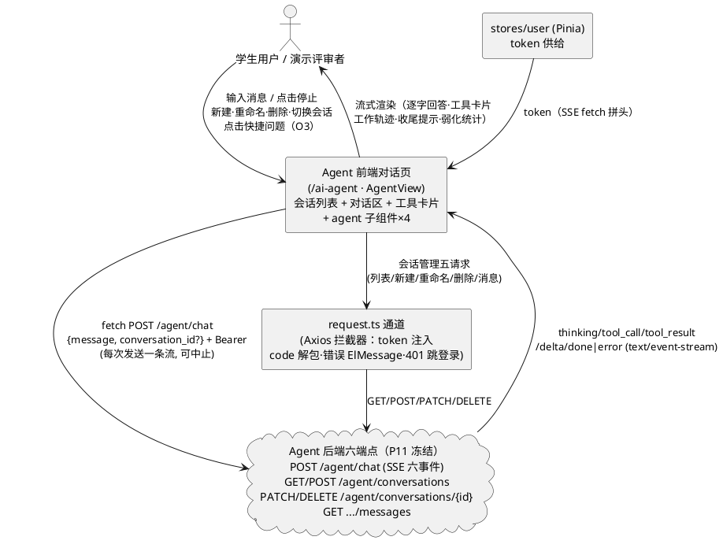
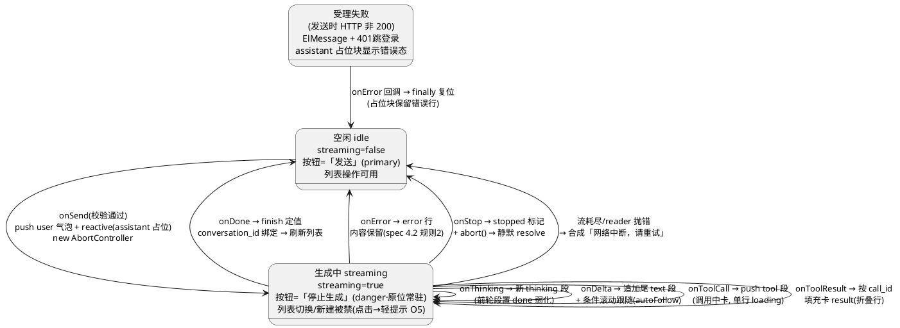
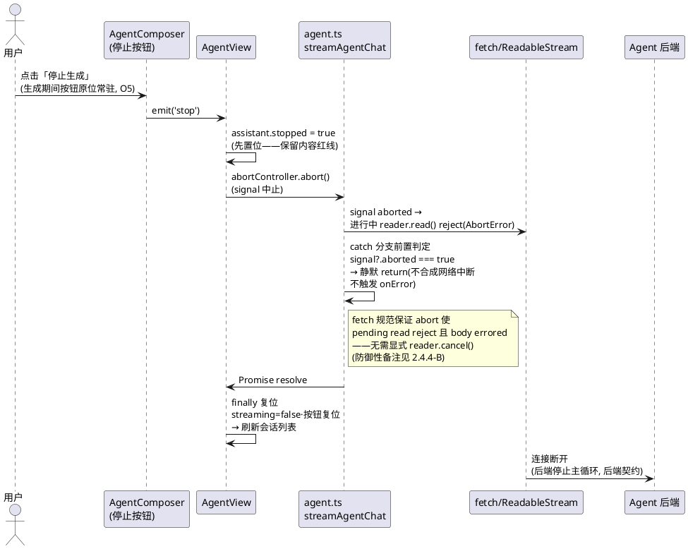
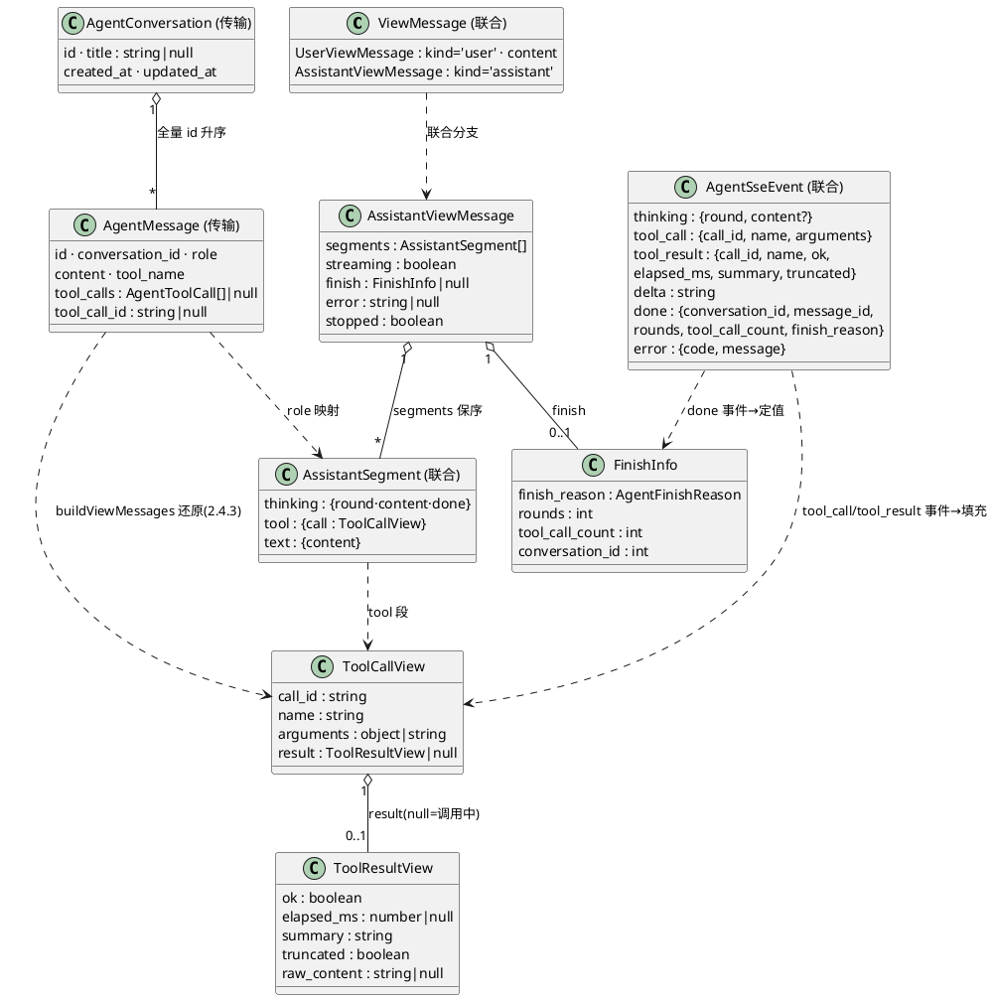

# Agent 前端对话页实现方案（DESIGN_AGENT_FRONTEND）

> feature: `agent_frontend` ｜ 阶段：实现方案设计（spec-design-agent 产出）
> 上游输入：`docs/specs/SPEC_AGENT_FRONTEND.md`（**R2 裁定定稿**，606 行——EARS 规则、§5.3 SSE 六事件消费状态机、§5.4 工具卡片、§5.6 历史回放还原算法、§6 七文件拆分（O1 裁定）、§8 F1–F13 验收标准、§10 八项裁定记录为本设计唯一需求来源，不再重开）、`docs/PROJECT_CONTEXT.md`（§7 前端约定：Vue3 script setup + TS 严格、Element Plus、fetch+ReadableStream、token key=`smartlearn_token`、§7.3 request.ts 拦截器口径）、`docs/designs/DESIGN_AGENT_CHAT.md`（对齐文档格式惯例与上游后端契约）、P9 既有交付（`api/chat.ts` 行缓冲 SSE 解析、`views/AskView.vue` 流式渲染/滚动跟随/历史回放、`components/ask/*` props-emits 惯例、`api/request.ts` 双通道与 `clearTokenAndRedirect`、`types/index.ts` 可辨识联合写法——**全部经实际读取核实**）
> 生成日期：2026-10-22 ｜ 状态：R2 八项裁定 + 用户两项设计重点（工具卡片高度控制 / 历史回放保真度）全量落实（2.8.2 对照表）；**R3 用户补充约束已并入**（停止链路 aborted 判定必须为 catch 首句，详见用户重点块③与决策 A4）；可进入 tasks.md 阶段
> 落盘路径说明：沿用 docs/ 对偶惯例——规格在 `docs/specs/SPEC_AGENT_FRONTEND.md`、设计在 `docs/designs/DESIGN_AGENT_FRONTEND.md`（`SPEC_` ↔ `DESIGN_`）
> 本阶段范围铁律：**只做前端**（7 个文件：AgentView.vue 替换骨架内容 + `components/agent/` 四子组件 + `api/agent.ts` + `types/agent.ts`，1 改 6 新增）；**后端零改动**（六端点与 SSE 契约只消费）；**P9 文件零改动**（chat.ts / AskView.vue / ask 子组件 / request.ts / router/index.ts / MainLayout.vue / types/index.ts 既有内容 git diff 为空）
> 用户 R2 后两项设计重点（本设计最优先落实项）：① **工具卡片高度控制**——调用中/折叠/展开/失败四态视觉规格（2.4.1），折叠态高度锁定单行 ≤40px、4 连卡片总高 ≤ 对话区 1/3，summary 折叠行处理裁定见决策 A1；② **历史回放还原保真度**——call_id 索引配对算法（2.4.3）、arguments 容错解析、历史卡片与实时卡片同一 ToolCallCard 组件渲染（O1 的结构性理由）、孤儿 tool 消息跳过
>
> **用户 R3 补充约束（实现硬约束，编码与评审均须核验）**：③ **停止链路 aborted 判定前置**——「停止生成」的 aborted 判定必须放在 catch 块的最前面（第一条语句），**先于任何错误分类逻辑**；用户主动停止不是错误——若落到「网络中断，请重试」分支，用户点了停止却看到一条红色错误，体验直接崩掉。A4 的「先置位 stopped → abort() → catch 前置 aborted 判定 → 静默 return」顺序为锁死顺序，**实现时不得被后续 catch 逻辑重排**（tasks.md 须将此项列为独立验证锚点：代码审查 catch 块首语句 + 本机走查 V2 无红色错误行）

---

# 一、需求与存量功能关系分析

> 本节所有代码位置均经实际读取核实（P9 / P3 前端交付现状），匹配度四档：100%（可直接复用）/ 75%（模式复刻或参数化扩展）/ 50%（交互模式借鉴、结构新建）/ 25%（仅有基础设施可借力）。
> 五个关键实测发现（设计输入）：
> ① **chat.ts 的 SSE 解析循环内联在 `streamChatQa` 函数体内**（`api/chat.ts:119-152`），模块仅导出 `StreamChatHandlers` 接口、`streamChatQa`、`getChatHistory` 三个名字——**不存在可 import 的独立解析函数**。因此 agent.ts 必须「逐行同构复刻」解析骨架（spec 复用总则「模式复用 + 新文件」的落地形态），同构性由 2.4.2 对照表逐项证明；
> ② **P9 全仓无 AbortController**（chat.ts 无 signal 参数、AskView 无停止按钮）——印证 spec 冲突裁决 #1：停止生成为本阶段全新能力，agent.ts 自行实现 signal 透传；
> ③ **`reactive(placeholderAssistant())` 是 P9 流式渲染的响应式关键**（AskView.vue:78-82 注释实测确认）：SSE 回调闭包直接修改局部变量，若非 reactive 代理则绕过 Vue 响应式、逐片 delta 不触发重渲染——AgentView 必须沿用同款模式（2.4.4）；
> ④ **request.ts 已导出 `clearTokenAndRedirect`**（`api/request.ts:49-61`，P9 决策 D8 专为 fetch 流式路径 401 复用而导出）——agent.ts 受理 401/1003 直接 import，零新增跳转逻辑（spec §4.3 规则 2）；
> ⑤ **`/ai-agent` 路由已注册**（`router/index.ts:74-78`，meta `{title: 'AI 助手', needsAuth: true}`）且 MainLayout 菜单项「AI 助手」存在（`MainLayout.vue:36`，`default-active` 高亮机制 :69）——本阶段仅替换 AgentView.vue 内容，路由/菜单零改动（O7）。

## 1.1 需求功能与存量功能对比

### 1.1.1 已实现功能

| 需求功能 | 存量功能 | 代码位置 | 匹配度 |
|---------|---------|---------|--------|
| SSE 流客户端（fetch + ReadableStream + 行缓冲解析） | `streamChatQa`：buffer 残包、`\n\n` 切块、`TextDecoder stream:true`、注释行忽略、脏块跳过 | `frontend/src/api/chat.ts:98-152` | 75%（解析骨架逐行同构复刻；差异仅事件 4→6、新增 signal、端点不同——见 2.4.2 对照表） |
| 受理错误三态处理（HTTP 非 200） | `!resp.ok` 分支：解析统一响应体 → 401 或 code=1003 走 `clearTokenAndRedirect` + ElMessage → onError 终止 | `frontend/src/api/chat.ts:73-90` | 100%（agent.ts 逐行复刻，422/1001、404/1005 由通用 ElMessage 分支覆盖） |
| 401 清 token 跳登录单一实现 | `clearTokenAndRedirect`（P9 决策 D8 起导出，fetch 路径专用复用点） | `frontend/src/api/request.ts:49-61` | 100%（import 复用，零复制） |
| 非流式通道（token 注入 / code 解包 / 错误 ElMessage / 401 处理） | request 实例 + 双拦截器（`code===0` 解包返回 data） | `frontend/src/api/request.ts:33-130` | 100%（五个会话管理 API 全部走此通道，视图层零重复实现） |
| 建连失败 / 浏览器不支持流式兜底 | fetch catch → ElMessage「网络异常」；`resp.body` 空 → onError「当前浏览器不支持流式响应」 | `frontend/src/api/chat.ts:66-71, 92-96` | 100%（同款兜底文案与路径） |
| 流耗尽 / reader 抛错合成网络中断 | 流耗尽无终结事件 → onError「网络中断，请重试」；catch 同款 | `frontend/src/api/chat.ts:144-151` | 100%（agent.ts 增加 aborted 判定前置——用户主动停止不走此分支） |
| 滚动跟随（流式期间最新内容可见） | `scrollToBottom`：`nextTick` 后置 `scrollTop = scrollHeight` | `frontend/src/views/AskView.vue:43-48` | 75%（函数模式 100% 复刻；新增 autoFollow 守卫——F3 要求可上滚查看历史，见决策 A5） |
| 流式渲染响应式结构 | `reactive(placeholder)` push 入列 + 回调原地更新字段 | `frontend/src/views/AskView.vue:50-116` | 100%（AgentView 沿用同款模式，实测发现 ③） |
| 消息气泡双形态（user 主色右对齐 / assistant 白底） | MessageBubble 的 bubbleClass + cursor 闪烁动画 | `frontend/src/components/ask/MessageBubble.vue:54-60, 113-175` | 75%（视觉规格复刻到新 MessageItem；内部结构换 segments——旧文件不动） |
| 折叠卡交互模式（expanded 切换 + line-clamp 截断 + link 按钮展开） | SourceCard 的 `expanded ref` + `.collapsed` 两行截断 | `frontend/src/components/ask/SourceCard.vue:29, 65-135` | 50%（交互模式借鉴；ToolCallCard 三态视觉与单行高度控制为全新设计） |
| 输入区惯例（trim 判空 / maxlength / 空消息提示 / 禁用态） | AskComposer 的 submit 校验链 | `frontend/src/components/ask/AskComposer.vue:36-45` | 75%（对齐惯例；textarea + 2000 上限 + 发送/停止切换为新增） |
| 可辨识联合事件类型写法 | `QaSseEvent` 四事件联合（`type` 判别） | `frontend/src/types/index.ts:508-520` | 100%（写法复用到 `AgentSseEvent` 六事件，与后端字面量同套） |
| 空态引导 | `el-empty` + description | `frontend/src/views/AskView.vue:211-216` | 100%（O2 同款组件 + O3 快捷问题按钮共存） |
| token 供给 | `useUserStore().token`（localStorage `smartlearn_token` 恢复） | `frontend/src/stores/user.ts:25-31` | 100% |
| 路由注册 / 守卫 / 菜单高亮 | `/ai-agent` 路由 + `needsAuth: true` + 全局前置守卫 + MainLayout 菜单 | `frontend/src/router/index.ts:74-78, 105-117`；`MainLayout.vue:36, 69` | 100%（零改动验证项，F12/O7） |
| 页面不滚动、消息区内部滚动布局约束 | `.ask-page overflow:hidden` + `.chat-scroll flex:1 overflow-y:auto` 双 flex 模式 | `frontend/src/views/AskView.vue:235-299` | 75%（约束复刻到 agent 双栏布局；左栏会话列表为新增结构） |

### 1.1.2 需要扩展的功能

| 需求功能 | 存量功能 | 差异说明 | 扩展方向 |
|---------|---------|---------|---------|
| SSE 六事件消费 + 停止生成 | `streamChatQa` 四事件、无 signal | 输入差异：新增第三参 `signal?: AbortSignal` 透传 fetch；输出差异：分发四回调 → 六回调（thinking/tool_call/tool_result/delta/done/error）；行为差异：abort 后 `reader.read()` reject 需前置判定 `signal.aborted` 静默返回（不合成网络中断错误） | `api/agent.ts` 新文件逐行同构复刻（2.4.2 对照表逐项证明）；**不改 chat.ts**（裁决 #1） |
| assistant 块结构化渲染 | MessageBubble 固定槽位（content + sources + error） | 结构差异：assistant 块内部 thinking 行 / 工具卡片 / 文本段 / 收尾提示**按事件到达顺序交错**，固定槽位无法表达时序（工作轨迹语义） | 新 `MessageItem.vue` 按 segments 数组保序渲染（2.3.2 精确类型 + 决策 A2） |
| 历史回放还原 | `historyToMessages` 一对一简单映射（question→user / answer→assistant） | 算法差异：agent_messages 三 role 混合、`assistant(tool_calls)` 与 tool 消息须按 call_id 配对、arguments 字符串容错解析、孤儿防御 | 新 `buildViewMessages` 纯函数（2.4.3 伪代码，用户设计重点 ②） |
| 会话列表管理交互 | 无对应（P9 问答无会话概念，仅「加载更早」） | 全新交互域：新建 / 切换 / 重命名（弹窗 1..200 校验）/ 删除（确认框）/ 当前高亮 / 生成中禁切换（O5 轻提示） | 新 `ConversationList.vue`（2.2.2 契约） |
| 输入区 2000 上限 + 发送/停止双态 | AskComposer 500 上限 + 单一提交按钮（loading 禁用） | 校验差异：2000 独立常量 + 计数提示；按钮差异：生成中**原位切换**为「停止生成」（警示色常驻可见，O5）而非禁用 | 新 `AgentComposer.vue`（2.2.2 契约） |

### 1.1.3 需要新增的功能或接口

**（A）新增文件（6 个）+ 替换内容（1 个）——共 7 个交付文件（O1 裁定）**

| 功能点 | 输入 | 输出 | 核心逻辑 | 依赖 |
|-------|------|------|---------|------|
| `types/agent.ts` —— Agent 前端类型单一来源 | — | 六事件联合 / finish_reason / 会话与消息 / 视图消息（ViewMessage + segments）等类型 | §7.2 SSE 载荷约束逐项转译为可辨识联合；视图消息 segments 顺序化建模（2.3.2） | 无（纯类型文件） |
| `api/agent.ts` —— SSE 流客户端 + 会话管理 API | payload / handlers / signal | Promise\<void\>（流终结）；会话 CRUD 数据 | 行缓冲解析同构复刻 + 六回调分发 + abort 静默链路 + 受理错误三态 + 五个 request.ts 通道函数 | `request.ts`（default + `clearTokenAndRedirect`）、`stores/user`、`types/agent` |
| `components/agent/ToolCallCard.vue` —— 工具卡片（实时/历史共用） | `ToolCallView`（统一数据形态） | 折叠行 / 展开详情渲染 + toggle 上报 | 四态渲染（调用中/完成折叠/展开/失败）+ 单行高度锁定 CSS + 参数紧凑格式化 + 耗时格式化 + 摘要 ellipsis | `types/agent`、Element Plus 图标 |
| `components/agent/MessageItem.vue` —— 消息渲染单元 | `ViewMessage` | user 气泡 / assistant 块（segments 保序渲染） | thinking 弱化态管理 + ToolCallCard 容器 + 文本段 + 收尾提示/统计小字/错误行/已停止标记 | `ToolCallCard`、`types/agent` |
| `components/agent/ConversationList.vue` —— 左栏会话列表 | conversations / currentId / 状态 | 列表渲染 + 操作事件上报 | 新建入口 / 切换高亮 / 重命名弹窗（1..200 校验）/ 删除确认（ElMessageBox）/ 空标题「新会话」 | Element Plus（不含 api 调用——spec §4.4 规则 4） |
| `components/agent/AgentComposer.vue` —— 输入区 | streaming / disabled | send / stop 事件 + 字数计数 | textarea maxlength 2000 + Enter 发送 / Shift+Enter 换行 + 发送⇄停止原位切换（O5 常驻） | Element Plus |
| `views/AgentView.vue` —— 页面编排（替换骨架内容） | 全部 | 双栏布局 + 状态编排 | 流式状态机（2.1.3）/ SSE 回调分发到响应式树 / 停止链路 / 竞态防护 / 历史还原调度 / 列表刷新时机 / 快捷问题（O3） | 上述全部子组件 + `api/agent` |

**（B）明确不改动清单（防越界，F12 验收）**：

| 文件 | 不改动理由 |
|------|-----------|
| `frontend/src/api/chat.ts` | P9 交付；解析逻辑内联于 `streamChatQa` 函数体（实测发现 ①），无可导出复用面；改动已验收文件违背 spec §4.5 规则 1 |
| `frontend/src/views/AskView.vue` / `components/ask/*` | P9 交付；`/ask` 页与 `/ai-agent` 页分立（spec §1.4 规则 3），互不复用历史数据 |
| `frontend/src/api/request.ts` | P9 交付；`clearTokenAndRedirect` / 拦截器口径已满足 agent 需要（实测发现 ④），新增 import 即可 |
| `frontend/src/types/index.ts` | P9 交付；agent 类型独立文件（冲突裁决 #2），两文件并存 |
| `frontend/src/router/index.ts` / `layouts/MainLayout.vue` | P3 交付；`/ai-agent` 已注册 + 菜单「AI 助手」已存在（实测发现 ⑤），O7 维持现状 |
| `frontend/src/components/PagePlaceholder.vue` | 既有通用组件；AgentView 替换内容后不再引用（组件本身保留供其他页用） |
| 全部后端文件 | 六端点 P11 已验收（pytest 153/153 + 真实冒烟），前端仅消费不重定义（spec §1.4 规则 1） |

## 1.2 存量功能详细分析

### 1.2.1 `api/chat.ts` SSE 流客户端（agent.ts 同构复刻的唯一模板）

**接口契约**：`streamChatQa(payload: ChatQaPayload, handlers: StreamChatHandlers): Promise<void>`——四回调 `{onSources, onDelta, onDone, onError}`；`done`/`error` 到达即 return（流终结，Promise resolve）。**无 signal 参数**（实测发现 ②）。

**解析骨架（逐段，2.4.2 对照表的左列基准）**：
1. token 从 `useUserStore().token` 读取；`base = import.meta.env.VITE_API_BASE_URL || '/api/v1'`；
2. `fetch` POST + `Content-Type: application/json` + 条件注入 `Authorization: Bearer`（token 为空串时不注入）——token 拼头不拼 URL（§4.3 安全红线）；
3. 建连失败 catch → `ElMessage.error('网络异常，请稍后重试')` + onError 终止；
4. `!resp.ok` → try 解析响应体 `{code, message}`（非 JSON 保留默认文案）→ `resp.status === 401 || code === 1003` → `clearTokenAndRedirect()` → `ElMessage.error(message)` → onError 终止；
5. `resp.body?.getReader()` 为空 → onError「当前浏览器不支持流式响应」；
6. `new TextDecoder('utf-8')` + `buffer = ''`；`dispatch(event)` switch 按 `type` 分发、done/error 返回 `'end'`；
7. 主循环：`read()` → `buffer += decoder.decode(value, {stream: true})` → 内层循环 `indexOf('\n\n')` 切块 → `block.trim()` → 空行 / `':'` 注释行 / 非 `'data: '` 前缀跳过 → `JSON.parse(line.slice(6))` try-catch 脏块 continue → `dispatch === 'end'` return；
8. 流自然耗尽（read done 且无终结事件）→ onError「网络中断，请重试」；catch（read 抛错）→ 同款；`finally: reader.releaseLock()`。

**约束与依赖**：`QaSseEvent` 联合类型使 dispatch 的 switch 穷尽（无 default——未知类型在类型层不可达，运行时脏 `type` 由 JSON.parse 后的结构自然落入不匹配分支；agent.ts 六事件分发补 default 静默忽略分支以落实 spec §5.3.1 规则 4 前向兼容）。

### 1.2.2 `views/AskView.vue` 视图编排模式（AgentView 的行为模板）

**响应式结构契约**：`messages = ref<AskMessage[]>([])` + `streaming = ref(false)`；发送时 push user 消息（普通对象）与 assistant 占位（**必须 `reactive()` 包裹**——实测发现 ③，回调闭包改局部变量需响应式代理才能逐片触发重渲染）；`finally` 统一复位 `streaming` 与 `assistant.streaming`（终态必达的落点）。

**业务规则（对 AgentView 的约束）**：① `onAsk` 入口 `if (streaming.value) return` 防重复发起（agent 版升级为按钮切换发送/停止，防重发由按钮形态结构性保证）；② 每个回调内 `void scrollToBottom()`（内容更新即跟随）；③ 历史加载失败仅弹错、保留空对话区可正常提问（agent 版同款语义：会话列表/消息加载失败不阻塞对话）；④ 历史回放 `reverse` 后 prepend 保持时间正序。

**扩展点与约束**：AskView 无 AbortController、无停止按钮、无会话概念——均为本阶段新增；布局 CSS 的「页面 overflow:hidden + 卡片 flex + 滚动区 flex:1 overflow-y:auto」三件套是防双滚动条的关键（agent 双栏布局复刻此约束：左栏列表与右栏消息区各自内部滚动）。

### 1.2.3 `api/request.ts` 双通道与 401 单一实现

**接口契约**：default 导出 Axios 实例（拦截器解包 `code===0 → data`）；命名导出 `clearTokenAndRedirect`（清 `smartlearn_token` + `window.location.href = '/login'`，登录页防重复跳转）与 `TOKEN_KEY`。

**拦截器行为（会话管理五 API 的免费能力）**：业务码 1002/1003 → 清 token 跳登录；HTTP 401 → 同款 + 「登录已过期」；403 → 「无权限」；其他 HTTP 错误 → 后端 message 或状态码文案；网络错误 → 「网络异常，请稍后重试」——**视图层对 422/1001、404/1005 的 ElMessage 提示由拦截器统一完成**（AgentView 的会话管理错误路径零手写）。

**约束**：fetch 流式路径不经拦截器——401/1003 须由 agent.ts 显式调 `clearTokenAndRedirect`（P9 chat.ts:84-86 同款判定式，agent.ts 复刻）；token 读取走 `useUserStore()`（与拦截器的 localStorage 直读殊途同归，双通道同源）。

### 1.2.4 `components/ask/*` 子组件惯例（agent 子组件的契约模板）

**props-emits 惯例**：`defineProps<{...}>()` 类型化 props（无 runtime 声明）+ `defineEmits<{(e: 'xxx', payload: T): void}>()` 类型化 emits；子组件**不含任何 api 调用**（api 调用仅在视图与 api 层——spec §4.4 规则 4 沿 P9 惯例）；弹窗/确认交互可内置于子组件（操作结果以事件上报）。

**SourceCard 折叠模式（ToolCallCard 的交互参照）**：`expanded = ref(false)` 内部态 + link 按钮「展开全文/收起」+ CSS `-webkit-line-clamp` 截断 + `@click.stop` 防穿透。ToolCallCard 的差异：折叠行高度需**锁定单行**（line-clamp:1 + ellipsis）且状态图标/耗时/摘要同行排布（2.4.1 视觉规格），Element Plus `el-collapse` 的默认 padding 与动画不满足 40px 级高度约束——裁定自绘折叠卡（决策 A9）。

**AskComposer 校验链（AgentComposer 的行为参照）**：trim 判空 → `ElMessage.warning` 不发请求；`maxlength` 输入层硬限 + `disabled` 提交层防护。Agent 版差异：上限 2000、textarea、Enter 发送 / Shift+Enter 换行、发送按钮生成中原位切换为停止（不禁用输入——spec §5.3.1 规则 12「输入区可输入但发送动作被停止动作替代」）。

### 1.2.5 `types/index.ts` 可辨识联合写法（types/agent.ts 的写法模板）

`QaSseEvent = {type: 'sources'; data: ...} | {type: 'delta'; data: string} | {type: 'done'; data: {...四字段}} | {type: 'error'; data: {code, message}}`——字面量 `type` 判别 + data 载荷结构逐字段对齐后端契约（snake_case 保留）。`AgentSseEvent` 扩为六事件同款写法；**新增写法约束**：事件与 finish_reason 字符串字面量与后端共用同一套（spec §4.4 规则 1），视图类型（ViewMessage）与传输类型（AgentMessage 等）分层定义——传输层 snake_case 原样、视图层建模渲染结构。

### 1.2.6 存量约束汇总（设计必须绕行的边界）

1. **chat.ts 不可 import 解析逻辑**（实测发现 ①）——同构复刻是唯一路径，2.4.2 对照表为 F7 验收的直接证据；
2. **P9 组件零改动**（F12）——agent 四子组件全部新建于 `components/agent/`，不向 ask 组件注入 props 或 slot 扩展；
3. **`types/index.ts` 不追加**（裁决 #2）——agent 类型与 index.ts 并存两文件，`types/agent.ts` 不被其他模块反向依赖（只有 agent 域 import）；
4. **token 红线**（§4.3）——fetch 手动拼头（复刻 chat.ts:60-64 条件注入式）、禁 URL 参数、禁 console 打印；
5. **构建链路**（F12）——`npm run build` = `vue-tsc --noEmit && vite build`（package.json:8 实测），TS 严格模式零错误是验收硬标准；esbuild 间歇崩溃的既有恢复预案见 2.9。
---

# 二、增量设计方案

## 2.1 实现模型

### 2.1.1 上下文视图



外部交互要点：① SSE 与非流式**双通道分立**（fetch 手动拼 token vs request.ts 拦截器自动注入——PROJECT_CONTEXT §7.3 约定，P9 同款）；② 会话管理五端点的错误提示/401 处理/解包全部由拦截器免费完成，视图层零重复；③ 后端对前端是纯服务方——多轮工具循环全部在后端 `agent/core.py` 内完成，前端只消费 SSE 事件（对齐 DESIGN_AGENT_CHAT 2.1.1 外部要点①）。

### 2.1.2 服务/组件总体架构（七文件职责与依赖方向）

```plantuml
@startuml
skinparam defaultTextAlignment left

package "views 层（状态编排唯一宿主）" {
  [AgentView.vue\n双栏布局 / streaming 状态机\nSSE 回调分发到响应式树\n停止链路 / 竞态防护（loadSeq）\n历史还原调度 / 列表刷新时机\n快捷问题（O3）·常量表（2.1.2-B）] as view
}

package "components/agent（纯展示+事件上报，零 api 调用）" {
  [MessageItem.vue\nuser 气泡 / assistant 块\nsegments 保序渲染\nthinking 弱化态 / 收尾提示\n统计小字（O8）/ 错误行 / 已停止标记] as item
  [ToolCallCard.vue\n四态（调用中/折叠/展开/失败）\n单行高度锁定 ≤40px\n实时/历史统一渲染（重点①②）\n参数格式化 / 耗时 / 摘要 ellipsis] as card
  [ConversationList.vue\n倒序渲染 / 当前高亮\n新建 / 切换 / 重命名弹窗\n删除确认 / 空标题「新会话」] as clist
  [AgentComposer.vue\ntextarea 2000 + 计数\nEnter 发送 / Shift+Enter 换行\n发送⇄停止原位切换（O5 常驻）] as composer
}

package "api 层" {
  [agent.ts\nstreamAgentChat（六回调分发\n+ 行缓冲解析同构复刻\n+ signal 透传 + 受理错误三态）\n会话管理五函数（request 通道）] as api
  [request.ts（P9 零改动）\n拦截器 + clearTokenAndRedirect] as req
  [chat.ts（P9 零改动，不 import）] as p9chat
}

package "types 层" {
  [agent.ts\nAgentSseEvent 六事件联合\n会话/消息/分页类型\nViewMessage + segments] as types
  [index.ts（P9 零改动，并存）] as idx
}

package "stores" {
  [user.ts（P9 零改动）\ntoken 供给] as store
}

view --> api : streamAgentChat / 五会话函数
view --> item : ViewMessage[] (props)
view --> clist : conversations / currentId (props)
view --> composer : streaming (props)
view --> composer : send / stop (emits, ↑)
view --> clist : create/select/rename/remove (emits, ↑)
item --> card : ToolCallView (props)
item --> card : toggle (emits, ↑)
card ..> types : 类型
item ..> types : 类型
view ..> types : 类型
api --> req : request 实例 + clearTokenAndRedirect
api --> store : token
api ..> types : 类型
view ..> store : token（经 api 间接）
p9chat ..x api : 解析循环内联不可 import（实测发现①）\n→ 同构复刻（2.4.2 对照表）
@enduml
```

**依赖方向铁律**：`AgentView → 子组件`（props 下行 / emits 上行）；`AgentView 与 agent.ts → types/agent.ts`；`agent.ts → request.ts / stores/user.ts`；子组件**只 import 类型与 Element Plus**（禁 api 调用——spec §4.4 规则 4）；`chat.ts` 与 agent.ts 零耦合（P9 隔离）。

**（A）七文件职责边界表**：

| 文件 | 职责（唯一关注点） | 明确不做 |
|------|------------------|---------|
| `views/AgentView.vue` | 视图状态编排：会话/消息双状态域、SSE 回调 → 响应式树、停止链路、竞态防护、历史还原调度、列表刷新时机、快捷问题发送 | 不做展示细节（样式在子组件）；不做 SSE 解析（在 agent.ts） |
| `components/agent/ToolCallCard.vue` | 单张工具卡片四态渲染与折叠交互（用户重点 ①） | 不做卡片堆叠布局（MessageItem 的 segments 容器负责）；不做 call_id 配对（AgentView 回调 / buildViewMessages 负责） |
| `components/agent/MessageItem.vue` | 单条视图消息渲染（user 气泡 / assistant 块 segments 保序） | 不修改 segments 数据（纯渲染）；流式光标只看 `message.streaming` |
| `components/agent/ConversationList.vue` | 左栏列表渲染 + 操作交互（弹窗/确认内聚） | 不调会话 API（重命名/删除仅 emit 参数，由 AgentView 落请求） |
| `components/agent/AgentComposer.vue` | 输入校验（非空/≤2000）+ 发送/停止切换 | 不发请求、不持有会话上下文 |
| `api/agent.ts` | SSE 流客户端 + 五个会话管理函数（传输层） | 不持有任何视图状态（回调透传给视图）；不渲染任何 UI（ElMessage 仅复刻 P9 的传输层错误提示口径） |
| `types/agent.ts` | 类型单一来源（传输类型 + 视图类型分层） | 零运行时代码（纯类型 + 常量文案映射表） |

**（B）常量表（AgentView.vue 模块级，全部锁定值 + 注释来源，spec §4.4 规则 3）**：

| 常量 | 值 | 依据 |
|------|-----|------|
| `MESSAGE_MAX_LEN` | `2000` | spec §7.1 规则 1（与后端 O6 同值同义；前端独立常量做发送前拦截——对齐 AskComposer maxlength 惯例） |
| `CONVERSATION_PAGE_SIZE` | `50` | spec 冲突裁决 #3（首屏单页、page_size=50 固定常量；后端上限 100 内取 50 留余量） |
| `QUICK_QUESTIONS` | `['我最近学习怎么样', '我哪些知识点最薄弱', '我还有哪些任务没做完', '帮我制定下周学习计划']` | O3 用户指定清单（四类演示场景：多工具分析 / 单工具 / 任务查询 / 能力边界） |
| `FINISH_HINTS` | `{ normal: '', max_rounds: '信息较多，已为你总结', timeout: '处理时间较长，以下是已获取的部分' }` | spec §7.4 规则 3（三态文案常量集中，F4 审查「映射齐全」） |
| `THINKING_TEXT` | `'思考中'` | spec §7.4 规则 4（固定常量 + 轮次后缀「（第 N 轮）」拼接，禁随轮次变文案模板） |
| `STOPPED_TEXT` | `'已停止生成'` | spec §5.3.1 规则 11（轻量标记非错误样式） |
| `GENERATING_BLOCK_HINT` | `'请先停止当前生成'` | O5 裁定（生成中点击会话/新建的轻提示文案，禁静默） |
| `ARG_VALUE_MAX_LEN` | `20` | spec §5.4.1 规则 1（参数值超 20 字符截断加省略号） |
| `LIST_TOTAL_HINT` | `` `仅显示最近 ${CONVERSATION_PAGE_SIZE} 条会话` `` | O4（total 超出首屏时底部提示文案，不做加载更多） |

ToolCallCard 内部常量（组件级）：`--toolcard-row-height: 36px`（CSS 变量，2.4.1）、耗时格式化阈值 `1000ms`（<1000 → `8ms`；≥1000 → 秒保留一位小数如 `1.2s`，spec §5.4.1 规则 7）。

### 2.1.3 实现设计文档（AgentView UI 状态机 / 停止链路 / 竞态防护）

**A. AgentView 流式生成状态机（spec §5.3.2 UI 状态机表的实现设计）**：



五条终结路径（spec §4.2 规则 1 终态必达）在实现上收敛为**单一 `finally` 复位块**（P9 AskView:112-116 模式）：`assistant.streaming = false; streaming.value = false; abortController = null; void refreshConversations()`——`done / error / 停止 / 网络中断 / 受理失败` 全部经 Promise 终结触发，结构性消灭「永久转圈」。

**B. 停止生成链路（活动图，spec §5.3.1 规则 11 + 裁决 #1）**：



**C. 会话切换与列表刷新竞态防护（决策 A6）**：

| 竞态场景 | 防护机制 |
|---------|---------|
| 生成中切换会话 / 新建（SSE 回调与视图重建竞态） | O5 结构性禁止：`streaming === true` 时点击列表项或新建 → `ElMessage.info('请先停止当前生成')` 短路返回，不发生任何切换——竞态源头消除 |
| 空闲时快速连点两个会话（旧 messages 响应晚到覆盖新视图） | **loadSeq 序号守卫**：`selectConversation()` 内 `const seq = ++loadSeq`；`getAgentConversationMessages` 回调渲染前校验 `seq === loadSeq`，不等则丢弃——后到旧响应不污染当前视图（spec §5.2.1 规则 8 失败弹错保留原视图的同类语义延伸） |
| 列表刷新与切换并发 | 列表是全局数据（正交于当前会话视图），`refreshConversations()` 无守卫直接覆盖——列表数据无「当前态」语义，后到即最新 |
| 空态直发后 done 绑定新会话（期间用户已离开？） | 生成中禁止切换（O5）→ done 回调必然发生在本会话上下文——结构消除；`conversation_id` 绑定后 `currentConversation` 置为服务端返回的会话对象 |
| 停止后立即再发（spec §5.3.3 场景 3） | `finally` 先复位 `streaming` 再允许新发送（Promise 时序保证）；前次已停止块保持不动，新请求携带同一会话 id 续聊 |

**D. 历史回放调度的状态契约**：切换会话时 `messagesLoading = true` → `getAgentConversationMessages` → `buildViewMessages`（纯函数，2.4.3）→ 一次性替换 `messages.value`（非增量追加——回放是全量重建）→ `messagesLoading = false`；加载期间消息区显示 loading（`v-loading` 指令于**消息区容器**局部使用，不违反 §5.5.1 规则 3「禁对话区 overlay」——该规则针对生成期间的遮罩，切换加载是短暂静态等待，且 spec §4.1 规则 4 明确要求「接口等待期间显示 loading 态」；裁定依据见决策 A10）。

## 2.2 接口设计

### 2.2.1 总体设计

**接口分类**：本阶段接口分三层——① HTTP 消费接口（六端点，均为后端既有，前端只定义调用函数签名）；② 模块内 TS 接口（`AgentStreamHandlers` 回调契约、组件 props/emits 契约）；③ 纯函数接口（`buildViewMessages` 历史还原算法）。接口稳定性：六端点契约由 SPEC_AGENT_CHAT §5.6.2/§6.2 冻结（后端 P11 已验收），前端消费不做降级推断；TS 契约为本设计定稿，变更须同步 types/agent.ts 单一来源。

**接口变更策略**：事件类型与 finish_reason 字符串字面量在 `types/agent.ts` 集中定义（`'thinking' | 'tool_call' | ...` 与 `'normal' | 'max_rounds' | 'timeout'`——与后端共用同一套，spec §4.4 规则 1）；未知 `type` 由 agent.ts dispatch 的 default 分支静默忽略（前向兼容，spec §5.3.1 规则 4）。

### 2.2.2 接口清单

**（1）`streamAgentChat` —— SSE 流客户端（agent.ts 核心）**

- **接口签名**：

  ```typescript
  export interface AgentStreamHandlers {
    onThinking: (data: { round?: number; content?: string }) => void
    onToolCall: (data: {
      call_id: string
      name: string
      arguments: Record<string, unknown>
    }) => void
    onToolResult: (data: {
      call_id: string
      name: string
      ok: boolean
      elapsed_ms: number
      summary: string
      truncated: boolean
    }) => void
    onDelta: (text: string) => void
    onDone: (data: {
      conversation_id: number
      message_id: number | null
      rounds: number
      tool_call_count: number
      finish_reason: AgentFinishReason
    }) => void
    onError: (data: { code: number; message: string }) => void
  }

  export async function streamAgentChat(
    payload: AgentChatPayload,
    handlers: AgentStreamHandlers,
    signal?: AbortSignal,
  ): Promise<void>
  ```

- **业务说明**：`POST /agent/chat` 的 fetch + ReadableStream 消费端。解析骨架与 P9 chat.ts 逐行同构（2.4.2 对照表——F7 证据）；六事件经 dispatch switch 分发到六回调，`done`/`error` 返回 `'end'` 终结；`signal` 透传 fetch init（裁决 #1 新增能力）。payload 为 `{ message: string; conversation_id?: number }`（当前会话存在时必带）。
- **前置条件**：调用方保证 `message` 已通过视图层校验（非空/≤2000——agent.ts 不重复校验，视图层是唯一校验点，对齐 P9 分层）；`handlers` 六回调齐备。
- **后置条件**：Promise 终结即流终结（五路径：done / error / abort / 流耗尽 / 受理失败——受理失败与建连失败经 `onError` 通知后 return）；`finally: reader.releaseLock()`（P9 同款）。
- **异常映射**：建连失败 → ElMessage「网络异常，请稍后重试」+ onError（P9 :66-71 复刻）；HTTP 非 200 → 解析统一响应体 → `401 || code===1003` → `clearTokenAndRedirect()` + ElMessage → onError（P9 :73-90 复刻，422/1001 与 404/1005 由通用 ElMessage(message) 分支覆盖——message 为后端中文文案）；流内 `error` 事件 → onError 透传（视图层渲染错误行）；`reader.read()` 抛错 → **catch 首语句前置判定 `signal?.aborted`（R3 硬约束——必须是 catch 块第一条语句，先于任何错误分类，实现不得重排）**：aborted → 静默 return（停止链路，决策 A4——用户主动停止不是错误，禁止落入网络中断分支渲染红色错误）；否则 onError「网络中断，请重试」（P9 :146-148 复刻）；流耗尽无终结事件 → onError「网络中断，请重试」（P9 :144-145 复刻）。
- **调用示例**（AgentView 内消费形态）：

  ```typescript
  const controller = new AbortController()
  abortController = controller
  try {
    await streamAgentChat(
      { message, ...(currentConversation.value ? { conversation_id: currentConversation.value.id } : {}) },
      {
        onThinking: (d) => { appendThinkingSegment(assistant, d) },
        onToolCall: (d) => { pushToolSegment(assistant, d) },
        onToolResult: (d) => { fillToolResult(assistant, d) },
        onDelta: (t) => { appendDelta(assistant, t) },
        onDone: (d) => { applyFinish(assistant, d) },
        onError: (d) => { assistant.error = d.message },
      },
      controller.signal,
    )
  } finally {
    assistant.streaming = false
    streaming.value = false
    abortController = null
    void refreshConversations()
  }
  ```

**（2）会话管理五函数（request.ts 通道，P9 `getChatHistory` 同款形态）**：

| 函数 | 签名 | HTTP | 说明 |
|------|------|------|------|
| `getAgentConversations` | `(page: number, pageSize: number) => Promise<ConversationPage>` | GET `/agent/conversations` | 首屏 `page=1, pageSize=50`（常量）；响应经拦截器解包为 `{items, total, page, page_size}` |
| `createAgentConversation` | `(title?: string) => Promise<AgentConversation>` | POST `/agent/conversations` | 显式新建（body 可 `{}` 或 `{title}`）；空 title 会话列表行显示「新会话」（子组件职责） |
| `renameAgentConversation` | `(conversationId: number, title: string) => Promise<AgentConversation>` | PATCH `/agent/conversations/{id}` | 前端提交前拦截空/超 200（弹窗内校验）；后端 422 由拦截器弹错 |
| `deleteAgentConversation` | `(conversationId: number) => Promise<null>` | DELETE `/agent/conversations/{id}` | 确认框在前置弹窗层完成；`data: null` 经解包得 null |
| `getAgentConversationMessages` | `(conversationId: number) => Promise<AgentMessage[]>` | GET `/agent/conversations/{id}/messages` | 全量、id 升序；404/1005（并发删除）由拦截器弹错 + 视图层从列表移除该行 |

- **统一约定**：全部 `request.get/post/patch/delete` + `as Promise<T>` 断言形态（P9 chat.ts:161-168 同款）；类型 T 定义于 types/agent.ts；错误提示/401 处理由拦截器统一完成（视图层 catch 仅做状态复位，不重复弹错——对齐 AskView.loadHistory 的空 catch 惯例）。

**（3）`ToolCallCard.vue` props-emits 契约（实时/历史统一建模——用户重点 ②）**：

  ```typescript
  // props：统一数据形态（实时流与历史回放共用同一组件的结构性契约, O1）
  defineProps<{
    /** 卡片数据：result === null 为调用中态（实时流 tool_call 已到、tool_result 未到） */
    call: ToolCallView
  }>()

  // emits
  defineEmits<{
    (e: 'toggle', callId: string, expanded: boolean): void
  }>()
  ```

- **统一建模要点**：`ToolCallView.result.elapsed_ms: number | null`（历史 = null → 折叠行省略耗时项，spec §5.6 规则 5）与 `result.raw_content: string | null`（历史 = tool 消息完整 JSON → 展开态格式化展示，spec §5.6 规则 4；实时 = null → 展开态显示 summary 全文）——**实时/历史差异全部数据驱动，组件无模式分支**（精确类型见 2.3.2；决策 A3）。
- **emits('toggle') 用途**：视图层接收展开/收起上报后可做滚动高度补偿（展开导致对话区高度变化）；无强制消费方但契约上报（调试与 F2 走查观测点）。

**（4）`MessageItem.vue` props-emits 契约**：

  ```typescript
  defineProps<{
    /** 单条视图消息（user / assistant 联合） */
    message: ViewMessage
  }>()
  // emits：无（纯渲染单元；卡片 toggle 由 ToolCallCard 上报后经 slots/属性透传非必要——
  // MessageItem 不介入卡片交互转发，AgentView 直接以 v-for 渲染 segments 内卡片并接收 toggle）
  ```

  实际上 segments 渲染发生在 MessageItem 模板内（`v-for segment in message.segments`），ToolCallCard 的 toggle 事件由 MessageItem **原样透传**（`@toggle="(id, ex) => emit('card-toggle', id, ex)"`）——为保持契约完备，MessageItem emits：`(e: 'card-toggle', callId: string, expanded: boolean): void`。

**（5）`ConversationList.vue` props-emits 契约**：

  ```typescript
  defineProps<{
    /** 会话列表（服务端 updated_at 倒序原样渲染） */
    conversations: AgentConversation[]
    /** 当前会话 id（null = 空态未选中） */
    currentId: number | null
    /** 列表加载中（骨架/等待态, spec §4.1 规则 4） */
    loading: boolean
    /** 生成中（禁切换 + 禁新建, O5——子组件只做视觉禁用, 轻提示由 AgentView 统一弹出保证文案单一来源） */
    generating: boolean
  }>()

  defineEmits<{
    (e: 'create'): void
    (e: 'select', conversationId: number): void
    (e: 'rename', conversationId: number, title: string): void
    (e: 'remove', conversationId: number): void
  }>()
  ```

- **交互内聚**：重命名弹窗（`el-dialog` + `el-input` maxlength 200 + show-word-limit + 空标题禁用提交）与删除确认（`ElMessageBox.confirm`，文案含「删除后不可恢复，将同时删除会话内全部消息」）内置于组件；确认后 emit 参数、**API 调用由 AgentView 执行**（spec §4.4 规则 4）。
- **轻提示归属裁定**：O5 的「请先停止当前生成」由 **AgentView 统一弹出**（select/create 事件处理入口短路），子组件 `generating` 仅做视觉置灰——文案常量单一来源（`GENERATING_BLOCK_HINT`），避免子组件与视图两处弹出造成双提示。

**（6）`AgentComposer.vue` props-emits 契约**：

  ```typescript
  defineProps<{
    /** 流式生成中（按钮切换「发送」→「停止生成」原位常驻, O5） */
    streaming: boolean
  }>()

  defineEmits<{
    (e: 'send', message: string): void
    (e: 'stop'): void
  }>()
  ```

- **行为**：`el-input type="textarea"` + `:maxlength="2000"` + `show-word-limit`（计数「N / 2000」内建于组件，spec §7.4 规则 1）+ `:autosize="{ minRows: 2, maxRows: 5 }"`；Enter 发送 / Shift+Enter 换行（`@keydown.enter.exact.prevent="submit"`——prevent 阻止默认换行，shift 组合自然换行）；trim 判空 → `ElMessage.warning('请输入消息')`（P9 AskComposer 同款链）；超 2000 由 maxlength 硬限结构性消除（达上限时发送禁用）；**生成中 textarea 保持可输入**（预输入下一问，spec §5.3.1 规则 12），仅发送动作被停止替代；发送后清空输入框（P9 同款）。
- **按钮**：空闲 = `type="primary"` icon Promotion「发送」；生成中 = `type="danger"` icon VideoPause「停止生成」——同一按钮原位切换（位置固定于 composer 区，不随内容滚动移动，O5「始终可见」结构性满足）。
## 2.3 数据模型

### 2.3.1 设计目标

数据模型解决三件事：① **传输类型**（六事件载荷 / 会话 / 消息）与后端契约逐字段对齐（snake_case 原样，禁二次映射）；② **视图消息建模**——assistant 块内部 thinking 行 / 工具卡片 / 文本段 / 收尾的**顺序化结构**（本设计最关键的数据决策，用户指定重点）；③ **工具卡片的实时/历史统一形态**（同一组件渲染的结构前提，用户重点 ②）。容量与性能目标：单会话消息量受后端 6 轮上限约束（每请求最多 1 user + 6×(1 assistant + n tools) + 1 final ≈ 数十条），50 条消息 + 10 卡片回放 2 秒内完成（spec §4.1 规则 3）——全量一次性渲染（不虚拟滚动，spec §5.6.3 场景 2），量级不支持也不需要该复杂度。

### 2.3.2 模型实现（types/agent.ts 精确类型定义）

**（A）传输层类型（SSE 事件 / 会话 / 消息——与后端契约对齐）**：

```typescript
// ---- SSE 六事件可辨识联合（spec §7.2；字面量与后端共用同一套）----

/** finish_reason 三值（done.data 字段, 与后端同套字面量） */
export type AgentFinishReason = 'normal' | 'max_rounds' | 'timeout'

export type AgentSseEvent =
  | { type: 'thinking'; data: { round: number; content?: string } }
  | {
      type: 'tool_call'
      data: { call_id: string; name: string; arguments: Record<string, unknown> }
    }
  | {
      type: 'tool_result'
      data: {
        call_id: string
        name: string
        ok: boolean
        elapsed_ms: number
        summary: string
        truncated: boolean
      }
    }
  | { type: 'delta'; data: string }
  | {
      type: 'done'
      data: {
        conversation_id: number
        message_id: number | null
        rounds: number
        tool_call_count: number
        finish_reason: AgentFinishReason
      }
    }
  | { type: 'error'; data: { code: number; message: string } }

// ---- 会话与消息（spec §7.3；GET/POST/PATCH 响应与 messages 全量）----

export interface AgentConversation {
  id: number
  title: string | null
  created_at: string
  updated_at: string
}

export interface ConversationPage {
  items: AgentConversation[]
  total: number
  page: number
  page_size: number
}

/** OpenAI 原始格式 tool_call 元素（agent_messages.tool_calls 列表元素；arguments 为 JSON 字符串） */
export interface AgentToolCall {
  id: string
  type: string
  function: { name: string; arguments: string }
}

export type AgentMessageRole = 'user' | 'assistant' | 'tool'

export interface AgentMessage {
  id: number
  conversation_id: number
  role: AgentMessageRole
  content: string
  tool_name: string | null
  tool_calls: AgentToolCall[] | null
  tool_call_id: string | null
  created_at: string
}

/** 发送载荷（POST /agent/chat 请求体） */
export interface AgentChatPayload {
  message: string
  conversation_id?: number
}
```

**（B）视图层类型（ViewMessage + segments 顺序化建模——决策 A2，本设计关键决策）**：

```typescript
// ---- 视图消息（AgentView ↔ MessageItem 组件间契约）----

export type ViewMessage = UserViewMessage | AssistantViewMessage

export interface UserViewMessage {
  kind: 'user'
  content: string
}

export interface AssistantViewMessage {
  kind: 'assistant'
  /**
   * 顺序化段列表：按事件到达顺序渲染（思考行→文本→卡片→文本→…→收尾）。
   * 保序是「工作轨迹」语义的结构保证——固定槽位（thinking[]/cards[]/text）
   * 无法表达中间轮解释性文本与卡片的交错时序。
   */
  segments: AssistantSegment[]
  /** 流式进行中（true 时末尾 text 段渲染闪烁光标） */
  streaming: boolean
  /** done 后定值（三态提示 + 弱化统计的渲染依据；null = 未到达 done） */
  finish: FinishInfo | null
  /** 流内错误 / 网络中断合成错误（渲染为块内错误行；内容保留红线的数据面） */
  error: string | null
  /** 用户主动停止标记（渲染为块末「已停止生成」轻量标记, 非错误样式） */
  stopped: boolean
}

/** assistant 块内部段（三种, 按到达顺序 append） */
export type AssistantSegment =
  /** thinking 轮次提示行：round 定值轮次；content 为推理模型增量（浅色小字附加）；done=该轮已结束（弱化样式） */
  | { kind: 'thinking'; round: number | null; content: string; done: boolean }
  /** 工具调用卡片段：call.result 填充即完成态迁移（组件内部按 result 判定四态） */
  | { kind: 'tool'; call: ToolCallView }
  /** 文本段：delta 逐片追加到「最后一个 text 段」（无则新建）——中间轮解释与最终回答天然分段保序 */
  | { kind: 'text'; content: string }

export interface FinishInfo {
  finish_reason: AgentFinishReason
  rounds: number
  tool_call_count: number
  conversation_id: number
}
```

**（C）工具卡片统一形态（实时流 / 历史回放共用——决策 A3，用户重点 ②）**：

```typescript
// ---- ToolCallCard 数据契约（ToolCallView：result === null 即调用中态）----

export interface ToolCallView {
  /** 配对键：实时 = SSE call_id；历史 = tool_calls[].id（tool 消息 tool_call_id 与其相等） */
  call_id: string
  name: string
  /**
   * 实时 = tool_call 事件 arguments（后端已解析对象）；
   * 历史 = JSON.parse 容错后的对象；解析失败降级为原始字符串（整条历史不崩）
   */
  arguments: Record<string, unknown> | string
  /** null = 调用中（loading 单行）；非 null = 已完成（折叠行 + 可展开） */
  result: ToolResultView | null
}

export interface ToolResultView {
  ok: boolean
  /** 实时 = elapsed_ms（8ms/1.2s 格式化展示）；历史 = null → 折叠行省略耗时项（spec §5.6 规则 5） */
  elapsed_ms: number | null
  /** 实时 = 服务端 summary（≤500 字, 失败时为错误信封中文文案）；历史 = ''（折叠行摘要位由 error 文案或空） */
  summary: string
  truncated: boolean
  /** 历史 = tool 消息 content（完整结果 JSON 字符串, 展开态格式化展示）；实时 = null（展开态显示 summary 全文） */
  raw_content: string | null
}
```

**（D）类型关系类图**：



**对象生命周期与持久化策略**：① `AgentSseEvent` 等传输对象为瞬时载荷（dispatch 后即弃，不缓存）；② `AssistantViewMessage` 生命周期 = 一次请求的流期间创建（reactive 包裹）→ 终态后作为静态历史块驻留于当前会话视图 → 切换会话时随 `messages.value` 整体替换丢弃（刷新后由 `buildViewMessages` 从服务端数据重建——**内存视图不跨会话缓存**，还原算法是唯一持久化恢复路径，这正是回放保真度成为重点的原因）；③ `ToolCallView` 在 reactive 树内被深度代理——`onToolResult` 回调直接改 `call.result` 触发卡片重渲染；④ `expanded` 为 ToolCallCard **组件内部状态**（不入数据模型——展开态不参与会话切换后的还原，回放一律初始折叠，spec §5.6 规则 7）。

## 2.4 核心模块详细设计

### 2.4.1 ToolCallCard 四态视觉规格与高度控制（用户设计重点 ①）

**A. 三态视觉规格表（调用中 / 完成折叠 / 展开 / 失败——评审最直观元素，按前端设计稿精度）**：

| 元素 | ① 调用中态（pending） | ② 完成折叠态（done·collapsed） | ③ 展开态（expanded） | ④ 失败态（failed·折叠） |
|------|---------------------|------------------------------|--------------------|-----------------------|
| **状态图标** | `Loading`（el-icon，`is-loading` 旋转动画，16×16，`--el-color-primary`） | `CircleCheck`（16×16，`--el-color-success`） | 同折叠行头部（图标不变） | `CircleClose`（16×16，`--el-color-error`） |
| **图标区宽** | 22px（图标 + 右 6px 间距，flex-shrink:0） | 22px | 22px | 22px |
| **工具名** | `` `name` `` 等宽字体（`font-family: 'JetBrains Mono', Consolas, monospace` 回退系统等宽；12px；`--el-color-text-primary`；font-weight 600） | 同左 | 同左 | 同左（名保持原色——失败信息由图标与摘要位表达） |
| **参数（紧凑）** | `(days=14)`——`key=value` 逗号连接；值超 20 字符截断加 `…`（spec §5.4.1 规则 1）；等宽 12px；`--el-color-text-secondary`；flex-shrink:1 + ellipsis | 同左（折叠行共用） | **详情区完整键值对**：`key: value` 逐行（等宽 12px，key 用 secondary 色、value 用 regular 色，值不截断，pre-wrap） | 同完成折叠态（紧凑参数仍显示） |
| **文案主体** | 「正在调用 `name(args)` …」——主体文案 13px 常规字重（spec 验收原文样式） | —（由元素列拼装，见 B 行布局） | — | — |
| **耗时** | —（未完成无耗时） | `· 8ms`（分隔点 `·` 前后各 4px；12px；`--el-color-text-secondary`；`elapsed_ms < 1000 → '{n}ms'`，`≥1000 → '{s 一位小数}s'`；flex-shrink:0） | 头部行同折叠态 | 同完成折叠态（失败调用 elapsed_ms 照显，如 `· 0ms`） |
| **结果摘要** | — | `· {summary 截断}`（flex:1 1 auto 弹性区 + 单行 ellipsis；12px；`--el-color-text-secondary`；**决策 A1：摘要同行截断展示**，理由见 2.8.1） | **摘要全文**（`summary` ≤500 字 pre-wrap 不截断；`truncated=true` 时尾部 `…（已截断）` 标记，12px `--el-color-text-placeholder`）或**历史格式化 JSON**（`raw_content` 经 `JSON.stringify(JSON.parse(raw), null, 2)` 缩进美化，`<pre>` 等宽 12px max-height 240px overflow-y:auto；解析失败降级原文展示，spec §5.6 规则 4） | 摘要位显示**错误说明**（error 信封中文文案，如「该工具不可用」；12px；`--el-color-error`；单行 ellipsis） |
| **展开指示** | —（无箭头：调用中不可展开） | `ArrowRight`（14×14，`--el-color-text-placeholder`；flex-shrink:0；hover 时变 `--el-color-text-secondary`） | `ArrowDown`（同位旋转语义） | 同完成折叠态 |
| **整卡高度** | **36px 单行**（行高锁定，见 B） | **36px 单行** | 头部行 36px + 详情区（auto，border-top 分隔 + padding 10px 12px + gap 8px） | **36px 单行** |
| **整卡边框** | `1px solid var(--el-border-color)` + `border-radius: 6px` | `1px solid var(--el-border-color-lighter)` | 同折叠态边框 | `1px solid var(--el-color-error-light-5)`（警示边框，spec §5.4.1 规则 4） |
| **整卡背景** | `var(--el-color-primary-light-9)`（极浅主色底，暗示「进行中」） | `#ffffff`（或 `var(--el-bg-color)`） | 头部同折叠；详情区 `var(--el-fill-color-light)`（嵌套层次，对齐 SourceCard 惯例） | `var(--el-color-error-light-9)`（极浅警示底） |
| **hover** | 无 hover 效果（调用中非交互目标） | 边框 → `var(--el-color-primary-light-7)` + `cursor: pointer`（可点击语义） | 同（头部仍可点击收起） | 同完成折叠态 |
| **点击行为** | —（整卡不可点） | 头部行 click → 展开 | 头部行 click → 收起 | 头部行 click → 展开（错误详情可见） |

**B. 折叠单行高度控制 CSS 约束（「≤40px 级」与「4 连卡片 ≤ 对话区 1/3」的落地）**：

```css
/* ToolCallCard.vue scoped —— 折叠行高度锁定（核心约束） */
.tool-card {
  --toolcard-row-height: 36px;      /* 单行高度 ≤40px 级的锁定值 */
  border-radius: 6px;
  border: 1px solid var(--el-border-color-lighter);
  overflow: hidden;                 /* 展开动画期间防内容溢出 */
}
.tool-row {                         /* 折叠行（调用中/完成/失败共用骨架） */
  display: flex;
  align-items: center;
  gap: 4px;
  height: var(--toolcard-row-height);  /* 高度锁定：不随内容换行膨胀 */
  padding: 0 12px 0 8px;
  box-sizing: border-box;
}
.tool-row .col-icon    { flex: 0 0 22px; }
.tool-row .col-name    { flex: 0 1 auto; max-width: 40%;   /* 工具名超长 ellipsis */
                         overflow: hidden; text-overflow: ellipsis; white-space: nowrap; }
.tool-row .col-args    { flex: 0 1 auto; max-width: 30%; overflow: hidden;
                         text-overflow: ellipsis; white-space: nowrap; }
.tool-row .col-elapsed { flex: 0 0 auto; }
.tool-row .col-summary { flex: 1 1 auto; overflow: hidden;  /* 摘要弹性区：单行截断 */
                         text-overflow: ellipsis; white-space: nowrap; min-width: 48px; }
.tool-row .col-arrow   { flex: 0 0 18px; }
```

- **4 连卡片总高验证**：卡片堆叠 gap = **6px**（MessageItem 的 segments 容器 `gap: 6px`，紧凑间距——spec §5.4.1 规则 5）；4 张折叠卡总高 = `4×36 + 3×6 = 162px`。对话滚动区最小可用高度按 500px 保守估算（1080p 视口下实际 ≥650px），1/3 ≈ 167px——**162px ≤ 167px ✓**；实际视口下余量更大。若用户视口极小（<500px 对话区），卡片仍恒为 162px 固定高（不随内容膨胀），最坏情形为对话区 1/3 略超——可接受边界（此时任何内容都占屏比例大）。
- **高度恒定的结构保证**：所有列 `white-space: nowrap` + 各自 ellipsis/max-width——无论参数多少键、摘要多长，折叠行**永不换行**；调用中态与完成态共用 `.tool-row` 骨架（仅图标区与内容列变化）——「完成后自动折叠成一行」在数据层即成立（pending 与 done 同为 36px 单行，状态迁移零高度跳变，决策 A7）。
- **展开动画**：详情区用 `max-height` 过渡（36px → 内容自然高度，`transition: max-height .2s ease`）或 Vue `<Transition>` 高度自适应——轻量即可，不引入 el-collapse（其默认 padding/动画无法满足 36px 锁定，决策 A9）。

**C. 组件内部结构（四态渲染逻辑，纯数据驱动无模式 prop）**：

- 态判定：`call.result === null` → 调用中；`call.result.ok === false` → 失败；`expanded === true`（内部 `ref(false)`，初始折叠——实时与历史同默认，spec §5.4.1 规则 3 + §5.6 规则 7）→ 展开态外壳；否则完成折叠态。失败态是**完成态的警示变体**（同样可展开，展开显示错误信封 JSON / 详情）。
- 格式化辅助（组件内纯函数）：`formatArgsCompact(arguments)`（对象 → `key=value` 逗号连接、值超 20 字符截断；字符串形态（历史容错降级）→ 原文截断 20 字符；空对象 → 空串——渲染为 `name()` 括号留空，spec §5.4.1 规则 8）；`formatElapsed(elapsed_ms)`（`<1000 → '8ms'`；`≥1000 → '1.2s'`；null → 不渲染该 span）；`formatDetailJson(raw_content)`（try `JSON.parse` → `JSON.stringify(obj, null, 2)`；catch → 原文返回）。
- 历史无耗时的渲染：`col-elapsed` span 加 `v-if="call.result?.elapsed_ms != null"`——历史卡折叠行自然省略耗时项（`·` 分隔符一并省略），其余样式与实时卡完全一致（F8「无耗时项但样式一致」）。

### 2.4.2 `api/agent.ts` SSE 解析骨架与 chat.ts 逐行同构对照表（F7 证据）

**A. 同构对照表（左列为 chat.ts 实测行号——P9 交付原文；右列为 agent.ts 的同构复刻要素；「差异」列穷尽全部偏离点）**：

| # | 解析骨架要素 | chat.ts（P9 实测） | agent.ts（同构复刻） | 差异（全部偏离点） |
|---|------------|-------------------|--------------------|------------------|
| 1 | 模块导入形态 | `ElMessage` / `request` / `clearTokenAndRedirect` / `useUserStore` / 类型（:15-20） | 同五类导入（request 仅会话五函数用） | 类型换 `types/agent`；无 |
| 2 | token 读取与 base | `useUserStore().token`；`VITE_API_BASE_URL \|\| '/api/v1'`（:53-54） | 同款逐行 | 无 |
| 3 | fetch 端点与请求头 | `POST ${base}/chat/qa` + Content-Type + 条件 Bearer（:56-65） | `POST ${base}/agent/chat` 同款条件注入 | 端点不同（唯一 URL 差异）；**新增 `signal` 透传**（fetch init 第三差异键，裁决 #1） |
| 4 | 建连失败 catch | ElMessage「网络异常，请稍后重试」+ onError return（:66-71） | 同款（前置 `signal?.aborted` 判定不适用此处——abort 只影响在途流，不影响建连 catch 的错误语义；若 abort 恰在建连窗口触发，fetch reject 且 aborted=true → 静默 return） | 新增 aborted 判定分支 |
| 5 | 受理错误（`!resp.ok`） | try 解析 `{code, message}` → 401\|\|code=1003 → `clearTokenAndRedirect` → ElMessage → onError（:73-90） | 逐行同款（401/1003 跳登录；422/1001、404/1005 走通用 ElMessage(message) 分支——后端中文文案直出） | 无 |
| 6 | reader 空兜底 | onError「当前浏览器不支持流式响应」return（:92-96） | 同款 | 无 |
| 7 | decoder 与 buffer 初始化 | `new TextDecoder('utf-8')`；`buffer = ''`（:98-100） | 同款逐行 | 无 |
| 8 | dispatch 分发表 | switch 四事件；done/error → `'end'`（:102-117） | switch **六事件**；done/error → `'end'`；**新增 default → 静默 `'continue'`**（未知 type 前向兼容，spec §5.3.1 规则 4） | 事件 4→6 + default 分支（契约差异，非算法差异） |
| 9 | 读取主循环 | `for(;;){ read → done break → buffer += decoder.decode(value,{stream:true}) }`（:120-123） | 逐行同构 | 无 |
| 10 | `\n\n` 边界切块 | 内层 `for(;;){ indexOf('\n\n') → slice 切块 }`（:125-130） | 逐行同构 | 无 |
| 11 | 行过滤 | `block.trim()` → 空行 / `':'` 注释行 / 非 `'data: '` 前缀 continue（:130-133） | 逐行同构 | 无 |
| 12 | 脏块跳过 | `JSON.parse(line.slice(6))` try-catch → continue（:134-140） | 逐行同构（脏事件不中断流，§4.2 规则 3） | 无 |
| 13 | 终结短路 | `dispatch(event) === 'end'` → return（:141） | 同款 | 无 |
| 14 | 流耗尽合成错误 | onError「网络中断，请重试」（:144-145） | 同款（**前置 aborted 判定**：aborted → return 不合成） | 新增 aborted 判定 |
| 15 | read 抛错 catch | onError「网络中断，请重试」（:146-148） | 同款（前置 `signal?.aborted === true` → 静默 return——停止链路核心分支，决策 A4） | 新增 aborted 判定 |
| 16 | finally 释放 | `reader.releaseLock()`（:149-151） | 同款 | 无 |

**同构性结论**：16 项骨架要素中 12 项逐行相同；4 项差异全部源于**契约本身**（端点、事件数、signal、aborted 判定）——均为 spec 明文要求（§5.3.1 规则 2/4、裁决 #1），**无任何算法性偏离**（切块边界、缓冲策略、decoder 参数、行过滤、脏块策略、终结语义六要素与 P9 完全一致）。chat.ts 解析循环内联于函数体（实测发现 ①）→ 复刻而非 import 是唯一合规路径——本对照表即 F7 验收「代码审查逐项比对」的交付证据。

**B. agent.ts 模块结构**：

| 区块 | 内容 |
|------|------|
| 模块 docstring | 职责声明 + 「解析骨架与 P9 chat.ts 逐行同构（差异仅端点/事件数/signal，见 DESIGN 2.4.2）」注明 |
| 常量 | `CODE_TOKEN_INVALID = 1003`（与 request.ts 同口径，P9 chat.ts:31 同款） |
| `AgentStreamHandlers` 接口 | 六回调（2.2.2（1）签名） |
| `streamAgentChat` | 受理段（fetch/错误三态）+ 解析段（对照表 1-16 项）+ dispatch 六分发 |
| 会话管理五函数 | 2.2.2（2）表格签名（request 通道） |

### 2.4.3 历史回放还原算法 `buildViewMessages`（用户设计重点 ②）

**A. 算法伪代码（纯函数，置于 AgentView.vue 内——视图域私有算法不进 api 层；输入输出见签名）**：

```
函数 buildViewMessages(msgs: AgentMessage[]) → ViewMessage[]

输入约束：msgs 为 GET /agent/conversations/{id}/messages 全量返回（id 升序, 服务端保证）
输出：ViewMessage[]（user 气泡 / assistant 块序列, 与实时对话同构）

1  view: ViewMessage[] = []
2  cardIndex: Map<string, ToolCallView> = new Map()   // call_id → 卡片对象引用（tool 消息回填入口）
3
4  for msg of msgs:                                    // id 升序逐条映射（spec §5.6.1 规则 2 主干）
5    switch msg.role:
6
7    case 'user':
8      view.push({ kind: 'user', content: msg.content })
9
10   case 'assistant' 且 msg.tool_calls 非空数组:
11     // 中间轮 assistant(tool_calls)：先 content 文本段（若非空——轮内解释性文本）, 再逐 tool_call 建卡
12     block: AssistantViewMessage = { segments: [], streaming: false, finish: null, error: null, stopped: false }
13     if msg.content 非空:
14       block.segments.push({ kind: 'text', content: msg.content })
15     for tc of msg.tool_calls:
16       args ← 容错解析(tc.function.arguments)        // 见 B：JSON.parse 失败 → 原始字符串降级
17       card: ToolCallView = { call_id: tc.id, name: tc.function.name,
18                             arguments: args, result: null }   // result=null 初始, 待 tool 消息填充
19       block.segments.push({ kind: 'tool', call: card })
20       cardIndex.set(tc.id, card)                    // ★ call_id 索引注册（配对骨架）
21     view.push(block)
22
23   case 'assistant'（tool_calls 为空或 null）:
24     // 最终回答（纯文本 assistant 块——单 text 段）
25     view.push({ kind: 'assistant', segments: [{ kind: 'text', content: msg.content }],
26                 streaming: false, finish: null, error: null, stopped: false })
27
28   case 'tool':
29     card ← cardIndex.get(msg.tool_call_id)
30     if card == null: continue                       // ★ 孤儿 tool 消息：跳过不渲染（spec §5.6.1 规则 6——
31                                                      //   理论不可达, 后端成组落库保证; 防御性兜底不崩溃）
32     parsed ← try JSON.parse(msg.content) catch → null   // 完整结果 JSON 字符串容错解析
33     ok ← !(parsed 为非空对象 且 'error' in parsed)       // 对齐后端 ok 语义（"error" not in result）
34     errorText ← (ok == false 且 parsed.error 为 string) ? parsed.error : ''
35     card.result ← {
36       ok,
37       elapsed_ms: null,                             // ★ 历史无耗时字段 → 折叠行省略（spec §5.6.1 规则 5）
38       summary: errorText,                           // 失败卡摘要位显示错误文案; 成功卡为空串（展开走 raw）
39       truncated: false,
40       raw_content: msg.content,                     // 完整结果 JSON → 展开态格式化展示（spec §5.6.1 规则 4）
41     }
42
43 return view
```

**B. arguments 容错解析规则（第 16 行展开，spec §5.6.1 规则 3）**：

```
容错解析(argumentsJson: string) → Record<string, unknown> | string
  1  try: return JSON.parse(argumentsJson) as Record<string, unknown>
       （解析成功且为对象 → 标准形态; 解析成功但为数组/标量 → 原样返回, 渲染层 formatArgsCompact 的字符串
         分支兜底截断展示）
  2  catch: return argumentsJson
       （★ 解析失败降级为原始字符串——整条历史不崩（spec §4.2 规则 3）; ToolCallCard 的 arguments 联合类型
         第二分支即为此设计, formatArgsCompact 对字符串形态直接截断 20 字符展示）
  3 特例: argumentsJson 为空串 → 返回 {} （name() 括号留空形态, spec §5.4.1 规则 8）
```

**C. 保真度保证逐项对照（用户重点 ② 的四项要求 → 设计落点）**：

| 要求 | 设计落点 | 结构保证 |
|------|---------|---------|
| assistant(tool_calls) 与 tool 消息靠 call_id **精确配对** | 伪代码 20 行索引注册 + 30 行 map 取回 | 两阶段遍历（先骨架后填充）——tool 消息永远在配对 assistant 之后到达（id 升序 + 后端成组落库），单次遍历内「注册→回填」时序天然成立；无需二次遍历 |
| arguments 字符串**容错解析** | B 规则三分支 | 联合类型 `Record<string, unknown> | string` + 渲染层字符串兜底——JSON.parse 失败不抛出、整条历史不崩 |
| 历史卡片与实时卡片**完全一致**（同一 ToolCallCard 渲染） | ToolCallView 统一形态（2.3.2-C）+ ToolCallCard 无模式分支（2.4.1-C） | 差异全部数据驱动：`elapsed_ms: null`（省略耗时 span）、`raw_content`（展开显示格式化 JSON 而非 summary 全文）、无 thinking 段（历史块 segments 天然不含——思考行不落库）、`streaming: false` 初始完成态（无光标）——**O1「ToolCallCard 独立文件」的结构性理由即在此** |
| 孤儿 tool 消息**跳过不渲染** | 伪代码 30-31 行 | `cardIndex` 未命中 → continue；不产生空卡片、不崩溃（F8 走查「构造孤儿消息数据 → 回放正常完成」） |

**D. 停止后回放差异（spec §5.3.3 场景 2 的对齐声明）**：停止生成时服务端已落库 user 消息与成对的轮组消息，但**半截 assistant 文本不落库**——回放按服务端实际数据如实还原（可能显示 user 消息后无/不完整 assistant 块）。前端**不做补偿渲染**（不补「已停止」标记到历史块——`stopped` 标记仅存在于实时流的内存视图，回放块 `stopped: false`），与后端落库语义一致。

### 2.4.4 AgentView 状态编排详细设计

**A. 响应式状态域与回调分发（SSE 六事件 → segments 树的写入规则）**：

| 状态/回调 | 写入规则 |
|----------|---------|
| `messages = ref<ViewMessage[]>([])` | 当前会话视图消息流（切换会话整体替换；流式期间尾部块原地更新） |
| `streaming = ref(false)` / `abortController: AbortController \| null`（非 ref——无需模板响应） | 生成态与停止句柄 |
| `conversations = ref<AgentConversation[]>([])` / `currentConversation = ref<AgentConversation \| null>` / `loadSeq = 0` | 列表域 / 当前会话 / 切换守卫 |
| `onThinking(d)` | `d.round != null` → push 新段 `{kind:'thinking', round, content: d.content ?? '', done:false}` 并把**之前最后一个 thinking 段**置 `done: true`（弱化——spec §5.5.1 规则 1「前轮提示收敛为已完成态」）；仅 `d.content`（无 round，推理增量）→ 追加到最后 thinking 段的 `content`（无段则新建 `round: null` 段——防御路径，deepseek-flash 实际不触发） |
| `onToolCall(d)` | push 段 `{kind:'tool', call: {call_id, name, arguments, result: null}}`（调用中卡出现，位置在已渲染内容之后——segments 保序即堆叠序） |
| `onToolResult(d)` | 在 assistant.segments 内**按 call_id 查找** tool 段（`find(s => s.kind==='tool' && s.call.call_id === d.call_id)`）→ 写入 `call.result = {ok, elapsed_ms, summary, truncated, raw_content: null}`；**未命中**（理论不可达）→ push 独立完成态卡片段（spec §5.3.1 规则 8 降级路径） |
| `onDelta(t)` | 找最后一个段：为 `text` → `content += t`；否则（首片/卡片后新文本轮）→ push 新 text 段——**中间轮解释性文本与最终回答按到达顺序分属不同 text 段**（决策 A2/A8） |
| `onDone(d)` | `assistant.finish = {finish_reason, rounds, tool_call_count, conversation_id}`；若 `currentConversation == null`（空态直发）→ 用 `d.conversation_id` 触发列表刷新后绑定新会话（刷新回调内取 items 首个 id 匹配——服务端排序保证新会话居首） |
| `onError(d)` | `assistant.error = d.message`（内容保留红线——只增错误行, segments 不动） |
| 终结 `finally` | 2.1.3-A 单一复位块（终态必达五路径收敛点） |

**B. 停止与防御细节**：`onStop()` 顺序为「先置位后 abort」——`assistant.stopped = true` → `abortController?.abort()`（置位先行保证内容与标记落定，即使 abort 触发的 reject 竞先也只走静默分支）；fetch 规范保证 abort 使 pending `reader.read()` reject 且 body errored——**无需显式 `reader.cancel()`**；实现时若个别浏览器发现 read 未 reject 的行为差异，防御性补 `reader.cancel().catch(() => {})` 于 catch 分支（幂等无副作用，2.4.2 对照表 15 行差异注释位）。

**C. 滚动跟随（决策 A5）**：`scrollToBottom()` 复刻 P9（`await nextTick()` → `scroller.scrollTop = scroller.scrollHeight`）；新增 `autoFollow = ref(true)` 守卫——`chat-scroll` 监听 scroll：`scrollHeight - scrollTop - clientHeight > 80` → `autoFollow = false`（用户上滚查看历史——F3）；回到底部 `< 40` → `autoFollow = true`（滞回带 40~80px 防抖动）；所有内容更新回调（onDelta/onThinking/onToolCall/onToolResult）内 `if (autoFollow.value) void scrollToBottom()`。

**D. 页面骨架与空态（O2/O3）**：

```
agent-page (flex row · height:100% · overflow:hidden —— 复刻 P9「页面不滚动」约束)
├── 左栏 conversation-panel (flex 0 0 264px · flex column · border-right)
│   ├── panel-head：「AI 助手」标题 + 新建按钮 (el-button plain · block · Plus 图标)
│   ├── ConversationList (flex 1 · overflow-y auto · loading 骨架态)
│   └── panel-foot：total > 50 时「仅显示最近 50 条会话」12px 灰字 (O4)
└── 右栏 chat-panel (flex 1 · flex column · min-width 0)
    ├── chat-head：当前会话标题 (title 空显示「新会话」) + 副标题引导文案 (13px secondary)
    ├── chat-scroll (flex 1 · overflow-y auto · ref=scroller) ← 滚动容器
    │   ├── 空态 (messages.length === 0)：el-empty description「向 AI 助手提问, 它会自动调用工具
    │   │   分析你的学习数据」+ 快捷问题区 (4 个 el-button plain 纵排, O3 用户指定清单常量)；
    │   │   点击 → 等价 onSend(question) 直接发送 (填入并发送——一步动作)
    │   └── message-list：MessageItem v-for (v-memo 可选 · :key=块索引)
    └── composer-area (flex 0 0 auto · border-top)：AgentComposer (含停止按钮, 位置固定)
```

**E. 收尾提示与弱化统计渲染（O8，MessageItem 内实现）**：assistant 块末尾固定区（非 segment）依次渲染——① `finish_reason ≠ 'normal'` → 轻量信息条（自绘 div：`InfoFilled` 小图标 14px + 文案 12px `--el-color-text-secondary` + 无底色块——「轻量信息条（非弹窗、非错误红色）」的弱化落地）；② 统计小字**恒显**（normal 也显示）：`{rounds} 轮 · {tool_call_count} 次工具调用`（12px、`--el-color-text-placeholder` 灰阶、无 badge 无底色——与正文明显色阶差，O8「统计恒显、提示分态」）；③ `error` → `el-alert type="error" closable=false`（P9 MessageBubble 错误行同款内联形态）；④ `stopped` → 「已停止生成」12px `--el-color-text-secondary` + `VideoPause` 12px 图标（轻量非错误样式）。渲染顺序：segments → 收尾提示 → 统计 → 错误行/已停止标记（错误行最后——视觉终结语义）。
## 2.5 验证方案

**分层策略**：本阶段为纯前端——沙箱可自动化验证的仅 `npm run build`（vue-tsc 类型检查 + vite 构建，P9 验收链路）；全部行为验收走**本机走查清单**（spec §8.3 V1–V7，需后端 `uvicorn` + 真实 LLM 配置）；代码审查项（F7 同构、F12 零改动）走 git diff 与对照表比对。**无新增前端单测框架**（P9 前端零测试基建，本阶段不引入——YAGNI，与 P9 验收口径一致）。

### 2.5.1 构建验证（沙箱可执行）

| 项 | 命令/方式 | 通过标准 |
|----|----------|---------|
| 类型检查 + 构建 | `cd frontend && npm run build` | 退出码 0；vue-tsc 零报错（TS 严格模式，禁 any——spec §4.4 规则 1）；vite 产物生成 |
| 类型契约静态审查 | build 通过即证明六事件联合穷尽（dispatch switch 穷尽性由 TS 判别联合结构性保证） | 无 TS 报错 |
| P9 零改动 | `git diff --stat -- frontend/src/api/chat.ts frontend/src/api/request.ts frontend/src/views/AskView.vue frontend/src/components/ask/ frontend/src/types/index.ts frontend/src/router/index.ts frontend/src/layouts/MainLayout.vue` | 输出为空（F12 硬标准） |

### 2.5.2 本机走查项 → F1–F13 映射（承接 spec §8.3 V1–V7）

| # | 场景 | 步骤要点 | 覆盖验收 |
|---|------|---------|---------|
| V1 | 真实多工具分析 | 登录 → /ai-agent → 空态点快捷问题「我最近学习怎么样」 | ≥3 卡片按序堆叠（调用中 loading 单行 → 完成 36px 折叠行 → 工作轨迹）；逐字回答含真实数字；thinking 行每轮一次且递增；done 后小字统计「N 轮 · M 次工具调用」；F1/F3/F6/F13 + 用户重点①（4 连卡片不淹没对话——观测卡片区总高） |
| V2 | 停止生成 | V1 生成中途点「停止生成」 | DevTools 网络面板请求 canceled；已出现文本/卡片全保留；「已停止生成」标记；按钮复位「发送」；列表操作恢复（可立即切换/新建）；F6 + 停止链路（2.1.3-B） |
| V3 | 流内错误 | 改错后端 `.env` LLM_BASE_URL 重启 → 发送 | 中文错误提示行（块内 el-alert）；已生成内容保留；按钮复位 → 还原配置恢复 | F10 |
| V4 | 历史回放 | V1 完成后刷新页面（F5） | 最近会话自动选中回放；卡片折叠态完整重现（**与实时卡同样式**、无耗时项、无思考行）；参数与摘要可见；展开显示格式化 JSON；F8 + 用户重点②（保真度） |
| V5 | 会话管理矩阵 | 新建 → 空态直发消息 → 重命名（含超 200 禁提交）→ 删除非当前 → 删除当前（确认框）；生成中点其他会话/新建 | 各操作结果正确；列表 updated_at 倒序 + 续聊升至首位；空标题「新会话」；首条消息后刷新显示截断标题；生成中点击 → 「请先停止当前生成」轻提示且无切换；F5 |
| V6 | 三态收尾（尽力） | 连续复杂追问或后端 mock max_rounds/timeout | max_rounds → 「信息较多，已为你总结」；timeout → 「处理时间较长，以下是已获取的部分」；normal 无提示行但统计小字仍显示；F4 |
| V7 | 鉴权 | 清 token 访问 /ai-agent；过期 token 发送（会话管理与 SSE 双通道） | 路由守卫跳 /login 带 redirect；SSE 受理 401 → 清 token 跳登录；非流式端点走拦截器同款；F9 |
| V8 | 输入约束 | 空白消息点发送；粘贴 2001 字 | 空白 → 「请输入消息」警告不发；2001 → maxlength 硬限 + 计数「2000 / 2000」+ 发送禁用；F11 |
| V9 | 卡片交互与容错 | V1 后逐张卡片点击展开/收起；展开历史卡对比实时卡 | 展开 = 参数完整键值 + 摘要全文（实时）/ 格式化 JSON（历史）+ 截断标记；再点收起；失败卡（可后端 mock 非法参数）警示样式；F2 |
| V10 | 弱网 loading | DevTools 节流后进页面/切换会话 | 列表与消息加载均有 loading 态不白屏；spec §4.1 规则 4 |

## 2.6 兼容性回归清单（P9/P3 零改动）

| # | 回归项 | 判定标准 | 方式 |
|---|--------|---------|------|
| R1 | `api/chat.ts` 零改动 | git diff 为空（agent.ts 为新文件, 不 import chat.ts 内部） | diff 审查 |
| R2 | `views/AskView.vue` / `components/ask/*` 零改动 | git diff 为空 | diff 审查 |
| R3 | `api/request.ts` 零改动 | git diff 为空（agent.ts 仅新增 import：default + clearTokenAndRedirect） | diff 审查 |
| R4 | `types/index.ts` 零改动 | git diff 为空（agent 类型独立 `types/agent.ts` 并存） | diff 审查 |
| R5 | `router/index.ts` / `MainLayout.vue` 零改动 | git diff 为空；侧边栏「AI 助手」点击进入且高亮正确 | diff + 走查 |
| R6 | `/ask` 页行为回归 | 问答页流式/历史/来源卡/警示样式全部不受影响（零共享文件改动——结构性隔离） | 走查一问一答 |
| R7 | 后端零改动 | `backend/` git diff 为空 | diff 审查 |
| R8 | AgentView 骨架替换 | 仅 `views/AgentView.vue` 内容变化（14 行骨架 → 完整实现）；PagePlaceholder 不再被本页引用但组件文件保留 | diff 审查 |

## 2.7 文件清单（7 文件 + 行数预估）与实施顺序

**交付文件（1 改 6 新增）**：

| 文件 | 类型 | 预估行数 | 内容摘要 |
|------|------|---------|---------|
| `frontend/src/types/agent.ts` | 新增 | ~170 | 传输类型（六事件联合 / finish_reason / 会话 / 消息 / payload）+ 视图类型（ViewMessage 联合 + AssistantSegment + FinishInfo + ToolCallView/ToolResultView）——2.3.2 全量 |
| `frontend/src/api/agent.ts` | 新增 | ~240 | `AgentStreamHandlers` 六回调接口 + `streamAgentChat`（受理三态 + 行缓冲同构解析 16 项 + abort 静默链路）+ 会话管理五函数——2.2.2/2.4.2 |
| `frontend/src/components/agent/ToolCallCard.vue` | 新增 | ~300 | 四态渲染（2.4.1 视觉规格）+ 36px 单行高度锁定 CSS + 三个格式化纯函数 + toggle 上报 |
| `frontend/src/components/agent/MessageItem.vue` | 新增 | ~220 | user 气泡 / assistant 块 segments 保序渲染 + thinking 弱化态 + 收尾提示/统计小字/错误行/已停止标记 + card-toggle 透传 |
| `frontend/src/components/agent/ConversationList.vue` | 新增 | ~240 | 列表渲染 + 当前高亮 + 重命名弹窗（1..200 校验）+ 删除确认 + 空标题「新会话」+ total 提示 |
| `frontend/src/components/agent/AgentComposer.vue` | 新增 | ~150 | textarea 2000 计数 + Enter/Shift+Enter + 发送⇄停止原位切换（O5） |
| `frontend/src/views/AgentView.vue` | 替换内容 | ~430 | 常量表（2.1.2-B）+ 双栏布局 + 状态机编排（2.4.4）+ `buildViewMessages`（2.4.3）+ 停止/竞态/滚动跟随 + 快捷问题空态 |

合计 ~1750 行（含注释与 scoped CSS）。

**实施顺序（供 tasks 阶段参考，Happy Path 先行）**：

1. `types/agent.ts`（类型先行——后续全部文件的编译依赖）；
2. `api/agent.ts`（先五会话函数后 streamAgentChat；跑 `npm run build` 验证类型层）；
3. `ToolCallCard.vue`（核心展示单元——先用静态假数据在隔离环境验证四态与高度）；
4. `MessageItem.vue` + `AgentComposer.vue`（渲染与输入单元）；
5. `ConversationList.vue`（列表交互域）；
6. `AgentView.vue`（状态编排集成——含 buildViewMessages；此后 V1–V10 走查）；
7. `npm run build` 零错误 + git diff 审查（F12）+ 走查清单全量。

## 2.8 设计决策记录与 spec 裁定落实对照

### 2.8.1 关键设计决策（A1–A12）

| # | 决策 | 理由 | 备选与否决原因 |
|---|------|------|---------------|
| A1 | **折叠行 summary 同行 ellipsis 截断展示**（`· 摘要前 N 字…` 弹性区单行截断） | ① spec F1 字面要求「折叠显示工具名/参数/耗时/摘要」——同行截断即满足且无 spec 偏差；② 评审价值：摘要同行可见让评委不逐张点开即可读出工具返回关键信息（「共学习 320 分钟」级），「工作轨迹一眼可读」正是本页评分核心；③ 高度约束不冲突：摘要列 `flex:1 + ellipsis`（2.4.1-B），超长自动截断显示省略号，36px 锁定不受影响 | 备选「摘要仅展开可见」否决：构成 spec F1 偏差需降级说明，且损失评审场景的轨迹可读性；用户示意「✓ get_learning_statistics · 8ms」是高度示意而非内容清单（后文明列「工具名 + 参数 + 耗时」+ summary 裁定项），按对齐 spec 优先 |
| A2 | **assistant 块 segments 顺序化数组建模**（thinking/tool/text 三种段按到达顺序 append；收尾/错误/停止为块级字段） | 「工作轨迹」= thinking 行/卡片/文本的**时序交错**（spec §2 术语「块内部按时间序」+ §5.4.1 规则 5「按事件到达顺序纵向堆叠」）——固定槽位（thinking[] + cards[] + content）会把中间轮解释文本与最终回答拼接、卡片整体上移，时序失真；收尾/错误/停止是「块级终结信息」（spec §5.5.1 规则 4「assistant 块末尾」）不属流内段，独立字段语义准确 | 备选「固定槽位结构」否决：无法表达交错时序（一轮内文本→卡片→文本→卡片的真实轨迹不可还原）；备选「每 delta 一段」否决：DOM 碎片化 + 渲染开销，见 A8 合并策略 |
| A3 | **卡片实时/历史统一 ToolCallView 形态**（`elapsed_ms: number\|null` + `raw_content: string\|null` 差异数据驱动，组件无模式分支） | 用户重点 ② 明示「历史卡片与实时卡片必须完全一致——同一组件渲染」；差异收敛为两个可空字段——TS 联合类型天然表达，`v-if` 数据驱动渲染（耗时 span 省略 / 展开态 summary↔raw 切换）；这也是 O1「ToolCallCard 独立文件」的结构性理由（两消费方共用一实现，样式一致性的编译期保证） | 备选「`mode: 'realtime'\|'history'` prop 分支」否决：组件内 if 分支渲染两套模板——样式漂移风险（F8「完全一致」验收的隐患），且字段差异本可用类型表达无需运行时模式 |
| A4 | **停止链路：abort() → read reject → catch 前置 aborted 判定 → 静默 return**（「已停止」标记由视图层在 abort 前置位）；**R3 用户硬约束：aborted 判定必须是 catch 块第一条语句、先于任何错误分类逻辑，锁死顺序不得被后续 catch 重排**——用户主动停止 ≠ 错误，落入「网络中断」红色错误分支属体验事故 | fetch 规范保证 signal abort 使 pending read reject 且 body errored——无需显式 reader.cancel（减少一条易错路径）；「先置位后 abort」顺序保证标记与内容落定不受 reject 竞态影响；aborted 静默分支与「网络中断」合成错误分流（主动停止 ≠ 错误——spec §5.3.1 规则 11 vs 13 的差异化实现）；视图层置位使 agent.ts 保持纯传输层（不感知 stopped 概念） | 备选「agent.ts 提供 onStopped 回调」否决：回调集合从六变七与后端事件契约不对齐（停止是本地行为非服务端事件）；备选「显式 reader.cancel() 主导」否决：与 signal 机制重复且 cancel 后 read 行为依浏览器而异，signal 是规范路径 |
| A5 | **滚动跟随 = P9 scrollToBottom 复刻 + autoFollow 守卫**（上滚 >80px 暂停 / 回底 <40px 恢复，滞回带防抖） | spec 内部张力：§4.1 规则 2「内容更新后自动滚动至最新」vs F3 验收「生成全程可向上滚动查看历史」——恒跟随（P9 现状）使 F3 不可达（每次内容更新被拉回底部）；守卫机制两者兼得（默认跟随满足规则 2，上滚暂停满足 F3）；40~80 滞回带避免边界抖动；scrollToBottom 函数体逐行复刻 P9（nextTick + scrollTop 置底）——「复用模式」语义保持 | 备选「恒跟随」否决：F3 验收不可达；备选「滚动到底部按钮（如聊天应用常见）」否决：YAGNI——守卫机制已覆盖需求，按钮是额外交互面 |
| A6 | **竞态防护双机制**：生成中结构性禁止切换（O5 短路）+ 空闲切换 loadSeq 序号守卫 | O5 的「请先停止当前生成」短路消除主竞态（SSE 回调写入 vs 视图重建）；但「空闲时快速连点两会话」的旧响应晚到覆盖新视图仍可能（非生成场景）——loadSeq 序号守卫以 O(1) 成本兜底（回调渲染前校验 seq 一致）；列表刷新无守卫（列表是全局数据无「当前态」语义，后到即最新） | 备选「仅依赖 O5 禁切换」否决：留有非生成竞态窗口（网络慢时连点切换可复现）；备选「AbortController 也守卫切换」否决：会话切换是 Axios 请求非流式，abort 语义错位 |
| A7 | **调用中卡片同为 36px 单行**（与折叠行同骨架 `.tool-row`，仅图标/内容列切换） | 用户重点 ① 的本质诉求是「卡片不淹没对话」——若调用中为多行展开态，4 连续调用期间卡片区先膨胀后收缩，视觉跳动且临时占屏大；单行 loading（「正在调用 name(args)…」含完整紧凑参数——信息上「展开」）+ 完成后信息密度切换（图标✓ + 耗时 + 摘要填充），高度恒定零跳变；「展开形态」语义落位于调用签名的完整可见（vs 完成后的紧凑摘要），与用户原文「展开形态（loading，『正在调用 name(args)…』）」的字面内容一致 | 备选「调用中多行展开（完整参数键值对）」否决：违反高度恒定原则且参数紧凑格式本就一行可容纳；参数键值详情留给用户主动展开（点击行为） |
| A8 | **delta 追加到最后一个 text 段（无则新建）** | 连续 delta 合并一段——DOM 节点数与段数 = 文本轮数（≤7）而非分片数（数百）；「卡片后新文本」自动开新段（中间轮解释与最终回答分属两段保序——A2 的时序语义落地）；P9 单 content 字段拼接的同性能直觉 | 备选「每 delta 独立段」否决：段数 = 分片数（数百段），v-for 渲染与响应式追踪开销放大；备选「全块单 text 段」否决：卡片前后的文本被拼接，时序失真（违反 A2） |
| A9 | **折叠卡自绘（div + CSS）而非 el-collapse** | el-collapse-item 的内容区默认 padding 与动画作用于整卡——36px 单行高度锁定（2.4.1-B 的 nowrap/ellipsis/高度 CSS 变量体系）无法精确施加；自绘折叠行 + max-height 过渡实现成本低（~30 行 CSS）；SourceCard（P9）同为自绘折叠卡——项目内已有先例惯例 | 备选「el-collapse」否决：视觉规格表（2.4.1-A）的像素级约束（36px/22px 图标列/ellipsis 各列）在 el-collapse 结构内不可达 |
| A10 | **切换会话 loading 用消息区容器局部 v-loading；生成期间禁任何 overlay** | spec §5.5.1 规则 3 禁的是「生成期间覆盖对话区的遮罩」（等待反馈一律内联）；切换加载是静态短暂等待且 §4.1 规则 4 明确要求「接口等待期间显示 loading 态」——两规则的对象不同，局部 v-loading（非全屏指令）恰是二者交集的合规实现；生成期间零 overlay（thinking 行/光标全部内联） | 备选「切换也用内联骨架行」否决：切换时旧消息已清空/将替换，内联行无处附着，v-loading 语义更直；备选「全屏 v-loading」否决：恰是规则 3 明令禁止项 |
| A11 | **thinking 段 done 弱化保留（不删除）+ 无 round 的 content 防御新建段** | spec §5.5.1 规则 1「该轮结束时提示行保持弱化态（不删除，保留轨迹可读性）」——删除会丢失「经历了几轮」的轨迹信息（评委观测多轮决策的载体）；round: number\|null 联合类型兼容无 round 的纯 content 事件（推理模型增量形态，后端两形态契约）——deepseek-flash 实际仅 round 形态，null 分支纯前向兼容 | 备选「新一轮删除旧 thinking 行」否决：直接违反规则 1 字面；备选「thinking 全部聚合为计数行」否决：丢失轮内 timing 感，且弱化保留的实现成本更低（一个 class 切换） |
| A12 | **历史失败卡 ok 判定 = 解析后含 'error' 键**（对齐后端 `"error" not in result` 语义）；解析失败降级原文 + ok=true | 后端工具失败返回恰好单键 error 信封（P10 契约）——历史回放的 ok 判定复刻同语义保证回放与实时样式一致；解析失败（脏 content）无法判定时保守 ok=true（非警示样式 + 原文展示降级）——「脏数据不崩溃」优先于「失败样式精确」，且后端成组落库下此路径理论不可达 | 备选「解析失败即 ok=false」否决：脏数据被误标为工具失败（视觉误导），「降级展示」语义应是中性；备选「不判定（全部 ok=true）」否决：历史失败卡（非法工具名等）丢失警示样式，F8 回放保真度受损 |

### 2.8.2 spec 裁定落实对照（O1–O8 + 两项设计重点 + F1–F13 全量映射）

| # | 裁定/验收 | 落实位置 |
|---|----------|---------|
| O1 | 四子组件独立文件 | 2.1.2-A 职责边界表 + 2.7 文件清单（ToolCallCard/ConversationList/MessageItem/AgentComposer + `components/agent/` 目录）；ToolCallCard 独立的结构理由见 A3 |
| O2 | el-empty + 引导文案空态 | 2.4.4-D 页面骨架（el-empty description「向 AI 助手提问…」+ 与快捷问题共存） |
| O3 | 4 个用户指定快捷问题 | 2.1.2-B 常量表 `QUICK_QUESTIONS` + 2.4.4-D（空态按钮区 · 点击即发送） |
| O4 | 首屏 50 条不做加载更多 | 2.1.2-B `CONVERSATION_PAGE_SIZE=50` + 2.4.4-D panel-foot total 提示文案 |
| O5 | 禁切换 + 轻提示 + 停止常驻 | 2.1.3-C 竞态表首行（ElMessage.info 短路）+ 2.2.2（6）按钮原位切换常驻 + `GENERATING_BLOCK_HINT` 常量；轻提示归属裁定（AgentView 统一弹出）见 2.2.2（5） |
| O6 | thinking 文字行 + 行内小 spinner | 2.4.1-A 调用中态图标规格（Loading 旋转 16px）+ thinking 段渲染（2.4.4-A `onThinking` 规则——`THINKING_TEXT` 常量 + 轮次后缀） |
| O7 | 维持「AI 助手」标题 | 1.1.3（B）不改动清单（router/MainLayout 零改动，实测发现 ⑤） |
| O8 | 弱化统计小字 | 2.4.4-E（12px placeholder 灰阶无 badge · 恒显 + 提示分态）+ `FINISH_HINTS` 常量 |
| **重点①** | 工具卡片高度控制 | 2.4.1 全节：四态视觉规格表（A）+ 36px 单行 CSS 约束（B：162px ≤ 对话区 1/3 验证）+ 高度恒定结构保证（C）+ 决策 A1（summary 同行截断）/A7（调用中同高）/A9（自绘折叠卡） |
| **重点②** | 历史回放保真度 | 2.4.3 全节：buildViewMessages 伪代码（call_id 两阶段配对）+ arguments 容错规则（B）+ 保真度四项对照（C）+ 停止后回放差异声明（D）+ 决策 A3（统一建模）/A12（ok 判定） |
| F1 | 卡片可见（调用中文案/折叠要素） | 2.4.1-A ①②列（「正在调用 name(args)…」/ 名·参·耗时·摘要） |
| F2 | 折叠交互（展开详情差异） | 2.4.1-A ③列 + 2.4.1-C（实时=summary 全文 / 历史=格式化 JSON + truncated 标记） |
| F3 | thinking 轻量信号 + 可上滚 | 2.4.4-A onThinking + A11 弱化保留 + A5 autoFollow（「可向上滚动」的达标机制） |
| F4 | finish_reason 三态 + 弱化统计 | 2.4.4-E + `FINISH_HINTS` 常量（三分支齐全）+ O8 落实 |
| F5 | 会话列表全操作矩阵 | 2.2.2（5）契约 + 2.4.4-C 竞态 + V5 走查 |
| F6 | 流式渲染 + 停止 | 2.1.3-B 停止链路活动图 + 2.4.4-B + V1/V2 走查 |
| F7 | SSE 解析同构复用 | 2.4.2-A 十六项对照表（12 项逐行相同 + 4 项契约性差异）——代码审查的交付证据 |
| F8 | 历史回放 | 2.4.3 算法 + C 表四项 + V4 走查 |
| F9 | 鉴权双通道 | 2.4.2-A #5（受理 401/1003 复刻）+ 2.2.2（2）拦截器通道 + V7 |
| F10 | 异常处理（流内错误/断网/五路径复位） | 2.4.2-A #14/#15 + 2.1.3-A 单一 finally 复位块 + V3 |
| F11 | 输入约束 | 2.2.2（6）行为（maxlength 硬限 + 计数 + trim 判空）+ V8 |
| F12 | 构建与零改动 | 2.5.1 构建验证三命令 + 2.6 回归清单 R1–R8 |
| F13 | 快捷问题按钮 | 2.4.4-D 空态（O3 常量 + 点击即发送 + 非空会话不显示——v-if messages.length===0）+ V1 |

## 2.9 风险与预案

| # | 风险 | 影响 | 预案（既有经验, 写入实施参考） |
|---|------|------|------------------------------|
| 1 | **esbuild 间歇崩溃**（沙箱构建链路已知问题——P9 验收期间出现过） | `npm run build` 偶发失败（esbuild 二进制损坏报错, 非代码错误） | 既有恢复路径：`npm pack` 下载 esbuild 包 + 系统 bsdtar 解压重下覆盖 node_modules 内对应二进制后重试；**判定纪律**：崩溃特征为 esbuild 服务进程级报错（与 TS 类型错误可明确区分）——先重试/恢复再排查代码, 避免误判为类型错误返工 |
| 2 | 长会话回放性能（50 消息 + 10 卡片） | 切换会话渲染超 2 秒（spec §4.1 规则 3） | 全量一次性渲染（无虚拟滚动）下量级实测预估毫秒级（数十 DOM 块 × 卡片三行级结构）；若走查超时：卡片初始全折叠（DOM 仅折叠行 36px/卡）已是默认——展开才渲染详情区（`v-if=expanded` 惰性渲染, 2.4.1-C） |
| 3 | thinking 事件双形态解析（round 缺失的 content 事件） | 类型层 `{round: number}` 必填与运行时形态不匹配 | `AgentStreamHandlers.onThinking` 入参类型放宽为 `{round?: number; content?: string}`（2.2.2（1）已按此设计）+ 视图层防御新建段（2.4.4-A / A11）——deepseek-flash 实际仅 round 形态, 此路径为前向兼容兜底 |
| 4 | abort 在个别浏览器的 read reject 行为差异 | 停止后 Promise 不终结（理论终态必达破坏） | 防御性预案：catch 分支内 `reader.cancel().catch(() => {})`（幂等, 2.4.4-B 注释位）；主流 Chrome/Edge 按 fetch 规范 reject——本预案为兜底非主路径 |
| 5 | 后端 LLM 响应慢导致走查耗时（V1 真实场景 ≥3 工具） | 验收周期拉长 | 正常风险（后端 60s 总预算已验收）;走查顺序按 V1→V2（中途停止可提前覆盖停止链路）组织, 最长等待一次完整流 |
| 6 | 空态直发 + 显式新建两路径并存的状态复杂度 | 新会话绑定分支遗漏（done.conversation_id 处理） | 两路径统一收敛到「`currentConversation == null` → 不带 id 发送 → done 回填绑定」（spec 冲突裁决 #4 的并存设计）；显式新建路径在创建时即绑定 id, done 时 `currentConversation != null` 自然跳过回填——单点分支（2.4.4-A onDone 行） |

---

> **下游交接说明**：本设计已覆盖全部要求——七文件职责边界与依赖方向（2.1.2）、agent.ts 流客户端与 chat.ts 十六项同构对照（2.4.2，F7 证据）、ToolCallCard 四态视觉规格与高度控制（2.4.1，用户重点①+决策 A1/A7/A9）、ViewMessage segments 精确类型（2.3.2，决策 A2/A8）、历史回放 buildViewMessages 算法（2.4.3，用户重点②+决策 A3/A12）、AgentView 状态机与停止链路与竞态防护（2.1.3/2.4.4，决策 A4/A5/A6）、子组件 props-emits 契约（2.2.2）、快捷问题与空态与弱化统计（O2/O3/O8）、决策表 A1–A12（2.8.1）、spec 裁定与 F1–F13 全量对照（2.8.2）、文件清单与实施顺序（2.7）、风险与预案（2.9，含 esbuild 恢复路径）。R2 八项裁定与用户两项设计重点全部落实且无 spec 偏差（A1 裁定为对齐式裁定——摘要同行截断满足 F1 字面）。**R3 用户补充约束（停止链路 aborted 判定 catch 首句化）已并入决策 A4 与 2.4.2 异常映射**。**本阶段禁止创建任何代码文件**；进入 spec-task-agent 生成 tasks.md（须将「aborted 判定为 catch 首语句」列为独立验证锚点）。