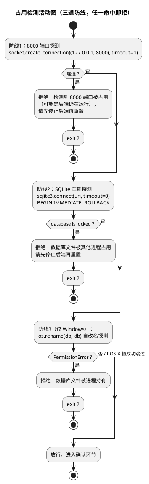
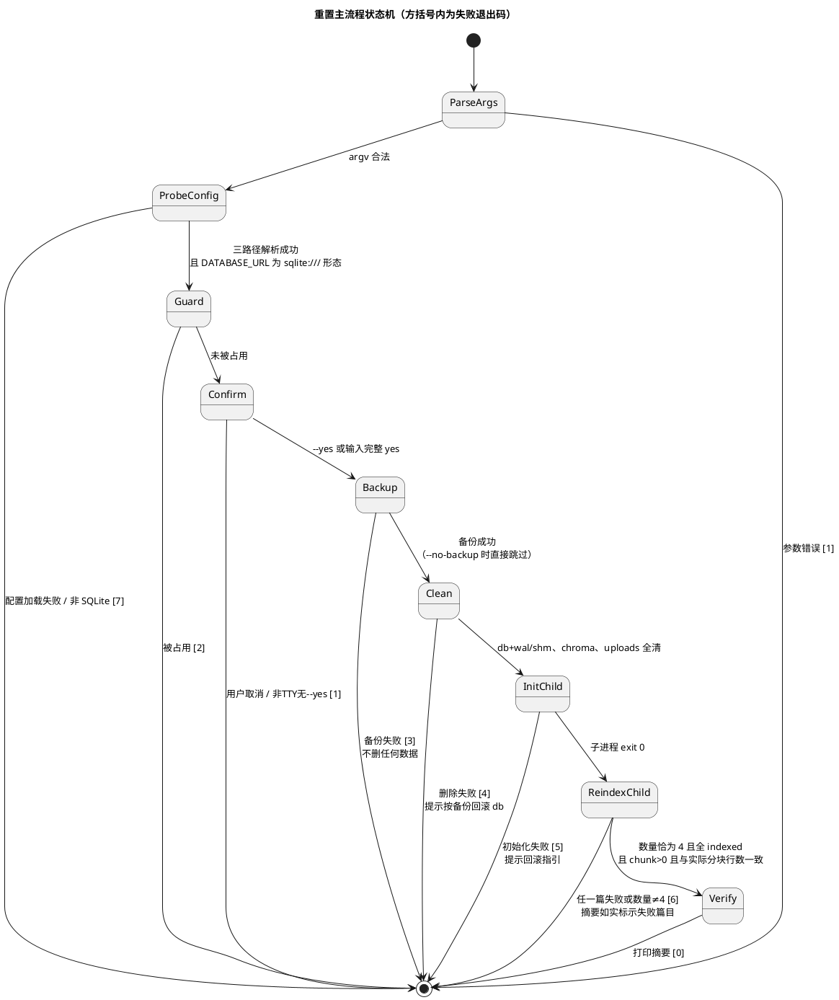
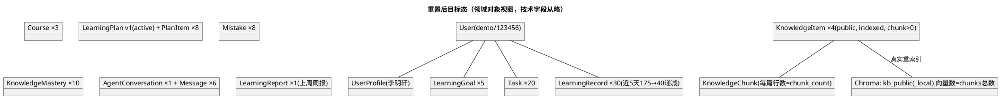

# 演示数据重置 + 演示脚本 + README 补齐 实现方案（DESIGN_DEMO_RESET）

> feature：`demo_reset`
> 阶段：P13 收尾批次（只新增脚本与文档，**禁止修改 `backend/app/**`、`frontend/src/**`、`backend/tests/**`**；不执行 git commit）
> 上游输入：`.codeartsdoer/specs/demo_reset/spec.md`（340 行，唯一需求输入，已含 5 处定点修订；修订处口径以 spec 为准）
> 技术契约：`docs/PROJECT_CONTEXT.md`；`docs/需求文档.md` 第 32 节（五步演示剧本）
> 后端契约事实（只读核对，已逐一过目）：`backend/app/db/init_db.py`（1167 行，幂等开关 + 16 表种子 + `__main__` 入口）、`backend/app/services/knowledge.py`（688 行，`reindex_item` 同步置 parsing/删旧 chunks、`process_document` 为 async）、`backend/app/rag/vectorstore.py`（306 行，模块级懒加载单例 + `_reset_vector_store()`）、`backend/app/core/config.py`（204 行，`DATABASE_URL` / `CHROMA_DIR` / `UPLOAD_DIR` 默认值与 `.env` 覆盖链）、`backend/app/db/session.py`（99 行，engine import 期绑定）
> 产物落点说明：本设计文档落在 `docs/designs/DESIGN_DEMO_RESET.md`（用户指定，对齐 `DESIGN_PLAN_REPORT_FRONTEND.md` 等既有文档惯例），**不**写 `.codeartsdoer/specs/demo_reset/design.md`
> 文风对齐：`docs/designs/DESIGN_PLAN_REPORT_FRONTEND.md`（文档头 / 章节编号 / PlantUML / 决策记录 / 验收映射）
> 本文档只描述「怎么实现」（架构、契约、决策），不含逐行代码；实现粒度到「文件职责 + 函数签名 + 关键分支」。

---

# 关键裁决速查表（授权 11 问逐条答案）

| # | 问题 | 裁决（详见正文章节） |
|---|---|---|
| 1 | 进程/生命周期 | **父子双进程模型**：父进程（主脚本）零 import `app.*`，只做配置探测、占用检测、确认、备份、删除、子进程编排、摘要打印；**初始化**由子进程 `python -m app.db.init_db` 执行；**重索引**由同脚本隐藏子命令 `--worker-reindex` 在全新子进程中执行。同进程严格控制 import 时序的方案被否决（import 期绑定不可静态强制，脆弱）；`_reset_vector_store` 在子进程模型下无需调用（新进程天然新单例）。详见 2.1.3-A |
| 2 | 重索引调用方式 | **直调服务层**：worker 子进程内 `reindex_item(db, demo_user, item_id)`（同步，置 parsing + 删旧 chunks）→ `await process_document(item_id)`；**不经 HTTP / BackgroundTasks / TestClient**（spec §5.1.1 规则 8 首选路径成立）。async 驱动：worker 内单事件循环 `asyncio.run()`，4 篇**串行** await。embedding 不可用：由 `embed_texts_with_fallback` 内部降级兜底向量，文档仍置 indexed，mode=offline 由 worker 在摘要行透传；仅当兜底也失败才置 failed → 脚本退出码 6。详见 2.2.2-B |
| 3 | 占用检测 | 三道防线按序执行：① 8000 端口探测（`socket.create_connection` 连通即判定后端可能在运行，拒绝）；② SQLite 写锁探测（标准库 `sqlite3`，`timeout=0` + `BEGIN IMMEDIATE` 立即 `ROLLBACK`，`database is locked` 即拒绝——兜底非 8000 端口的占用者）；③ Windows 独占补刀（`os.rename(db, db)` 自改名，`PermissionError` 即拒绝；POSIX 下恒成功自动跳过）。只提示退出、绝不杀进程。检测时机：参数解析后、二次确认前。误报处理：提示语写明「8000 端口被占用（可能是后端仍在运行）」，`--yes` 不豁免占用检测。详见 2.1.3-B |
| 4 | 备份/删除/重建顺序与失败点 | 顺序：配置探测 → 占用检测（退 2）→ 二次确认（取消退 1）→ 备份（失败退 3，不删任何数据）→ 删除 db（含 -wal/-shm）→ chroma 目录 → uploads 内容（删除失败退 4，提示按备份回滚 db）→ 初始化子进程（失败退 5）→ 重索引子进程（失败退 6）→ 只读验证 + 摘要（退 0）。已完成备份任何失败路径下均不删除。`--no-backup` 语义边界：仅跳过备份步骤，摘要备份行显式打印「未备份（--no-backup）」，其余全流程不变。详见 2.1.3-C |
| 5 | 摘要输出格式 | 父进程用**标准库 `sqlite3` 只读连接**查询（不 import ORM，保持父进程零 app import 铁律）：`knowledge_items`（`scope='public'`）取 `title / status / chunk_count`，`knowledge_chunks` 按 item_id `GROUP BY` 交叉验证行数一致。摘要块含：库路径、demo / 123456 账号提示、备份路径、4 篇标题 + 分块数（在线省略 mode，仅离线兜底篇目附标注）、验证查询命令。详见 2.2.2-D |
| 6 | DEMO_SCRIPT 结构 | 四段骨架：① 前置检查清单（6 项：重置执行 / 前后端启动 / 登录 / 4 篇 indexed 且 chunk>0 / 周报有数据 / 自备上传文件副本）；② 五步分镜（每步固定三小节：操作路径 / 预期界面 / 30–45 秒口播词）+ Dashboard 收尾幕——**默认 5 分钟版**，8–10 分钟加长版仅作附加章节并标注可展开的幕；第 4 幕固定走 `/plans` 工具栏「生成下一周学习计划」（W2）、第 5 幕固定走「重新调整计划 → diff 预览 → 查看/关闭/ESC」（W4/W5），Agent 对话仅用于第 3 幕学习状态分析；③ 常见问题（登录失败 / 检索无结果 / LLM 不可用 / 目标拆解失败改用种子目标）；④ 回滚指引。详见 2.4.1 |
| 7 / 9 | README 结构 | 同一问题合并回答：在现有八章基础上**只补不推翻**——修订「一、环境要求」补一键安装；新增「演示数据重置」小节落位复现步骤（含明确声明不提供 Docker / 云部署）；新增「数据集与开源组件说明」章；新增「码道（CodeArts）使用说明」章。全文禁止出现 Docker / 云部署操作指引。详见 2.4.2 |
| 8 | 脚本 CLI | `backend/scripts/reset_demo_data.py`：`--yes`（跳过交互确认；不豁免占用检测）、`--no-backup`（跳过备份）、隐藏 `--worker-reindex`（子进程内部入口，README 不暴露）。交互确认：未 `--yes` 时打印将删除的路径清单，须输入完整 `yes`；stdin 非 TTY 且未 `--yes` 直接拒绝。退出码表见 2.2.2-E（0/1/2/3/4/5/6/7 八档）。详见 2.2.2-A |
| 10 | 验收映射与风险 | spec §5.4.1 五条验收 → 设计落点逐条映射见第三章；风险表（Windows 删占用文件 / Chroma 单例 / 在线 embedding 不可用 / 端口误报 / WAL 伴随文件 / pytest 误收集 / 配置覆盖场景）见第四章 |
| 11 | 文件清单 | 新增 `backend/scripts/reset_demo_data.py`（约 480–560 行，单文件双进程角色）、新增 `docs/DEMO_SCRIPT.md`（约 280–340 行）、修改 `README.md`（净增约 90–120 行）、新增本文档。零改动 `backend/app/**`、`frontend/src/**`、`backend/tests/**`。详见第五章 |

---

# 一、需求与存量功能关系分析

## 1.1 需求功能与存量功能对比

### 1.1.1 已实现功能

| 需求功能 | 存量功能 | 代码位置 | 匹配度 |
|---|---|---|---|
| 建表 + 全套演示种子数据（demo 账号 / 目标 / 任务 / 记录 / 计划 / 周报 / 错题 / 掌握度 / 公共文档元数据） | `init_db()`：`create_all` 建 16 表 + 「demo 用户存在」幂等开关 + 单事务种子 + 摘要打印 + `__main__` 入口（`python -m app.db.init_db`） | `backend/app/db/init_db.py:1139-1167`（入口）、`1087-1106`（`_seed_all` 编排） | 100% |
| 真实重索引流水线（解析 → 切分 → 向量化 → 入库） | `process_document(item_id)`：async 流水线，状态机入口校验、扫描件/编码/空分块文案、`SessionLocal()` 独立短事务、先向量库后关系库写序 | `backend/app/services/knowledge.py:267-425` | 100% |
| 重索引前置动作（删旧 chunks + 置 parsing + chunk_count 清零 + 公共文档允许） | `reindex_item(db, user, item_id)`：同步函数，可见性校验、`pending/parsing` 拒绝（1007）、`db.commit()` | `backend/app/services/knowledge.py:507-552` | 100% |
| embedding 不可用时的自动降级 | `embed_texts_with_fallback`：在线失败内部降级兜底向量并返回 `mode="offline"`；`embed_texts_local` 无条件兜底 | `backend/app/rag/embedding.py:220-263`；`services/knowledge.py:349-359`（编排） | 100% |
| 向量库单例重置机制 | `_reset_vector_store()`：清模块级懒加载单例 | `backend/app/rag/vectorstore.py:102-111` | 100%（子进程模型下为免调用的保险） |
| 运行期路径配置单一来源 | `settings.DATABASE_URL` / `CHROMA_DIR` / `UPLOAD_DIR` / `PUBLIC_KB_DIR`，`.env` 覆盖链（项目根优先、backend/ 其次） | `backend/app/core/config.py:40-43, 96, 99, 128-129` | 100% |
| 公共知识库 4 篇源文档 | `data/public_kb/`：ml_basics / linear_algebra_notes / probability_formulas / ds_cheatsheet（4 个 .md，已核对存在）；种子元数据 `file_path` 与其逐字对应 | `data/public_kb/`；`init_db.py:790-797` | 100% |
| 一键启动入口（README 复现链路的既有锚点） | `start.bat`（新窗口后端 + 前端，缺 `.env` 自动复制模板）、`start.sh`（后台后端 + 前台前端，trap 关后端） | `start.bat:1-29`、`start.sh:1-35` | 100% |
| 脚本执行惯例（sys.path 注入、独立运行、防 pytest 收集） | `scripts/verify_*.py` 系列：`sys.path.insert(0, backend)` 后 import app；`scripts/conftest.py` 用 `collect_ignore` 防 `test_tools.py` 误收集 | `backend/scripts/verify_p7_dashboard.py:30-32`、`backend/scripts/conftest.py:14` | 100%（惯例复用） |
| 五步演示剧本原始素材 | 需求文档第 32 节：创建目标 AI 拆解 → 上传资料 → Agent 分析 → 生成下周计划 → 任务未完成动态调整 → Dashboard 收尾 | `docs/需求文档.md:1146-1248` | 100%（剧本骨架来源，口播词需新写） |
| README 既有有效内容（环境要求 / 目录结构 / 启动方式 / 访问地址 / 约定要点） | 现 README 八章 | `README.md:1-136` | 100%（保留对象） |

**判定依据说明**：上表匹配度均为 100%，依据是「功能语义逐点对得上且无需修改存量一行代码」——spec §1.4 边界 2 禁止修改产品代码，本章核对结论是**全部所需后端能力已存在**，重置脚本是纯编排层。唯一需要特别注意的不是功能缺失，而是**调用上下文的生命周期约束**（engine import 期绑定 + Chroma 进程内单例），这是 2.1.3-A 进程模型裁决的动因。

### 1.1.2 需要扩展的功能

| 需求功能 | 存量功能 | 差异说明 | 扩展方向 |
|---|---|---|---|
| 「重置」整体流程（检测 → 备份 → 删除 → 重建 → 重索引 → 摘要） | 无现成编排；`init_db` 只管建表种子、`reindex_item` 只管单篇前置、`process_document` 只管单篇流水线 | 输入差异：需要 CLI 参数（--yes / --no-backup）与交互确认，存量入口均无参数；业务逻辑差异：跨「文件系统操作 + 两个子进程 + 只读验证」的编排层不存在；边界条件差异：占用检测、备份时间戳目录、失败退出码均为新规则 | 新增 `backend/scripts/reset_demo_data.py` 单文件编排层（父进程零 import app；worker 子命令复用存量服务层）；**不改动** `init_db` / `knowledge.py` / `vectorstore.py` 任何一行；潜在兼容性：零（纯新增文件） |
| README 四项比赛内容 | 现有八章覆盖「环境要求 / 启动 / 验证」的大部分 | 差异：缺「演示数据重置」操作指引、「数据集与开源组件说明」、「码道使用说明」三块；「验证方式」仍停留在骨架阶段描述（占位登录），与现状（真实登录 + demo 账号）不符需修正 | 只补不推翻：新增 2 章 + 新增 1 节 + 修订「验证方式」节；显式声明不提供 Docker / 云部署 |

**兼容性结论**：两类扩展均为「纯新增文件 + README 只增补修订」，存量 Python 模块、前端、测试零触碰；回归面收敛在新脚本自身的手工执行验证与文档走读。

### 1.1.3 需要新增的功能或接口

按交付物分组（依赖关系：脚本不依赖两份文档，两份文档引用脚本行为——文档在脚本之后定稿以保持一致性口径，spec §5.3.1 规则 3）：

**① 重置脚本（1 个新文件，单文件双进程角色）**

- `backend/scripts/reset_demo_data.py`
  - 父进程角色（默认入口）：`main(argv)`——参数解析 → 配置探测（子进程）→ 占用检测 → 交互确认 → 备份 → 删除 → 初始化子进程 → 重索引子进程 → 只读验证 + 摘要。输入：CLI 参数；输出：stdout 摘要 + 退出码。
  - worker 角色（`--worker-reindex` 隐藏入口）：`_worker_reindex()`——import app 服务层，查 4 篇公共文档，逐篇 `reindex_item` + `await process_document`，逐篇打印 `标题 / chunk_count / mode`。输入：无（环境即输入）；输出：逐篇结果行 + 退出码。
  - 依赖关系：父进程 → `subprocess` → `python -m app.db.init_db`（存量）与 `python scripts/reset_demo_data.py --worker-reindex`（自身）；worker → `app.services.knowledge` / `app.db.session` / `app.models`（存量只读复用）。

**② 演示分镜脚本（1 个新文档）**

- `docs/DEMO_SCRIPT.md`：前置检查清单 + 五步分镜（操作路径 / 预期界面 / 30–45 秒口播词，默认 5 分钟版）+ Dashboard 收尾 + 常见问题四类 + 回滚指引。依赖：脚本摘要口径、前端既有页面事实、W1–W12 走查事实（2.4.1 写作约束）。

**③ README 修订（1 个既有文件增补）**

- `README.md`：新增「演示数据重置」节、「数据集与开源组件说明」章、「码道（CodeArts）使用说明」章；修订「环境要求 / 验证方式」节。依赖：脚本 CLI 定稿（命令与输出必须与脚本实际行为一致）。

**④ 本设计文档（1 个新文档）**

- `docs/designs/DESIGN_DEMO_RESET.md`。

**明确不新增**：不新增 pytest 用例（spec §1.4 边界 6：禁止 `scripts/test_*.py`；脚本命名 `reset_demo_data.py` 不匹配 pytest 默认收集模式 `test_*.py` / `*_test.py`，无需动 `scripts/conftest.py`）；不新增 npm 依赖与 Python 依赖（spec §4.1 规则 2）。
## 1.2 存量功能详细分析

### 1.2.1 `init_db()` 的幂等开关与进程期绑定约束（重置编排的第一约束来源）

- **接口契约**：入参无；出参无（结果落库 + stdout 摘要）；副作用 = `create_all` 建 16 表 + 单事务写入全部种子；异常路径 = 种子任一步失败整体 `rollback()` 并 `raise SystemExit(1)`（`init_db.py:1156-1162`），库中无半成品。
- **业务规则**：幂等开关**只有**一个——「demo 用户存在则跳过全部插入」（`init_db.py:1151-1155`）。推论：不删旧库直接跑初始化，种子被整体跳过、演示数据缺失——这正是 spec §5.1.1 规则 5「必须先删库再初始化」的代码依据。
- **进程期绑定（关键约束）**：`init_db.py:37` `from app.db.session import SessionLocal, engine`；`session.py:41-46` `engine = create_engine(settings.DATABASE_URL, ...)` 在 **import 期**完成绑定，同进程内再无重绑 API。推论：「先 import 再删库」的执行序会让初始化仍写旧连接已打开/已缓存的库句柄——这是 spec §4.2 规则 4 点名的隐患，设计必须以进程隔离消解（2.1.3-A）。
- **可用性正面事实**：`init_db.py:1146-1149` 自带「sqlite URL → 父目录 mkdir」逻辑，库文件被删后由子进程执行初始化会自建目录重建，无需编排层代建。
- **公共文档种子的口径注意**：`_seed_knowledge`（`init_db.py:781-844`）写入的 4 篇公共文档状态直接置 `INDEXED`、`chunk_count` 为预置值（2/1/1/0）、`embedding_id=NULL`——即种子态是「元数据齐但向量未建」的占位态（docstring 明示「文件本体由 RAG / P13 阶段放置」）。推论：重置流程的「真实重索引」不是锦上添花而是**必要环节**——不重索引则向量库为空、检索演示必败；重索引后 `process_document` 会以真实切分结果**覆盖** `chunk_count`（`knowledge.py:402-404`），与 spec §5.1.1 规则 6「分块数来自真实切分」自洽。
- **扩展点**：无（不修改 init_db 一行；`__main__` 入口即子进程调用形态）。

### 1.2.2 `reindex_item` + `process_document` 的调用契约（worker 子进程的直接复用面）

- **`reindex_item`（同步）**：入参 `(db: Session, user: User, item_id: int)`；出参 `KnowledgeItem`（已置 parsing）；异常 = `BizException`（1005 不可见/不存在；1007 pending/parsing 竞态拒绝）。副作用：`KnowledgeChunk` 旧行同步删除 + `status=parsing` + `chunk_count=0` + `error_msg=None`，**同一 `db` 事务内 commit**（`knowledge.py:532-548`）。
  - **对脚本的三点约束推导**：① 需要真实 `User` ORM 对象做可见性校验——worker 内以 `username=="demo"` 查出（初始化子进程先于 worker 完成，demo 必存在）；公共文档 `scope=PUBLIC` 对任意用户可见（`visibility_filters`，`knowledge.py:111-130`），校验必过。② 公共文档允许重索引是 spec 裁决过的既有能力（docstring `knowledge.py:512-514`），脚本不构成越权。③ 调用后文档处于 parsing 态，**必须**紧接着驱动 `process_document`，否则文档卡在中间态——两调用在 worker 内是原子编排单元。
- **`process_document`（async）**：入参 `(item_id: int)`；无出参（结果落库）；内部每次状态变更自建 `SessionLocal()` 短事务；失败一律置 `failed` + 阶段化 `error_msg`（解析/切分/向量化/向量入库/分块落库五类前缀），**不抛异常给调用方**。
  - **对脚本的三点约束推导**：① 「失败不抛异常」意味着 worker 不能以 try/except 判成败，必须在每篇 await 返回后**用全新 session 回查数据库**判定终态（`status==indexed 且 chunk_count>0 且与实际分块行数一致` 为成功，三条件口径详见 2.2.2-B；`failed` 取 `error_msg` 如实上报）。② async 驱动用 `asyncio.run()` 单事件循环即可；4 篇**串行**而非 `gather`——并行会增加 SQLite 写锁竞争与 Chroma 并发写复杂度，4 篇小文档串行耗时可控，简单性优先。③ 入口状态机（`knowledge.py:283-298`）只放行 pending/parsing——**禁止**绕过 `reindex_item` 直接对种子态（indexed）文档调 `process_document`（会直接退出不索引），两函数必须成对调用。
- **embedding 降级链**：`embed_texts_local` 无条件计算兜底向量并写 `_local` collection；`embed_texts_with_fallback` 在线失败自动降级返回 `mode="offline"`（`knowledge.py:349-367`）。推论：在线 embedding 不可用时文档仍置 indexed，属**成功路径的降级分支**而非失败——与 spec §5.1.3 场景 3 一致；worker 需透传 mode 供摘要标注「离线兜底索引」。仅当兜底也抛异常（防御性分支）才置 failed。
- **资源限制**：单文档 20MB 上限、公共文档实测 8~12 块/篇（`knowledge.py:565-568` docstring），4 篇串行全流程在演示机上次分钟级可完成（spec §4.1 的 10 分钟红线充裕）。

### 1.2.3 `vectorstore` 单例与 `_reset_vector_store` 的适用边界

- **存量形态**：`_vector_store` 模块级懒加载单例 + `threading.Lock` 双检（`vectorstore.py:61-99`），路径取自 `settings.CHROMA_DIR`；`_reset_vector_store()`（`102-111`）仅清缓存，docstring 明示「仅供测试注入独立 CHROMA_DIR 后重建使用」。
- **对本设计的约束推导**：① 在**同一进程**内「先触达单例（哪怕间接 import 后由流水线首次调用触发）→ 删 chroma 目录 → 再索引」，旧 client 持有的旧目录句柄会让重建落空；`_reset_vector_store()` 可解 Chroma 一侧，但**解不了 engine 一侧**（1.2.1：engine import 期绑定且无重绑 API）。② 因此 `_reset_vector_store` 在本设计中**不是主机制而是保险**：子进程模型下 worker 是全新进程、首次 import，单例天然指向新目录，无需调用；仅当未来有人把编排改为同进程时它才必要——设计选择不依赖它，但保留其为「备选方案 B」的组成件（2.1.3-A 对比表）。
- **线程安全**：Chroma client 线程安全（模块 docstring），worker 内 `asyncio.to_thread` 卸载解析段与向量写入并发无额外约束。

### 1.2.4 `config.py` 的路径解析链与 JWT 强校验（配置探测子进程的动因）

- **路径默认值**：`DATABASE_URL=sqlite:///{PROJECT_ROOT}/data/smartlearn.db`、`CHROMA_DIR={PROJECT_ROOT}/data/chroma`、`UPLOAD_DIR={PROJECT_ROOT}/data/uploads`（`config.py:96, 99, 128`），`PROJECT_ROOT` 由 `__file__` 推导（`config.py:29-37`），与 cwd 无关。
- **`.env` 覆盖链**：项目根 `.env` 优先、`backend/.env` 其次（`config.py:40-43`）。当前仓库实测：`backend/.env` 中 `DATABASE_URL` / `CHROMA_DIR` 行均被注释（已核对），即**默认路径生效**；但脚本必须兼容「评审机器上 `.env` 覆盖了路径」的场景，禁止把默认值硬编码进脚本。
- **JWT 强校验副作用**：`Settings` 的 `model_validator` 在 `JWT_SECRET` 缺失/占位时**拒绝启动**（`config.py:170-188`）。推论：任何 `import app.core.config` 的探测动作都依赖 `.env` 就绪——配置探测子进程失败时脚本应报「配置加载失败，请检查 .env」而非误报为占用。
- **铁律推导**：父进程若 import `app.core.config` 虽不会绑定 engine（engine 在 `app.db.session`），但会把「父进程零 import app.*」的纯净性打破（config 的 `lru_cache` 单例 + JWT 校验失败面都引入父进程）。裁决：父进程连 config 也不 import，路径解析走「配置探测子进程」（2.2.2-A），保证解析口径与后端 100% 同源。

### 1.2.5 `scripts/` 目录的既有惯例与 pytest 收集红线

- **惯例**：`sys.path.insert(0, str(脚本所在目录的父级))` 后直接 import app（`verify_p7_dashboard.py:30-32`）；脚本以 `cd backend && .venv/Scripts/python scripts/xxx.py` 方式独立运行。
- **红线事实**：`scripts/conftest.py` 只为 `test_tools.py` 声明了 `collect_ignore`——任何新增 `test_*.py` 形态的文件都会被 pytest 全量收集并在 import 期固化 engine（conftest docstring 记录的 P13 事故根因）。本设计脚本命名 `reset_demo_data.py` 不匹配收集模式，**结构性规避**，无需修改 conftest；worker 子命令虽在同一文件，仅当 argv 含 `--worker-reindex` 才 import app 模块（模块顶层保持零 app import），即使被任何工具误 import 也无副作用。

### 1.2.6 前端页面事实核对（DEMO_SCRIPT 的操作路径输入，只读）

- 登录页 `/login`、Dashboard 为登录后默认页（README §七验证方式 + MainLayout 骨架）；知识库上传后经「轮询文档状态到 `indexed`」再继续是前端既有交互（spec §5.2.1 规则 1 已点名该口径）。
- 公共文档列表端点：`GET /api/v1/knowledge/items`（`api/v1/knowledge.py:62` 已核对存在），按 `scope=public` 过滤核对 4 条——spec §5.4.1 规则 2.c 已勘误 `/knowledge/public` 端点不存在，本文档与 DEMO_SCRIPT 一律以真实端点为准。
- **约束**：DEMO_SCRIPT 只写「操作路径 + 既有界面元素」级别的描述，不承诺任何前端尚未实现的交互细节；口播词中涉及的徽章/提示以前端现状为准，编写 DEMO_SCRIPT 时需对照前端页面走查（该走查是 tasks 阶段的文档写作动作，本设计不展开逐页核对）。
---

# 二、增量设计方案

## 2.1 实现模型

### 2.1.1 上下文视图

```plantuml
@startuml
title 演示数据重置 上下文视图（进程边界即生命线）

actor 演示者

node "父进程（重置脚本主角色）" as parent {
  [reset_demo_data.py\nmain()]\n零 import app.*\n纯标准库
}

node "子进程1（配置探测）" as probe {
  [python -c 探测]\nimport app.core.config\n输出三个路径
}

node "子进程2（初始化）" as initp {
  [python -m app.db.init_db]\nimport 期绑定新 engine\n建表 + 种子
}

node "子进程3（重索引 worker）" as worker {
  [reset_demo_data.py\n--worker-reindex]\nimport 服务层\nreindex_item + process_document
}

node "本地文件系统" as fs {
  [data/smartlearn.db(+wal/shm)]
  [data/chroma/]
  [data/uploads/]
  [data/public_kb/（只读红线）]
  [data/_reset_backup/<时间戳>/]
}

cloud "LLM / Embedding 服务\n（OpenAI 兼容）" as llm

演示者 --> parent : python scripts/reset_demo_data.py\n[--yes] [--no-backup]
parent --> probe : subprocess（1 次，启动期）
probe --> parent : DATABASE_URL / CHROMA_DIR / UPLOAD_DIR\n（stdout 机器可读行）
parent --> fs : 占用检测 / 备份 / 删除\n（每路径类一次，失败即中止）
parent --> initp : subprocess（删除完成后）
initp --> fs : 重建 smartlearn.db（16 表 + 种子）
parent --> worker : subprocess（初始化成功后）
worker --> fs : 重建 chroma/ 向量（4 篇公共文档）
worker --> llm : 在线向量化（失败自动降级兜底）
parent --> fs : 只读验证（标准库 sqlite3）
parent --> 演示者 : 结构化摘要 + 退出码
@enduml
```

**通信协议与频率**：进程间全部为「一次性 `subprocess.run` 同步调用 + 退出码/stdout 回传」，无长连接、无中间件；`--worker-reindex` 是 CLI 层面的私有约定（README 不暴露）。频率：每次重置，probe ×1、init ×1、worker ×1。

### 2.1.2 服务/组件总体架构

```plantuml
@startuml
title reset_demo_data.py 内部组件结构（单文件双角色）

package "父进程角色（默认入口）" {
  [CliParser]\n解析 --yes/--no-backup/--worker-reindex
  [ConfigProbe]\n子进程探测三路径\n+sqlite URL 形态校验
  [OccupancyGuard]\n端口探测+锁探测+Windows改名探测
  [Confirmer]\n交互确认（完整 yes）
  [BackupManager]\n时间戳目录+copy2(含wal/shm)
  [RuntimeCleaner]\n删db→删chroma→清uploads
  [InitRunner]\nsubprocess: -m app.db.init_db
  [ReindexRunner]\nsubprocess: --worker-reindex
  [SummaryPrinter]\n只读sqlite3验证+摘要
}

package "worker 角色（--worker-reindex）" {
  [ReindexWorker]\nasyncio.run 串行4篇
}

[CliParser] --> [ConfigProbe]
[CliParser] --> [OccupancyGuard]
[OccupancyGuard] --> [Confirmer]
[Confirmer] --> [BackupManager]
[BackupManager] --> [RuntimeCleaner]
[RuntimeCleaner] --> [InitRunner]
[InitRunner] --> [ReindexRunner]
[ReindexRunner] --> [SummaryPrinter]
[CliParser] ..> [ReindexWorker] : argv 分发

note right of [ReindexWorker]
  import 边界铁律：
  本文件模块顶层零 import app.*；
  app 相关 import 只出现在
  _worker_reindex() 函数体内
end note
@enduml
```

**模块职责与配置项**：
- 父进程九组件均为**纯函数式协作的模块内函数**，不抽类（脚本量级约 500 行，类 hierarchy 是过度设计；与 `verify_*.py` 的函数式惯例对齐）。
- 配置项取值策略：路径三件套**只**来自 ConfigProbe 子进程输出（口径与后端同源）；备份根目录 `data/_reset_backup/` 由「probe 所得 DATABASE_URL 的库文件父目录 + `/_reset_backup`」推导而非硬编码项目相对路径（兼容 .env 把库指向非默认位置的场景——备份跟随库走，spec §6.2 的 `data/` 前缀是默认配置下的表现形）。
- 依赖关系调用频率：主链各组件每执行一次重置各调用一次；无循环依赖。

### 2.1.3 实现设计文档

#### A. 进程/生命周期模型裁决（授权问题 1，本轮最核心决策）

**裁决：父子双进程模型（方案 A）**——父进程零 import `app.*`；初始化与重索引各自由全新子进程执行。

| 维度 | 方案 A：子进程（**采纳**） | 方案 B：同进程严控 import 时序 | 方案 C：同进程 + `_reset_vector_store` |
|---|---|---|---|
| 正确性保障 | **结构性保障**：子进程首次 import 时库文件/目录已是新状态，engine 与 Chroma 单例天然绑新路径；满足 spec §4.2-4 的验收口径（全新启动的后端视角下无任何旧句柄残留） | 时序性保障：依赖「删除前任何人不在文件顶层/函数内提前 import」的**纪律**，无法静态强制；未来一次顺手 import 即静默破坏「重建真正生效」 | **不成立**：`_reset_vector_store` 只清 Chroma 单例；engine 在 `session.py` import 期 `create_engine` 后无重绑 API（1.2.1），同进程方案救不了 DB 一侧 |
| 幂等第二次执行 | 每次执行都是全新父进程 + 全新子进程，天然一致 | 同左（进程级重启），但单次执行内的时序脆弱性仍在 | 不成立 |
| 复杂度 | 多两次 subprocess 调用 + 一个隐藏子命令；进程间契约仅需退出码 + stdout 摘要行 | 代码最短，但需在文档与评审中反复辩护时序 | — |
| 失败可诊断性 | 子进程退出码 + stderr 原样透传，失败环节天然分段 | 异常与文件操作纠缠在同一堆栈 | — |
| 跨平台 | subprocess / socket / sqlite3 / shutil 全标准库跨平台 | 同左 | — |

**裁决理由**：spec §4.2 规则 4 把「重建必须真正生效」列为可靠性红线且给了验收条件；方案 A 把该红线从「靠纪律维持」升级为「靠进程边界结构性保证」，代价仅是约 2 秒的进程启动开销——对演示准备场景可忽略。方案 C 已被代码事实证伪（engine 不可重绑），方案 B 是「能跑但脆」的次优。

**落地要点**：worker 与父进程同一文件、以 `--worker-reindex` 隐藏参数分发角色——避免新增第二个脚本文件；`app.*` 的 import 语句**只出现在 `_worker_reindex()` 函数体内**（函数级 import 在 Python 中合法且局部化），文件模块顶层保持零 app import，即使被 pytest/其他工具误收集 import 也无任何副作用（1.2.5 红线的双保险）。

#### B. 占用检测设计（授权问题 3）



**各防线职责与误报口径**：
- **防线 1（主防线）**：检测「后端在运行」这一最高频场景。WAL 模式下空闲后端不持写锁，防线 2 可能漏检，故端口探测承担主责。误报 = 8000 被无关程序占用——提示语如实写明「8000 端口被占用（可能是后端仍在运行）」，引导演示者自行确认；**`--yes` 不豁免占用检测**（spec §4.3-2 安全红线高于便利性）。
- **防线 2（兜底）**：检测「非 8000 端口的占用者」（如 DB Browser 开着库文件、改端口启动的后端）。`timeout=0` 保证探测立即返回不阻塞；`BEGIN IMMEDIATE` 取 RESERVED 锁后立即 `ROLLBACK`，对运行中后端无侵入（瞬时锁请求，失败才说明有活跃写者/排他持有者）。探测连接必须显式 `close()`，避免自身成为占用源。
- **防线 3（Windows 补刀）**：Windows 禁止 rename 被无 DELETE 共享打开的句柄持有的文件（SQLite 默认打开方式即如此），`os.rename(db, db)` 是**纯标准库**下最可靠的「文件被持有」探针；POSIX 语义下 rename 打开中的文件恒成功，故该防线以 `os.name == "nt"` 门控，macOS/Linux 自动跳过。
- **检测时机**：参数解析 + 配置探测之后、交互确认之前——占用是最常见的失败，尽早暴露不浪费演示者的确认动作；且确认之后再删的窗口期内后端被启动属于 TOCTOU 残余风险，由防线 2/3 在删除前的**二次探测**（删除前再跑一次防线 2+3，跳过防线 1 的端口探测以省时间）收口——残余窗口内若后端恰好启动持锁，写锁探测仍可拦截。
- **绝不杀进程**（spec §1.4 边界 4）：三道防线只有「检测 → 拒绝 → 提示」三个动作，无任何 `kill`/`taskkill` 调用。

#### C. 主干流程与失败点行为（授权问题 4）



**逐步失败行为表**：

| 步骤 | 失败行为 | 退出码 | 备份保留 | 用户感知 |
|---|---|---|---|---|
| 参数解析 | 打印 usage | 1 | 无备份产生 | 用法提示 |
| 配置探测 | 提示检查 .env；非 SQLite 形态明示不支持 | 7 | 无 | 配置错误原文 |
| 占用检测 | 不删任何数据、不杀进程 | 2 | 无 | 「请先停止后端再重置」 |
| 交互确认 | 取消即终止，输出「已取消，未做任何修改」 | 1 | 无 | 明确未执行 |
| 备份 | 中止，**不进入删除** | 3 | 失败现场保留 | 备份失败原因（目录不可写/磁盘不足） |
| 删除 | 中止（剩余不删）；已删的 db 可从刚完成的备份回滚，chroma/uploads 无回滚义务（spec §4.2-3） | 4 | **保留** | 失败文件 + 回滚指引 |
| 初始化子进程 | 透传子进程 stderr；提示先按备份回滚 db 再排查 | 5 | **保留** | init_db 原始报错 |
| 重索引子进程 | 摘要逐篇标示成功/失败及 error_msg；失败篇目禁止显示虚假分块数；公共文档数量 ≠4（种子异常）同属失败——打印实际数量与标题清单，不输出「重置完成」摘要 | 6 | **保留** | 失败篇目 + 阶段化原因 |
| 验证+摘要 | 全绿打印结构化摘要 | 0 | 保留（spec 未授权自动清理备份） | 完整摘要 |

**`--no-backup` 语义边界**：仅跳过 Backup 一步；Clean 及以后各步不变；摘要备份行打印「未备份（--no-backup）」以满足 spec §6.3-3 的显式说明义务；回滚指引在该模式下改写为「无备份可回滚，可再次执行本脚本重建」。

**回滚指引（写进脚本失败提示与 DEMO_SCRIPT 附录，逐字口径对齐 spec §4.2-3）**：先停止后端 → 将 `data/_reset_backup/<YYYYmmdd-HHMMSS>/` 下的数据库主文件及 `-wal`、`-shm` 伴随文件复制回原数据库路径覆盖 → 重启后端。向量库与上传目录不备份、不回滚，由重新执行重置/重索引再生成。

**备份目录撞名处理**：`<YYYYmmdd-HHMMSS>` 秒级时间戳在「同一秒内连跑两次」的极限场景下撞名——若目标目录已存在则追加 `-2`、`-3` 序号后缀，保证多次备份永不互相覆盖（spec §6.2-2）。
## 2.2 接口设计

### 2.2.1 总体设计

本组件对外只有**一个 CLI 接口**与**两个文档产物**，无 HTTP / 库级 API；对内通过 subprocess 契约与存量模块衔接。

| 接口 | 形态 | 稳定性 | 说明 |
|---|---|---|---|
| `python scripts/reset_demo_data.py [--yes] [--no-backup]` | CLI（README/DEMO_SCRIPT 暴露） | 稳定 | 父进程入口，唯一演示者触点 |
| `python scripts/reset_demo_data.py --worker-reindex` | CLI（隐藏，文档不暴露） | 实验 | worker 子进程入口；与 `--yes/--no-backup` 互斥，同现时报参数错误 |
| `python scripts/reset_demo_data.py --verify-only` | CLI（隐藏，文档不暴露） | 实验 | 只读验证入口：仅配置探测 + sqlite3 只读验证 + 验证摘要，零写操作；退出码 0/6/7（详见 2.2.2-A） |
| `python -m app.db.init_db` | 存量 CLI（只读复用） | 稳定 | 初始化子进程形态，存量入口零改动 |
| `docs/DEMO_SCRIPT.md` / `README.md` | 文档 | 稳定 | 内容必须与脚本实际行为一致（spec §5.3.1 规则 3） |

接口变更策略：CLI 参数只增不改语义；`--worker-reindex` 为私有契约，未来如需拆分独立文件，保持参数名不变即可平滑迁移。

### 2.2.2 接口清单

#### A. 父进程 CLI（唯一公开接口）

**签名**：

```
cd backend && python scripts/reset_demo_data.py [--yes] [--no-backup]
```

| 参数 | 语义 | 边界 |
|---|---|---|
| （无参） | 全流程 + 交互确认 + 默认备份 | 未 `--yes` 且 stdin 非 TTY → 拒绝执行，exit 1 |
| `--yes` | 跳过交互确认直接执行 | **不豁免**占用检测与配置校验 |
| `--no-backup` | 跳过备份步骤 | 摘要必须显式说明未备份；不影响其余步骤 |
| `--verify-only` | 隐藏参数：仅执行「配置探测 + sqlite3 只读验证 + 验证摘要」，**不执行**占用检测、确认、备份、删除、初始化、重索引 | 退出码：验证通过 0；任一篇 status/chunk_count/行数不一致或数量≠4 → 6；配置失败 → 7；用于验收测试与故障排查，不产生任何写操作；不写进 README / DEMO_SCRIPT，不出现在普通 `--help` 主用法中；与 `--yes`/`--no-backup`/`--worker-reindex` 同现时报参数错误 |

**前置条件**：`backend/.venv` 可用或系统 python 已装项目依赖（worker 与 init 子进程需要 SQLAlchemy/chromadb 等）；`.env` 已就绪（config 的 JWT 强校验在 probe 子进程即触发）。**后置条件**：成功时运行期数据为「可演示的干净状态」；失败时按 2.1.3-C 失败行为表收口。**异常映射**：见 E 退出码表。

**配置探测子进程契约**（父进程获取三路径的唯一方式）：
- 形态：`subprocess.run([sys.executable, "-c", "<探测片段>"], cwd=backend目录, capture_output=True)`，探测片段 import `app.core.config` 并以固定分隔行打印 `DATABASE_URL` / `CHROMA_DIR` / `UPLOAD_DIR` 三个值（**不打印任何密钥字段**——spec §4.3-3）。
- 父进程校验：`DATABASE_URL` 必须 `sqlite:///` 前缀且非 `:memory:`，否则 exit 7 明示「仅支持 SQLite 文件库形态」；三个路径统一 `Path(...).expanduser().resolve()` 归一化后再使用。
- **路径安全守卫（PathGuard）**：探测归一化后立即执行 `validate_protected_paths`——数据库/向量库/上传目录三路径中任一与受保护路径重叠即 exit 7 且零写操作：命中 `.env` 文件本身、`data/public_kb`（含其子路径或为其父路径）、项目根、`backend/`、`data/` 目录本身均拒绝。守卫位于占用检测/确认/备份/删除之前，主链、`--verify-only` 与 worker 子进程入口均复用；防 `.env` 误配（如 `UPLOAD_DIR=data/`）导致删除环节殃及受保护路径（spec §4.3-1）。
- 为何不解析 `.env` 文本：pydantic-settings 的覆盖链（根 `.env` 优先、backend 其次、环境变量最高）在脚本侧复制即漂移；子进程探测保证口径与后端永远同源（1.2.4）。

#### B. worker 子进程契约（重索引调用方式裁决的落点，授权问题 2）

**调用链（逐篇串行 × 4，逐篇隔离 + 终态回查）**：

```
_worker_reindex():
    # 函数体内才执行 import（模块顶层零 app import 铁律）
    import app 相关模块
    with SessionLocal() as db0:                  # 短 session：仅查 demo 与公共文档清单
        demo = db0.scalar(select(User).where(User.username == "demo"))  # init 子进程已保证存在
        items = db0.scalars(select(KnowledgeItem)
                            .where(KnowledgeItem.scope == KnowledgeScope.PUBLIC)
                            .order_by(KnowledgeItem.id)).all()
    # 数量硬门禁：恰 4 篇，≠4 打印实际数量与标题清单后立即 exit 1（见下「公共文档定位依据与数量硬门禁」）
    results = []
    for item in items:                           # 跨循环只携带 id/title 标量，不持 ORM 对象跨 await
        try:
            with SessionLocal() as db1:          # ① 短生命周期 session：reindex 专用
                reindex_item(db1, demo, item.id) # 同步：删旧 chunks + 置 parsing + commit
            # db1 commit 后随 with 立即关闭，不跨 await 持有
            await process_document(item.id)      # ② async：解析→切分→向量化→入库
            with SessionLocal() as db2:          # ③ 全新的 SessionLocal 回查终态
                fresh = db2.get(KnowledgeItem, item.id)
                real = db2.scalar(select(func.count()).select_from(KnowledgeChunk)
                                  .where(KnowledgeChunk.item_id == item.id))
                # 三条件缺一不可；第三条件等价于
                # chunk_count == SELECT COUNT(*) FROM knowledge_chunks WHERE item_id = ?
                ok = (fresh.status == INDEXED and fresh.chunk_count > 0
                      and fresh.chunk_count == real)
                err = None if ok else (fresh.error_msg or "终态回查不满足三条件")
        except BizException as exc:              # 1005 不可见 / 1007 竞态
            ok, err = False, f"BizException {exc.code}: {exc.message}"
        except Exception as exc:                 # 未预期异常不中断后续篇目
            ok, err = False, f"{type(exc).__name__}: {exc}"
        results.append((item.title, ok, err))
        打印结果行 [OK]/[FAIL]（标题 / chunk_count 或原因；mode 标注见下「mode 透传」条款）
    return 0 if 全部 ok else 1                   # 任一篇失败 → worker exit 1 → 父进程映射 exit 6
```

- **逐篇隔离**：每篇文档独立 `try/except`，捕获 `BizException` 与未预期异常，打印 `[FAIL] <标题> — <原因>` 后继续下一篇；全部跑完后任一篇失败则 worker exit 1——单篇失败既不中断其余篇目，也不得被静默吞掉。
- **session 生命周期三禁区**：① 不允许同一个 ORM session 跨 `await` 持有——`reindex_item` 用短生命周期 `SessionLocal`，commit 后立即关闭；② 回查必须用**全新的** `SessionLocal`——`process_document` 内部以独立短事务提交（1.2.2），调用方若复用旧 session，其读事务快照可能看不到新提交（SQLite 读事务隔离），`db.get` 还可能命中 identity map 中的旧对象；③ 回查是三条件联合判定：`status == INDEXED` 且 `chunk_count > 0` 且 `chunk_count == SELECT COUNT(*) FROM knowledge_chunks WHERE item_id = ?`——不允许只看 `chunk_count > 0` 不看实际分块行数（第三条件是「分块行数 = chunk_count」不变量的 worker 侧实证，与父进程 sqlite3 交叉验证同一口径，2.2.2-D）。

- **async 驱动方式**：worker 内 `_worker_reindex` 定义为 async 函数，`asyncio.run(_worker_reindex())` 单事件循环承载；4 篇**串行 await**，不用 `asyncio.gather`（1.2.2 推导②：规避 SQLite 写锁竞争与 Chroma 并发写复杂度）。
- **为何不经 HTTP/BackgroundTasks**：spec §5.1.1 规则 8 的首选路径成立——`reindex_item`/`process_document` 是可脱离请求上下文直调的服务层函数（不依赖 Request/BackgroundTasks 对象）；经 TestClient 走 HTTP 反而引入鉴权 token 构造、路由层包装等无关复杂度。裁决：**直调服务层**，无需临时测试客户端。
- **mode 透传（在线省略 mode）**：`process_document` 的 mode 不落库（1.2.2），worker 在调用前后通过 `embed` 侧日志不可直取——落地方案：worker 在调用 `process_document` 前**先自行探测一次在线 embedding 可用性**（复用存量 `embed_query_with_fallback` 或等价探测，取其二元 mode），仅用于离线兜底篇目的结果行标注；**在线为默认路径，结果行省略 mode 字段不予标注**——spec §6.3 摘要必填项不含 mode，§5.1.3 场景 3 口径为「必要时提示当前为离线兜底索引」，故仅离线兜底篇目附 `(offline 兜底)`，在线篇目一律省略 mode；探测失败不阻断（兜底路径必然可用）。
- **embedding 不可用的退出语义**：在线不可用 → 降级兜底 → 文档仍 indexed → **不影响退出码**（spec §5.1.3 场景 3）；兜底也失败 → 该篇 failed → worker exit 1 → 父进程映射 exit 6。
- **公共文档定位依据与数量硬门禁**：按 `scope=PUBLIC` 查而非按标题硬编码——种子是唯一写入公共文档的入口（`init_db._seed_knowledge`），种子只应有 4 篇公共文档。`scope=PUBLIC` 的文档**数量恰为 4** 是硬门禁：查到数量 ≠4 时，打印实际数量与标题清单，worker 立即 exit 1（父进程映射 exit 6），**不得输出「重置完成」摘要**——数量不符说明初始化异常，按失败收口而非警示（不伪造、不硬编码 4、不降级为警告后继续）。

#### C. 占用检测接口（父进程内部函数契约）

**签名**（模块内函数，不对外暴露）：

```
guard_occupancy(db_path: Path, backend_port: int = 8000) -> None
# 命中占用：打印提示并以 exit 2 终止（SystemExit(2)）
# 未命中：静默返回
```

- **前置条件**：`db_path` 已经归一化；库文件不存在时（首次运行）防线 2/3 自动跳过（不存在即不可能被占用），防线 1 仍执行。
- **后置条件**：返回即「删除动作可安全开始」。
- **副作用**：防线 2 的探测连接显式关闭；无任何写操作、无进程操作。
- **二次探测**：删除动作前再执行一次防线 2+3（跳过防线 1），收口 TOCTOU 窗口（2.1.3-B）。

#### D. 摘要输出格式（授权问题 5）

**验证查询方式裁决**：父进程以**标准库 `sqlite3` 只读连接**直查 SQLite（`mode=ro` URI 打开，防误写），不用 ORM——父进程零 import app 铁律优先；且 `sqlite3` 是标准库，Windows/macOS/Linux 行为一致，不依赖评审机器装 sqlite3 CLI。查询两张表：
1. `knowledge_items WHERE scope='public'`：取 `title / status / chunk_count`（摘要主数据源——`chunk_count` 由 `process_document` 按真实切分回填，非伪造）；
2. `knowledge_chunks GROUP BY item_id`：行数与 `chunk_count` 交叉一致才算验证通过（「分块行数 = chunk_count」是 `process_document` 三方一致性的既有不变量，1.2.2）。

**摘要块版式**（stdout，全部中文，禁止出现密钥）：

```
========== SmartLearn 演示数据重置完成 ==========
数据库路径: <绝对路径>/data/smartlearn.db（已重建）
演示账号: demo / 123456（仅供开发演示，请勿用于生产环境）
备份目录: <绝对路径>/data/_reset_backup/20261024-153012
          （--no-backup 时本行显示：未备份（--no-backup））
公共知识库（4 篇，真实索引）:
  [OK] 机器学习核心概念速览 — 8 chunks
  [OK] 线性代数要点笔记：特征值与矩阵分解 — 6 chunks (offline 兜底)
  [OK] 概率论与数理统计公式表 — 5 chunks
  [OK] 数据结构常见考点速查 — 7 chunks
验证查询（可选）: cd backend && python -c "import sqlite3;c=sqlite3.connect('../data/smartlearn.db');print(c.execute(\"select title,status,chunk_count from knowledge_items where scope='public'\").fetchall())"
下一步: 启动后端与前端（start.bat / bash start.sh），以 demo / 123456 登录
==================================================
退出码: 0
```

- 失败篇目行版式：`[FAIL] <标题> — <error_msg 原文>`（禁止显示虚假分块数，spec §5.1.1 规则 6）。
- 分块数在上方示例中为占位示意（`8/6/5/7`），实际数字以真实切分为准；在线篇目省略 mode 标注，仅离线兜底篇目在摘要行附 `(offline 兜底)`（spec §5.1.3 场景 3「必要时提示」口径）。
- worker 的逐篇结果行由父进程**原样透传**进摘要块（父进程不重新格式化 worker 的事实数据，避免双源不一致）；父进程的 sqlite3 交叉验证结果作为 `[OK]/[FAIL]` 前缀的判定来源。

#### E. 退出码表（授权问题 8 的另一半）

| 退出码 | 语义 | 触发环节 |
|---|---|---|
| 0 | 成功（含验证通过） | 全链路完成 |
| 1 | 参数错误 / 用户取消确认 / 非 TTY 未 `--yes` / 未分类错误 | ParseArgs / Confirm |
| 2 | 数据库被占用或后端在运行 | Guard（三道防线任一） |
| 3 | 备份失败 | Backup |
| 4 | 删除失败 | Clean |
| 5 | 初始化子进程失败 | InitChild |
| 6 | 重索引失败（任一篇）或最终验证不通过 | ReindexChild / Verify |
| 7 | 配置加载失败 / 非 SQLite 形态 / 路径安全校验失败 | ProbeConfig / PathGuard |

worker 子进程自身退出码收敛为 0/1（细节由父进程据其结果行与回查映射为 6）；init 子进程退出码即 `init_db` 自身的 0/1（父进程映射为 5）。

## 2.3 数据模型

### 2.3.1 设计目标

本组件**不新增任何数据模型、表结构或持久化字段**——全部数据形态由存量 `init_db` 种子与知识库流水线定义。数据模型层面的设计问题只有一个：**重置前后数据形态的一致性保证**，即「可演示的干净状态」的可核对定义。

### 2.3.2 模型实现（重置后目标态不变量）

重置成功后，运行期数据必须满足以下可核对不变量（摘要与验收的共同依据）：



- **对象生命周期**：全部演示数据由 `init_db` 单事务创建（存量），由重置脚本整体删除后重建——无中间态对象流转设计；种子日期字段全部相对执行时刻动态生成（`init_db.py` docstring 规则 4），任意演示日期重置均自洽。
- **持久化策略**：SQLite 单文件 + Chroma 目录 + uploads 目录三类运行期路径；备份仅覆盖 SQLite 三文件（spec §6.2-3），向量与上传目录由重建再生成。
- **与存量数据的兼容策略**：不兼容也不需兼容——重置的语义就是「推翻重建」；需保留数据者依赖备份目录人工回滚（2.1.3-C 回滚指引）。

## 2.4 文档产物设计

### 2.4.1 `docs/DEMO_SCRIPT.md` 结构骨架（授权问题 6）

```
# SmartLearn 比赛演示分镜脚本
> 用途 / 总时长预估（默认 **5 分钟版**：五幕 + Dashboard 收尾；另可附「8–10 分钟加长版」章节，明确标注哪些幕可展开，不得把加长版当默认）/ 演示账号 / 适用场景

## 一、前置检查清单（演示前 15 分钟逐项打勾）
1. 执行重置：cd backend && python scripts/reset_demo_data.py --yes
   通过标志：摘要含备份路径 + 4 篇 [OK] + 退出码 0
2. 启动后端（8000）与前端（5173）：start.bat 或 bash start.sh
   通过标志：/health 返回 code=0
3. 登录 demo / 123456
   通过标志：进入 Dashboard 且各卡片有数据
4. 公共知识库 4 篇均已索引且分块数 > 0
   通过标志：知识库页可见 4 篇公共文档；或接口 GET /api/v1/knowledge/items
   按 scope=public 过滤为 4 条（真实端点，spec §5.4.1-2.c 勘误口径）
5. 周报有数据
   通过标志：报告页可见上周周报
6. 自备上传文件：复制 data/public_kb/linear_algebra_notes.md 到桌面备用
   （重置已清空上传目录，「上传资料」一幕必须自备文件，spec §5.2.1 规则 1）

## 二、五步分镜（每步固定三小节：操作路径 / 预期界面 / 口播词 30–45 秒；五幕 + 收尾幕合计约 5 分钟）
### 第 1 幕：创建目标，AI 拆解学习路线
  - 操作路径：目标页 → 「创建学习目标」→ 输入「6个月掌握机器学习」→ 提交
  - 预期界面：AI 拆解的知识树/路线图渲染；拆解中 loading 态
  - 口播词：（30–45 秒中文成稿，亮点：AI 把模糊目标变成可执行路线）
### 第 2 幕：上传资料进知识库
  - 操作路径：知识库页 → 上传桌面备用的 md → 轮询状态到 indexed
  - 预期界面：文档状态 pending→parsing→indexed 流转、分块数出现
  - 口播词：（亮点：真实解析切分向量化，检索即刻可用）
### 第 3 幕：Agent 分析学习状态
  - 操作路径：Agent 对话页 → 输入「我最近感觉机器学习学得很乱，帮我分析一下」
  - 预期界面：流式输出 + 工具调用痕迹；引用学习记录/任务/掌握度/知识库
  - 口播词：（亮点：四类数据融合分析，不是聊天机器人）
### 第 4 幕：生成下周计划
  - 操作路径：/plans 页工具栏点「生成下一周学习计划」→ 等头部出现「下周计划」标注且按钮结束 loading（W2 已验证路径，全程停留 /plans 无跳转）
  - 预期界面：周视图立即渲染下周完整网格（不显示空态）、信息头含「下周计划」标注；unplaced_tasks 非空时下方提示卡含标题与原因
  - 口播词：（亮点：计划落到具体任务与时段）
### 第 5 幕：任务未完成，动态调整计划
  - 操作路径：把一个任务保持未完成 → /plans 周视图点「重新调整计划」→ diff 双栏预览 →「查看调整后的计划」/「关闭对比」/ ESC（W4/W5 已验证路径）
  - 预期界面：按实际 diff 双栏与提示写——顶部 adjust_reason 全文显著可见；被移动条目两栏均有醒目标记、removed 左栏标「移出」、added 右栏标「新增」；切换后为新版本周视图；「关闭对比」/ESC 路径出现「新计划已生效」轻提示；不得虚构「v2 徽章」等不存在的元素
  - 口播词：（亮点：逾期任务 + 时间衰减触发的动态再规划）
### 收尾幕：Dashboard 学习画像
  - 操作路径：切到 Dashboard
  - 预期界面：趋势图（近 5 天 175→40 递减）、掌握度雷达/薄弱点、风险预警
  - 口播词：（亮点：「这是 AI 根据过去学习数据形成的个人学习画像」）

## 三、常见问题与降级话术
1. 登录失败 → 排查顺序：后端是否启动 → 是否已执行重置 → 数据库路径；
   备用话术 + 现场重跑重置脚本
2. 知识库检索无结果 → 先确认 4 篇公共文档 indexed；换用预置问题清单
   （问题清单随文档给出，与 4 篇文档内容强相关）
3. LLM 不可用 → 降级话术「现场网络波动，系统已切换到本地检索结果」；
   指明周报/计划等不依赖实时 LLM 的环节可继续
4. 目标拆解失败 → 改用种子目标「6个月掌握机器学习核心算法」（已含
   roadmap）继续演示，不阻塞后续计划生成与报告演示（spec §5.2.3-3）

## 四、附录：回滚指引（逐字对齐 spec §4.2-3 口径）
```

**写作约束**：口播词逐句成稿、可直接照读；操作路径只写既有页面元素（1.2.6 约束）；**Agent 对话只在第 3 幕做学习状态分析**——第 4/5 幕固定走 `/plans` 工具栏按钮的 W2/W4/W5 已验证路径，若要把 Agent 触发计划/调整作为附加演示，必须标注「需先走查确认，不作为主路径」；**编写 DEMO_SCRIPT 前必须对照 `docs/WALKTHROUGH_PLAN_REPORT_FRONTEND.md` 的 W1–W12 实际操作路径与预期逐条核对，不允许凭设计想象界面**；默认产出 **5 分钟版**（五幕 + Dashboard 收尾，每幕口播 30–45 秒），「8–10 分钟加长版」仅作附加章节并明确标注可展开的幕，不得把加长版当默认；禁止出现 Docker / 云部署步骤；禁止要求修改产品代码或真实密钥。

### 2.4.2 `README.md` 修订设计（授权问题 7/9，合并回答）

**原则**：保留现有八章全部有效内容（环境要求 / 目录结构 / 启动 / 访问地址 / 约定要点），只增补与修正（spec §4.5-1）；四项比赛要求的落点如下：

| 比赛要求 | README 落点 | 动作 |
|---|---|---|
| 环境依赖与一键安装 | 现「一、环境要求」扩写：Python/Node 版本表保留，补「后端 pip install -r requirements.txt、前端 npm install、一键 start.bat / start.sh」的串链 | 修订 |
| 本地运行与复现步骤 | 新增「演示数据一键重置」节（置于「五、一键启动」之后）：重置命令（`--yes` / `--no-backup`）、预期摘要样例、公共知识库索引确认方式（含验证查询命令）、demo 账号、常见启动失败处理（端口占用识别与释放、重置后无法登录的排查）；**明确声明本项目不提供 Docker 容器化与云部署**；现「七、验证方式」中骨架期占位描述修正为真实登录验证 | 新增节 + 修订 |
| 数据集与开源组件说明 | 新增独立章：`data/public_kb/` 4 篇文档的来源与用途（课程笔记型自编材料，供知识库检索演示）、主要开源组件清单（SQLite / FastAPI / Vue 3 / Element Plus / Chroma / pypdf / OpenAI 兼容 API 等）、声明未使用外部受限数据集 | 新增章 |
| 码道（CodeArts）使用说明 | 新增独立章：码道参与的开发环节（需求/设计/编码/测试辅助）与作用描述 | 新增章 |

**禁止项落地**：全文检索自查——不出现 Dockerfile / docker-compose / 云部署操作指引（spec §5.3.1 规则 2a）；不泄露 `.env` 真实密钥；「重置命令、摘要样式、账号、访问地址」逐字对齐脚本实际输出（一致性规则 §5.3.1-3，编写时以脚本真实跑出的摘要为准贴样例）。
---

# 三、验收映射（授权问题 10 前半）

spec §5.4.1 本轮验收口径 → 设计落点逐条映射：

| spec 验收条款 | 设计落点 | 验证方式 |
|---|---|---|
| §5.4.1-1 重置验证（连跑两次，第二次不报错；输出含备份路径 / demo 账号提示 / 4 篇分块验证行） | 进程模型（2.1.3-A）保证每次执行都是全新进程链；备份撞名序号后缀（2.1.3-C）保证第二次备份不覆盖；摘要版式（2.2.2-D）固定含三要素 | 实跑 `reset_demo_data.py --yes` 两次，比对两次摘要与退出码 |
| §5.4.1-2.a 后端测试全绿（基线 206 passed） | 本设计零改动 `backend/app/**` 与 `backend/tests/**`；新脚本命名规避 pytest 收集（1.2.5） | `cd backend && pytest` |
| §5.4.1-2.b 前端构建通过 | 零改动 `frontend/**` | `cd frontend && npm run build` |
| §5.4.1-2.c 公共文档 4 条（`GET /api/v1/knowledge/items` 按 scope=public） | worker 重索引 4 篇至 indexed（2.2.2-B）；DEMO_SCRIPT 前置检查第 4 项含该核对（2.4.1） | 重置 + 启动后端后调真实端点 |
| §5.4.1-2.d demo / 123456 登录返回 token | init 子进程种子含 demo 账号（1.2.1）；DEMO_SCRIPT 前置检查第 3 项 | 登录接口实测 |
| §5.4.1-3 文档交付（DEMO_SCRIPT.md 已生成、README 已更新） | 2.4.1 / 2.4.2 结构骨架与写作约束 | 文档走读 |
| §5.4.1-4 改动范围验证（git 基线对比） | 文件清单（第五章）即允许新增集；脚本自身不创建任何 git 操作 | 开工/收工各跑一次 `git status --short -uall` 对比 |
| §5.4.1-5 汇报纪律（真实输出，禁止虚报） | 本设计不含任何「已验证」表述的预设；所有验证留待实现后实跑 | 汇报贴原文 |

spec §5.1.1 各规则的映射要点：规则 1（路径解析）→ 2.2.2-A 配置探测子进程；规则 2（占用检测）→ 2.1.3-B + 2.2.2-C；规则 3（备份）→ 2.1.3-C Backup 步 + §6.2 撞名处理；规则 4（确认）→ 2.2.2-A 交互确认；规则 5（重建复用 init_db）→ 2.1.3-A 子进程 2；规则 6（真实重索引）→ 2.2.2-B 服务层直调 + 回查终态；规则 7（幂等）→ 全新进程链天然幂等；规则 8（优先服务层）→ 裁决直调，无需 TestClient；规则 9（禁止项）→ 全文贯穿。

# 四、风险与未决点（授权问题 10 后半）

| # | 风险 | 影响 | 设计缓解 | 残余等级 |
|---|---|---|---|---|
| R1 | Windows 删除被占用文件（杀软/索引器瞬时持锁，三道防线全过后的竞态） | 删除步失败，重置中断 | 删除前二次探测（2.1.3-B）；失败即中止 + 备份回滚指引（2.1.3-C） | 低 |
| R2 | Chroma 旧单例写旧目录 | 重建落空（spec §4.2-4 红线） | 子进程模型结构性规避（2.1.3-A）；`_reset_vector_store` 留作备选机制不依赖 | 极低 |
| R3 | 在线 embedding 不可用 | 摘要 mode=offline，检索质量略降 | 存量降级链自动兜底（1.2.2）；摘要如实标注；DEMO_SCRIPT 降级话术覆盖 | 低（不阻断） |
| R4 | 8000 端口被无关程序占用 → 误报「后端在运行」 | 重置被拒 | 提示语写明「可能是后端仍在运行」并引导确认；三道防线职责分层（2.1.3-B） | 低（可人工恢复） |
| R5 | `-wal`/`-shm` 伴随文件漏删漏备 | 备份不完整或残留旧数据并入新库 | 备份与删除均以「主文件 + 存在时的 -wal/-shm」三元组为单位（2.1.3-C） | 低 |
| R6 | 脚本被 pytest 误收集 | 测试库隔离失效（P13 事故重演） | 命名 `reset_demo_data.py` 不匹配收集模式 + 模块顶层零 app import 双保险（1.2.5） | 极低 |
| R7 | `.env` 将 DATABASE_URL 覆盖到非默认位置甚至非 SQLite | 脚本删错位置或不适配 | 配置探测子进程同源解析 + sqlite:/// 形态校验，非 SQLite 明确拒绝（2.2.2-A） | 低 |
| R8 | 重索引单篇失败 | 退出码 6，演示数据不完整 | 摘要如实标示失败篇目与阶段化原因；备份保留；修复源文档后可单独重跑 | 中（设计已如实上报，不掩盖） |
| R9 | DEMO_SCRIPT 口播词/界面描述与前端实况漂移 | 演示现场卡壳 | 写作约束「只写既有页面元素」+ 编写时逐页走查（1.2.6）；该走查是 tasks 阶段动作 | 中 |

**未决点**：
1. 4 篇公共文档的真实分块数当前**未验证**（需实现后实跑才知），摘要样例中的数字为占位示意；README/DEMO_SCRIPT 贴样例时必须以真实输出为准。
2. worker 探测在线 embedding 可用性的具体调用点（复用 `embed_query_with_fallback` 或等价最小探测）在实现时以代码事实为准——两方案均为存量能力复用，不改变本设计的进程模型与契约。
3. 前端「上传后状态轮询」的既有交互细节（轮询间隔/可见徽章）未在本设计中展开核对，留待 DEMO_SCRIPT 编写时对照页面走查（R9）。

# 五、文件清单（授权问题 11）

| 文件 | 动作 | 预估行数 | 说明 |
|---|---|---|---|
| `backend/scripts/reset_demo_data.py` | 新增 | 480–560 | 单文件双角色：父进程编排（配置探测/三道防线占用检测/确认/备份/删除/子进程编排/sqlite3 只读验证/摘要）+ `--worker-reindex` worker 分支（函数级 import 服务层，`asyncio.run` 串行 4 篇）；模块顶层零 app import |
| `docs/DEMO_SCRIPT.md` | 新增 | 280–340 | 前置检查 6 项 + 五步分镜（每幕操作路径/预期界面/30–45 秒口播词，默认 5 分钟版，可附 8–10 分钟加长版章节）+ 收尾幕 + 常见问题 4 类 + 回滚指引附录 |
| `README.md` | 修改 | 净增 90–120 | 新增「演示数据一键重置」节、「数据集与开源组件说明」章、「码道（CodeArts）使用说明」章；修订「环境要求」「验证方式」节；保留现有全部有效内容；不出现 Docker/云部署 |
| `docs/designs/DESIGN_DEMO_RESET.md` | 新增 | 本文件 | 落点 `docs/designs/`（用户指定），不写 `.codeartsdoer/specs/demo_reset/design.md` |
| `backend/app/**` | **零改动** | 0 | 红线（spec §1.4-2）；存量能力核对结论为 100% 够用（1.1.1） |
| `frontend/src/**` | **零改动** | 0 | 红线 |
| `backend/tests/**` | **零改动** | 0 | 红线；亦不新增 `scripts/test_*.py` |
| Docker / 云部署文件 | **不创建** | 0 | 红线（spec §1.4-1） |

**git 操作**：本轮不执行任何 commit（spec §1.4-5）。