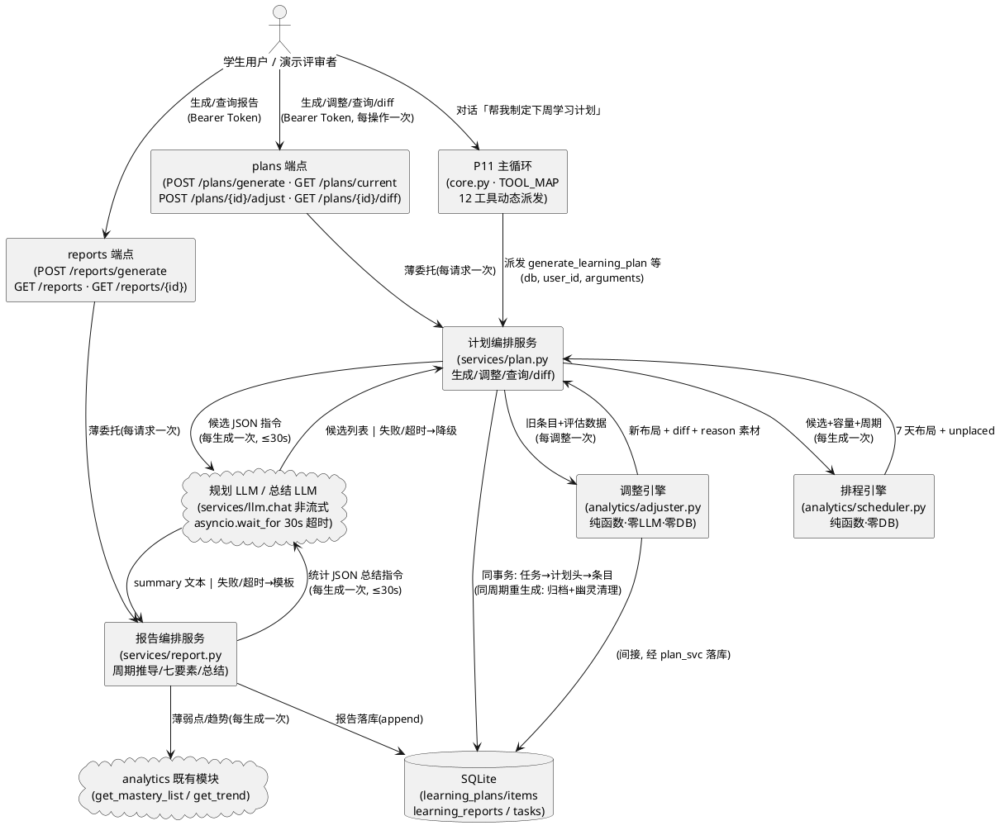
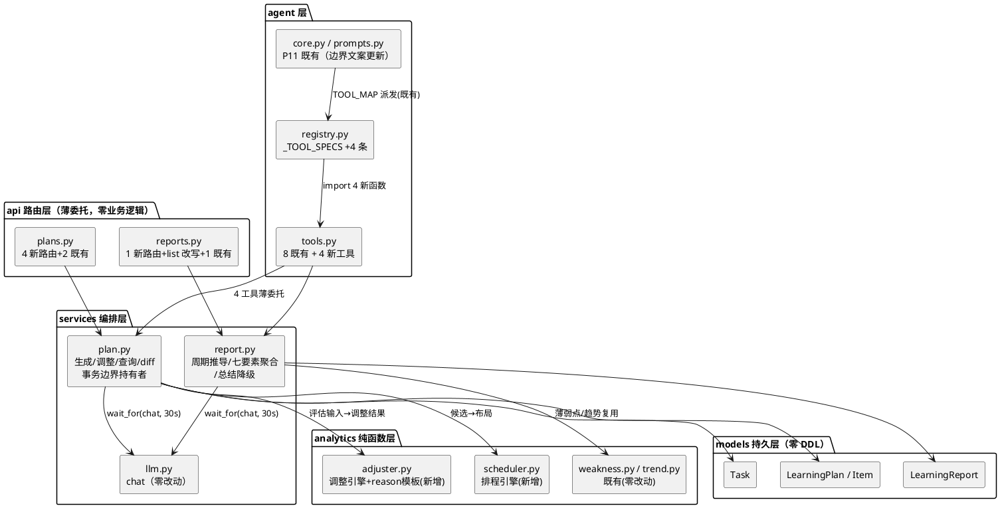
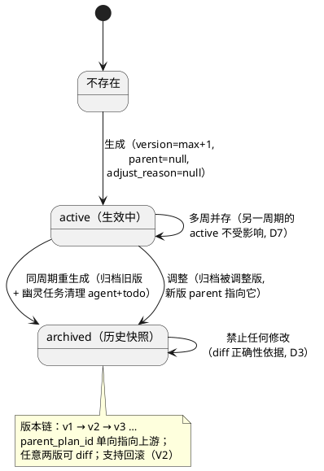
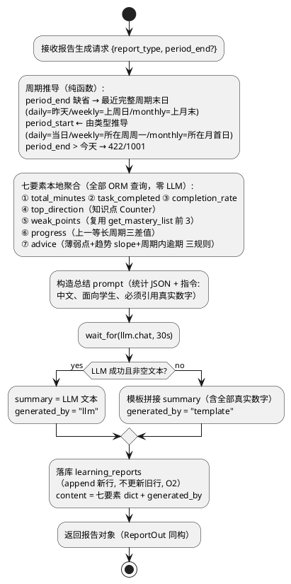
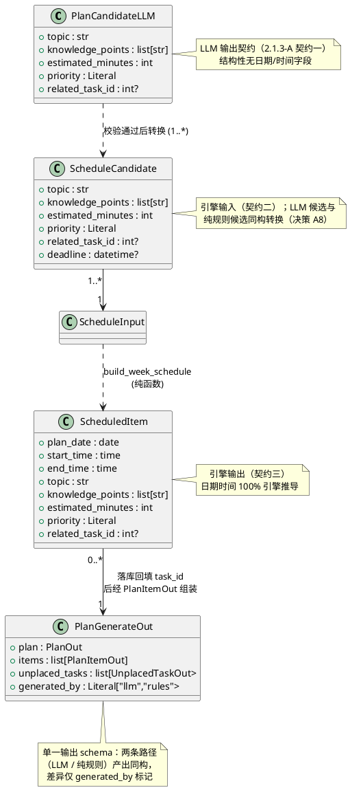

# 动态学习计划与学习成长报告实现方案（DESIGN_DYNAMIC_PLAN_REPORTS）

> feature: `dynamic_plan_reports` ｜ 阶段：实现方案设计（spec-design-agent 产出）
> 上游输入：`docs/specs/SPEC_DYNAMIC_PLAN_REPORTS.md`（**R1 裁定定稿**，643 行：13 项冲突裁决 + O1–O4 开放决策全部裁定 + D1–D14 验收标准 + 19 条领域术语 + 9 端点契约）、`docs/PROJECT_CONTEXT.md`（唯一技术契约：§4 分层铁律与 12 工具清单 / §5.2–5.4 响应体与错误码 / §6.4–6.7 数据模型 / §7.2 接口清单）
> 生成日期：2026-10-23 ｜ 状态：承接 SPEC R1 全部裁定（第 7/9 章，不再重开），可进入 tasks.md 阶段
> 落盘路径说明：沿用 P9 起确立的对偶惯例——规格在 `docs/specs/SPEC_DYNAMIC_PLAN_REPORTS.md`、设计在 `docs/designs/DESIGN_DYNAMIC_PLAN_REPORTS.md`（`SPEC_` ↔ `DESIGN_`）
> 已裁决事项继承（spec 第 7/9 章，不再重开）：#1 API 路径以契约 §7.2 为准（`/api/v1/plans/*`、`/api/v1/reports/*`），任务书 `agent/plan/generate` 路径 = Agent 工具入口；#2 过滤参数名 `report_type`；#3 周期定位 = 列表过滤 + `period_end` 组合；#4 version 为 per-user 全局单调；#5 同周期重生成 = 归档旧版再新建；#6 幽灵任务清理（agent+todo 删除、已流转保留）；#7 `GET /reports` 改 `created_at` 倒序 + 标量分页声明；#8 current 无计划 200+null；#9 diff 无基线 200+空结构；#10 调整周期不变；#11 prompts.py 边界文案改正向声明（有意变更）；#12 内嵌 LLM 30s 超时 + 慢日志照记；#13 done/skipped 原样迁移；O1 统计本地计算 + 模板降级（`generated_by="template"`）；O2 报告 append 语义 + 倒序取最新；O3 周五固定休息日（无特例）；O4 「LLM 决定学什么 + 确定性引擎决定何时学」混合模式 + `generated_by="rules"` 降级 + 调整路径零 LLM
> 本阶段范围铁律：**只做后端**（服务 + 端点 + 4 个 Agent 工具注册 + Prompt 边界更新 + pytest），禁止创建任何前端文件；**不改任何数据库表结构**（§6.4/6.5/6.15/6.7 沿用契约既有定义）；`core.py` / `memory.py` / `services/llm.py` 既有方法零改动（git diff 为空是 D13 验收项）

---

# 一、需求与存量功能关系分析

> 本节所有代码位置均经实际读取核实（P3 / P7 / P10 / P11 交付现状），匹配度四档：100%（可直接复用）/ 75%（模式复用或参数化扩展）/ 50%（结构性扩展）/ 25%（仅有基础设施可借力）。
> 四个关键实测发现（设计输入）：
> ① `services/llm.py` 的 `chat` 客户端超时**锁定 90s**（`_LLM_TIMEOUT_SECONDS`，llm.py:40）且该文件零改动铁律——SPEC 要求的 30s 内嵌 LLM 超时**不能改客户端参数实现**，须在调用方用 `asyncio.wait_for` 外层包裹（见 2.4.3/2.4.4 与决策 A3）；
> ② `services/goal.py` 已有「LLM 结构化 JSON 解析两次尝试」成熟模式（`_call_and_parse`，goal.py:299-351：服务类失败不重试、解析失败附纠错提示重试 1 次）——规划 LLM 的「严格 schema 校验 + 失败重试」直接复刻该模式（决策 A7）；
> ③ analytics 既有统计是**全量累计口径**（`get_overview` / `get_weakness_top5`），而报告七要素是**周期窗口口径**——仅 `weak_points`（掌握度概念与周期无关）与 `trend.slope` 可直接复用，时长/完成数/完成率须按周期窗口自写聚合（复用映射表见 1.2.4，严禁重写掌握度与薄弱点逻辑）；
> ④ `registry.py` docstring（8-12 行）已预留 P12 接入说明：`_TOOL_SPECS` 追加即自动扩展 `TOOLS_SCHEMA` / `TOOL_MAP`，`core.py` 的 `TOOL_MAP[name]` 动态派发（core.py:528）对 8→12 零感知——工具接入是**纯追加**工作。

## 1.1 需求功能与存量功能对比

### 1.1.1 已实现功能

| 需求功能 | 存量功能 | 代码位置 | 匹配度 |
|---------|---------|---------|--------|
| 计划/条目/报告 ORM（`learning_plans` 含 `version/parent_plan_id/adjust_reason`、`learning_plan_items` 含 `(plan_id,plan_date,start_time)` 联合唯一、`learning_reports` 含 `JSONType content`） | `LearningPlan` / `LearningPlanItem` / `LearningReport` 三模型齐备，CASCADE / SET NULL / CheckConstraint 全部就位 | `backend/app/models/plan.py:29-175`、`backend/app/models/report.py:16-51` | 100%（零 DDL 改动，直接读写） |
| 计划与报告出参模型（`PlanOut` / `PlanItemOut` / `ReportOut`） | 字段与契约 §6.4/6.5/6.15 一一对应，`from_attributes` 序列化 | `backend/app/schemas/plan.py:10-44`、`backend/app/schemas/report.py:11-26` | 100%（零删改；本阶段仅**新增**模型，SPEC §4.5-5） |
| `GET /plans`（分页 id 升序）、`GET /plans/{id}`（404/1005） | paginate + get_by_id_or_404 + user_id 过滤 | `backend/app/api/v1/plans.py:26-81` | 100%（零行为变更，D12 回归） |
| `GET /reports/{id}`（详情） | 同上惯例 | `backend/app/api/v1/reports.py:54-80` | 100%（零行为变更，D12 回归） |
| 工具横切设施（`tool_endpoint` 装饰器：校验→执行→异常转 `{"error"}` 信封→300ms 慢日志） | 8 工具共用；签名 `(db, user_id, arguments) -> Awaitable[dict]`；参数模型 `extra="forbid"` | `backend/app/agent/tools.py:332-389, 53-54` | 100%（4 新工具装饰即得信封/慢日志/注入防护，SPEC §5.6.1-2） |
| 工具注册单一事实来源（`_TOOL_SPECS` → `TOOLS_SCHEMA` / `TOOL_MAP` 双推导） | docstring 已标注 P12 接入 4 工具名；追加条目即注册 | `backend/app/agent/registry.py:117-274`（docstring 8-16 行） | 100%（追加 4 条 ToolSpec，`registry.py` 仅此改动） |
| P11 主循环 TOOL_MAP 派发（对话内调用新工具） | `await TOOL_MAP[name](db, user_id, parsed_args)` 动态查找 | `backend/app/agent/core.py:528` | 100%（零改动，12 工具自动可派发，SPEC §5.6.1-6） |
| LLM 非流式对话（规划/总结调用通道） | `chat(messages) -> str`，服务类异常统一包装 3000/502 | `backend/app/services/llm.py:167-198`（`_SERVICE_ERRORS`:156-164） | 75%（调用口径 100% 复用；90s 客户端超时与 30s 业务超时的关系须外层 `wait_for` 协调——决策 A3） |
| LLM 结构化 JSON 解析 + 失败重试模式 | `_call_and_parse` 两次尝试（解析失败附纠错 prompt 重试 1 次；服务类失败不重试） | `backend/app/services/goal.py:299-351` | 75%（模式逐层复刻到 plan.py 的候选解析；代码不共享——两处 prompt 结构与失败语义不同） |
| 薄弱知识点（报告七要素之五） | `get_mastery_list`：掌握度升序 + 排除零分待学点（唯一判定点 `_excluded_filter`） | `backend/app/analytics/weakness.py:38-58, 107-111` | 100%（直接取 items 前 3 条，不重写排除逻辑） |
| 趋势斜率（报告建议输入） | `get_trend`：最小二乘 slope + 风险预警 | `backend/app/analytics/trend.py:29-59` | 100%（报告 advice 规则引用其 slope，不重写） |
| 学习时长/任务统计（调整评估与报告输入的**口径参照**） | `get_overview` 七指标（全量累计口径） | `backend/app/analytics/statistics.py:31-106` | 25%（口径不同不可直用：周期窗口聚合须自写查询，但 streak / 排除条件等实现口径作为一致性参照） |
| 泛型查询助手（分页 + 404 + Pydantic 序列化，`order_by` 参数化） | `paginate` / `get_by_id_or_404` | `backend/app/services/readonly.py:30-115` | 100%（reports 列表倒序仅需换 `order_by` 参数） |
| 标量分页声明模板（混入标量 Query 后的正确写法） | `list_goals`：page/page_size/status 逐个标量声明 + 注释说明 §5.3 约束 | `backend/app/api/v1/goals.py:32-70` | 100%（`list_reports` 逐字复刻该写法，裁决 #7） |
| JWT 鉴权 / 统一响应体 / 错误码（1003/1005/1007/1001） | `get_current_user` + 全局异常处理器 | `backend/app/api/deps.py`、`backend/app/core/response.py:28-45` | 100% |
| 北京时区常量惯例（ZoneInfo + Windows 回退） | `TZ_BEIJING` 三处独立定义同款 | `backend/app/services/task.py:63-66` 等 | 100%（plan/report/analytics 新模块本地定义同款，不跨层导入） |
| 测试基建（ASGI 直调 + 临时 SQLite + 双用户 fixture + IPv6 补丁） | `app_client` / `user_a` / `user_b` / `_isolated_runtime` | `backend/tests/conftest.py:36-122` | 100%（零新增基建；mock 注入沿用模块属性访问惯例） |

### 1.1.2 需要扩展的功能

| 需求功能 | 存量功能 | 差异说明 | 扩展方向 |
|---------|---------|---------|---------|
| `GET /reports` 列表（倒序 + 类型过滤） | P3 实现：`PaginationParams` 查询参数模型 + id 升序 | 排序差异：id 升序 → `created_at` 倒序（O2，行为变更）；参数差异：混入 `report_type` 标量后查询参数模型不展开会误判必填致 422（契约 §5.3 实测约束） | 改写 `list_reports` 为标量声明分页（复刻 `list_goals`）+ `order_by=[desc(created_at), desc(id)]`（id 倒序 tie-break 保证分页稳定）+ `report_type` 可选枚举过滤 |
| `registry.py` 8 → 12 工具 | `_TOOL_SPECS` 既有 8 条 | 追加差异：4 条 `ToolSpec`（get_learning_plan / generate_learning_plan / adjust_learning_plan / generate_learning_report），依赖 tools.py 的 4 个新实现函数与参数模型 | `_TOOL_SPECS` 末尾追加 4 条 + import 区扩展（文件唯一改动点，D13 断言「仅追加 4 条」） |
| `prompts.py` 能力边界声明 | `_BOUNDARY_SECTION_TEMPLATE` 静态文案写「学习计划的生成与调整、学习报告生成将在后续版本提供……」 | 语义反转（裁决 #11 **有意变更**）：改写为正向能力声明（计划生成/调整/报告已可用 + 「调整会新建版本并说明理由」+「生成失败自动降级规则模式」两句护栏）；工具清单段本就从 `TOOLS_SCHEMA` 动态生成（8→12 自动跟进） | 仅改 `_BOUNDARY_SECTION_TEMPLATE` 常量文案（prompts.py:58-65）；`_GUIDE_SECTION` 场景引导同步补 4 工具路径行 |
| `test_agent_prompt.py` 边界断言 | 断言 Prompt 含「后续版本提供」能力边界表述 | 计划内行为反转（SPEC §4.5-2）：断言改为「含 12 工具名 + 正向声明 + 不含『后续版本提供』」 | 更新 `test_prompt_capability_boundary` 与相关用例（D6/D13 回归覆盖） |
| `api/v1/plans.py` 追加 3 端点 | 既有 2 只读端点，路由已挂载（`api/v1/__init__.py`） | 新增 generate / current / adjust / diff 四个路由函数（同前缀扩展，`__init__.py` 零改动） | 追加路由函数（薄委托 services/plan.py，见 2.4.6） |
| `services/task.py` 的 `scheduled_date` 语义 | 字段存在（P3 落库），仅被 update_task 可选修改 | 生成路径批量写入（=plan_date）、调整路径同步更新、移出计划置空——均为本阶段新写入方 | 不改 task.py 本体；plan.py 直接操作 Task ORM（services 内跨模块合法，无循环依赖） |

### 1.1.3 需要新增的功能或接口

**（A）后端新增文件（4 个）**

| 功能点 | 输入 | 输出 | 核心逻辑 | 依赖 |
|-------|------|------|---------|------|
| `app/services/plan.py` —— 计划编排服务（生成/调整/查询/diff 单一业务事实来源） | db 会话、user_id、（工具路径的 plan_id?） | 统一业务 dict（HTTP 与工具共用出参结构） | 生成：输入聚合（档案/目标 roadmap/掌握度/任务池）→ 规划 LLM（30s）或纯规则候选 → 排程引擎 → 同事务落库（任务→计划头→条目回填）；调整：三条件评估 → 纯确定性重排 → diff + adjust_reason → 同事务版本链落库；查询：current 定位与 items 排序；diff：两版条目重算 | `analytics/scheduler`、`analytics/adjuster`、`services/llm.chat`（模块属性访问）、models、analytics/weakness |
| `app/services/report.py` —— 报告编排服务 | db 会话、user_id、ReportGenerateIn | 报告业务 dict（ReportOut 同构） | 周期推导（period_start 由类型+period_end 推导）→ 七要素本地聚合 → LLM 总结（30s）或模板拼接 → 落库（append 语义） | models、`services/llm.chat`、analytics/weakness、analytics/trend |
| `app/analytics/scheduler.py` —— 排程引擎（纯函数，O4 核心） | 候选列表 + 每日容量 + 周期日期 + 休息日 | 7 天条目布局 + unplaced 清单 | 候选排序（逾期/临期 deadline 升序 → 优先级）→ 逐日贪心装入（时段锚点分配）→ 硬约束校验（日容量/时段唯一/时长一致/周五休息）→ 容量不足进 unplaced | 零依赖（纯函数，不 import services/models——分层铁律，对齐 statistics.py 先例） |
| `app/analytics/adjuster.py` —— 调整引擎（纯函数，零 LLM） | 旧版条目+关联任务快照+近 7 天时长+now+阈值 | 新版条目布局 + diff（moved/added/removed）+ reason 素材 | 三条件量化评估（未完成×截止临近×时长不足）→ 移动集重排（后续日期空闲容量、优先周末）→ 低优先级顺延 → 周期全满时 removed → diff 计算 + adjust_reason 模板渲染 | 零依赖（纯函数；数据由 plan.py 读库后传入） |

**（B）后端扩展文件（6 个）**

| 功能点 | 输入 | 输出 | 核心逻辑 | 依赖 |
|-------|------|------|---------|------|
| `agent/tools.py` —— 追加 4 工具 + 4 参数模型 | `(db, user_id, arguments)` | 业务 dict 或 `{"error"}` 信封 | `@tool_endpoint` 装饰 + 薄委托 services/plan.py / services/report.py（工具层与 HTTP 层复用同一 service 函数，SPEC §5.7 注）；全 async（对齐 TOOL_MAP 类型单一） | services/plan、services/report |
| `agent/registry.py` —— `_TOOL_SPECS` 追加 4 条 | — | `TOOLS_SCHEMA`/`TOOL_MAP` 自动 12 条 | import 4 新函数与参数模型；追加 4 条 ToolSpec（三要素长文案 description） | agent/tools |
| `agent/prompts.py` —— 边界文案改写 | — | 正向能力声明段 | 见 1.1.2（裁决 #11） | registry.TOOLS_SCHEMA（动态工具清单既有机制） |
| `api/v1/plans.py` —— 追加 4 路由（generate/current/adjust/diff） | Bearer + 路径参数 | 统一响应体 | 薄委托 services/plan.py（路由层零业务逻辑） | services/plan、schemas/plan |
| `api/v1/reports.py` —— 追加 generate 路由 + 改写 list_reports | Bearer + 请求体 | 统一响应体 | generate 薄委托 services/report.py；list_reports 改标量分页+倒序+过滤 | services/report、models |
| `schemas/plan.py` / `schemas/report.py` —— 追加入出参模型 | — | — | PlanGenerateIn/PlanAdjustIn（空对象 extra="forbid"）、ReportGenerateIn、Diff 条目模型、生成/调整出参模型（详见 2.3） | Pydantic v2 |

**（C）测试新增文件（5 个 + 1 更新）**：`tests/test_plan_generate.py`（D1/D2/D7/D8/D9 计划侧/D11/D14）、`tests/test_plan_adjust.py`（D3/D4/D10/D11/D14）、`tests/test_plan_query_diff.py`（D12 查询侧）、`tests/test_report_generate.py`（D5/D9 报告侧/D12）、`tests/test_plan_report_tools.py`（D6 工具注册与对话集成）；更新 `tests/test_agent_prompt.py`（断言反转，D6/D13）——mock 注入点与 D1–D14 逐项映射详见 2.5。

**（D）文档零改动**：`PROJECT_CONTEXT.md` §4 已列 12 工具清单、§7.2 已列全部 9 端点、§6 数据模型齐备——本阶段无文档修订义务（区别于 P11 的 §3 目录树滞后项）。

**（E）明确不改动清单（防越界）**：

| 文件 | 不改动理由 |
|------|-----------|
| `backend/app/agent/core.py` / `memory.py` | SPEC §5.6.1-6：TOOL_MAP 动态派发零感知；D13 验收 `git diff` 为空 |
| `backend/app/services/llm.py` | SPEC §4.5-1：`chat`/`chat_stream`/`agent_chat_stream`/客户端构造区零改动（P4/P9/P11 依赖）；30s 超时在调用方实现（决策 A3） |
| `backend/app/agent/tools.py` 既有 8 工具实现区 | 仅文件末尾追加 4 工具（纯追加铁律，参照 P11 对 llm.py 的追加先例）；横切私有区零触碰 |
| `backend/app/models/*.py` 全部 DDL | SPEC 范围总则：不改数据库表结构 |
| `backend/app/api/v1/plans.py` 既有 2 端点 / `reports.py` 详情端点 | P3 契约零行为变更（list_reports 改写是 SPEC 裁决 #7 的计划内行为变更，唯一例外） |
| `backend/app/analytics/` 既有 4 模块 | 复用不重写（SPEC §3.2）；排程/调整引擎为**新增文件**，不触碰既有模块 |
| `backend/app/services/task.py` / `goal.py` / `record.py` / `profile.py` | 只读消费（聚合输入经其查询能力或直接 ORM 查询），无改动触点 |
| 全部前端文件 | 本阶段禁止创建任何前端文件（SPEC 范围总则；PlanView.vue / ReportsView.vue 后续阶段单独下达） |
| `backend/scripts/test_tools.py` | P10 工具测试套件，回归直接跑（新增 4 工具后其基线断言如「8 工具」存在则属 tasks 阶段计划内更新，本设计不扩大改动面） |

## 1.2 存量功能详细分析

### 1.2.1 P10 工具注册表（本阶段的扩展宿主）

**接口契约**：`ToolSpec` 为 frozen dataclass 四字段（name / func / params_model / description）；`TOOLS_SCHEMA`（OpenAI `tools=` 直传）与 `TOOL_MAP`（名字→函数派发表）均由 `_TOOL_SPECS` 列表推导——**工具名集合相等是构造性事实而非纪律约定**（registry.py:14-16 docstring）。

**业务规则（对追加的约束）**：① 4 条 ToolSpec 的 `params_model` 必须继续满足 `_build_parameters_schema` 的扁平化流水线（`$defs` 内联展开 / `anyOf` 拆 null / enum 平铺）——参数模型用 `Literal` 枚举与标量 `int` 字段即天然兼容（无嵌套模型），SPEC §5.6.1-3 验收「无 `$defs/$ref/anyOf`」；② `description` 三要素长文案格式（何时调用/参数填法/返回结构），与既有 8 条风格逐字对齐；③ docstring 头部的「P12 接入」标注段落在追加后更新为历史说明（文档性改动，不破坏行为）。

**约束**：注册表为模块加载期构建的进程内常驻结构——4 工具实现必须可在 import 期无副作用定义（装饰器只包装不执行），异步函数定义无 IO。

### 1.2.2 P11 主循环与 60s 预算（工具内嵌 LLM 的运行环境）

**接口契约**：`core.py` 经 `TOOL_MAP[name](db, user_id, parsed_args)` 动态派发（core.py:528），工具返回 dict 回灌 LLM；`TOTAL_BUDGET_S=60.0`（core.py:53）为对话**总预算**，轮前/工具前双检查点。

**对本设计的约束（裁决 #12）**：① 4 工具中两个内嵌 LLM（generate_learning_plan / generate_learning_report）最坏耗时 30s（超时上限）+ 落库毫秒级——单工具调用恰在预算内，但 P11 侧不再有二次调用空间（若 LLM 决策先调 get_learning_plan 再调 generate_learning_plan，两次合计可能逼近 60s——这是 P11 既有预算语义的自然边界，SPEC §5.6.3-1 认定为非本组件缺陷）；② 慢日志 300ms 必然触发（内嵌 LLM > 300ms），照记为规划耗时观测信号，不视为告警故障；③ 工具执行期异常由 `tool_endpoint` 转信封（「不抛异常红线」），core.py 零感知。

**扩展点**：无需改 core.py——`TOOL_MAP` 派发为运行时字典查找，新工具名自动可被 LLM 的 tool_call 触达（前提：`TOOLS_SCHEMA` 已含其描述，注册表追加即满足）。

### 1.2.3 P3 plans/reports 只读端点（扩展宿主）

**接口契约**：`paginate(db, model, schema, page, page_size, order_by?, filters)` 返回 `{items, total, page, page_size}`（`order_by` 缺省主键升序）；`get_by_id_or_404` 带 `user_id` 过滤（越权与不存在统一 404/1005，防 ID 枚举）。

**对扩展的约束**：① `GET /plans` 保持 id 升序零变更（版本链时间线语义，SPEC §4.5-3）；② `list_reports` 改写须保留校验规则与 `PaginationParams` 完全一致（page≥1、1≤page_size≤100，参照 list_goals 逐字对齐）；③ 新端点路由注册顺序注意**路径字面量先于 `{plan_id}` 通配**（`/plans/current` 与 `/plans/generate` 必须声明在 `/plans/{plan_id}` 之前，否则 FastAPI 按声明序匹配会把 `current`/`generate` 当 plan_id 解析——既有文件 `/plans/{plan_id}` 在前，追加端点需**插入到其之前**或依赖路由函数声明顺序调整；实测 FastAPI 按注册顺序匹配，本设计将 4 新路由声明于文件中 `get_plan` 之前，`git diff` 呈现为既有函数位置后移，属计划内编辑）。

### 1.2.4 analytics 既有能力 → 报告七要素复用映射表

| 报告要素（SPEC §5.4.1-2） | 既有能力 | 代码位置 | 复用方式 |
|---|---|---|---|
| ⑤ weak_points（最低 3 个薄弱点） | `get_mastery_list`（升序 + 排除零分待学点） | `analytics/weakness.py:38-58` | **直接调用**取 `items[:3]`（掌握度与周期无关，全量口径正确） |
| ⑦ advice（趋势类建议输入） | `get_trend` 的 `slope` / `risk_alert` | `analytics/trend.py:29-59` | **直接调用**（窗口=周期天数，slope 判断升/降趋势文案） |
| ⑦ advice（逾期类建议输入） | 无周期口径的逾期计数（`get_overview.overdue_task_count` 为全量） | `analytics/statistics.py:70-83` | **不调用**：报告建议需「周期内截止且逾期」口径，自写一条聚合查询（口径参照其 `deadline < now AND status != done` 条件写法） |
| ① total_minutes | 无（`get_overview.total_minutes` 为全量累计） | — | 自写周期窗口聚合（`sum(duration_minutes) where study_date between`——与 `get_trend` 的窗口聚合写法同构） |
| ② task_completed / ③ completion_rate | 无（`get_overview` 为全量 done+review 占比） | — | 自写：completed_at 落周期内的计数 + 周期内截止任务中 done 占比（口径参照 P5 周完成率惯例：分子含 review） |
| ④ top_direction | 无 | — | 自写：周期内 `learning_records.knowledge_points` JSON 数组摊平 Counter 聚合取最大项（写法参照 `get_weakness_top5` 的 recent Counter，weakness.py:80-89） |
| ⑥ progress（阶段进步） | 无 | — | 自写：对上一等长周期重复 ①③ 与自评均值聚合（三差值对象） |

> 复用原则（SPEC §3.2「复用不重写」）：**掌握度/薄弱点/趋势逻辑零重写**；周期窗口聚合是 analytics 从未交付过的口径，属新增查询而非重写——落点在 `services/report.py`（业务编排层，可 import models 做 ORM 查询，分层合法）。

### 1.2.5 `services/llm.py` 与 `goal.py` 的 LLM 编排先例（30s 超时的实现约束）

**llm.chat 契约**：`async chat(messages: Sequence[ChatMessage]) -> str`，返回首选项完整文本（None → `""`）；服务类失败（`_SERVICE_ERRORS` 六类）统一包装 `BizException(3000, "AI 服务暂时不可用，请稍后重试", 502)`；**客户端级超时 90s 在构造期锁定**（`AsyncOpenAI(timeout=_LLM_TIMEOUT_SECONDS)`，llm.py:88-93），且 `reset_clients()` 仅为测试钩子。

**关键推论（决策 A3 的依据）**：30s 业务超时**无法**经 `chat` 的参数传入（签名无 timeout 形参），亦不可改 `_LLM_TIMEOUT_SECONDS`（零改动铁律 + 会波及 P4/P9/P11 三条依赖链）。唯一合规实现：调用方 `asyncio.wait_for(llm.chat(messages), timeout=PLAN_LLM_TIMEOUT_S)`——`wait_for` 在 30s 到点取消协程（底层 httpx 连接被安全取消），抛 `asyncio.TimeoutError` 进降级分支；客户端 90s 退化为 SDK 级最后兜底（正常情况下业务超时先触发，两者无冲突）。

**goal.py 两次尝试模式（决策 A7 的依据）**：`_call_and_parse` 的分层语义——**服务类失败（BizException）直接上抛不重试**（避免 90s×2 成倍等待），**解析失败（`_ParseFailed`）附首输出片段与失败原因的重试 prompt 再试 1 次**，两次解析均失败才抛 3000。本设计对规划 LLM 的差异：两次失败后**不抛错而是降级纯规则**（SPEC O4「降级不失败」红线，区别于 goal 拆解的「失败即 502」）。

### 1.2.6 models 关键约束（落库事务的设计输入）

**接口契约（写路径相关）**：① `LearningPlanItem` 的 `(plan_id, plan_date, start_time)` UniqueConstraint——SQLite 唯一索引对 `NULL` 不判重，休息条目 `start_time=None` 天然不冲突；② `LearningPlan.items` relationship 带 `cascade="all, delete-orphan"`——删除旧版计划行会级联删条目（幽灵清理只删**任务**，不动旧版条目——archived 版本条目必须原样保留，D3 验收「旧版条目逐字段不变」）；③ `JSONType`（report.content）读写自动 `json.loads/dumps`，services 层直接赋 dict 结构、禁手动序列化；④ `Task.completed_at` 在状态置 done 时写入（P5 语义）——报告 ② 的「周期内完成任务」按 `completed_at` 落窗口过滤；⑤ `utc_now()` 为 UTC 存储基准，「今天/本周」判断一律先转 `TZ_BEIJING`（P5 裁定㉒惯例，task.py:9-14 docstring）。

**事务边界现状**：services 层惯例为「请求级短事务」（`db.add(...)` → `db.commit()`，异常时 `get_db` teardown 回滚）。本阶段生成/调整为**多表复合写**，须显式编排 add 顺序与单次 commit（半截计划防护，D14），详见 2.4.3-D。

---
# 二、增量设计方案

## 2.1 实现模型

### 2.1.1 上下文视图



外部交互要点：① HTTP 端点与 Agent 工具是同一服务函数的两个入口（单一业务事实来源，SPEC §5.7 注）；② 两处 LLM 调用（规划/总结）均为非流式 `chat` + 外层 30s 超时，失败/超时**不向上抛**而走降级（与 P4 拆解 502 语义的关键差异）；③ 排程/调整两个纯函数引擎不接触 db 与 LLM——可测性红线的结构性保证；④ 调整路径全程无 LLM 箭头（SPEC 规则 5.2.1-8）。

### 2.1.2 服务/组件总体架构



**模块职责与依赖方向裁定（决策 A1/A2）**：

| 模块 | 职责 | 依赖 | 禁止事项 |
|---|---|---|---|
| `services/plan.py` | 输入聚合、LLM 编排与降级分支、引擎调用、**事务边界**（多表原子写）、版本链维护、幽灵清理、diff 重算 | scheduler / adjuster / llm / models / weakness（薄弱点候选） | 禁止拼接 HTTP 响应；禁止把布局逻辑内联（必须经引擎） |
| `services/report.py` | 周期推导、七要素聚合查询、LLM 总结与模板降级、报告落库 | llm / models / weakness / trend | 禁止任何统计数字来自 LLM（SPEC §5.4.1-2） |
| `analytics/scheduler.py` | 候选 → 7 天条目布局（硬约束全量保证）+ unplaced | 零依赖（纯函数） | 禁止 import services / models / agent（分层铁律，对齐 statistics.py 先例）；禁止 IO |
| `analytics/adjuster.py` | 三条件评估、移动/顺延/removed 算法、diff 计算、adjust_reason 模板渲染 | 零依赖（纯函数） | 同上；禁止调 LLM（SPEC 规则 5.2.1-8） |

> 排程/调整引擎放 `app/analytics/` 而非 `services/` 的理由：① 依赖方向——引擎不依赖 DB 与 services，放 services 会造成「services 内出现无 DB 的纯函数模块」的分层噪音，而 analytics 本就是「纯计算、不对外暴露 HTTP、不 import services」的既定纯函数层（statistics.py docstring 明示「不 import services——分层铁律」）；② 可测性——与 statistics/trend/weakness 同级后，「单测不依赖 LLM 与 DB」（SPEC §4.4-3）成为包结构的自然属性；③ `services/plan.py → analytics/scheduler` 的调用方向正是契约 §4「services → analytics」的合法边。

### 2.1.3 实现设计文档

#### A. LLM 与确定性引擎的职责边界（本设计最核心架构决策，O4 落实）

**分工表（答辩口径：「我们不让模型决定具体时间，因为排程需要确定性保证」）**：

| 决策维度 | 规划 LLM（`llm.chat`，30s 超时） | 确定性排程引擎（`scheduler.py` 纯函数） | 裁定依据 |
|---|---|---|---|
| **学什么**（topic 与知识点选择） | ✅ 基于 roadmap 叶子、掌握度薄弱排序、任务池、兴趣方向**选内容** | ❌ 不选内容（降级路径例外：按「逾期→临期→roadmap 顺序」固定规则取候选，`generated_by="rules"`） | SPEC O4 |
| **学多久**（单条目预估时长） | ✅ 给出建议时长（15–240 分钟，prompt 约束 + schema 校验） | ❌ 仅透传与累计（不修改 LLM 时长） | SPEC O4 |
| **优先级** | ✅ 给出 low/medium/high 建议 | ✅ 校验枚举 + 排序依据（逾期/临期 deadline 升序优先于 LLM 优先级） | SPEC 规则 5.1.1-6 ③ |
| **排在周几** | ❌ **禁止输出任何日期字段**（schema 结构性不含，`extra="forbid"` 拒绝） | ✅ 全权决定 plan_date | 用户最高优先级指令；SPEC「引擎决定何时学」 |
| **几点开始** | ❌ **禁止输出任何时间字段** | ✅ 时段锚点分配（决策 A6） | 同上 |
| **每天不超 daily_study_minutes** | ❌（LLM 可能给出超容量候选） | ✅ 硬约束：逐日贪心装入，装不下的进 unplaced | SPEC 规则 5.1.1-6 ① |
| **时段不冲突** | ❌ | ✅ 硬约束：(plan_date, start_time) 唯一（游标式分配结构性保证） | SPEC 规则 5.1.1-6 ② |
| **周五休息** | ❌ | ✅ 硬约束：周五仅一条「休息 / 复习」条目（task_id=null） | SPEC O3 |
| **条目时长自洽** | ❌ | ✅ end_time − start_time = estimated_minutes（分钟粒度） | SPEC 规则 5.1.1-6 ⑤ |
| **输出形态** | 结构化 JSON 候选（严格 Pydantic schema 校验） | 确定性布局列表（同输入恒同输出） | — |

**「为什么不让 LLM 决定时间」的工程 rationale（设计判断记录，答辩讲述要点）**：

1. **确定性保证是排程的刚性需求，而 LLM 输出是概率性的**。日容量 ≤ `daily_study_minutes`、`(plan_date, start_time)` 不冲突、周五休息、时长自洽——这四条是验收 D1 逐日断言的**硬约束**，要求 100% 成立。LLM 无法结构性保证：实测中模型会给出「周一 09:00–10:30 + 周一 09:30–11:00」式重叠、超容量堆料、或幻觉出周期外的日期。用纯函数引擎，约束满足是**构造性事实**（游标单调前进 ⇒ 无冲突；逐日容量计数 ⇒ 不超限）——不是「校验后修复」而是「结构上不可能违反」。
2. **可测试性与沙箱约束**。本阶段验收全部依赖 pytest + mock LLM（网络全禁）。若时间排布由 LLM 决定，mock 返回值就得内嵌整份课表（测试在测 mock 自己）；引擎为纯函数后，「输入候选 → 断言布局」的测试不依赖 LLM 与 DB，降级路径（纯规则候选）与正常路径共用同一引擎，D9/D10 的断言是真实算法的断言。
3. **幂等与 diff 正确性**。`GET /plans/{id}/diff` 按两版条目**重算**（SPEC 规则 5.3.1-5）要求「同输入同输出」；调整算法零 LLM（SPEC 规则 5.2.1-8）同理。任何由模型参与的布局都会让重算不可复现。
4. **LLM 的比较优势在语义选择而非时序安排**。哪个知识点薄弱该补、roadmap 下一步学什么、一项学习估多久——这需要理解用户画像与知识图谱（LLM 强项）；「周三晚上还有没有空」是纯组合问题（枚举可解，LLM 弱项且不可验证）。把各自放在强项上是工程效率最优。
5. **降级路径的存在倒逼引擎独立**。LLM 失败时系统仍要产出合法计划（O4「降级不失败」）——意味着**排程能力本来就必须独立于 LLM 存在**；既然引擎是必备件，让它全权负责时间维度只是把职责线画在自然的位置。

**两层数据契约（LLM 输出 → 引擎输入 → 引擎输出）**：

```text
【契约一：规划 LLM 输出的候选结构（PlanCandidateLLM，Pydantic 严格校验）】
{
  "candidates": [                      # 5–14 条，数组
    {
      "topic": "Transformer 注意力机制",   # str, 1–200 字符（非空）
      "knowledge_points": ["Transformer", "Attention"],  # list[str], 0–20 个
      "estimated_minutes": 45,          # int, 15–240
      "priority": "high",               # Literal["low","medium","high"]
      "related_task_id": 12             # int | 缺省——仅可引用输入聚合提供的任务 id
    }
  ]
}
※ schema 结构性不含任何日期/时间字段；extra="forbid" 使 LLM 试图输出
  date/start_time/day 等字段时校验失败（触发重试或降级，见契约三）。
※ related_task_id 语义：把逾期/临期任务作为候选来源交给 LLM 时携带其 id，
  LLM 引用之 ⇒ 该条目复用既有任务（不重复建）；语义校验：id 不在输入
  聚合的合法任务 id 集合内 ⇒ 视为解析失败（防编造）。

【契约二：排程引擎的输入 schema（ScheduleInput，内部 dataclass）】
ScheduleInput(
  candidates: list[ScheduleCandidate],   # LLM 候选或纯规则候选（同构！见决策 A8）
  daily_capacity_minutes: int,           # 档案容量（缺省 60）
  week_days: list[date],                 # 下周一~下周日 7 天（服务端推导，LLM 无参与）
  rest_weekday: int = 4,                 # 周五（ISO weekday=4，模块常量）
  now: datetime,                         # deadline 距今计算（逾期/临期判定）
)

【契约三：排程引擎输出的条目结构（ScheduledItem）】
ScheduledItem(
  plan_date: date, start_time: time, end_time: time,   # ← 全部由引擎推导
  topic: str, knowledge_points: list[str],
  estimated_minutes: int, priority: Literal[...],
  related_task_id: int | None,           # 引擎透传；落库阶段决定复用或新建任务
)
ScheduleOutput(placed: list[ScheduledItem],     # 已排条目（含周五休息条目，由 plan_svc 注入）
               unplaced: list[UnplacedTask])    # 容量不足候选（id?/topic/原因）
※ task_id 不在引擎输出中——它由 services/plan.py 落库阶段回填
  （复用既有任务或新建 agent 任务后写入条目），见 2.4.3-C。
```

**LLM 输出的严格校验与失败分支（三段式，决策 A7）**：`llm.chat` 文本 → `json.loads`（剥 ```` ```json ```` 围栏，参照 goal.py `_parse_roadmap` 惯例）→ `PlanCandidatesLLM.model_validate`（Pydantic `extra="forbid"` + 字段约束）+ `related_task_id` 合法集合语义校验。任一环节失败：**附失败原因与首输出截断的重试 prompt 再试 1 次**（服务类 BizException 不重试直接降级——沿用 goal.py 分层语义，避免 30s×2 击穿 35s HTTP 上限：解析重试的第二次调用仍受同一个 `wait_for` 30s 总窗约束，详见 2.4.3-B）；两次失败 → **降级纯规则候选**（`generated_by="rules"`），不报错、不阻塞（O4 红线）。

#### B. 计划生成路径活动图（含降级分支）

```plantuml
@startuml
start
:接收生成请求（HTTP / 工具）
user_id 取认证结果;
:聚合输入（只读）:
档案容量（缺省 60）/ active 目标 roadmap 叶子
knowledge_mastery 薄弱点升序
逾期+临期任务（deadline 升序，含 id）/ 兴趣方向;
:构造候选 prompt
（约束：只选内容、估时长、给优先级
禁止输出任何日期时间字段）;
:wait_for(llm.chat, 30s);
if (LLM 成功返回?) then (yes)
  if (JSON 解析 + schema 校验\n+ related_task_id 合法集校验通过?) then (yes)
    :候选 = LLM 候选列表
    generated_by = "llm";
  else (no, 解析失败)
    if (第 1 次解析失败?) then (yes)
      :附纠错提示重试 1 次
      （同 30s 总窗）;
      note right: 服务类失败(3000)\n不重试,直接降级
    else (no, 两次失败)
      :降级：候选 = 纯规则
      （逾期→临期→roadmap 薄弱点顺序）
      generated_by = "rules";
    endif
  endif
else (no, 超时/服务失败)
  :降级：候选 = 纯规则
  generated_by = "rules";
endif
:排程引擎 scheduler.build_week_schedule(候选, 容量, 周期):
排序(逾期/临期 deadline 升序→优先级)→逐日贪心
→时段锚点分配→周五休息条目→unplaced 截断;
:【单事务开始】
(1) 同周期判定: 目标周已有 active → 归档旧版 + 幽灵任务清理
    部分重叠异常 → 抛 1007 回滚;
(2) 候选落任务: related_task_id 复用(同步 scheduled_date)
    / 新学项新建(source=agent, status=todo, goal_id);
(3) unplaced 候选: 同样建任务但 scheduled_date=null;
(4) 新建计划头(version=max+1, active, source=agent
    parent=null, adjust_reason=null);
(5) 建 items(引擎布局, 回填 task_id);
(6) commit;
:【事务结束】
if (commit 成功?) then (yes)
  :返回 {plan, items,
  unplaced_tasks, generated_by};
  stop
else (no, 异常)
  :整体回滚(get_db teardown)
  无半截计划/条目/任务;
  stop
endif
@enduml
```

> 多周并存分支：目标周与既有 active **不重叠**（如本周未结束）时步骤 (1) 判定为「无同周期旧版」——既有 active 原样保留（D7）；仅**完全同周期**才归档重生成（D8）；**部分重叠**抛 1007（异常数据防护，SPEC 5.1.3-3）。

#### C. 动态调整路径活动图（纯确定性，零 LLM）

```plantuml
@startuml
start
:接收调整请求（HTTP plan_id / 工具缺省当前 active）;
:定位计划（越权/不存在 → 404/1005 信封）;
if (计划 status == active?) then (yes)
else (no, archived)
  :抛 1007「仅可调整生效中的计划」;
  stop
endif
:读取旧版条目 + 关联任务快照 + 近 7 天学习时长
+ 档案容量（全部只读，一次聚合）;
:调整引擎 adjuster.evaluate_move_set（三条件量化）:
未完成(plan_date<今天 或 任务 status≠done)
× 截止临近(deadline-now ≤ 48h, 含逾期)
× 时长不足(近7天 < 容量×7×0.6);
if (移动集为空?) then (yes)
  :不新建版本
  返回 {adjusted: false,
  reason: "当前计划无需调整"};
  stop
else (no)
endif
:adjuster.apply_adjustment（纯函数重排）:
done/skipped 条目原样迁移 → 移动集重排到
后续日期空闲容量(优先周末) → 目标日容量不足
顺延低优先级(low先,medium次,high不顺延)到更晚
→ 周期全满: 低优先级移出(removed, 任务保留);
:计算 diff（moved/added/removed 结构）;
:渲染 adjust_reason（模板函数
含任务名/从→到日期时段/顺延数, 见 2.4.2-C）;
:【单事务开始】
(1) 旧版置 archived（行与条目零修改）
(2) 新建计划头(version+1, active,
    parent_plan_id=旧版 id, adjust_reason=reason)
    start/end 与旧版逐字段相等
(3) 新建全部条目（迁移+重排布局,
    done/skipped 状态保持）
(4) 被移动任务 scheduled_date 同步;
    removed 任务 scheduled_date 置空
(5) commit;
:【事务结束】
:返回 {plan, adjust_reason,
diff, adjusted: true};
stop
@enduml
```

#### D. 版本链状态图与事务边界



**事务边界（D14 原子性设计）**：生成与调整各为一个**显式编排的多表事务**——全部 `db.add()` 完成后单次 `db.commit()`；中途任何异常（含 mock 注入的异常）由 `get_db` teardown 统一回滚，库中不留半截计划/条目/任务，既有 active 未被动过。关键点：① 幽灵清理的 `DELETE` 与新建的 `INSERT` 同事务（归档后清理失败可整体回滚）；② 引擎与 LLM 编排**全部在事务外完成**（计算无副作用），事务内仅剩纯落库操作——事务窗口最小化（毫秒级），避免 30s LLM 等待占用连接；③ `(plan_id, plan_date, start_time)` 唯一约束是 DB 半边兜底（引擎结构性保证之上双保险）。

#### E. 报告管道活动图



---
## 2.2 接口设计

### 2.2.1 总体设计

**接口分类**：① 计划写接口（generate / adjust）——「AI 请求」类，响应 ≤ 35s（LLM 30s + 余量）；② 计划读接口（current / diff / 列表 / 详情）——普通页面 2s 红线；③ 报告写接口（generate）——AI 请求类 ≤ 35s；④ 报告读接口（列表 / 详情）——2s 红线；⑤ Agent 工具接口（非 HTTP，`(db, user_id, arguments) -> dict` 契约）。**全部端点 Bearer JWT 鉴权，user_id 一律取认证结果**（HTTP 请求体与工具参数结构性不含 user_id）。

**接口变更策略**：既有 `GET /plans`、`GET /plans/{id}`、`GET /reports/{id}` 零行为变更（稳定级）；`GET /reports` 排序与过滤行为变更属 SPEC 裁决 #7 计划内变更（回归覆盖）；新增 6 个 HTTP 端点 + 4 个工具（实验→稳定，随本阶段交付即稳定）。

| # | 接口 | 方法 | 鉴权 | 请求 | 响应 data | 稳定性 |
|---|---|---|---|---|---|---|
| 1 | `/api/v1/plans/generate` | POST | Bearer | `{}`（PlanGenerateIn） | `{plan, items, unplaced_tasks, generated_by}` | 新增·稳定 |
| 2 | `/api/v1/plans/current` | GET | Bearer | — | `{plan, items}` 或 `null` | 新增·稳定 |
| 3 | `/api/v1/plans/{id}/adjust` | POST | Bearer | `{}`（PlanAdjustIn） | `{plan, adjust_reason, diff, adjusted}` | 新增·稳定 |
| 4 | `/api/v1/plans/{id}/diff` | GET | Bearer | — | `{base_plan_id, moved, added, removed}` | 新增·稳定 |
| 5 | `/api/v1/plans` | GET | Bearer | page/page_size（查询参数模型） | `{items, total, page, page_size}` | 既有·零变更 |
| 6 | `/api/v1/plans/{id}` | GET | Bearer | — | 计划对象 | 既有·零变更 |
| 7 | `/api/v1/reports/generate` | POST | Bearer | `{report_type, period_end?}` | 报告对象 | 新增·稳定 |
| 8 | `/api/v1/reports` | GET | Bearer | `report_type?` + page/page_size（**标量声明**） | `{items, total, page, page_size}` | 既有·**行为变更**（倒序+过滤） |
| 9 | `/api/v1/reports/{id}` | GET | Bearer | — | 报告对象 | 既有·零变更 |
| T1 | 工具 `get_learning_plan` | — | user_id 注入 | `{}`（零参数） | `{plan, items}` 或 `{plan: null, message}` | 新增·稳定 |
| T2 | 工具 `generate_learning_plan` | — | user_id 注入 | `{}`（零参数） | `{plan, items, unplaced_tasks, generated_by}` | 新增·稳定 |
| T3 | 工具 `adjust_learning_plan` | — | user_id 注入 | `{plan_id?}`（可选正整数） | `{plan, adjust_reason, diff, adjusted}` 或 `{"error"}` | 新增·稳定 |
| T4 | 工具 `generate_learning_report` | — | user_id 注入 | `{report_type?}`（可选枚举，缺省 weekly） | 报告对象 或 `{"error"}` | 新增·稳定 |

> 路由注册顺序（1.2.3-③ 实测约束）：`plans.py` 中 `/plans/generate`、`/plans/current` 两个**字面量路径**路由必须声明在 `/plans/{plan_id}` 之前（FastAPI 按声明序匹配，否则 `generate`/`current` 被解析为 plan_id → 422）。`/plans/{plan_id}/adjust` 与 `/plans/{plan_id}/diff` 为子路径，不受通配遮蔽影响。

### 2.2.2 接口清单

#### （1）POST /api/v1/plans/generate —— 生成下一个完整自然周计划

**签名**（`api/v1/plans.py` 路由 → `services/plan.py`）：

```python
async def generate_plan(db: Session, user_id: int) -> dict
# 路由: @router.post("/generate") → success(data=await plan.generate_plan(db, current_user.id))
# 入参模型 PlanGenerateIn: 零字段 + extra="forbid"（拒 user_id 注入）
```

- **业务说明**：以北京时区今天为基准生成下周一~下周日计划；混合模式（LLM 选内容 + 引擎排时）；同周期已有 active 则归档旧版重生成。
- **前置条件**：Bearer JWT；目标周期与既有 active **部分重叠**时报 400/1007（不自动归档）。
- **后置条件**：新计划行（version=max+1、active、source=agent、parent=null、adjust_reason=null）+ items + 关联任务（复用或新建 source=agent/status=todo）落库；同周期旧版 archived 且其 agent+todo 任务删除。
- **异常映射**：1003（未登录）/ 1007（周期部分重叠冲突）/ 5000（统计读取异常）——**LLM 失败不是错误**（降级 `generated_by="rules"` 正常返回）。
- **响应示例**（data）：

```json
{
  "plan": {"id": 12, "version": 3, "status": "active", "parent_plan_id": null,
           "start_date": "2026-10-26", "end_date": "2026-11-01", "adjust_reason": null, "...": "..."},
  "items": [
    {"plan_date": "2026-10-26", "start_time": "19:00", "end_time": "19:45",
     "topic": "Transformer 注意力机制", "task_id": 88, "estimated_minutes": 45,
     "priority": "high", "status": "planned"},
    {"plan_date": "2026-10-30", "start_time": null, "end_time": null,
     "topic": "休息 / 复习", "task_id": null, "estimated_minutes": null,
     "priority": null, "status": "planned"}
  ],
  "unplaced_tasks": [{"task_id": 95, "title": "线性代数特征值专题",
                      "reason": "本周容量不足，按优先级截断"}],
  "generated_by": "llm"
}
```

#### （2）GET /api/v1/plans/current —— 当前 active 计划及条目

**签名**：`def get_current_plan(db: Session, user_id: int) -> dict | None`

- **业务说明**：返回 `start_date <= 今天 <= end_date` 且 `status="active"` 的计划及全部条目；items 按 `plan_date` 升序、同日 `start_time` 升序（None 排最前——休息条目）。
- **后置条件**：无匹配计划返回 `data=null`（HTTP 200，**非 404**，裁决 #8——Dashboard 空态依赖）。
- **异常映射**：仅 1003。纯读无 404 语义（current 是语义定位不是资源定位）。

#### （3）POST /api/v1/plans/{id}/adjust —— 动态调整（核心差异化能力）

**签名**：`async def adjust_plan(db: Session, user_id: int, plan_id: int | None) -> dict`

- **业务说明**：三条件量化评估 → 纯确定性重排 → 新版本 + 备份链 + diff + 具体 adjust_reason；**零 LLM**，响应 ≤ 2s（普通红线）。plan_id 属 HTTP 路径；工具路径缺省时定位当前 active。
- **前置条件**：Bearer JWT；plan_id 属本人（否则 404/1005）；目标计划 status=active（否则 400/1007「仅可调整生效中的计划」）。
- **后置条件**：旧版 archived（行/条目零修改）；新版 active、version+1、parent_plan_id=旧版 id、adjust_reason 具体中文（≥20 字符）；被移动任务 `scheduled_date` 同步、removed 任务置空；移动集为空时**不新建版本**返回 `adjusted=false`。
- **异常映射**：1003 / 1005（越权或不存在）/ 1007（非 active）。
- **响应示例**（data，无可调整项时 `{adjusted: false, reason: "当前计划无需调整"}`）：

```json
{
  "plan": {"id": 13, "version": 4, "status": "active", "parent_plan_id": 12,
           "adjust_reason": "检测到你本周的 Transformer 注意力机制学习任务未完成且截止临近，已从周三（10-28）晚上调整到周六（10-31）下午，并顺延了原定周六的 2 个低优先级任务。"},
  "adjust_reason": "检测到你本周的 ... 同上（与 plan.adjust_reason 同值）",
  "adjusted": true,
  "diff": {
    "moved":   [{"topic": "Transformer 注意力机制", "task_id": 88,
                 "from_date": "2026-10-28", "from_time": "19:00",
                 "to_date": "2026-10-31", "to_time": "14:00",
                 "reason": "任务未完成且截止临近"}],
    "added":   [],
    "removed": []
  }
}
```

#### （4）GET /api/v1/plans/{id}/diff —— 版本对比（幂等重算）

**签名**：`def get_plan_diff(db: Session, user_id: int, plan_id: int) -> dict`

- **业务说明**：对比该计划与 `parent_plan_id` 指向版本的条目，按两版条目**现值重算**（不落库存储 diff）；结构 `{base_plan_id, moved, added, removed}` 与调整随返 diff 逐条一致。
- **后置条件**：`parent_plan_id=null`（首版）返回 `{base_plan_id: null, moved: [], added: [], removed: []}`（200，裁决 #9）。
- **异常映射**：1003 / 1005（越权或不存在）。纯读 2s 红线。

#### （5）POST /api/v1/reports/generate —— 学习成长报告生成

**签名**：`async def generate_report(db: Session, user_id: int, data: ReportGenerateIn) -> dict`

- **业务说明**：`report_type` 必填枚举（daily/weekly/monthly）；`period_end` 可选（不得晚于今天，422/1001）；`period_start` **不接受传入**（由类型与 period_end 推导——防首尾矛盾，SPEC §6.3）。
- **前置条件**：Bearer JWT；入参 Pydantic 校验。
- **后置条件**：`learning_reports` 新行落库（append，O2）；content 含七要素字段 + `generated_by`；summary 引用真实数字（模板路径结构性保证）。
- **异常映射**：1003 / 1001（report_type 非法、period_end 晚于今天或格式错）/ 5000（统计查询本身异常——**LLM 失败不是错误**，O1）。
- **请求/响应示例**：

```json
// 请求体
{"report_type": "weekly"}
// 响应 data（ReportOut 同构）
{"id": 31, "report_type": "weekly",
 "period_start": "2026-10-12", "period_end": "2026-10-18",
 "summary": "本周学习 3.5 小时，完成任务 5 个，完成率 83%。……",
 "content": {"total_minutes": 210, "task_completed": 5, "task_total": 6,
             "completion_rate": 83.3, "top_direction": "机器学习",
             "weak_points": [{"knowledge_point": "概率论", "mastery_score": 42.0}],
             "progress": {"minutes_diff": 45, "completion_rate_diff": 8.3,
                          "avg_mastery_diff": 3.2},
             "advice": ["概率论掌握度较低，建议下周安排 2 次专项复习", "..."],
             "generated_by": "template"},
 "created_at": "2026-10-19T08:30:00"}
```

#### （6）GET /api/v1/reports —— 列表（倒序 + 类型过滤 + 标量分页）

**签名**（路由层，复刻 `list_goals` 写法）：

```python
@router.get("", summary="学习报告列表（分页，仅当前用户）")
def list_reports(
    db: Annotated[Session, Depends(get_db)],
    current_user: Annotated[User, Depends(get_current_user)],
    page: Annotated[int, Query(ge=1, description="页码，从 1 开始")] = 1,
    page_size: Annotated[int, Query(ge=1, le=100, description="每页条数，1~100")] = 10,
    report_type: Annotated[ReportType | None, Query(description="按报告类型筛选")] = None,
) -> dict[str, Any]:
    # paginate(order_by=[desc(LearningReport.created_at), desc(LearningReport.id)],
    #          filters=[user_id 过滤] + ([type 过滤] if report_type else []))
```

- **业务说明**：`created_at` 倒序（最新在前，O2「取最新一条」语义）；`id` 倒序 tie-break 保证同秒并列时分页稳定；`report_type` 可选（daily/weekly/monthly，非法值枚举自动 422/1001）。
- **实现约束**（契约 §5.3）：混入 `report_type` 标量后**不得**继续用 `PaginationParams` 查询参数模型（不展开会被误判必填致 422）——逐个标量声明，校验规则与模型完全一致。

#### （7）Agent 工具四件套（registry 追加的 ToolSpec 参数/返回契约）

**参数模型**（`extra="forbid"`，全部标量字段——`_build_parameters_schema` 无 `$defs/$ref/anyOf`）：

| 工具 | 参数模型 | 字段 | 返回 |
|---|---|---|---|
| `get_learning_plan` | `GetLearningPlanParams`（零字段） | — | `{plan, items}`；无计划时 `{plan: null, message: "当前没有进行中的学习计划"}`（**说明性 dict 非错误信封**，SPEC §5.6.1-3） |
| `generate_learning_plan` | `GenerateLearningPlanParams`（零字段） | — | 同 HTTP ① 的 `{plan, items, unplaced_tasks, generated_by}` |
| `adjust_learning_plan` | `AdjustLearningPlanParams` | `plan_id: int \| None = Field(default=None, ge=1)`（缺省当前 active） | 同 HTTP ③；无 active 时 `{"error": "当前没有进行中的学习计划"}` |
| `generate_learning_report` | `GenerateLearningReportParams` | `report_type: Literal["daily","weekly","monthly"] \| None = Field(default=None)`（缺省 weekly） | 同 HTTP ⑦ 报告对象（周期取最近完整周期） |

**工具实现形态**（tools.py 追加区，逐字对齐既有 8 工具惯例）：

```python
@tool_endpoint("generate_learning_plan", GenerateLearningPlanParams)
async def generate_learning_plan(
    db: Session, user_id: int, params: GenerateLearningPlanParams
) -> ToolResult:
    """生成下一个完整自然周学习计划（薄委托 services/plan.generate_plan）。"""
    return await generate_plan_service(db, user_id)   # 与 HTTP 端点同一函数
```

**SSE 集成**（零改 core.py 的接入证据链）：`registry._TOOL_SPECS` 追加 4 条 → `TOOLS_SCHEMA` 自动 12 条（渲染进 Prompt 的工具清单自动跟进）→ LLM 的 tool_call 带 `function.name="generate_learning_plan"` → `core.py` 经 `TOOL_MAP[name]` 动态派发（core.py:528 既有行，零改动）→ 结果 dict 回灌 LLM 并落库 tool 消息。大结果截断由 P11 既有机制处理：`tool_result` 事件摘要 ≤ 500 + `truncated=true`（7 天条目必然触发），完整 JSON 照常落库（SPEC §5.6.1-7）。

**描述文案要点**（三要素长文案，与既有风格一致）：每个工具声明「何时调用 / 参数填法 / 返回结构」；`generate_learning_plan` 声明「不需要任何参数，恒生成下一个完整自然周」；`adjust_learning_plan` 声明「计划调整会生成新版本并给出具体理由（含调整到哪天、顺延了什么）」；`generate_learning_plan`/`generate_learning_report` 声明「生成失败时自动降级规则/模板模式，仍会返回可用结果」。

---
## 2.3 数据模型

### 2.3.1 设计目标

1. **单一输出 schema（用户最高优先级指令 ②的落地）**：`generated_by="llm"` 与 `"rules"` 两条生成路径、`"llm"` 与 `"template"` 两条报告路径，产出**完全相同的落库结构、API 响应结构与工具返回结构**——差异仅体现在 `generated_by` 一个标记字段。前端后续不为两种来源写两套渲染（结构性保证，非纪律约定）。
2. **领域对象与 SPEC 术语对齐**：`PlanCandidate`（候选学习项）/ `ScheduledItem`（已排条目）/ `UnplacedTask`（未排下任务）/ `DiffEntry`（diff 条目）/ 报告七要素 dict——命名与 SPEC 第 2 章领域术语一一对应。
3. **存储零变更**：不新增表、不改列——全部新模型是**传输/计算对象**（Pydantic 出入参 + 引擎内部 dataclass），落库仍写契约 §6.4/6.5/6.15/6.7 既有四表。
4. **生命周期**：候选与布局对象为请求内瞬态（不持久化）；计划/条目/任务/报告为持久对象，生命周期见 2.1.3-D 状态图。

### 2.3.2 模型实现（Pydantic 模型层级与类图）

**（A）出入参模型（schemas/plan.py、schemas/report.py 追加区）**

```text
schemas/plan.py（追加）
├── PlanGenerateIn          # 零字段 + extra="forbid"（POST /plans/generate 请求体）
├── PlanAdjustIn            # 零字段 + extra="forbid"（POST /plans/{id}/adjust 请求体）
├── UnplacedTaskOut         # {task_id: int|None, title: str, reason: str}
├── PlanGenerateOut         # {plan: PlanOut, items: list[PlanItemOut],
│                           #  unplaced_tasks: list[UnplacedTaskOut],
│                           #  generated_by: Literal["llm","rules"]}
├── DiffEntryMoved          # {topic, task_id|None, from_date, from_time|None,
│                           #  to_date, to_time|None, reason}
├── DiffEntryAdded          # {topic, task_id|None, plan_date, start_time|None, reason}
├── DiffEntryRemoved        # {topic, task_id|None, from_date, reason}
├── PlanDiffOut             # {base_plan_id: int|None, moved, added, removed}
└── PlanAdjustOut           # {plan: PlanOut, adjust_reason: str|None,
                            #  diff: PlanDiffOut, adjusted: bool}  # reason 仅 adjusted=false 时为提示文案

schemas/report.py（追加）
└── ReportGenerateIn        # {report_type: Literal["daily","weekly","monthly"],
                             #  period_end: date|None（校验 ≤ 今天，路由层断言）}
```

**（B）引擎内部对象（analytics/scheduler.py、adjuster.py 模块内 dataclass，不进 schemas/）**

```text
scheduler.py                          adjuster.py
├── ScheduleCandidate（引擎输入条目）   ├── AdjustContext（评估输入快照）
│   {topic, knowledge_points,         │   {items: list[ItemSnapshot], tasks: dict[int, TaskSnapshot],
│    estimated_minutes, priority,     │    recent_minutes: int, daily_capacity: int,
│    related_task_id, deadline?}      │    now: datetime, week_days: list[date]}
├── ScheduleInput（见 2.1.3-A 契约二）  ├── ItemSnapshot（旧版条目只读快照）
├── ScheduledItem（见契约三）           │   {item_id, plan_date, start_time|None, end_time|None,
├── UnplacedTask                       │    topic, task_id|None, estimated_minutes|None,
└── ScheduleOutput                     │    priority|None, status}
    {placed, unplaced}                 ├── AdjustmentResult
                                       │   {new_items: list[NewItemLayout>, diff: PlanDiffOut,
                                       │    reason_material: ReasonMaterial}
                                       └── ReasonMaterial（模板变量素材，见 2.4.2-C）
```

**（C）对象关系类图（领域视角）**



**（D）持久化策略**：候选/布局/diff 对象一律不持久化（瞬态计算对象）；diff 由两版条目**现值重算**（不存 diff 快照——版本不可变保证重算恒等，SPEC 规则 5.3.1-5）；`adjust_reason` 随计划头落库（唯一持久化的调整叙事）；报告七要素 dict 经 `JSONType` 整体存 `content` 列（禁手动 json 序列化）。

---

## 2.4 核心模块详细设计

### 2.4.1 排程引擎 `analytics/scheduler.py`（纯函数，生成路径）

**公开接口**：

```python
def next_week_window(today: date) -> tuple[date, date]
    """北京今天 → (下周一, 下周日)。days_ahead = 7 - today.weekday()（周一=0）。"""

def build_week_schedule(schedule_input: ScheduleInput) -> ScheduleOutput
    """候选 → 7 天条目布局 + unplaced。核心纯函数。"""

def build_rule_candidates(overdue_tasks, due_soon_tasks, roadmap_leaves,
                          weak_points, ...) -> list[ScheduleCandidate]
    """降级路径的纯规则候选构造（逾期→临期→roadmap/薄弱点顺序）。"""
```

**布局算法（硬约束的构造性保证）**：

1. **候选排序**：`deadline` 非空者升序在前（逾期/临期优先，满足规则 5.1.1-6 ③「排在周期前段」）→ 同 deadline 或无 deadline 者按 priority 权重（high=0 < medium=1 < low=2，复用 task.py 的字典序陷阱规避注释口径）→ 同级按输入顺序稳定排序。
2. **逐日贪心装入**：日期游标从 `week_days[0]`（周一）顺序前进，**跳过周五**（rest_weekday=4，仅由 plan_svc 注入休息条目）；每日维护 `remaining = daily_capacity_minutes` 与时段游标。
3. **时段锚点分配（决策 A6）**：模块常量 `DAY_SLOT_ANCHORS = [time(9,0), time(14,0), time(19,0)]`、`DAY_SLOT_LIMITS = [time(14,0), time(19,0), time(23,0)]`（上午/下午/晚上三窗口，各 300 分钟，合计 840 分钟 ≥ 档案上限 600——任何合法容量都有解）。条目在当前窗口内从游标处连续排布（`end = start + estimated_minutes`）；放不下当前窗口则移下一锚点；三窗口全满则该日结束。**单条目上限 240 分钟**（`CANDIDATE_MAX_MINUTES`，prompt 约束 + 引擎拒收），超出者直接进 unplaced（原因「单条目时长超出可排时段窗口」）。
4. **约束构造性**：日容量——装入前检查 `estimated_minutes <= remaining`，不足则该候选顺延至下一可用日，全周期无可容日进 unplaced；时段唯一——游标单调前进，结构性无重复 `(plan_date, start_time)`；时长自洽——`end_time` 由 `start + estimated` 计算，恒等。
5. **unplaced 截断**：按排序逐个装入，装不下的候选进 `unplaced` 清单（透传 topic/related_task_id + 中文原因），**不因容量不足失败**（规则 5.1.1-9）。
6. **休息条目注入**：`build_week_schedule` 不生成休息条目（引擎只排任务候选）；plan_svc 在引擎输出后为周五追加一条 `topic="休息 / 复习"`、`start_time=end_time=task_id=estimated_minutes=priority=None` 条目（SQLite 唯一索引对 NULL 不判重，1.2.6-①）。

**常量表（模块级，注释依据）**：`REST_WEEKDAY=4`（O3 固定周五）；`DAY_SLOT_ANCHORS/LIMITS`（上午/下午/晚上三窗口）；`CANDIDATE_MAX_MINUTES=240`（单窗口可容纳上限）；`CANDIDATE_MIN_MINUTES=15`（低于 15 分钟的学习块无意义）。全部仅测试可 monkeypatch。

### 2.4.2 调整引擎 `analytics/adjuster.py`（纯函数 + reason 模板，调整路径）

**公开接口**：

```python
def evaluate_move_set(context: AdjustContext) -> list[ItemSnapshot]
    """三条件量化评估 → 移动集（未完成 ∧ (截止临近 ∨ 时长不足)）。"""

def apply_adjustment(context: AdjustContext, move_set: list[ItemSnapshot])
    -> AdjustmentResult
    """移动/顺延/removed 纯确定性重排 + diff 计算（零 LLM）。"""

def render_adjust_reason(material: ReasonMaterial) -> str
    """adjust_reason 模板渲染（含具体时间与任务名，≥20 字符）。"""
```

**三条件阈值常量（SPEC §4.4-1 锁定，仅测试可 monkeypatch）**：`DEADLINE_URGENT_HOURS=48`（截止临近含逾期）；`RECENT_MINUTES_RATIO=0.6`（近 7 天时长 < 容量×7×0.6 即不足）；`RECENT_WINDOW_DAYS=7`。

**A. 移动/顺延算法**：

1. **原样迁移**：`status in (done, skipped)` 的条目与其余未进移动集的条目，原样复制（保持 plan_date/start_time/end_time/task_id/status——锚定不动，保证 diff 里不出现噪音条目）。
2. **移动集重排**：移动集条目（含历史位置信息）寻找周期内 `plan_date > max(原日期, 今天)` 的日期中**空闲容量**（`该日已占容量 + estimated <= daily_capacity` 且时段窗口有位）；同等空闲度**优先周末**（weekday ≥ 5 优先于工作日——对齐 SPEC 5.2.1-6「优先周末空闲时段」）；找到则落位（记录 from→to 进 moved diff）。
3. **低优先级顺延**：目标日容量不足时，从该日**非 done/skipped** 条目中按 low → medium 顺序选牺牲条目（high 不顺延，SPEC 5.2.1-6）挪到更晚空闲时段；牺牲条目同样记录 from→to（合并进 moved diff，reason 标「为紧急任务腾出时段顺延」）。
4. **removed 兜底**：周期内确无可挪空间（所有后续日期满载）→ 低优先级条目移出计划（进 removed diff，reason「容量不足顺延不出，移出计划」）；若移动集自身也无法安排，同样移出并如实写 reason（SPEC 5.2.3-3）。
5. **冲突防护**：重排复用 scheduler 的时段窗口常量与游标逻辑（**同模块内联实现或经 scheduler 暴露的 `find_free_slot` 辅助函数**——两引擎共享时段常量单一来源，避免两处 `DAY_SLOT_ANCHORS` 漂移）。

**B. diff 计算**：新布局 vs 旧版条目按 `task_id`（优先）与 `(topic, from位置)` 对齐：位置变化 → moved；新版多出 → added（调整路径通常为空——不新增学习内容）；新版缺失且非 done → removed。与 `get_plan_diff` 端点共用**同一个计算函数**（幂等重算一致性，D4——调整随返 diff 与端点重算 diff 逐条相等是「同函数」的构造性结果）。

**C. adjust_reason 模板函数（用户最高优先级指令 ③的落地——禁止空话模板）**

**模板变量表**：

| 变量名 | 类型/来源 | 示例值 | 说明 |
|---|---|---|---|
| `moved_topics` | list[str]（移动集 topic） | `["Transformer 注意力机制"]` | 被移动条目的任务名（多任务逗号连接，>2 个取前 2 + 「等 N 个」） |
| `moved_count` | int | `1` | 移动集条目数 |
| `cause_desc` | str（评估结论） | `未完成且截止临近` / `未完成且近期学习时长不足` | 触发原因（三条件判定结果的中文短语） |
| `from_desc` | str（日期+时段中文） | `周三（10-28）晚上` | 原计划日期时段（plan_date → 周几+短日期；start_time 锚点 → 上午/下午/晚上） |
| `to_desc` | str | `周六（10-31）下午` | 新日期时段（同上转换规则） |
| `postponed_count` | int | `2` | 被顺延条目数（0 则模板走无顺延分支） |
| `postponed_to_desc` | str | `周日（11-01）` | 顺延目标日 |
| `removed_desc` | str | `线性代数特征值专题 等 1 个` | 被移出条目概括（无则空） |

**中文转换纯函数**：`_weekday_cn(d: date) -> str`（`周一`~`周日` + `（MM-DD）`）；`_slot_cn(t: time) -> str`（< 12:00 → `上午`；< 18:00 → `下午`；否则 `晚上`；None → 空串）。

**模板主体（分段拼接，非单一 format）**：

```text
段1（必有）: 检测到你本周的{moved_topics}学习任务{cause_desc}，
段2（单任务移动）: 已从{from_desc}调整到{to_desc}。
段2'（多任务移动）: 已分别调整到后续空闲时段（{首条 from_desc} → {首条 to_desc} 等 {moved_count} 处）。
段3（有顺延时追加）: 并顺延了原定{postponed_day_desc}的{postponed_count}个低优先级任务到{postponed_to_desc}。
段4（有 removed 时追加）: 因本周容量不足，{removed_desc}任务已移出计划，可在任务页单独安排。
```

**三个生成示例（覆盖单任务移动 / 多任务移动 / 任务被顺延三场景）**：

1. **单任务移动（无顺延）**：
   `检测到你本周的 Transformer 注意力机制学习任务未完成且截止临近，已从周三（10-28）晚上调整到周六（10-31）下午。`
2. **多任务移动**：
   `检测到你本周有 2 个学习任务未完成且近期学习时长不足，已分别调整到后续空闲时段（周三（10-28）晚上 → 周六（10-31）下午 等 2 处）。`
3. **任务被顺延（SPEC 示例句式还原）**：
   `检测到你本周的 Transformer 注意力机制学习任务未完成且截止临近，已从周三（10-28）晚上调整到周六（10-31）下午，并顺延了原定周六（10-31）的 2 个低优先级任务到周日（11-01）。`

**质量红线**（结构性保证，非提示词约束）：模板只引用 `ReasonMaterial` 中的真实字段（全部来自新旧两版条目计算结果）——**编造不可能发生**；所有日期/时段由纯函数从 plan_date/start_time 转换——**与库中数据恒一致**；段2/2'/3/4 依素材有无拼接——**无顺延不会出现顺延话术**；拼接结果长度恒 ≥ 20 字符（段1 单任务最短情形已 40+ 字符，D3 断言天然满足）。

### 2.4.3 编排服务 `services/plan.py`（生成/调整/查询/diff）

**公开接口**：

```python
async def generate_plan(db: Session, user_id: int) -> dict          # HTTP ① + 工具 T2 共用
async def adjust_plan(db: Session, user_id: int, plan_id: int | None) -> dict  # HTTP ③ + 工具 T3
def get_current_plan(db: Session, user_id: int) -> dict | None      # HTTP ② + 工具 T1
def get_plan_diff(db: Session, user_id: int, plan_id: int) -> dict  # HTTP ④（工具不设，SPEC §5.6.1-1）
```

**A. 生成路径编排**（活动图 2.1.3-B 的落点）：

1. **输入聚合**（只读四查询）：档案（`daily_study_minutes` 缺省 60，P10 契约同款）→ active 目标（roadmap 叶子提取，复用 goal.py `_collect_leaves` 同构逻辑但本地实现——services 间可互调但 goal.py 的叶子提取是私有函数，复制口径注释说明）→ 掌握度薄弱升序（`get_mastery_list`）→ 逾期/临期任务（deadline 升序，含 id/title/estimated/priority/knowledge_points）。
2. **候选获取三分支**：LLM 正常（prompt 含候选来源 JSON + 「禁止输出日期时间」硬指令 + 输出格式示例）→ 解析失败重试 1 次（附失败原因）→ 双败/超时/服务失败降级 `build_rule_candidates`。`generated_by` 三处赋值点收敛为返回结构单一字段。
3. **引擎调用**：`build_week_schedule(ScheduleInput(...))` → 布局 + unplaced → 注入周五休息条目。
4. **同周期判定**：目标周与既有 active 区间关系三分类（不重叠=并存保留 / 完全同周期=归档重生成+幽灵清理 / 部分重叠=抛 1007）——区间相等判定用 `(start_date, end_date)` 逐字段比对。
5. **落库事务**（2.1.3-D 顺序，单 commit）。

**B. 30s 超时实现（决策 A3 的代码形态）**：

```python
PLAN_LLM_TIMEOUT_S: float = 30.0   # 模块常量（SPEC §4.1-1；仅测试可 monkeypatch）
try:
    text = await asyncio.wait_for(llm.chat(messages), timeout=PLAN_LLM_TIMEOUT_S)
except (asyncio.TimeoutError, BizException):
    ...降级纯规则候选（记元数据级日志：user_id/降级原因/耗时）
```

> 解析重试的第二次 LLM 调用共享同一 30s 常量但**独立计时**——最坏情形 30s(首调超时) 不发生重试（超时属服务类失败直接降级）；仅「返回了但解析失败」才重试，重试最坏 30s，总最坏 ≈ 60s 逼近 HTTP 35s 上限的窗口由**重试仅一次 + 解析失败多发生在秒级返回**缓解；工程权衡：把重试调用纳入同一个 `wait_for` 总窗（首调+重试合计 ≤ 30s）——**本设计选择总窗方案**（`wait_for(_call_with_retry(...), 30s)`），彻底锁定 35s HTTP 上限不破（决策 A7 微调）。

**C. 任务落库规则（决策 A5，OP1 裁定定稿——双分支）**：候选带 `related_task_id` → **复用该任务**（仅同步 `scheduled_date=plan_date`，不新建任务行，不动 priority/goal_id/status——那是用户数据）；候选无 `related_task_id`（如针对薄弱知识点的学习项）→ **新建任务**（`Task(title=topic, knowledge_points, estimated_minutes, scheduled_date, priority, goal_id=聚合所得, source=agent, status=todo)`），计划条目 `task_id` 指向它。unplaced 候选同样建/复用任务但 `scheduled_date=None`（任务页可见、数据不丢失，SPEC §4.2-4）。休息条目不建任务。

**任务唯一性铁律（OP1 裁定补充）**：**一个任务在整个计划里只出现一次**——同一 plan 的 items 中 `task_id` 不得重复（任务页不出现重复行）。三道保证：① 输入聚合的逾期/临期任务池按 id 天然去重；② LLM 候选校验环节按 `related_task_id` 去重（LLM 对同一任务输出多条候选时只保留排序最优一条，其余丢弃；prompt 明示「每个任务最多出现一次」）；③ 落库前断言已回填的 task_id 集合无重复，违例抛 `BizException(5000)`（理论不可达，兜底）。**调整路径同步义务**：任务被移走时其 `task.scheduled_date` 同步更新为新 `plan_date`（removed 任务置空）——否则任务页与计划页对不上（A8 断言覆盖）。

**D. 事务原子性（D14）**：见 2.1.3-D；mock 注入点 = 在步骤 (4)/(5) 之间 monkeypatch 抛异常 → 断言库中零新增（conftest 的 `_isolated_runtime` 每测试重建库，断言即「无该测试造的一半数据」）。

**E. 幽灵清理**：归档旧版前，收集其条目关联任务中 `source=agent AND status=todo` 者删除（`in_progress/done/review` 或 `source=manual` 保留——已流转是用户事实，SPEC 规则 5.1.1-8）；与新建同事务。

### 2.4.4 报告服务 `services/report.py`

**公开接口**：

```python
async def generate_report(db: Session, user_id: int, data: ReportGenerateIn) -> dict
def resolve_period(report_type: str, period_end: date | None, today: date) -> tuple[date, date]
def collect_statistics(db: Session, user_id: int, start: date, end: date) -> dict
def render_template_summary(stats: dict, report_type: str) -> str
```

**A. 周期推导**（纯函数）：daily → period_end=昨天（缺省）、start=end；weekly → period_end=上周日（缺省）、start=所在周周一（`end - weekday(end)`）；monthly → period_end=上月末日（缺省）、start=所在月首日。`period_end > today` 由入参校验拒绝（422/1001）。

**B. 七要素聚合**：复用映射表（1.2.4）——⑤ 调 `get_mastery_list` 取前 3（映射为 `{knowledge_point, mastery_score}` 列表）、⑦ 调 `get_trend(period_days)` 取 slope + 自写周期内逾期计数；①②③④⑥ 自写 ORM 窗口聚合（`study_date/completed_at/deadline between start/end`，北京自然日口径）。零数据容错：全 0/null/[]，不报错（SPEC 规则 5.4.1-7）。

**C. 总结双路径**：LLM prompt（统计 JSON + 「中文、面向学生、必须引用其中的真实数字、给出可执行建议」指令）→ `wait_for(llm.chat, 30s)`（同 2.4.3-B 机制）→ 成功非空 `generated_by="llm"`；失败/超时/空文本 → `render_template_summary`（模板含全部真实数字：`「本周学习 {hours} 小时，完成任务 {n} 个，完成率 {rate}%。学习最多的方向是{direction}；最需要加强的知识点是{weak}。建议{advice首条}」`——空数据分支「本周期暂无学习记录，建议从 {首薄弱点或兴趣方向} 开始」）→ `generated_by="template"`。**统计本身异常**（ORM 查询抛错）→ 500/5000，不落半截报告（SPEC 5.4.3-2）。

**D. 落库**：`LearningReport(report_type, period_start, period_end, summary, content=七要素 dict+generated_by)` 单行 insert + commit（append，O2——旧行永不 UPDATE）。

### 2.4.5 工具接入与 Prompt 边界（agent 层）

**A. `tools.py` 追加区**（文件末尾，纯追加铁律）：4 个参数模型（2.2.2-(7) 表）+ 4 个 `@tool_endpoint` 装饰实现（薄委托 2.4.3/2.4.4 服务函数）+ import 区扩展（`from app.services.plan import ...` 等——依赖方向 agent→services 合法）。`get_learning_plan` 工具返回无计划时的**说明性 dict**（`{plan: null, message: ...}`）与 error 信封的区分：无计划是正常状态不是失败（SPEC §5.6.1-3）。

**B. `registry.py` 追加 4 条 ToolSpec**：`_TOOL_SPECS` 末尾追加（get_learning_plan / generate_learning_plan / adjust_learning_plan / generate_learning_report 顺序对齐契约 §4 清单）；import 区扩展；docstring「P12 接入」段更新为交付说明。`TOOLS_SCHEMA`/`TOOL_MAP` 零代码改动自动 12 条。

**C. `prompts.py` 边界文案改写**（裁决 #11，唯一有意变更）：`_BOUNDARY_SECTION_TEMPLATE` 由「后续版本提供」改为正向声明——「学习计划的生成与调整、学习报告生成能力已可用（generate_learning_plan / adjust_learning_plan / generate_learning_report）；计划调整会生成新版本并给出具体理由；生成失败时自动降级为规则模式，仍返回可用结果。」；`_GUIDE_SECTION` 追加场景行（「制定下周学习计划 → generate_learning_plan；调整本周计划 → adjust_learning_plan；生成日报/周报/月报 → generate_learning_report」）。动态工具清单段零改动（`TOOLS_SCHEMA` 名集合自动 8→12）。**P11 不编造底线不变**：禁止事项段原样保留。

**D. `test_agent_prompt.py` 断言更新**：`test_prompt_capability_boundary` 由「含『后续版本提供』」反转为「含 12 工具名 + 正向声明 + **不含**『后续版本提供』」；`test_prompt_scenario_guide` 补 4 工具引导行断言。

### 2.4.6 路由层扩展 `api/v1/plans.py` / `reports.py`

**A. plans.py**：4 新路由声明于 `get_plan` 之前（1.2.3-③ 顺序约束）：`POST /generate`（async，委托 `plan.generate_plan`）、`GET /current`（`data=null` 空态语义）、`POST /{plan_id}/adjust`（async，PlanAdjustIn 请求体 + 路径 plan_id）、`GET /{plan_id}/diff`。全部 `Depends(get_current_user)` + `success()` 包装，路由层零业务逻辑（404/1005/1007 全部由服务层 BizException → 全局处理器转换）。

**B. reports.py**：追加 `POST /generate`（async，ReportGenerateIn，`period_end > today` 校验在模型 validator——日期比较需 today 上下文，用 `model_validator(mode="after")` + 北京时区今天，错误消息中文含格式示例）；改写 `list_reports`（2.2.2-(6) 签名——标量分页 + desc 排序 + report_type 过滤）。

---
## 2.5 验证方案

### 2.5.1 mock LLM 注入点设计（沙箱网络全禁，全部路径可注入）

**注入形态（沿用 P9/P11 惯例：模块属性访问 + monkeypatch）**：

| 注入点 | monkeypatch 目标 | 三态注入 | 覆盖路径 |
|---|---|---|---|
| 规划 LLM | `monkeypatch.setattr("app.services.plan.llm.chat", fake)`（plan.py 经 `from app.services import llm` 模块属性访问——与 goal.py/chat.py 同款惯例） | ① 成功：返回合法候选 JSON（含 ```` ```json ```` 围栏与裸 JSON 两种形态）；② 解析失败：返回合法文本但 JSON 破损 / related_task_id 编造（触发重试后降级）；③ 服务失败/挂起：抛 `BizException(3000)` / `asyncio.sleep(60)`（配合 `monkeypatch.setattr("app.services.plan.PLAN_LLM_TIMEOUT_S", 0.05)` 加速超时） | 生成正常 / 重试 / 降级（D1/D9） |
| 总结 LLM | `monkeypatch.setattr("app.services.report.llm.chat", fake)` | ① 成功固定文本；② 抛错；③ 挂起（同上加速） | 报告 LLM / 模板降级（D5/D9） |
| 对话 LLM（P11 通道） | `monkeypatch.setattr("app.services.llm.agent_chat_stream", fake)`（P11 既有惯例零新增） | 预设 `tool_calls=[{name: "generate_learning_plan", arguments: "{}"}]` | 工具对话集成（D6） |

**降级的「真实触发」与「模拟触发」区分**：D9 断言的是**真实降级链路**——fake 抛错/挂起后走 plan.py/report.py 的降级分支产出 `generated_by="rules"/"template"`（不是直接断言标记字段）；纯规则候选质量（逾期→临期→roadmap 顺序）由引擎单测独立覆盖。**调整路径零 mock**：全部调整用例在「LLM 完全不可用」（两个 fake 均抛错）环境下跑通即证明纯确定性（D10）。

**引擎单测（不依赖 LLM 与 DB）**：`scheduler.build_week_schedule` / `adjuster.apply_adjustment` / `render_adjust_reason` 以构造 dataclass 直测（容量边界 / 周五休息 / 时段冲突 / 顺延 / removed / 模板三场景文案）——纯函数测试文件可独立于 conftest 的 app_client 运行。

### 2.5.2 pytest 用例 → D1–D14 验收映射

| 文件 | 用例组（锚定 SPEC §8.2 步骤） | 覆盖验收 |
|---|---|---|
| `test_plan_generate.py` | G1 结构与容量（demo 档案 90 分钟 + 种子 1 逾期 1 临期 → 7 天条目 / 每日合计 ≤ 90 / 每日 start_time 无重复 / 周五休息 / 逾期临期在前段）；G2 落库（tasks source=agent/status=todo/scheduled_date=plan_date、task_id 回填、休息条目 task_id=null、**同 plan 内 task_id 无重复**）；G3 LLM 候选一致性（mock 返回固定候选 → 条目 topic 与候选一致且硬约束成立）；G4 降级（fake 抛错/挂起 → 生成成功、条目来自任务池+roadmap、`generated_by="rules"`）；G5 多周并存（本周 active 时生成下周 → 两版同时 active 区间不重叠）；G6 同周期重生成+幽灵清理（旧版 2 agent-todo + 1 agent-done → 仅 2 todo 删除）；G7 容量不足（10 小时候选 vs 60 分钟/天 → unplaced 非空且任务在 tasks 表）；G8 无档案默认 60 / 无目标 goal_id=null；G9 部分重叠 1007；G10 事务原子性（落库中途 mock 异常 → 零残留、旧 active 未动） | D1、D2、D7、D8、D9(计划)、D14 |
| `test_plan_adjust.py` | A1 版本链（构造「未完成+截止明天」→ 调整 → version+1 / parent 指向旧版 / 旧版 archived 且条目逐字段不变 / adjust_reason 含任务名与从→到日期且 ≥ 20 字符）；A2 diff 三要素（moved 的 from_date/to_date/reason 真实对应两版 plan_date，调整随返 == diff 端点重算）；A3 纯确定性（LLM 全不可用下全绿）；A4 无可调整（全 done → 计划数不变、adjusted=false）；A5 done 保持（先完成一个条目再调整 → 新版该条目仍 done 且不在 diff）；A6 顺延（周六满+周日空闲 → 周六 low 条目到周日）；A7 removed（周期全满 → 低优先级 removed、任务保留）；A8 任务同步（被移动任务 scheduled_date=新 plan_date；removed 置空）；A9 越权 404/1005、archived 400/1007、周期不变；A10 事务原子性 | D3、D4、D10、D11(部分)、D14 |
| `test_plan_query_diff.py` | Q1 current 有计划（含 items 排序 plan_date/start_time 升序）/ 无计划 200+null；Q2 diff 无基线 200+空结构 + base_plan_id=null；Q3 P3 plans 列表/详情回归（id 升序、越权 404）；Q4 未登录 401/1003 | D12(查询侧)、D11(部分) |
| `test_report_generate.py` | R1 真实数字（周期内 3 条记录 145 分钟 + 2 done 任务 → content 精确相等 + 落库行存在）；R2 周期推导（今天动态计算：weekly 缺省上周一~上周日；带 period_end=某周三 → 该周周一~周日）；R3 LLM 路径（mock 固定文本 → summary=该文本、generated_by="llm"）；R4 模板降级（fake 抛错 → 成功、summary 含统计数字、generated_by="template"、落库）；R5 零数据容错（空用户 → 200+落库+0 类值+「暂无学习记录」文案）；R6 重复生成 append（同周期两次 → 两行、倒序第一条为第二次）；R7 入参非法（report_type 非法 / period_end 晚于今天 → 422/1001） | D5、D9(报告)、D12(reports 列表) |
| `test_plan_report_tools.py` | T0 注册（`len(TOOLS_SCHEMA)==12` 且与契约 §4 清单逐字一致、`set(TOOL_MAP)=={spec.name}`、参数 schema 无 `$defs/$ref/anyOf`）；T1-T4 逐工具 mock 场景断言返回键集合（含 get_learning_plan 无计划说明性 dict / adjust 无 active error 信封）；T5 非法参数中文信封 + user_id 注入拒绝；T6 对话集成（P11 通道 mock tool_calls → SSE tool_call/tool_result（truncated=true 且 summary ≤ 500）/done、tool 消息落库完整 JSON）；T7 双账号隔离（工具层 user_id 注入正确性） | D6、D11 |
| `test_agent_prompt.py`（更新） | 断言反转：含 12 工具名 + 正向声明 + 不含「后续版本提供」；场景引导含 4 新工具行 | D6、D13 |
| 全量回归 | 153 基线 + 新增全绿；`git diff` 审查 core.py/memory.py/services/llm.py 为空、registry.py 仅追加 | D13 |

### 2.5.3 日期敏感断言的动态计算口径（P7 惯例沿用）

全部断言禁止硬编码日期，测试内动态推导（与被测代码同口径的北京时区）：

```python
TZ = ZoneInfo("Asia/Shanghai")
today = datetime.now(TZ).date()
next_monday = today + timedelta(days=7 - today.weekday())      # 下周一（周一=0；今天是周一则恰 +7）
friday = next_monday + timedelta(days=4)                        # 本目标周的周五
last_sunday = today - timedelta(days=today.weekday() + 1)       # 上周日（weekly 缺省 period_end）
last_monday = last_sunday - timedelta(days=6)                   # 上周一
# D1 断言: plan["start_date"] == next_monday.isoformat()、条目 plan_date 全落在
#          [next_monday, next_monday+6]、friday 当天仅休息条目
# D3 断言: moved 的 from/to 日期 ∈ 两版条目 plan_date 集合（真实对应）
```

> 阈值/超时类的 monkeypatch 加速点：`PLAN_LLM_TIMEOUT_S`（plan/report 两模块各一处）→ 0.05s；`DEADLINE_URGENT_HOURS` / `RECENT_MINUTES_RATIO` 需要边界测试时按需 patch（默认用真实值构造数据更可信——48h 临期用 `now + timedelta(hours=24)` 的 deadline 构造）。

### 2.5.4 本机（真实 LLM）验证清单（承接 SPEC §8.3，沙箱 mock 无法覆盖）

V1 真实计划生成对话（「帮我制定下周学习计划」→ tool_call 可见、回答含 7 天具体安排）；V2 真实调整理由质量（留一个未完成且截止明天 → 对话调整 → 理由具体可读）；V3 规划质量人工评审（topic 与 roadmap 相关、时段合理）；V4 真实周报（summary 自然语言含真实数字、列表倒序可见）；V5 故障降级（改错 `LLM_BASE_URL` 重启 → 生成仍成功带降级标记 → 还原）；V6 diff 端到端（调整后 GET diff → moved 清单可读）。

## 2.6 兼容性回归清单（D13）

| 项 | 风险 | 回归方式 |
|---|---|---|
| P11 主循环对 12 工具的派发 | 新工具描述进 Prompt 后 LLM 决策路径变化（8→12） | `test_agent_chat_stream.py` 全量重跑（既有 mock 场景与新 T6 场景） |
| `test_agent_prompt.py` 断言 | 边界文案反转（裁决 #11 计划内） | 断言同步更新后全绿（非兼容性破坏，是 SPEC §4.5-2 声明的行为演进） |
| P3 端点零变更 | `/plans` 列表与详情、`/reports` 详情行为漂移 | Q3 用例 + 既有 plans/reports 相关测试重跑 |
| `GET /reports` 行为变更（倒序+过滤） | 前端（后续阶段）消费顺序假设 | R6 用例 + SPEC 裁决 #7 声明的计划内变更，无兼容义务 |
| `services/llm.py` 零改动 | P4 拆解 / P9 问答 / P11 对话三条依赖链 | `git diff` 为空审查 + 全量回归（拆解/问答测试文件重跑） |
| `registry.py` 仅追加 | TOOLS_SCHEMA 顺序与内容变化影响 Prompt 渲染 | T0 断言 12 条与契约 §4 清单逐字一致 |
| tools.py 既有 8 工具 | 追加区误触既有实现 | `git diff` 呈纯追加 + `scripts/test_tools.py` 重跑 |
| 153 基线 | 任何破坏 | 全量 pytest（基线 + 新增） |

## 2.7 文件清单（新增 / 修改，含预估规模）

| 文件 | 操作 | 预估行数 | 内容 |
|---|---|---|---|
| `backend/app/analytics/scheduler.py` | **新增** | ~230 | 排程引擎纯函数（常量表 / next_week_window / build_rule_candidates / build_week_schedule / find_free_slot） |
| `backend/app/analytics/adjuster.py` | **新增** | ~260 | 调整引擎纯函数（阈值常量 / evaluate_move_set / apply_adjustment / diff 计算 / render_adjust_reason + 中文转换助手） |
| `backend/app/services/plan.py` | **新增** | ~420 | 生成/调整/查询/diff 编排（输入聚合 / LLM 三分支 / 30s 总窗 / 事务落库 / 幽灵清理 / 周期判定） |
| `backend/app/services/report.py` | **新增** | ~330 | 周期推导 / 七要素聚合 / 总结双路径 / 模板渲染 / 落库 |
| `backend/app/schemas/plan.py` | 修改（追加） | +~90 | 2.3.2-A 全部模型 |
| `backend/app/schemas/report.py` | 修改（追加） | +~25 | ReportGenerateIn（含 period_end 校验 validator） |
| `backend/app/agent/tools.py` | 修改（末尾追加） | +~150 | 4 参数模型 + 4 工具实现 + import 扩展 |
| `backend/app/agent/registry.py` | 修改（追加） | +~70 | 4 条 ToolSpec + import 扩展 + docstring 更新 |
| `backend/app/agent/prompts.py` | 修改 | ~15 行变更 | `_BOUNDARY_SECTION_TEMPLATE` 改写 + `_GUIDE_SECTION` 追加 4 行 |
| `backend/app/api/v1/plans.py` | 修改 | +~120 | 4 新路由（顺序先于 `{plan_id}`） |
| `backend/app/api/v1/reports.py` | 修改 | +~80 | generate 路由 + list_reports 改写 |
| `backend/tests/test_plan_generate.py` | **新增** | ~380 | 2.5.2 G1–G10 |
| `backend/tests/test_plan_adjust.py` | **新增** | ~340 | A1–A10 |
| `backend/tests/test_plan_query_diff.py` | **新增** | ~150 | Q1–Q4 |
| `backend/tests/test_report_generate.py` | **新增** | ~300 | R1–R7 |
| `backend/tests/test_plan_report_tools.py` | **新增** | ~320 | T0–T7 |
| `backend/tests/test_agent_prompt.py` | 修改 | ~30 行变更 | 断言反转 |
| `docs/designs/DESIGN_DYNAMIC_PLAN_REPORTS.md` | **新增** | 本文档 | — |

> 新增 Python 模块合计 ~1,240 行 + 测试 ~1,490 行；零 DDL、零前端文件、`core.py`/`memory.py`/`llm.py` 零改动。

## 2.8 契约铁律遵循清单与设计决策记录

### 2.8.1 PROJECT_CONTEXT 铁律逐条遵循

| 铁律 | 遵循方式 |
|---|---|
| 分层单向 `api → services → models/agent/analytics` | 路由薄委托 services；工具层经 services 访问数据；引擎在 analytics 零反向依赖（2.1.2 裁定表） |
| Agent 绝不直接访问数据库/ORM | 4 工具全部薄委托 plan/report 服务（2.4.5-A） |
| 统一响应体 `{code,message,data}` / 错误码表 | 全部端点经 `success()`；1003/1005/1007/1001/5000 映射见 2.2.2 |
| snake_case 命名 / Pydantic v2 全出入参 / type hints 全签名 | 2.2.2 签名清单；2.3.2 模型层级 |
| 不改表结构 / 不硬编码模型名 / 常量模块级 | 零 DDL；LLM 经 `services/llm.py` 既有配置读取；常量表见 2.4.1/2.4.2 |
| 工具清单 12 个（§4） | registry 追加 4 条即达 12，名集合与契约逐字一致（T0 断言） |
| JSONType 禁手动序列化 / None 原样 | report.content 直接赋 dict；ReportOut.content 可 None |
| LLM/Embedding 调用点超时与失败兜底 | 30s `wait_for` + 双降级路径（LLM 失败不构成业务失败，O1/O4） |

### 2.8.2 设计决策记录（A1–A12）

| # | 决策 | 理由与备选 |
|---|---|---|
| A1 | 排程引擎 = `app/analytics/scheduler.py` 纯函数 | 备选 services/ 内模块——被否：analytics 是既定「纯计算、不 import services」层（statistics.py 先例），依赖方向与可测性更优（2.1.2） |
| A2 | 调整引擎 = `app/analytics/adjuster.py` 纯函数（含 reason 模板） | 与 A1 同理；reason 渲染随 diff 素材同源产出，避免 services 内拼接散落 |
| A3 | 30s 超时 = 调用方 `asyncio.wait_for(llm.chat(...), 30s)` | llm.py 零改动铁律 + 客户端 90s 为 SDK 级兜底，业务超时先触发（1.2.5 推论） |
| A4 | LLM 候选 schema 结构性不含日期/时间字段（`extra="forbid"` 拒绝） | 用户最高优先级指令；时间维度 100% 引擎推导（2.1.3-A rationale 五条） |
| A5 | `related_task_id` 复用既有任务（同步 scheduled_date），仅新学项新建 agent 任务 | 防逾期任务重复建行（任务页同任务出现两次）；兼容 D2 断言（新增行仍全为 agent）；**开放点 OP1** |
| A6 | 时段锚点 `[09:00, 14:00, 19:00]` 三窗口（各 300 分钟），单条目上限 240 分钟 | 支撑「周六下午」等真实时段语义（SPEC 示例）；三窗口合计 840 ≥ 档案上限 600，任何合法容量有解；**开放点 OP2** |
| A7 | LLM 解析失败重试 1 次且首调+重试共享同一 30s 总窗；服务类失败不重试直接降级 | 沿用 goal.py 分层语义（服务类不重试防成倍等待）；总窗方案锁定 35s HTTP 上限（2.4.3-B 权衡） |
| A8 | LLM 候选与纯规则候选同构（ScheduleCandidate），双路径共用引擎与 PlanGenerateOut | 单一输出 schema 的构造性保证（用户指令 ②）；降级路径是「换候选源」不是「换管线」 |
| A9 | unplaced 候选同样建任务（scheduled_date=null） | SPEC §4.2-4「任务保留在 tasks 表」；任务页可见、数据不丢失 |
| A10 | 报告 advice 三规则自建（周期内逾期 + 薄弱点 + 趋势 slope），不复用 advice.generate_advice | advice.py 是「今日建议」全量口径（逾期/薄弱/streak），报告是「周期建议」——语义与口径均不同，复用会造成口径污染；仅复用其底层数据源（weakness/trend） |
| A11 | 阶段进步的平均掌握度口径 = 周期内 `learning_records.mastery_level` 平均值 | knowledge_mastery 无历史快照（无法回溯上周期）；自评均值是周期内可得的掌握度代理指标 |
| A12 | 调整重排复用 scheduler 的时段常量与 `find_free_slot` 辅助（跨模块共享单一来源） | 防两引擎时段口径漂移（同锚点下生成/调整布局可互解释） |

### 2.8.3 SPEC 裁定落实对照（第 7 章 13 项 + 第 9 章 O1–O4 抽查）

#1 工具入口不新设 HTTP 端点 → 2.2.1 工具五件套与 HTTP 分列；#5 归档重生成 → 2.1.3-B 步骤 (1)；#6 幽灵清理 agent+todo → 2.4.3-E；#7 标量分页 + 倒序 → 2.2.2-(6)；#8/#9 空态 200 → 2.2.2-(2)/(4)；#10 周期不变 → 2.1.3-C 事务步骤 (2)；#11 边界文案 → 2.4.5-C；#12 30s + 慢日志照记 → A3 + 1.2.2；#13 done 保持 → 2.4.2-A-1；O1 模板降级含真实数字 → 2.4.4-C；O2 append + 倒序 → 2.4.4-D + (6)；O3 周五休息无特例 → 2.4.1-6；O4 混合模式 + 调整零 LLM → 2.1.3-A/C 全节。

### 2.8.4 开放点裁定（OP1/OP2 已由用户于 2026-10-23 裁定定稿）

| # | 开放点 | 裁定结论（定稿） | 依据 |
|---|---|---|---|
| OP1 | 逾期/临期任务进入计划时的任务落库方式（A5） | **复用既有任务 + 双分支**：候选带 `related_task_id` → 复用该任务（仅同步 `scheduled_date`，不新建任务行）；候选无 `related_task_id`（如针对薄弱知识点的学习项）→ 新建 `source=agent` 任务，计划条目 `task_id` 指向它。**铁律：一个任务在整个计划里只出现一次，任务页不出现重复行**；调整计划时任务被移走，`task.scheduled_date` 同步更新（removed 置空），保证任务页与计划页一致 | 用户裁定（2026-10-23）；已补入 2.4.3-C「任务唯一性铁律」三道保证 + G2 断言「同 plan 内 task_id 无重复」+ A8 断言「移走任务 scheduled_date 同步」 |
| OP2 | 时段锚点布局（A6） | **三窗口 `[09:00, 14:00, 19:00]` 定稿**（各 300 分钟，单条目 ≤ 240 分钟，reason 可产出「上午/下午/晚上」中文时段） | 用户裁定（2026-10-23）：需求文档第 13 章示例「周六 14:00 - 17:00 机器学习项目」要求「下午」语义，固定晚间单窗口表达不了 |

> 两项裁定均与设计默认方案一致，无结构性返工；唯一新增落实点见 2.4.3-C「任务唯一性铁律」（候选按 `related_task_id` 去重 + 落库断言兜底 + 调整路径同步义务）。

---

> **下游交接说明**：本设计已落实 SPEC R1 全部裁定（13 项冲突 + O1–O4）与用户三项特别强调（LLM/引擎边界专节 2.1.3-A、单一输出 schema 2.3.2、adjust_reason 模板 2.4.2-C）。spec-task-agent 可据此生成 `docs/tasks/` 任务文档；实现阶段结束后按 SPEC §8.3 V1–V6 做本机真实 LLM 验证，前端（PlanView.vue / ReportsView.vue / plan.ts 扩展）单独下达。