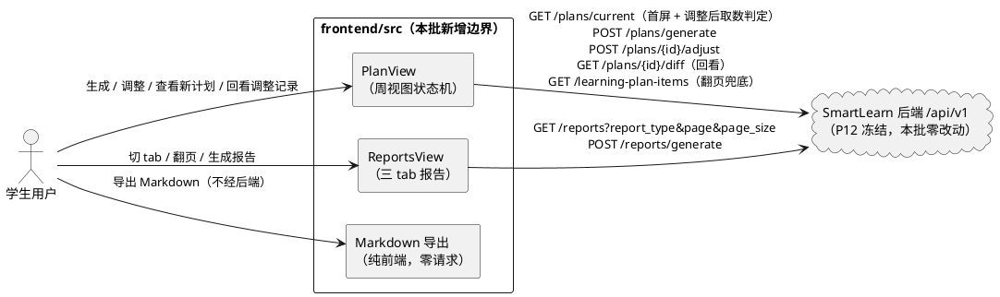
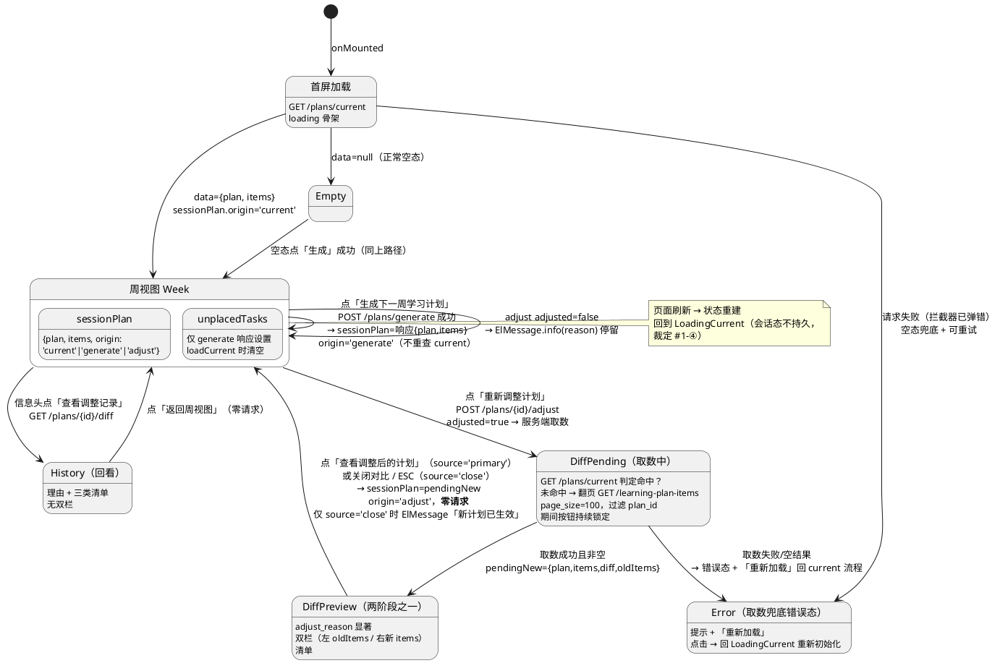
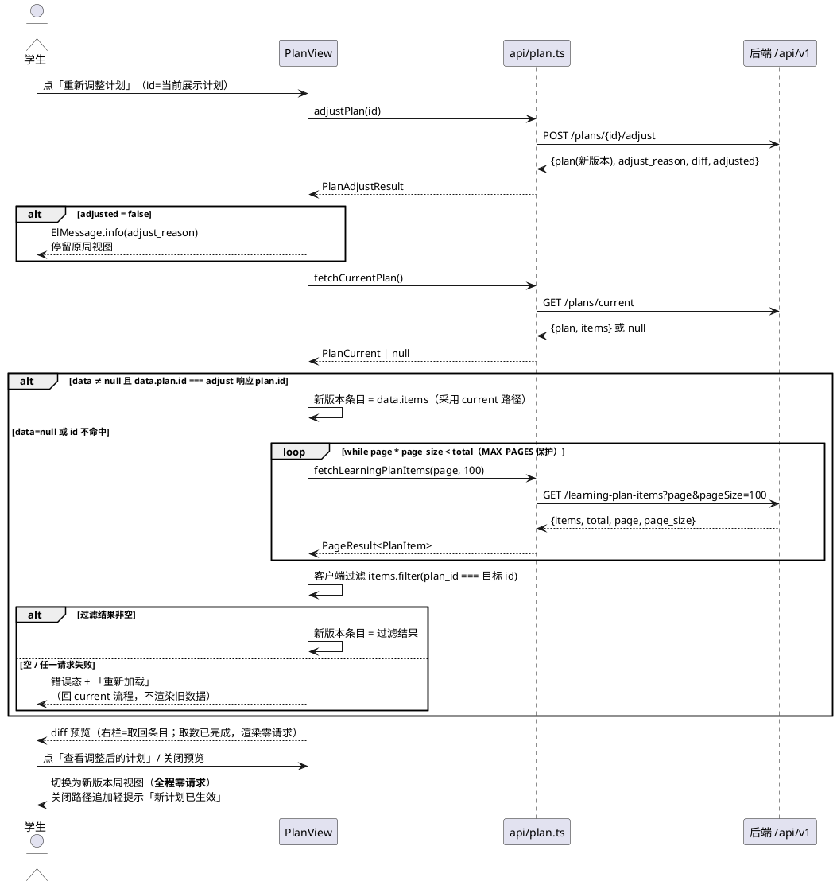
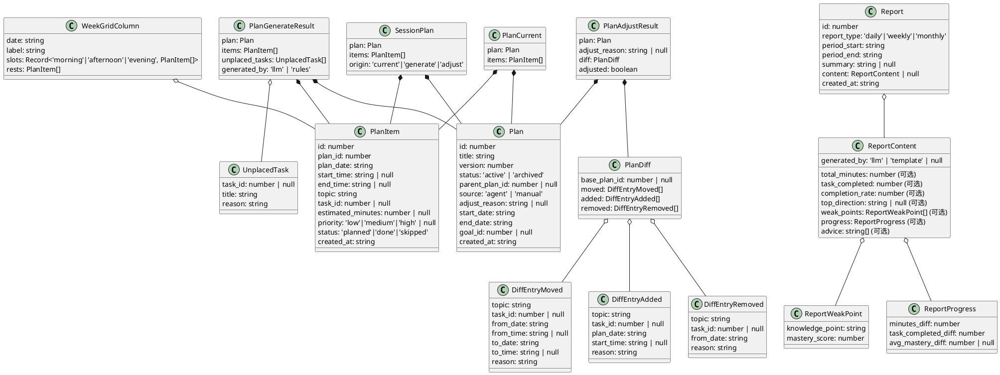

# 学习计划周视图与成长报告前端实现方案（DESIGN_PLAN_REPORT_FRONTEND）

> feature：`plan_report_frontend`
> 阶段：P13 前端批次（只改 `frontend/` 与 `docs/`，**禁止修改 `backend/`**、零新增 npm 依赖）
> 上游输入：`docs/specs/SPEC_PLAN_REPORT_FRONTEND.md`（633 行，唯一需求输入，6 项关键裁定的口径不得偏离）
> 技术契约：`docs/PROJECT_CONTEXT.md` §5 响应体/错误码、§7 前端约定、§8 编码规范
> 后端契约事实（只读核对）：`backend/app/api/v1/plans.py`、`learning_plan_items.py`、`reports.py`；`backend/app/schemas/plan.py`、`report.py`；`backend/app/services/plan.py`、`report.py`
> 文风对齐：`docs/designs/DESIGN_DYNAMIC_PLAN_REPORTS.md`（章节编号 / PlantUML / 决策记录 / 验收映射）
> 本文档只描述「怎么实现」（架构、契约、决策），不含逐行代码；实现粒度到「文件职责 + 函数/组件签名 + 关键分支」。

---

# 一、需求与存量功能关系分析

## 1.1 需求功能与存量功能对比

### 1.1.1 已实现功能

后端 P12 已冻结交付全部 8 个 REST 端点（pytest 206/206），本批**纯前端消费**，后端零改动。前端仓内可直接复用的存量能力如下：

| 需求功能 | 存量功能 | 代码位置 | 匹配度 |
|---|---|---|---|
| `/plans`、`/reports` 路由（需登录） | 路由骨架已注册，MainLayout 子路由 + `needsAuth: true` 守卫 | `frontend/src/router/index.ts:44-48、79-84` | 100% |
| 统一响应体解包（`{code,message,data}` → data） | 响应拦截器成功路径直接返回 `res.data`，业务层零解包 | `frontend/src/api/request.ts:85-104` | 100% |
| 失败统一 ElMessage（页面不重复弹错） | 拦截器失败路径 `ElMessage.error` + reject；网络错误「网络异常，请稍后重试」 | `frontend/src/api/request.ts:98-130` | 100% |
| 鉴权（Bearer 注入 / 401 清 token 跳登录） | 请求拦截器注入 token；401/1002/1003 清 token 跳 `/login` | `frontend/src/api/request.ts:66-75、99-101` | 100% |
| 分页响应 TS 类型 | `PageResult<T>`（items/total/page/page_size，与后端分页契约逐字段对齐） | `frontend/src/types/index.ts:16-21` | 100% |
| 视图 + 子组件拆分惯例 | DashboardView 编排 + `components/dashboard/*` 七个子组件；`components/<域>/` 目录对偶 | `frontend/src/views/DashboardView.vue`、`frontend/src/components/dashboard/` | 100%（惯例复用） |
| 纯函数工具惯例（时区安全日期 / 分钟格式化） | `todayLocalStr`（禁 toISOString 的 UTC 坑）、`formatMinutes`（X 小时 Y 分钟） | `frontend/src/utils/record.ts:20-32` | 75% |
| api 模块封装惯例 | `fetchXxx / createXxx` 函数式封装，返回 `Promise<T>`，`as unknown as` 解包断言 | `frontend/src/api/record.ts:31-96` | 100%（惯例复用，模块本体需新建） |
| 类型域独立文件先例 | `types/agent.ts`：独立域文件、仅本域 import、snake_case 直传 | `frontend/src/types/agent.ts:1-13` | 100%（惯例复用） |

**判定依据说明**：匹配度 100% 的行均为「接口/惯例可直接套用，零改造」；`utils/record.ts` 评 75% 是因为 `formatMinutes`、`todayLocalStr` 可直接复用，但周视图列头日期推导、时段归属等纯函数需新建（见 1.1.3）。

### 1.1.2 需要扩展的功能

| 需求功能 | 存量功能 | 差异说明 | 扩展方向 |
|---|---|---|---|
| `/plans` 页面（周视图 + 状态机） | `PlanView.vue` 为 PagePlaceholder 骨架（14 行，仅标题 + 说明） | 输入输出差异：骨架零数据零交互 → 需承载「会话态混合加载」状态机（首屏 current / generate 会话态 / adjust 服务端取数 / 刷新回 current）；业务逻辑差异：页面持有三视图模式（周视图 / diff 预览 / 调整记录回看）切换 | 全量实现视图编排层（状态机 + api 调用 + 子组件拼装），保留文件路径不变（路由零改动） |
| `/reports` 页面（三 tab + 分页 + 生成 + 导出） | `ReportsView.vue` 为 PagePlaceholder 骨架（14 行） | 骨架零数据 → 需承载三 tab 独立列表/分页/会话内缓存状态、生成后重载、卡片式七要素渲染 | 全量实现视图编排层 |
| TS 类型库 | `types/index.ts`（564 行）含 P2-P9 各域分节，**无任何 plan / report 域类型** | 差异：本批需新增约 15 个接口/类型（Plan、PlanItem、Report、ReportContent 等） | 新增 `types/plan.ts` + `types/report.ts` 域文件（决策 D1，对齐 `types/agent.ts` 先例），不继续膨胀 index.ts |

**兼容性结论**：两处扩展均为「骨架替换为实体」，不触碰路由表、不触碰既有页面与组件，回归面收敛在新增文件 + 两个视图文件内；`npm run build`（vue-tsc）通过即为本批构建验收。

### 1.1.3 需要新增的功能或接口

按模块分组（全部为新建文件，依赖关系自上而下单向：视图 → 组件 → api/utils → types）：

**① api 层（2 个文件，7 个函数）**

- `frontend/src/api/plan.ts`：计划域 5 个函数（current / generate / adjust / diff / learning-plan-items 分页）；**明确不封装** `GET /plans` 列表与 `GET /plans/{id}` 详情（spec 附录 B #3：列表本批无消费场景，版本信息经 current/generate/adjust 响应的 plan 对象已可得）。
- `frontend/src/api/report.ts`：报告域 2 个函数（列表带 report_type 过滤 / generate）；**不封装** `GET /reports/{id}`（列表出参 ReportOut 已含全部字段，无详情页场景）。

**② types 层（2 个文件）**

- `frontend/src/types/plan.ts`：传输层（Plan / PlanItem / UnplacedTask / PlanCurrent / PlanGenerateResult / PlanAdjustResult / PlanDiff 及三个 DiffEntry）+ 视图层（WeekSlot / WeekGridColumn / ItemHighlight / SessionPlan）。
- `frontend/src/types/report.ts`：传输层（Report / ReportContent / ReportWeakPoint / ReportProgress / 查询与生成入参）+ 视图层（ReportTypeLabel 映射常量）。

**③ utils 层（2 个文件，纯函数）**

- `frontend/src/utils/plan.ts`：周视图网格构建（列头日期推导、时段归属左闭右开、休息条目分区、越界防御剔除）+ diff 双栏高亮匹配。
- `frontend/src/utils/report.ts`：报告文案映射（类型中文名 / 生成方式徽章文案）+ Markdown 拼装（标题/引言/七要素分节/结尾）+ Blob 下载（文件名拼装、URL 释放）+ created_at 本地可读格式化。

**④ components 层（7 个子组件，2 个域目录）**

- `frontend/src/components/plan/`：PlanInfoHeader（计划信息头）、WeekGrid（周视图网格，含 diff 双栏缩略复用）、UnplacedTasksCard（未排入任务提示卡）、PlanDiffPreview（diff 预览双栏对比）、AdjustHistoryPanel（调整记录回看）、PlanEmptyState（空态）。
- `frontend/src/components/report/`：ReportCard（报告卡片，含导出按钮）。

**⑤ 视图层（2 个文件替换骨架）**

- `frontend/src/views/PlanView.vue`：状态机 + 取数编排 + 子组件拼装。
- `frontend/src/views/ReportsView.vue`：三 tab 状态 + 分页 + 生成动作编排。

**跨模块依赖关系**：视图与子组件**禁止** import `api/`（写动作与取数编排全部收口在视图层，子组件纯展示；对齐 DashboardView「视图调 api、子组件零请求」惯例）；utils 只 import types；api 只 import request + types。

## 1.2 存量功能详细分析

### 1.2.1 `request.ts` 拦截器契约（本批全部请求的行为基线）

- **接口契约**：成功路径返回值**即 data 本体**（类型断言 `as unknown as Promise<T>` 落在 api 函数层）；业务码非 0 → `ElMessage.error(message)` + `Promise.reject(Error)`；HTTP 401/403/5xx 与网络错误各有统一文案；401/1002/1003 清 token 跳 `/login`。
- **对本批的三点约束推导**：
  1. 视图层 `catch` 只做**状态回滚**（解除 loading、置错误态），**禁止**再弹错误 toast（SPEC §4.2-2「页面不重复弹错误提示」的落点即「catch 静默」）；
  2. `GET /plans/current` 的 `data=null`（200 成功、无当前计划）在业务层表现为 `Promise<PlanCurrent | null>` 的 null 分支——**不是**异常路径，不得走 catch（SPEC §5.1.3-1「正常空态非错误」）；
  3. 按钮防重复提交完全由视图层 loading ref 承担（拦截器无请求去重能力）。
- **扩展点**：无（本批不改 request.ts 一行）。

### 1.2.2 DashboardView 编排模式与 `useDashboardBlock` 的适用性边界

- **存量形态**：`useDashboardBlock<T>(fetcher)` 产出 `{data, loading, error, reload}`，`onMounted` 自动首发——适合「一页多块、每块一个独立请求」的纯读场景。
- **为何 PlanView 不能复用**：PlanView 的数据源是**会话态混合加载**（SPEC §5.1.1 规则 1 裁定 #1）——generate 成功后渲染响应内数据（不重查 current）、adjust 成功后需两段式服务端取数（current 命中判定 → 翻页兜底过滤）、刷新回 current。这是**多阶段状态机**，不是「单块数据 reload」；强行套用会掩盖状态迁移语义。故 PlanView 自建状态机（见 2.1.3-A）。
- **为何 ReportsView 部分借鉴但不复用**：ReportsView 是「三 tab 各一块」+ **会话内缓存**（已加载 tab 切回零请求，SPEC §5.5.1 规则 1），`useDashboardBlock` 的 `reload` 语义与「未加载才请求」缓存语义冲突。自建 `Record<ReportType, TabState>` 结构（见 2.1.3-D）。

### 1.2.3 子组件契约惯例（props/emits 的既有范式）

以 `components/task/TaskStatsCards.vue` 为范式：`defineProps<{ stats: TaskStats | null }>()` 泛型字面量 props、数据为 null 时 computed 兜底显示 `'--'` 不阻塞、纯展示零请求零 emit（无动作时）。本批子组件沿用该范式：**props 必填数据一律可 null（加载失败/空态容错），动作向上 emit，文案全中文，样式用 Element Plus 主题变量**（`--el-color-warning` 等而非硬编码色值，PROJECT_CONTEXT §8.2）。

### 1.2.4 `PagePlaceholder` 的定位与退出

存量骨架组件（44 行：el-card + el-empty），无按钮插槽、无业务文案定制能力。本批 PlanView / ReportsView **替换**为其业务实现后，`/plans`、`/reports` 不再引用它（其余未实现页面继续使用，不删除、不修改该文件）。

### 1.2.5 后端 API 事实核对结果（设计输入，禁止偏离）

| 核对项 | 代码事实 | 对本批设计的影响 |
|---|---|---|
| `GET /plans/current` 空态语义 | `services/plan.py:801-809` 无匹配返回 `None`（HTTP 200 + data=null，**非 404**） | 业务层 `Promise<PlanCurrent | null>`，null 走空态分支 |
| items 排序 | `_ordered_items`：plan_date 升序、同日 start_time 升序、**None（休息）排最前** | 前端不重排，网格构建直接消费（对齐「列表直传不重排」惯例） |
| adjust 响应结构 | `{plan, adjust_reason, diff, adjusted}`，**plan 仅元信息不含 items** | 必须实现 5.3.1 规则 4 两段式取数（本设计核心） |
| `GET /plans/{id}/diff` 首版语义 | `services/plan.py:818-822`：parent=null 或父版本丢失均返回空结构（200） | 回看视图空态文案「该版本无调整记录」 |
| learning-plan-items 过滤能力 | 路由仅接受 page/page_size，**无 plan_id 查询参数**；归属过滤在服务端按用户隔离 | 只能全量翻页 + 客户端 `plan_id === 目标 id` 过滤（兜底路径） |
| reports 列表排序 | `created_at` 倒序 + id 倒序 tie-break | 前端不重排；生成成功后重载列表页 1，新报告必然置顶 |
| **报告 content.generated_by 实际取值** | `services/report.py:454、463、475`：实际写入 `"llm"` 或 `"template"`（plan 域 generate 才是 `'rules'`，两域字面量不得混用） | spec §6.7-8 已勘误为 `'template'`；TS 类型锁定 `'llm' \| 'template' \| null`，渲染映射对未知值不显示徽章（决策 D11，详见 2.3.1） |
| report content 结构 | `content = {**stats, "generated_by": ...}`：七要素键名 `total_minutes / task_completed / completion_rate / top_direction / weak_points[{knowledge_point, mastery_score}] / progress{minutes_diff, task_completed_diff, avg_mastery_diff} / advice[]` | TS 类型逐字段对齐（2.3.2）；前端渲染/导出共用同一映射 |
| generate 的 unplaced_tasks | `services/plan.py:589`：`{task_id, title, reason}` 列表随返 | 提示卡数据源；adjust 响应无此键（undefined 不渲染） |
---

# 二、增量设计方案

## 2.1 实现模型

### 2.1.1 上下文视图

本批只新增两个前端页面级上下文（`/plans`、`/reports`），与后端的交互收敛为 **7 个消费端点**（写 3 + 读 4；`GET /plans` 列表、`GET /plans/{id}`、`GET /reports/{id}` 不消费）：



- 调用频率：首屏 1 次 current（有计划即完成渲染）；adjust 流程最多 1 + 1 + N 次（adjust → current → 翻页 N 次，N 通常为 1，page_size=100 下单用户全部条目远不足一页）；reports 每 tab 首切 1 次 + 翻页按需。
- 中间件：无新增（不经消息队列/缓存；报告 tab 会话内缓存为前端内存态，见 2.1.3-D）。

### 2.1.2 服务/组件总体架构

```plantuml
@startuml
package "视图层（编排 + 状态机，唯一允许调 api 的层）" {
  [PlanView.vue] : 取数状态机 / 三视图模式切换\n生成·调整·回看动作编排
  [ReportsView.vue] : 三 tab 状态 + 分页 + 生成\ntab 会话缓存
}

package "components/plan（纯展示）" {
  [PlanInfoHeader]
  [WeekGrid] : 7 列 × 3 时段 + 休息区块\ncompact 模式供 diff 双栏复用
  [UnplacedTasksCard]
  [PlanDiffPreview] : adjust_reason + 双栏 + 清单
  [AdjustHistoryPanel]
  [PlanEmptyState]
}

package "components/report（纯展示）" {
  [ReportCard] : 区间显著头部 + 七要素分区\n内联触发导出
}

package "服务层" {
  [api/plan.ts] : 5 个函数
  [api/report.ts] : 2 个函数
  [api/request.ts] : 既有，零改动
}

package "纯函数层 utils" {
  [utils/plan.ts] : buildWeekGrid / slotOf / markDiffHighlights
  [utils/report.ts] : buildReportMarkdown / downloadReportMarkdown\n文案映射
}

package "types" {
  [types/plan.ts]
  [types/report.ts]
  [types/index.ts] : 既有 PageResult<T> 复用
}

PlanView --> [api/plan.ts]
PlanView --> [utils/plan.ts]
PlanView ..> [components/plan] : 拼装
ReportsView --> [api/report.ts]
ReportsView ..> [components/report] : 拼装
[components/plan] --> [utils/plan.ts]
[components/plan] --> [types/plan.ts]
[components/report] --> [utils/report.ts]
[components/report] --> [types/report.ts]
[api/plan.ts] --> [types/plan.ts]
[api/plan.ts] --> [types/index.ts]
[api/report.ts] --> [types/report.ts]
[utils/plan.ts] --> [types/plan.ts]
[utils/report.ts] --> [types/report.ts]
[utils/report.ts] ..> [utils/record.ts] : 复用 formatMinutes
@enduml
```

**分层铁律（由既有惯例推导，设计即约束）**：

1. 子组件**禁止** import `@/api/*`、禁止出现 axios/fetch（SPEC §4.4-1 验收：全局检索 views/components 下 plan/report 代码无 axios、无裸 fetch）；所有请求发生在视图层。
2. `ReportCard` 内联触发「导出 Markdown」是**纯前端行为**（调 utils 纯函数，零请求），不违反第 1 条。
3. utils 层全为无副作用纯函数 + 只读常量（对齐 `utils/record.ts` 模块注释惯例）；Markdown 下载函数是唯一副作用点（DOM a 元素 + URL 释放），单列一个函数隔离。
4. types 独立于所有层（零依赖），域文件仅被本域 import（对齐 `types/agent.ts` 裁决先例）。

**新增/修改文件清单（含职责一句话）**：

| 文件 | 新增/修改 | 职责 |
|---|---|---|
| `views/PlanView.vue` | 修改（骨架 14 行 → 实体） | 计划页编排：会话态数据源状态机、生成/调整/回看动作、三视图模式切换、错误态兜底 |
| `views/ReportsView.vue` | 修改（骨架 14 行 → 实体） | 报告页编排：三 tab 独立列表与分页、按需加载与会话缓存、生成动作 |
| `components/plan/PlanInfoHeader.vue` | 新增 | 计划信息头：标题、周期、版本徽章、生成方式徽章、「下周计划」标注、「查看调整记录」入口 |
| `components/plan/WeekGrid.vue` | 新增 | 周视图网格：7 列 × 上午/下午/晚上三时段 + 每日休息区块；compact 缩略模式 + diff 高亮复用 |
| `components/plan/UnplacedTasksCard.vue` | 新增 | 未排入任务提示卡（title + reason + 引导文案） |
| `components/plan/PlanDiffPreview.vue` | 新增 | diff 预览：adjust_reason 显著展示 + 左右双栏网格对比 + 结构化改动清单 + 主按钮 |
| `components/plan/AdjustHistoryPanel.vue` | 新增 | 调整记录回看：adjust_reason + 三类清单（无双栏、无任何应用/确认按钮） |
| `components/plan/PlanEmptyState.vue` | 新增 | 空态：引导文案 + 「生成下一周学习计划」按钮 + 归档说明 |
| `components/report/ReportCard.vue` | 新增 | 报告卡片：区间显著头部 + 七要素分区 + 薄弱点色块 + 导出按钮 |
| `api/plan.ts` | 新增 | 计划域 5 个接口函数（不封装 GET /plans 列表） |
| `api/report.ts` | 新增 | 报告域 2 个接口函数 |
| `types/plan.ts` | 新增 | 计划域传输层 + 视图层类型 |
| `types/report.ts` | 新增 | 报告域传输层 + 视图层类型 |
| `utils/plan.ts` | 新增 | 周网格构建 / 时段归属 / diff 高亮匹配纯函数 |
| `utils/report.ts` | 新增 | 文案映射 / Markdown 拼装与下载纯函数 |

### 2.1.3 实现设计文档（核心状态机与流程分支）

#### A. PlanView 会话态数据源状态机（裁定 #1 的落地形态）

三组正交状态（均为页面内 `ref`/`reactive`，非 Pinia，理由见 2.5）：



**关键分支标注**：

- **generate 成功分支（SPEC §5.2.1 规则 1）**：成功 toast 由视图层 `ElMessage.success` 弹出（成功提示不在拦截器职责内）；`generated_by='rules'` 时追加降级提示（ElMessage.warning「LLM 规划暂不可用，已按规则引擎生成计划」，SPEC §5.2.1 规则 3）；**不重查 current**（下周计划不满足 current 条件）。
- **adjusted=false 分支（SPEC §5.3.1 规则 5）**：`ElMessage.info(adjust_reason)`（此场景它是提示文案），页面停留原周视图，不进入取数、不进预览。
- **取数失败/空结果分支（SPEC §5.3.3 场景 4）**：抛出内部 `PlanFetchError`，视图层置错误态（独立错误卡片：说明文案 + 「重新加载」按钮 → `loadCurrent()`）；错误卡文案必须明确「计划调整已生效，但新版本条目暂时加载失败」，禁止只写「加载失败」让用户误以为调整未生效；「重新加载」仍走 `loadCurrent()`。**绝不**用旧 items + diff 前端重建新网格（规则 4-⑤ 红线），也绝不渲染旧网格冒充。
- **404/1005 越权分支（SPEC §5.3.3 场景 2）**：adjust 失败时统一走 catch → 解除 loading；若需恢复，用户刷新或点重试回 current 流程（视图层不解析业务码——拦截器已按 message 弹错，前端不做码值分支，保持「catch 静默回滚」惯例）。

#### B. 调整流程完整时序（请求顺序 = SPEC §5.3.1 规则 4 的验收口径）



**约束复述（实现者必须逐条对照 SPEC §5.3.1 规则 4）**：取数发生在**进入 diff 预览之前**；预览右栏与切换后的周视图**共用同一份**取回条目（同一引用，保证一致性）；点「查看调整后的计划」与关闭按钮**同一处理函数**（裁定 #2：不提供放弃/撤销类按钮）；全程不调用 `GET /plans/{id}/diff`（规则 7 禁止项——adjust 响应已含同构 diff）。

#### C. 首屏与刷新语义

`onMounted` 一律走 `loadCurrent()`：成功非 null → 渲染；null → 空态；失败 → 拦截器弹错 + 空态兜底（保持可重试，SPEC §5.1.3-2「页面渲染空态（含生成按钮）保持可用」——注意失败兜底为空态而非错误卡片，错误卡片仅用于**取数兜底路径**，两者区分见 2.4.1-C）。刷新 = 状态重建 = 回 current 语义（会话态不持久）。

#### D. ReportsView 三 tab 状态机（按需加载 + 会话缓存）

```plantuml
@startuml
[*] --> TabWeekly : 默认激活周报 tab\n首次进入即加载 weekly

state "TabState × 3\n(reactive Record)" {
  state "每 tab 独立字段" : items / total / page / pageSize\nloaded（会话缓存标记）/ loading
}

TabWeekly --> TabDaily : 切「日报」\ndaily.loaded=false → 发起 1 次请求
TabDaily --> TabWeekly : 切回「周报」\nweekly.loaded=true → **零请求**直接渲染缓存
TabWeekly --> TabMonthly : 切「月报」（同理按需）
TabWeekly --> TabWeekly : 翻页 → page=N 请求并覆盖 items\n（翻页不置 loaded 缓存语义，始终真实请求）

TabWeekly --> Generating : 点「生成报告」\nPOST /reports/generate {report_type}
Generating --> TabWeekly : 成功 → 该 tab 重置 page=1 重载列表\n（新报告 created_at 最新，重载后置顶）
Generating --> TabWeekly : 失败 → 解除 loading，列表维持原状
@enduml
```

- 每类型**至多首次 1 次列表请求**（SPEC §4.1-2 验收）；「已加载过可直接复用会话内缓存」指**回到已加载 tab 的页 1 数据**；翻页操作始终真实请求并更新缓存页。
- report_type 非法防御（SPEC §5.5.3-2）：ReportType 为字面量联合类型，TypeScript 层面结构性排除；运行时按钮绑定固定三字面量，无用户输入路径，不额外判空。
## 2.2 接口设计

> 本批「接口」有两层：① 视图 ↔ 后端的 **api 函数**（HTTP 契约的 TS 投影）；② 视图 ↔ 子组件的 **props/emits 契约**。全部类型落在 `types/plan.ts`、`types/report.ts`，函数返回 `Promise<T>`（`as unknown as Promise<T>` 断言，对齐 `api/record.ts` 惯例）。

### 2.2.1 总体设计

**分类依据**：按「读 / 写 / 纯函数」三分。读函数无前置条件（Bearer 由拦截器保证）；写函数的前置条件 = 视图层 loading 锁（防重复提交，SPEC §4.2-1）；纯函数无 IO。

**接口变更策略**：`request.ts`、`types/index.ts`（PageResult）零变更（稳定级）；7 个 api 函数与全部组件契约为本批新增（随交付即稳定）。**不封装的端点**（防实现者画蛇添足）：`GET /plans`（列表，本批无消费场景，附录 B #3）、`GET /plans/{id}`（详情，元信息已在各响应 plan 对象内）、`GET /reports/{id}`（详情，列表出参已含全部字段）。

**api 函数总表**：

| # | 函数 | HTTP | 返回类型 | 稳定性 |
|---|---|---|---|---|
| 1 | `fetchCurrentPlan()` | GET `/plans/current` | `Promise<PlanCurrent \| null>` | 新增·稳定 |
| 2 | `generatePlan()` | POST `/plans/generate`（零字段体 `{}`） | `Promise<PlanGenerateResult>` | 新增·稳定 |
| 3 | `adjustPlan(planId: number)` | POST `/plans/{planId}/adjust`（零字段体 `{}`） | `Promise<PlanAdjustResult>` | 新增·稳定 |
| 4 | `fetchPlanDiff(planId: number)` | GET `/plans/{planId}/diff` | `Promise<PlanDiff>` | 新增·稳定 |
| 5 | `fetchLearningPlanItems(page: number, pageSize: number)` | GET `/learning-plan-items?page&page_size` | `Promise<PageResult<PlanItem>>` | 新增·稳定 |
| 6 | `fetchReports(query: ReportListQuery)` | GET `/reports?report_type&page&page_size` | `Promise<PageResult<Report>>` | 新增·稳定 |
| 7 | `generateReport(payload: ReportGeneratePayload)` | POST `/reports/generate` | `Promise<Report>` | 新增·稳定 |

### 2.2.2 接口清单（api 函数 + 视图编排函数 + 关键纯函数）

#### （1）`fetchCurrentPlan(): Promise<PlanCurrent | null>`

- **业务说明**：首屏基线与 adjust 后取数判定的共用函数。返回 null 表示今天不在任何 active 计划周期内（HTTP 200 + data=null，非 404）。
- **前置条件**：已登录（拦截器保证）。
- **后置条件**：无副作用（纯读）。
- **异常映射**：网络错误/业务码非 0 → 拦截器 reject + ElMessage；调用方 catch 只做状态回滚。
- **调用示例**：`const current = await fetchCurrentPlan(); if (current) { sessionPlan.value = { ...current, origin: 'current' } } else { phase.value = 'empty' }`

#### （2）`generatePlan(): Promise<PlanGenerateResult>`

- **业务说明**：生成下一个完整自然周计划（LLM 失败自动降级 rules，**降级不是错误**——generated_by 字段区分）。
- **前置条件**：视图层 `generating` 锁未持有；同周期重生成会归档旧版（真实副作用，必须防重复）。
- **后置条件**：视图层以响应 `{plan, items, unplaced_tasks, generated_by}` 直接渲染会话态，**不得重查 current**。
- **异常映射**：1007（周期部分重叠冲突）等由拦截器弹后端 message；视图层解除 loading、维持原状态。
- **调用示例**：`const res = await generatePlan(); sessionPlan.value = { plan: res.plan, items: res.items, origin: 'generate' }; unplacedTasks.value = res.unplaced_tasks`

#### （3）`adjustPlan(planId: number): Promise<PlanAdjustResult>`

- **业务说明**：动态调整（纯确定性零 LLM）。planId = 当前展示计划的 id（会话态 plan.id）。
- **前置条件**：页面存在可展示计划；`adjusting` 锁未持有。
- **后置条件**：**后端已即时生效**（新版本落库、旧版归档）——视图层收到响应后必须继续完成新版本条目取数（见（8）resolveNewVersionItems），不得停在中间态。
- **异常映射**：404/1005（不存在或越权）、400/1007（非 active）→ 拦截器弹错；视图层解除 loading、维持原周视图。
- **调用示例**：`const res = await adjustPlan(sessionPlan.value.plan.id); if (!res.adjusted) { ElMessage.info(res.adjust_reason ?? '当前计划无需调整') }`

#### （4）`fetchPlanDiff(planId: number): Promise<PlanDiff>`

- **业务说明**：调整记录回看专用（SPEC §5.4）。首版或父版本丢失返回空结构（base_plan_id=null、三个空数组），**不是错误**。
- **前置条件**：plan.parent_plan_id 非空（信息头入口的显示条件）。
- **后置条件**：纯读。**禁止**在 adjust 即时流程调用（SPEC §5.3.1 规则 7：adjust 响应已含同构 diff）。
- **调用示例**：`historyDiff.value = await fetchPlanDiff(sessionPlan.value.plan.id)`

#### （5）`fetchLearningPlanItems(page: number, pageSize: number): Promise<PageResult<PlanItem>>`

- **业务说明**：新版本条目取数的**兜底路径**——端点仅接受分页参数（无 plan_id 过滤），返回当前用户全部计划条目（id 升序）；调用方翻页取全后按 `plan_id === 目标 id` 客户端过滤。
- **前置条件**：仅由 resolveNewVersionItems 的兜底分支调用，不作为常规数据源。
- **后置条件**：纯读。pageSize 固定传 100（上限，最小化翻页次数）。
- **异常映射**：任何一页失败 → 整个取数流程失败 → 错误态（SPEC §5.3.3 场景 4）。
- **调用示例**：`const page1 = await fetchLearningPlanItems(1, 100)`

#### （6）`fetchReports(query: ReportListQuery): Promise<PageResult<Report>>`

- **业务说明**：按 report_type 过滤的报告分页列表（后端 created_at 倒序，前端不重排）。
- **前置条件**：query.report_type 为三字面量之一（TS 结构性保证）。
- **后置条件**：视图层更新对应 tab 的 items/total/page。
- **调用示例**：`const res = await fetchReports({ report_type: 'weekly', page: 1, page_size: 10 })`

#### （7）`generateReport(payload: ReportGeneratePayload): Promise<Report>`

- **业务说明**：生成报告。请求体**仅 `{report_type}`**（不传 period_end，恒用后端缺省最近完整周期）。
- **前置条件**：`generatingReport` 锁未持有。
- **后置条件**：视图层重置该 tab 至 page=1 重载列表（新报告置顶，SPEC §5.6.1 规则 1；选择「重载列表」而非「头部插入」，理由见决策 D9）。
- **调用示例**：`await generateReport({ report_type: 'weekly' }); await loadTabList('weekly', 1)`

#### （8）视图编排函数（PlanView 内部，非导出——列出签名以钉死职责边界）

```text
loadCurrent(): Promise<void>
  首屏/刷新/错误态重试共用：GET current → 空态/周视图/失败兜底三分支。
resolveNewVersionItems(targetPlanId: number): Promise<PlanItem[]>
  规则 4 两段式取数：current 命中同 id → data.items；否则翻页取全 + 过滤；
  空/失败 → throw PlanFetchError（内部错误类，仅用于驱动错误态分支）。
handleGenerate(): Promise<void>   生成动作（锁 generating）
handleAdjust(): Promise<void>     调整动作（锁 adjustPipeline = adjusting || 取数中）
handleConfirmNewPlan(): void      「查看调整后的计划」/关闭预览统一入口（零请求切换）
handleViewHistory(): Promise<void>  回看动作（GET diff）
```

#### （9）utils/plan.ts 纯函数（签名与关键分支）

```text
WEEK_SLOTS: readonly WeekSlotLabel[]        ['上午','下午','晚上']（渲染序）
buildWeekColumns(plan: Plan): WeekColumnMeta[]
  由 plan.start_date 推导 7 列 {date:'YYYY-MM-DD', label:'周一 10-26'}，逐列 +1 天。
slotOfItem(item: PlanItem): WeekSlot
  start_time=null → 'rest'；'HH:MM' 字符串字典序比较（ISO 短格式字典序=时间序）：
  [09:00,14:00)→'morning'；[14:00,19:00)→'afternoon'；[19:00,23:00)→'evening'；
  <09:00 就近归 'morning' + console.warn；≥23:00 就近归 'evening' + console.warn（防御）。
buildWeekGrid(plan: Plan, items: PlanItem[]): WeekGridColumn[]
  列合并：每列 {date,label,slots:{morning,afternoon,evening},rests:[]}；
  plan_date 越界（不在 start~end）条目剔除 + console.warn（SPEC §5.1.3-3）；
  同时段内保持传入顺序（后端已按 plan_date+start_time 升序）。
markDiffHighlights(items: PlanItem[], diff: PlanDiff, side: 'old'|'new'): Map<number, ItemHighlight>
  生成「条目数组索引 → moved/added/removed」标注，供双栏渲染高亮；
  匹配键与降级策略见 2.4.3（决策 D6）。
```

#### （10）utils/report.ts 纯函数（签名与关键分支）

```text
REPORT_TYPE_LABELS: Record<ReportType, string>   daily→日报 / weekly→周报 / monthly→月报
generatedByLabel(v: string | undefined): string | null
  'llm'→'LLM 总结'；'template'→'规则模板'；其他/缺失→null（不显示徽章，决策 D11）。
buildReportMarkdown(report: Report): string
  固定结构拼装（SPEC §5.6.1 规则 5）：一级标题含区间 → 引言（区间重申 + created_at 本地
  可读）→ ## 摘要（空则整节省略）→ 七要素七节（每节空值落空态文案）→ 结尾分隔线 +
  生成方式标注（generated_by 缺省省略）。字符串模板逐段拼接，无任何依赖。
downloadReportMarkdown(report: Report): void
  文件名 学习{类型中文名}_{period_start}_{period_end}.md；new Blob([md], {type:
  'text/markdown;charset=utf-8'})；createObjectURL → a.click → 移除 a → revokeObjectURL
  （同一次宏任务内完成释放，禁止 URL 滞留，SPEC §5.6.1 规则 6）。
formatCreatedAtLocal(iso: string): string
  created_at → 'YYYY-MM-DD HH:mm' 本地格式（原生 Date 组件拼接，禁 toISOString——
  对齐 utils/record.ts 时区教训）。
```

## 2.3 数据模型

### 2.3.1 设计目标

1. **支撑的业务场景**：会话态混合加载（current/generate/adjust 三来源的统一渲染结构）、diff 双栏对比、周视图网格分区、三 tab 报告列表、七要素卡片渲染、Markdown 导出。
2. **性能/容量**：单计划条目 ≤ 7 天 × 个位数条目；报告单页 ≤ 100 条——类型设计无性能诉求，纯正确性契约。
3. **兼容策略**：传输字段与后端 Pydantic 出参**逐字段 snake_case 对齐**（不做大小写转换）；存量数据容错（content=null、部分字段缺失）在类型上体现为可选字段（SPEC §5.5.1 规则 6）。
4. **一处事实澄清（设计输入级）**：后端报告 `content.generated_by` 实际取值为 `"llm" | "template"`（`services/report.py:454/463/475`），spec §6.7-8 已同步勘误为 `'llm' | 'template'`。**设计裁定（D11）**：`ReportContent.generated_by` 锁定为 `'llm' | 'template' | null`（对齐 spec「或缺失」）；`generatedByLabel` 对未知值返回 null（不显示徽章）属运行期防御，但不再把 `'rules'` 视为报告域合法字面量；计划域 `PlanGenerateResult.generated_by` 仍为 `'llm' | 'rules'`。

### 2.3.2 模型实现（TS 类型层级与类图）



**说明**：

1. **Plan / PlanItem 对齐后端 PlanOut / PlanItemOut**（`schemas/plan.py:22-56`）——`user_id` 字段在出参中存在但前端无消费，**保留定义**（与后端字段集严格一致是「snake_case 直传、不二次映射」契约的一部分，删字段会造成后端加字段时的隐性漂移）。
2. **视图层类型与传输层类型同文件分节**（对齐 `types/agent.ts`「传输层 + 视图层」双层惯例）：`SessionPlan`（会话态渲染数据源）、`WeekSlot / WeekGridColumn / ItemHighlight`（网格渲染结构）、`PendingNewPlan`（diff 预览持有：新 plan + 取回 items + diff + oldItems + adjustReason）。
3. **ReportContent 全字段可选**：后端 content 为 `dict[str, Any] | null`（JSONType 读出语义：null=无结构化内容，**不是**空对象，PROJECT_CONTEXT §8.1）；存量报告可能部分字段缺失——「有则显示、无则隐藏分区」（SPEC §5.5.1 规则 6）在类型上即 optional 字段。
4. **ReportContent.generated_by 锁定字面量**：按 spec §6.7-8 锁定 `'llm' | 'template' | null`（见 2.3.1-4）；plan 域 `PlanGenerateResult.generated_by` 保持 `'llm' | 'rules'` 字面量联合（后端 Literal 锁定）。
5. **对象创建/销毁**：全部为请求响应反序列化对象与纯函数派生结构，无生命周期管理；`pendingNewPlan` 在「查看调整后的计划」确认后被消费并清空（同一份 items 引用转移给 sessionPlan，保证 diff 右栏与切换后周视图一致性）。
6. **持久化**：无（会话态不持久是裁定 #1 的既定语义；页面刷新自然销毁回 current）。
## 2.4 核心模块详细设计

### 2.4.1 PlanView 与取数编排（视图层核心）

**页面状态字段**（`<script setup>` 内）：

| 状态 | 类型 | 语义 |
|---|---|---|
| `phase` | `'loading' \| 'empty' \| 'ready'` | 首屏加载三态（失败落 `empty` 兜底，错误 toast 由拦截器弹） |
| `viewMode` | `'week' \| 'diff' \| 'history'` | 页面级视图模式（三视图互斥切换） |
| `sessionPlan` | `SessionPlan \| null` | 会话态渲染数据源（唯一周视图数据来源） |
| `unplacedTasks` | `UnplacedTask[]` | 最近一次 generate 的未排入任务（loadCurrent 清空、adjust 不触碰，决策 D8） |
| `pendingNew` | `PendingNewPlan \| null` | diff 预览持有（adjust 响应 + 取回条目 + 旧条目快照） |
| `historyDiff` | `PlanDiff \| null` | 回看视图数据 |
| `fetchError` | `boolean` | 取数兜底错误态标记（仅 adjust 取数路径使用，区别于首屏失败的空态兜底） |
| `generating` / `adjusting` / `fetchingItems` | `boolean` | 按钮锁（`adjustBusy = adjusting \|\| fetchingItems` 同时锁住取数阶段，SPEC §4.2-1 的完整覆盖） |
| `degraded` | `boolean` | 最近一次 generate 是否 rules 降级（信息头徽章 + 降级提示共用） |

**取数兜底错误态与首屏失败态的区分（SPEC §5.3.3 场景 4 的精确落点）**：首屏 current 失败 → 空态兜底（页面可用、含生成按钮，SPEC §5.1.3-2）；adjust 后取数失败/空结果 → **独立错误卡片**（错误说明 + 「重新加载」按钮，点击 `loadCurrent()` 重走 current 流程）。错误卡文案必须明确「计划调整已生效，但新版本条目暂时加载失败」，禁止只写「加载失败」让用户误以为调整未生效；「重新加载」仍走 `loadCurrent()`。二者视觉与语义都不同：前者是「没有计划」，后者是「有新计划但拿不到」——不得渲染旧数据冒充（规则 4-④）。

**「下周计划」标注推导（决策 D3）**：`isNextWeek = plan.start_date > todayLocalStr()`（复用 `utils/record.ts` 的 todayLocalStr）。generate 出的下周 start_date 恒 > 今天 ✓；adjust 后新版本周期与旧版相同，标注保持连续 ✓；current 加载的计划覆盖今天（start_date ≤ 今天）不标 ✓；周日生成、周一刷新后 current 命中同一计划 → 自动转为本周语义（start_date=今天，不标）✓。日期推导比 `origin==='generate'` 更稳健（覆盖 adjust 后跨会话的周期真值）。

### 2.4.2 WeekGrid 周视图网格（components/plan/WeekGrid.vue）

**Props**：

```text
plan: Plan                      所属计划（列头日期推导依据）
items: PlanItem[]               条目（buildWeekGrid 的输入，组件内部调用纯函数）
compact?: boolean = false       缩略模式（diff 双栏复用：仅 topic + 时间，隐藏状态色条/
                                关联任务标识/时长行，缩小内边距与字号）
highlights?: Map<number, ItemHighlight>   条目索引 → moved/added/removed（diff 双栏专用）
```

**Emits**：无（纯展示，无任何点击/编辑交互——SPEC §5.1.1 规则 9 禁止项）。

**关键渲染逻辑**：

1. 网格骨架：CSS `grid`（`grid-template-columns: 72px repeat(7, minmax(120px, 1fr))`；首列为时段行头「上午/下午/晚上」）。**决策 D4**：用 CSS grid 而非 el-table——课表是「视觉网格 + 单元格内多卡片纵向堆叠 + 跨行休息区块」结构，el-table 的行列模型（固定行高、单元格单值）需大量 hack 才能表达；且 el-table 面向数据表语义（排序/选择/固定列）在本场景全部无用。窄屏兜底：外层容器 `overflow-x: auto`（7 列横向滚动，不引入复杂响应式）。
2. 三时段行 × 7 列 = 21 个格子；每格 `v-for` 渲染该格条目卡片；第四行为「休息区块」行——仅渲染**至少有一个 rest 条目的列**显示灰底「休息」标记（决策：休息行不是全宽行，而是每列独立的第四行区块；无休息条目的列显示空白占位以维持列对齐）。
3. 条目卡片（正常模式四类信息，SPEC §5.1.1 规则 5）：topic（主文案）+ `start_time ~ end_time`（rest 条目不显示时间）+ `estimated_minutes`（null 不渲染该行）+ task_id 非空时「关联任务」el-tag。
4. 状态标注（规则 6）：`status='planned'` → 卡片左侧 3px 宽 warning 色条（`--el-color-warning`）；`'done'` → 文本灰显弱化 + 完成 icon（对勾）；`'skipped'` → 删除线 + 灰显。**标注依据仅为条目自身 status 字段**，禁止按 task_id 反查任务状态（N+1，SPEC §5.1.1 规则 6 裁定）。
5. compact + highlights 模式：卡片附加 `is-highlight-moved` / `is-highlight-added` / `is-highlight-removed` class（高亮边框 + 角标文案「移出/移入/新增/移除」；moved 在左右两栏分别标「移出/移入」）。右栏 added 高亮、左栏 removed/moved 高亮（spec 5.3.1 规则 3）。

### 2.4.3 diff 双栏与高亮匹配（utils/plan.ts markDiffHighlights）

**数据来源铁律**：左栏 = `pendingNew.oldItems`（进入调整前页面持有的旧版本条目快照，adjust 发起时从 sessionPlan.items 拷贝）；右栏 = `pendingNew.items`（规则 4 服务端取回的同一份条目）。**严禁**「旧 items + diff」重建右栏（规则 4-⑤）。

**匹配键设计（决策 D6）**——diff 条目与网格条目分属两个数据集（diff 无 item id，网格条目有 id），需用业务键对齐：

| diff 类别 | 匹配目标栏 | 主匹配键 | task_id 为 null 时降级 |
|---|---|---|---|
| moved | 左栏：`(task_id, from_date, from_time)`；右栏：`(task_id, to_date, to_time)` | task_id + 位置三元组 | `topic + 位置二元组` |
| added | 右栏：`(task_id, plan_date, start_time)` | 同上 | `topic + plan_date` |
| removed | 左栏：`(task_id, from_date)` | task_id + 日期 | `topic + from_date` |

- 匹配产出 `Map<数组索引, highlight>`；**匹配不上一律不渲染高亮、不报错**（防御性降级——底层数据与 diff 不一致时宁可少一个高亮，不崩布局）；一个条目被多条 diff 命中时按 moved > added > removed 优先级取一（互斥语义）。
- `from_time / to_time / start_time` 的 null 与字符串直接宽松相等比较（rest 条目为 null）。

### 2.4.4 其余 plan 子组件契约

**PlanInfoHeader.vue**

```text
Props: plan: Plan | null; isNextWeek: boolean; degraded: boolean(生成方式 rules)
Emits: view-history（点击「查看调整记录」）
渲染：标题 + 周期文本「2026-10-26 ~ 2026-11-01」+ v{version} 徽章 + 生成方式徽章
（degraded → 「规则降级」（warning），否则「LLM 规划」（info））+ isNextWeek →
「下周计划」tag（primary）+ plan.parent_plan_id ≠ null → 文字按钮「查看调整记录」
（首版 null 不渲染入口，SPEC §5.4.1 规则 1）
```

**UnplacedTasksCard.vue**

```text
Props: tasks: UnplacedTask[]
Emits: 无
渲染：el-alert（warning，不阻断）或 el-card 独立提示卡「容量不足，未排入的任务」：
逐条 title + reason + 固定说明文案「这些任务已保存在任务列表，可前往任务页手动安排」。
父层控制渲染条件：tasks.length === 0 时父组件不挂载（SPEC §5.1.1 规则 8-b「无占位」）
```

**PlanDiffPreview.vue**

```text
Props: pending: PendingNewPlan
Emits: confirm(source: 'primary' | 'close')（「查看调整后的计划」= 'primary'，
「关闭对比」与 ESC = 'close'；统一出口、source 区分路径——仅 'close' 路径父组件
追加「新计划已生效」提示，SPEC §5.3.1 规则 6）
渲染结构（自上而下，SPEC §5.3.1 规则 3）：
① adjust_reason 显著卡片（大字号独立色块，禁止折叠默认隐藏；reason 为 null 时降级显示
  「本次调整未提供说明」占位——防御）；
② 双栏 WeekGrid（左「原计划」oldItems / 右「新计划」items，均 compact + highlights；
  每栏上方小标题 + 新栏版本徽章）；
③ 结构化改动清单：moved 逐条「{topic}：从 {from_date from_time} 挪到 {to_date to_time}
（{reason}）」；removed 逐条「{topic} 被移出计划（{reason}）」；added 逐条「新增：{topic}
（{reason}）」；三类全空 → 显示「本次调整无条目变动」（SPEC §5.3.3 场景 3）；
④ 操作区：主按钮「查看调整后的计划」（primary）+ 次按钮「关闭对比」（plain）——
**无任何「放弃/取消/撤销」类按钮**（裁定 #2）。
time 为 null 的展示降级：挪动描述时间位显示「休息时段」。
```

**AdjustHistoryPanel.vue**

```text
Props: plan: Plan; diff: PlanDiff | null（null = 请求飞行中，骨架）；loading: boolean
Emits: back（「返回周视图」）
渲染：plan.adjust_reason 显著展示（计划对象自带字段，SPEC §5.4.1 规则 2）+ 三类改动清单
（与 PlanDiffPreview ③ 同构样式——两组件共用一个清单渲染思路，实现为各自的局部模板块，
不抽公共子组件：清单 markup 约 20 行，抽组件反而增加一层间接）；diff 为空结构 →
「该版本无调整记录」。**无双栏网格、无任何应用/确认按钮**（SPEC §5.4.1 规则 2/4）。
```

**PlanEmptyState.vue**

```text
Props: loading: boolean（生成请求飞行中，透传给按钮）
Emits: generate
渲染：el-empty（「还没有进行中的学习计划」）+ 说明文案「为下一个完整自然周（周一开始）
生成学习计划」（含下周语义，裁定 #3）+ 主按钮「生成下一周学习计划」（loading 锁）+
次级说明「同一周期重复生成会归档旧版本」（SPEC §5.2.1 规则 4）。
```

### 2.4.5 ReportsView 与 ReportCard

**ReportsView 编排**：

- tab 容器：`el-tabs`（v-model 当前类型），三个 `el-tab-pane`（label：日报/周报/月报）。
- `tabState: reactive<Record<ReportType, TabState>>`，`TabState = { items: Report[]; total: number; page: number; pageSize: number; loaded: boolean; loading: boolean }`；默认激活 weekly，`onMounted` 加载 weekly。
- 切换 handler：目标 tab `loaded === false` 才 `loadTabList(type, 1)`；已加载直接渲染缓存（零请求）。
- 空态：某 tab `loaded && total === 0` → el-empty + 「生成报告」引导按钮、不渲染分页器（SPEC §5.5.1 规则 8）；列表失败 → 拦截器弹错，tab 显示空态（含生成入口，SPEC §5.5.3 场景 1）。
- 分页器：`el-pagination`（total 对齐响应 total、current-page 双向对应 tabState.page、page-size 固定 10）。
- 工具栏：「生成报告」按钮（当前激活 tab 的类型）+「生成说明」tooltip（同周期重复生成会追加新报告行——后端 append 语义的如实告知）；loading 锁 `generatingReport`。
- 生成成功：`ElMessage.success` → `loadTabList(type, 1)` 重载（tabState.items 覆盖、total 更新，新报告置顶由后端倒序保证）。

**ReportCard.vue**：

```text
Props: report: Report
Emits: 无（导出按钮内联调用 downloadReportMarkdown——纯前端行为零请求，不需要父层参与）
渲染（SPEC §5.5.1 规则 3/4/5/6/7）：
① 卡片头部（显著位置）：类型标识 tag（日报/周报/月报）+ 统计区间「{period_start} 至
{period_end}」大字重文本 + 生成时间（formatCreatedAtLocal）+ 生成方式徽章
（generatedByLabel：null 不渲染）——区间必须在头部肉眼即见，禁止只在正文埋；
② summary 非空 → 摘要引用块；
③ 七要素分区（el-descriptions 或分块 grid，有则显示无则隐藏）：
- 学习时长：formatMinutes(total_minutes)（复用 utils/record.ts）
- 完成任务：「完成 {task_completed} 个任务，完成率 {completion_rate}%」
- 学习最多的方向：top_direction 或「本期暂无」
- 薄弱知识点：weak_points 逐个 el-tag（danger/warning 色系）「{knowledge_point}
{mastery_score} 分」；空数组 → 「本期无明显薄弱知识点」（不留白）
- 阶段进步：progress 三差值，正负号保留（+/- 前缀显式拼接；avg_mastery_diff 为 null
  的项省略该值行——「无对比数据」）
- 建议：advice 有序列表
④ 卡片操作区：「导出 Markdown」按钮（plain）→ downloadReportMarkdown(report)。
content=null 的卡片：仅渲染 ①（+② 若有），页面不报错（零数据容错，规则 6）。
```

### 2.4.6 Markdown 导出模块（utils/report.ts）

**纯函数管线**（全部无状态、可单测）：

```text
buildReportMarkdown(report)
  ├─ filename 拼装：`学习${REPORT_TYPE_LABELS[report.report_type]}_${period_start}_${period_end}.md`
  │ （拼装函数独立导出 buildReportFilename(report)，便于单测与卡片复用）
  ├─ 一级标题：# 学习{类型中文名}（{period_start} 至 {period_end}）
  ├─ 引言块：统计区间重申 + 生成时间（formatCreatedAtLocal）
  ├─ ## 摘要（summary 空则整节省略）
  ├─ ## 学习时长：{formatMinutes(total_minutes)}（共 {total_minutes} 分钟）
  ├─ ## 任务完成：完成 {n} 个，完成率 {rate}%
  ├─ ## 学习最多的方向：{值 | 本期暂无}
  ├─ ## 薄弱知识点：- {kp}（{score} 分）列表 | 本期无明显薄弱知识点
  ├─ ## 阶段进步：三差值行（分钟 +N / 任务数 +N / 平均掌握度 +N；null 项省略行）
  ├─ ## 建议：有序列表（advice 逐条）
  └─ --- 分隔线 + 生成方式：{LLM 总结 | 规则模板}（generated_by 缺省整行省略）

downloadReportMarkdown(report)
  Blob([md], 'text/markdown;charset=utf-8') → URL.createObjectURL →
  临时 <a download={filename}> click → remove → revokeObjectURL
```

**边界与防御**：content=null 的报告导出仅含标题/引言/摘要（若有）/结尾，不报错（SPEC §5.6.3 场景 2）；数值字段 undefined 一律落空态文案，**禁止**拼接出「undefined/null」字样（SPEC §5.6.1 规则 5 验收 a）；浏览器拦截下载由调用方 catch（a.click 后无异常可捕获，实际以 `navigator` 场景说明为准——本批在按钮 handler 外层 try/catch 兜底 + ElMessage「浏览器已拦截下载，请允许下载后重试」，SPEC §5.6.3 场景 3）。

## 2.5 状态管理裁定：不引入 Pinia store（决策 D12）

**理由**（对齐 spec 1.4-6 与「跨组件共享状态放 Pinia」的反向排除）：

1. **无跨页面共享需求**：会话态计划（SessionPlan）仅 PlanView 消费；报告 tab 缓存仅 ReportsView 消费；两页数据模型零交集。
2. **生命周期恰好等于页面**：会话态「刷新即回 current 语义」是裁定 #1-④ 的**期望行为**——组件内状态随路由切换自动销毁，天然满足；若入 Pinia 反而需要手动清理（keep-alive/页面切换残留风险）。
3. **Dashboard「本周计划」摘要卡接入属后续批次**（PROJECT_CONTEXT §7.2 已注明端点保留）——届时若需跨页共享 current 计划，再评估 `stores/plan.ts`，本批不预建（避免「为未来设计」的空转）。
4. 既有先例一致：Dashboard 的五块数据、TasksView 的任务状态均页面内管理，仅 token/user 入 Pinia。

## 2.6 关键决策表（D1–D15）

| # | 决策点 | 结论 | 理由 |
|---|---|---|---|
| D1 | TS 类型文件组织 | 新建 `types/plan.ts` + `types/report.ts` 域文件，不追加 index.ts | 对齐 `types/agent.ts` 独立域文件先例（「仅本域 import」）；index.ts 已 564 行避免继续膨胀；与 api/utils/components 域目录形成完整对偶 |
| D2 | PlanView 状态管理 | 页面内三层正交状态（phase / viewMode / sessionPlan），不复用 `useDashboardBlock` | 会话态混合加载是多阶段状态机，非「单块 reload」；复用会掩盖状态迁移语义（1.2.2 分析） |
| D3 | 「下周计划」标注判定 | `plan.start_date > todayLocalStr()` 日期推导，非 origin 字段 | 覆盖 adjust 后新版本（周期不变标注连续）、跨会话周期真值（周日生成周一刷新自动转正）；generate/current 两来源均自洽 |
| D4 | 周网格实现选型 | CSS grid（72px 行头 + 7 等宽列），不用 el-table | 课表是视觉网格（单元格多卡片堆叠 + 独立休息行 + 高亮角标），el-table 行列模型需 hack 且其数据表能力（排序/选择）全无用；窄屏 overflow-x 兜底 |
| D5 | 时段归属实现 | 'HH:MM' 字符串字典序比较（左闭右开三分支）+ 越界就近归类 + console.warn | ISO 短格式字典序=时间序，零解析成本；后端不排 09:00 前与 23:00 后，出现即脏数据防御（SPEC §5.1.1 规则 3） |
| D6 | diff 双栏高亮对齐 | 业务键匹配（task_id 优先 + 位置三元组，null 降级 topic），Map<索引, highlight>，匹配不上不高亮不报错 | diff 条目无 item id（后端 DiffEntry 结构事实）；防御性降级保证脏数据下布局稳定 |
| D7 | 新版本条目取数编排位置 | `resolveNewVersionItems` 收口在 PlanView（组合两个 api 函数 + 翻页循环），api 层保持单请求粒度 | api 层职责 = HTTP 投影；多请求编排是视图状态机的一部分；翻页上限 MAX_PAGES=50 防脏数据死循环 |
| D8 | unplaced_tasks 生命周期 | 仅 generate 响应设置；loadCurrent 清空；adjust 不触碰 | spec 明确「adjust 流程响应不含该字段不涉及」——保留展示如实（任务确实未排入），刷新自然消失与 current 语义一致 |
| D9 | 生成报告后的列表反馈 | 重载列表（page=1），不做头部插入 | 重载保证 total/分页一致性且实现路径单一；插入需维护第一页溢出边界，复杂度不成比例（spec 5.6.1 规则 2 两案择一） |
| D10 | created_at 本地格式化 | 原生 Date 组件拼接（禁 toISOString） | 对齐 utils/record.ts 时区教训（UTC 偏移导致日期错位），导出与卡片共用同一函数 |
| D11 | 报告 generated_by 字面量 | `ReportContent.generated_by` 锁定 `'llm' \| 'template' \| null`；`generatedByLabel` 映射 'llm'→LLM 总结、'template'→规则模板、其他/缺失→不显示徽章 | spec §6.7-8 已勘误为 'template'，按勘误后口径实现，无需双字面量兼容；未知值防御仅为运行期兜底 |
| D12 | Pinia store | 不引入（2.5 专节论证） | 无跨页共享；会话态生命周期=页面正是期望语义；Dashboard 卡片属后续批次不预建 |
| D13 | WeekGrid 双形态复用 | 单组件 `compact` + `highlights` props 区分主视图/diff 双栏 | 双栏是同构网格（7×3+休息），抽两组件会复制网格骨架逻辑；compact 隐藏细节对齐「缩略网格」要求 |
| D14 | 调整流程按钮锁粒度 | `adjustBusy = adjusting \|\| fetchingItems`（adjust 请求与后续取数两阶段全程锁定） | 取数是 adjust 流程的组成部分，中间态放行「重新调整」会叠加版本切换；SPEC §4.2-1 的完整覆盖 |
| D15 | 首屏失败 vs 取数失败的形态 | 首屏 current 失败→空态兜底（可生成可重试）；adjust 取数失败→独立错误卡（重新加载回 current） | 前者语义「没有计划」（SPEC §5.1.3-2 要求空态保持可用），后者语义「有新计划拿不到」（SPEC §5.3.3-4 要求明确错误态）——视觉语义必须区分；错误卡文案须含「调整已生效」语义 |
## 2.7 验收条件映射（spec 验收点 → 设计落点）

| SPEC 验收点（章节） | 设计落点（组件/函数级） |
|---|---|
| §4.1-1 首屏仅 1 次 plans 请求 | PlanView `loadCurrent()`（onMounted 唯一请求入口）；空态不追加请求 |
| §4.1-2 每 tab 至多首次 1 次请求 | ReportsView `tabState[type].loaded` 缓存标记 + 切换 handler 判重 |
| §4.2-1 三个按钮飞行期锁定 | `generating` / `adjustBusy`（D14）/ `generatingReport` 三个 ref → `:loading` 绑定 |
| §4.2-2 失败不白屏、可重试 | 拦截器统一弹错（存量）+ 视图 catch 静默回滚；空态/错误卡两形态（D15） |
| §4.3-1 鉴权链路不新增处理 | 设计零触碰 token 逻辑（1.2.1 契约第 3 条） |
| §4.4-1 无 axios/裸 fetch 于组件 | 分层铁律 2.1.2-1：请求只出现在视图层 |
| §4.4-2 vue-tsc 通过无大面积 any | 全部类型具名（2.3.2）；可选字段显式 `\| null`；`as unknown as Promise<T>` 仅存在于 api 函数层（既有惯例） |
| §4.5-1 后端零改动 | 全部改动位于 frontend/ 与 docs/（2.9 文件清单） |
| §4.5-2 零新增 npm 依赖 | 导出用原生 Blob + createObjectURL（2.4.6）；分页/网格用 Element Plus 存量组件 |
| §4.5-3 npm run build 通过 | 类型可静态检查（无运行时才能确定的类型分支）；沙箱无联调，交互走查留本机（2.8-R1） |
| §5.1.1-1a 生成下周立即渲染 | generate 成功分支直接渲染响应 `{plan, items}`（状态机 Week 自迁移） |
| §5.1.1-1b 刷新回 current | 状态重建 → onMounted `loadCurrent()`（会话态不持久） |
| §5.1.1-1c 周期与计划一致 | PlanInfoHeader 周期文本 = plan.start_date ~ end_date；列头 buildWeekColumns 由 start_date 推导 |
| §5.1.1-2a 7 列 × 3 行网格 | WeekGrid（CSS grid 7 列 + 三时段行 + 行头，D4） |
| §5.1.1-3a/3b 时段归属 | `slotOfItem` 左闭右开（19:00→晚上、14:00→下午，D5） |
| §5.1.1-4a 休息条目独立区块 | buildWeekGrid `rests` 分区 + WeekGrid 休息行渲染（不占三时段行） |
| §5.1.1-5a 卡片四类信息 | WeekGrid 条目卡片（topic/起止/时长/关联任务） |
| §5.1.1-6a/6b 状态醒目标注 | WeekGrid 状态色条/灰显/删除线（仅依据条目 status） |
| §5.1.1-7a/7b 信息头徽章与下周标注 | PlanInfoHeader（v{version}/生成方式徽章）+ `isNextWeek` 日期推导（D3） |
| §5.1.1-8a/8b unplaced 提示卡 | UnplacedTasksCard + 父层 length===0 不挂载（D8） |
| §5.1.1-9a 无编辑/拖拽入口 | WeekGrid 零 emits 纯展示 |
| §5.1.3-3 越界条目防御 | buildWeekGrid 剔除 + console.warn |
| §5.2.1-2a 按钮与空态文案含「下一周」 | PlanEmptyState 固定文案（裁定 #3） |
| §5.2.1-3a/3b 降级提示 | `degraded` ref + ElMessage.warning + 信息头「规则降级」徽章 |
| §5.2.1-4a 归档说明文案 | PlanEmptyState + 工具栏生成入口附近说明 |
| §5.3.1-1a 发出 POST /plans/{id}/adjust | `handleAdjust`（id 取 sessionPlan.plan.id） |
| §5.3.1-2a/2b/2c 两阶段展示、零请求切换、无确认类请求 | `pendingNew` 持有 + `handleConfirmNewPlan` 零请求切换；时序图 B（无任何确认端点） |
| §5.3.1-3a/3b/3c diff 视图结构与清单 | PlanDiffPreview 四段结构（reason 显著/双栏/清单/操作区） |
| §5.3.1-4a-d 服务端取数唯一口径 | `resolveNewVersionItems` 两段式 + 客户端过滤 + 空失败错误态（时序图 B + D7/D15） |
| §5.3.1-5a adjusted=false 停留 | handleAdjust 的 info 分支（不进预览） |
| §5.3.1-6a 关闭预览同主按钮 | PlanDiffPreview `confirm` 统一出口 + 「新计划已生效」轻提示 |
| §5.3.1-7a 全程不调 GET diff | 取数编排仅 current + learning-plan-items；diff 只在回看路径（handleViewHistory） |
| §5.4.1-1a/1b 回看入口条件 | PlanInfoHeader `parent_plan_id ≠ null` 判定 |
| §5.4.1-2a 回看无双栏 | AdjustHistoryPanel（理由 + 清单） |
| §5.4.1-3a 返回零请求 | `viewMode` 回切 week（historyDiff 保留，不重发） |
| §5.4.1-4a 无应用/确认按钮 | AdjustHistoryPanel 仅 back emit |
| §5.5.1-1a/1b tab 按需加载 | tabState loaded 缓存（2.1.3-D） |
| §5.5.1-2a/2b 列表与分页 | fetchReports + el-pagination（page=2 真实请求） |
| §5.5.1-3a 区间头部显著 | ReportCard 头部结构 ①（硬性） |
| §5.5.1-4a 七要素分区数字一致 | ReportCard 分区 ③（有则显示无则隐藏） |
| §5.5.1-5a/5b 薄弱点色块/空态文案 | ReportCard weak_points el-tag + 空数组文案 |
| §5.5.1-6a content=null 容错 | ReportContent 全可选类型 + 卡片容错渲染 |
| §5.5.1-7a 规则模板徽章 | generatedByLabel（D11：'template'→规则模板，未知/缺失不显示徽章） |
| §5.5.1-8a 空 tab 无分页器 | ReportsView 空态分支 |
| §5.6.1-1a/1b 生成重载置顶 + 锁定 | handleGenerateReport（D9）+ generatingReport |
| §5.6.1-2a 免刷新见新报告 | 重载列表路径 |
| §5.6.1-3a 导出零请求 | ReportCard 内联 downloadReportMarkdown（纯前端） |
| §5.6.1-4a 文件名格式 | buildReportFilename（裁定 #6） |
| §5.6.1-5a/5b 导出结构完整无 undefined | buildReportMarkdown 逐节空态文案（2.4.6） |
| §5.6.1-6a 依赖无变化 + URL 释放 | 原生 Blob + revokeObjectURL 同任务完成 |

## 2.8 风险与未决点

| # | 风险/未决点 | 影响 | 应对（设计内建 or 遗留） |
|---|---|---|---|
| R1 | **沙箱无后端联调环境**：本批验收中「网络面板请求序列」「按钮锁」「零请求切换」等交互类条件无法在沙箱自动验证 | 中 | 设计已将全部行为收敛为可静态检查的类型与函数签名；`npm run build`（vue-tsc）为沙箱门禁；交互走查清单留本机执行（对齐 SPEC §4.5-3）：①首屏 1 请求 ②generate 渲染+刷新回 current ③adjust 全请求序列 ④零请求切换 ⑤tab 缓存 ⑥导出文件名与内容 ⑦断网重试 |
| R2 | ~~spec §6.7 与后端事实出入~~ **已解决**：报告 generated_by 实际为 'llm'/'template' | — | 本轮已对 spec §1.2 / §5.5.1 / §6.7 勘误，design D11 同步收紧；保留本行用于追溯 |
| R3 | learning-plan-items 翻页死循环防御：脏数据下 total 异常大或翻页结果不稳定 | 低 | D7：MAX_PAGES=50 硬上限（50×100=5000 条远超真实规模），达上限按已取数据过滤并 console.warn |
| R4 | diff 高亮匹配失败（后端 diff 与条目数据不一致的极端脏数据） | 低 | D6：匹配不上不渲染高亮不报错（清单文本仍完整呈现——diff 本体即真值） |
| R5 | 7 列网格窄屏挤压（移动端 <768px） | 低 | overflow-x 横向滚动兜底；不引入响应式列折叠（本批无移动端验收要求，避免复杂度） |
| R6 | 会话态刷新丢失的用户困惑（生成下周→刷新→空态或回到本周） | 低（预期行为） | 信息头「下周计划」标注 + 空态文案如实说明语义缓解；spec 裁定 #1 已接受该行为，不做持久化。**2026-10-25 已修复**：新增 `GET /plans/upcoming` 回读 + 视图偏好持久化（仅存「看哪一周」）+ 本周兜底生成，计划数据仍全部来自接口 |
| R7 | adjust 期间并发归档（Agent 对话内同时调整同一计划）→ 本页 404/1007 | 低 | 拦截器弹后端 message；视图 catch 维持可用状态；用户刷新/重试自然回 current（SPEC §5.3.3-5，不做页面级自动恢复——保持「catch 静默回滚」最小实现） |
| R8 | 周视图时段行头与后端三窗口的一致性（09:00-14:00 等）为设计常量，后端窗口若未来变更需前端同步 | 低 | 常量集中在 utils/plan.ts（单点维护）；已与 spec 裁定 #4 对齐 |
| R9 | 未决：ReportsView 页面级「报告图表（ECharts）」与 Dashboard 本周计划卡接入 | — | 明确不在本批范围（SPEC §1.4-3/6）；后续批次处理 |

## 2.9 文件清单（新增 / 修改，含预估规模）

| 文件 | 类型 | 预估行数 | 说明 |
|---|---|---|---|
| `frontend/src/views/PlanView.vue` | 修改 | ~300 | 骨架（14 行）替换为状态机编排实体 |
| `frontend/src/views/ReportsView.vue` | 修改 | ~260 | 骨架（14 行）替换为三 tab 编排实体 |
| `frontend/src/components/plan/PlanInfoHeader.vue` | 新增 | ~120 | |
| `frontend/src/components/plan/WeekGrid.vue` | 新增 | ~230 | 主视图 + compact 双形态 |
| `frontend/src/components/plan/UnplacedTasksCard.vue` | 新增 | ~70 | |
| `frontend/src/components/plan/PlanDiffPreview.vue` | 新增 | ~240 | 双栏 + 清单 + 操作区 |
| `frontend/src/components/plan/AdjustHistoryPanel.vue` | 新增 | ~110 | |
| `frontend/src/components/plan/PlanEmptyState.vue` | 新增 | ~70 | |
| `frontend/src/components/report/ReportCard.vue` | 新增 | ~260 | 七要素 + 导出 |
| `frontend/src/api/plan.ts` | 新增 | ~90 | 5 函数 |
| `frontend/src/api/report.ts` | 新增 | ~60 | 2 函数 |
| `frontend/src/types/plan.ts` | 新增 | ~180 | 传输层 + 视图层 |
| `frontend/src/types/report.ts` | 新增 | ~120 | 传输层 + 视图层 |
| `frontend/src/utils/plan.ts` | 新增 | ~170 | 网格/时段/高亮纯函数 |
| `frontend/src/utils/report.ts` | 新增 | ~200 | Markdown 拼装/下载/文案映射 |
| `docs/designs/DESIGN_PLAN_REPORT_FRONTEND.md` | 新增 | 本文件 | |

**零改动确认**：`backend/**`（全部）、`frontend/src/api/request.ts`、`frontend/src/router/index.ts`、`frontend/src/stores/**`、`frontend/src/types/index.ts`、`frontend/package.json`（零新增依赖）、`frontend/src/components/PagePlaceholder.vue`（其余骨架页继续使用）。

## 2.10 契约铁律遵循清单（PROJECT_CONTEXT 对照）

| 铁律 | 本设计的遵循方式 |
|---|---|
| §8.2 `<script setup lang="ts">` 禁 Options API | 全部新组件统一 script setup |
| §8.2 组件 PascalCase / 变量 camelCase / 常量 UPPER_SNAKE_CASE | 文件清单与函数签名命名全部对齐 |
| §8.2 类型集中 src/types、禁大面积 any | types/plan.ts + types/report.ts 域文件（D1）；唯一类型断言点在 api 层既有惯例位置 |
| §8.2 请求经 src/api/ 封装、组件内禁直接 axios | 分层铁律 2.1.2-1（子组件零请求） |
| §8.2 跨组件共享状态放 Pinia / 页面内不放 | D12 论证不引入 store（无共享需求时反向约束同样成立） |
| §8.2 优先 Element Plus 组件与主题变量 | el-tabs/el-card/el-tag/el-alert/el-empty/el-pagination + `--el-color-*` 变量；网格用原生 CSS grid（D4 裁定理由） |
| §8.3 JSON 字段 snake_case 不做大小写转换 | 类型定义逐字段对齐后端出参（2.3.2）；仅展示层局部转 camelCase（如 isNextWeek 等派生态） |
| §7.3 拦截器解包语义 | 业务层直接拿 data（api 函数返回 Promise<T>）；页面不重复弹错（catch 静默回滚） |
| §5.2/5.3/5.4 响应体/分页/错误码 | PageResult 复用；分页参数 page 从 1 / page_size ≤ 100；错误码消费全部经拦截器（视图层零码值分支） |

---

*文档状态：待用户评审确认。确认后交由 spec-task-agent 产出任务分解（本 agent 不越界）。*