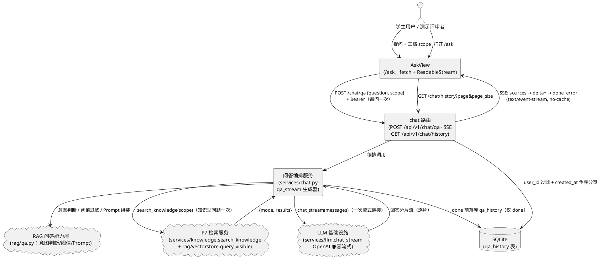
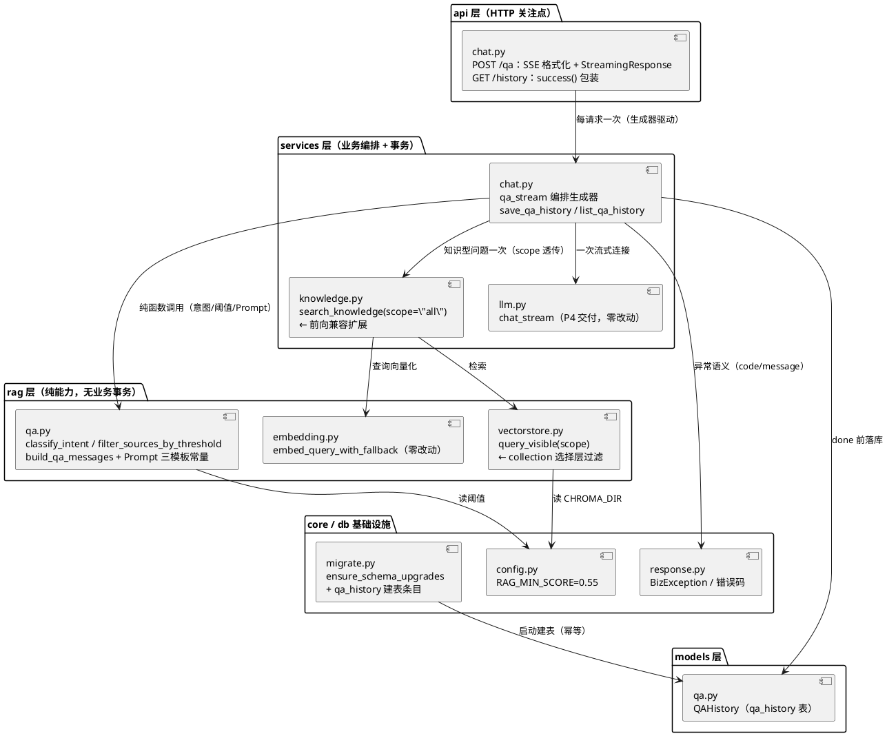
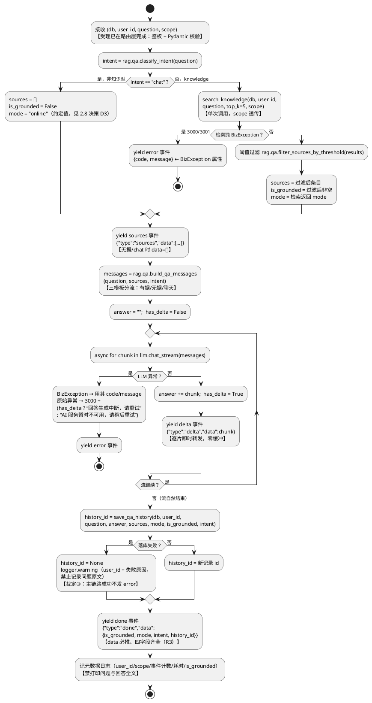
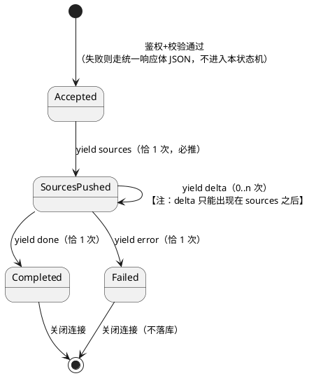
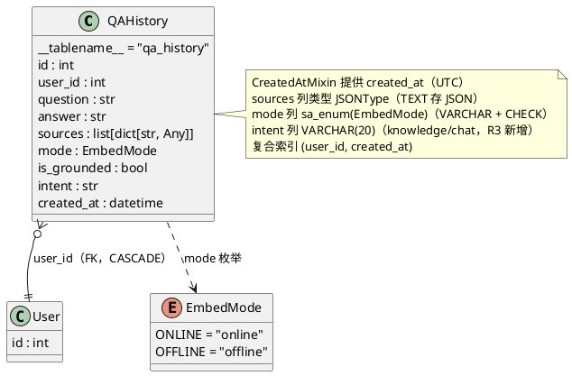
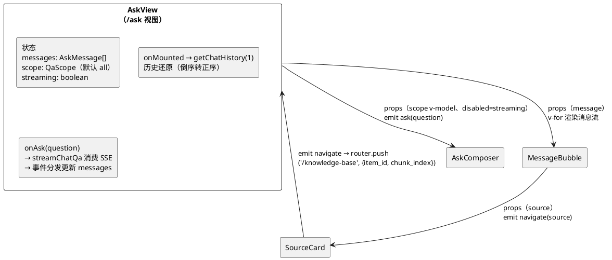

# RAG AI 学习问答实现方案（DESIGN_RAG_QA）

> **变更说明（2026-10-25，公共库能力已移除）**：`ChatQAIn.scope` 三档与公共 collection 检索已删除；`search_knowledge` 恒查当前用户个人 collection，来源 `scope` 恒为 personal。下文涉及 public/all 档位与公共库的历史设计仅作演进记录。

> feature: `rag_qa` ｜ 阶段：实现方案设计（spec-design-agent 产出）
> 上游输入：`docs/specs/SPEC_RAG_QA.md`（**R3 定稿**，12 项裁决 + R3 三项增量裁定 + D1–D9 验收标准 + SSE 四事件契约 + §6.16 qa_history 表 + RAG_MIN_SCORE=0.55 与 Prompt 第二道防线）、`docs/PROJECT_CONTEXT.md`（全项目唯一技术契约，16 张表口径）
> 生成日期：2026-10-21 ｜ 修订日期：2026-10-21（R3 增量修订）｜ 状态：三项开放决策点已由用户裁定并落实（见修订记录），可进入 tasks.md 阶段
> 落盘路径说明：需求规格位于 `docs/specs/SPEC_RAG_QA.md`，设计文档按对偶惯例落盘 `docs/designs/DESIGN_RAG_QA.md`（`SPEC_` ↔ `DESIGN_`、`specs/` ↔ `designs/`）。**路径约定定稿（裁定②）**：从本阶段起，规格与设计文档统一放 `docs/specs/` 与 `docs/designs/`；此前 8 个阶段仍在 `.codeartsdoer/specs/`（被 gitignore），该不一致在 P13 打包时统一——把各阶段的 spec/design/tasks 复制到 `docs/specs/` 补齐，让仓库文档自成体系；本阶段只保证新文档落位正确，不动历史文档
> 已裁决事项继承（spec 第 7 章 + R3 裁定，不再重开）：#1 `/ask` 路由与菜单位置、#2 scope 默认 all 前向兼容、#3 来源三字段透出、#4 error 第四事件、#5 qa_history 独立表、#6 单轮、#7 仅 done 落库、#8 done.data **四字段必推（R3：`{is_grounded, mode, intent, history_id}`，intent=knowledge|chat）**、#9 极简规则意图判断、#10 受理错误走统一响应体、#11 不检索学习记录、#12 阈值 0.55 + Prompt 第二道防线；R3 增量裁定：③ 落库失败 → 正常发 done（history_id=null）+ warning 日志（不记问题原文）
>
> **修订记录（2026-10-21 R3 增量修订，核心架构不变）**：
> ① **裁定①落实——done.data 契约扩为四字段**：新增 `intent`（`knowledge | chat`，`rag/qa.py` 意图判断结果直接透出）。理由（用户原意）：仅 `is_grounded` 无法区分「没检索（chat）」与「检索无果（knowledge 无据）」两种 `false` 场景，前端对两者处理必须不同——前者是正常聊天，后者才该显示「知识库无相关内容」的警示；只给一个 `is_grounded` 前端只能二选一，必然有一边是错的。前端规则定稿：`intent=knowledge 且 is_grounded=false → 无据警示样式`；`intent=chat → 正常回答，不显示任何警示`。引申落地（D10）：chat 类回答改走独立轻量聊天模板（不用无据固定句式，避免「文字说无相关内容、样式却正常」的自相矛盾）。**intent 落库定稿（D9）：qa_history 新增 `intent` 列**——intent=chat 与 knowledge 无据两种记录的既有字段完全同构（`sources=[]` + `is_grounded=false`），无法推导区分，而历史回放要求与实时呈现一致（spec 5.5.1 规则 5）；PROJECT_CONTEXT §6.16 已同步新增该字段。
> ② **裁定③改判——落库失败不再发 error**：原 D4「error(5000) 收尾」方案否决。理由（用户原意）：落库失败时用户已看到完整答案，此时发 error 前端会把已显示的回答标记为失败，用户以为回答出错了——为后台记录失败牺牲了正确的主结果。改为：正常发送 done（`data.history_id` 置 `null`）+ `logger.warning` 记录失败原因（含 user_id，**不记录问题原文**，避免日志泄露用户内容）+ 前端拿到 `history_id=null` 时不显示「已保存」相关状态。原则：**主链路（回答）成功，不被辅链路（历史保存）的失败拖垮**。error 事件仅保留给检索 / LLM 失败路径。
> ③ **裁定②定稿——文档路径**：`docs/designs/` 维持（见落盘路径说明）。

---

# 一、需求与存量功能关系分析

> 本节所有代码位置均经实际读取核实（P7/P8 交付现状），匹配度四档：100%（可直接复用）/ 75%（小改或参数化扩展）/ 50%（结构性扩展）/ 25%（仅有基础设施可借力）。
> **两个关键实测发现**（与任务书预期不同，已按代码现状修正设计输入）：
> ① `services/llm.py` 的 `chat_stream` 流式能力**已于 P4 交付**（docstring 明确「供后续 Agent 对话（SSE 流式）复用」），本阶段**直接复用、零改动**，不存在「新增流式能力」工作项；
> ② `app/agent/` 目录**尚不存在**（Agent 属 P11 阶段），spec 4.5 规则 1 所述「P9 Agent 工具 search_knowledge_base 既有调用方」是前瞻兼容对象，当前实际调用方仅 `POST /knowledge/search` 端点一处。

## 1.1 需求功能与存量功能对比

### 1.1.1 已实现功能

| 需求功能 | 存量功能 | 代码位置 | 匹配度 |
|---------|---------|---------|--------|
| LLM 真实流式生成（逐片 yield、90s 超时、SDK 级重试、finally 释放上游连接） | `chat_stream(messages) -> AsyncIterator[str]`，OpenAI 兼容 `stream=True`，`delta.content` 逐片产出；创建阶段异常统一包装 `BizException(3000, 502)` | `backend/app/services/llm.py:201-243` | 100%（直接复用，**无需新增**） |
| LLM 客户端懒加载单例（双配置组、`timeout=90s`、`max_retries=1`） | `get_chat_client()` 只读 `LLM_*` 三项，配置缺失抛 3000 | `backend/app/services/llm.py:65-94`（常量 `_LLM_TIMEOUT_SECONDS:40`） | 100% |
| 服务类异常统一捕获清单（超时/连接/鉴权/限流/上游 4xx-5xx） | `_SERVICE_ERRORS` 六类 openai 异常显式枚举 | `backend/app/services/llm.py:156-164` | 100% |
| 语义检索编排（查询向量化在线→兜底降级 → 两 collection 检索合并 → score 降序 → 强类型化出参） | `search_knowledge(db, user_id, query, top_k)` 返回 `{mode, results}` | `backend/app/services/knowledge.py:592-669` | 75%（需新增 `scope` 参数与来源三字段透出，见 1.1.2；编排逻辑本身零改动） |
| 双层向量检索（本人个人库 + 公共库同空间合并、空库跳过、score 降序截断 top_k） | `query_visible(user_id, query_vector, top_k, mode)`；命中**已含** `item_id / chunk_index / scope / title / heading_path / score`（取自 Chroma metadata） | `backend/app/rag/vectorstore.py:235-289` | 75%（需把硬编码的「personal+public 两路」参数化为 scope 可选，见 1.1.2） |
| 查询向量化双模式降级（在线失败→本地兜底，返回 mode 决定查哪个空间） | `embed_query_with_fallback(query) -> (vector, mode)` | `backend/app/rag/embedding.py:265-286` | 100% |
| 统一响应体 / BizException / 错误码（3000 LLM 失败、3001 检索失败、1001 参数、1003 Token、5000 兜底） | 全局异常处理器四层拦截（BizException / RequestValidationError / HTTPException / Exception） | `backend/app/core/response.py:28-40, 84-228` | 100%（受理阶段错误处理零改动） |
| JWT Bearer 鉴权依赖 | `get_current_user`（无效/过期/禁用统一 1003/401）+ `get_db` | `backend/app/api/deps.py:39-76` | 100% |
| 历史分页查询（过滤 + 倒序 + COUNT/LIMIT/OFFSET + Pydantic 序列化） | 泛型助手 `paginate(db, model, schema, page, page_size, order_by, filters)` | `backend/app/services/readonly.py:30-74` | 100% |
| 分页参数模型（page 1 起、page_size 1~100 默认 10） | `PaginationParams`（`extra="forbid"`） | `backend/app/schemas/common.py:12-25` | 100% |
| JSON 字段 TypeDecorator（`qa_history.sources` 所需：TEXT 存 JSON、读出 `list[dict]`、脏数据容错） | `JSONType`（Python 侧 `Any`，NULL 原样返回 None，非法 JSON 返回 None） | `backend/app/models/types.py:76-115` | 100%（`qa_history.sources` 契约 §8.1 已点名适用） |
| ORM 建模基建（声明式基类、`created_at` 单时间戳混入、UTC 时间源、枚举列 CHECK 约束） | `Base` / `CreatedAtMixin` / `utc_now()` / `sa_enum()` | `backend/app/models/base.py:23-72` | 100% |
| 建表与升级路径（`create_all` 全量建表 + 应用启动幂等轻量迁移） | `init_db()`（幂等建表+种子）与 `ensure_schema_upgrades(engine)`（main.py 模块加载时执行，P8 建立的「重启即升级」惯例） | `backend/app/db/init_db.py:1137-1161`、`backend/app/db/migrate.py`、`backend/app/main.py:33` | 75%（需追加 qa_history 的表注册，见 1.1.2；机制本身零新增） |
| 阈值环境变量模板（`RAG_MIN_SCORE`，默认 0.55） | `.env.example` 末尾已写入说明与取值 | `backend/.env.example`（`RAG_MIN_SCORE=0.55` 行） | 100%（R2 已同步；`config.py` 字段读取属本阶段新增） |
| 测试基建（ASGI TestClient、临时 SQLite、Chroma 目录隔离、双用户 fixture、沙箱 IPv6 socketpair 补丁） | `conftest.py`：`app_client` / `user_a` / `user_b` / `_isolated_runtime`（autouse）+ `backend/scripts/_sandbox_patch.py` | `backend/tests/conftest.py:1-120+` | 100% |
| 前端 HTTP 封装与拦截器（解包 `{code,message,data}`、401 清 token 跳登录、错误统一 toast） | `request.ts`（Axios 实例，`unwrapResponse` 拦截器） | `frontend/src/api/request.ts:79-124` | 100%（历史接口直接走 Axios；SSE 走 fetch 的例外见 2.2.1） |
| 前端路由守卫（needsAuth + token 判定）与主布局菜单机制 | 路由表 `children` 数组 + `MainLayout.vue` 的 `menus` 数组（el-menu router 模式） | `frontend/src/router/index.ts:99-111`、`frontend/src/layouts/MainLayout.vue:27-38` | 100%（机制复用；插入条目属 1.1.2 小改） |
| 知识库分块预览抽屉（按 chunk_index 序渲染块号 + heading_path + content） | `ChunkDrawer.vue`（el-drawer，props `item` / `modelValue`，打开时拉全量分块） | `frontend/src/components/knowledge/ChunkDrawer.vue` | 75%（来源卡跳转定位需其父视图新增 query 处理，见 1.1.2） |
| 离线警示条 UI 惯例（mode=offline 常驻 `el-alert warning`，文案逐字锁定） | `SearchPanel.vue` 离线常驻警示（「当前为离线检索模式」） | `frontend/src/components/knowledge/SearchPanel.vue:73-85` | 100%（AskView 沿用同口径文案与样式语义） |
| token 读取（fetch SSE 请求头注入所需） | Pinia `stores/user.ts`（`TOKEN_KEY='smartlearn_token'`，localStorage 同步） | `frontend/src/stores/user.ts` | 100% |

### 1.1.2 需要扩展的功能

| 需求功能 | 存量功能 | 差异说明 | 扩展方向 |
|---------|---------|---------|---------|
| 检索范围三档（personal / public / all）单次调用 | `search_knowledge(db, user_id, query, top_k)` 无 scope 参数；`query_visible` 硬编码 `(("personal", user_id), ("public", None))` 两路 | 输入差异：新增档位枚举入参；业务逻辑差异：personal 只查 `kb_user_{uid}`（在线/兜底同空间）、public 只查 `kb_public*`、all 维持现状两路合并；边界差异：默认值必须为 `all` 保证既有调用零感知 | `search_knowledge` 追加带默认值的位置参数 `scope="all"` 并透传；`query_visible` 追加同义参数，把硬编码二元组改为按 scope 推导的目标 collection 清单（过滤发生在 **collection 选择层**而非 SQL where——继承 Chroma 物理隔离红线，详见 2.5） |
| 来源条目透出 `item_id / chunk_index / scope`（跳转定位与归属徽章依据） | `KnowledgeSearchHit` 仅 `content / source_title / score` 三字段；底层 `query_visible` 命中已含三字段但被 `search_knowledge` 组装时**丢弃**（裁决 #3 实测确认） | 输出差异：命中结构新增三个可选字段；兼容性边界：P7 端点 `POST /knowledge/search` 响应 JSON 会出现三个新字段（新增字段不破坏既有消费方，裁决 #3 明确允许） | `schemas/knowledge.py` 的 `KnowledgeSearchHit` 追加 `item_id: int \| None = None`、`chunk_index: int \| None = None`、`scope: str \| None = None` 三个可选字段；`search_knowledge` 组装时从 hit 填充（不再丢弃） |
| `RAG_MIN_SCORE` 配置读取（默认 0.55，留空回退） | `config.py` 无该字段（`.env.example` 已有模板行） | 输入差异：`.env` 中该变量可能为空字符串（pydantic-settings 直接映射 float 会校验失败）；约束差异：合法区间 0~1 | `Settings` 新增 `RAG_MIN_SCORE: float = Field(default=0.55, ge=0.0, le=1.0)` + before 模式 field_validator：空串/None 回退 0.55（对齐「留空回退」契约 §2） |
| qa_history 表注册（表清单 15 → 16） | `models/__init__.py` 导出 15 张表；`init_db._print_summary` 打印 15 张表；`ensure_schema_upgrades` 只有加列条目、无建表条目 | 边界差异：**存量库升级路径**——main.py 启动时不执行 `create_all`，仅靠 init_db 建表的话存量库（demo 用户已存在、永不重跑种子）重启后不会出现 qa_history 表 | ① `models/__init__.py` 导出 `QAHistory`（自动注册 `Base.metadata`）；② `migrate.py` 的 `ensure_schema_upgrades` 追加「建表」条目（`create_all(engine, tables=[QAHistory.__table__])`，幂等：已存在跳过）；③ `init_db._print_summary` 摘要表清单 15 → 16（建表能力本身由既有 create_all 覆盖） |
| chat 路由挂载 | `api/v1/__init__.py` 汇总 19 个 router，无 chat | 新增 `chat_router` 挂载 | `from app.api.v1.chat import router as chat_router` + `api_router.include_router(chat_router)`（一处两行） |
| 枚举（qa_history.mode 落库 online/offline） | `models/enums.py` 13 个枚举无 EmbedMode（mode 目前是 `rag/embedding.py` 的 `Literal` 类型，非 ORM 枚举） | 落库差异：ORM 列需要 `sa_enum` 的 CHECK 约束惯例；`Literal` 不能直接用于 ORM 列 | `models/enums.py` 新增 `EmbedMode(str, Enum)`（ONLINE="online" / OFFLINE="offline"），`models/qa.py` 的 mode 列用 `sa_enum(EmbedMode)`；rag 层 Literal 保持不变（两套类型各司其职，见 2.3.2） |
| 前端 `/ask` 路由与菜单 | 路由表与菜单数组均无 `/ask` 条目 | 插入位置锁定：路由 children 在 `knowledge-base` 与 `ai-agent` 之间；菜单在「知识库」之后（裁决 #1） | 两处各插一条（路由 `meta: { title: 'AI 问答', needsAuth: true }`；菜单 `icon: 'ChatLineRound'`，与 AI 助手的 ChatDotRound 区分） |
| 来源卡跳转知识库定位（D2 验收） | `KnowledgeBaseView.vue` **无任何 `route.query` 处理**（实测确认）；`ChunkDrawer` 无高亮能力 | 输入差异：需接收 `?item_id=&chunk_index=` 查询参数；边界差异：文档可能不在当前页/已删除（spec 5.4.3 场景 1） | `KnowledgeBaseView.vue` 挂载时读 query → 调既有详情端点 `GET /knowledge/items/{id}`（自带可见性 404 语义）→ 命中则置 `activeItem` 并打开 `ChunkDrawer`；`ChunkDrawer.vue` 新增可选 prop `highlight_chunk_index`，对应分块卡片高亮；文档不存在 → `ElMessage` 中文提示（404 由拦截器统一弹出） |
| 前端类型扩展 | `types/index.ts` 的 `KnowledgeSearchHit` 三字段（462-468 行）；无任何 chat/问答类型 | 输出差异：后端命中结构新增三字段；问答域类型全新 | `KnowledgeSearchHit` 追加三个可选字段；新增 `QaScope / QaSourceItem / QaSseEvent（可辨识联合）/ ChatQaPayload / ChatHistoryItem` 类型组（2.6.1） |
| fetch 路径 401 处理复用 | `request.ts` 的 `clearTokenAndRedirect` 是**模块私有函数**（未导出） | 复用差异：SSE 用 fetch 不走 Axios 拦截器，受理阶段 401 需要同一份「清 token + 跳 /login」逻辑，禁止复制两份 | `request.ts` 将 `clearTokenAndRedirect` 改为导出（仅加 `export`，行为零变化）；`api/chat.ts` 导入复用 |

### 1.1.3 需要新增的功能或接口

**（A）后端新增文件（5 个）**

| 功能点 | 输入 | 输出 | 核心逻辑 | 依赖 |
|-------|------|------|---------|------|
| `app/rag/qa.py` —— 意图判断 | 问题文本 | `Literal["chat", "knowledge"]` | 预编译正则规则集匹配（问候/感谢告别/助手身份元问题/系统元问题），宁缺毋滥原则（详见 2.4.1）；判定结果即 `intent`，透出至 done.data 与 qa_history（裁定① / D9） | 无（纯函数，`re` 标准库） |
| `app/rag/qa.py` —— 阈值过滤 | `search_knowledge` 返回的 results | (有效 sources, is_grounded) | 逐条 `score >= RAG_MIN_SCORE` 过滤，过滤后非空 ⇔ 有据（与 spec 5.3.1 规则 1「最高分 ≥ T」等价，见 2.4.2） | `core/config`（全局基础设施，rag 层可引用） |
| `app/rag/qa.py` —— Prompt 组装 | 问题 + 有效 sources + intent | `list[ChatMessage]` | **三模板分流**（裁定①引申，D10）：有据 / 无据 / 聊天三模板（全文见 2.4.3，有据模板含第二道防线逐字指令、无据模板含固定句式）；模板常量集中本模块（spec 4.4 规则 3：后端单一位置） | `services/llm.ChatMessage`（TypedDict 类型引用，见 2.8 决策 D5） |
| `app/services/chat.py` —— SSE 问答编排生成器 | db 会话、user_id、question、scope | `AsyncIterator[dict]`（SSE 事件 dict 流） | 意图判断 → （knowledge）调 `search_knowledge` → 阈值过滤 → yield sources → 组装 Prompt → `llm.chat_stream` 逐片转发 delta → 完成后落库 → yield done（**四字段**，intent 透出；**落库失败时 history_id=null 照常 done**，裁定③）；流内检索/LLM 异常捕获转 error 事件（详见 2.4.4） | `rag/qa.py`、`services/knowledge.py`、`services/llm.py`、`models/qa.py`（分层：services → rag/models 单向，合法） |
| `app/services/chat.py` —— 历史落库与分页查询 | db 会话、user_id、问答产物 / 分页参数 | history_id（或 None） / `{items, total, page, page_size}` | done 前写入 qa_history（快照语义，**intent 一并落库**）；落库失败不抛穿主链路——返回 None + warning 日志（含 user_id、禁问题原文，裁定③）；历史按 user_id 过滤 + created_at 倒序分页（复用 `paginate`） | `models/qa.py`、`services/readonly.py` |
| `app/api/v1/chat.py` —— `POST /chat/qa` | `ChatQAIn`（question + scope）+ Bearer | `StreamingResponse`（text/event-stream） | 鉴权与校验（受理阶段，走统一响应体）→ 调 `services/chat.qa_stream` → SSE 文本格式化生成器（`data: {JSON}\n\n`）→ `StreamingResponse(media_type="text/event-stream", headers={"Cache-Control": "no-cache"})`（详见 2.2.2） | `services/chat.py`、`schemas/chat.py` |
| `app/api/v1/chat.py` —— `GET /chat/history` | page / page_size + Bearer | 统一响应体分页 | 薄委托 `services/chat.list_qa_history` + `success()` 包装（路由层零业务逻辑） | 同上 |
| `app/schemas/chat.py` | — | — | `ChatQAIn`（question 非空 ≤500 + strip；scope 枚举默认 all）、`QaSourceItem`（来源条目六字段）、`ChatHistoryOut`（历史出参，含 intent） | Pydantic v2 |
| `app/models/qa.py` | — | — | `QAHistory` ORM 模型（§6.16 **九字段**——R3 新增 `intent` 列，`sources` 用 `JSONType`、`mode` 用 `sa_enum(EmbedMode)`、复合索引） | `models/base`、`models/types`、`models/enums` |

**（B）前端新增文件（5 个）**

| 功能点 | 输入 | 输出 | 核心逻辑 | 依赖 |
|-------|------|------|---------|------|
| `views/AskView.vue` —— 对话式问答页 | 用户交互 | 流式渲染的对话流 | 持有消息列表与 scope 状态；提交提问 → `api/chat.streamChatQa` 消费 SSE → 事件分发驱动响应式更新；挂载时拉历史还原对话流（spec 5.5.1 规则 5） | `components/ask/*`、`api/chat.ts` |
| `components/ask/AskComposer.vue` —— 输入区 | v-model 问题文本 + scope | emit 提问事件 | el-input（maxlength 500、回车提交）+ 三档 `el-radio-group`（button 形态）+ 提交按钮（流式期间禁用防并发流） | Element Plus |
| `components/ask/MessageBubble.vue` —— 消息气泡 | 单条消息对象（含流式状态） | 渲染气泡 | 用户/助手双形态；助手气泡：流式光标 → 完成后按 `is_grounded` 切常规/警示样式、按 `mode` 渲染离线警示条、渲染来源卡组 | `SourceCard.vue` |
| `components/ask/SourceCard.vue` —— 来源折叠卡 | 单条来源（item_id 等） | 折叠卡 + emit 跳转 | 标题（source_title）+ 摘要（content 折叠/展开）+ score 徽章（保留 2 位）+ 归属徽章（scope）+ 点击 `router.push('/knowledge-base', query={item_id, chunk_index})` | vue-router |
| `api/chat.ts` —— SSE 客户端 + 历史接口 | payload + 事件回调 | Promise（流终结时 resolve） | `streamChatQa`：fetch + ReadableStream + TextDecoder，缓冲区累积 + `\n\n` 分隔切分（跨 chunk 残包处理）+ 事件分发 + 受理阶段 HTTP 错误（含 401）处理；`getChatHistory`：Axios 常规分页（详见 2.6.2） | `request.ts`（导出的 401 处理 + Axios）、`types` |

**（C）测试新增文件（3 个）**：`tests/test_rag_qa_prompt.py`（意图判断/Prompt 模板/阈值过滤纯函数单测）、`tests/test_rag_qa_scope.py`（scope 三档 + D8 兼容回归）、`tests/test_rag_qa_stream.py`（SSE 契约 e2e：事件序列/受理错误/流内异常/落库时机/历史分页隔离）——详见 2.7。

**（D）明确不改动清单（防越界）**：

| 文件 | 不改动理由 |
|------|-----------|
| `backend/app/services/llm.py` | `chat_stream` 已完整交付本阶段所需全部流式能力（含超时、重试、异常包装、连接释放）；任务书「流式生成需新增能力设计」经实测不成立，**零改动直接复用**（见 1.1.1 首行） |
| `backend/app/api/v1/knowledge.py` | P7 端点 `POST /knowledge/search` 对外契约不变（不传 scope → 服务层默认 all → 行为与扩展前一致，spec 4.5 规则 1/3；响应新增可选字段属裁决 #3 明确允许） |
| `backend/app/rag/embedding.py` / `loader.py` / `splitter.py` | P8 纯能力层，本阶段只消费 `embed_query_with_fallback`，不触碰 |
| `backend/app/main.py` | chat_router 经 `api/v1/__init__.py` 聚合挂载，main.py 零改动；qa_history 建表经 `ensure_schema_upgrades` 追加条目实现（其调用点已存在于 main.py:33） |
| `backend/app/agent/`（尚不存在） | Agent 编排属 P11；spec 4.5 规则 1 的「P9 Agent 工具」是未来调用方，兼容性由 `scope` 默认值静态保证 |
| `frontend/src/api/knowledge.ts` | P8 前端接口封装不动（`KnowledgeSearchHit` 类型扩展在 `types/index.ts`，可选字段不影响既有消费） |
| `frontend/src/components/knowledge/SearchPanel.vue` | 知识库页检索面板不消费新字段、不参与跳转定位 |
| 其余全部既有视图/接口/模型 | 与本特性无依赖关系（spec 1.4 职责边界第 2/4/5 条） |

## 1.2 存量功能详细分析

### 1.2.1 `search_knowledge` 检索编排（本阶段的检索唯一入口）

**接口契约**：`async def search_knowledge(db: Session, user_id: int, query: str, top_k: int) -> dict[str, Any]`；返回 `KnowledgeSearchOut` 序列化结构 `{"mode": "online"|"offline", "results": [{content, source_title, score}, ...]}`；空库返回 `{"mode": ..., "results": []}` 不报错。

**业务规则**：① 查询向量化经 `embed_query_with_fallback`（在线两层重试失败 → 整体转本地兜底，`mode` 即时判定）；② `query_visible` 在与查询向量**同空间**的两 collection 检索（online 查 `kb_user_{uid}` + `kb_public`，offline 查两 `_local` 库）——查询向量与被查库必然同空间是双空间设计的硬规则；③ 每库 `n_results = min(top_k, count)` 且空库直接跳过；④ 两路合并按 score 降序截断 top_k；⑤ hit 经 `KnowledgeSearchHit.model_validate` 强类型化（禁止裸 dict 出 services 边界）。

**异常映射**：查询向量化彻底失败（兜底也异常）→ `BizException(CODE_LLM_FAILED=3000, "AI 服务暂时不可用，请稍后重试", 502)`；向量库查询异常 → `BizException(CODE_VECTOR_FAILED=3001, "检索失败请稍后重试", 500)`。**这两个 message 与 spec 5.1.3 异常场景的 error 事件文案逐字一致**——SSE error 事件的 `data.{code, message}` 可直接取 `BizException` 属性，零二次映射。

**扩展点与约束**：docstring 声明「本函数是 P9 Agent 工具 search_knowledge_base 的业务底座，签名保持稳定」——与 spec 裁决 #2 的调和方式为**追加带默认值的位置参数**（既有调用方零改动）；`db` 参数当前检索路径不触达关系库（保留以满足统一调用形态），本阶段 qa_stream 传请求级会话即可；**mode 只随响应透出不落库**（可用性是瞬时状态），但 spec 裁决 #5 要求 qa_history.mode 落库——两者不矛盾：qa_history.mode 落的是「该次问答的检索模式快照」，与「文档状态不落 mode」是不同对象（详见 2.3.1 决策说明）。

### 1.2.2 `query_visible` 双层检索（scope 扩展的落点）

**接口契约**：`query_visible(user_id: int, query_vector: list[float], top_k: int, mode: EmbedMode) -> list[dict[str, Any]]`；命中条目含 `content / item_id / chunk_index / scope / title / heading_path / score`（score = 1 − cosine 距离，保留 4 位小数）。

**业务规则**：目标 collection 由「归属 × 向量空间」四象限命名（`kb_user_{uid}` / `kb_user_{uid}_local` / `kb_public` / `kb_public_local`），循环体 `for scope, owner_id in (("personal", user_id), ("public", None))` 硬编码两路；个人库按 user_id 分 collection 实现「物理隔离即权限隔离」（跨用户命中在存储结构上不可能——继承 spec 4.3 规则 2 用户隔离红线）。

**对本设计的约束**：① 循环变量名 `scope`（归属语义）与新增参数 `scope`（检索档位语义）**同名冲突**，扩展时必须重命名循环变量（如 `owner_scope`）防遮蔽；② 三档的语义差异不在 SQL 过滤层而在 **collection 选择层**——`personal` 只查个人两空间、`public` 只查公共两空间、`all` 维持两路（这使隔离红线天然继承，无新增过滤逻辑）；③ `score` 语义为 1 − cosine 距离，`RAG_MIN_SCORE=0.55` 的实测分布（领域内 0.572–0.733 / 领域外 0.412–0.533）即基于该口径，阈值过滤直接比较即可。

### 1.2.3 `chat_stream` 流式能力（P4 交付，直接复用）

**接口契约**：`async def chat_stream(messages: Sequence[ChatMessage]) -> AsyncIterator[str]`；逐片 yield `delta.content`（跳过空片段）；`ChatMessage` 为 `TypedDict(role: str, content: str)`。

**行为细节（决定上层异常设计）**：① **创建阶段**（`create(stream=True)` 调用）异常已包装为 `BizException(3000, "AI 服务暂时不可用，请稍后重试", 502)`；② **迭代阶段**（`async for chunk in stream`）异常**未包装**——中途断开会抛原始 openai/httpx 异常；③ `finally: await stream.close()` 保证客户端断开时安全释放上游连接。**含义**：上层（services/chat.py）必须同时兜住「已包装的 BizException」与「未包装的原始异常」，后者按 spec 5.1.3 场景 3 归 3000「回答生成中断，请重试」（详见 2.4.5）。

**超时口径**：客户端构造 `timeout=_LLM_TIMEOUT_SECONDS(90.0)` + `max_retries=1`（仅瞬态网络错误）——对齐 spec 4.1 规则 3「单次问答 LLM 侧总时长 ≤ 90 秒（复用既有超时常量）」，无需任何调整。

### 1.2.4 建表与升级路径（qa_history 落地的关键约束）

**现状机制**：全新库经 `init_db()` 的 `Base.metadata.create_all` 一次建齐；存量库升级经 `main.py` 模块加载时的 `ensure_schema_upgrades(engine)`（P8 为两个加列场景建立，幂等：PRAGMA 检查列存在性）。**关键缺口**：`ensure_schema_upgrades` 目前只有加列条目、无建表条目，且 main.py 不调用 `create_all`——若 qa_history 只注册进 `Base.metadata` 而不追加启动迁移条目，**存量库重启后 qa_history 表不存在**，首个 done 落库即 500。migrate.py 的设计注释明确「后续列变更继续在本模块追加条目即可」——追加「建表」条目（`create_all(engine, tables=[QAHistory.__table__])`，幂等）是该机制的顺势延伸，不引入新组件（符合「禁止引入与需求无关的技术组件」）。

### 1.2.5 SSE 前置事实（本项目首个 SSE 端点）

全仓 grep 确认：无任何 `StreamingResponse` / `text/event-stream` 先例（`api/v1/agent.py` 仅 80 行会话 CRUD，SSE 端点属 P11）。因此本设计需自行确立 SSE 实现基线（StreamingResponse + async generator + 手工 `data: {JSON}\n\n` 格式化），并处理三个本项目特有的协调点：① 与统一响应体铁律的协调（裁决 #10：受理错误走 JSON、流内错误走 error 事件）；② 与 `get_db` 请求级会话生命周期的协调（FastAPI 依赖 teardown 在响应发送完成后执行，流式期间会话有效——落库时机在 done 前天然安全）；③ 前端 fetch 路径的 401 处理（Axios 拦截器不覆盖 fetch，需导出复用）。
---

# 二、增量设计方案

## 2.1 实现模型

### 2.1.1 上下文视图



外部交互要点：① 前端每问仅发**一个** `POST /chat/qa`（spec 5.2.1 规则 2：禁前端两路检索拼接，检索在后端内部单次完成）；② LLM 与检索均为后端内部调用，前端不感知；③ 历史接口为常规 Axios 请求（统一响应体），与 SSE 通道分离。

### 2.1.2 服务/组件总体架构



**模块职责与依赖方向（分层铁律落地）**：

| 模块 | 职责 | 关键约束 |
|------|------|---------|
| `api/v1/chat.py` | 鉴权注入、请求体解析、SSE 文本格式化（`data: {JSON}\n\n`）、StreamingResponse 头部、历史端点包装 | 禁业务规则；SSE 格式化属 HTTP 响应拼接，**必须**在 api 层（services 层禁止拼接 HTTP 响应，契约 §4） |
| `services/chat.py` | qa_stream 全链路编排（事件顺序、落库时机）、qa_history 读写事务、异常→error 事件转换 | 禁接收 Request/Response；可调 rag 与 models（单向依赖合法）；**不 import api** |
| `rag/qa.py` | 意图判断规则集、阈值过滤、Prompt 模板与组装（纯函数，无 IO 无事务） | **不 import services / api**（rag 包单向被依赖，rag/__init__.py 已声明）；仅可引用 `core/*`（全局基础设施）与 `services/llm.ChatMessage` **类型**——经 `from app.services.llm import ChatMessage` 引入 TypedDict 纯类型不构成运行时反向调用，但为彻底避免 rag→services 的 import 依赖，**将 `ChatMessage` TypedDict 定义上移或在本模块重复声明二选一**（决策见 2.8 决策 D5） |
| `models/qa.py` | QAHistory ORM（§6.16 八字段） | 无业务逻辑、无外部 IO |
| `core/config.py` | RAG_MIN_SCORE 字段（空值回退 0.55） | 全局基础设施，任意层可引用 |

**配置项及取值策略**：

| 配置 | 类型/默认 | 策略 |
|------|----------|------|
| `RAG_MIN_SCORE` | `float`，默认 `0.55`，区间 [0,1] | `.env` 可覆盖（D9 验收需临时调 0.30 再复原）；空串/未配置回退默认；调整阈值不改前端（spec 4.4 规则 2） |
| `top_k`（检索条数） | 固定 `5`（模块常量 `QA_TOP_K`） | 与 P7 检索默认一致；5 片 × ~500 字符 ≈ 2.5K 字符 Prompt 上下文，量级安全；**不暴露给前端**（spec 请求体仅 question + scope，防止参数面膨胀） |
| SSE 响应头 | `Cache-Control: no-cache` + `media_type="text/event-stream"` | spec 4.3 规则 5 硬性要求；本地 uvicorn 直连无中间层缓冲，不追加心跳注释行（决策见 2.8 决策 D6） |

### 2.1.3 实现设计文档（主链路活动图与事件状态机）

**A. qa_stream 主链路活动图（含全部分支）**：



**B. SSE 连接事件状态机（每连接的合法迁移）**：



不变量：① `sources` 先于一切 `delta`（spec 5.1.1 规则 2）；② 终结事件与 `error` 互斥且恰一个（裁决 #4）；③ 只有 `Completed`（done）路径**尝试**落库（裁决 #7），且**落库失败也走 done**（`history_id=null`，裁定③）——`error` 事件仅用于检索 / LLM 失败路径；④ 客户端中途断开（生成器被取消）不产生任何终结事件、不落库——已推送 delta 由前端保留（spec 4.2 规则 5），上游连接由 `chat_stream` 的 `finally` 释放（1.2.3）。

**C. 事务设计**：落库是唯一写事务（请求级 `db` 会话，`save_qa_history` 内 `db.add + db.commit`）；检索路径不触达关系库（1.2.1），SQLite 写锁仅在流末尾短暂持有，与并发的其他请求会话无争用风险；落库失败整体回滚（无半成品——单条 insert）且**不抛穿主链路**——`save_qa_history` 捕获自身异常返回 `None`，由调用方以 `history_id=None` 构造 done（裁定③：主链路成功不被辅链路失败拖垮）。

### 2.2 接口设计

#### 2.2.1 总体设计

| 接口 | 方法 | 鉴权 | 稳定性 | 分类依据 |
|------|------|------|--------|---------|
| `/api/v1/chat/qa` | POST | Bearer JWT | 稳定（契约 §7.2 已登记） | 流式问答（SSE 通道） |
| `/api/v1/chat/history` | GET | Bearer JWT | 稳定 | 历史查询（常规 JSON 通道） |
| `search_knowledge`（服务层内部） | — | — | 签名稳定（裁决 #2 前向兼容） | 检索底座扩展（非 HTTP） |

**接口变更策略**：SSE 四事件契约（`sources / delta / done / error`）与 `done.data` **四字段为 R3 定稿**（R2 三字段 + 裁定①新增 `intent`），前端按此消费不做降级推断（裁决 #8）；`sources` 条目六字段为跳转与徽章的最小集，后续只增不改；`scope` 枚举三值锁定（spec 4.4 规则 4：前后端共用同一套字符串字面量）。

**SSE 端点与统一响应体铁律的协调（裁决 #10 落地）**：

| 阶段 | 载体 | 触发条件 | 形态 |
|------|------|---------|------|
| 受理阶段（流未开始） | HTTP JSON | 鉴权失败 / Pydantic 校验失败 | HTTP 401 + `{code:1003,...}` 或 HTTP 422 + `{code:1001,...}`——由既有全局异常处理器自动产出（路由函数正常声明 `Depends(get_current_user)` 与请求体模型即可，**零额外代码**，因为 `StreamingResponse` 构造发生在受理检查之后） |
| 流内阶段（流已开始） | SSE error 事件 | 检索失败 / LLM 失败 / 流中断（**落库失败不走 error**——裁定③：正常 done 收尾 + `history_id=null`） | HTTP 200 已发送（text/event-stream），带内信令 `{"type":"error","data":{"code":3000,"message":"..."}}`——SSE 语义下唯一可读错误通道 |
| 成功流 | SSE 事件流 | — | HTTP 200 + `text/event-stream`，事件流本身即响应体——**这是与「所有接口返回 `{code,message,data}`」铁律的协调点**：SSE 流式响应按裁决 #10 作为契约声明的例外（PROJECT_CONTEXT §7.3 亦已注明流式接口走 fetch 通道不经 Axios）；历史接口则严格走统一响应体 |

#### 2.2.2 接口清单

**（1）`POST /api/v1/chat/qa` —— 流式问答（SSE）**

- **接口签名**（路由处理函数形态）：
  ```python
  async def chat_qa(
      payload: ChatQAIn,
      db: Annotated[Session, Depends(get_db)],
      current_user: Annotated[User, Depends(get_current_user)],
  ) -> StreamingResponse
  ```
- **请求体 schema（`ChatQAIn`，Pydantic v2）**：

  | 字段 | 类型 | 校验 | 说明 |
  |------|------|------|------|
  | `question` | `str` | `strip_whitespace=True` + 非空 + `max_length=500`（`Annotated[str, StringConstraints(...)]`） | 去首尾空白后非空（spec 6.1）；与检索入参上限一致 |
  | `scope` | `Literal["personal","public","all"]` | 枚举校验，默认 `"all"` | 小写字面量、大小写敏感（spec 6.1） |

  越界输入（空 question / 501 字符 / `scope="foo"`）→ 全局处理器自动 HTTP 422 + `code=1001` 中文提示（spec 5.1.1 规则 6 验收条件）。
- **响应**：`StreamingResponse`，`media_type="text/event-stream"`，`headers={"Cache-Control": "no-cache"}`；body 为 SSE 格式化生成器输出，每条事件形如 `data: {JSON}\n\n`（`json.dumps(..., ensure_ascii=False)`，中文原样）。
- **SSE 事件载荷契约（逐字段）**：

  | 事件 | data 载荷 | 次序 |
  |------|----------|------|
  | `sources` | `[{"item_id": int, "chunk_index": int, "content": str, "source_title": str, "score": float(4 位小数), "scope": "personal"\|"public"}, ...]`；无据/非知识型为 `[]` | 第 1 条，恰 1 次 |
  | `delta` | 字符串分片（LLM `delta.content` 原文） | sources 后 0..n 次，与 LLM 产出顺序一致 |
  | `done` | `{"is_grounded": bool, "mode": "online"\|"offline", "intent": "knowledge"\|"chat", "history_id": int\|null}`（R3 四字段；`history_id` 落库失败时为 `null`——裁定③） | 终结，恰 1 次（成功，含落库失败） |
  | `error` | `{"code": 3000\|3001, "message": str(中文可读)}`（R3 收窄：仅检索 / LLM 失败路径，**落库失败不再走 error**——裁定③） | 终结，恰 1 次（异常） |

  典型事件流（curl -N 观测形态）：
  ```
  data: {"type": "sources", "data": [{"item_id": 5, "chunk_index": 2, "content": "Transformer 的自注意力……", "source_title": "机器学习基础 » Transformer", "score": 0.7331, "scope": "public"}]}

  data: {"type": "delta", "data": "Transformer 是一种基于自注意力机制的神经网络架构[1]，"}

  data: {"type": "delta", "data": "它的核心思想是……"}

  data: {"type": "done", "data": {"is_grounded": true, "mode": "online", "intent": "knowledge", "history_id": 42}}
  ```
- **前置条件**：有效 Bearer Token；请求体通过 `ChatQAIn` 校验。
- **后置条件**：成功流 → qa_history 新增一行（answer = 全部 delta 拼接、sources = 快照、含 mode/is_grounded/**intent**）；落库失败的成功流 → qa_history 无新行但事件流仍以 done 收尾（`history_id=null`）；失败流（error 收尾）→ 无落库；`sources` 数组顺序即引用编号顺序（第 i 条 ↔ 回答 `[i]`，spec 5.6.2 契约细则 2）。
- **异常映射**（流内）：

  | 异常源 | 终结事件与载荷 | 依据 |
  |--------|---------------|------|
  | 查询向量化彻底失败 | error `{3000, "AI 服务暂时不可用，请稍后重试"}` | `search_knowledge` 既有包装（1.2.1），message 逐字对齐 spec 5.1.3 场景 1 |
  | 向量库查询异常 | error `{3001, "检索失败请稍后重试"}` | 同上，场景 2；**不得**伪装为无据降级（spec 5.3.1 规则 6） |
  | LLM 创建阶段失败 | error `{3000, "AI 服务暂时不可用，请稍后重试"}` | `chat_stream` 既有包装（1.2.3） |
  | LLM 流中途断开（已有 delta 后原始异常） | error `{3000, "回答生成中断，请重试"}` | spec 5.1.3 场景 3 文案逐字 |
  | **落库失败** | **done（正常收尾），`data.history_id = null`**；同时 `logger.warning`（user_id + 异常类型与摘要，**禁问题原文**） | **裁定③（R3 改判）**：回答已完整送达，为后台记录失败把主结果标记为错误得不偿失；`history_id=null` 即「未保存历史」的前端信号——主链路（回答）成功，不被辅链路（历史保存）的失败拖垮 |
  | 其他未预期异常（意图判断 / 事件构造等） | error `{5000, "服务器内部错误"}` | 兜底（不外透堆栈，spec 4.3 规则 4 同源精神）——仅当回答链路本身无法完成时 |

- **性能**：受理→sources 完成 ≤ 5s（检索耗时主导，超时即转 error，禁静默等待）；delta 随 LLM 产出即时推送（零缓冲、禁先算后发）；单次 LLM 总时长 ≤ 90s（客户端既有超时）。

**（2）`GET /api/v1/chat/history` —— 历史问答分页**

- **接口签名**：
  ```python
  async def list_chat_history(
      page_params: Annotated[PaginationParams, Query()],
      db: Annotated[Session, Depends(get_db)],
      current_user: Annotated[User, Depends(get_current_user)],
  ) -> dict[str, Any]
  ```
  仅分页参数的列表端点，沿用查询参数模型写法（契约 §5.3 实现约束的「仅有分页参数」分支，全仓既有惯例）。
- **请求**：`page`（默认 1）、`page_size`（默认 10，上限 100）。
- **响应**：统一响应体 `data = {items, total, page, page_size}`；`items` 每条为 `ChatHistoryOut`：`{id, question, answer, sources(数组，快照原样), mode, is_grounded, intent, created_at}`（R3：新增 `intent`，回放时区分「正常聊天」与「无据警示」两种渲染的前置信号）；按 `created_at` 倒序（第 1 页首条 = 最近一次问答，spec 5.5.1 规则 4）。
- **前置条件**：有效 Bearer Token。
- **后置条件**：无（只读）。
- **异常映射**：参数越界 → 422/1001；数据库异常 → 全局兜底 5000（spec 5.5.3 场景 2）；**用户隔离**：查询恒带 `QAHistory.user_id == current_user.id` 过滤（「不可见即不存在」，spec 4.3 规则 3）。
- **边界**：无历史 → `{items: [], total: 0}` 不报错；本阶段无编辑/删除/搜索端点（spec 5.5.1 规则 6 禁止项）。

**（3）`search_knowledge` 服务层签名扩展（非 HTTP，裁决 #2）**

```python
async def search_knowledge(
    db: Session, user_id: int, query: str, top_k: int,
    scope: Literal["personal", "public", "all"] = "all",
) -> dict[str, Any]
```

返回结构在既有 `{mode, results}` 基础上，`results` 每条**新增** `item_id / chunk_index / scope` 三字段（可选语义，实际总有值——底层 metadata 完整时填充）；既有字段 `content / source_title / score` 不删不改。配套扩展 `query_visible` 签名（新增同名默认参数 `scope="all"`，循环变量重命名 `owner_scope` 防遮蔽）。兼容性论证详见 2.5。

### 2.3 数据模型

#### 2.3.1 设计目标

1. **支持的业务场景**：成功问答（done）的完整回放——问题、完整回答、来源快照、向量模式、无据判定信号、**意图信号（intent，R3）**；本人可见的历史分页倒序浏览；`/ask` 页刷新后对话流完整还原（spec 5.5.1 规则 5，含来源卡片与无据警示样式还原——**intent 落库是回放样式一致性的前提**：intent=chat 与 knowledge 无据两种记录的既有字段完全同构（`sources=[]` + `is_grounded=false`），不落库则历史回放无法区分「正常聊天」与「无据警示」两种渲染，裁定① / D9）。
2. **性能与容量**：单条记录 ≈ 问题 0.5K + 回答数 K + 来源快照（5 片 × ~0.6K）≈ 5–10KB 量级；个人日常使用数百条以内，SQLite 单表无压力；分页查询 `WHERE user_id=? ORDER BY created_at DESC LIMIT ? OFFSET ?` 走复合索引，满足 ≤ 2s 红线（毫秒级）。
3. **与存量数据的兼容策略**：全新独立表（裁决 #5——复用 `agent_messages` 会造成 Agent 页与问答页历史混淆的用户可见错误）；`create_all`（新库）+ `ensure_schema_upgrades` 追加建表条目（存量库重启即建，1.2.4）双路径幂等；无任何既有表结构变更。
4. **mode 落库与「mode 不落库」惯例的关系说明**：P8 惯例「mode 不落库」针对**文档状态**（可用性是瞬时状态，落在文档上会过期误导）；qa_history.mode 落的是**某次问答发生时刻的检索模式快照**（历史事实，不会过期）——两者对象不同、不冲突，spec 裁决 #5 字段清单已含 mode。

#### 2.3.2 模型实现

**QAHistory 类图**：



- **字段与 §6.16（R3 版）逐项对齐**：`id`（INTEGER 自增主键）/ `user_id`（FK `users.id`，`ondelete="CASCADE"`，`index` 惯例由复合索引替代）/ `question`（TEXT，非空；长度约束在入参 schema 层把关，DB 层不设 500 上限——TEXT 无长度语义，与全库惯例一致）/ `answer`（TEXT，非空）/ `sources`（`JSONType`，非空——无据落 `[]` 而非 NULL，与 `JSONListType`「空数组是自然默认」精神一致且满足快照原样语义）/ `mode`（`sa_enum(EmbedMode)`，非空，CHECK 约束拒收 online/offline 之外的值）/ `is_grounded`（BOOLEAN，非空）/ **`intent`（VARCHAR(20)，非空，取值 `knowledge | chat`——R3 裁定① / D9 新增；值为 `rag/qa.py` 意图判断结果原样落库；不设 CHECK 约束而用普通 VARCHAR 的理由：仅两值且由代码唯一写入点控制，与 `learning_reports.report_type` 等既有轻量枚举列的落库惯例对齐，避免为新增值再改约束）** / `created_at`（`CreatedAtMixin`，UTC 非空）。检索档位 scope **不落库**（裁决 #5）。
- **DDL（SQLite 实际生成形态）**：
  ```sql
  CREATE TABLE qa_history (
      id INTEGER NOT NULL PRIMARY KEY AUTOINCREMENT,
      user_id INTEGER NOT NULL REFERENCES users(id) ON DELETE CASCADE,
      question TEXT NOT NULL,
      answer TEXT NOT NULL,
      sources TEXT NOT NULL,
      mode VARCHAR(20) NOT NULL,
      is_grounded BOOLEAN NOT NULL,
      intent VARCHAR(20) NOT NULL,
      created_at DATETIME NOT NULL
  );
  CREATE INDEX ix_qa_history_user_created
      ON qa_history (user_id, created_at);
  -- mode 的 CHECK 约束由 sa_enum 以 CHECK 形式内联（SQLite）
  ```
- **索引设计依据**：复合索引 `(user_id, created_at)` 精确覆盖历史查询的「过滤 + 倒序 + 分页」三要素（等值 user_id 前缀 + created_at 有序后缀，LIMIT/OFFSET 直接沿索引扫描），优于单列 `user_id` 索引 + 内存排序；写入代价可忽略（单用户低频写）。
- **对象生命周期**：创建于 qa_stream 的 done 前一步（唯一写入口 `save_qa_history(db, user_id, question, answer, sources, mode, is_grounded, intent) -> int | None`——**落库失败返回 `None` 不抛穿**，裁定③）；本阶段**无更新、无删除**（spec 5.5.1 规则 6 只读）；用户删除时经 FK CASCADE 级联清理（与全库惯例一致）。
- **sources 快照语义**：落库值为 sources 事件 `data` 的 JSON 数组**原样**（`JSONType` 写入 `json.dumps(ensure_ascii=False)`）；历史回放展示落库快照、跳转按 `item_id` 尽力定位（spec 5.4.3 场景 2——文档后续变更/删除不影响当时快照可读性）；出参经 `QaSourceItem` schema 序列化，其 `item_id / chunk_index` 声明为可空（防御性：极端脏 metadata 下历史接口不 500，前端跳转判空降级为不跳转）。
- **`EmbedMode` 枚举双轨说明**：`rag/embedding.py` 的 `EmbedMode = Literal["online","offline"]`（函数签名用）与 `models/enums.py` 新增的 `EmbedMode(str, Enum)`（ORM 列用）是**两套类型各司其职**——前者是能力层的返回类型标注（零改动），后者是落库列类型（本阶段新增）；两者成员值字符串一致（`"online"` / `"offline"`），边界处以字符串值自然衔接（`search_knowledge` 返回的 `mode` 是 `Literal` 值，落库时枚举按值构造），无需互相 import。
- **建表路径**：① 新库：`init_db()` 的 `create_all` 自动建齐 16 张表（`models/__init__.py` 导出 `QAHistory` 即注册 metadata）；② 存量库：`ensure_schema_upgrades` 追加条目——执行 `Base.metadata.create_all(engine, tables=[QAHistory.__table__])`（幂等，已存在跳过），对齐 P8「升级代码后重启即完成迁移」惯例；③ `init_db._print_summary` 的表清单与打印说明 15 → 16。
## 2.4 核心链路设计（rag/qa.py + services/chat.py + LLM 流式）

### 2.4.1 轻量意图判断（规则式，不调 LLM——裁决 #9）

**设计目标**：以极小成本识别「明显非知识型」的问题，跳过无意义的向量检索（性能）；**宁缺毋滥**——误判「知识型为闲聊」的代价是丢失检索（有据变无据，伤演示），误判「闲聊为知识型」的代价只是一次多余检索（无害）。因此规则集只收录高置信模式。

**规则集（预编译正则，模块级常量 `_SMALL_TALK_PATTERNS`）**：

| 类别 | 模式（中文/英文） | 判定语义 |
|------|------------------|---------|
| 纯问候 | `^(你好\|您好\|嗨\|哈喽\|hi\|hello\|hey\|早上好\|上午好\|中午好\|下午好\|晚上好\|早安\|晚安)[!！。.~～呀啊哦哈]*$` | 整句仅由问候词 + 语气符号构成（`^...$` 锚定 + `.lower()` 归一大小写） |
| 感谢/告别 | `^(谢谢\|多谢\|感谢\|辛苦了\|thanks\|thank you\|thx\|再见\|拜拜\|bye\|goodbye)[!！。.~～]*$` | 同上 |
| 助手身份元问题 | `你是谁\|你叫什么\|你是什么(模型\|AI\|机器人\|东西)\|介绍一下你自己\|你能(做\|帮)什么` | `search`（非锚定）——问句中包含即命中 |
| 系统元问题 | `(这个\|本)?(系统\|网站\|平台\|软件\|应用)是(什么\|干嘛\|做什么)(的)?` | 关于系统本身的提问 |

**判定函数（R3：返回 intent 而非布尔——裁定①要求透出）**：`classify_intent(question: str) -> Literal["chat", "knowledge"]`——`text = question.strip().lower()`，任一模式 `search` 命中返回 `"chat"`，否则 `"knowledge"`。返回值即 `intent`：三处消费——① `qa_stream` 据此决定是否跳过检索；② done 事件 `data.intent` 透出（前端样式判定信号）；③ `qa_history.intent` 落库（历史回放信号）。

**可关停设计（裁决 #9 的兜底要求）**：函数为纯字符串操作、无外部依赖、不会抛异常；调用侧（`qa_stream`）仍以 try/except 包裹意图判断段，**任何异常一律返回 `"knowledge"`（退化为「始终检索」）**——关停语义 = 删除/清空规则集数组即恢复全量检索，无需改调用方。

**验收对齐**：提问「你好」→ `sources(空) → delta* → done(is_grounded=false, intent="chat")`，回答为正常聊天式（**不以无据固定句式开头**——R3：chat 类走独立聊天模板，见 2.4.3 模板三），前端正常样式不显示警示（spec 5.1.1 规则 7 的 R3 修订口径）；提问「什么是 Transformer」不命中任何模式 → `intent="knowledge"` 正常检索。

### 2.4.2 检索编排与阈值过滤（无据判定）

**scope 透传（单次调用）**：`qa_stream` 对知识型问题仅调**一次** `search_knowledge(db, user_id, question, QA_TOP_K=5, scope)`；scope 由请求体原样透传（服务端不重写、不默认补档——前端三档控件默认 `all` 已在请求体层面兜底）；检索边界恒为当前认证用户的 `user_id`（spec 4.3 规则 2：禁收客户端传入的 user_id/item_id 作为检索边界）。

**阈值过滤（`filter_sources_by_threshold`）**：

- 签名：`filter_sources_by_threshold(results: list[dict[str, Any]]) -> tuple[list[dict[str, Any]], bool]`
- 逻辑：`filtered = [r for r in results if r["score"] >= settings.RAG_MIN_SCORE]`；返回 `(filtered, len(filtered) > 0)`。
- **与 spec 5.3.1 规则 1 的等价性论证**：规则表述为「检索结果为空，或最高 score < T → 无据」；本实现「逐条过滤后为空 → 无据」。二者等价：`filtered` 非空 ⇔ 存在某条 `score ≥ T` ⇔ `max(score) ≥ T`；`filtered` 为空 ⇔ 全部 `score < T`（含 results 为空的平凡情形）。采用逐条过滤而非「仅判最高分」的额外收益：**有据场景下低于阈值的噪声条目也被挡在 sources 之外**，使引用编号与「有效片段」严格一一对应，与第二道防线（Prompt 管「召回的能不能用」）的分层语义一致。
- **无据场景 sources 恒为 `[]`**（被丢弃的低分条目不外透，spec 5.3.1 规则 3）——`filtered` 为空时直接以空数组构造 sources 事件。
- **is_grounded 与 intent 的分工（R3，裁定①）**：`is_grounded` 表达「回答是否基于知识库检索」，`intent` 表达「问题是否走了检索路径」——`intent=chat` 时 `is_grounded` 恒为 `false`（未检索即无据），但**这不是「检索无果」**；`intent=knowledge 且 is_grounded=false` 才是「检索了但没找到」。两者组合覆盖全场景：`(knowledge, true)` 有据 / `(knowledge, false)` 检索无果（警示）/ `(chat, false)` 正常聊天（不警示）。本函数只在 `intent=knowledge` 路径被调用（chat 路径跳过检索与过滤）。
- 阈值读取点集中在 rag 层函数内（`settings.RAG_MIN_SCORE`），`qa_stream` 不重复读配置——单一读取点保证 D9「临时调低/复原」只经 `.env` + 重启生效。

### 2.4.3 Prompt 模板（全文，集中管理于 `app/rag/qa.py` 模块常量）

**模板一：有据模板（`_GROUNDED_SYSTEM_TEMPLATE`，检索命中非空时使用）**：

```text
你是「彭城智学」的 AI 学习助手，基于学生本人的双层知识库（个人库 + 公共库）回答学习问题。

回答规则：
1. 仅依据下方提供的知识库片段回答问题；引用来源时使用 [1]、[2] 形式的编号标注，编号与片段的排列顺序一一对应。
2. 禁止编造用户笔记或知识库中不存在的内容；禁止在回答中使用「根据你的笔记」「你的文档里写道」等有据口吻来陈述片段中并不存在的内容。
3. 如果检索片段与问题无关，直接说明知识库中没有相关内容，不要强行拼接。
4. 回答使用简体中文，条理清晰、结构完整，适合高校学生学习阅读。

知识库片段（按相似度从高到低排列）：
{context_block}
```

其中 `{context_block}` 由组装函数按 sources 顺序逐条拼接（第 i 条格式）：

```text
[{i}]（来源：{source_title}，相似度 {score}）
{content}

```

**模板二：无据模板（`_UNGROUNDED_SYSTEM_TEMPLATE`，`intent=knowledge` 且过滤后 sources 为空时使用）**：

```text
你是「彭城智学」的 AI 学习助手。当前知识库中没有检索到与问题相关的内容，请基于通用知识回答。

回答规则：
1. 回答的第一句必须逐字为「你的知识库中没有找到相关内容，以下为基于通用知识的回答」，不得改写、不得省略、不得在该句之前添加任何内容。
2. 固定句式之后，基于你自己的通用知识完整回答问题。
3. 禁止声称回答内容来自用户的知识库、笔记或文档。
4. 回答使用简体中文，条理清晰、结构完整，适合高校学生学习阅读。
```

**模板三：聊天模板（`_CHAT_SYSTEM_TEMPLATE`，`intent=chat` 时使用——R3 裁定①引申新增，D10）**：

```text
你是「彭城智学」的 AI 学习助手。用户正在进行日常问候或闲聊，请自然、友好地回应。

回答规则：
1. 直接回应问候或闲聊内容，保持简洁友好，可以顺带说明你能提供的学习帮助（如基于知识库的问答、检索来源展示等）。
2. 不要谈论知识库检索结果，不要使用任何「知识库中没有找到相关内容」类的表述——本次没有进行知识库检索，该表述不适用。
3. 回答使用简体中文，篇幅简短（问候类一般一两句话即可）。
```

> 模板三的必要性（D10 决策依据）：裁定①规定 `intent=chat → 正常回答，不显示任何警示`——若 chat 类仍套用无据固定句式「你的知识库中没有找到相关内容……」，会出现「文字宣称无相关内容、样式却是正常聊天」的自相矛盾，且对「你好」回以此句式体验极差。故 chat 类分流独立轻量模板：**无据固定句式仅出现在 `intent=knowledge` 且无据的回答中**（spec 5.3.1 规则 2 的「仅出现在无据回答中」语义经 R3 收窄为「仅出现在 knowledge 无据回答中」，spec 已同步修订）。

**组装函数**：`build_qa_messages(question: str, sources: list[dict[str, Any]], intent: Literal["chat", "knowledge"] = "knowledge") -> list[ChatMessage]`——分流规则：`intent="chat"` 走模板三（sources 恒为空，忽略该参数）；`intent="knowledge"` 且 `sources` 非空走模板一（拼接 context_block）；`intent="knowledge"` 且 `sources` 为空走模板二。返回 `[{"role": "system", "content": 系统提示}, {"role": "user", "content": question}]` 两元素列表（单轮、无历史上下文，裁决 #6）。

**模板要点的 spec 锚点核对**：

| 模板要素 | spec 锚点 |
|---------|----------|
| 引用编号 `[n]` 与 sources 数组顺序一一对应 | 5.1.1 规则 4 / 5.6.2 契约细则 2 |
| 禁止编造 + 禁「根据你的笔记」口吻 | 5.1.1 规则 5（验收：仅上传《线性代数要点》的账号问未覆盖内容 → 不得出现有据口吻） |
| 第二道防线逐字指令「如果检索片段与问题无关，直接说明知识库中没有相关内容，不要强行拼接」 | 5.3.1 规则 7 / 裁决 #12（模板一规则 3 逐字嵌入；D9 验收第二段：阈值调低后召回无关片段 → LLM 依此指令拒答拼接） |
| 无据固定句式「你的知识库中没有找到相关内容，以下为基于通用知识的回答」 | 5.3.1 规则 2（句式逐字锁定；模板二规则 1 逐字嵌入并强制首句；该句式**不出现在模板一与模板三**——R3 收窄后「仅出现在 knowledge 无据回答中」，chat 类回答不含） |
| 聊天模板独立分流（模板三） | R3 裁定①引申（D10）：`intent=chat → 正常回答不显示任何警示`，若沿用无据句式将出现文字与样式自相矛盾；模板三规则 2 显式禁止出现无据类表述 |
| 模板集中后端单一位置、禁前端拼 Prompt | 4.4 规则 3（两模板 + context 块格式全部为 `rag/qa.py` 模块常量） |
| 片段正文不截断改写 | 6.2 条 3（content 原文进 Prompt，与 sources 事件载荷同源） |

### 2.4.4 SSE 编排生成器（`services/chat.py :: qa_stream`）

**签名**：`async def qa_stream(db: Session, user_id: int, question: str, scope: str) -> AsyncIterator[dict[str, Any]]`——产出**事件 dict**（非 SSE 文本；SSE 文本格式化属 HTTP 关注点，在 api 层，2.2.2）。

**编排要点（按活动图 2.1.3-A 顺序）**：

1. **事件构造辅助**：模块内以 `_sources_event(data)` / `_delta_event(text)` / `_done_event(is_grounded, mode, intent, history_id)` / `_error_event(code, message)` 四个小构造函数产出 `{"type": ..., "data": ...}`——事件结构单一来源，防散落拼 dict；`history_id` 参数类型 `int | None`（落库失败传 None，裁定③）。
2. **真实流式（任务书硬约束）**：`async for chunk in llm.chat_stream(messages): answer_parts.append(chunk); yield _delta_event(chunk)`——LLM 每产出一分片**立即** yield，无累积、无定时切片、无人为缓冲（spec 4.1 规则 2；D1 验收「首条 delta 明显早于 done」由该结构天然保证）。
3. **落库时机与失败处理（裁决 #7 + R3 裁定③）**：LLM 流自然耗尽后、yield done **之前**调 `save_qa_history`（intent 一并落库）——`history_id` 必须在构造 done 事件前取得（done.data 四字段齐全，裁决 #8 / 裁定①）；**落库失败不抛穿**：`save_qa_history` 内部捕获异常、回滚、记 `logger.warning`（含 user_id 与异常类型摘要，**禁问题原文**——避免日志泄露用户内容）、返回 `None`，调用方以 `history_id=None` 照常构造 done 收尾。原则：主链路（回答）成功，不被辅链路（历史保存）的失败拖垮；前端拿到 `history_id=null` 时不显示「已保存」相关状态。
4. **answer 拼接**：`answer = "".join(answer_parts)`（流末一次性拼接，仅用于落库与日志元数据计数，不影响推送节奏）。
5. **异常捕获结构（与 1.2.3 的两层异常事实对齐；R3 后 error 仅两源）**：
   - 检索段：`except BizException as exc: yield _error_event(exc.code, exc.message)`——3000/3001 与文案自动继承服务层既有包装（1.2.1）；
   - LLM 段：`except BizException`（创建阶段包装）用其 code/message；`except Exception`（迭代阶段未包装的原始异常）转 `_error_event(3000, "回答生成中断，请重试" if has_delta else "AI 服务暂时不可用，请稍后重试")`——按「是否已推送 delta」区分场景 1 / 场景 3 文案；
   - 落库段：`save_qa_history` **内部消化**（见第 3 点），不进入本层异常捕获——落库失败不是 error 事件来源（裁定③）；
   - **每个 error 分支 return（生成器终止）保证终结事件恰一个**；原始异常堆栈仅入日志（warning 级，记异常类型与摘要，不外透——spec 4.3 规则 4）。
6. **db 会话生命周期**：生成器持有请求级会话；检索路径不触达关系库、落库是唯一写事务且发生在流末——与 FastAPI「依赖 teardown 在响应发送完成后执行」的时序天然兼容（1.2.5 ②）；落库失败时 `save_qa_history` 内部 `db.rollback()` 释放写锁。
7. **日志规范**：流结束时记一条 info——`user_id / scope / intent / is_grounded / mode / delta 片数 / 总耗时 / history_id`；失败分支记 warning——`user_id / scope / 错误码 / 异常类型`；**落库失败分支记 warning——`user_id / 异常类型与摘要`（禁止记录 question 原文与 answer 全文，spec 4.3 规则 4 隐私红线）**。
8. **chat 路径**（2.4.1 判定 `intent="chat"`）：跳过检索与阈值过滤，`sources=[]`、`is_grounded=False`、`intent="chat"`、`mode="online"`（约定值，决策 D3）→ 模板三 + 流式生成 → 落库（intent="chat"）→ done（`data.intent="chat"` 透出）。

**LLM 调用点注入形态（测试友好性）**：`services/chat.py` 采用 `from app.services import llm` 模块引用 + 调用点 `llm.chat_stream(...)`（属性访问）——monkeypatch `app.services.llm.chat_stream` 即可注入假流，无需 patch 绑定名（与 `reset_clients` 惯例的模块单例思想一致；`search_knowledge` 同理由 `from app.services.knowledge import search_knowledge` 直接导入绑定——该路径在测试中以真实检索（本地兜底 embedding + 真 Chroma）驱动，不 mock）。

### 2.4.5 LLM 流式调用与失败兜底（`services/llm.py` 零改动复用）

| 需求 | 既有能力（1.2.3） | 本设计动作 |
|------|------------------|-----------|
| OpenAI 兼容 `stream=True` 逐片产出 | `chat_stream` ①②③（创建/迭代/释放三段完整） | 直接调用，零改动 |
| 90s 总时长上限 | 客户端 `timeout=90.0`（SDK 级，建连与读取均覆盖） | 复用既有常量（spec 4.1 规则 3「复用既有超时常量」） |
| 瞬态网络快速重试 | SDK `max_retries=1`（仅网络/连接类） | 复用（业务级不重试，避免最坏 90s×2） |
| 配置缺失/鉴权/限流/上游 5xx → 3000 | `_SERVICE_ERRORS` 六类显式捕获 + BizException 包装（创建段） | 复用；**迭代段未包装的原始异常由 `qa_stream` 兜底转 3000**（2.4.4 ⑤，本设计新增的唯一异常处理点） |
| 客户端断开时上游资源释放 | `finally: await stream.close()` | 复用（客户端断流 → 生成器取消 → 迭代终止 → close 执行） |

**结论**：任务书第 6 点「LLM 流式调用设计（services/llm.py 扩展）」经存量核实为**零扩展**——所需能力 P4 已全部交付；本阶段新增的仅有「上层异常兜底」（在 services/chat.py，不在 llm.py）。

## 2.5 `search_knowledge` scope 扩展的兼容性设计

**改动面（三层透传，全部带默认值）**：

| 层 | 改动 | 默认值 |
|----|------|--------|
| `services/knowledge.py :: search_knowledge` | 签名追加 `scope: Literal["personal","public","all"] = "all"`；调用 `query_visible` 时透传；`KnowledgeSearchHit` 组装时补填 `item_id / chunk_index / scope`（从底层 hit 取，不再丢弃） | `"all"` |
| `rag/vectorstore.py :: query_visible` | 签名追加 `scope: str = "all"`；**循环变量 `scope` 重命名为 `owner_scope`**（防参数遮蔽，1.2.2 约束 ①）；目标 collection 清单按 scope 推导 | `"all"` |
| `schemas/knowledge.py :: KnowledgeSearchHit` | 追加 `item_id: int \| None = None`、`chunk_index: int \| None = None`、`scope: str \| None = None` 三个可选字段 | — |

**目标 collection 清单推导（scope → 检索路数）**：

| scope | 检索的 collection（mode=online 形态） | 语义 |
|-------|--------------------------------------|------|
| `personal` | 仅 `kb_user_{uid}`（offline 对应仅 `kb_user_{uid}_local`） | 只查本人个人库 |
| `public` | 仅 `kb_public`（offline 对应仅 `kb_public_local`） | 只查公共库 |
| `all` | `kb_user_{uid}` + `kb_public` 两路合并（**现状行为原样**） | 两者结合，score 降序统一排序 |

**实现层面**：过滤发生在 **collection 选择层**（决定循环里查哪几个库），而非 SQL `where` 或 Chroma `where` metadata 过滤——理由：① 双层知识库的物理隔离就是 collection 级（`kb_user_{uid}` 分库即权限边界），档位选择与隔离结构同构，**隔离红线天然继承**（personal 档在存储结构上不可能命中他用户内容，D4 验收的结构性保证）；② 零新增过滤逻辑，`all` 路径代码与现状逐行一致；③ 每库 `n_results = min(top_k, count)` + 合并截断的既有口径对三档统一适用（`personal`/`public` 单路时合并退化为恒等，无行为差异）。

**兼容性论证（D8 验收的设计保证）**：

1. **既有调用方零改动**：`POST /knowledge/search` 端点（`api/v1/knowledge.py:275-280`）调用 `search_knowledge` 不传 scope → 默认 `all` → `query_visible` 目标清单与现状完全一致 → 检索结果与响应逐字段一致（除裁决 #3 允许的新增三字段）；未来 P9 Agent 工具同理。
2. **签名前向兼容**：追加的是**带默认值的位置参数**，任何按位置或关键字传既有四参的调用不受影响（Python 语义保证）；docstring「签名保持稳定」声明同步更新为「scope 为前向兼容扩展，既有四参调用行为不变」。
3. **响应结构兼容**：`KnowledgeSearchHit` 新增三字段为**可选字段**（默认 None，实际总有值）——Pydantic 序列化下既有消费方按原字段读取不受影响；前端 `KnowledgeSearchHit` 类型同步追加可选字段（1.1.2）。
4. **回归防线**：`tests/test_rag_qa_scope.py` 固化「不传 scope ≡ 传 all」的断言（2.7）。
## 2.6 前端设计

### 2.6.1 组件结构、路由与类型

**路由与菜单插入（裁决 #1）**：

| 位置 | 插入内容 |
|------|---------|
| `frontend/src/router/index.ts`（`children` 数组，`knowledge-base` 与 `ai-agent` 条目之间） | `{ path: 'ask', name: 'ask', component: () => import('@/views/AskView.vue'), meta: { title: 'AI 问答', needsAuth: true } }` |
| `frontend/src/layouts/MainLayout.vue`（`menus` 数组，「知识库」之后） | `{ index: '/ask', title: 'AI 问答', icon: 'ChatLineRound' }`（与 AI 助手的 `ChatDotRound` 区分；图标可在实现时微调） |

既有路由条目零改动（仅插入，spec 4.5 规则 4）；`needsAuth: true` 复用既有守卫。

**组件结构（沿用 KnowledgeBaseView 的「视图持有数据 + 子组件 props 进 / emit 出」惯例）**：



**`AskMessage` 前端内部类型（组件间契约）**：`{ role: 'user' | 'assistant', content: string, sources: QaSourceItem[], is_grounded: boolean | null（流中为 null，done 权威定值）, intent: 'knowledge' | 'chat' | null（流中为 null，done 定值）, mode: 'online' | 'offline' | null, streaming: boolean, error: string | null }`——用户消息仅用 role/content。

**`src/types/index.ts` 新增类型组（全部 snake_case 对齐后端）**：

```ts
/** 检索范围三档（对齐后端 ChatQAIn.scope）。 */
export type QaScope = 'personal' | 'public' | 'all'

/** 问题意图（对齐后端 done.data.intent / qa_history.intent，R3 新增）。 */
export type QaIntent = 'knowledge' | 'chat'

/** SSE 来源条目（对齐后端 sources 事件 data 元素 / QaSourceItem）。 */
export interface QaSourceItem {
  item_id: number | null
  chunk_index: number | null
  content: string
  source_title: string
  score: number
  scope: 'personal' | 'public'
}

/** SSE 事件可辨识联合（对齐后端四事件契约；done 为 R3 四字段）。 */
export type QaSseEvent =
  | { type: 'sources'; data: QaSourceItem[] }
  | { type: 'delta'; data: string }
  | { type: 'done'; data: { is_grounded: boolean; mode: 'online' | 'offline'; intent: QaIntent; history_id: number | null } }
  | { type: 'error'; data: { code: number; message: string } }

/** 问答请求体。 */
export interface ChatQaPayload { question: string; scope?: QaScope }

/** 历史问答条目（对齐后端 ChatHistoryOut，含 intent）。 */
export interface ChatHistoryItem {
  id: number
  question: string
  answer: string
  sources: QaSourceItem[]
  mode: 'online' | 'offline'
  is_grounded: boolean
  intent: QaIntent
  created_at: string
}
```

同步扩展：`KnowledgeSearchHit` 追加 `item_id?: number | null`、`chunk_index?: number | null`、`scope?: 'personal' | 'public' | null`（可选字段，对齐 2.5 后端扩展）。

### 2.6.2 SSE 解析器（`src/api/chat.ts :: streamChatQa`，fetch + ReadableStream）

**设计要点（任务书硬约束：禁 EventSource）**：

1. **请求**：`fetch(base + '/chat/qa', { method: 'POST', headers: { 'Content-Type': 'application/json', Authorization: 'Bearer ' + token }, body: JSON.stringify(payload) })`——token 从 `useUserStore().token`（或 `localStorage['smartlearn_token']`）读取；base 取 `import.meta.env.VITE_API_BASE_URL || '/api/v1'`（与 request.ts 同源）。
2. **受理阶段错误（HTTP 非 200）**：`await resp.json()` 解析统一响应体 → 401/`code===1003` 时调 `clearTokenAndRedirect()`（从 request.ts 导出复用，1.1.2）+ `ElMessage.error(message)`；其他业务码 `ElMessage.error(message)`；随后 reject 终止（此时尚未建流，无 SSE 事件，与裁决 #10 的「以流是否开始为分界」一致）。
3. **流解析（跨 chunk 残包处理的核心）**：`resp.body.getReader()` + `TextDecoder('utf-8')`；**行缓冲算法**——`buffer += decoder.decode(value, { stream: true })`，循环 `buffer.indexOf('\n\n')` 切出完整事件块（SSE 事件以空行分隔），剩余半包留在 buffer 等待下一 chunk；对每个完整块取 `data: ` 前缀后的 JSON 行（忽略注释行 `:` 开头与空行），`JSON.parse` 后按 `type` 判别分发。**残包场景**（一条事件的 JSON 被网络分包切断）由「只在 `\n\n` 边界切分」结构性消除。
4. **事件分发（回调接口）**：`streamChatQa(payload, handlers: { onSources(s), onDelta(t), onDone(d), onError(e) })`——视图层把回调绑到响应式更新；`done`/`error` 到达后 resolve Promise（流终结）。
5. **浏览器侧网络中断**：`reader.read()` 抛错 → catch → 调 `onError({ code: 0, message: '网络中断，请重试' })`（本地合成错误，不崩溃）——已收到的 delta 保留在消息里（spec 4.2 规则 5 的前端半边）。
6. **并发防串扰**：视图层在 `streaming === true` 时禁用提交按钮（同一时刻至多一个活跃流），不引入 AbortController 抢占（spec 未要求，YAGNI）。

### 2.6.3 三档切换（AskComposer）

- 控件：`el-radio-group` + 三个 `el-radio-button`（「两者结合 / 仅个人库 / 仅公共库」，对应值 `all / personal / public`）——button 形态紧凑、不可输入非法值（spec 5.2.3 场景 1 的前端先行拦截）。
- 状态：`scope` 由 AskView 持有（`ref<QaScope>('all')`），`v-model` 双向；**档位即时生效**——随每次提问请求体提交（`{question, scope}`），切换后下一次提问立即按新档检索、无需刷新（spec 5.2.1 规则 4）。
- 提交校验：问题 trim 非空 + ≤500（`maxlength` 属性 + 提交前判空）；空问题点击给出输入提示、不发请求。

### 2.6.4 参考来源卡片与跳转（SourceCard）

- **先渲染**：`onSources` 回调即时把 `sources` 写入当前助手消息 → 卡片先于回答完成出现（spec 5.4.1 规则 1）。
- **卡片内容**：来源标题（`source_title`，即「文档标题 » 标题路径」）+ 片段摘要（`content` 折叠展示两行、展开全文）+ 相似度徽章（`score` 保留 2 位，沿用 SearchPanel 惯例）+ 归属徽章（`scope==='personal'` → 「个人库」（primary 色）/ `'public'` → 「公共库」（info 色））。
- **同文档多片段**：不去重合并，逐条独立卡片、编号连续（spec 5.4.1 规则 6）；卡片右上角固定展示 `[n]` 序号（与回答中引用编号对应，规则 5）。
- **跳转**：点击卡片 → `router.push({ path: '/knowledge-base', query: { item_id: String(source.item_id), chunk_index: String(source.chunk_index) } })`；`item_id` 为空（脏快照防御）时按钮禁用并降级为纯展示。
- **知识库页承接（1.1.2 扩展项）**：`KnowledgeBaseView.vue` 挂载时读 `route.query.item_id`（正整数校验）→ 调既有详情端点 `GET /knowledge/items/{id}`（404 语义：不可见或已删除，错误提示由拦截器统一弹出，spec 5.4.3 场景 1）→ 命中则置 `activeItem` + `drawerVisible = true` 打开 `ChunkDrawer`；`ChunkDrawer.vue` 新增可选 prop `highlight_chunk_index: number | null`——对应 `chunk_index` 的分块卡片加高亮样式（实现方式：既分块卡片列表加条件 class + `scrollIntoView` 定位）。**详情调用使定位不受分页影响**（文档可能不在当前页列表中，详情端点直接按 id 取）。

### 2.6.5 差异化样式（intent × is_grounded 联合权威驱动，R3 裁定①）

- **权威信号（两条规则，逐字对齐裁定①）**：
  - `intent === 'knowledge' && is_grounded === false` → 渲染**无据警示样式**（「知识库无相关内容」的警示，检索了但没找到）；
  - `intent === 'chat'` → **正常回答，不显示任何警示**（正常聊天，根本没检索）。
  信号来源：实时流取 `done.data.{intent, is_grounded}`（服务端权威，阈值判定在前端不可见，裁决 #8）；历史还原取 `ChatHistoryItem.{intent, is_grounded}` 同源信号。**仅 `is_grounded` 不足以区分上述两种 `false` 场景——intent 是必要第二信号（裁定①核心理由）**。
- **句式辅助信号（知识型无据专属）**：`intent=knowledge 且 is_grounded=false` 的回答文本以固定句式开头（模板二硬要求）——句式仅作渲染一致性的辅助校验（LLM 偶发不遵守句式时权威信号仍兜底，spec 5.3.3 场景 2）；**chat 类回答不含该句式**（模板三显式禁止，2.4.3），句式判定不适用于 chat 分支。
- **流中断（无 done）**：`intent / is_grounded` 均为 null → 常规样式 + 错误提示（权威信号缺失时宁可不标注）。
- **视觉方案（肉眼可辨，D3 验收）**：警示变体 = 气泡切换灰底 + warning 色边框 + 顶部 `el-alert type="warning"` 常驻条（标题「未引用知识库 · 基于通用知识回答」，不可关闭）+ 回答正文前不加任何来源徽章；常规变体（有据 **与 chat**）= 白底气泡（chat 类无来源卡片组，有据类底部带来源卡片组）。同屏对比时两类气泡样式差异显著（spec 5.3.1 规则 5）。
- **offline 警示条**：`mode === 'offline'`（done 或历史记录）时气泡内常驻 `el-alert type="warning"`「当前为离线检索模式」（文案与 SearchPanel 逐字一致，P8 惯例）；与无据警示条并存时上下排布（先 mode 后 is_grounded）。

### 2.6.6 历史记录列表与对话流还原

- **加载**：`onMounted` → `getChatHistory(1, 10)`（Axios，走 request.ts 统一解包）→ `items`（created_at 倒序）→ **reverse 后**逐条映射为一对消息（用户气泡 = question；助手气泡 = answer + sources + is_grounded + **intent** + mode，`streaming: false`）——对话流按时间正序呈现，第 1 页末尾即最新问答（spec 5.5.1 规则 5）。
- **加载更多**：对话区顶部「加载更早的问答」按钮（`total > 已加载数` 时显示）→ `page+1` 追加更早条目（保持正序拼接）；本阶段无删除/编辑入口（规则 6）。
- **空状态**：`total === 0` → `el-empty`「暂无问答记录，开始提问吧」（spec 5.5.3 场景 1）。
- **样式还原一致性**：`intent=knowledge 且 is_grounded=false` 的记录渲染警示变体、`intent=chat` 的记录渲染正常聊天变体、有据记录渲染常规变体 + 来源卡片、offline 记录渲染离线警示条——**intent 落库是该一致性的前提**（chat 与 knowledge 无据字段同构，不落库则回放无法区分，D9）；与实时问答最终呈现一致（D6 验收「刷新页面对话流完整还原」）。
- **降级容错**：历史接口失败 → 拦截器弹错 + 页面保留空对话区可正常提问（spec 5.5.3 场景 2「问答主功能不受历史加载失败影响」）。

## 2.7 验证方案

**分层策略**：沙箱内（网络全禁、IPv4 回环拦截）以 pytest + ASGI TestClient 直调覆盖全部可自动化验收点（检索真实路径：本地兜底 embedding 真算 + 真 Chroma 写入，沿用 P8 conftest 惯例；**唯一外部 LLM 调用点 mock**）；真实 LLM 流式体验（逐字渲染节奏、首 delta 早于 done 的时间差）与全部浏览器端验收留给用户本机清单。

### 2.7.1 pytest 单测与 ASGI e2e（三个测试文件）

**A. `tests/test_rag_qa_prompt.py`（纯函数单测，无 IO）**

| 用例组 | 断言要点 | 对应验收 |
|--------|---------|---------|
| 意图判断（`classify_intent`） | 「你好 / 谢谢 / 你是谁 / 这个系统是干嘛的」→ `"chat"`；「什么是 Transformer / 你好，请问什么是 SVM」→ `"knowledge"`（混入知识内容不命中） | spec 5.1.1 规则 7（R3：intent 透出） |
| 阈值过滤 | 默认 0.55：`[{score:0.572},{score:0.533}]` → 过滤后仅 0.572、is_grounded=True；`[{score:0.484}]` → `([], False)`；空输入 → `([], False)`；monkeypatch `RAG_MIN_SCORE=0.30` 后 0.484 保留 | D9 第一段 / spec 5.3.1 规则 1、3 |
| RAG_MIN_SCORE 配置 | `.env` 空串 → 回退 0.55（monkeypatch env 后重建 Settings 断言）；非法值（>1、负数）→ 配置加载失败 | spec 4.4 规则 2 |
| Prompt 有据模板 | 组装结果含第二道防线逐字指令、含 `[1]`（来源：…，相似度 …）块、片段正文原文、question 位于 user 消息；**不含**无据固定句式 | spec 5.1.1 规则 4、5.3.1 规则 7 |
| Prompt 无据模板 | 以 `intent="knowledge"` + sources=[] 组装 → 系统提示含无据固定句式逐字文本且要求首句；**不含**知识库片段块与第二道防线指令（无片段可防） | spec 5.3.1 规则 2（句式仅出现在 knowledge 无据） |
| Prompt 聊天模板（R3） | 以 `intent="chat"` 组装 → 系统提示含模板三全文；**不含**无据固定句式、不含知识库片段块（chat 类禁谈知识库检索结果） | 裁定①引申 / D10 |

**B. `tests/test_rag_qa_scope.py`（检索扩展 + D8 兼容回归；真实 embedding 兜底 + 真 Chroma）**

| 用例组 | 断言要点 | 对应验收 |
|--------|---------|---------|
| 三档检索 | 用户 A 上传文档并索引后：`scope="personal"` → 命中仅 A 文档；`scope="public"` → 仅公共文档；`scope="all"` → 两类混合按 score 降序 | D5 / spec 5.2.1 规则 1 |
| 隔离 | 用户 B `scope="personal"`（空个人库）提问 → 空结果；任意档位不含 A 的内容 | D4 |
| 默认兼容（**D8 核心**） | 同一查询下「不传 scope」与「显式传 all」的返回（mode + results 全字段）**逐字段相等**；`POST /api/v1/knowledge/search` 端点响应含既有三字段且语义不变（新增 item_id/chunk_index/scope 字段有值） | D8 / spec 4.5 规则 1、2 |
| 字段透出 | 命中条目 `item_id` 为正整数、`chunk_index` ≥ 0、`scope ∈ {personal, public}`；`source_title` 为「标题 » 路径」拼接 | spec 5.4.1 规则 4 / D2 |

**C. `tests/test_rag_qa_stream.py`（SSE 契约 e2e，ASGI TestClient + mock LLM）**

| 用例组 | 断言要点 | 对应验收 |
|--------|---------|---------|
| 事件序列（有据） | 注入向量数据 + mock `chat_stream` 为逐片假流（3 片）→ 响应 `content-type: text/event-stream` + `cache-control: no-cache`；逐行解析 SSE：首条 sources（1 次）、中间全 delta（3 条、顺序与 mock 产出一致）、末条 done；done.data **四字段齐全**（R3）且 `is_grounded=true`、`intent="knowledge"`、`history_id` 非空 | spec 5.1.1 规则 2、8 / 裁决 #8 / 裁定① |
| 事件序列（无据） | 提问领域外问题（本地兜底向量下构造低分）或空库用户 → sources 为 `[]`、done `is_grounded=false` 且 `intent="knowledge"`；落库记录 sources 为 `[]`、intent 为 `"knowledge"` | D3 ②③④⑤ |
| chat 路径（R3） | 提问「你好」→ sources 空 + done `is_grounded=false`、`intent="chat"`；**mock 检索层并断言未被调用**（调用计数为 0）；落库记录 `intent="chat"`（历史回放区分的前置） | spec 5.1.1 规则 7（R3）/ 裁定① / D9 |
| 受理错误走统一响应体 | 无 token → HTTP 401 + `{code:1003}` JSON（非 SSE）；空 question / 501 字符 / `scope="foo"` → HTTP 422 + `code=1001` | spec 5.1.1 规则 1、6 / 裁决 #10 |
| 流内异常 → error 事件 | mock `chat_stream` 抛 `BizException(3000,...)` → sources 后恰一条 error 事件收尾、无 done、`error.data.{code,message}` 逐字段断言；mock 迭代中途抛原始异常（首片后）→ error 3000「回答生成中断，请重试」 | spec 5.1.3 场景 1、3 |
| 检索异常 → error 事件 | monkeypatch `search_knowledge` 抛 `BizException(3001,...)` → error 事件 `{3001, "检索失败请稍后重试"}`，**且不伪装为无据降级**（无 sources 空数组 + 无据句式路径） | spec 5.1.3 场景 2 / 5.3.1 规则 6 |
| 落库时机与失败处理（R3 裁定③） | 成功流后 `GET /chat/history` 新增 1 条且 answer = delta 拼接、sources 与事件一致、intent 落库正确、时间倒序；error 流后历史**不新增**；**monkeypatch `save_qa_history` 抛异常 → 事件流仍以 done 收尾且 `history_id=null`（无 error 事件）、历史不新增、warning 日志已记**（主链路不被辅链路拖垮） | D6 / 裁决 #7 / 裁定③ / spec 5.5.1 规则 1、2 |
| 历史隔离与分页 | 双账号各问答数条 → 互查不含对方记录（D4 历史维度）；page_size=2 翻页正确、total 正确 | D4 / D6 |
| 真实流式结构性证明 | mock 为「先 yield 1 片 → sleep 短暂 → 再 yield」的异步生成器，断言 TestClient 收到的是完整流（StreamingResponse 逐段拉取语义下事件顺序即产出顺序）——真实逐字节奏的最终验证归本机清单 | D1（沙箱内结构等价部分） |

**mock 注入点（2.4.4 ⑧）**：`monkeypatch.setattr("app.services.llm.chat_stream", fake_stream)`（模块属性访问形态）；意图跳过用例同步 patch `app.services.chat.search_knowledge` 计数。conftest 全部复用既有 `app_client / user_a / user_b / _isolated_runtime`（沙箱 IPv6 socketpair 补丁已在 conftest 顶部加载，IPv4 回环拦截下 ASGI 直调不经网络）。

### 2.7.2 用户本机验证清单（真实 LLM 流式 + 浏览器端 D1–D9）

前置：`.env` 的 LLM/Embedding 配置有效；4 篇公共文档 33 分块已索引（P7 现状）；前后端启动。

| # | 步骤 | 观测点 | 对应验收 |
|---|------|--------|---------|
| 1 | 登录 → `/ask` → 默认「两者结合」提问「什么是 Transformer」 | 逐字渲染；来源卡片先出现；回答含 `[1]` 编号 | D1 / D2 |
| 2 | 另开终端 `curl -N -H "Authorization: Bearer <token>" -H "Content-Type: application/json" -d '{"question":"什么是 Transformer"}' http://localhost:8000/api/v1/chat/qa` | 多条 delta 以不同时间戳陆续到达；首 delta 时刻 ≪ done 时刻；事件序列 sources → delta* → done | D1（时间戳证明真实流式） |
| 3 | 三档分别提问同一问题，网络面板观测 | 每次仅 1 个 `POST /chat/qa`；sources 归属集合按档位变化 | D5 |
| 4 | 点击来源卡 | 跳 `/knowledge-base`、抽屉打开、对应分块高亮、片段原文与卡片一致 | D2 |
| 5 | 新账号（空个人库）切「仅个人库」提问「法国大革命的历史背景」 | 固定句式开头 + 空 sources + 警示样式 + `done.is_grounded=false` + `done.intent="knowledge"` 五要素 | D3（答辩必测） |
| 5a | 同页提问「你好」 | 正常聊天式回答（**无固定句式**）+ 空 sources + **正常样式无警示** + `done.intent="chat"`；刷新页面后该条历史仍按正常样式还原（intent 落库生效） | 裁定① / D9 / D10（R3 新增） |
| 6 | 账号 A 上传文档并提问命中；账号 B 同问题提问 + 查历史 | B 无 A 的来源与历史记录 | D4 |
| 7 | 完成数条问答后刷新 `/ask`；`curl` 调 `GET /chat/history?page=1&page_size=10` | 对话流完整还原（含样式）；分页倒序正确 | D6 |
| 8 | 临时改错 `.env` 的 `LLM_BASE_URL` → 重启 → 提问 | 中文错误提示（「AI 服务暂时不可用，请稍后重试」）；页面可再次提问；历史不新增；还原配置后恢复 | D7 |
| 9 | 调用 `POST /api/v1/knowledge/search`（P7 契约） | 响应结构与检索结果与扩展前一致（新增三字段除外） | D8 |
| 10 | 默认阈值提问「股票K线图怎么看」（≈0.484 < 0.55）→ sources 空 + 无据句式；`.env` 设 `RAG_MIN_SCORE=0.30` 重启 → 同问题（无关片段被召回）→ 回答明确说明知识库无相关内容、不强行拼接；恢复 0.55 行为复原 | D9（两段式：阈值挡召回 / 第二道防线管无关召回） |
## 2.8 契约铁律遵循清单与设计决策记录

### 2.8.1 PROJECT_CONTEXT 铁律逐条遵循

| 铁律 | 本设计的遵循方式 |
|------|----------------|
| 分层单向依赖（§4：api → services → models/rag；rag 不 import services） | 业务编排在 `services/chat.py`（调 rag/qa、services/knowledge、services/llm、models/qa——全部合法方向）；`rag/qa.py` 纯函数仅引用 core/config（唯一例外为 `ChatMessage` 类型引用，见决策 D5）；api 层仅做 SSE 格式化与鉴权 |
| 统一响应体 `{code, message, data}`（§5.2） | 历史接口严格遵循；SSE 端点按裁决 #10 协调：受理阶段错误走全局处理器产出统一 JSON，流内错误走 error 事件带内信令（2.2.1 协调表） |
| 分页规范（§5.3：page/page_size、data 固定四字段） | `GET /chat/history` 复用 `PaginationParams` + `paginate`，响应结构零偏差 |
| 错误码表（§5.4） | 3000（LLM）/ 3001（检索）/ 5000（落库与兜底）/ 1001（Pydantic 校验）/ 1003（Token）全部沿用既有常量，无新码位 |
| snake_case 全程（§8.1/§8.3） | 后端字段、SSE 事件 JSON、前端 TS 类型、qa_history 列全部 snake_case；前端展示层仅在模板内做中文标签转换 |
| Pydantic v2 校验（§8.1：所有出入参必须校验） | `ChatQAIn`（StringConstraints + Literal）、`QaSourceItem` / `ChatHistoryOut` 出参校验；SSE 事件 dict 在构造函数单一来源产出 |
| type hints 全覆盖（§8.1） | 所有新增函数签名写全参数与返回类型（含 `AsyncIterator[dict[str, Any]]`）；TS 侧 `QaSseEvent` 可辨识联合、无 any |
| 配置禁硬编码（§8.1） | `RAG_MIN_SCORE` / LLM 全部经 `core/config.py`；`QA_TOP_K=5` 为业务常量（非环境配置，与 `MAX_UPLOAD_BYTES` 同级惯例） |
| 异常 BizException + 全局处理器（§8.1） | 服务层异常语义沿用既有包装；SSE 流内异常由 qa_stream 转事件（处理器不介入流内——流已开始后 HTTP 状态已锁定 200） |
| ORM 2.x 声明式（§8.1） | `QAHistory` 用 `Mapped[T] + mapped_column` + `CreatedAtMixin` + `sa_enum`，与全库 16 张表同构 |
| JSON 字段 TypeDecorator（§8.1） | `qa_history.sources` 用 `JSONType`（契约 §8.1 点名适用字段）；各层不手动 json.loads/dumps |
| LLM/Embedding 调用点超时与失败兜底（§8.4） | LLM：90s 客户端超时 + 创建段既有包装 + 迭代段本设计兜底（2.4.5）；Embedding：检索路径复用两层重试降级（3000 包装） |
| 前端请求经 src/api 封装（§8.2） | `api/chat.ts` 统一封装 SSE 与历史；SSE 用 fetch 属 PROJECT_CONTEXT §7.3 明确认可的流式例外（「Agent 流式使用 fetch + ReadableStream，不走 Axios」同源惯例） |
| 提交信息与注释中文、标识符英文（§8.4） | 新模块 docstring/注释中文，函数/变量英文 snake_case |
| 最小可运行路径优先（§8.4） | 实现顺序建议（供 tasks 阶段参考）：config+models+建表 → scope 扩展 → qa.py 纯函数 → services 编排 → SSE 端点 → 前端 → 测试 |

### 2.8.2 设计决策记录（D1–D8）

| # | 决策 | 理由 | 备选与否决原因 |
|---|------|------|---------------|
| D1 | 业务编排放 `services/chat.py`，`rag/qa.py` 只做纯函数（意图/阈值/Prompt） | 契约 §4「rag 禁止与业务事务耦合」+ rag 不能 import services（search_knowledge 在 services 层，rag/qa 若调它即反向依赖）；qa_history 落库是业务事务必须 services 层 | 备选「rag/qa.py 全链路（含落库）」否决：违反单向依赖铁律，且 rag/__init__.py 已显式声明本包不 import services |
| D2 | SSE 文本格式化（`data: {JSON}\n\n`）放 api 层，事件 dict 由 services 产出 | 契约 §4「services 禁止拼接 HTTP 响应」；SSE 语法是 HTTP 传输关注点；services 产出结构化事件 dict 便于单测（不经 SSE 文本化） | 备选「services 直接产 SSE 文本」否决：违反分层禁令 |
| D3 | chat 路径（跳过检索）的 `mode` 固定填 `"online"`；**`intent` 透出至 done.data 与 qa_history（R3 裁定①定稿）** | mode 枚举仅两值且必推，无检索发生时无离线警示语义负担（前端仅 offline 才渲染警示条）、DB 非空约束满足、历史回放自洽；intent 是区分「没检索（chat）」与「检索无果（knowledge 无据）」两种 `is_grounded=false` 场景的必要第二信号，`rag/qa.py` 意图判断已有该结果、透出成本为零 | 备选「仅 is_grounded 单信号」否决（用户裁定理由）：前端对 chat / knowledge 无据的处理必须不同，单信号只能二选一，必然有一边是错的 |
| D4 | **落库失败 → 正常发 done（`history_id=null`）+ `logger.warning`（user_id + 失败原因，禁问题原文）——R3 裁定③改判** | 用户已看到完整答案时发 error 会把已显示的回答标记为失败——为后台记录失败牺牲正确的主结果；`history_id=null` 即「未保存」的前端信号（不显示「已保存」状态）；原则：主链路（回答）成功不被辅链路（历史保存）失败拖垮 | 原方案「error(5000) 收尾」否决（用户裁定）；备选「history_id 填 0/-1 仍发 done」否决：魔法值语义模糊，null 是 JSON 原生「无值」表达 |
| D5 | `rag/qa.py` 内**重复声明** `ChatMessage` TypedDict（role/content 两字段），不 import `services/llm` | 保持 rag 层零 services import 的纯净性（分层铁律的静态可验证性）；TypedDict 是纯类型，两字段结构极简、重复成本趋零；`services/chat.py` 消费时二者结构兼容（鸭子类型） | 备选「from app.services.llm import ChatMessage（仅类型引用）」否决：虽然运行时无调用，但 import 依赖事实成立，静态检查（如分层 lint）会误报反向依赖；备选「上移 core」否决：core 是配置与安全基础设施，不该承载 LLM 协议类型 |
| D6 | SSE 不做心跳注释行（keep-alive） | 本地部署 uvicorn 直连无中间层缓冲（Cache-Control 已设）；LLM 首 token 通常远小于浏览器/代理超时；YAGNI | 备选「每 15s yield `: keep-alive`」列为后续扩展点（若引入反向代理出现缓冲再加） |
| D7 | `top_k` 固定 5（`QA_TOP_K` 常量），不进请求体 | spec 请求体仅 question + scope（防参数面膨胀）；5 片 × ~500 字符 Prompt 量级安全；与 P7 检索默认一致 | 备选「可配置」否决：无需求输入，YAGNI |
| D8 | 前端 401 处理复用：`request.ts` 导出 `clearTokenAndRedirect` | fetch 路径不经 Axios 拦截器，但 401 行为必须与 Axios 路径一致（清 token + 跳 /login）；单一实现防两处漂移 | 备选「chat.ts 复制一份」否决：逻辑重复，token key 或跳转行为变更时会漏改 |
| D9 | **`intent` 落库：qa_history 新增 `intent VARCHAR(20)` 列（R3 裁定①落实）** | 如实分析结论：intent=chat 与 intent=knowledge+无据两种记录的**既有字段完全同构**（`sources=[]` + `is_grounded=false`，question/answer/mode 各自独立），落库后无法从既有字段推导区分；而历史回放要求与实时问答最终呈现一致（spec 5.5.1 规则 5）——前端回放必须依赖 intent 决定「正常样式」还是「警示样式」，缺列则「你好」类历史记录会被错误渲染为无据警示。PROJECT_CONTEXT §6.16 已同步新增该字段（qa_history 为本阶段新表，直接建模含列即可，无存量加列迁移） | 备选「不落库、回放按 is_grounded 推断」否决：如上分析不可推导；备选「回放时重跑意图判断（对 question 现算）」否决：规则集演进后历史记录的渲染口径会漂移，且违背「落库快照」语义 |
| D10 | **chat 类独立轻量聊天模板（模板三，裁定①引申落地）** | 裁定①规定 `intent=chat → 正常回答不显示任何警示`——若 chat 类沿用无据固定句式，会出现「文字宣称知识库无相关内容、样式却正常」的自相矛盾，且对「你好」回以该句式体验极差；独立模板使「无据句式仅出现在 knowledge 无据回答中」语义闭环 | 备选「chat 类沿用无据模板（保留句式、仅样式不同）」否决：文字与样式语义冲突；备选「chat 类回答加前缀剥离逻辑」否决：把模板问题转嫁为字符串处理，脆弱 |

### 2.8.3 开放决策点裁定记录（R3 全部定稿）

| # | 决策点 | 用户裁定 | 落实位置 |
|---|--------|---------|---------|
| ① | 非知识型问题（如「你好」）的 done.data 契约与前端样式判定 | **采纳 mode="online" 并扩展**：done.data 增至四字段 `{is_grounded, mode, intent, history_id}`（intent=knowledge\|chat）；前端规则——`intent=knowledge 且 is_grounded=false → 无据警示样式`，`intent=chat → 正常回答不显示任何警示`（仅 is_grounded 无法区分「没检索」与「检索无果」两种 false，前端只能二选一必然有一边错） | 2.2.2 契约表与示例、2.4.1（classify_intent）、2.4.3（模板三）、2.6.5（样式判定）、2.8.2 D3/D9/D10；spec R3 同步 |
| ② | design.md 落盘路径 | **采纳 `docs/designs/`**：从本阶段起规格与设计统一放 `docs/specs/` 与 `docs/designs/`；`.codeartsdoer/specs/` 历史 8 阶段文档在 P13 打包时复制到 `docs/specs/` 补齐（本阶段不动历史文档） | 文档头落盘路径说明 |
| ③ | 落库失败的处理 | **改判（原 error 方案不采纳）**：正常发送 done（`history_id=null`）+ `logger.warning`（含 user_id，禁记问题原文，避免日志泄露用户内容）+ 前端 `history_id=null` 时不显示「已保存」状态；原则——主链路（回答）成功不被辅链路（历史保存）失败拖垮 | 2.1.3 活动图与事务设计、2.2.2 异常映射表、2.4.4 ③⑤⑦、2.8.2 D4、2.7.1 落库失败用例改判；spec R3 同步 |

---

> **下游交接说明（R3）**：本设计已覆盖任务书全部 9 项内容要求（模块与文件清单 / qa.py 完整链路含 Prompt 全文与 SSE 生成器 / search_knowledge scope 兼容性 / qa_history 模型与建表 / SSE 端点要点 / LLM 流式复用结论 / 前端全量设计 / 分层验证方案 / 契约铁律遵循），三项开放决策点已由用户裁定并全量落实（intent 四字段契约 + 落库失败 done+null + 路径定稿）。两处与任务书预期不同、经代码实测修正的设计输入维持：`services/llm.py` 零改动（chat_stream P4 已交付）、qa_history 经 `ensure_schema_upgrades` 追加建表条目（存量库重启即建）。**R3 增量变更已同步三份文档**：本设计、`docs/specs/SPEC_RAG_QA.md`（R3 修订）、`docs/PROJECT_CONTEXT.md`（§6.16 新增 intent 列）。确认后可进入 spec-task-agent 生成 tasks.md。