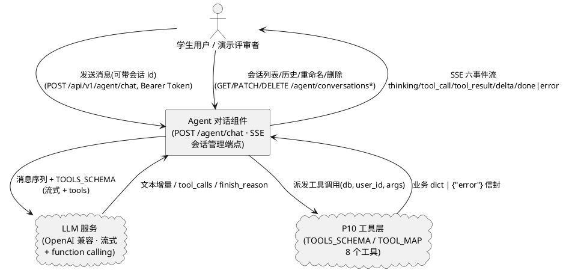
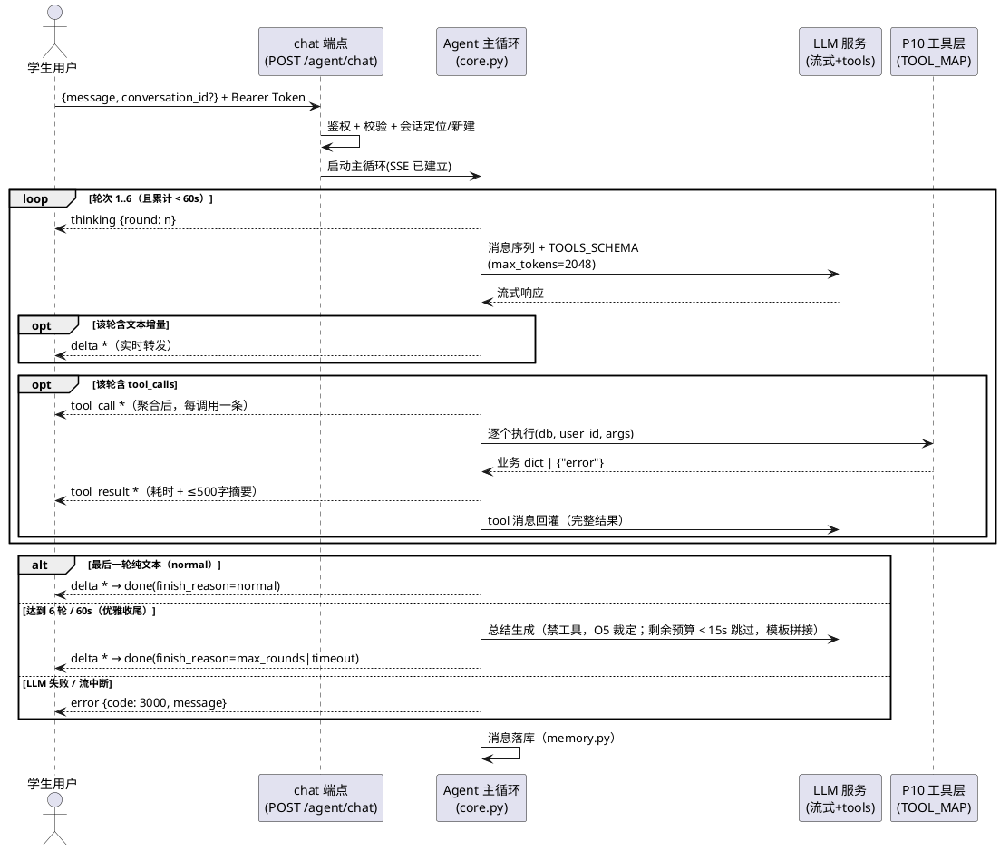
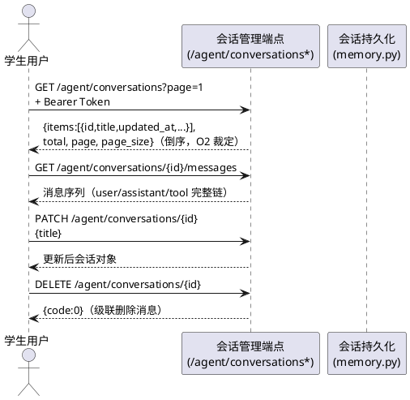

# Agent 对话主循环（ReAct + Function Calling）需求规格（SPEC_AGENT_CHAT）

| 项目 | 内容 |
|---|---|
| 所属项目 | 彭城智学 SmartLearn Agent |
| 阶段 | P11 Agent 主循环与对话 SSE（基于 P10 工具层交付，需求文档第 12 章后端第一步） |
| 文档状态 | **R3 裁定定稿**——R2 八项裁定全量落实；R3 新增上下文体积观测约束（§4.1 规则 8 / §8 D13，只观测不截断）；design 已确认，进入 tasks 阶段 |
| 上游依据 | `docs/PROJECT_CONTEXT.md`（唯一技术契约）、本阶段任务书（含 P10 实测背景）、P10 交付现状（`app/agent/tools.py` 8 工具 + `registry.py` TOOLS_SCHEMA/TOOL_MAP，76 用例）、P9 SSE 既有模式（`{type, data}` 事件流，`api/v1/chat.py` + `services/chat.py`）、P3 会话只读端点现状（`api/v1/agent.py`） |
| 下游文档 | design.md（`docs/designs/DESIGN_AGENT_CHAT.md`，由 spec-design-agent 另行生成）、tasks.md（由 spec-task-agent 生成） |
| 验收方式 | pytest 自动化（**mock LLM**，沙箱无法真实调用）+ 本机真实 LLM 验证清单（§8.3）+ `curl -N` 观测 SSE 事件序列，逐条核对 §8 可量化验收标准 |

> **修订记录**：
> - **R1（初版）**：依据任务书与 P10 实测背景完成完整规格；裁决任务书与 PROJECT_CONTEXT 的冲突与空白共 12 项（第 7 章）；提出 8 项开放决策点待用户裁定（第 9 章，均附建议倾向）。
> - **R2（裁定版）**：8 项开放决策点全部按建议裁定（第 9 章）；**O5 增补保护条件**——优雅收尾时剩余预算 < 15 秒则不再追加 LLM 总结调用，改用固定模板拼接，避免第 6 轮收尾撞上 60s 上限；**新增约束**——`done.finish_reason` 三值必须真实反映结束原因，禁止一律报 normal（前端据此渲染差异化收尾样式）；同步修正正文开放决策点编号交叉引用错乱（统一按第 9 章编号 O1–O8）。
> - **R3（设计确认版）**：用户确认 design（`docs/designs/DESIGN_AGENT_CHAT.md`）并**补充可观测性要求（不改行为）**——每轮调用 LLM 前统计本轮进入 messages 的总字符数写 debug 日志，超过 30000 字符升 warning（conversation_id / 轮次 / 字符数三字段）；**只观测不截断**（Agent 回灌完整性优先）。理由：get_learning_records 单次最多返回 100 条记录，配合 6 轮循环上下文可能不知不觉膨胀，无此统计则 P11 验收时「响应越来越慢」无法归因。已并入 §4.1 规则 8 与 §8 D13。

> **裁决总纲**：本阶段任务书与 `PROJECT_CONTEXT.md` 存在若干冲突与空白（模块命名 core.py vs 目录树 executor.py、§7.2 六端点 vs 任务书四端点、P3 列表升序 vs 会话惯例倒序、`llm.py` 无 function calling 能力等），已按以下依据链裁决并记录于**第 7 章**：① 用户当前明确指令（本阶段任务书，含 P10 实测背景）优先；② 其余冲突依 PROJECT_CONTEXT「开发提示词与本文件冲突时以本文件为准」；③ 已交付代码现状（P10 工具层、P9 SSE 模式、P3 只读端点）作为「复用不重写」的边界依据。凡本规格未覆盖的细节，以 PROJECT_CONTEXT 为准。

> **需求句式约定**：第 5 章业务规则均采用 EARS 句式的中文等价表达——「当〈触发条件〉时，系统应〈系统响应〉」；无条件规则表述为「系统应〈始终成立的行为〉」。每条规则附验收条件（触发场景 → 预期行为），可直接转化为测试用例。

> **范围总则（本阶段只做后端）**：本阶段交付 Agent 主循环（`app/agent/core.py`）、System Prompt（`app/agent/prompts.py`）、会话持久化（`app/agent/memory.py`）、SSE 接口与会话管理端点（`app/api/v1/agent.py` 扩展）、pytest 测试（mock LLM）。**本阶段禁止创建任何前端文件**（`AgentView.vue`、`src/api/agent.ts` 等属后续阶段）；SSE 事件契约按前端可视化需求设计（折叠卡片、中途停止、重新生成），前端仅作契约消费方验证背景。

---

# **1. 组件定位**

## **1.1 核心职责**

本组件负责编排「LLM ↔ 工具 ↔ 用户」的 ReAct 多轮对话主循环，实现工具调用的自动连续执行、全过程 SSE 推送与多轮会话持久化。

## **1.2 核心输入**

1. 用户消息与可选会话 id（来源：`POST /api/v1/agent/chat` 请求体，前端 AgentView 后续消费）。
2. 会话管理操作（来源：会话列表 / 消息读取 / 删除 / 重命名 / 新建 HTTP 请求）。
3. LLM 流式响应（来源：OpenAI 兼容 `/v1/chat/completions` 流式 + function calling，经 `services/llm.py` 扩展能力接入）：文本增量、tool_calls、finish_reason。
4. 工具执行结果（来源：P10 `TOOL_MAP` 派发的 8 个工具，返回业务 dict 或 `{"error": str}` 信封）。
5. 有效 JWT Bearer Token（来源：前端请求头 `Authorization`）。

## **1.3 核心输出**

1. SSE 事件流：六事件 `thinking / tool_call / tool_result / delta / done / error`，`{type, data}` 信封（对齐 P9），推给前端（§5.6.2 契约）。
2. 持久化的会话与消息（`agent_conversations` / `agent_messages`，PROJECT_CONTEXT §6.13/6.14）。
3. 统一响应体 `{code, message, data}` 的会话管理 JSON（列表 / 消息 / 删除 / 重命名 / 新建）。
4. 工具慢日志与循环异常日志（300ms 阈值，P10 惯例格式）。

## **1.4 职责边界**

本组件**不负责**以下事项（防止职责蔓延）：

1. **不修改 P10 工具实现与注册表**：`tools.py` / `registry.py` 冻结，仅消费 `TOOLS_SCHEMA` / `TOOL_MAP`；工具的增删改属 P10/P12 范围。
2. **不实现未注册的 4 个工具**：`get_learning_plan / generate_learning_plan / adjust_learning_plan / generate_learning_report` 依赖 P12 规划与报告服务；本阶段不造桩、不注册（P10 既定裁决），Agent 对此类请求如实说明「该能力将在后续版本提供」。
3. **不创建任何前端文件**：AgentView.vue / agent.ts / stores 等属后续阶段；本阶段以 SSE 事件与测试验证工具调用过程可见性（任务书验收 3）。
4. **不做 RAG 学习问答**：知识库问答（sources/无据判定/qa_history）属 P9 `/chat/qa`，与本组件分立；Agent 通过 `search_knowledge_base` 工具间接使用检索能力。
5. **不直接访问学习业务数据库**：LLM 决策通道的一切业务数据读写必须经 `TOOL_MAP`（PROJECT_CONTEXT §4 铁律）；会话/消息表为组件自有元数据，其持久化归属见裁决 #6。
6. **不做用户账号 / 权限管理**：认证复用 `get_current_user`；不提供改密码、注销等能力（Prompt 禁止事项同步声明「不越权」）。
7. **不做会话内容导出 / 分享 / 点赞等增值功能**。

---

# **2. 领域术语**

**Agent 主循环（ReAct 循环）**
: 一次 `/agent/chat` 请求内的「调 LLM → 若返回 tool_calls 则执行工具并回灌 → 继续调 LLM → 直至产出最终文本」的迭代过程；`app/agent/core.py` 的核心逻辑。

**轮（round）**
: 主循环的一次迭代，等于一次 LLM 请求-响应；一轮可含 0..n 个 tool_calls（并行调用）与可选文本。轮次上限 6。

**tool_call / tool_result**
: tool_call 是 LLM 决策发起的一次工具调用（call_id + 工具名 + 参数），对应 SSE `tool_call` 事件与 `agent_messages.tool_calls` JSON；tool_result 是工具执行产物（完整结果回灌 LLM，摘要推送前端），对应 SSE `tool_result` 事件与 `role=tool` 消息。

**thinking 事件**
: 每轮 LLM 调用开始时推送的轮次信号（`data.round`）；若模型产出 reasoning_content 增量则附于 `data.content`。前端据此显示「正在思考（第 N 轮）」。

**delta 事件**
: 任意轮次 LLM 文本增量的实时转发（`data` 为字符串分片），与 P9 语义一致。

**done / error 事件**
: SSE 流的两个互斥终结事件：`done` 表示成功收尾（含会话/消息 id、轮次统计、finish_reason）；`error` 表示受理后发生异常（LLM 失败 / 流中断）。一个连接**恰好推送其一**（对齐 P9 裁决 #4）。

**优雅收尾（graceful finish）**
: 达到 6 轮上限或 60s 总预算时，不报错、不空转，把已获得的工具信息总结成含具体数字的回答，以 `done`（`finish_reason="max_rounds"` 或 `"timeout"`）收尾；总结优先由一次禁工具的 LLM 调用生成（不计轮次），剩余预算 < 15 秒或调用失败时降级为固定模板拼接（O5 裁定）。

**循环总预算（60s）**
: 一次 `/agent/chat` 请求从受理到终结事件的全部耗时上限，含所有轮次的 LLM 调用与工具执行（裁决 #8）；进入收尾时剩余预算 < 15 秒则不得再追加 LLM 总结调用（O5 保护条件）。

**结果摘要（≤500 字截断）**
: `tool_result` 事件 `data.summary` 的形态约束：完整工具结果序列化后超过 500 字符时截断至 500 并置 `truncated=true`，禁止把原始大 JSON 全量推给前端（任务书 SSE 契约）。

**非法工具名兜底**
: LLM 返回的 tool_call 名称不在 `TOOL_MAP` 时，不崩溃、不中断：推送 `tool_result(ok=false)`，向 LLM 回灌「该工具不可用」tool 消息，继续对话使其自我纠正（任务书验收 5）。

**错误信封（error envelope）**
: P10 工具失败统一返回的 `{"error": "<中文提示>"}` 单键结构；主循环原样作为 tool 消息回灌 LLM 自纠，同时映射为 `tool_result(ok=false)`。

**不编造底线**
: 回答中的学习数据（时长、任务数、分数等）必须来自工具调用结果，能力边界外的请求（学习计划生成/调整、学习报告）必须如实说明「该能力将在后续版本提供」——禁止编造数据或伪造计划（任务书验收 2）。

**预取（prefetch）**
: System Prompt 组装阶段经 P10 工具层获取用户档案与最近学习概况的内部调用，不经过 LLM 决策、不推送 SSE 事件（裁决 #11）。

**多轮上下文窗口**
: 每次 chat 携带的该会话最近历史消息条数上限（O7 裁定：最近 20 条）；截取不得产生协议非法的孤儿 tool 消息。

**会话（conversation）/ 消息（message）**
: 会话 = `agent_conversations` 一行（用户维度的多轮对话容器）；消息 = `agent_messages` 一行（role ∈ user/assistant/tool；system 不落库，裁决 #7）。

**慢日志阈值（300ms）**
: 单次工具执行耗时超过 300 毫秒时记 warning 日志（P10 `SLOW_TOOL_MS` 既有锁定值，本阶段继承并透出耗时到 `tool_result.elapsed_ms`）。

---

# **3. 角色与边界**

## **3.1 核心角色**

- **学生用户**：登录后在 `/ai-agent` 页（后续阶段）与 Agent 对话、查看会话列表与历史消息（含工具调用卡片）、重命名/删除会话；仅能访问本人会话。本阶段以 curl / pytest 角色代行验证。
- **演示评审者（评委）**：答辩场景下观测「问学习状态 → Agent 自动连查多工具 → 含具体数字的分析」的智能体决策过程（SSE 工具卡片可见）；复用学生用户身份。

## **3.2 外部系统**

- **LLM 服务（OpenAI 兼容 `/v1/chat/completions`，流式 + function calling）**：接收含 TOOLS_SCHEMA 的消息序列，流式返回文本增量与 tool_calls；经 `services/llm.py` 扩展的 Agent 专用流式方法调用（裁决 #4）。
- **P10 工具层（`app/agent/tools.py` + `registry.py`，同进程已交付能力）**：接收 `(db, user_id, arguments)` 派发请求，返回业务 dict 或 `{"error"}` 信封；本组件工具调用唯一通道，不存在其他数据访问路径。
- **SQLite 持久层（间接依赖）**：会话/消息读写经 `app/agent/memory.py`（组件自有元数据）；业务数据经工具层间接使用，本组件不直接读写业务表。

## **3.3 交互上下文**

---

# **4. DFX 约束**

## **4.1 性能**

1. **循环总预算**：单次 `/agent/chat` 从受理到终结事件总时长 ≤ **60 秒**；超时进入优雅收尾（裁决 #8）。Agent 侧预算先于 LLM 客户端既有 90s 超时触发（实现方式属 design）。
2. **max_tokens 下限**：主循环内每次 LLM 调用 `max_tokens ≥ 1024`（P10 实测：300 时 finish=length 截断、工具参数不完整）；锁定常量 **2048**（满足红线并留余量，不做环境变量化，对齐 P10 慢日志锁定惯例；裁决 #9）。
3. **轮次上限**：主循环最多 **6 轮**（P10 实测「过度调用」倾向——建完任务后仍继续查询确认）；锁定量值，不做环境变量化。
4. **优雅收尾预算保护（O5 裁定保护条件）**：进入优雅收尾（6 轮上限或 60s 预算）时，若**剩余预算 < 15 秒**则不得追加 LLM 总结调用，直接以固定模板拼接收尾（含已获工具结果摘要，如「已为你查询到以下信息：{工具结果摘要}」）——避免第 6 轮结束后的总结调用撞上 60s 上限，使用户看到超时错误而非收尾。
5. **真实流式**：`delta` 事件随 LLM 产出实时逐片推送，禁止先取回完整回答再切片（对齐 P9 红线）；`tool_call` 事件在该轮流式响应聚合完成后立即推送。
6. **工具慢日志**：单次工具执行 > **300ms** 记 warning（三字段 `tool_name / user_id / elapsed_ms`，P10 既有格式，不含参数与业务数据）。
7. **会话管理接口**：列表/消息/重命名/删除/新建响应 ≤ 2 秒（PROJECT_CONTEXT 普通页面红线）。
8. **上下文体积观测（R3 补充，不改行为）**：每轮调用 LLM 前，系统应统计本轮进入 messages 的总字符数并写入 debug 日志；超过 **30000 字符**时改为 warning（含 `conversation_id`、轮次、字符数三字段）。该统计**仅用于观测——不得因此截断回灌内容**（Agent 完整性优先；tool 完整结果回灌是 LLM 自纠与总结质量的依赖，裁决 #7）。观测目的：get_learning_records 单次最多返回 100 条记录，配合 6 轮循环上下文可能不知不觉膨胀；无此统计则「响应越来越慢」无法归因是否上下文膨胀所致。观测信息不进 SSE 事件流（服务端运维信号）。
   a. 验收条件：每轮 LLM 调用前出现 debug 日志（三字段）；构造 > 30000 字符上下文的轮次 → warning 同三字段；回灌的 messages 内容与无观测时逐字节一致（不截断的直接验证）。

## **4.2 可靠性**

1. 每个 SSE 连接必须以 `done` 或 `error` **恰好一个**终结事件收尾；禁止悬挂、禁止无终结断开（对齐 P9）。
2. LLM 调用失败（超时/连接/鉴权/限流/上游 5xx）→ `error` 事件 `code=3000` + 中文可读提示；原始异常与堆栈不外透（沿用 `services/llm.py` 包装口径）。
3. 达到 6 轮上限或 60s 预算 → 优雅收尾（`done` + finish_reason 标记），**不报错、不空转**（任务书验收 6）；收尾受 §4.1 规则 4 预算保护——剩余预算 < 15 秒走模板拼接，不追加 LLM 调用。
4. LLM 返回非法工具名 → 不崩溃，兜底回灌「该工具不可用」并继续对话（任务书验收 5）。
5. SSE 异常（客户端断开 / 流异常）→ 停止循环、关闭连接、记录日志（任务书硬约束）。
6. 落库失败不拖垮主链路（P9 原则沿用）：回答已完整送达时正常 `done`（`data.message_id=null`）+ `logger.warning`（含 user_id，禁记消息原文）。
7. 会话与消息写入须保证「半截不一致」不可见：中断时已落库消息自洽（user 消息可独立存在，assistant 的 tool_calls 与 tool 消息成对落库，见 5.4.1 规则 3）。

## **4.3 安全性**

1. 全部端点须 JWT Bearer 鉴权；未携带/无效 token → HTTP 401 + `code=1003`（受理阶段错误不走 SSE，对齐 P9 裁决 #10）。
2. **user_id 服务端注入红线**：user_id 一律取认证结果注入工具调用；禁止以任何形式接收客户端传入的 user_id / conversation_id 越界参数（conversation_id 仅作会话定位并校验归属）。
3. 会话与消息按 `user_id` 过滤，「不可见即不存在」（越权与不存在统一 404 + `code=1005`）。
4. 日志脱敏：全程禁打印用户消息原文与回答全文；仅记元数据（user_id、conversation_id、轮次、事件计数、工具名、耗时、错误码）。
5. SSE 响应头 `Content-Type: text/event-stream` + `Cache-Control: no-cache`，禁止中间层缓冲。
6. Prompt 禁止事项（不编造数据、不做医疗或心理诊断、不越权）为安全护栏的组成部分（§5.2）。

## **4.4 可维护性**

1. System Prompt 模板集中管理于 `app/agent/prompts.py` 单一位置，禁止散落硬编码、禁止前端拼 Prompt。
2. 轮次上限 / 总预算 / max_tokens / 摘要截断长度 / 慢日志阈值等以模块级常量锁定并注释实测依据，禁止散落魔法数。
3. 事件类型与 finish_reason 枚举前后端共用同一套字符串字面量（`thinking / tool_call / tool_result / delta / done / error`；`normal / max_rounds / timeout`）。
4. **可测性**：LLM 调用点必须可 mock（沙箱无法真实调用 DeepSeek）；pytest 以注入预设 tool_calls 序列与文本增量方式覆盖 §8 各自动化验收项。
5. LLM 调用点做超时与失败兜底（PROJECT_CONTEXT §8.4，错误码 3000）。
6. **finish_reason 真实性（用户 R2 补充约束）**：`done.data.finish_reason` 三值（`normal / max_rounds / timeout`）必须真实反映结束原因，**禁止一律报 normal**——自然结束=normal、6 轮上限收尾=max_rounds、60s 预算收尾=timeout；前端据此渲染差异化收尾样式（max_rounds → 「信息较多，已为你总结」；timeout → 「处理时间较长，以下是已获取的部分」）。

## **4.5 兼容性**

1. `services/llm.py` 既有 `chat` / `chat_stream` 契约**零改动**（P9 与 goal 拆解依赖）；Agent 流式 + function calling 以新增方法扩展（裁决 #4）。
2. P10 `tools.py` / `registry.py` **零改动**（本阶段只做编排）；P10 测试套件回归通过。
3. P3 已交付的 `GET /agent/conversations`（分页）与 `GET /agent/conversations/{id}`（详情）保留；列表排序由 id 升序改为 updated_at 倒序（O2 裁定，属既有端点行为变更，回归须覆盖）。
4. P9 pytest 套件回归通过（115 passed 基线不被破坏）。
5. `agent_conversations` / `agent_messages` 表结构沿用 PROJECT_CONTEXT §6.13/6.14，本阶段不改 DDL。

---

# **5. 核心能力**

## **5.1 Agent 对话主循环（ReAct + Function Calling）**

### **5.1.1 业务规则**

1. **鉴权规则**：Agent 全部端点必须登录。
   a. 验收条件：未携带 token 调用 `POST /agent/chat` → HTTP 401 + 统一响应体 `{code:1003, ...}`（JSON，非 SSE 流）。
2. **入参校验规则**：请求体必须经 Pydantic v2 校验——`message` 非空且 ≤ 2000 字符（O6 裁定；**独立常量，与 P9 `/chat/qa` 的 500 上限不得抽成共用常量**——问答是一句话，Agent 指令可能带上下文）；`conversation_id` 可选正整数。
   a. 验收条件：提交空 `message` 或超长消息或非整数 `conversation_id` → HTTP 422 + `code=1001` 中文提示（受理阶段统一响应体）。
3. **会话定位规则**：当请求携带 `conversation_id` 时，系统应校验其存在且属当前用户；未携带时自动新建会话。
   a. 验收条件：传入本人会话 id → 在该会话续聊，历史上下文生效；传入不存在或他人会话 id → HTTP 404 + `code=1005`（受理阶段，非 SSE）。
4. **循环执行规则**：当 LLM 返回的响应含 tool_calls 时，系统应解析全部调用（含并行多调用）、经 `TOOL_MAP` 逐个执行（注入 db 与认证 user_id）、将完整结果序列化为 tool 消息回灌、进入下一轮；当 LLM 返回纯文本（无 tool_calls）时，流式推送文本后循环自然结束。
   a. 验收条件：mock LLM 脚本（轮 1 返回 3 个 tool_calls → 轮 2 返回文本）→ SSE 出现 3 组 `tool_call`+`tool_result` 后接 `delta`* 与 `done`，落库消息含 role=assistant(tool_calls) 与成对 role=tool。
5. **轮次上限规则**：当完成第 6 轮 LLM 响应仍含 tool_calls 时，系统应不再发起第 7 轮，而是优雅收尾——追加一次**禁工具的总结性 LLM 调用**（不计轮次、不推 `thinking` 事件、受总预算约束，O5 裁定），基于已获得的工具信息生成含具体数字的总结回答，以 `done`（`finish_reason="max_rounds"`）收尾；**当剩余预算 < 15 秒时不得追加该总结调用**，改用固定模板拼接收尾（含已获工具结果摘要，如「已为你查询到以下信息：{工具结果摘要}」）；总结调用自身失败亦降级为模板拼接。
   a. 验收条件：mock LLM 永远返回 tool_calls → 主循环恰 6 轮，第 6 轮后不出现第 7 个 `thinking` 事件；`done.data.finish_reason="max_rounds"`；无 `error` 事件（任务书验收 6）；剩余预算 < 15s 场景 → 无总结 LLM 调用、回答为模板拼接、`finish_reason` 仍为 `max_rounds`。
6. **循环总预算规则**：当请求累计耗时达到 60s 时，系统应停止发起新一轮，以已有信息优雅收尾（`done`，`finish_reason="timeout"`）；正在执行中的轮次/工具按剩余预算受控（实现方式属 design）；超时收尾时剩余预算必为 0（< 15s 保护线），一律走模板拼接，不再追加 LLM 调用。
   a. 验收条件：测试中将预算常量调小（如 1s，必然低于 15s 保护线）+ mock 慢 LLM → 流以 `done(finish_reason="timeout")` 收尾且总耗时不超过预算 + 单步容忍；无 `error`、无总结 LLM 调用（模板拼接路径）。
7. **max_tokens 规则**：主循环每次 LLM 调用 `max_tokens` 必须 ≥ 1024（锁定 2048）。
   a. 验收条件：审查 LLM 调用点常量（单测断言请求参数）；P4 默认值（不传）不得沿用。
8. **非法工具名兜底规则**：当 LLM 返回的 tool_call 名称不在 `TOOL_MAP` 时，系统应不崩溃、不中断：向该调用推送 `tool_result`（`ok=false`，说明「该工具不可用」），向 LLM 回灌同义 tool 消息，继续本轮后续调用与下一轮对话。
   a. 验收条件：mock LLM 返回 `name="foo_bar"` 的 tool_call → SSE 仍按序推送后续事件并最终 `done`；`tool_result.data.ok=false` 且 summary 含「该工具不可用」；进程无异常、落库正常（任务书验收 5）。
9. **错误信封回灌规则**：当工具返回 `{"error": ...}` 信封时，系统应将信封 JSON 原样作为 tool 消息回灌 LLM（供自我纠正），对应 `tool_result` 事件 `ok=false`（summary 为信封中文提示）；不得把工具失败当作流级 `error` 事件。
   a. 验收条件：mock 一次参数非法（如 `days=999`）的 `get_learning_records` 调用 → `tool_result(ok=false)` 后对话继续，LLM 收到错误文案（P10 自纠机制被消费）。
10. **工具执行规则**：工具一律经 `TOOL_MAP` 派发，签名 `(db, user_id, arguments)`，user_id 取认证结果；单次执行 > 300ms 记慢日志（P10 装饰器既有行为，继承）。
    a. 验收条件：审查派发代码无旁路 SQL / ORM 直查业务表；构造慢工具（mock sleep 400ms）→ 日志出现 `agent_tool_slow` 三字段行（任务书验收 6 之工具慢日志）。
11. **终结事件规则**：每个 SSE 连接必须以 `done` 或 `error` 恰好一个收尾；优雅收尾（max_rounds / timeout）属 `done` 而非 `error`。
    a. 验收条件：任意成功/收尾场景末条事件为 `done`；仅 LLM 失败/流中断场景末条为 `error`。

### **5.1.2 交互流程**

### **5.1.3 异常场景**

1. **LLM 服务不可用（未配置/超时/上游 5xx）**
   a. 触发条件：`.env` LLM 配置缺失、调用超时、上游 5xx/限流。
   b. 系统行为：停止循环，推送 `{"type":"error","data":{"code":3000,"message":"AI 服务暂时不可用，请稍后重试"}}` 并关闭 SSE 连接；日志记异常类型摘要（禁记消息原文）。
   c. 用户感知：中文错误提示，页面不崩溃，可重新发送。
2. **LLM 流中途断开**
   a. 触发条件：已推送部分事件后 LLM 流异常终止。
   b. 系统行为：推送 `error(3000, "回答生成中断，请重试")` 收尾并关闭连接。
   c. 用户感知：已流式出现的部分内容保留，其后附错误提示，无无限等待。
3. **客户端断开连接**
   a. 触发条件：用户中途停止生成（前端 abort）或网络断开。
   b. 系统行为：停止主循环（不再发起 LLM 调用与工具执行）、关闭 SSE 连接、记录日志（含 user_id / conversation_id / 已完成轮次）；已落库消息保持自洽（半截 assistant 消息不落库）。
   c. 用户感知：（本阶段以 curl 断开验证）服务端日志出现关闭记录，进程无异常。
4. **达到轮次上限（6 轮）**
   a. 触发条件：第 6 轮响应仍含 tool_calls（deepseek-flash 过度调用倾向）。
   b. 系统行为：不再发起新工具轮，基于已获信息优雅收尾（O5 裁定：追加一次禁工具总结调用，不计轮次、受总预算约束；**剩余预算 < 15 秒时跳过总结调用直接模板拼接**；总结调用失败亦降级模板）。
   c. 用户感知：收到含已获数据的总结回答；`done.finish_reason="max_rounds"`；无报错、无空转。
5. **达到时间预算（60s）**
   a. 触发条件：累计耗时达 60s（LLM 慢或工具慢）。
   b. 系统行为：停止新轮次，优雅收尾（同上；此时剩余预算为 0，必走模板拼接），`finish_reason="timeout"`。
   c. 用户感知：收到基于已获信息的总结回答，无报错。
6. **非法工具名**
   a. 触发条件：LLM 幻觉出不存在的工具名。
   b. 系统行为：`tool_result(ok=false, "该工具不可用")` + 回灌 + 继续对话（规则 8）。
   c. 用户感知：工具卡片显示「该工具不可用」，对话继续，最终仍得到回答。

## **5.2 System Prompt 设计（prompts.py）**

### **5.2.1 业务规则**

1. **三要素规则**：System Prompt 必须包含——① 今天日期（北京时区，如「今天是 2026-10-21」）；② 用户档案摘要（姓名 / 专业 / 年级 / 每日可学习时长）；③ 逐字指令「直接调用工具完成任务，不要反问用户确认」。三者缺一不可（P10 实测：缺日期则模型先调两个工具确认上下文；缺强制指令则反问用户）。
   a. 验收条件：单测断言渲染后 Prompt 同时含日期串、档案四要素字段与逐字指令（mock 档案数据渲染）。
2. **档案与概况预取规则**：System Prompt 的档案摘要与最近学习概况（近 7 天时长/任务完成率等核心数字）必须经 P10 工具层预取（`get_user_profile` / `get_learning_statistics` 的 TOOL_MAP 直调，不经 LLM、不推 SSE 事件，裁决 #11）；预取失败时 Prompt 降级为不含该段，**不阻塞对话**。
   a. 验收条件：mock 预取失败 → 主循环照常运行、SSE 正常收尾；Prompt 不含概况段（日志记降级原因）。
3. **当前目标规则**：System Prompt 应含用户当前目标（档案 `current_goal_type` 及兴趣方向），与档案摘要同段渲染。
   a. 验收条件：单测断言 Prompt 含 `current_goal_type` 值。
4. **身份与回复风格规则**：Prompt 必须声明 Agent 身份（SmartLearn AI 学习助手）与回复风格——中文回答、分点组织、给出可执行建议。
   a. 验收条件：单测断言 Prompt 含身份与三条风格要求。
5. **禁止事项规则**：Prompt 必须逐项声明——① 不编造数据：任何学习数字必须来自工具返回结果；② 不做医疗或心理诊断；③ 不越权：不执行账号操作、不代替用户流转任务状态（工具本就不支持 status 修改）、不访问他人数据。
   a. 验收条件：单测断言 Prompt 含三项禁止声明。
6. **能力边界声明规则（验收 2 的机制）**：Prompt 必须声明当前可用工具清单（8 个）与不可用能力——学习计划生成/调整、学习报告生成属后续版本；当用户请求不可用能力时如实说明「该能力将在后续版本提供」，可基于现有工具给替代建议（如用 `create_task` 手工安排），**禁止编造一份计划**。
   a. 验收条件：单测断言 Prompt 含「后续版本」边界声明；本机真实 LLM 问「帮我制定下周学习计划」→ 回答含「后续版本」类表述且不出现伪造的计划条目（§8.3 V2）。
7. **场景引导规则**：Prompt 应引导典型场景的标准工具路径——分析学习状态 = `get_learning_statistics` + `get_tasks` + `get_knowledge_mastery` 组合（支撑任务书验收 1 的「自动连续调用至少 3 个工具」）。
   a. 验收条件：Prompt 含该组合引导；本机实测问「我最近学习怎么样」→ 连续调用 ≥3 个工具且回答含具体数字（§8.3 V1）。
8. **集中管理规则**：Prompt 模板仅在 `app/agent/prompts.py` 定义（单一事实来源）；禁止散落、禁止前端拼接。
   a. 验收条件：全局检索无其他 Prompt 拼接点。

### **5.2.2 交互流程**

并入 5.1.2 时序图「启动主循环」前置步骤：`core.py → TOOL_MAP（预取档案/概况）→ prompts.py 渲染 System Prompt → 进入轮次循环`。

### **5.2.3 异常场景**

1. **档案从未填写**
   a. 触发条件：用户未填写 user_profiles。
   b. 系统行为：`get_user_profile` 返回默认值结构（P10 契约，非错误），Prompt 按默认档案渲染（daily_study_minutes=60）。
   c. 用户感知：对话正常，Agent 以默认画像工作。
2. **预取工具抛错**
   a. 触发条件：预取调用返回 `{"error"}` 信封。
   b. 系统行为：Prompt 降级（缺段不缺要素三——逐字指令与日期恒在），记 warning，继续主循环。
   c. 用户感知：对话正常收尾，无异常暴露。

## **5.3 SSE 事件流与全过程可视化**

### **5.3.1 业务规则**

1. **事件信封与格式规则**：系统应以 `{type, data}` 信封推送标准 SSE（每条 `data: {JSON}\n\n`，`ensure_ascii=False` 中文原样），响应头 `text/event-stream` + `Cache-Control: no-cache`（对齐 P9 既有模式，SSE 格式化在 api 层）。
   a. 验收条件：`curl -N` 观测每行为合法 SSE 帧且 JSON 可解析。
2. **事件顺序规则**：当主循环运行时，系统应按固定顺序推送——每轮 `thinking`（恰 1 次）→ 该轮 `delta`*（有文本时）→ 该轮 `tool_call`* → 对应 `tool_result`*；跨轮按实际发生顺序；终结事件必为最后一条。
   a. 验收条件：mock 脚本跑 3 工具场景 → 事件序列满足上述偏序，`tool_call` 先于其 `tool_result`，无终结后事件。
3. **tool_call 载荷规则**：`tool_call.data` 必须携带 `call_id`（OpenAI tool_call id，关联 tool_result 与落库 tool_call_id）、`name`（工具名）、`arguments`（**解析后的参数对象**，非字符串——前端渲染「正在调用 get_learning_statistics(days=7)」卡片）。非法工具名同样推送（卡片如实显示）。
   a. 验收条件：SSE 原始事件中 `arguments` 为 JSON 对象；`call_id` 与后续 `tool_result.call_id` 一一对应。
4. **tool_result 载荷与截断规则**：`tool_result.data` 必须携带 `call_id`、`name`、`ok`（bool）、`elapsed_ms`（int，执行耗时）、`summary`（结果摘要）、`truncated`（bool）；完整结果序列化 > 500 字符时截断至 500 并 `truncated=true`，**禁止把原始大 JSON 全量推给前端**（任务书 SSE 契约）。
   a. 验收条件：构造大结果工具调用（如 100 条学习记录）→ `summary` ≤ 500 字符且 `truncated=true`；小结果 `truncated=false` 且摘要与结果一致。
5. **thinking 载荷规则**：`thinking.data` 携带 `round`（当前轮次，从 1 起）；若模型产出 reasoning_content 增量，以 `content` 字段附加推送（增量式）。
   a. 验收条件：每轮恰一条轮次信号 `thinking`；deepseek-flash（无推理链）场景仅含 `round`。
6. **done 载荷与 finish_reason 真实性规则**：`done.data` 固定五字段——`conversation_id`（int）、`message_id`（int|null，最终 assistant 消息 id，落库失败为 null）、`rounds`（实际轮次）、`tool_call_count`（本次请求累计工具调用数）、`finish_reason`（`normal|max_rounds|timeout`）。**finish_reason 必须真实反映结束原因，禁止一律报 normal**（用户 R2 补充约束）——自然结束=`normal`、6 轮上限收尾=`max_rounds`、60s 预算收尾=`timeout`；前端据此渲染差异化收尾样式（max_rounds → 「信息较多，已为你总结」；timeout → 「处理时间较长，以下是已获取的部分」）。
   a. 验收条件：成功对话 → 五字段齐全且与实际统计一致；新建会话场景前端可凭 `conversation_id` 续聊；D6/D7 场景 finish_reason 分别为 `max_rounds`/`timeout`（禁止为 `normal`）。
7. **error 载荷规则**：`error.data` 为 `{code, message}`；本阶段 code 仅 `3000`（LLM 失败/流中断）；受理阶段错误（401/404/422）走统一响应体 JSON，不进 SSE（对齐 P9 裁决 #10）。
   a. 验收条件：mock LLM 抛错 → 末条 `error` 且 `code=3000`、message 中文可读。
8. **delta 真实流式规则**：`delta` 为任意轮 LLM 文本增量的即时转发（含中间轮的解释性文本，如「我先看看你最近的学习数据」），顺序与产出一致；禁止累积后切片。
   a. 验收条件：`curl -N` 时间戳显示多条 delta 陆续到达、首条显著早于 done。

### **5.3.2 交互流程**

见 5.1.2 时序图（SSE 事件推送贯穿循环全程）。

### **5.3.3 异常场景**

1. **一轮内 tool_call 与 tool_result 数不一致（部分执行失败）**
   a. 触发条件：并行多调用中个别执行异常。
   b. 系统行为：每个 tool_call 必有对应 tool_result（ok=false 承载失败），不出现无结果的调用卡片。
   c. 用户感知：失败卡片显示错误说明，其余正常。
2. **工具结果序列化异常**
   a. 触发条件：工具返回不可序列化结构（理论不发生，P10 返回 dict）。
   b. 系统行为：按错误信封处理（ok=false，summary=「工具执行失败，请稍后重试」），不中断流。
   c. 用户感知：卡片显示失败提示，对话继续。

## **5.4 多轮会话与持久化（memory.py）**

### **5.4.1 业务规则**

1. **会话创建规则**：当请求未携带 `conversation_id` 时，系统应自动新建会话（或经显式新建端点，O1 裁定：纳入）；会话标题按 O4 裁定生成——首条用户消息截断 20 字符；显式新建且 title 为空时，同样在首条消息落库时补截断标题。
   a. 验收条件：不带 id 发起对话 → `done.data.conversation_id` 为新会话 id；`GET /agent/conversations` 含该会话且 title 为消息前缀。
2. **user 消息落库规则**：当请求受理成功后，系统应立即将用户消息落库（role=user）；此后即使循环 error 终结，user 消息保留（支撑后续「重新生成」语义），不回滚。
   a. 验收条件：mock LLM 失败后查询该会话消息 → 含该条 user 消息、无 assistant 回复。
3. **循环消息落库规则**：系统应按实际发生顺序落库——每轮含 tool_calls 的 assistant 消息（`tool_calls` 存 OpenAI 格式完整 JSON）与对应 tool 消息（`content` 存**完整结果 JSON** 供回灌与回放、`tool_name`、`tool_call_id`）**成对落库**；最终 assistant 回答落库（`message_id` 来源）；system 消息**不落库**（动态组装，裁决 #7）。落库失败不拖垮主链路（4.2 规则 6）。
   a. 验收条件：3 工具对话后读库 → 消息序列 user → assistant(tool_calls) → tool ×3 → assistant(最终)，tool_calls 含 arguments、tool_call_id 可关联。
4. **updated_at 触碰规则**：当会话有新消息落库时，系统应更新会话 `updated_at`（支撑列表按最近活跃排序，O2 裁定：updated_at 倒序）。
   a. 验收条件：续聊后会话在列表（倒序）中升至首位。
5. **多轮上下文回灌规则**：当会话存在历史消息时，系统应携带最近历史（O7 裁定：最近 20 条，成对边界截断）作为上下文——历史 assistant(tool_calls) 与 tool 消息按协议顺序成对回灌（使模型知晓已查过什么，抑制重复查询）；窗口截取**禁止产生孤儿 tool 消息**（协议非法，须从成对边界截断）。
   a. 验收条件：mock 断言第 2 次请求的 LLM 消息序列以合法边界开头（首条不为孤立 tool）；历史轮的 tool_calls+tool 成对出现。
6. **刷新还原规则**：`GET /agent/conversations/{id}/messages` 必须返回完整消息序列（含 tool_calls JSON 与 tool 结果），足以还原对话流与工具调用卡片（前端后续阶段消费；本阶段以 curl 验证数据完整性）。
   a. 验收条件：对话后 curl 该端点 → 消息含 role/tool_name/tool_calls/tool_call_id 字段，工具卡片所需数据齐备（任务书验收 4 的服务端维度）。
7. **删除规则**：`DELETE /agent/conversations/{id}` 删除会话并级联删除其全部消息（表 CASCADE 既有设计，硬删除）；仅限本人。
   a. 验收条件：删除后列表不含该会话、消息端点 404；他人/不存在 → 404 + `code=1005`。
8. **重命名规则**：`PATCH /agent/conversations/{id}` 更新标题（1–200 字符）；仅限本人（O1 裁定：本阶段纳入）。
   a. 验收条件：重命名后列表/详情返回新标题；空标题或超 200 字 → 422 + `code=1001`。
9. **隔离规则**：会话与消息的一切读写按 `user_id` 过滤，「不可见即不存在」。
   a. 验收条件：双账号互查 → 均无法见对方会话与消息（404）。

### **5.4.2 交互流程**

### **5.4.3 异常场景**

1. **会话不存在 / 越权**
   a. 触发条件：conversation_id 不存在或属他人。
   b. 系统行为：HTTP 404 + `code=1005`（chat 受理阶段与消息/重命名/删除端点同口径）。
   c. 用户感知：中文「资源不存在」提示。
2. **消息落库失败**
   a. 触发条件：数据库异常（如临时锁库）。
   b. 系统行为：回答照常送达，`done(message_id=null)` 收尾 + warning 日志（含 user_id，禁记原文）。
   c. 用户感知：回答完整显示；历史可能缺该轮记录（P9「主链路不被辅链路拖垮」原则沿用）。
3. **空会话（无消息）**
   a. 触发条件：显式新建后未发消息。
   b. 系统行为：消息端点返回空列表（不报错）。
   c. 用户感知：空会话正常显示。

## **5.5 会话管理接口**

### **5.5.1 业务规则**

1. **列表规则**：`GET /agent/conversations` 分页（page 默认 1、page_size 默认 10 上限 100，沿用 `PaginationParams` 查询参数模型——该端点仅此一组 query 参数，符合 §5.3 展开条件）；排序 `updated_at` 倒序（O2 裁定，对 P3 的 id 升序为行为变更）。
   a. 验收条件：多会话按最近活跃倒序；分页字段正确。
2. **消息规则**：`GET /agent/conversations/{id}/messages` 返回该会话全部消息（O3 裁定：全量不分页——工具调用链完整性优先、单会话消息量受 6 轮上限约束），按 id 升序（对话还原顺序）。
   a. 验收条件：对话后读取 → 顺序与对话时序一致、tool 链完整。
3. **鉴权与校验**：全部端点复用 `get_current_user`；出入参 Pydantic 校验（重命名 title 1–200、新建 title ≤200 可空）；统一响应体包装。
   a. 验收条件：未登录 401/1003；非法入参 422/1001。

### **5.5.2 交互流程 / 5.5.3 异常场景**

并入 5.4.2 图与 5.4.3（会话管理异常统一 404/1005、鉴权 401/1003、校验 422/1001 口径）。

## **5.6 接口清单与 SSE 事件契约（汇总）**

### **5.6.1 接口清单**

| 接口 | 方法 | 鉴权 | 请求 | 响应 | 说明 |
|---|---|---|---|---|---|
| `/api/v1/agent/chat` | POST | Bearer JWT | `{"message": str(1..2000), "conversation_id": int?}` | SSE 六事件流（5.6.2）；受理错误统一响应体 | Agent 对话主循环（上限 2000，O6 裁定，独立于 P9 的 500） |
| `/api/v1/agent/conversations` | GET | Bearer JWT | `page` / `page_size`（查询参数模型） | 统一响应体 `{items, total, page, page_size}` | 会话列表（updated_at 倒序，O2 裁定） |
| `/api/v1/agent/conversations` | POST | Bearer JWT | `{"title": str?}` | 统一响应体 data=会话对象 | 显式新建（O1 裁定：纳入） |
| `/api/v1/agent/conversations/{id}` | GET | Bearer JWT | — | 统一响应体 data=会话对象 | 详情（P3 既有，保留不动） |
| `/api/v1/agent/conversations/{id}` | PATCH | Bearer JWT | `{"title": str(1..200)}` | 统一响应体 data=会话对象 | 重命名（O1 裁定：纳入） |
| `/api/v1/agent/conversations/{id}` | DELETE | Bearer JWT | — | 统一响应体 `data=null` | 删除（级联消息） |
| `/api/v1/agent/conversations/{id}/messages` | GET | Bearer JWT | —（O3 裁定：全量） | 统一响应体 data=消息数组（全量，O3 裁定） | 会话消息（还原对话流） |

> 服务层内部扩展（非 HTTP）：`services/llm.py` 新增 Agent 专用流式 + function calling 方法（既有 `chat` / `chat_stream` 零改动，裁决 #4）；`app/agent/` 新增 `core.py` / `prompts.py` / `memory.py`（裁决 #1/#6）。

### **5.6.2 SSE 事件契约**

| 事件 | 顺序与次数 | `data` 载荷 | 必推条件 |
|---|---|---|---|
| `thinking` | 每轮开始恰 1 次；共 1..n 次（n=轮数） | `{"round": int, "content"?: str}`（content 仅推理模型增量时出现） | 每轮必推 |
| `tool_call` | 该轮 thinking 之后、对应 tool_result 之前；0..n 次 | `{"call_id": str, "name": str, "arguments": object}`（解析后参数对象） | LLM 每返回一个 tool_call 必推一条（含非法工具名） |
| `tool_result` | 对应 tool_call 之后（同轮全部调用执行完逐条推）；0..n 次 | `{"call_id": str, "name": str, "ok": bool, "elapsed_ms": int, "summary": str(≤500), "truncated": bool}` | 每个 tool_call 必有对应 tool_result |
| `delta` | 任意轮有文本增量时；0..n 次 | 回答文本分片（`str`） | 有文本即推、实时转发 |
| `done` | 终结事件，与 error 互斥，恰 1 次 | `{"conversation_id": int, "message_id": int\|null, "rounds": int, "tool_call_count": int, "finish_reason": "normal"\|"max_rounds"\|"timeout"}` | 成功收尾（含优雅收尾）必推 |
| `error` | 终结事件，与 done 互斥，恰 1 次 | `{"code": int(3000), "message": str(中文可读)}` | LLM 失败/流中断必推；落库失败不走 error |

**契约细则**：
1. 传输格式：标准 SSE（`data: {JSON}\n\n`，`ensure_ascii=False`），`text/event-stream` + `Cache-Control: no-cache`；SSE 格式化在 api 层（services 产出事件 dict，对齐 P9 分层）。
2. 轮内偏序固定：`thinking → delta*（该轮文本，若有）→ tool_call* → tool_result*`（tool_call 须等该轮流式聚合完成后推送，arguments 必须完整）。
3. `call_id` 为 OpenAI tool_call id（`tool_call_id` 同值），贯穿 SSE 事件与落库字段，前端据此配对卡片。
4. `summary` 截断以 500 字符计（序列化后长度），截断必置 `truncated=true`；完整结果仅回灌 LLM 与落库，不进 SSE。
5. 终结事件必为流最后一条；优雅收尾（max_rounds/timeout）走 `done`，仅 LLM 失败/流中断走 `error`。
6. 前端以 `fetch` + `ReadableStream` 解析（PROJECT_CONTEXT §7.3，后续阶段消费；本阶段以 curl 验证）。

---

# **6. 数据约束**

> 本章定义核心领域对象的逻辑约束；存储沿用 PROJECT_CONTEXT §6.13/6.14（本阶段不改 DDL），索引等属 design 范畴。

## **6.1 对话请求入参（AgentChatIn）**

1. **message**：用户消息文本；非空、去首尾空白后判定；长度上限 1..2000 字符（O6 裁定；与 P9 `/chat/qa` 的 500 为**两个独立上限，不得抽成共用常量**——问答是一句话，Agent 指令可能带上下文；宽于 P9 的理由：Agent 指令常含任务上下文描述且无检索入参对齐约束）。
2. **conversation_id**：可选正整数；未携带 → 自动新建会话；携带 → 校验存在且属本人（404/1005）。

## **6.2 SSE 事件载荷（事件级）**

1. **type**：事件类型；枚举 `thinking / tool_call / tool_result / delta / done / error`；每轮 `thinking` 恰 1 次；终结事件恰 1 次。
2. **thinking.data.round**：当前轮次序号；int；从 1 起；上限 6。
3. **thinking.data.content**：推理内容增量；str；可选字段（仅模型产出 reasoning_content 时出现）；与文本 `delta` 分通道。
4. **tool_call.data.call_id**：工具调用 id；str 非空；与 `tool_result.call_id`、落库 `tool_call_id` 三处同值。
5. **tool_call.data.name**：LLM 返回的工具名；str 非空；可能为非法名（不在 TOOL_MAP），照推不拒。
6. **tool_call.data.arguments**：解析后的参数对象；JSON object（非字符串）；聚合完整后推送；解析失败时为 `{}` 并由 tool_result 承载参数错误（P10 校验信封）。
7. **tool_result.data.ok**：执行是否成功；bool；`false` = 工具 error 信封或非法工具名。
8. **tool_result.data.elapsed_ms**：执行耗时；int 毫秒；> 300 触发慢日志（同值）。
9. **tool_result.data.summary**：结果摘要；str；≤ 500 字符；成功 = 结果序列化（截断），失败 = 中文错误说明（「该工具不可用」/ 信封文案）。
10. **tool_result.data.truncated**：摘要是否被截断；bool；仅成功路径可为 true。
11. **delta.data**：文本分片；str；任意轮的文本增量，实时转发。
12. **done.data.conversation_id**：会话 id；int；新建与续聊场景均必推（前端续聊依据）。
13. **done.data.message_id**：最终 assistant 消息 id；int|null；落库失败为 null（前端不显示「已保存」类状态，对齐 P9）。
14. **done.data.rounds**：实际执行轮次；int；1..6。
15. **done.data.tool_call_count**：本次请求累计工具调用次数；int；含失败与非法调用。
16. **done.data.finish_reason**：收尾方式；枚举 `normal`（自然结束）/ `max_rounds`（6 轮上限收尾）/ `timeout`（60s 预算收尾）。
17. **error.data.code**：错误码；本阶段仅 3000（LLM 失败/流中断）；受理阶段错误不进 SSE。
18. **error.data.message**：中文可读提示；str。

## **6.3 会话（agent_conversations 落库约束）**

1. **user_id**：归属用户；非空；一切读写以服务端认证结果过滤。
2. **title**：会话标题；可空（≤200 字符）；生成方式见 O4 裁定——首条用户消息截断 20 字符；PATCH 可改（1–200）。
3. **created_at / updated_at**：非空；新消息落库时触碰 `updated_at`（倒序排序依据）。

## **6.4 消息（agent_messages 落库约束）**

1. **conversation_id**：外键；非空；级联删除。
2. **role**：枚举 `user / assistant / tool`（system 不落库，裁决 #7）。
3. **content**：user=消息原文（≤2000）；assistant=文本内容（纯文本轮/最终回答，tool_calls 轮可为空串）；tool=**完整结果 JSON**（含 error 信封原样；非法工具名为「该工具不可用」说明）。
4. **tool_name**：role=tool 时必填（≤50 字符；非法名照存）；其余 null。
5. **tool_calls**：role=assistant 且触发调用时存 OpenAI 格式完整 tool_calls JSON（含 id/name/arguments，`JSONType`）；其余 null。
6. **tool_call_id**：role=tool 时必填（≤64 字符，与 assistant.tool_calls[].id 同值）；其余 null。
7. **created_at**：非空；同会话消息按 id 升序即对话时序。

## **6.5 出参模型（沿用 / 扩展 schemas/agent.py）**

1. **ConversationOut**：`id / user_id / title / created_at / updated_at`（P3 既有，零改动）。
2. **MessageOut**：`id / conversation_id / role / content / tool_name / tool_calls / tool_call_id / created_at`（P3 既有，零改动；满足前端工具卡片还原）。
3. **AgentChatIn**：`message / conversation_id?`（新增）。
4. **ConversationCreateIn / ConversationRenameIn**：`title?` / `title`（新增，O1 裁定：本阶段纳入）。

---

# **7. 冲突点裁决记录（12 项）**

| # | 冲突 / 空白 | 裁决 | 依据 |
|---|---|---|---|
| 1 | 任务书模块清单 `core.py / prompts.py / memory.py` vs PROJECT_CONTEXT §3 目录树 `executor.py / prompts.py`（无 memory.py） | **【按任务书裁定】`app/agent/core.py`（主循环）+ `prompts.py` + `memory.py`**；交付时同步更新 PROJECT_CONTEXT §3 目录树（该树已滞后于 P10 实际——`registry.py` 亦未列入） | 依据链①用户当前明确指令优先；P10 spec 同款处理（范围裁决以任务书为准） |
| 2 | 任务书 4 端点 vs PROJECT_CONTEXT §7.2 定义 6 端点（含 POST 新建、PATCH 重命名） | **列为开放决策点 O1，R2 已裁定：纳入 POST + PATCH**（memory.py 职责含重命名、前端后续必需、成本低；chat 自动新建与显式新建并存不冲突） | 用户补充事实明确要求裁定 |
| 3 | P3 既有 `GET /conversations` 按 id 升序 vs 会话列表「最近活跃在前」惯例 | **列为开放决策点 O2，R2 已裁定：改 `updated_at` 倒序**（对齐 P9 历史倒序；属既有端点行为变更，回归须覆盖） | 用户补充事实提示裁定 |
| 4 | `services/llm.py` 仅有 `chat` / `chat_stream`（无 tools 参数），Agent 需流式 + function calling | **【裁定】以新增方法扩展**（Agent 专用流式方法：携带 `tools` / `max_tokens`，产出文本增量 + 聚合 tool_calls + finish_reason 的结构化块）；既有 `chat` / `chat_stream` 契约零改动（P9 / goal 拆解依赖） | PROJECT_CONTEXT §4.5 兼容性；复用不重写 |
| 5 | Agent 层禁直接访问数据库铁律 vs memory.py 需读写 agent_conversations / agent_messages | **【裁定】memory.py 位于 `app/agent/`（任务书指定），直接操作会话 ORM 模型（db 层为「全局基础设施，可被任意层引用」；P3 的 api/v1/agent.py 已直接操作 AgentConversation 先例）**；铁律解释边界收窄为「**LLM 工具决策通道**访问**学习业务数据**必须经 tools.py/services（对应需求文档第 19 章防直连本意）」，会话日志为组件自有元数据，模块 docstring 须注明该边界 | 依据链①任务书明确 memory.py 位置；PROJECT_CONTEXT §4「db 为全局基础设施」；实践先例 |
| 6 | System Prompt 是否落库 agent_messages（role=system 表定义支持） | **【裁定】不落库**：System Prompt 含动态档案/概况快照，随档案变更失真；历史回放不需要；每次请求动态组装 | 数据一致性；P9 同款（qa_history 不存 system） |
| 7 | tool 消息落库内容：完整结果 vs 摘要 | **【裁定】落库完整结果 JSON（SSE 才推 ≤500 摘要）**：多轮上下文回灌与前端历史回放展开均需完整数据；TEXT 字段无长度约束 | 任务书仅约束 SSE 侧；回灌协议需完整 |
| 8 | 「Agent 循环必须有超时（60s）」的语义：单轮 vs 总预算 | **【裁定】总预算**：一次 `/agent/chat` 从受理到终结 ≤ 60s（含全部轮次 LLM 调用与工具执行）；若为单轮 60s，最坏 6 轮 ≥ 360s，与「避免死循环/不空转」的验收意图相悖；实现（轮间检查 + 剩余预算受控）属 design，且须先于 LLM 客户端 90s 超时触发 | 任务书字面 + 验收 6 语义 |
| 9 | max_tokens 取值（任务书「≥1024，不要沿用 P4 默认」） | **【裁定】锁定常量 2048**（满足 ≥1024 红线，为最终长总结留余量；不做环境变量化，对齐 P10 SLOW_TOOL_MS 锁定惯例；如需调整改常量并注明实测依据） | P10 实测（300 截断、参数不完整） |
| 10 | System Prompt 组装需要档案/概况 vs agent 层禁直查业务数据 | **【裁定】经 TOOL_MAP 预取**（get_user_profile / get_learning_statistics 直调；预取不推 SSE——前端卡片语义 = LLM 决策调用，避免每次对话固定出现两张无信息量卡片；失败降级不阻塞） | 铁律（经 tools.py）+ 前端语义 |
| 11 | 预取调用是否推送 SSE 事件 | **【裁定】不推送**（并入裁决 #10 理由；thinking 事件已承担轮次状态信号） | 前端卡片语义纯净性 |
| 12 | error 终结时已落库的 user 消息是否回滚 | **【裁定】不回滚**：user 消息属会话历史（用户已发出），保留以支撑后续「重新生成」；assistant 半截消息不落库（成对落库约束保证自洽） | 多轮会话语义（区别于 P9 单轮不落库） |

---

# **8. 验收标准（可量化）**

## **8.1 验收项（含任务书映射）**

| # | 验收项 | 判定标准（可观测） | 任务书映射 | 验证方式 |
|---|---|---|---|---|
| D1 | 学习状态自动分析 | 问「我最近学习怎么样」→ 自动连续调用 ≥3 个工具（get_learning_statistics + get_tasks + get_knowledge_mastery），最终回答含工具结果中的具体数字（非空泛套话） | 验收 1 | pytest（mock LLM 脚本断言工具链与事件序列）+ 本机真实 LLM（V1） |
| D2 | 能力边界不编造 | 问「帮我制定下周学习计划」→ 回答如实说明「该能力将在后续版本提供」，不出现伪造计划条目；Prompt 含边界声明（单测断言） | 验收 2 | 单测（Prompt 断言）+ 本机真实 LLM（V2） |
| D3 | 工具调用过程 SSE 可见 | `tool_call` 事件携带工具名与解析后参数（可渲染「正在调用 get_learning_statistics(days=7)」卡片）；`tool_result` 携带耗时与 ≤500 字摘要；前端可见性以 SSE 事件验证（页面属后续阶段） | 验收 3 | pytest + `curl -N` |
| D4 | 会话持久化 | 对话后 `GET /conversations` 含该会话、`GET /conversations/{id}/messages` 含完整消息链（user/assistant/tool 成对、tool_calls JSON 完整）；「刷新还在」服务端维度成立 | 验收 4 | pytest（落库断言）+ 本机 curl（V4） |
| D5 | 非法工具名兜底 | mock 返回非法工具名 → 无崩溃、`tool_result(ok=false)` 含「该工具不可用」、对话继续并正常 `done` | 验收 5 | pytest |
| D6 | 6 轮优雅收尾 | mock 永远返回 tool_calls → 主循环恰 6 轮（无第 7 个 thinking）、`done(finish_reason="max_rounds")`、无 error、无空转；剩余预算 < 15s 场景 → 无总结 LLM 调用、模板拼接收尾、finish_reason 仍真实 | 验收 6 + 约束 | pytest |
| D7 | 60s 总预算与收尾保护 | 预算调小（必然 < 15s 保护线）+ mock 慢 LLM → `done(finish_reason="timeout")`、总耗时受控、无 error、无总结 LLM 调用（模板拼接路径） | 约束 | pytest（常量可测覆盖） |
| D8 | 工具慢日志 | 单次工具执行 > 300ms → `agent_tool_slow` warning（tool_name/user_id/elapsed_ms 三字段） | 约束 | pytest（mock 慢工具 + 日志断言） |
| D9 | 鉴权与隔离 | 未登录 → 401/1003；双账号会话/消息互不可见（404/1005）；user_id 仅服务端注入 | 补充 | pytest |
| D10 | 会话管理端点 | 列表（倒序/分页）、消息（全量/升序）、删除（级联）、重命名/新建（O1 裁定后）行为符合 §5.5 | memory.py 职责 | pytest + curl |
| D11 | 异常可读提示 | LLM 配置错误重启后提问 → `error(3000)` 中文提示、连接关闭、日志记录；已推内容保留 | 约束（SSE 异常关连接记日志） | pytest（mock 抛错）+ 本机（V5） |
| D12 | 兼容性回归 | `llm.chat/chat_stream` 零改动；P10 工具与注册表零改动（diff 为空）；P9 pytest 套件全通过；P3 详情端点行为不变 | 约束 | pytest + git diff 审查 |
| D13 | 上下文体积观测 | 每轮 LLM 调用前 debug 日志（conversation_id / round / chars 三字段）；> 30000 字符的轮次升 warning 同三字段；**messages 回灌内容不因观测被截断/修改**（captured messages 与无观测场景逐字节一致） | R3 补充约束 | pytest（caplog + captured messages 断言） |

## **8.2 验证步骤（自动化）**

1. **环境**：pytest（`backend/tests/test_agent_*.py`，新增）；mock 注入点 = `services/llm.py` Agent 流式方法（预设 tool_calls 序列 / 文本增量 / 异常）；数据库用测试库或内存库（conftest 既有惯例）。
2. **D1**：mock 脚本「3 tool_calls → 文本（含数字）」→ 断言事件序列（thinking→tool_call×3→tool_result×3→delta*→done）、工具名集合、done 统计、落库消息链。
3. **D2**：断言渲染后 Prompt 含「后续版本」边界声明与三要素。
4. **D3**：断言 `tool_call.arguments` 为对象、`tool_result` 六字段、大结果截断（summary ≤500 且 truncated=true）。
5. **D5**：mock 返回 `name="foo_bar"` → 断言兜底事件与继续对话。
6. **D6**：mock 永远 tool_calls → 断言主循环 6 轮上限、finish_reason="max_rounds"、无第 7 个 thinking；另设剩余预算 < 15s 场景 → 断言无总结 LLM 调用、回答为模板拼接、finish_reason 仍为 max_rounds。
7. **D7**：monkeypatch 预算常量为 1s（< 15s 保护线）+ mock 慢响应 → 断言 timeout 收尾、走模板拼接路径、无追加 LLM 调用。
8. **D8**：mock 工具 sleep 400ms → caplog 断言 `agent_tool_slow`。
9. **D13**：多轮脚本跑循环 → caplog 断言每轮 LLM 调用前有 debug 级 `agent_context_size` 行（三字段）；构造大上下文（长历史或大结果工具回灌）→ 超阈值轮次升 warning；同时断言 captured messages 内容未被截断。
10. **D9/D10/D11/D12**：按判定标准逐项断言；D12 跑全量既有套件回归。

## **8.3 需本机（真实 LLM）验证项（沙箱 mock 无法覆盖）**

| # | 项 | 步骤 |
|---|---|---|
| V1 | 真实学习分析（D1 真实数字） | 登录 → `curl -N POST /api/v1/agent/chat` 问「我最近学习怎么样」→ 观测 ≥3 个工具连调、回答含真实统计数字 |
| V2 | 真实不编造（D2） | 问「帮我制定下周学习计划」→ 回答含「后续版本」表述、无伪造计划 |
| V3 | SSE 端到端 | `curl -N` 观测六事件序列、delta 实时到达（时间戳）、摘要截断 |
| V4 | 持久化 | 对话后重开会话列表/消息端点 → 历史完整（前端页面验证留待后续阶段） |
| V5 | LLM 故障 | 改错 `.env` LLM_BASE_URL 重启 → 中文错误提示、连接关闭、日志记录 → 还原恢复 |
| V6 | 过度调用实测 | 观察 deepseek-flash 实际轮次分布（验证 6 轮上限的充足性与收尾自然度），供后续调参 |

---

# **9. 开放决策点裁定记录（R2，已全部裁定）**

用户于 R2 评审逐项裁定：**全部采纳建议**，其中 O5 附加预算保护条件；另补充 finish_reason 真实性约束（已并入 §4.4 规则 6、§5.3.1 规则 6、§8 D6/D7）。

| # | 决策点 | 裁定结果 | 备注 |
|---|---|---|---|
| O1 | 端点范围 | **纳入 POST /conversations + PATCH /conversations/{id}**（对齐 PROJECT_CONTEXT §7.2 六端点） | chat 自动新建与显式新建并存不冲突 |
| O2 | 会话列表排序 | **updated_at 倒序**（最近使用的排前面） | 对 P3 的 id 升序为行为变更，回归须覆盖 |
| O3 | 会话消息接口形态 | **全量返回（不分页）** | 工具调用链 assistant(tool_calls)+tool 成对出现，分页会切断配对、制造孤儿消息 |
| O4 | 会话标题生成 | **首条用户消息截断 20 字符** | 确定性、零成本；PATCH 重命名兜底 |
| O5 | 优雅收尾实现 | **追加禁工具总结调用 + 预算保护条件**：剩余预算 **< 15 秒**时不再追加 LLM 调用，改用固定模板拼接（如「已为你查询到以下信息：{工具结果摘要}」） | 保护理由：第 6 轮结束后的总结调用很可能直接撞上 60s 上限，用户看到的将是超时错误而非收尾 |
| O6 | 用户消息长度上限 | **2000 字符** | 与 P9 `/chat/qa` 的 500 是**两个不同上限，不得抽成共用常量**——问答是一句话，Agent 指令可能带上下文 |
| O7 | 多轮上下文窗口 | **最近 20 条**（成对边界截断） | 截断不产生孤儿 tool 消息 |
| O8 | 60s 超时常量 | **模块常量，仅测试可 monkeypatch** | 生产行为锁定 60s；D7 自动化依赖此项 |

> **补充约束（用户 R2 新增）**：`done.data.finish_reason` 三值（normal / max_rounds / timeout）必须真实反映结束原因，不能一律报 normal——前端据此显示不同收尾样式：max_rounds → 「信息较多，已为你总结」；timeout → 「处理时间较长，以下是已获取的部分」。已并入 §4.4 规则 6 与 §5.3.1 规则 6。

---

> **下游交接说明（R2）**：8 项开放决策点已全部裁定（第 9 章），规格定稿，用户已确认进入 design 阶段。spec-design-agent 生成 `docs/designs/DESIGN_AGENT_CHAT.md`（重点：core.py 状态机与轮次/预算控制**含 O5 的 15s 收尾保护分支**、llm.py 扩展方法签名、memory.py 分层实现、SSE 事件生成器复用 P9 分层模式、mock 测试方案），再由 spec-task-agent 生成 tasks.md。本阶段**禁止创建任何前端文件**；`AgentView.vue` 等后端验收（§8.3）通过后另行下达。