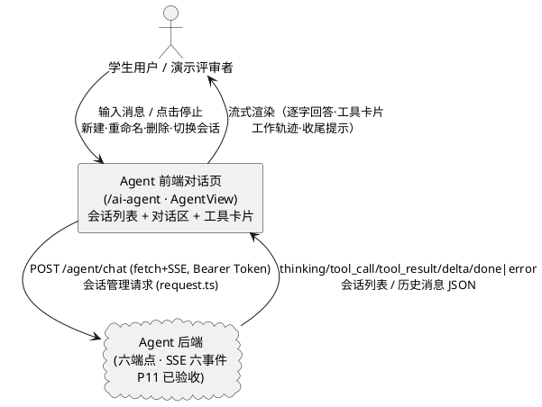
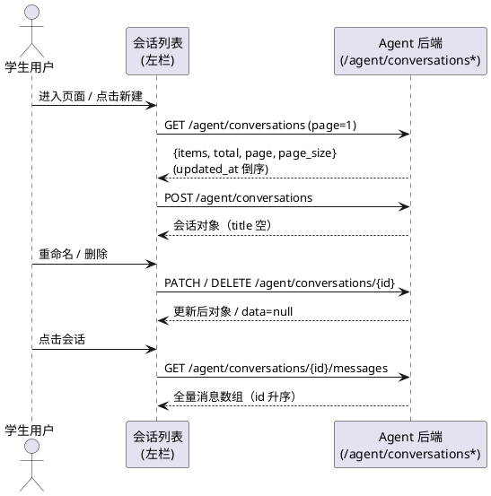
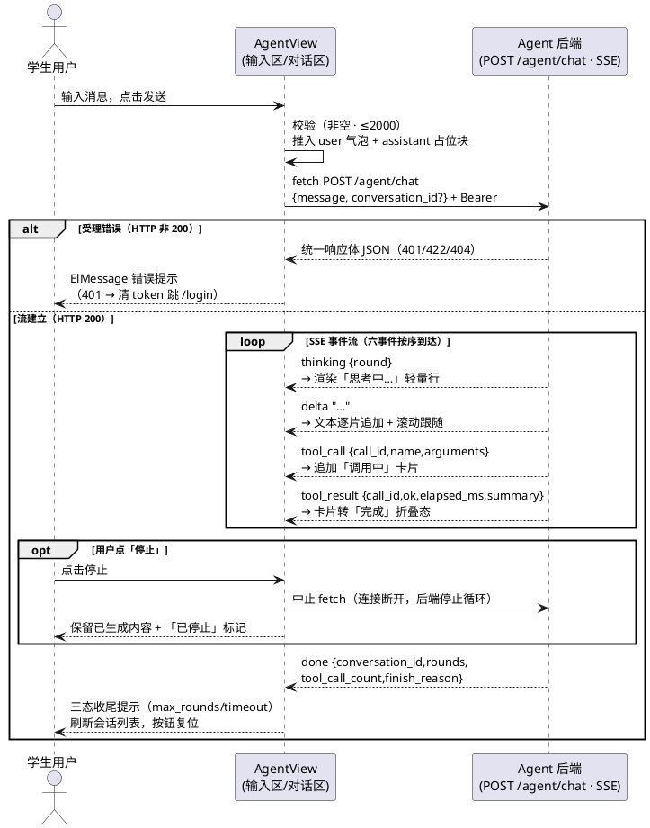

# Agent 前端对话页（AgentView）需求规格（SPEC_AGENT_FRONTEND）

| 项目 | 内容 |
|---|---|
| 所属项目 | 彭城智学 SmartLearn Agent |
| 阶段 | Agent 前端阶段（P11 后端验收通过后：pytest 153/153、工具层 76/76、真实 DeepSeek 冒烟通过） |
| 文档状态 | **R2（裁定定稿）**——8 项开放决策点已全部裁定（第 10 章：O1/O2/O4/O6/O7 按建议；O3 用户指定 4 个快捷问题；O5 增补轻提示反馈与停止按钮常驻要求；O8 采用弱化小字统计）；文档自 `.codeartsdoer/specs/agent_frontend/spec.md` 迁移至本路径（与 docs/designs/、docs/tasks/ 保持 SPEC_↔DESIGN_↔TASKS_ 对偶；`.codeartsdoer` 历史文档 P13 统一补齐，本阶段不动） |
| 上游依据 | `docs/specs/SPEC_AGENT_CHAT.md`（R3 定稿——**SSE 六事件契约 §5.6.2/§6.2 与六端点清单 §5.6.1 是本前端的需求来源**）、`docs/PROJECT_CONTEXT.md`（§7 前端约定、§5 响应体/错误码、§8 编码规范）、P9 既有交付（`src/api/chat.ts` 行缓冲 SSE 解析、`src/views/AskView.vue` 流式渲染/滚动跟随/历史回放模式、`src/types/index.ts` 可辨识联合事件类型）、P3 骨架路由（`/ai-agent` 已注册，AgentView.vue 现为占位组件） |
| 下游文档 | design.md（由 spec-design-agent 另行生成）、tasks.md（由 spec-task-agent 生成） |
| 验收方式 | `npm run build`（vue-tsc 类型检查 + vite 构建，P9 验收过的 build 链路）+ 本机走查清单（§8.3，映射任务书 6 点要求）+ 代码审查（组件拆分、P9 文件零改动） |

> **修订记录**：
> - **R1（初版）**：依据本阶段任务书与上游契约生成完整规格（599 行）；裁决 4 项冲突（第 9 章，含「P9 无 AbortController——停止生成为本阶段新增能力」的重要事实澄清）；提出 8 项开放决策点（第 10 章，均附建议倾向）。
> - **R2（裁定版）**：8 项决策全部裁定——O1/O2/O4/O6/O7 按建议；**O3 用户指定 4 个快捷问题**（「我最近学习怎么样」多工具分析 / 「我哪些知识点最薄弱」单工具 / 「我还有哪些任务没做完」任务查询 / 「帮我制定下周学习计划」能力边界——答辩必问，已补入 §5.1.1 规则 3 与 F13）；**O5 增补反馈要求**（生成中点击会话/新建必须弹轻提示「请先停止当前生成」，禁止静默无响应；「停止生成」按钮生成期间始终可见、位置固定，已改写 §5.2.1 规则 9）；**O8 采用弱化统计**（收尾提示旁小号灰字「N 轮 · M 次工具调用」，不做醒目 badge，已改写 §5.5.1 规则 4 与 §7.4 规则 3）。文档迁移至本路径（docs/specs/ 对偶惯例）。

> **需求句式约定**：第 5 章业务规则均采用 EARS 句式的中文等价表达——「当〈触发条件〉时，系统应〈系统响应〉」；无条件规则表述为「系统应〈始终成立的行为〉」。每条规则附验收条件（触发场景 → 预期行为），可直接转化为走查项。

> **范围总则（本阶段只做前端）**：本阶段交付 `src/views/AgentView.vue`（替换骨架占位）、`src/api/agent.ts`、`src/types/agent.ts` 及 Agent 子组件（拆分建议见第 6 章）。**后端零改动**——六端点全部就绪，前端仅作消费方；`/agent/chat` 受理错误（401/1003、422/1001、404/1005）走统一响应体 JSON 而非 SSE 流。禁止修改 P9 交付文件（chat.ts / AskView.vue / ask 子组件）与路由表结构。

> **复用总则**：SSE 解析直接复用 P9 chat.ts 模式——按 `\n\n` 切块、残包留 buffer、`TextDecoder stream:true`、忽略注释行、JSON 解析失败的脏块跳过不中断；仅事件类型由四种扩为六种（thinking/tool_call/tool_result/delta/done/error），解析算法不得另写一套。

---

# **1. 组件定位**

## **1.1 核心职责**

本组件负责消费 Agent 后端六端点与 SSE 六事件流，实现多轮会话对话界面、工具调用全过程可视化与会话管理，让评审者直观看到 Agent 的工作轨迹。

## **1.2 核心输入**

1. 用户输入的消息文本与发送/停止操作（来源：对话输入区，`message` 1..2000 字符）。
2. 会话管理操作指令（来源：左侧会话列表——新建 / 切换 / 重命名 / 删除）。
3. SSE 六事件流（来源：`POST /api/v1/agent/chat`，fetch + ReadableStream，六事件契约见上游 SPEC §5.6.2）。
4. 会话列表与历史消息数据（来源：`GET/POST /agent/conversations`、`GET/PATCH/DELETE /agent/conversations/{id}`、`GET /agent/conversations/{id}/messages` 全量）。
5. 认证 token（来源：Pinia user store / localStorage `smartlearn_token`）。

## **1.3 核心输出**

1. 流式渲染的对话界面：逐字出现的回答文本、每轮思考提示行、按序堆叠的工具调用卡片、finish_reason 差异化收尾提示。
2. 会话管理请求（来源：输入区与列表操作 → 六端点中的五个非流式端点，经 request.ts 统一封装）。
3. 中止信号（来源：停止按钮 → 中止进行中的 fetch 请求，已生成内容保留）。
4. 页面内的错误提示与操作反馈（ElMessage / ElMessageBox，中文可读）。

## **1.4 职责边界**

本组件**不负责**以下事项（防止职责蔓延）：

1. **不修改后端任何文件**：六端点、SSE 事件契约、会话/消息表结构均属 P11 已验收交付，前端只消费不重定义。
2. **不修改 P9 交付文件**：`chat.ts` / `AskView.vue` / `components/ask/*` / `request.ts` 零改动；SSE 解析以「模式复用 + 新文件」方式落地于 `agent.ts`。
3. **不承载 RAG 学习问答**：`/ask` 页（sources/无据警示/qa_history）与 `/ai-agent` 页分立，互不复用历史数据。
4. **不做「重新生成」**：上游 SPEC 仅预留语义（error 后 user 消息保留），本阶段不提供重新生成按钮。
5. **不做会话导出 / 分享 / 点赞 / 消息编辑删除**等增值功能。
6. **不在前端拼装或修改 Prompt**：System Prompt 属后端 `prompts.py` 单一事实来源。
7. **不做工具执行的容错补偿**：工具失败兜底（ok=false 卡片、非法工具名提示）如实展示服务端下发结果，前端不重试、不掩盖。

---

# **2. 领域术语**

**会话（conversation）**
: 用户维度的一组多轮对话容器（`agent_conversations` 一行），左侧列表的一行；按 `updated_at` 倒序排列；标题可空（空则显示「新会话」）。

**视图消息流（消息渲染序列）**
: 当前会话对话区的渲染单元序列，由「用户气泡 / assistant 块」组成；assistant 块内部按时间序包含：轮次思考行、工具调用卡片、流式文本段、收尾提示。

**工具调用卡片（ToolCallCard）**
: 一次工具调用的可视化单元，对应一个 `call_id`；三态——**调用中**（loading，「正在调用 name(args)…」）、**完成**（折叠卡：工具名 + 参数 + 耗时 + 结果摘要 ≤500 字，点击展开详情）、**失败**（`ok=false`，警示样式 + 中文错误说明）。多个卡片按到达顺序纵向堆叠形成「工作轨迹」。

**工作轨迹**
: 同一 assistant 块内多轮多工具卡片按实际发生顺序堆叠的视觉整体（如轮 1 两张卡 → 轮 2 一张卡 → 最终回答），是评审者观测 Agent 决策过程的核心载体。

**thinking 轮次提示行**
: 每个 `thinking` 事件到达时渲染的一行轻量提示（如「思考中…（第 N 轮）」）；禁止做成全屏或大面积 loading 遮罩，不得遮挡已出现的内容。

**finish_reason 收尾提示**
: `done` 事件五字段之一的三态展示规则——`normal` 无提示；`max_rounds` 显示「信息较多，已为你总结」；`timeout` 显示「处理时间较长，以下是已获取的部分」。禁止一律静默。

**停止生成**
: 流式期间用户点击「停止」按钮，前端中止 fetch 请求；服务端收到断开后停止主循环（后端 SPEC §5.1.3 场景 3 已保证）；已生成内容（文本 + 卡片）全部保留，附「已停止」轻量标记。

**行缓冲解析**
: P9 chat.ts 的 SSE 解析模式——`buffer += decoder.decode(value, { stream: true })`，循环按 `\n\n` 边界切出完整事件块，剩余半包留在 buffer 等待下一 chunk；一条 `data:` 行被网络分包切断的场景由「只在 `\n\n` 边界切分」结构性消除。

**受理错误 / 流内错误**
: 受理错误 = HTTP 非 200、SSE 流尚未开始（401/1003、422/1001、404/1005，统一响应体 JSON）；流内错误 = SSE `error` 终结事件（code=3000，LLM 失败/流中断）。二者提示渠道与处理路径不同。

**历史回放**
: 切换会话或刷新页面时，用 `GET /agent/conversations/{id}/messages` 的全量消息（user/assistant/tool 三种 role）重建视图消息流，把 `assistant(tool_calls)` + `tool` 消息对重新渲染成与实时对话**同样式**的折叠工具卡片。

**孤儿 tool 消息**
: 历史消息序列中 `tool_call_id` 无法关联到任何 `assistant.tool_calls[].id` 的 tool 消息（理论不可达——后端成对落库；前端回放须防御性兜底，不崩溃）。

---

# **3. 角色与边界**

## **3.1 核心角色**

- **学生用户**：登录后访问 `/ai-agent`，与 Agent 多轮对话、观察工具调用过程、管理会话（新建/重命名/删除/切换）；仅能看到本人会话（服务端过滤，前端无需也不得做二次权限逻辑）。
- **演示评审者（评委）**：答辩场景下在 `/ai-agent` 页观测「问学习状态 → Agent 自动连查多个工具 → 含具体数字的分析回答」的完整决策过程——工具卡片可见性与工作轨迹连续性是本页评分的核心依据（复用学生用户身份）。

## **3.2 外部系统**

- **Agent 后端六端点（P11 已验收交付）**：`POST /agent/chat`（SSE 六事件流）、`GET /agent/conversations`（分页 `{items,total,page,page_size}`，updated_at 倒序，page_size 默认 10 上限 100）、`POST /agent/conversations`（新建，title 可空）、`GET /agent/conversations/{id}`（详情）、`PATCH /agent/conversations/{id}`（重命名，title 1..200）、`DELETE /agent/conversations/{id}`（删除，级联消息）、`GET /agent/conversations/{id}/messages`（全量、id 升序）。
- **Pinia user store（token 供给）**：SSE fetch 请求头 `Authorization: Bearer <token>` 从 store 读取；401/1003 时复用 request.ts 的清 token 跳登录口径。
- **request.ts（Axios 统一通道）**：五个非流式会话管理端点走此通道（自动注入 token、`code===0` 解包、错误 ElMessage、401 清 token 跳转）。

## **3.3 交互上下文**

---

# **4. DFX 约束**

## **4.1 性能**

1. **真实流式渲染**：首条 `delta` 事件到达即渲染（不得等待 `done` 后整体显示）；后续 delta 逐条追加，视觉上逐字出现。
   a. 验收条件：本机真实对话录屏观察 → 回答随事件陆续出现，首字符显著早于收尾。
2. **滚动跟随**：流式输出期间对话区每次内容更新后自动滚动至最新内容（复用 P9 scrollToBottom 模式：`nextTick` 后置 scrollTop）。
   a. 验收条件：长回答生成过程中最新内容始终可见，无需手动滚动。
3. **卡片渲染轻量**：单次工具卡片状态迁移（调用中→完成）不产生可感知卡顿；50 条历史消息 + 10 张卡片的会话回放在 2 秒内完成渲染。
   a. 验收条件：切换到长会话 → 消息区完整渲染且页面可交互，总时长 ≤ 2 秒。
4. **会话列表加载**：进入页面 / 切换会话的接口等待期间显示 loading 态（骨架或 spinner），不白屏。
   a. 验收条件：弱网（DevTools 节流）下操作均有 loading 反馈。

## **4.2 可靠性**

1. **终态必达**：任何一条 SSE 请求的终结路径——`done`、`error`、用户停止、网络中断、受理失败——均必须使 UI 退出「生成中」状态（发送按钮复位为「发送」、输入区恢复可用）；禁止永久转圈。
   a. 验收条件：对上述五种路径逐一触发 → 按钮与输入区状态均正确复位。
2. **内容保留红线**：`error` / 停止 / 网络中断时，已到达的全部内容（文本片段 + 工具卡片 + 思考行）必须保留且不清空、不回滚。
   a. 验收条件：生成中途点停止 → 已出现文本与卡片完整保留；mock 流内错误（改错后端 LLM 配置）→ 同样保留。
3. **脏数据不崩溃**：SSE 脏块（JSON 解析失败）、历史消息中 arguments 解析失败、孤儿 tool 消息等异常数据，均须跳过或降级渲染，页面不崩溃、不白屏。
   a. 验收条件：构造含非法 JSON 的 SSE 块（DevTools 拦截改写或代码审查）→ 流不中断、后续事件正常消费。

## **4.3 安全性**

1. token 仅从 Pinia/localStorage（key=`smartlearn_token`）读取并注入请求头；禁止拼入 URL 参数、禁止日志打印 token。
   a. 验收条件：代码审查无 token 出现在 URL / console。
2. SSE fetch 收到 401 或 `code=1003` → 清除 token 并跳转 `/login`（复用 request.ts 的 `clearTokenAndRedirect` 单一实现，不复制第二份跳转逻辑）。
   a. 验收条件：token 过期后发送消息 → 自动登出并跳登录页。
3. 路由守卫：未登录访问 `/ai-agent` → 跳 `/login`（P3 既有守卫，`needsAuth: true` 已生效，零改动验证）。
   a. 验收条件：清 token 后直接访问 `/ai-agent` → 被重定向到 `/login`。

## **4.4 可维护性**

1. **类型集中**：Agent 相关类型定义于 `src/types/agent.ts`（任务书指定路径；与后端字段保持 snake_case，禁止大面积 `any`）；六事件类型用可辨识联合（discriminated union on `type`），事件与 finish_reason 字符串字面量与后端共用同一套（`thinking/tool_call/tool_result/delta/done/error`；`normal/max_rounds/timeout`）。
   a. 验收条件：vue-tsc 严格模式编译通过；类型文件与后端 SPEC §6.2 字段逐项对照一致。
2. **SSE 解析单一模式**：agent.ts 的流解析复用 P9 chat.ts 的行缓冲算法（按 `\n\n` 切块、残包留 buffer、TextDecoder stream:true、注释行忽略、脏块跳过），仅扩展事件分发表；**禁止另写一套不同算法**。
   a. 验收条件：代码审查——两文件解析骨架一致（差异仅事件类型数量与回调集）。
3. **常量锁定**：消息长度上限 2000、会话列表分页参数、finish_reason 提示文案等以具名常量集中定义并注释来源（「任务书/SPEC_AGENT_CHAT」），禁止散落魔法字符串。
   a. 验收条件：代码审查无散落硬编码文案。
4. **组件职责单一**：视图状态编排集中于 AgentView；卡片/列表/输入区子组件只做展示与事件上报（拆分建议见第 6 章）。
   a. 验收条件：子组件不含接口调用逻辑（api 调用仅在 AgentView 与 agent.ts）。

## **4.5 兼容性**

1. **P9 文件零改动**：`chat.ts` / `AskView.vue` / `components/ask/*` / `request.ts` / `types/index.ts` 中既有类型零改动（agent 类型新增独立文件）；git diff 审查为空。
   a. 验收条件：`git diff` 确认 P9 交付文件无变更。
2. **路由零改动**：`/ai-agent` 路由与 MainLayout 菜单项（「AI 助手」）已注册且激活正常，本阶段仅替换 AgentView.vue 内容；router/index.ts 与 MainLayout.vue 零改动（标题改名列为开放决策点 O7）。
   a. 验收条件：侧边栏点「AI 助手」进入本页且高亮正确。
3. **构建链路**：`npm run build`（vue-tsc + vite build）零错误通过——沿用 P9 验收标准。
   a. 验收条件：build 命令退出码 0，无 TS 报错。
4. **浏览器兼容**：fetch + ReadableStream + TextDecoder（Chrome/Edge 现代浏览器）；不支持流式时给出「当前浏览器不支持流式响应」提示（P9 同款兜底）。
   a. 验收条件：`resp.body` 为空时页面提示而非报错。

---

# **5. 核心能力**

## **5.1 页面布局与路由激活**

### **5.1.1 业务规则**

1. **布局规则**：系统应采用「左侧会话列表 + 右侧对话区」双栏布局——左栏为会话列表（含新建入口），右栏自上而下为消息滚动区与输入区；对话区高度自适应，滚动仅发生在消息区内部（复用 P9「页面不滚动、消息区内部滚动」约束，避免双滚动条）。
   a. 验收条件：进入 `/ai-agent` → 双栏结构正确；长会话时仅消息区出现滚动条。
2. **路由激活规则**：系统应在访问 `/ai-agent` 时渲染 AgentView 并保持侧边栏菜单项高亮（P3 既有 `default-active=route.path` 机制，零改动）。
   a. 验收条件：从任意页点击侧边栏「AI 助手」→ 进入本页且该项高亮。
3. **快捷问题按钮规则（O3 裁定，用户指定清单）**：系统应在空会话空态（含首次进入且无任何会话时）显示 4 个快捷问题按钮——「我最近学习怎么样」（多工具分析，最核心演示场景）、「我哪些知识点最薄弱」（掌握度单工具）、「我还有哪些任务没做完」（任务查询）、「帮我制定下周学习计划」（无对应工具时如实说明「后续版本提供」——答辩必问的能力边界演示）；点击即填入输入框并直接发送；空态本体用 el-empty + 引导文案（O2 裁定）；非空会话不显示按钮（避免干扰多轮语境）。
   a. 验收条件：空会话 → 4 个按钮可见可点且与 el-empty 空态共存；点击任一 → 直接触发对应对话；有消息的会话 → 按钮不显示。

### **5.1.2 交互流程**

并入 5.3.2 页面总时序图。

### **5.1.3 异常场景**

1. **浏览器不支持流式**
   a. 触发条件：`resp.body` 不可用（极老旧浏览器）。
   b. 系统行为：发送时提示「当前浏览器不支持流式响应」，不发起后续读取。
   c. 用户感知：一次性提示，页面不崩溃。

## **5.2 会话列表管理（左栏）**

### **5.2.1 业务规则**

1. **列表加载规则**：系统应在进入页面时拉取会话列表（`GET /agent/conversations`，page=1，page_size 取 20~50 内固定值），按服务端返回顺序（updated_at 倒序）渲染；拉取失败仅弹错、保留空列表态，页面可用。
   a. 验收条件：有多个会话时 → 最近活跃的排最前；接口失败 → ElMessage 提示且页面仍可新建会话。
2. **排序保持规则**：系统应使列表顺序与 `updated_at` 倒序一致——新会话与刚续聊的会话出现在列表顶部。
   a. 验收条件：在会话 B 发消息完成后 → B 升至列表首位。
3. **新建规则**：当用户点击「新建会话」时，系统应调用 `POST /agent/conversations`（title 不传或传空）创建空会话，插入列表顶部并置为当前会话，右侧切换为空对话区。
   a. 验收条件：点击新建 → 列表顶部出现新行（标题显示「新会话」）、对话区清空为空态、后续发送携带该会话 id。
4. **空标题显示规则**：当会话 `title` 为空或缺失时，系统应在列表行显示「新会话」占位文本（服务端会在首条消息后自动补 20 字截断标题，前端刷新后如实显示）。
   a. 验收条件：显式新建未发消息的会话 → 显示「新会话」；发送首条消息并刷新列表 → 显示消息前缀标题。
5. **重命名规则**：当用户对某会话发起重命名时，系统应提供输入弹窗（预填当前标题），提交后调用 `PATCH /agent/conversations/{id}`（title 1..200），成功后更新列表行与（若为当前会话）对话区标题；空标题或超长提交被禁用并提示。
   a. 验收条件：重命名后列表即时显示新标题；输入超 200 字 → 无法提交且有提示。
6. **删除规则**：当用户删除某会话时，系统应先弹确认框（提示「删除后不可恢复，将同时删除会话内全部消息」），确认后调用 `DELETE /agent/conversations/{id}` 并从列表移除。
   a. 验收条件：删除非当前会话 → 仅列表移除；删除当前会话 → 列表移除且右侧切到剩余首个会话（无会话时切空态）；取消确认 → 无请求无变更。
7. **当前会话高亮规则**：系统应对当前会话的列表行施加高亮样式（选中态背景/边框），点击其他行即切换。
   a. 验收条件：切换会话后高亮跟随移动。
8. **切换加载规则**：当用户点击某会话时，系统应调用 `GET /agent/conversations/{id}/messages` 拉取全量消息并按 5.6 还原算法渲染；加载期间显示 loading，失败弹错并保留原会话视图。
   a. 验收条件：点击含工具调用的历史会话 → 工具卡片以折叠态完整重现（见 5.6）。
9. **生成中切换约束（O5 裁定 + 反馈要求）**：当处于流式生成中时，系统应禁止切换会话与新建——点击会话列表项或「新建会话」时弹出轻提示「请先停止当前生成」（ElMessage info 级，**禁止静默无响应**——静默会让用户以为界面卡死）；同时「停止生成」按钮在生成期间**始终可见、位置固定**（发送按钮原位切换为停止，不随滚动或内容增长移动或消失），保证用户随时可一键停止；停止后列表操作恢复可用。
   a. 验收条件：生成中点击其他会话/新建 → 出现「请先停止当前生成」轻提示且无切换发生；生成全程停止按钮固定可见可点；停止后可正常切换与新建。
10. **列表刷新时机规则**：当一次对话请求终结（done / error / 用户停止）后，系统应刷新会话列表以反映 updated_at 变化与新会话插入。
    a. 验收条件：新会话首次对话 done 后 → 列表出现该会话且排序正确（无需手动刷新页面）。

### **5.2.2 交互流程**

### **5.2.3 异常场景**

1. **会话不存在 / 越权（404/1005）**
   a. 触发条件：列表数据过期后点击已被删除的会话（或会话属他人——理论不可达）。
   b. 系统行为：request.ts 拦截器统一弹错；从列表移除该行或提示刷新。
   c. 用户感知：中文「资源不存在」提示，页面不崩溃。
2. **重命名入参非法（422/1001）**
   a. 触发条件：空标题或超 200 字提交。
   b. 系统行为：前端提交前拦截（按钮禁用 + 计数提示）；后端 422 由拦截器弹错。
   c. 用户感知：无法提交无效标题，提示具体原因。
3. **列表接口失败**
   a. 触发条件：网络异常或服务不可用。
   b. 系统行为：ElMessage 错误提示，列表保持空态，新建/重试可用。
   c. 用户感知：错误提示后仍可操作页面。

## **5.3 消息发送与 SSE 六事件消费状态机**

### **5.3.1 业务规则**

1. **发送校验规则**：系统应在发送前校验——消息去首尾空白后非空、长度 ≤ 2000 字符（前端独立常量，与后端 O6 裁定同值）；空消息禁发；超限禁发并提示「消息不能超过 2000 字」；输入区提供剩余字数提示。
   a. 验收条件：输入空白 → 发送禁用；粘贴 2001 字 → 发送禁用且有计数提示；正常消息可发。
2. **请求构造规则**：当用户发送消息时，系统应以 `POST /agent/chat` 发起 fetch（Bearer token 注入请求头），请求体 `{message, conversation_id?}`——当前存在会话则携带其 id；无会话（空态直发，若 O2 裁定支持）则不携带。
   a. 验收条件：网络面板观测请求体字段与上送会话 id 正确。
3. **受理错误处理规则**：当 fetch 返回 HTTP 非 200（流未开始）时，系统应解析统一响应体并按口径处理——401 或 code=1003 → 清 token 跳 `/login`；422/1001、404/1005 → ElMessage 中文提示；随后本次请求终止、按钮复位。
   a. 验收条件：token 过期发送 → 跳登录页；会话被删后（另一端删除）发送 → 提示「资源不存在」类文案。
4. **六事件分发规则**：当 SSE 事件到达时，系统应按 `type` 分发到对应处理（见 5.3.1 规则 5-10 与 §5.4/§5.5 的渲染规则）；未知 `type` 静默忽略不报错（前向兼容）。
   a. 验收条件：向流中注入 `type:"foo"` 脏事件（代码审查/调试）→ 其余事件处理不受影响。
5. **thinking 事件规则**：当 `thinking` 事件到达时，系统应在当前 assistant 块内渲染一行轻量轮次提示（「思考中…」样式，可含轮次序号）；同一请求内第 N 个 thinking 到达时，前一轮提示收敛为已完成态（或保留但弱化），新提示出现——**禁止全屏遮罩、禁止遮挡已出现内容**。若事件携带 `content`（推理模型增量），附加为该行浅色小字。
   a. 验收条件：多轮对话中每轮出现一次提示行且轮次递增；已渲染的文本与卡片不被遮挡或清空。
6. **delta 事件规则**：当 `delta` 事件到达时，系统应把文本分片追加到当前 assistant 块的文本渲染目标并触发滚动跟随（中间轮解释性文本与最终回答同通道渲染，按到达顺序拼接）。
   a. 验收条件：回答逐字/逐片出现；`curl -N` 与页面录屏对照分片顺序一致。
7. **tool_call 事件规则**：当 `tool_call` 事件到达时，系统应在当前 assistant 块内、按到达顺序追加一张「调用中」工具卡片（展示 `name` 与格式化 `arguments`，见 §5.4 规则 1）。
   a. 验收条件：卡片以 loading 态出现，位置在已渲染文本之后、按序堆叠。
8. **tool_result 事件规则**：当 `tool_result` 事件到达时，系统应按 `call_id` 找到对应调用中卡片并迁移为「完成」态（填入耗时、摘要、成功/失败样式，见 §5.4 规则 2-4）；找不到对应卡片时（理论不可达）降级为独立完成态卡片。
   a. 验收条件：每个 tool_call 卡片恰被其 tool_result 填充；无残留的永久 loading 卡片。
9. **done 事件规则**：当 `done` 事件到达时，系统应——①把 assistant 块置为完成态（停止流式光标）；②按 `finish_reason` 三态渲染收尾提示（见 §5.5 规则 2）；③记录 `conversation_id`（新会话场景刷新列表并绑定当前会话）；④按钮复位、输入恢复。
   a. 验收条件：done 后界面无残留流式态；新会话场景列表出现该会话且后续发送携带正确 id。
10. **error 事件规则**：当 `error` 终结事件到达时，系统应在保留全部已生成内容的前提下，于 assistant 块末尾附加错误提示行（红色警示样式 + `message` 中文文案）；按钮复位。
    a. 验收条件：流内错误后已渲染内容仍在，其后出现错误提示行。
11. **停止生成规则**：当流式期间用户点击「停止」时，系统应立即中止 fetch 请求（中止信号透传至流读取）、保留已生成的全部内容、在 assistant 块末尾附加「已停止生成」轻量标记（非错误样式）、按钮复位为「发送」。
    a. 验收条件：生成中途点停止 → 网络请求状态变为 canceled；已出现文本与卡片保留；出现「已停止」标记；可立即再次发送。
12. **按钮状态规则**：当处于流式生成中时，系统应把发送按钮变为「停止」按钮（警示色），输入区可输入但发送动作被停止动作替代；生成期间禁止重复发起请求。
    a. 验收条件：生成中按钮显示「停止」；点击它不发送新消息而是中止当前流。
13. **网络中断规则**：当流读取抛错或流自然耗尽而无终结事件时（服务端异常关闭），系统应合成「网络中断，请重试」错误提示并按 error 事件规则处理（保留已生成内容）。
    a. 验收条件：DevTools 断网模拟 → 已有内容保留 + 中断提示 + 按钮复位。
14. **终态复位规则**：系统应保证 done / error / 停止 / 网络中断 / 受理失败五条终结路径全部使页面退出「生成中」态（§4.2 规则 1 的规则化表达）。
    a. 验收条件：五路径逐一触发 → `streaming` 状态复位、按钮与输入区恢复。

### **5.3.2 交互流程（页面总时序与 UI 状态机）**

**UI 状态机（每事件到达时的状态迁移表）**：

| 当前态 | 到达事件 / 用户动作 | 迁移后态 | UI 表现 |
|---|---|---|---|
| 空闲 | 点击发送（校验通过） | 生成中·轮 0 | user 气泡入列；assistant 占位块入列；按钮变「停止」 |
| 生成中·轮 N | `thinking`（round=N+1） | 生成中·轮 N+1 | 新增/刷新「思考中…」轻量行；前轮提示弱化 |
| 生成中·轮 N | `delta` | 生成中·轮 N | 文本追加渲染 + 滚动跟随 |
| 生成中·轮 N | `tool_call` | 生成中·轮 N | 块内追加「调用中」卡片（loading） |
| 生成中·轮 N | `tool_result` | 生成中·轮 N | 按 call_id 配对卡片 → 「完成」折叠态 |
| 生成中·任意轮 | `done` | 空闲 | 流式光标消失；finish_reason 三态提示；列表刷新；按钮复位 |
| 生成中·任意轮 | `error` | 空闲 | 内容保留 + 错误提示行；按钮复位 |
| 生成中·任意轮 | 点击「停止」 | 空闲 | fetch 中止；内容保留 + 「已停止」标记；按钮复位 |
| 生成中·任意轮 | 流断开/耗尽 | 空闲 | 内容保留 + 「网络中断，请重试」；按钮复位 |
| 空闲 | 发送时 HTTP 非 200 | 空闲 | ElMessage 提示（401 跳登录）；assistant 占位块显示错误态 |

### **5.3.3 异常场景**

1. **会话被并发删除（受理 404）**
   a. 触发条件：另一端删除了当前会话后继续发送。
   b. 系统行为：ElMessage 提示资源不存在；建议用户新建会话（提示文案引导）。
   c. 用户感知：明确错误提示，可新建会话继续使用。
2. **停止后服务端落库不一致的回放差异**
   a. 触发条件：停止生成后刷新页面——服务端已落库 user 消息与已成对的 assistant(tool_calls)+tool 消息，但半截 assistant 文本不落库。
   b. 系统行为：回放按服务端实际数据如实还原（可能显示 user 消息后无/不完整 assistant 回复）。
   c. 用户感知：回放内容与停止时看到的可能有差异——这是后端语义（半截不落库），前端不做补偿渲染。
3. **快速连发（停止后立即再发）**
   a. 触发条件：停止后立即发送新消息。
   b. 系统行为：按新请求正常处理（携带同一会话 id 续聊）；前一次的已停止块保持不动。
   c. 用户感知：新消息正常生成，历史块不受影响。

## **5.4 工具调用卡片可视化（ToolCallCard）**

> 本模块是评审核心——「多轮对话、工具调用等核心机制是否完整有效」的直接可视化载体。

### **5.4.1 业务规则**

1. **调用中态规则**：当 `tool_call` 事件到达且对应 `tool_result` 未到时，系统应渲染 loading 态卡片，显示「正在调用 `name(args)`…」——args 为 `arguments` 对象的 `key=value` 逗号连接（如 `get_learning_statistics(days=14)`）；值为长字符串时截断显示（超 20 字符截断加省略号）。
   a. 验收条件：真实对话触发工具调用 → 出现「正在调用 get_learning_statistics(days=14)…」样式文案与 loading 指示。
2. **完成态折叠规则**：当 `tool_result` 事件到达后，系统应把卡片收敛为折叠态，折叠摘要行显示——工具名（等宽字体）、参数（同规则 1 格式）、耗时（`elapsed_ms` 毫秒，如「8ms」）、成功/失败图标、结果摘要（`summary`，≤500 字，截断时尾部显示「…（已截断）」标记）。
   a. 验收条件：工具完成后卡片折叠为一行摘要；耗时与摘要可见；`truncated=true` 的场景出现截断标记。
3. **默认折叠与展开规则**：系统应使卡片**默认折叠**；点击卡片头部切换展开/折叠；展开态显示——参数完整键值对 + 摘要全文（实时对话）或完整结果 JSON 格式化展示（历史回放，见 5.6 规则 4）；再次点击收回。
   a. 验收条件：工具完成即折叠；点击展开可见详情；再点折叠。
4. **失败态规则**：当 `tool_result.ok=false` 时，系统应以警示样式（如橙色/红色边框与图标）渲染卡片，摘要行显示服务端下发的中文错误说明（如「该工具不可用」、参数校验错误文案）。
   a. 验收条件：mock 参数非法调用 → 失败卡片警示样式 + 中文错误说明；对话不中断。
5. **堆叠顺序规则**：系统应按事件到达顺序纵向堆叠同一 assistant 块内的全部卡片（同轮多工具依序、跨轮依序），形成从上到下的「工作轨迹」；卡片间留紧凑间距，轨迹整体位于对应轮次思考行之后、文本流之内。
   a. 验收条件：问「我最近学习怎么样」（真实场景连调 ≥3 工具）→ ≥3 张卡片按调用顺序堆叠，一眼可读出工作轨迹。
6. **配对完整性规则**：系统应保证每个 `tool_call` 卡片恰被同 `call_id` 的 `tool_result` 填充一次；`call_id` 不匹配的 tool_result 降级为独立完成态卡片（不丢弃、不崩溃）。
   a. 验收条件：全流程无永久 loading 卡片；无重复填充。
7. **耗时展示规则**：系统应在折叠摘要行显示 `elapsed_ms`（如「8ms」「1.2s」，毫秒 <1000 显示 ms、≥1000 显示 s 保留一位小数）。
   a. 验收条件：卡片摘要行含耗时且格式正确。
8. **参数渲染容错规则**：当 `arguments` 为空对象时显示 `name()`（括号留空）；`arguments` 渲染不得抛错（对象/字符串两种形态均可渲染——历史回放的落库形态见 5.6 规则 3）。
   a. 验收条件：无参工具调用卡片显示 `name()`；脏 arguments 不崩溃。

### **5.4.2 交互流程**

并入 5.3.2 总时序图（tool_call → 调用中卡片 → tool_result → 折叠卡片的迁移已内嵌）。

### **5.4.3 异常场景**

1. **非法工具名卡片**
   a. 触发条件：LLM 幻觉工具名（后端照推 `tool_call`，`tool_result.ok=false`）。
   b. 系统行为：卡片如实显示该名称，tool_result 到达后按失败态渲染「该工具不可用」。
   c. 用户感知：一张失败卡片，对话继续至最终回答（真实冒烟已验证后端行为）。
2. **大结果摘要截断**
   a. 触发条件：工具返回 100 条学习记录等大 JSON。
   b. 系统行为：卡片摘要显示服务端截断后的 ≤500 字 + 「（已截断）」标记；前端不做二次截断。
   c. 用户感知：折叠卡摘要可读，展开后内容与下发一致。

## **5.5 thinking 轮次信号与 finish_reason 三态收尾**

### **5.5.1 业务规则**

1. **轻量思考行规则**：当每个 `thinking` 事件到达时，系统应在 assistant 块内渲染一行轻量提示（文案如「思考中…」，可带轮次「（第 N 轮）」）；样式为小字号浅灰色单行——**禁止大面积 loading 遮罩、禁止清空或遮挡已渲染内容**；该轮结束时提示行保持弱化态（不删除，保留轨迹可读性）。
   a. 验收条件：连续多轮对话中每轮出现一次轻量行；已出现的文本/卡片不被遮挡、位移或清空；页面无全屏遮罩。
2. **finish_reason 三态规则**：当 `done` 事件到达时，系统应按 `finish_reason` 差异化收尾——`normal` → 无附加提示；`max_rounds` → 回答末尾显示「信息较多，已为你总结」；`timeout` → 显示「处理时间较长，以下是已获取的部分」；提示样式为轻量信息条（非弹窗、非错误红色）。**禁止三态一律静默或一律同文案**。
   a. 验收条件：代码审查三分支文案映射齐全（常量集中定义）；本机构造超长任务或后端 mock 观测 max_rounds/timeout 分支渲染；normal 场景无提示行。
3. **轮次提示与遮罩禁止项**：系统在生成期间**禁止**使用任何覆盖对话区的 overlay/loading 遮罩组件（含 Element Plus `v-loading` 全屏指令）；等待反馈一律内联于 assistant 块。
   a. 验收条件：生成全程对话区可见且可向上滚动查看历史内容。
4. **done 统计消费与弱化展示规则（O8 裁定）**：系统应将 `done.data.conversation_id` 用于会话绑定；并在收尾提示旁（assistant 块末尾）以**小号灰字弱化样式**展示运行统计——「{rounds} 轮 · {tool_call_count} 次工具调用」（如「2 轮 · 4 次工具调用」）；**禁止做成醒目 badge / 彩色标签**（否则看起来像调试信息而非产品功能）；normal 场景同样展示该小字统计（与 finish_reason 提示的 normal 静默差异互不冲突——统计恒显、提示分态）；`message_id=null` 时无「已保存」类状态展示（对齐 P9）。
   a. 验收条件：任一 done 后 assistant 块末尾出现小号灰字统计且数值与实际一致（V1 场景显示「2 轮 · N 次工具调用」级数据）；样式弱化（与正文有明显色阶差、无底色块）；normal 场景统计仍显示但无收尾提示行；新会话首条对话 done 后列表正确出现新会话并可续聊。

### **5.5.2 交互流程**

并入 5.3.2（thinking 行与 done 收尾的迁移已内嵌）。

### **5.5.3 异常场景**

1. **thinking 重复到达（防御）**
   a. 触发条件：异常流内同一轮次 thinking 重复（理论不可达——后端每轮恰 1 次）。
   b. 系统行为：重复事件渲染为新的轻量行（不做去重复杂逻辑），不崩溃。
   c. 用户感知：多一行弱化提示，无功能影响。

## **5.6 历史消息回放（agent_messages → 视图还原算法）**

### **5.6.1 业务规则**

1. **全量拉取规则**：当切换会话或刷新页面恢复当前会话时，系统应调用 `GET /agent/conversations/{id}/messages`（全量、id 升序）拉取消息并按下列算法还原视图消息流。
   a. 验收条件：刷新页面 → 当前会话消息完整重现（含工具卡片）。
2. **消息映射规则（还原算法主干）**：系统应按 id 升序逐条映射——
   - `role=user` → 用户气泡（content 原文）；
   - `role=assistant` 且 `tool_calls` 非空 → 一个 assistant 块：先渲染 content 文本段（若非空——中间轮解释性文本），再为 `tool_calls` 数组每个元素生成一张**完成态折叠**工具卡片（`call_id`=元素 `id`、`name`、`arguments` 解析后渲染）；
   - `role=assistant` 且 `tool_calls` 为空 → 最终回答气泡（content 全文）；
   - `role=tool` → 按 `tool_call_id` 匹配前述卡片，填充结果（content 为完整结果 JSON 字符串，解析后作为展开详情）。
   a. 验收条件：含 3 工具调用的历史会话 → 回放出现 3 张折叠卡片 + 最终回答，顺序与原始对话时序一致。
3. **arguments 解析容错规则**：当历史消息 `tool_calls[].arguments` 为 JSON 字符串（OpenAI 原始格式）时，系统应先解析为对象再渲染；解析失败时以原始字符串降级显示。
   a. 验收条件：历史回放卡片参数渲染与实时对话一致（同一格式化规则）。
4. **完整结果格式化规则**：当展开历史回放的工具卡片时，系统应把 `tool` 消息 `content`（完整结果 JSON 字符串）格式化（缩进美化）展示于详情区；解析失败时降级为原始文本展示。
   a. 验收条件：展开历史卡片 → 结构化 JSON 可读展示；脏数据降级不崩溃。
5. **耗时缺失规则**：当历史回放渲染卡片时，因 `agent_messages` 无耗时字段，系统应省略耗时显示（折叠摘要行不显示耗时项或显示「—」），其余样式与实时对话卡片**完全一致**（同一组件渲染）。
   a. 验收条件：历史卡片与实时卡片视觉一致，仅缺耗时项。
6. **孤儿 tool 消息兜底规则**：当 `tool` 消息的 `tool_call_id` 无法匹配任何卡片时（理论不可达），系统应跳过该消息不渲染（不崩溃、不产生空卡片）。
   a. 验收条件：构造孤儿消息数据 → 回放正常完成且无异常块。
7. **回放完成态规则**：系统应使历史回放的 assistant 块一律为完成态（无流式光标、无「思考中」提示行——思考行属实时流信号，不落库不回放；工具卡片一律折叠态）。
   a. 验收条件：回放后无任何 loading/流式残留态。
8. **页面刷新恢复规则**：当页面刷新时，系统应恢复会话列表并自动选中最近活跃会话（列表第一项）回放其消息；无任何会话时显示空态。
   a. 验收条件：对话中途刷新 → 回到本页后最近会话已选中且消息完整。

### **5.6.2 交互流程**

并入 5.2.2（会话切换 → messages 端点 → 还原渲染）。

### **5.6.3 异常场景**

1. **历史接口失败**
   a. 触发条件：messages 端点请求失败。
   b. 系统行为：ElMessage 提示，保留当前视图（或空态），会话列表可用。
   c. 用户感知：错误提示后可重试切换。
2. **超长会话回放**
   a. 触发条件：单会话消息极多（受后端 6 轮上限约束，量级可控）。
   b. 系统行为：全量一次性渲染（不虚拟滚动——量级不支持该复杂度）。
   c. 用户感知：2 秒内完成渲染（§4.1 规则 3）。

## **5.7 鉴权与异常处理汇总**

### **5.7.1 业务规则**

1. **页面鉴权规则**：系统应使 `/ai-agent` 路由受全局守卫保护（`needsAuth: true`，P3 既有）——未登录访问跳 `/login`（带 redirect 回跳参数）。
   a. 验收条件：清 token 直接访问 → 跳登录；登录后回跳 `/ai-agent`。
2. **SSE 通道鉴权规则**：系统应在 fetch 请求头注入 `Authorization: Bearer <token>`；受理 401 或 code=1003 → 清 token 跳 `/login`（复用 request.ts `clearTokenAndRedirect`，不另写跳转）。
   a. 验收条件：过期 token 发送 → 跳登录页。
3. **非流式通道规则**：系统应使五个会话管理端点全部经 request.ts（Axios）通道——token 注入、code 解包、错误 ElMessage、401 处理由拦截器统一完成，视图层不重复实现。
   a. 验收条件：代码审查会话管理调用均走 request 实例。
4. **错误分层规则**：系统应区分三层错误并差异化呈现——①受理错误（HTTP 非 200）：ElMessage 全局提示；②流内 error 事件：assistant 块内错误行 + 内容保留；③网络中断：合成「网络中断，请重试」错误行 + 内容保留。三层均不清空已生成内容、不崩溃。
   a. 验收条件：三层逐一触发（过期 token / 后端 LLM 配置错误 / 断网）→ 表现各自正确。

### **5.7.2 交互流程 / 5.7.3 异常场景**

并入 5.3.2 / 5.3.3（发送链路全部异常已覆盖）。

---

# **6. 组件拆分与交付文件清单（建议）**

> 本章为**结构建议**（用户任务书明确要求列出），具体文件内聚、props/emits 契约属 design.md 细化范围；最终粒度受 O1 裁定。

| 文件 | 职责 | 拆分理由 |
|---|---|---|
| `src/views/AgentView.vue` | 主页面：双栏布局、会话/消息视图状态编排、SSE 回调分发、历史还原调度 | 页面级唯一入口，路由既有 |
| `src/components/agent/ToolCallCard.vue` | 工具调用卡片（调用中/完成/失败三态、折叠展开、参数格式化、耗时/摘要/截断标记、详情 JSON 格式化） | **独立文件（强烈建议）**：实时流与历史回放共用同一组件保证样式一致（§5.6 规则 5）；本页最高频复用单元 |
| `src/components/agent/ConversationList.vue` | 会话列表（倒序渲染、当前高亮、新建/重命名/删除操作入口与确认弹窗、空标题「新会话」） | 左栏独立交互域，与对话区解耦 |
| `src/components/agent/MessageItem.vue` | 消息渲染单元（user 气泡 / assistant 块：思考行 + 卡片容器 + 文本 + 收尾提示） | 对齐 P9 MessageBubble 模式 |
| `src/components/agent/AgentComposer.vue` | 输入区（textarea + 字数计数 + 发送/停止按钮切换 + 禁用逻辑） | 对齐 P9 AskComposer 模式 |
| `src/api/agent.ts` | SSE 客户端（六事件分发、行缓冲解析复用 P9 模式、中止信号透传、受理错误处理）+ 五个会话管理 API 函数 | 流式与非流式通道分离（§7.3 约定） |
| `src/types/agent.ts` | 六事件可辨识联合、finish_reason 枚举、会话/消息/分页类型、视图消息类型 | 任务书指定路径；类型集中约定 |

**交付物范围**：以上 7 个文件（1 改 6 新增——AgentView.vue 为替换骨架内容）。router/index.ts、MainLayout.vue、request.ts、chat.ts 及 ask 组件**零改动**。

---

# **7. 数据约束**

> 本章定义前端消费的数据逻辑约束；字段与上游 SPEC_AGENT_CHAT §6.2/§6.5 及 PROJECT_CONTEXT §5/§6.13/6.14 对齐（snake_case 传输）。

## **7.1 发送入参（前端侧）**

1. **message**：非空（去首尾空白判定）；长度 1..2000 字符；前端以独立常量锁定并做发送前拦截（与后端 O6 裁定同值同义——问答 500 上限不适用于本页）。
2. **conversation_id**：可选正整数；当前会话存在时必带；不带则由后端自动新建（done.conversation_id 回填绑定）。

## **7.2 SSE 事件载荷（前端消费约束）**

1. **type**：枚举六值 `thinking / tool_call / tool_result / delta / done / error`；未知值忽略不报错。
2. **thinking.data**：`{round: int(≥1), content?: str}`；`round` 用于轮次提示递增；`content` 可选（推理模型增量，浅色附加展示）。
3. **tool_call.data**：`{call_id: str, name: str, arguments: object}`——arguments 已是解析后对象（非字符串）；非法工具名照常渲染卡片。
4. **tool_result.data**：`{call_id: str, name: str, ok: bool, elapsed_ms: int, summary: str(≤500), truncated: bool}`；`call_id` 与对应 tool_call 一一配对；`truncated=true` 时展示截断标记。
5. **delta.data**：文本分片 str；按到达顺序直接拼接渲染，禁止重排/缓冲整段。
6. **done.data**：五字段 `{conversation_id: int, message_id: int|null, rounds: int, tool_call_count: int, finish_reason: 'normal'|'max_rounds'|'timeout'}`——前端至少消费 `conversation_id` 与 `finish_reason`；`message_id=null` 时无「已保存」类状态展示（对齐 P9）。
7. **error.data**：`{code: int, message: str}`——本阶段 code 仅 3000；message 中文可读直接展示。

## **7.3 会话与消息（REST 响应侧）**

1. **会话对象**：`{id: int, title: str|null, created_at, updated_at}`；`title` 空或 null → 列表显示「新会话」；排序以服务端为准（updated_at 倒序）。
2. **列表分页**：`{items: 会话[], total, page, page_size}`；前端首屏单页拉取（page_size 固定常量 ≤100，倾向 50）；`total` 仅用于「是否还有更多」判断（是否加载更多见 O4）。
3. **消息对象**：`{id, conversation_id, role: 'user'|'assistant'|'tool', content, tool_name: str|null, tool_calls: OpenAI 格式 JSON|null, tool_call_id: str|null, created_at}`；`tool_calls[].arguments` 可能为 JSON 字符串（OpenAI 原始格式）——回放解析须容错（§5.6 规则 3）；tool 消息 `content` 为完整结果 JSON 字符串。
4. **role 枚举**：仅 `user / assistant / tool` 三种（system 不落库不回放）。

## **7.4 视图渲染约束**

1. **消息长度提示**：输入区显示当前字数与上限（如「1234 / 2000」）；达上限时发送禁用。
2. **卡片摘要展示**：实时卡片摘要 = 服务端 `summary` 原文（≤500 字，前端不二次截断）；历史卡片展开详情 = 完整结果 JSON 格式化（可能远超 500 字，属用户主动展开行为）。
3. **收尾提示文案**：三条固定文案以常量集中定义——`max_rounds` → 「信息较多，已为你总结」；`timeout` → 「处理时间较长，以下是已获取的部分」；`normal` → 无；三态均附加弱化统计小字「{rounds} 轮 · {tool_call_count} 次工具调用」（O8 裁定，小号灰字、无 badge）。
4. **思考行文案**：固定常量（如「思考中…」+ 可选轮次后缀），禁止随轮次变化产生不同文案模板。

---

# **8. 验收标准（可量化，映射任务书 6 点要求）**

## **8.1 验收项**

| # | 验收项 | 判定标准（可观测） | 任务书映射 | 验证方式 |
|---|---|---|---|---|
| F1 | 工具调用卡片可见 | 真实对话「我最近学习怎么样」→ 连调 ≥3 工具，卡片按调用顺序堆叠成工作轨迹；调用中显示「正在调用 get_learning_statistics(days=14)…」；完成后折叠显示工具名/参数/耗时（如 8ms）/摘要 | 要求 1 | 本机走查 + 录屏 |
| F2 | 卡片折叠交互 | 卡片默认折叠；点击展开详情（实时=摘要全文，历史=格式化 JSON）；再点折叠 | 要求 1（点击展开） | 本机走查 |
| F3 | thinking 轻量信号 | 每轮出现一行「思考中…」提示且轮次递增；无全屏/大面积遮罩；已出现内容不被遮挡、清空或位移 | 要求 2 | 本机走查（多轮对话）+ 代码审查无 overlay |
| F4 | finish_reason 三态 + 弱化统计 | normal → 无提示；max_rounds → 「信息较多，已为你总结」；timeout → 「处理时间较长，以下是已获取的部分」；三态均附小号灰字「{rounds} 轮 · {tool_call_count} 次工具调用」（O8 裁定）且样式弱化无 badge；三分支文案常量集中、映射齐全、禁止一律静默 | 要求 3 + O8 | 代码审查三分支 + 本机构造触发（复杂长任务/mock） |
| F5 | 会话列表 | updated_at 倒序；支持新建（POST）/重命名（PATCH+弹窗）/删除（DELETE+确认框）；当前会话高亮；空标题显示「新会话」；续聊后会话升至首位；生成中点击会话/新建 → 「请先停止当前生成」轻提示且不切换（O5 裁定） | 要求 4 + O5 | 本机走查全操作矩阵 |
| F6 | 流式渲染 + 停止 | 回答逐字出现（首条 delta 即渲染）；生成中按钮变「停止」且**始终可见、位置固定**（O5 裁定）；点击后请求中止（网络面板 canceled）、已生成内容与卡片全部保留、出现「已停止」标记、按钮复位、可立即再发 | 要求 5 + O5 | 本机走查 + DevTools 网络面板 |
| F7 | SSE 解析复用 | agent.ts 解析骨架与 chat.ts 一致（\n\n 切块、残包 buffer、TextDecoder stream:true、脏块跳过）；仅事件类型扩为六种 | 要求 6 | 代码审查逐项比对 |
| F8 | 历史回放 | 刷新/切换会话 → assistant(tool_calls)+tool 消息重建为与实时对话同样式的折叠卡片；参数容错解析；孤儿 tool 消息不崩溃；无耗时项但样式一致 | 历史回放（补充项） | 本机走查（先真实对话再刷新） |
| F9 | 鉴权 | 未登录访问 /ai-agent 跳 /login（带 redirect）；SSE 受理 401/1003 清 token 跳登录；非流式端点走 request.ts 拦截器 | 鉴权（补充项） | 本机走查 |
| F10 | 异常处理 | 流内 error（后端 LLM 配置改错）→ 中文提示+内容保留；断网 → 「网络中断」+内容保留；五条终结路径全部使按钮/输入复位 | 约束与边界 | 本机走查（V2/V3） |
| F11 | 输入约束 | 空白消息禁发；2000 上限计数提示+禁发；422 受理错误有中文提示 | 约束与边界 | 本机走查 |
| F12 | 构建与兼容 | `npm run build`（vue-tsc + vite）零错误；P9 文件（chat.ts/AskView/ask 组件/request.ts/types 既有内容）git diff 为空；router/MainLayout 零改动 | 验证标准 | 命令执行 + git diff 审查 |
| F13 | 快捷问题按钮 | 空会话空态显示 4 个快捷问题（多工具分析 / 单工具 / 任务查询 / 能力边界四类演示场景，O3 用户指定清单）；点击即填入并发送；非空会话不显示 | O3 裁定 | 本机走查 |

## **8.2 交付时输出（对齐用户偏好）**

1. 文件清单（含每个文件职责一句话）。
2. `npm run build` 结果（原样粘贴退出码与输出摘要）。
3. 需本机走查项清单（映射 F1-F11）。

## **8.3 需本机走查项（核心场景）**

| # | 场景 | 步骤 | 预期 |
|---|---|---|---|
| V1 | 真实多工具分析 | 登录 → /ai-agent → 点击快捷问题「我最近学习怎么样」（或手输） | ≥3 张卡片按序堆叠 → 逐字回答含真实数字；收尾小字统计「N 轮 · M 次工具调用」；F1/F3/F6/F13 同时覆盖 |
| V2 | 停止生成 | V1 生成中途点「停止」 | 请求 canceled、内容保留、「已停止」标记、按钮复位、可再发 |
| V3 | 流内错误 | 改错后端 `.env` LLM_BASE_URL 重启 → 发送 | 中文错误提示、已生成内容保留、按钮复位 → 还原配置 |
| V4 | 历史回放 | V1 完成后刷新页面 | 最近会话自动选中、消息与工具卡片完整重现（折叠态） |
| V5 | 会话管理矩阵 | 新建 → 空态发消息 → 重命名 → 删除非当前 → 删除当前；生成中点击其他会话/新建 | 各操作结果正确、列表排序与高亮正确、删除有确认；生成中点击 → 「请先停止当前生成」轻提示（O5 反馈验证） |
| V6 | 三态收尾（尽力） | 连续复杂追问或后端 mock | max_rounds / timeout 提示正确出现；normal 无提示 |
| V7 | 鉴权 | 清 token 访问 /ai-agent；过期 token 发送 | 均跳登录且可回跳 |

---

# **9. 冲突点裁决记录（4 项）**

| # | 冲突 / 空白 | 裁决 | 依据 |
|---|---|---|---|
| 1 | 任务书称「P9 AskView.vue 已有 AbortController 停止」vs **代码现状：前端全仓 grep 无 AbortController/abort**（chat.ts 无 signal 参数，AskView 无停止按钮） | **【按代码现状裁定】停止生成为本阶段新增能力**：agent.ts 自行实现中止信号透传（fetch signal → reader 取消），解析骨架仍复用 P9 行缓冲模式；**不回改 chat.ts**（P9 兼容性零改动优先，避免为通用能力改动已验收文件） | 依据链：已交付代码现状 + P9 文件零改动约束；任务书「复用 P9 模式」指 SSE 解析模式（其原文亦限定「解析逻辑完全相同」） |
| 2 | 任务书指定 `src/types/agent.ts` 独立文件 vs P9 惯例（全部类型集中于 `types/index.ts` 单文件，chat 类型在 index.ts 内） | **【按任务书裁定】新建 `src/types/agent.ts`**；不改动 index.ts 既有内容（零改动红线），两文件并存——agent 类型体量大（六事件联合+会话/消息+视图类型），独立文件可控 | 用户当前明确指令（范围说明明列 src/types/agent.ts）优先于既有惯例 |
| 3 | 会话列表分页加载策略：首屏单页 vs 完整加载 | **【裁定】首屏单页拉取（page=1，page_size=50 固定常量）**，暂不做滚动加载/翻页 UI——会话量为演示规模，O4 保留「加载更多」为后续增强决策 | MVP 最小实现；后端 page_size 上限 100 内取 50 留余量 |
| 4 | 新会话创建路径：显式 POST 新建 vs 纯前端空态直发（首条消息不带 id 由后端自动新建） | **【裁定】显式新建走 POST 端点**（按钮触发），列表即时出现「新会话」行——后端 O1 裁定已为此提供端点；空态直发路径（无会话时发送）同样支持（不带 conversation_id，done 回填绑定），两条路径并存不冲突 | 后端契约（POST 已就绪 + chat 自动新建并存）；空标题「新会话」展示需要显式新建场景覆盖 |

---

# **10. 开放决策点裁定记录（R2，已全部裁定）**

用户于 R2 评审裁定：**8 项全部按建议执行**；O3 用户指定快捷问题清单，O5 增补反馈要求，O8 采用弱化小字统计；文档迁移至 docs/specs/ 对偶路径（`.codeartsdoer` 历史文档 P13 统一补齐，本阶段不动）。

| # | 决策点 | 裁定结果 | 备注 |
|---|---|---|---|
| O1 | 组件拆分粒度 | **四子组件独立文件**（ToolCallCard / ConversationList / MessageItem / AgentComposer，`components/agent/` 目录） | 实时流与历史回放共用 ToolCallCard 是样式一致性的结构保障 |
| O2 | 空会话空态设计 | **el-empty + 引导文案** | 与快捷问题按钮共存（O3） |
| O3 | 快捷问题按钮 | **保留 4 个（用户指定）**：「我最近学习怎么样」（多工具分析——最核心演示）、「我哪些知识点最薄弱」（掌握度单工具）、「我还有哪些任务没做完」（任务查询）、「帮我制定下周学习计划」（无对应工具时如实说明「后续版本提供」——答辩必问的边界演示）；点击即填入并发送 | 已补入 §5.1.1 规则 3 与 F13 |
| O4 | 会话列表「加载更多」 | **本阶段不做**（首屏 50 条，total 超出时底部提示文案即可） | YAGNI |
| O5 | 生成中切换约束 | **禁止切换与新建 + 必须反馈**：点击会话列表项或「新建会话」时弹轻提示「请先停止当前生成」（禁止静默无响应——静默会让用户以为界面卡死）；「停止生成」按钮生成期间始终可见、位置固定 | 已改写 §5.2.1 规则 9 |
| O6 | thinking 提示形态 | **文字行 + 行内小 spinner** | 不构成遮罩 |
| O7 | 菜单/路由标题 | **维持现状「AI 助手」** | 路由/菜单零改动 |
| O8 | done 统计展示 | **弱化小字统计（用户裁定）**：收尾提示旁小号灰字「{rounds} 轮 · {tool_call_count} 次工具调用」；禁止醒目 badge（否则看起来像调试信息而非产品功能） | 已改写 §5.5.1 规则 4 与 §7.4 规则 3 |

> **下游交接说明（R2）**：8 项开放决策点已全部裁定（第 10 章），规格定稿。spec-design-agent 生成 `docs/designs/DESIGN_AGENT_FRONTEND.md` 的重点：AgentView 状态编排与 SSE 回调分发结构、agent.ts 流客户端（六事件分发 + signal 透传 + 行缓冲复用）、ToolCallCard 三态与折叠交互、历史还原算法实现、视图消息类型建模、快捷问题按钮与 el-empty 空态（O2/O3）、O5 轻提示反馈与停止按钮常驻、O8 弱化统计小字。**本阶段禁止在 spec 阶段产出任何代码**。