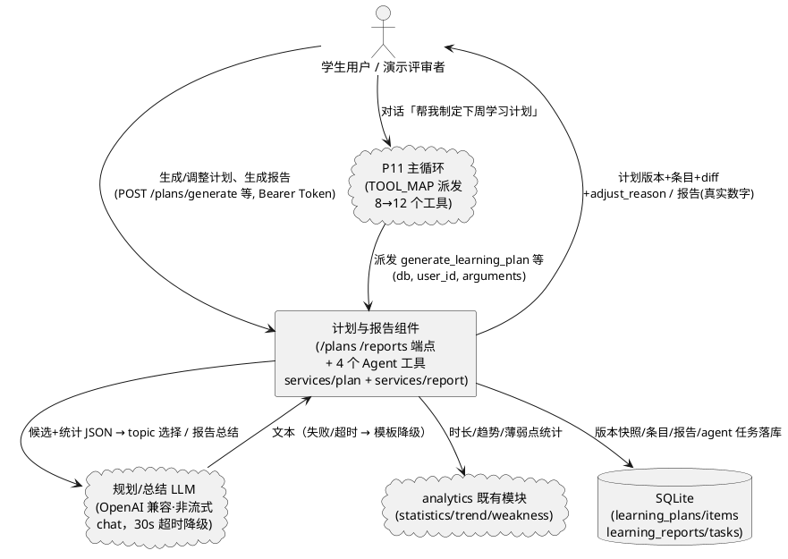
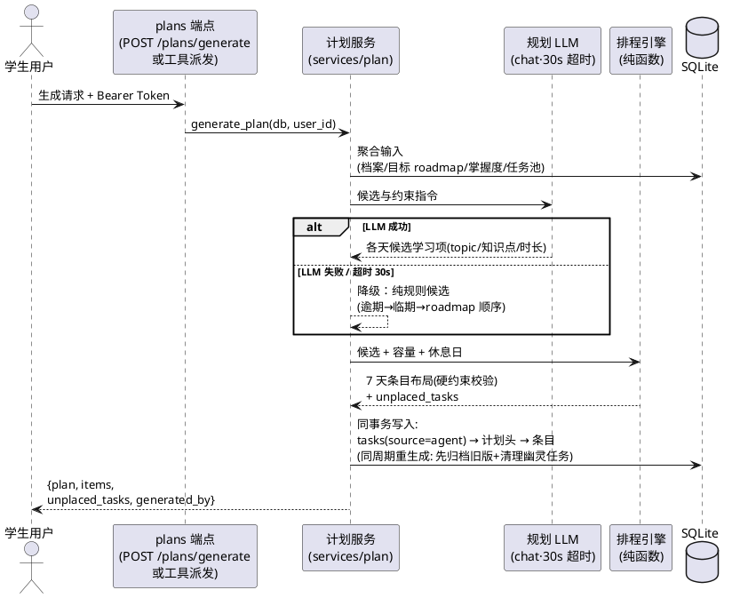
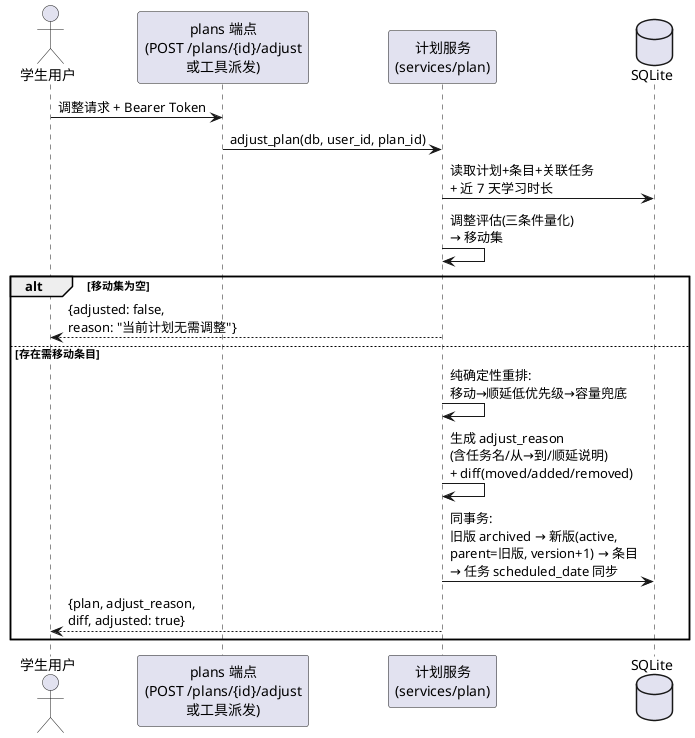
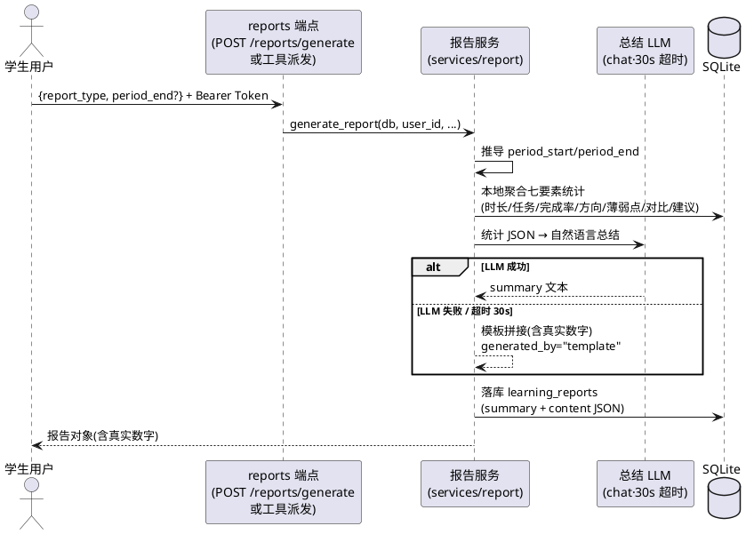

# 动态学习计划与学习成长报告（P12 后端）需求规格（SPEC_DYNAMIC_PLAN_REPORTS）

| 项目 | 内容 |
|---|---|
| 所属项目 | 彭城智学 SmartLearn Agent |
| 阶段 | P12 动态学习计划 + 学习成长报告（**只做后端**；需求文档第 13、14、17 章，MVP 闭环「规划 / 再规划 / 反馈」环节落地） |
| 文档状态 | **R1 裁定定稿**——用户 R1 指令给出 4 项开放决策点初步倾向，本文件按调研确认全部采纳（含 3 处微调，见第 9 章）；待用户确认后进入 design 阶段 |
| 上游依据 | `docs/PROJECT_CONTEXT.md`（唯一技术契约，§4 工具清单 12 个 / §6.4–6.5 / §6.15 / §7.2）、本阶段任务书、P10 交付现状（`registry.py` ToolSpec 冻结结构 + `_TOOL_SPECS` 单一来源，docstring 已标注 P12 接入 4 工具）、P11 交付现状（`core.py` 经 `TOOL_MAP` 派发 `(db, user_id, arguments)`、`prompts.py` 能力边界静态文案 + TOOLS_SCHEMA 动态工具清单、pytest 全量 153 passed）、P3 只读端点现状（`api/v1/plans.py`、`api/v1/reports.py`、`learning_plan_items.py`） |
| 下游文档 | design.md（`docs/designs/DESIGN_DYNAMIC_PLAN_REPORTS.md`，由 spec-design-agent 另行生成）、tasks.md（由 spec-task-agent 生成） |
| 验收方式 | pytest 自动化（**mock LLM**，沿用 P4/P9/P11 沙箱惯例）+ 本机真实 LLM 验证清单（§8.3）+ `curl` 逐项核对 §8 可量化验收标准 |

> **修订记录**：
> - **R1（初版裁定）**：依据任务书 + PROJECT_CONTEXT + P10/P11/P3 交付现状完成完整规格；用户 R1 指令对 4 项开放决策点给出初步倾向，本文件结合调研逐项确认采纳（O1–O4，第 9 章）；自行裁决任务书与契约的冲突及空白共 13 项（第 7 章）。

> **裁决总纲**：本阶段任务书与 `PROJECT_CONTEXT.md` 存在 API 路径出入（`POST /api/v1/agent/plan/generate` vs 契约 §7.2 `POST /api/v1/plans/generate`）等冲突，按契约头部规则裁决——**PROJECT_CONTEXT 是唯一技术契约，开发提示词与本文件冲突时以本文件为准；本文件未覆盖的细节以提示词为准**。全部裁决记录于第 7 章（冲突裁决）与第 9 章（用户指令裁定）。

> **关键裁定速览**（详见第 7/9 章）：
> - **A. API 路径**：以契约 §7.2 为准（`/api/v1/plans/*`、`/api/v1/reports/*`）；任务书的 `POST /api/v1/agent/plan/generate` 裁定为 **Agent 工具 `generate_learning_plan` 的调用入口**（对话内自然语言触发），不新设 HTTP 端点；`GET /api/v1/reports?type=weekly` 与 §7.2 `GET /api/v1/reports` 兼容，type/period 作为查询参数（参数名对齐 snake_case：`report_type`，裁决 #2/#3）。
> - **B. 报告 LLM 失败兜底**：统计数字全部本地计算；LLM 失败/超时降级为**含真实数字的模板化总结**，报告仍落库（`content.generated_by="template"` 标记）；错误码 3000 仅在统计本身异常时使用（O1）。
> - **C. 同周期重复生成报告**：`learning_reports` 无唯一约束，重复生成 = 新建记录（重新生成语义）；报告列表按 `created_at` 倒序，取该周期最新一条即最新版（O2）。
> - **D. 休息日策略**：固定**周五**为休息日（需求文档第 13 章示例）；休息日条目 topic 为「休息 / 复习」类、`task_id` 可空（§6.5 约定）（O3）。
> - **E. 计划生成模式**：**「LLM 决定学什么 + 确定性引擎决定何时学」混合模式**——LLM 基于目标 roadmap 与掌握度选各天 topic 与知识点；排程引擎（纯函数）保证硬约束（日容量 ≤ `daily_study_minutes`、逾期/临期优先、休息日、时段不冲突）；LLM 失败/超时（30s）降级为纯规则排程（O4）。

> **需求句式约定**：第 5 章业务规则均采用 EARS 句式的中文等价表达——「当〈触发条件〉时，系统应〈系统响应〉」；无条件规则表述为「系统应〈始终成立的行为〉」。每条规则附验收条件（触发场景 → 预期行为），可直接转化为测试用例。

> **范围总则（本阶段只做后端）**：本阶段交付计划生成/调整/查询/diff 服务与端点、报告生成/查询服务与端点、4 个 Agent 工具正式注册、Prompt 能力边界文案更新、pytest 测试（mock LLM）。**本阶段禁止创建任何前端文件**（`PlanView.vue`、`ReportsView.vue`、`src/api/plan.ts` 的 Agent 扩展等属后续阶段，后端验收通过后单独下达）；本阶段**不改任何数据库表结构**（`learning_plans` / `learning_plan_items` / `learning_reports` / `tasks` 均为契约 §6 既有定义）。

---

# **1. 组件定位**

## **1.1 核心职责**

本组件负责生成与动态调整版本化学习计划、生成学习成长报告，并将其注册为 Agent 工具，实现项目「AI 主动规划 + 动态再规划」的核心差异化能力。

## **1.2 核心输入**

1. 计划生成请求（来源：`POST /api/v1/plans/generate` HTTP 请求，或 Agent 对话中 LLM 决策调用 `generate_learning_plan` 工具）。
2. 计划调整请求（来源：`POST /api/v1/plans/{id}/adjust` HTTP 请求，或 LLM 决策调用 `adjust_learning_plan` 工具）。
3. 报告生成请求（来源：`POST /api/v1/reports/generate` HTTP 请求，或 LLM 决策调用 `generate_learning_report` 工具）。
4. 计划与报告查询请求（来源：`GET /plans`、`GET /plans/current`、`GET /plans/{id}/diff`、`GET /reports` 等 HTTP 请求，前端 PlanView / ReportsView 后续消费）。
5. 用户画像与业务数据（来源：`user_profiles.daily_study_minutes`、active 目标 roadmap、`tasks`（逾期/临期）、`knowledge_mastery`、`learning_records` 统计——经 services/analytics 既有函数读取）。
6. 规划 LLM 响应（来源：OpenAI 兼容非流式 `chat`，`services/llm.py` 既有方法——选内容用，见裁决 #12 补充）。
7. 有效 JWT Bearer Token（来源：前端请求头 `Authorization`）。

## **1.3 核心输出**

1. 新计划版本与条目（`learning_plans` + `learning_plan_items`，及关联 `tasks`（`source=agent`））。
2. 调整结果：新版本 + `parent_plan_id` 备份链 + 具体中文 `adjust_reason` + 结构化 diff（moved/added/removed）。
3. 学习报告（`learning_reports`：`summary` 自然语言 + `content` 结构化 JSON，含 `generated_by` 生成方式标记）。
4. 统一响应体 `{code, message, data}` 的计划/报告 JSON（契约 §5.2）。
5. Agent 工具注册产物：`TOOLS_SCHEMA` / `TOOL_MAP` 扩至 **12 个**工具；工具返回业务 dict 或 `{"error": str}` 信封（P10 契约）。

## **1.4 职责边界**

本组件**不负责**以下事项（防止职责蔓延）：

1. **不创建任何前端文件**：PlanView.vue / ReportsView.vue / 前端类型与 api 模块扩展属后续阶段（本批范围铁律）。
2. **不改数据库表结构**：`learning_plans` / `learning_plan_items` / `learning_reports` / `tasks` 沿用契约 §6.4/§6.5/§6.15/§6.7 既有定义；本阶段只写数据不改 DDL。
3. **不做计划条目状态流转界面逻辑**：条目 `status`（planned/done/skipped）的「用户勾选完成」交互属前端后续阶段；本阶段只在**调整迁移**时保持已完成条目 `status=done`（规则 5.2.1-5）。
4. **不改 P11 主循环**：`core.py` 经 `TOOL_MAP` 动态派发，工具从 8 个变 12 个无需改动执行器；本阶段仅改 `prompts.py` 静态边界文案（裁决 #11，有意变更）与 `registry.py` 追加 4 条 `ToolSpec`。
5. **不做计划自动定时调整**：调整由用户请求或 Agent 对话触发（LLM 决策「要不要调」），本阶段无定时任务/主动触发器（V2 扩展位）。
6. **不做任务状态代流转**：计划生成只创建 `status=todo` 的 agent 任务；任务状态流转仍由用户在任务页操作（P11 Prompt 禁止事项延续）。
7. **不做 V2 范围功能**：学习风险预警的独立报告、AI 出题、错题系统等不做（契约 §1 适用范围）。

---

# **2. 领域术语**

**计划版本（plan version）**
: 一次生成或调整产出的完整计划快照，`learning_plans` 一行；`version` 为该用户下单调自增整数，任何计划都**不可原地修改**（契约 §6.4 铁律）。

**active / archived**
: 计划版本的两个状态。`active` 为生效版本（周视图数据源），`archived` 为历史快照（diff 与回滚依据）；同一用户同一周期最多一个 active。

**parent_plan_id（备份链）**
: 新版本指向被调整版本的外键；构成「v1 → v2 → v3」版本链，任意两版可对比、支持回滚；`parent_plan_id` 非空时 `adjust_reason` 必填（契约 §6.4）。

**adjust_reason（调整理由）**
: 服务端生成的**具体、可读中文**解释（含任务名、从哪天到哪天、顺延了什么），落库并在 diff 视图展示；禁止只存 diff 不存解释、禁止静默改数据。

**diff（结构化改动清单）**
: 调整接口返回值的组成部分，`{"moved": [...], "added": [...], "removed": [...]}` 三类；`moved` 条目含 `topic / from_date / to_date / reason`。**不设独立 `get_plan_diff` 工具**——diff 由 `adjust_learning_plan` 返回值携带（任务书明令，工具数量越少模型选择越准）。

**下一个完整自然周**
: 生成目标周期的固定语义：以北京时区「今天」为基准的下周一至下周日（7 天）；生成接口无参数，恒生成该周期。

**混合生成模式**
: 「LLM 决定学什么 + 确定性引擎决定何时学」——规划 LLM 基于目标 roadmap、掌握度、任务池选出各天 topic 与关联知识点；排程引擎（纯函数）负责时段排布与全部硬约束校验；引擎约束优先级高于 LLM 意志。

**排程引擎（scheduler）**
: 纯函数模块：输入（候选学习项、每日容量、休息日、既有条目），输出（plan_date × start_time × end_time 布局）；保证日容量不超限、`(plan_date, start_time)` 不冲突、逾期/临期优先、休息日保留。LLM 失败时以纯规则候选（逾期 + 临期 + roadmap 顺序）独立完成排程（降级路径）。

**休息日**
: 每周固定**周五**；该日不排任务条目，仅一条 topic 为「休息 / 复习」的条目（`task_id` 可空，§6.5 约定）；「至少留一天休息」硬约束的落地形式。

**未排下任务（unplaced_tasks）**
: 因周期容量不足而无法排入计划的任务清单；生成结果如实返回（可解释性），任务本身保留在 `tasks` 表不丢失。

**幽灵任务清理**
: 同周期重新生成而归档旧版本时，删除旧版条目关联的 `source=agent` 且 `status=todo` 任务（避免任务列表堆积无人执行的计划残留）；用户已流转状态（in_progress/done/review）的任务保留。

**调整评估（三条件）**
: 服务端确定性判定「哪些条目需要移动」的依据：任务未完成 + 截止临近（含逾期）+ 近期学习时长不足；量化阈值见规则 5.2.1-2。调整算法**纯确定性、不调 LLM**，`adjust_reason` 由模板生成——防编造、沙箱可测。

**报告三型**
: `report_type` 枚举 `daily`（单自然日）/ `weekly`（自然周，周一起）/ `monthly`（自然月）；周期边界由 `period_end` 与类型推导（`period_start` 恒为推导值，不接受直接传入）。

**最近完整周期**
: `period_end` 缺省时的取值语义：daily=昨天、weekly=上周日、monthly=上月末日（都是已完整结束的周期，统计无歧义）。

**generated_by（生成方式标记）**
: `learning_reports.content` 内字段，`"llm"`（LLM 生成自然语言总结）或 `"template"`（模板降级拼接）；报告在任何生成方式下都必须含真实统计数字。

**模板降级**
: 规划/总结 LLM 失败或超时（30s）时的兜底路径：计划生成降级为纯规则排程、报告总结降级为含真实数字的固定模板拼接；降级产物仍落库并带标记，**不报错、不空转**。

---

# **3. 角色与边界**

## **3.1 核心角色**

- **学生用户**：登录后经任务页/后续 PlanView 触发计划生成与调整、查看版本与 diff、生成日报/周报/月报；或在 `/ai-agent` 对话中说「帮我制定下周学习计划」「生成周报」由 Agent 代为执行。仅能访问本人计划与报告。本阶段以 curl / pytest 角色代行验证。
- **演示评审者（评委）**：答辩场景下观测「生成下周计划 → 人为留一个任务未完成且截止明天 → Agent 调整并给出具体理由与 diff → 周报含真实数字」的完整差异化闭环（Demo 场景第二、三、五步）；复用学生用户身份。

## **3.2 外部系统**

- **规划/总结 LLM 服务（OpenAI 兼容 `/v1/chat/completions` 非流式）**：接收统计/候选 JSON 与指令，返回 topic 选择或报告总结文本；经 `services/llm.py` 既有 `chat` 方法调用（零改动复用）；失败/超时触发模板降级。
- **P11 Agent 主循环（`core.py` + `TOOL_MAP`，同进程已交付能力）**：对话内 LLM 决策调用本组件 4 个新工具时，经 `(db, user_id, arguments)` 契约派发；本组件对其零改动。
- **P10 工具注册表（`registry.py` 单一事实来源）**：本组件向 `_TOOL_SPECS` 追加 4 条 `ToolSpec`，`TOOLS_SCHEMA` / `TOOL_MAP` 自动扩至 12 条。
- **analytics 既有模块（statistics / trend / weakness）**：报告统计与调整评估的数据来源（学习时长、趋势、薄弱点），复用不重写。
- **SQLite 持久层（间接依赖）**：一切表读写经 services 层（契约 §4 分层铁律；agent 工具层经 `tools.py` 封装访问 services）。

## **3.3 交互上下文**



---

# **4. DFX 约束**

## **4.1 性能**

1. **内嵌 LLM 超时上限**：规划 LLM 与报告总结 LLM 单次调用超时上限 **30 秒**（模块常量，仅测试可 monkeypatch）；超时或失败即走模板/纯规则降级路径。理由：P11 Agent 对话总预算 60s——工具内嵌 LLM 若不限时，一次 `generate_learning_plan` 即可击穿对话预算；30s 为「LLM 可用性」与「预算安全」的折中（规划类 prompt 实测 10–25s 量级）。
   a. 验收条件：monkeypatch LLM 抛错 / 挂起超 30s → 生成与报告请求在超时窗内返回降级产物（计划含纯规则排程结果 / 报告 summary 为模板拼接），无 502、无悬挂。
2. **HTTP 响应上限**：`POST /plans/generate`、`POST /plans/{id}/adjust`、`POST /reports/generate` 响应 ≤ **35 秒**（LLM 30s + 引擎与落库余量）；这三类属「AI 请求」（同 Dashboard advice / goal breakdown 惯例），不受普通页面 2s 红线约束，但必须有界。`adjust` 为纯确定性算法，响应 ≤ 2 秒（普通红线）。
   a. 验收条件：mock LLM 即时返回 → 三端点响应 ≤ 2s 量级；mock LLM 挂起 → 端点最迟 35s 内返回降级结果。
3. **查询端点**：`GET /plans`、`GET /plans/current`、`GET /plans/{id}/diff`、`GET /reports`、`GET /reports/{id}` 响应 ≤ 2 秒（普通页面红线）。
   a. 验收条件：pytest 计时断言（或实测日志）均满足。
4. **工具慢日志继承**：4 个新工具沿用 P10 `tool_endpoint` 装饰器（> 300ms 记 `agent_tool_slow` warning）；`generate_learning_plan` / `generate_learning_report` 内嵌 LLM 必然超 300ms——慢日志照记，作为规划耗时的正常观测信号，不视为异常。
   a. 验收条件：mock 慢 LLM 下工具调用 → 出现慢日志行，功能正常完成。

## **4.2 可靠性**

1. **降级不失败**：规划 LLM 失败/超时 → 纯规则排程生成计划（降级标记）；报告 LLM 失败/超时 → 模板拼接 summary（`generated_by="template"`）；两种降级产物均正常落库返回。**错误码 3000 仅在「统计/数据本身异常」时使用**，LLM 失败不构成报告/计划的失败（O1 裁定）。
   a. 验收条件：mock LLM 全部失败 → 计划与报告生成成功率 100%，产物含真实数字与降级标记。
2. **落库原子性**：一次生成 = 计划头 + 全部条目 + 关联 agent 任务，同一事务提交；失败整体回滚（不留半截计划）。调整 = 旧版置 archived + 新版 + 新条目 + 任务 scheduled_date 更新，同一事务。
   a. 验收条件：事务中途 mock 异常 → 库中无新增计划/条目/任务，旧 active 计划未被动过。
3. **版本不可变**：archived 版本的行与条目一经归档不再修改（except 无）；diff 的正确性由此保证。
   a. 验收条件：调整后再查旧版本条目 → 与归档前逐字段一致。
4. **数据不丢失**：容量不足的任务进 `unplaced_tasks`（任务保留在 tasks 表）；调整被移出计划的条目其任务同样保留（规则 5.2.1-6）。
   a. 验收条件：构造超容量场景 → 生成成功且 tasks 表任务数 = 已排 + 未排。
5. **多周并存不误伤**：生成下周计划不得归档本周未结束的 active 计划（契约 §6.4 明文）。
   a. 验收条件：本周存在 active 计划时生成下周 → 两版本同时 active、日期区间不重叠。

## **4.3 安全性**

1. 全部新端点须 JWT Bearer 鉴权；未携带/无效 token → HTTP 401 + `code=1003`。
2. **user_id 服务端注入红线**：计划与报告的 user_id 一律取认证结果；工具参数模型结构性不含 user_id（P10 `extra="forbid"` 拒绝）；HTTP 请求体亦不接受 user_id 字段。
3. 计划、条目、任务、报告按 `user_id` 过滤，「不可见即不存在」（越权与不存在统一 404 + `code=1005`）。
4. 日志脱敏：不打印 LLM 完整请求/响应正文与用户业务数据；仅记元数据（user_id、plan_id、version、report_type、耗时、降级原因）。

## **4.4 可维护性**

1. **常量锁定**：休息日（周五）、LLM 超时（30s）、调整评估阈值（截止临近 48h、时长不足比例 0.6）、规划 LLM `max_tokens`、摘要与 reason 长度上限等以模块级常量定义并注释依据，禁止散落魔法数；评估阈值仅测试可 monkeypatch。
2. **单一事实来源**：4 个新工具仅在 `registry.py` 的 `_TOOL_SPECS` 追加 `ToolSpec` 条目（P10 既定扩展方式），`TOOLS_SCHEMA` / `TOOL_MAP` 由列表推导自动一致，禁止旁路注册。
3. **可测性**：规划 LLM 与总结 LLM 调用点必须可 mock（沙箱无法真实调用）；排程引擎为纯函数（输入候选 → 输出布局），单测不依赖 LLM 与 DB；调整算法纯确定性（不调 LLM），全量规则可自动化断言。
4. 工具描述文案遵循 P10 三要素长文案格式（何时调用 / 参数填法 / 返回结构），与既有 8 个工具风格一致。

## **4.5 兼容性**

1. **P10/P11 零改动原则的例外声明**：`tools.py` 既有 8 工具实现、`core.py` 主循环、`memory.py`、`services/llm.py` 的 `chat` / `chat_stream` / `agent_chat_stream` 全部零改动；本阶段仅动 `registry.py`（追加 4 条）与 `prompts.py`（边界静态文案，裁决 #11 **有意变更**）。
2. **P11 测试基线演进**：pytest 全量 153 passed 基线不被破坏，但 `test_agent_prompt.py` 中针对「后续版本提供」边界声明的断言须**同步更新**为正向能力声明——这是计划内行为反转（P11 SPEC D2 验收「不编造 + 如实说明后续版本」在 P12 交付后由「真正调用工具」取代），回归须覆盖。
3. **P3 只读端点回归**：`GET /plans`、`GET /plans/{id}`、`GET /reports`、`GET /reports/{id}` 行为兼容；`GET /reports` 列表**排序由 id 升序改为 created_at 倒序**并新增 `report_type` 过滤（O2 裁定，行为变更，回归覆盖）；`GET /plans` 列表保持 id 升序（版本链时间线语义，不变更）。
4. **分页实现约束（契约 §5.3）**：`GET /reports` 增加了 `report_type` 标量 Query 过滤后**不得继续混用** `PaginationParams` 查询参数模型，须改为逐个标量声明（参照 `api/v1/goals.py` 的 `list_goals` 写法，校验规则一致）。
5. 数据表结构零改动（见范围总则）；`PlanOut` / `PlanItemOut` / `ReportOut` 既有出参字段零删改，仅新增模型。

---

# **5. 核心能力**

## **5.1 学习计划生成**

### **5.1.1 业务规则**

1. **鉴权规则**：计划与报告全部新端点必须登录。
   a. 验收条件：未携带 token 调用 `POST /plans/generate` → HTTP 401 + `{code:1003}`。
2. **目标周期规则**：当收到生成请求（HTTP 或工具）时，系统应以北京时区「今天」为基准生成**下一个完整自然周**（下周一至下周日，7 天）的计划；接口无周期参数。
   a. 验收条件：2026-10-22（周四）调用 → 新计划 `start_date=2026-10-26`、`end_date=2026-11-01`，条目 `plan_date` 全部落在该区间（任务书验收 1 的「下周」语义）。
3. **版本快照规则**：系统应在生成时新建计划行——`version` = 该用户现有最大 version + 1（per-user 单调自增，裁决 #4）、`status="active"`、`source="agent"`、`parent_plan_id=null`、`adjust_reason=null`；**禁止原地修改任何既有计划**。
   a. 验收条件：生成后查库 → 新行 version 递增、五字段取值如上；既有计划行无任何字段变化。
4. **多周并存规则**：当目标周期与既有 active 计划日期区间**不重叠**时，系统应保持既有 active 不动（本周未结束计划不得归档，契约 §6.4）；当目标周期已存在 active 计划（同周期重新生成）时，系统应先归档旧版（置 archived）再新建 version+1，并按规则 8 清理幽灵任务。
   a. 验收条件：本周有 active 计划时生成下周 → 两版本同时 active；对同一下周连续生成两次 → 仅第二次的版本 active，第一次置 archived。
   b. 验收条件（异常数据防护）：存在与目标区间**部分重叠**且无法判定为同周期的 active 计划 → HTTP 400 + `code=1007`（业务规则冲突），不自动归档。
5. **混合生成规则（O4）**：系统应采用「LLM 决定学什么 + 确定性引擎决定何时学」——先聚合输入（active 目标 roadmap 叶子、`knowledge_mastery` 薄弱点排序、逾期/临期任务、兴趣方向），交规划 LLM 产出各天候选学习项（topic + 关联知识点 + 预估时长 + 优先级）；再由排程引擎（纯函数）排布 `plan_date / start_time / end_time` 并执行全部硬约束校验。当规划 LLM 失败或超时（30s）时，系统应降级为纯规则排程（候选 = 逾期任务 → 临期任务 → roadmap 顺序的薄弱知识点），生成结果携带 `generated_by="rules"` 降级标记，**不报错、不阻塞**。
   a. 验收条件：mock LLM 返回合法候选 → 条目 topic 与 LLM 候选一致且时段满足硬约束；mock LLM 抛错 → 计划仍生成、条目来自任务池与 roadmap、`generated_by="rules"`。
6. **排程硬约束规则**：排程引擎输出的条目必须同时满足——① 每天条目 `estimated_minutes` 合计 ≤ `daily_study_minutes`（档案缺省 60）；② 同一计划内 `(plan_date, start_time)` 不重复（契约 §6.5 联合唯一的应用层保证）；③ 逾期任务与临期任务（截止时间升序）优先排在周期前段；④ 周五为休息日（仅一条「休息 / 复习」条目、`task_id=null`）；⑤ 条目 `end_time - start_time` 与 `estimated_minutes` 一致。引擎约束优先级高于 LLM 候选——LLM 候选超容量或冲突时由引擎截断/重排，不得因 LLM 输出破坏约束。
   a. 验收条件（任务书验收 1 核心）：demo 用户（daily_study_minutes=N）生成 → 7 天条目、每天合计 ≤ N、每天 start_time 无重复、周五无任务条目、逾期/临期任务排在周期前段。
7. **任务落库规则**：系统应把每条任务语义的条目先写入 `tasks` 表（`title=topic`、`knowledge_points`、`estimated_minutes`、`scheduled_date=plan_date`、`priority`、`goal_id`（来自输入聚合）、`source="agent"`、`status="todo"`），再把任务 id 回填条目 `task_id`；「休息 / 复习」条目不建任务（`task_id=null`，§6.5 约定）。
   a. 验收条件（任务书验收 1 落库断言）：生成后 tasks 表新增行全部 `source="agent"` 且条目 `task_id` 一一对应；休息条目 `task_id` 为空。
8. **幽灵任务清理规则**：同周期重新生成而归档旧版本时，系统应删除旧版条目关联且 `source="agent"`、`status="todo"` 的任务；`status` 已流转（in_progress/done/review）或 `source="manual"` 的任务一律保留。
   a. 验收条件：旧版含 2 条 agent-todo + 1 条 agent-done 任务，重新生成 → 仅 2 条 todo 被删除，done 保留且仍可在任务页可见。
9. **容量不足可解释规则**：当候选总量超出周期容量时，系统应按优先级截断并在生成结果 `unplaced_tasks` 中列出未排下任务（id + title + 原因），任务保留在 tasks 表。
   a. 验收条件：构造 10 小时候选对 60 分钟/天档案 → 计划生成成功、每天不超限、`unplaced_tasks` 非空且对应任务仍在 tasks 表。
10. **无档案默认规则**：用户从未填写 `user_profiles` 时按 `daily_study_minutes=60` 默认容量生成（P10 契约同款），不报错。
    a. 验收条件：无档案用户生成 → 正常产出，容量按 60 分钟约束。
11. **无目标容错规则**：无 active 目标时仍可生成（候选 = 任务池 + 薄弱点），`goal_id=null`；不因缺目标拒绝生成。
    a. 验收条件：删除目标后生成 → 成功且 `goal_id=null`。

### **5.1.2 交互流程**



### **5.1.3 异常场景**

1. **规划 LLM 失败 / 超时**
   a. 触发条件：LLM 服务不可用、超时 30s、返回不可解析内容。
   b. 系统行为：降级纯规则排程，`generated_by="rules"`，正常落库；日志记降级原因（元数据级）。
   c. 用户感知：计划正常返回；结果内 `generated_by` 字段提示生成方式（前端后续可展示「规则模式生成」）。
2. **同周期已有 active 计划（重新生成语义）**
   a. 触发条件：对同一目标周重复调用生成。
   b. 系统行为：归档旧版 → 清理旧版 agent-todo 幽灵任务 → 新建 version+1。
   c. 用户感知：返回新版本；版本列表可见旧版为 archived。
3. **周期区间与既有 active 部分重叠（异常数据）**
   a. 触发条件：手工数据或并发造成的非整周重叠。
   b. 系统行为：HTTP 400 + `code=1007`「与现有计划周期冲突」，不自动归档。
   c. 用户感知：中文提示，可人工处理后再试。
4. **LLM 返回超容量候选**
   a. 触发条件：LLM 给出超出每日容量的学习项。
   b. 系统行为：引擎截断/重排，硬约束不被破坏；截断项进 `unplaced_tasks`。
   c. 用户感知：计划满足容量约束，未排下任务在返回值中可见。

## **5.2 动态计划调整（核心差异化能力）**

### **5.2.1 业务规则**

1. **鉴权与定位规则**：`POST /plans/{id}/adjust` 须登录且 plan_id 属本人（否则 404/1005）；工具 `adjust_learning_plan(plan_id?)` 缺省作用于「当前 active 计划」（`start_date <= 今天 <= end_date`）；无 active 计划时返回错误信封「当前没有进行中的学习计划」。
   a. 验收条件：越权/不存在 id → 404 + `code=1005`；无 active 计划调工具 → `{"error": "..."}` 信封。
2. **调整评估规则（三条件量化）**：系统应以确定性规则评估需移动的条目，阈值均为模块常量（可 monkeypatch）：
   - **未完成**：条目 `status != "done"` 且（`plan_date < 今天` 或关联任务 `status != "done"`）；
   - **截止临近**：关联任务 `deadline - now <= 48h`（含已逾期）；
   - **近期时长不足**：近 7 天学习总时长 < `daily_study_minutes × 7 × 0.6`。
   满足「未完成」且（「截止临近」或「时长不足」）的条目进入移动集。
   a. 验收条件（任务书验收 2 场景构造）：把一个任务设为未完成且截止明天 → 该条目进入移动集（未完成 + 截止临近双命中）。
3. **不可原地修改铁律**：调整一律新建版本——旧版置 `archived`、新版 `status="active"`、`version=旧版+1`、`parent_plan_id=旧版 id`；旧版行与条目零修改（备份链即备份）。
   a. 验收条件：调整后 → 新版 `parent_plan_id` 指向旧版 id、旧版 `status="archived"`、旧版条目逐字段不变（任务书验收 2）。
4. **adjust_reason 必填且具体规则**：`parent_plan_id` 非空时 `adjust_reason` 必填（契约 §6.4）；文案由服务端模板生成，**必须包含**被移动条目的任务名、原日期、新日期与顺延说明，形如「检测到你本周的〈任务名〉学习任务未完成，已调整到〈新日期〉〈时段〉，并顺延了原定〈日期〉的〈N〉个低优先级任务。」；禁止空泛（如「已优化你的计划」）、禁止编造未发生的改动。
   a. 验收条件：调整返回的 `adjust_reason` 非空、含移动条目的 topic 与「从 → 到」日期表述、长度 ≥ 20 字符（任务书验收 2「非空且具体」）。
5. **已完成条目保持规则**：迁移到新版本时，`status="done"` 的条目原样复制且保持 `done`（历史事实不可篡改）；`skipped` 同样保持。
   a. 验收条件：先完成一个条目再调整 → 新版本中该条目仍为 done，且不在 moved/removed diff 中。
6. **移动与顺延规则**：移动集条目重排到周期内**后续日期的空闲容量**（优先周末空闲时段）；目标日容量不足时顺延该日**低优先级**（low 优先，medium 次之，high 不顺延）条目到更晚空闲时段；周期内确无可挪空间时，低优先级条目移出计划（进 removed diff），其任务保留在 tasks 表（不删除）。
   a. 验收条件：构造「周六已满 + 周日空闲」→ 被顺延的周六 low 条目出现在周日时段；构造周期全满 → 低优先级条目进 removed、任务仍存在。
7. **周期不变规则**：调整不改变 `start_date` / `end_date`（新版本与旧版本同区间），保证 diff 可比性与周视图稳定。
   a. 验收条件：调整前后两版本起止日期逐字段相等。
8. **纯确定性规则**：调整算法不调用 LLM（候选、布局、reason 全部服务端规则生成）；Agent 对话中 LLM 仅决定「是否调用本工具」与向用户转述结果。
   a. 验收条件：mock LLM 完全不可用环境下调整功能全部用例通过。
9. **无可调整项规则**：当移动集为空（无未完成临期条目且时长充足）时，系统应**不新建版本**，返回 `{adjusted: false, reason: "当前计划无需调整"}` 类说明（HTTP 200；工具返回同义 dict）。
   a. 验收条件：全部条目 done 时调用调整 → 计划数量不变、返回 adjusted=false。
10. **diff 随返规则**：调整接口返回值必须携带结构化改动清单：
    ```json
    {
      "moved":   [{"topic": "Transformer", "task_id": 12, "from_date": "2026-10-21",
                   "from_time": "19:00", "to_date": "2026-10-24", "to_time": "14:00",
                   "reason": "任务未完成且截止临近"}],
      "added":   [{"topic": "...", "plan_date": "...", "reason": "..."}],
      "removed": [{"topic": "...", "from_date": "...", "reason": "容量不足顺延不出，移出计划"}]
    }
    ```
    `moved` 每条含 topic、from/to（日期 + 时段）、reason；`added` 为新版本新增条目（如补入的薄弱点学习）；`removed` 为被移出条目（任务保留）。**不设独立 `get_plan_diff` 工具**（任务书明令）。
    a. 验收条件（任务书验收 3）：未完成 + 截止明天的场景调整 → `moved` 含该条目且 `from_date`/`to_date`/`reason` 三要素齐全、日期真实对应新旧版本 `plan_date`。
11. **任务同步规则**：被移动条目关联任务的 `scheduled_date` 同步更新为新 `plan_date`（同一事务）；removed 条目任务的 `scheduled_date` 置空。
    a. 验收条件：调整后查 tasks → 被移动任务 `scheduled_date` 等于新条目 `plan_date`。

### **5.2.2 交互流程**



### **5.2.3 异常场景**

1. **无 active 计划 / 计划不存在 / 越权**
   a. 触发条件：plan_id 不存在、属他人，或用户无任何进行中计划（工具缺省路径）。
   b. 系统行为：HTTP 404 + `code=1005`（端点）；工具返回 `{"error": "当前没有进行中的学习计划"}` 信封。
   c. 用户感知：中文提示，无副作用。
2. **目标计划非 active（对 archived 版本调整）**
   a. 触发条件：传入历史版本 id。
   b. 系统行为：HTTP 400 + `code=1007`「仅可调整生效中的计划」；不产生任何版本变更。
   c. 用户感知：中文提示；如需基于历史版本重排，先经生成重建。
3. **周期全满无可挪空间**
   a. 触发条件：移动集非空但所有后续日期容量为零。
   b. 系统行为：低优先级条目移出计划（removed diff），高优先级移动条目若也无法安排则同样移出并写入 reason；计划仍然生成新版本、`adjust_reason` 如实说明「因本周容量不足，以下任务已移出计划」。
   c. 用户感知：diff 的 removed 类别可见被移出条目与原因，任务仍在任务页。

## **5.3 计划查询与 diff**

### **5.3.1 业务规则**

1. **current 语义规则（契约 §6.4 固定）**：`GET /api/v1/plans/current` 返回「`start_date <= 今天 <= end_date` 且 `status="active"`」的计划**及其全部条目**（条目按 `plan_date` 升序、同日内按 `start_time` 升序）；无匹配计划时返回 HTTP 200 + `data=null`（无计划是正常状态，Dashboard 摘要卡片依赖此语义）。
   a. 验收条件：存在本周 active → 返回计划头 + items 数组；删除全部计划后调用 → 200 且 `data=null`（非 404）。
2. **列表与详情规则**：`GET /plans`（分页、id 升序、沿用 P3）与 `GET /plans/{id}`（越权 404/1005）行为不变；列表/详情不带条目（周视图走 current、版本对比走 diff，最小端点集对齐契约 §7.2）。
   a. 验收条件：P3 既有测试回归通过；响应结构无破坏性变更。
3. **diff 端点规则**：`GET /api/v1/plans/{id}/diff` 对比该计划与其 `parent_plan_id` 指向版本的条目，返回 `{base_plan_id, moved, added, removed}`（结构同 5.2.1-10）；被查询计划须属本人（404/1005）。
   a. 验收条件：调整产生的 v2 查 diff → `base_plan_id` = v1 id、moved/added/removed 与调整时返回一致（幂等重算）。
4. **无基线规则**：被查询计划 `parent_plan_id=null`（首版生成产物）时，返回 HTTP 200 + `{base_plan_id: null, moved: [], added: [], removed: []}`（「无对比基线」是正常状态，非错误）。
   a. 验收条件：对 generate 产物调 diff → 200 + 空三数组 + `base_plan_id=null`。
5. **diff 重算一致性规则**：diff 端点按两版本条目现值**重算**（不落库存储 diff 本身）；与调整时随返的 diff 逐条一致。
   a. 验收条件：调整后间隔任意时间调 diff 端点 → 结果与调整响应中的 diff 等价。

### **5.3.2 交互流程 / 5.3.3 异常场景**

并入 5.4.2 图（查询类端点无独立编排）；异常场景统一为：鉴权 401/1003、越权与不存在 404/1005、入参非法 422/1001（受理口径与全项目一致）。

## **5.4 学习成长报告生成**

### **5.4.1 业务规则**

1. **周期推导规则**：`POST /api/v1/reports/generate` 请求体 `{report_type: "daily"|"weekly"|"monthly", period_end?: "YYYY-MM-DD"}`；`period_end` 缺省取最近完整周期末日（daily=昨天、weekly=上周日、monthly=上月末日，北京时区）；`period_start` 由类型与 `period_end` 推导（daily=当日、weekly=所在周周一、monthly=所在月首日），**不接受直接传入 period_start**（防首尾矛盾）。
   a. 验收条件：今天 2026-10-22 生成 weekly 不带 period_end → `period_start=2026-10-12`、`period_end=2026-10-18`；带 `period_end=2026-10-21` → 该周（10-19 至 10-25）。
2. **统计本地计算规则**：报告七要素统计**全部由数据库聚合本地计算**（复用 analytics 既有函数与 services 查询），禁止任何数字来自 LLM——① 学习时长（周期内 `learning_records.duration_minutes` 合计）；② 完成任务数（`completed_at` 落在周期内的 tasks 数）；③ 任务完成率（周期内截止任务中 done 占比）；④ 学习最多方向（周期内记录知识点/关联任务聚合的最大项，无数据时为 null）；⑤ 薄弱知识点（复用 weakness 逻辑、排除零分待学点，取最低 3 个）；⑥ 阶段进步（与上一等长周期对比：时长差、完成率差、平均掌握度差）；⑦ 下周/明日建议（规则生成：基于薄弱点、趋势 slope、逾期任务）。
   a. 验收条件（任务书验收 4 核心）：构造已知数据（如周期内 3 条记录共 145 分钟、2 个完成任务）→ 生成的 `content` 数字与库中聚合值精确相等。
3. **LLM 总结规则**：统计 JSON 交 LLM（`services/llm.py` 既有 `chat`，非流式、30s 超时）生成自然语言 `summary`（中文、面向学生、引用真实数字、给出建议）；`content.generated_by="llm"`。
   a. 验收条件：mock LLM 返回固定文本 → `summary` 为该文本且 `generated_by="llm"`。
4. **模板降级规则（O1）**：当 LLM 失败/超时/返回空时，系统应以固定模板拼接含全部真实数字的中文总结（如「本周学习 3.5 小时，完成任务 5 个，完成率 83%。学习最多的方向是机器学习；最需要加强的知识点是概率论。建议下周……」），`content.generated_by="template"`，报告**仍落库、接口仍成功**；错误码 3000 不用于此路径（仅统计本身异常时返回 3000/5000）。
   a. 验收条件：mock LLM 抛错 → 生成成功、summary 含统计数字（非空泛鼓励话）、`generated_by="template"`、落库行存在。
5. **真实数字底线**：无论 LLM 还是模板，落库报告的 `content` 必须含第 2 条的量化字段；`summary` 不得是无数字的空泛鼓励（模板路径结构性保证；LLM 路径 prompt 明令引用数字）。
   a. 验收条件：任一路径产物的 content 含 total_minutes / task_completed / completion_rate 等字段且为数值。
6. **重复生成 append 规则（O2）**：`learning_reports` 无唯一约束——同周期同类型重复生成 = 新建一行（重新生成语义，不更新旧行）；查询侧按 `created_at` 倒序自然取到最新一条。
   a. 验收条件：同一 weekly 周期连生成两次 → 两行记录、`created_at` 后者新；列表第一条为第二次结果。
7. **零数据容错规则**：周期内无任何学习记录与任务 → 报告仍生成：统计字段为 0/null、`top_direction=null`、`weak_points=[]`、summary 如实说明「本周期暂无学习记录，建议从……开始」；不报错。
   a. 验收条件：空数据用户生成日报 → 200 + 落库 + 数字全为 0 类值。

### **5.4.2 交互流程**



### **5.4.3 异常场景**

1. **总结 LLM 失败 / 超时**：见规则 4（模板降级，报告仍成功落库）。
2. **统计本身异常**
   a. 触发条件：数据库查询失败等。
   b. 系统行为：HTTP 500 + `code=5000`（或 3000 若经 LLM 统计路径——本项目统计不依赖 LLM，故为 5000），不落半截报告。
   c. 用户感知：中文错误提示，可重试。
3. **非法入参**
   a. 触发条件：report_type 非 daily/weekly/monthly、period_end 非法日期或晚于今天。
   b. 系统行为：HTTP 422 + `code=1001`（Pydantic 校验）。
   c. 用户感知：中文校验提示。

## **5.5 报告查询**

### **5.5.1 业务规则**

1. **列表过滤与排序规则（O2 落地）**：`GET /api/v1/reports` 支持 `report_type` 可选过滤（daily/weekly/monthly，缺省全部）；分页沿用 page/page_size；**排序由 id 升序改为 `created_at` 倒序**（最新报告在前，配合「取最新一条」语义）；因混入标量 Query 过滤，分页参数改为逐个标量声明（契约 §5.3 实现约束，参照 `list_goals`）。
   a. 验收条件：生成 3 份报告（含 2 份 weekly）→ `?report_type=weekly` 仅返 2 条且最新在前；全量列表倒序。
2. **详情规则**：`GET /api/v1/reports/{id}` 沿用 P3（越权/不存在 404 + `code=1005`）；`content` 为结构化 dict（`JSONType`，§8.1 序列化约定——读侧不得强行转 `{}`）。
   a. 验收条件：P3 回归通过；content 结构含七要素字段。
3. **查询兼容说明（对齐用户提示词）**：任务书 `GET /api/v1/reports?type=weekly&period=...` 与本规则兼容——`type` 即 `report_type` 查询参数（命名对齐 snake_case，裁决 #2）；`period` 定位语义由「列表过滤 + 详情/最新一条」组合覆盖（裁决 #3），不新增独立 period 参数端点。
   a. 验收条件：`GET /reports?report_type=weekly` 返回该类型全部分页列表（倒序）。

### **5.5.2 交互流程 / 5.5.3 异常场景**

并入 5.3.3 统一口径（鉴权 401/1003、越权 404/1005、非法入参 422/1001）。

## **5.6 Agent 工具接入（P10 注册表扩展 + P11 边界更新）**

### **5.6.1 业务规则**

1. **12 工具规则**：本阶段在 `registry.py` 的 `_TOOL_SPECS` **追加 4 条** `ToolSpec`（且仅此四处新增）：`get_learning_plan` / `generate_learning_plan` / `adjust_learning_plan` / `generate_learning_report`；`TOOLS_SCHEMA` 与 `TOOL_MAP` 由既有列表推导自动扩为 **12 条**（工具名集合相等是构造性事实）。**不新增 `get_plan_diff` 独立工具**——diff 由 `adjust_learning_plan` 返回值携带（任务书明令，工具数量越少模型选择越准）。
   a. 验收条件：断言 `len(TOOLS_SCHEMA) == 12` 且与契约 §4 清单逐字一致、`set(TOOL_MAP) == set(name for ...)`。
2. **工具签名与信封规则**：4 个新工具沿用 P10 `tool_endpoint` 装饰器契约——签名 `(db: Session, user_id: int, arguments: dict) -> dict`、参数模型 `extra="forbid"` 且结构性不含 user_id、成功返回业务 dict、失败返回 `{"error": "<中文>"}` 单键信封、慢日志 300ms 继承。
   a. 验收条件：传非法参数 → 中文信封（含参数名与合法值）；传 user_id → 注入特例拒绝文案（P10 惯例）。
3. **工具参数最小化规则**：
   - `get_learning_plan()`：无参数；返回当前 active 计划及条目（供周视图与对话展示；无计划时返回说明性 dict，非错误）。
   - `generate_learning_plan()`：无参数（恒生成下一个完整自然周；输入由服务端聚合）。
   - `adjust_learning_plan(plan_id?)`：可选正整数，缺省当前 active 计划。
   - `generate_learning_report(report_type?)`：可选枚举，缺省 weekly（周期取最近完整周期，LLM 不算日期）。
   a. 验收条件：4 个参数模型 schema 与上述一致（无多余字段）；`_build_parameters_schema` 产物无 `$defs/$ref/anyOf`。
4. **工具返回结构规则**：`generate_learning_plan` 返回 `{plan, items, unplaced_tasks, generated_by}`；`adjust_learning_plan` 返回 `{plan, adjust_reason, diff, adjusted}`；`get_learning_plan` 返回 `{plan, items}` 或 `{plan: null, message}`；`generate_learning_report` 返回报告对象（同 HTTP 出参）。工具描述文案按 P10 三要素长文案格式撰写（何时调用/参数/返回结构），并声明「计划调整会生成新版本并给出具体理由」。
   a. 验收条件：mock 场景逐工具断言返回键集合。
5. **Prompt 边界更新规则（裁决 #11，有意变更）**：`prompts.py` 的 `_BOUNDARY_SECTION_TEMPLATE` 静态文案由「学习计划的生成与调整、学习报告生成将在后续版本提供……」改写为**正向能力声明**——声明计划生成/调整/报告能力已可用（含「调整会新建版本并说明理由」「生成失败时自动降级规则模式」两句护栏）；工具清单部分本就从 `TOOLS_SCHEMA` 动态生成（8→12 自动跟进，无需改代码）。**P11 的「不编造」底线不变**：回答中的计划与数字仍必须来自工具返回结果。
   a. 验收条件：渲染后 Prompt 含 12 个工具名与正向声明、**不再含**「后续版本提供」字样；`test_agent_prompt.py` 断言同步更新后通过。
6. **主循环零改动规则**：`core.py` / `memory.py` / `services/llm.py` 零改动——`TOOL_MAP` 派发为动态查找，新工具自动可被对话调用；工具执行耗时受 P11 60s 总预算约束（内嵌 LLM 30s 上限即为此设计，规则 4.1-1）。
   a. 验收条件：`git diff` 审查 core.py/memory.py 为空；mock LLM 决策调用 `generate_learning_plan` → 对话 SSE 正常走 tool_call/tool_result 并 done。
7. **大结果与 SSE 截断规则**：计划生成结果（7 天条目）序列化必然超 500 字符 → `tool_result` 事件按 P11 契约截断至 500 并 `truncated=true`；**完整结果照常回灌 LLM 与落库**（P11 规则），前端摘要卡片语义不变。
   a. 验收条件：对话中生成计划 → `tool_result.truncated=true` 且 `summary ≤ 500`；落库 tool 消息 content 为完整 JSON。

### **5.6.2 交互流程**

并入 3.3 上下文图（对话路径：用户 → P11 主循环 → TOOL_MAP 派发 → 本组件服务）。

### **5.6.3 异常场景**

1. **对话中调用生成工具超预算**：内嵌 LLM 30s 超时降级（规则 4.1-1）+ P11 60s 总预算双重保护 → 最坏情况 P11 以 `done(finish_reason="timeout")` 收尾并附已获信息（既有行为，非本组件缺陷）。
2. **工具失败信封**：如无 active 计划时调 `adjust_learning_plan` → `{"error": "当前没有进行中的学习计划"}` → P11 回灌 LLM 自纠（既有机制消费）。

## **5.7 接口清单（汇总）**

| 接口 | 方法 | 鉴权 | 请求 | 响应（data） | 说明 |
|---|---|---|---|---|---|
| `/api/v1/plans/generate` | POST | Bearer JWT | `{}`（空对象） | `{plan, items, unplaced_tasks, generated_by}` | 生成下一个完整自然周计划（同周期重生成=归档旧版新建） |
| `/api/v1/plans/current` | GET | Bearer JWT | — | `{plan, items}` 或 `null` | 当前 active 计划 + 条目（契约 §6.4 语义；无计划 200+null） |
| `/api/v1/plans/{id}/adjust` | POST | Bearer JWT | `{}`（空对象） | `{plan, adjust_reason, diff, adjusted}` | 动态调整（新版本 + 备份链 + diff 随返） |
| `/api/v1/plans/{id}/diff` | GET | Bearer JWT | — | `{base_plan_id, moved, added, removed}` | 对比 parent 版本重算 diff；无基线 200+空结构 |
| `/api/v1/plans` | GET | Bearer JWT | page/page_size（查询参数模型） | `{items, total, page, page_size}` | P3 既有，id 升序，零行为变更 |
| `/api/v1/plans/{id}` | GET | Bearer JWT | — | 计划对象 | P3 既有，零行为变更 |
| `/api/v1/reports/generate` | POST | Bearer JWT | `{report_type, period_end?}` | 报告对象 | 七要素统计 + LLM/模板总结（O1/O2） |
| `/api/v1/reports` | GET | Bearer JWT | `report_type?` + page/page_size（标量声明） | `{items, total, page, page_size}` | **created_at 倒序** + 类型过滤（O2，行为变更） |
| `/api/v1/reports/{id}` | GET | Bearer JWT | — | 报告对象 | P3 既有，零行为变更 |

> 服务层新增（非 HTTP）：`services/plan.py`（生成/调整/查询/diff 编排）、`services/report.py`（周期推导/统计聚合/总结生成）；排程引擎为纯函数模块（位置属 design）；4 个工具实现落在 `agent/tools.py` 追加区（经 services 访问数据，契约 §4 铁律）。工具层与 HTTP 层复用同一 service 函数（单一业务事实来源）。

---

# **6. 数据约束**

> 本章定义核心领域对象的逻辑约束；表结构沿用契约 §6.4/§6.5/§6.15/§6.7（本阶段不改 DDL），索引与实现细节属 design 范畴。

## **6.1 生成入参（PlanGenerateIn）**

1. **（无字段）**：空对象 `{}`；不接受任何周期/目标参数（周期恒为下一个完整自然周，目标由服务端聚合）；`extra="forbid"` 拒绝未知字段（防 user_id 注入）。

## **6.2 调整入参（PlanAdjustIn）**

1. **（无字段）**：空对象 `{}`；plan_id 一律来自路径（HTTP）或工具可选参数；`extra="forbid"`。

## **6.3 报告生成入参（ReportGenerateIn）**

1. **report_type**：报告类型；枚举 `daily / weekly / monthly`；必填。
2. **period_end**：周期定位末日；可选 ISO 日期（YYYY-MM-DD）；不得晚于今天（未来周期无统计意义）；缺省 = 最近完整周期末日（§5.4.1-1）。

## **6.4 计划领域对象（learning_plans 落库逻辑约束）**

1. **version**：per-user 单调自增（新值 = 该用户最大 version + 1，裁决 #4）；跨周期不重置（「每次重新规划自增」字面语义 + 实现最简）。
2. **status**：枚举 `active / archived`；新建即 active；同周期重生成与调整时旧版置 archived；**禁止对 archived 行做任何修改**。
3. **parent_plan_id**：调整产物必填（指向被调整版本）；生成产物为 null；非空时 `adjust_reason` 必填（契约 §6.4 联动约束）。
4. **adjust_reason**：调整时必填、具体中文（含任务名与从→到日期，≥ 20 字符）；生成时为 null；`source="agent"` 恒定（本阶段无 manual 生成路径）。
5. **start_date / end_date**：非空、`end_date >= start_date`、恒为完整自然周（周一/周日）；调整产物的区间与被调整版本**逐字段相等**（周期不变规则）。
6. **重叠约束**：同一 user 下日期区间与 active 计划重叠的计划最多一个（契约 §6.4 ②）——由「同周期先归档再新建」的事务顺序保证；部分重叠的异常数据拒绝生成（1007）。

## **6.5 计划条目对象（learning_plan_items 落库逻辑约束）**

1. **plan_id**：外键；条目随版本整体创建（调整 = 复制迁移 + 变更，非跨版本搬行）。
2. **plan_date**：必须落在所属计划的 `[start_date, end_date]` 区间内；休息日（周五）仅允许「休息/复习」类条目。
3. **start_time / end_time**：可空；同一计划内 `(plan_date, start_time)` 联合唯一（应用层保证，契约 §6.5）；`end_time - start_time` 与 `estimated_minutes` 一致（分钟粒度）。
4. **topic**：非空 ≤ 200 字符；任务条目 topic = 关联任务 title。
5. **task_id**：任务条目必填（回填新建 agent 任务 id）；「休息/复习」条目为 null。
6. **status**：枚举 `planned / done / skipped`；新建默认 planned；调整迁移时 done/skipped 原样保持（历史事实不可篡改）。
7. **priority**：枚举 `low / medium / high`；与关联任务 priority 一致；调整顺延顺序依据（low 先于 medium，high 不顺延）。

## **6.6 任务联动约束（tasks 落库逻辑约束）**

1. **source**：计划生成的任务恒为 `"agent"`（任务书验收 1 落库断言）。
2. **status**：生成时恒为 `"todo"`；本组件不改任务状态（流转属用户操作）。
3. **scheduled_date**：生成时 = 条目 `plan_date`；调整移动时同步更新、移出计划时置空（同事务）。
4. **幽灵清理范围**：仅 `source="agent"` 且 `status="todo"` 且关联条目属被归档版本的任务可删除；其余一律保留（规则 5.1.1-8）。

## **6.7 报告对象（learning_reports 落库逻辑约束）**

1. **report_type**：枚举 `daily / weekly / monthly`；与请求一致。
2. **period_start / period_end**：非空、由类型与 period_end 推导（§5.4.1-1）；`period_end >= period_start` 结构性成立。
3. **summary**：自然语言总结（LLM 或模板）；必须引用 `content` 中的真实数字（模板结构性保证）。
4. **content**：结构化 JSON（`JSONType`），必须含七要素字段：`total_minutes`（int）、`task_completed`（int）、`task_total`（int）、`completion_rate`（float 0–100）、`top_direction`（str|null）、`weak_points`（数组）、`progress`（与上一等长周期对比对象）、`advice`（字符串数组）+ `generated_by`（`"llm" | "template"`）；读侧 None 原样返回（§8.1 JSONType 约定）。
5. **重复生成**：无唯一约束，append 新行（O2）；旧行不更新（审计轨迹）。

---

# **7. 冲突点裁决记录（13 项）**

| # | 冲突 / 空白 | 裁决 | 依据 |
|---|---|---|---|
| 1 | 任务书 API `POST /api/v1/agent/plan/generate` vs 契约 §7.2 `POST /api/v1/plans/generate` | **【以契约为准】**：HTTP 端点为 `/api/v1/plans/generate`；任务书路径语义解释为 **Agent 工具 `generate_learning_plan` 的调用入口**（对话内自然语言触发，经 TOOL_MAP 派发），不新设 HTTP 端点 | 契约头部明文「开发提示词与本文件冲突时以本文件为准」；§7.2 已完整定义 Plan 页 8 端点 |
| 2 | 任务书 `GET /api/v1/reports?type=weekly` 的参数名 `type` vs 契约 snake_case 铁律（DB 列 `report_type`） | **【参数名裁定 `report_type`】**：与 DB 列名、既有 `ReportOut` 字段、§8.3 JSON snake_case 约定对齐；`type` 为提示词简写，非契约字段 | 契约 §8.3「JSON 传输字段一律 snake_case」；避免 type/report_type 二次映射 bug |
| 3 | 任务书 `period=...` 查询参数的形态（值格式、与 §7.2 的关系） | **【裁定为列表过滤 + 详情组合】**：列表端点仅 `report_type` 过滤 + created_at 倒序（最新在前即「该周期最新一条」）；周期定位由 `POST /reports/generate` 的 `period_end` 承担；**不新增独立 period 参数端点**（§7.2 端点集最小化） | O2 用户倾向；契约 §7.2 未定义 period 参数；端点越少越稳 |
| 4 | `version` 自增域：per-user 全局 vs per-(user, 周期) | **【per-user 全局单调】**：新值 = 用户最大 version + 1，跨周期不重置 | 契约 §6.4 字面「每次重新规划自增」；per-周期需先定位周期再取 max，实现复杂且边界（跨周期调整）语义含混 |
| 5 | 同周期重复生成的重叠约束处理（§6.4「重叠 active 最多一个」vs 生成必新建） | **【归档旧版再新建】**（非 409 拒绝）：目标周期已有 active = 重新生成语义，旧版置 archived、新版 version+1、parent=null；仅**部分重叠**的异常数据走 1007 拒绝 | 「重新生成」是高频真实需求（答辩演示重跑）；409 会把正常流程变故障 |
| 6 | 归档旧版本后其条目关联的 agent 任务去向（幽灵任务问题，契约空白） | **【agent+todo 删除，已流转保留】**：重新生成清理 `source="agent" AND status="todo"` 的关联任务；`adjust` 移出计划的条目其任务**保留**（仅 scheduled_date 置空）——前者是整版作废，后者是任务仍在待办池 | 任务页不堆积无人执行的残留；任务本体不丢（用户可见） |
| 7 | `GET /reports` 列表排序（P3 id 升序 vs 取最新语义）与分页实现 | **【改 created_at 倒序 + report_type 过滤；分页改逐个标量声明】**（契约 §5.3 实现约束：混入标量 Query 后查询参数模型不展开会被误判必填致 422，参照 `list_goals`） | O2 用户倾向「按 created_at 降序取最新」；契约 §5.3 P4 实测约束 |
| 8 | `GET /plans/current` 无匹配计划的语义（404 vs 200+null） | **【200 + data=null】**：无计划是正常状态（新用户/周间歇），Dashboard 摘要卡片依赖；404 会把空态当错误 | 契约 §6.4「current 语义固定」未含错误语义；前端空态渲染惯例 |
| 9 | diff 端点对无 parent 计划（首版）的语义 | **【200 + 空结构 + base_plan_id=null】**：「无对比基线」非错误；与 #8 同哲学（空态≠故障） | 首版计划是正常产物；404/407 均误导 |
| 10 | 调整是否允许变更 `start_date/end_date`（周期延长的诱惑） | **【周期内重排，区间不变】**：调整恒保持与旧版同区间；容量耗尽的兜底是移出条目（removed）而非延长期 | diff 可比性要求两版同区间逐条对齐；延长周期会破坏周视图与多周并存约束 |
| 11 | P11 `prompts.py` 静态边界文案「后续版本提供」与新工具上线的矛盾 | **【必须修改（有意变更）】**：`_BOUNDARY_SECTION_TEMPLATE` 改为正向能力声明；工具清单动态生成自动 8→12；`test_agent_prompt.py` 断言同步更新；P11 SPEC D2 验收语义按计划内演进处理 | Prompt 与 TOOLS_SCHEMA 自相矛盾会导致 LLM 拒绝调用新工具（验收 5 失败的直接原因） |
| 12 | 工具内嵌 LLM 调用与 P11 60s 对话预算/300ms 慢日志的关系 | **【内嵌 LLM 30s 超时 + 降级；慢日志照记为正常观测】**：规划/总结 LLM 挂起最坏 30s，叠加对话轮次仍在 60s 预算内；慢日志必然触发，作为规划耗时观测信号非告警故障 | P11 §4.1 总预算与 P10 慢日志既有语义；「降级不失败」红线 |
| 13 | 调整后已完成条目在新版本的状态（契约 §6.5 有 done 值但未定义迁移语义） | **【done/skipped 原样保持，不回退 planned】**：已完成是历史事实；回退会导致周视图「已完成又变未完成」的体验倒退 | 数据一致性常识；Demo 场景「留一个任务未完成」的反面即其余已完成条目应稳定 |

---

# **8. 验收标准（可量化）**

## **8.1 验收项（含任务书映射）**

| # | 验收项 | 判定标准（可观测） | 任务书映射 | 验证方式 |
|---|---|---|---|---|
| D1 | 计划生成结构与容量 | demo 用户生成下周计划 → 7 天结构化条目（周一~周日 × 时段 × topic × 关联任务 × 预计时长）；每天条目 `estimated_minutes` 合计 ≤ `daily_study_minutes`；逾期/临期任务排在周期前段；周五为休息条目 | 验收 1 | pytest（mock LLM + 真实 SQLite 测试库断言落库结构） |
| D2 | 计划落库为 agent 任务 | 生成后 tasks 新增行全部 `source="agent"`、`status="todo"`、`scheduled_date=plan_date`；条目 `task_id` 一一回填；休息条目 `task_id=null` | 验收 1 | pytest（库断言） |
| D3 | 动态调整版本链 | 构造「任务未完成 + 截止明天」→ 调整 → 新版本生成（version+1）、`parent_plan_id` 指向旧版、旧版 `status="archived"` 且行/条目零修改、`adjust_reason` 非空且含任务名与从→到日期（≥ 20 字符） | 验收 2 | pytest |
| D4 | diff 结构化改动清单 | 调整返回与 `GET /plans/{id}/diff` 均能列出被移动条目：`moved[].topic/from_date/to_date/reason` 三要素齐全且日期真实对应两版 `plan_date`；与调整时随返一致（幂等重算） | 验收 3 | pytest |
| D5 | 周报真实数字落库 | 构造已知数据（如 3 条记录 145 分钟、2 个完成任务）→ 生成 weekly → `content` 的 `total_minutes=145`、`task_completed=2` 等与库中聚合精确相等；`learning_reports` 新行存在 | 验收 4 | pytest |
| D6 | 12 工具注册与真实调用 | `len(TOOLS_SCHEMA)==12` 且与契约 §4 清单逐字一致；渲染 Prompt 含 12 工具名与正向边界声明、不含「后续版本提供」；mock LLM 决策调用 `generate_learning_plan` → 对话 SSE 走 tool_call/tool_result 并 done；本机真实 LLM 问「帮我制定下周学习计划」→ 真正调用工具并返回含具体条目的计划 | 验收 5 | pytest + 本机（V1） |
| D7 | 多周并存 | 本周存在 active 未结束计划时生成下周 → 两版本同时 active、区间不重叠、本周计划未被归档 | 约束 | pytest |
| D8 | 同周期重生成 + 幽灵清理 | 对同一下周生成两次 → 第二次 active、第一次 archived；旧版 agent-todo 任务被删除、agent-done 保留 | 补充 | pytest |
| D9 | LLM 降级可用性 | mock LLM 抛错/挂起 → 计划生成走纯规则排程（`generated_by="rules"`）、报告走模板拼接（`generated_by="template"` 且 summary 含真实数字）；两者均落库、无 502/500 | 约束 | pytest |
| D10 | 调整纯确定性 | 全部调整用例在 LLM 完全不可用（mock 全失败）环境下通过；无可调整项 → 不新建版本、`adjusted=false` | 约束（可解释、不静默） | pytest |
| D11 | 鉴权与隔离 | 未登录 401/1003；双账号计划/报告/diff 互不可见（404/1005）；user_id 仅服务端注入 | 补充 | pytest |
| D12 | 查询端点行为 | `current` 无计划 200+null、有计划含 items；`diff` 无基线 200+空结构；`GET /reports` 倒序 + `report_type` 过滤；P3 既有 plans/reports 端点回归通过 | 补充 | pytest + curl |
| D13 | 兼容性回归 | 全量 pytest 通过（153 基线 + 新增，`test_agent_prompt` 断言更新为计划内变更）；`core.py`/`memory.py`/`services/llm.py` 的既有方法 `git diff` 为空；`registry.py` 仅追加 4 条 ToolSpec | 约束 | pytest + git diff 审查 |
| D14 | 事务原子性 | 生成/调整中途 mock 异常 → 无半截计划/条目/任务残留，旧 active 未被动 | 约束 | pytest |

## **8.2 验证步骤（自动化）**

1. **环境**：pytest 新增 `backend/tests/test_plan_generate.py` / `test_plan_adjust.py` / `test_plan_query_diff.py` / `test_report_generate.py` / `test_plan_report_tools.py`（命名可按 design 调整）；LLM 注入点 = 规划/总结调用处 monkeypatch（成功文本 / 抛错 / 挂起三态）；数据库用测试库（conftest 既有惯例）。
2. **D1/D2**：demo 档案（daily_study_minutes=90）+ 种子任务（含 1 逾期 + 1 临期）→ 生成 → 断言 7 天条目、每日合计 ≤ 90、周五休息、逾期/临期在前段、tasks 落库四字段。
3. **D3**：生成 → 将一个条目关联任务置未完成 + deadline=明天 → adjust → 断言版本链三字段 + adjust_reason 含任务名与两日期 + 旧版条目快照不变。
4. **D4**：D3 场景断言调整返回 diff 与 diff 端点重算一致（moved 三要素）。
5. **D5**：固定周期内插入 3 条记录（145 分钟）与 2 个 done 任务 → generate weekly → 断言 content 数字精确相等 + 落库行。
6. **D6**：断言 TOOLS_SCHEMA 长度/名称集合/Prompt 渲染；mock 对话（预设 tool_calls=generate_learning_plan）→ 断言 SSE 事件与工具执行。
7. **D7–D14**：按判定标准逐项构造场景断言；D13 跑全量回归并审查 git diff。

## **8.3 需本机（真实 LLM）验证项（沙箱 mock 无法覆盖）**

| # | 项 | 步骤 |
|---|---|---|
| V1 | 真实计划生成对话（D6 核心） | 登录 demo → `curl -N POST /api/v1/agent/chat` 问「帮我制定下周学习计划」→ 观测真实调用 `generate_learning_plan`（tool_call 事件可见）、回答含具体 7 天安排（非「后续版本提供」） |
| V2 | 真实调整理由质量 | 留一个任务未完成且截止明天 → 对话说「帮我调整一下这周的计划」→ 观测 `adjust_learning_plan` 被调用、回答转述的调整理由具体可读 |
| V3 | 规划 LLM 质量 | 生成计划条目的 topic 与用户目标 roadmap 相关、时段布局合理（人工评审） |
| V4 | 真实周报 | `POST /api/v1/reports/generate {"report_type":"weekly"}` → summary 为自然语言且含真实数字；`GET /api/v1/reports` 倒序可见 |
| V5 | LLM 故障降级 | 改错 `.env` LLM_BASE_URL 重启 → 生成计划/报告仍成功（降级标记）→ 还原恢复 |
| V6 | diff 端到端 | 调整后 `GET /api/v1/plans/{id}/diff` → moved 清单可读（前端视图属后续阶段） |

---

# **9. 开放决策点裁定记录（R1，用户指令裁定）**

用户于 R1 指令给出 4 项初步倾向，本文件按调研确认全部采纳，其中 3 项附微调（备注列）：

| # | 决策点 | 裁定结果 | 备注（微调说明） |
|---|---|---|---|
| O1 | 报告 LLM 失败兜底 | **统计全部本地计算；LLM 失败/超时（30s）降级为含真实数字的模板化总结，报告仍落库（`content.generated_by="template"`）；错误码 3000 仅统计本身异常时使用** | 采纳。微调：内嵌 LLM 统一 30s 超时上限（并入 DFX §4.1-1，保护 P11 60s 对话预算）；`generated_by` 落在 content 内随报告持久化（比返回值临时标记可审计） |
| O2 | 同周期重复生成报告 | **无唯一约束，重复生成 = 新建记录（append 语义）；`GET /reports` 按 created_at 倒序，取该周期最新一条即最新版** | 采纳。微调：列表排序由 P3 的 id 升序**改为倒序**属既有端点行为变更（并入裁决 #7 与 §4.5-3，回归须覆盖）；分页实现须同步改为标量声明（契约 §5.3 约束） |
| O3 | 休息日策略 | **固定周五为休息日**（策略常量）；休息日条目 topic 为「休息 / 复习」、`task_id=null`（§6.5 约定）；逾期/临期任务排在周一至周四，与休息日无冲突路径 | 采纳。微调：不做「周五遇截止冲突顺延休息日」特例——逾期任务优先排周一~周四已结构性避免冲突，特例徒增测试矩阵；固定策略可测性最强 |
| O4 | 计划生成模式 | **「LLM 决定学什么 + 确定性引擎决定何时学」混合模式**；LLM 基于目标 roadmap 与掌握度选各天 topic 与知识点；排程引擎（纯函数）保证硬约束（日容量/优先级/休息日/时段唯一）；LLM 失败降级纯规则排程（逾期→临期→roadmap 顺序），降级标记 `generated_by="rules"` | 采纳。微调：降级标记同样进返回值（对齐 O1 的可审计性）；**调整路径不含 LLM**（纯确定性 + 模板 reason，规则 5.2.1-8）——超出倾向原文但与其精神一致（防编造 + 沙箱可测），已在裁决 #12/#13 关联说明 |

> **用户指令铁律落实声明**（逐条对应）：① 本批只做后端、零前端文件（§范围总则、§1.4-1）；② API 路径以契约 §7.2 为准、`agent/plan` 路径裁定为工具入口、`reports?type` 兼容为 `report_type` 查询参数（裁决 #1/#2/#3）；③ TOOLS_SCHEMA 最终 12 个、不新增 `get_plan_diff`（规则 5.6.1-1）；④ 计划不可原地修改 + 备份链 + adjust_reason 具体中文（规则 5.2.1-3/4）；⑤ 生成不得归档本周未结束计划（规则 5.1.1-4，契约 §6.4）；⑥ 任务书 5 条验收逐条对应 D1–D6（§8.1）。

---

> **下游交接说明（R1）**：4 项开放决策点已全部裁定（第 9 章）、13 项冲突已裁决（第 7 章），规格待用户确认后定稿。spec-design-agent 生成 `docs/designs/DESIGN_DYNAMIC_PLAN_REPORTS.md`（重点：`services/plan.py` 生成/调整编排与事务边界、排程引擎纯函数模块位置与接口、规划 LLM prompt 模板与 30s 超时降级分支、`services/report.py` 周期推导与七要素聚合、`registry.py` 4 条 ToolSpec 追加与工具描述文案、`prompts.py` 边界文案改写、`test_agent_prompt.py` 断言更新方案、mock LLM 注入点设计），再由 spec-task-agent 生成 tasks.md。本阶段**禁止创建任何前端文件**；`PlanView.vue` / `ReportsView.vue` 等后端验收（§8.3）通过后单独下达。