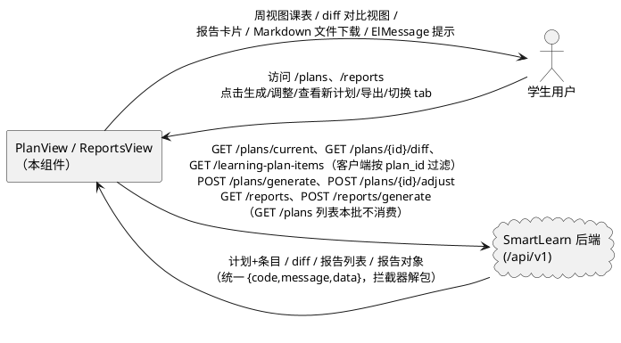
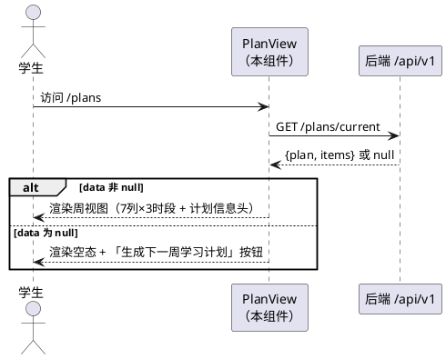
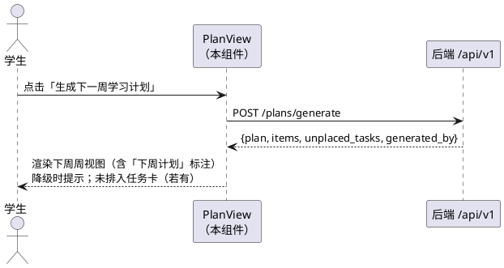
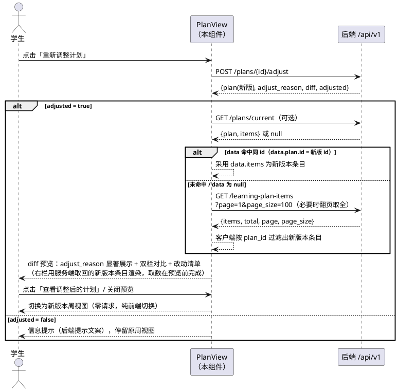
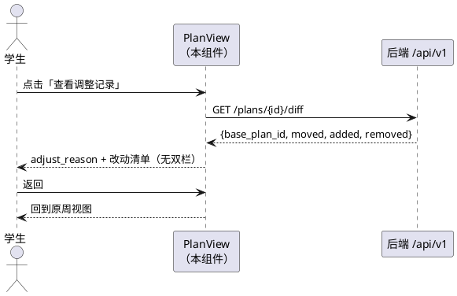
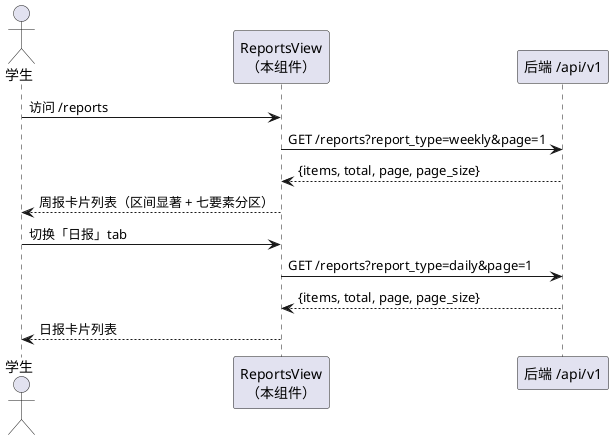
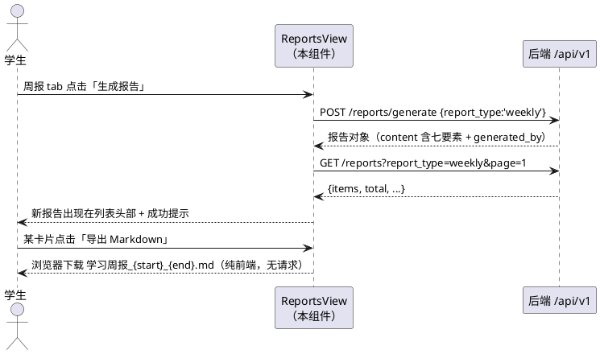

# 学习计划周视图与成长报告前端 — 需求规格（spec.md）

> feature：`plan_report_frontend`
> 阶段：P13 前端批次（只做前端：PlanView.vue、ReportsView.vue 及配套 api / types / components）
> 上游契约：`docs/PROJECT_CONTEXT.md`（唯一技术契约，§7 前端约定 / §8 编码规范）；后端 P12 已冻结验收（pytest 206/206），**本批禁止修改 backend/**
> 后端 API 事实依据：`backend/app/api/v1/plans.py`、`backend/app/api/v1/learning_plan_items.py`、`backend/app/api/v1/reports.py`、`backend/app/schemas/plan.py`、`backend/app/schemas/report.py`、`backend/app/services/report.py`（七要素聚合）
> 本文档只描述「做什么」，不描述「怎么实现」；6 个关键裁定的结论与理由见各模块业务规则及附录 A。

---

# 1. 组件定位

## 1.1 核心职责

本组件负责向学生**展示**版本化学习计划的周视图课表与动态调整 diff 对比，并承载学习成长报告的查看、生成与导出，实现「规划 → 执行 → 反馈」闭环的可视化落地。

## 1.2 核心输入

1. 页面加载信号：用户访问 `/plans`、`/reports` 路由（来源：路由表已有骨架，需登录）。
2. 后端只读数据（来源：SmartLearn 后端 REST API，响应已由 `request.ts` 拦截器自动解包为 data）：
   - `GET /api/v1/plans/current` → `{plan, items}` 或 `null`（仅返回 `start_date ≤ 今天 ≤ end_date` 且 active 的计划；无匹配返回 200 + data=null，**非 404**）；
   - `GET /api/v1/plans?page&page_size` → 计划版本列表（id 升序分页，仅含计划元信息，**不含条目**；**本批不消费**，见附录 B #3——版本信息经 current / generate / adjust 响应的 plan 对象已可得，设计阶段勿为其编写 API 函数）；
   - `GET /api/v1/learning-plan-items?page&page_size` → `{items, total, page, page_size}`（本用户全部计划条目，id 升序，出参 `PlanItemOut` 含 plan_id；**无 plan_id 查询参数**，仅接受分页参数，只能客户端过滤——是调整后取回新版本条目的兜底路径，见 5.3.1 规则 4）；
   - `GET /api/v1/plans/{id}/diff` → `{base_plan_id, moved[], added[], removed[]}`（幂等重算；首版计划返回空结构）；
   - `GET /api/v1/reports?report_type=daily|weekly|monthly&page&page_size` → `{items, total, page, page_size}`（created_at 倒序，最新在前）。
3. 用户操作指令（来源：页面按钮）：
   - 「生成下一周学习计划」→ `POST /api/v1/plans/generate`（零字段请求体）；
   - 「重新调整计划」→ `POST /api/v1/plans/{id}/adjust`（零字段请求体）；
   - 「生成报告」→ `POST /api/v1/reports/generate`（请求体 `{report_type}`，period_end 不暴露给用户）；
   - 「查看调整后的计划」→ 纯前端切换（新版本条目已在进入 diff 预览前按 5.3.1 规则 4 从服务端取回：current 命中同 id 才用，否则 learning-plan-items 客户端过滤；点击时零请求）；「导出 Markdown」→ 纯前端行为不产生请求；「切换报告 tab」→ 产生列表请求。

## 1.3 核心输出

1. 页面渲染（目标：学生浏览器）：
   - `/plans`：周视图课表网格（周一~周日 × 上午/下午/晚上三时段）、计划信息头、未排入任务提示卡、diff 对比视图、空态引导；
   - `/reports`：日报/周报/月报三个 tab 的报告卡片列表（含统计区间显著展示、七要素卡片式排版）。
2. 文件下载（目标：学生本地）：报告 Markdown 文件（前端拼字符串 + 原生 Blob 下载，不新增 npm 依赖）。
3. 用户通知（目标：学生浏览器）：操作成功 / 失败 / 降级的 ElMessage 提示（失败提示由 `request.ts` 拦截器统一弹出，页面不重复弹）。

## 1.4 职责边界

本组件**不负责**以下事项（防止职责蔓延）：

1. **不提供计划条目的手动编辑 / 新增 / 删除**——后端无对应写接口；条目只能由「生成 / 调整」产生。
2. **不提供计划版本回滚、版本历史周视图浏览**——后端无版本切换 / 回滚写接口；`learning-plan-items` 端点虽可分页取回条目，但无 plan_id 服务端过滤（仅接受 page/page_size），本批仅将其用于调整流程取回新版本条目（5.3.1 规则 4），不扩展为历史版本浏览能力；版本链信息仅以版本号徽章形式展示。
3. **不提供报告的删除 / 编辑 / 可视化图表**——后端无对应接口；报告图表（ECharts）留待后续批次，本批报告正文用卡片式排版呈现。
4. **不暴露报告生成的 period_end 入参**——恒用后端缺省语义（最近完整周期：daily=昨天 / weekly=上周日 / monthly=上月末）。
5. **不修改后端任何代码、不新增后端接口**——后端 P12 已冻结验收（206 passed）；发现契约缺口时由前端展示层裁定消化（见附录 A 裁定 #1）。
6. **不负责 Dashboard「本周计划」摘要卡片的接入**——该卡片属 Dashboard 页职责（PROJECT_CONTEXT §7.2 已注明「端点保留，后续阶段接入」），本批只做 `/plans` 与 `/reports` 两个路由页面。

---

# 2. 领域术语

**学习计划（Plan）**
: 版本化的一周学习安排，含周期（start_date ~ end_date）、版本号、生成方式与调整理由；同一周期同一时刻至多一个 active 版本，旧版本归档保留。

**当前生效计划（current plan）**
: 满足 `start_date ≤ 今天 ≤ end_date` 且 `status=active` 的计划；由 `GET /plans/current` 返回，通常为覆盖今天的「本周」计划。刚生成的「下周」计划**不满足**此条件，current 查不到它。

**会话态计划**
: 在当前浏览器会话内存中渲染的计划（如下周计划、调整后的新版本）——generate 响应直接携带 `{plan, items}`；adjust 响应只含 plan 元信息，条目须按 5.3.1 规则 4 从服务端取回（current 命中同 id 才用，否则 learning-plan-items 客户端过滤）。刷新页面后不再持久，页面回到 current 语义。是裁定 #1 引入的核心概念。

**计划条目（PlanItem）**
: 计划内某天某时段的学习安排，含主题（topic）、起止时间、预计时长、优先级、条目状态（planned / done / skipped）；「休息」类条目 start_time 为空。

**未排入任务（UnplacedTask）**
: 因每日学习容量不足而未排入计划的候选任务；任务本身已存在于任务列表（scheduled_date 为空），generate 响应以 `{task_id, title, reason}` 列出。

**调整理由（adjust_reason）**
: Agent 调整计划时写给用户的中文自然语言解释（如「检测到你本周 Transformer 学习任务未完成，已将其调整到周六下午」）；随新版本落库并在 diff 视图显著展示。

**版本对比（diff）**
: 新版本计划相对其 parent 版本的结构化改动清单，固定为 `{base_plan_id, moved[], added[], removed[]}` 三类；moved 条目含 from → to 的位置五要素与单条理由。

**查看调整后的计划（展示层切换）**
: 纯前端展示行为——用户在 diff 预览中点击「查看调整后的计划」按钮（或关闭预览，作用相同）后，页面把渲染数据源切换为新版本（新版本条目已在进入 diff 预览前按 5.3.1 规则 4 从服务端取回：current 命中同 id 才用，否则 learning-plan-items 客户端过滤；点击时零请求）；**不是**后端的确认/提交动作（后端 adjust 已即时生效，diff 预览只是展示层对比，不是待确认的草稿）。不设「放弃调整」——后端已生效，放弃会变成谎言。

**生成方式（generated_by）**
: 分域取值（两域字面量不同，不得混用）——**计划生成方式**（generate 响应顶层字段）：`llm`（LLM 规划）或 `rules`（LLM 失败后降级为规则引擎，仍含真实排程）；`rules` 时计划信息头显示「规则降级」徽章并给出可见提示。**报告生成方式**（report.content.generated_by）：`llm`（LLM 总结）或 `template`（LLM 失败后降级为模板文案，数字仍是真实统计）；`template` 时卡片显示「规则模板」徽章（用户可见文案沿用既有叫法）。前端需对两域的降级分别给出可见提示。

**成长报告（Report）**
: 按统计区间聚合的学习总结，分日报（daily）/ 周报（weekly）/ 月报（monthly）三类；同一周期重复生成会追加新行（审计轨迹）。

**统计区间（period）**
: 报告覆盖的日期范围 `period_start ~ period_end`；必须在报告卡片上显著展示，否则用户会误以为内容是「本」周期的数据。

**七要素**
: 报告正文 content 的固定结构：①总学习时长 total_minutes ②完成任务数 task_completed ③任务完成率 completion_rate ④学习最多方向 top_direction ⑤薄弱知识点 weak_points ⑥阶段进步 progress（对比上一等长周期的三差值）⑦建议 advice；外加生成方式标记 generated_by。

---

# 3. 角色与边界

## 3.1 核心角色

- 学生用户：登录 SmartLearn 的唯一人类角色；查看周视图课表、发起计划生成与调整、查看调整后的新版本计划、切换报告 tab、生成与导出报告。

## 3.2 外部系统

- SmartLearn 后端（FastAPI，`/api/v1` 前缀）：本组件全部数据的唯一来源；交互内容为 8 个 REST 接口（plans 5 个——其中 `GET /plans` 列表本批不消费、learning-plan-items 1 个、reports 2 个）；鉴权（Bearer token）与统一响应体解包由既有 `src/api/request.ts` 封装承担，本组件不重复处理。

## 3.3 交互上下文

---

# 4. DFX 约束

## 4.1 性能

1. `/plans` 首屏数据请求不得超过 1 次（GET /plans/current）；空态下不追加请求。
   - 验收条件：打开 /plans（有当前计划）→ 网络面板仅 1 个 plans 请求即完成首屏渲染。
2. `/reports` 首屏仅加载当前激活 tab 对应类型的报告列表（1 次请求）；切换 tab 时按需加载。
   - 验收条件：切到未加载过的 tab → 发起且仅发起 1 次该类型的列表请求。
3. 周视图与报告卡片为纯渲染场景（单计划条目 ≤ 7 天 × 每日个位数条目；单页报告 ≤ 100 条），前端渲染不得引入虚拟滚动等额外复杂度。

## 4.2 可靠性

1. 「生成下一周学习计划」「重新调整计划」「生成报告」三个按钮在请求飞行期间必须锁定（loading 态防重复提交）。
   - 验收条件：请求未返回前再次点击 → 不发起第二次请求（后端 generate 同周期重生成会归档旧版，重复点击有真实副作用，必须防）。
2. 请求失败（网络错误 / 业务码非 0）由拦截器统一 ElMessage 提示，页面保持可用的上一次渲染状态或空态，**不得白屏**。
   - 验收条件：断网状态点「生成下一周学习计划」→ 弹「网络异常，请稍后重试」，页面不崩溃、可重试。
3. diff 预览的新版本条目一律由服务端取回（current 命中同 id 才用，否则 learning-plan-items 客户端过滤，见 5.3.1 规则 4），diff 清单只用于对比视图的高亮与改动清单；任何取数失败场景必须有兜底路径（见 5.3.3 异常场景 4），不得让页面卡死在中间态、不得以旧网格冒充新版本。

## 4.3 安全性

1. 沿用既有鉴权链路：token 注入、401 清 token 跳登录均由 `request.ts` 拦截器承担，本组件不新增任何 token 处理逻辑。
   - 验收条件：token 过期后访问 /plans → 自动跳转 /login（既有行为，不回退）。
2. 导出的 Markdown 文件内容来自后端数据原样转写，前端不拼接任何用户输入之外的脚本类内容；不新增敏感数据面。

## 4.4 可维护性

1. 全部请求经 `src/api/` 模块化封装（plan 相关与 report 相关各自成文件），组件内禁止直接出现 axios 调用。
   - 验收条件：全局检索 views/ 与 components/ 下 plan/report 相关代码 → 无 `axios`、无裸 `fetch`。
2. TS 类型集中在 `src/types/`，字段名与后端保持 snake_case，禁止大面积 `any`。
   - 验收条件：`npm run build`（含 vue-tsc 类型检查）通过，无 any 相关告警。
3. 页面组件拆分参照 AgentView / DashboardView 既有惯例（视图 + 子组件），子组件命名 PascalCase。
4. 用户可见文案全部使用简体中文。

## 4.5 兼容性

1. **后端零改动**：本批不修改 `backend/` 任何文件；后端 206 个 pytest 用例结果不受影响。
   - 验收条件：本批全部改动位于 `frontend/`（及文档）；后端测试重跑仍 206 passed。
2. **零新增依赖**：不新增任何 npm 依赖；Markdown 导出用原生 Blob + URL.createObjectURL 实现。
   - 验收条件：diff `frontend/package.json` 的 dependencies/devDependencies → 无变化。
3. 构建验证：`npm run build` 必须通过（沙箱无后端联调环境，交互走查留本机执行）。
   - 验收条件：CI/本机执行 `npm run build` → exit 0。

---

# 5. 核心能力

## 5.1 计划周视图展示

### 5.1.1 业务规则

1. **数据源规则（裁定 #1 —— current 语义矛盾的消化）**：`/plans` 周视图的数据源按以下优先级确定为「会话态混合加载」：
   - ① 页面首次进入 / 刷新：调 `GET /plans/current`，返回非 null → 渲染该计划（覆盖今天的 active 计划，通常为本周计划）；返回 null → 渲染空态（见 5.2）。
   - ② 会话内点「生成下一周学习计划」成功：直接以 generate 响应的 `{plan, items}` 渲染（下周计划），**不得重查 current**（刚生成的下周计划不满足 current 条件，重查必拿不到）。
   - ③ 会话内调整成功后：按 5.3.1 规则 4 的服务端取数规则取回新版本条目并渲染（current 命中同 id 才用，否则 learning-plan-items 客户端过滤），取数在进入 diff 预览前完成。
   - ④ 页面刷新后回到 ① 的 current 语义（会话态不持久）。
   - 裁定理由：候选方案 A（GET /plans 列表取 active 中 start_date 最大者）与 B（本周/下周切换）**均不可行**——经代码核实，`GET /plans` 列表与 `GET /plans/{id}` 详情都只返回计划元信息（PlanOut），**不含条目**；`learning-plan-items` 虽可分页取回条目，但无 plan_id 服务端过滤参数（仅接受 page/page_size），只能全量翻页后客户端过滤，作为首屏常规数据源开销不当。方案 C（严格 current）在核心演示场景（生成下周 → 立即调整下周）下页面仍是空态，直接不可用。故采用会话态混合加载 + 调整后服务端取数：后端语义不动、演示链路可用、刷新行为可预期。
    a. 验收条件：[刚点完「生成下一周学习计划」（生成的是下周）] → [周视图立即显示下周计划的完整网格，不显示空态]
   b. 验收条件：[生成下周计划后刷新页面] → [回到 current 语义：若本周另有 active 计划则显示本周计划，否则显示空态]
   c. 验收条件：[今日处于某 active 计划周期内打开 /plans] → [周视图显示该计划，顶部周期与该计划 start_date ~ end_date 一致]
2. **网格结构规则**：周视图必须是「列 = 周一至周日（7 列）、行 = 上午 / 下午 / 晚上（3 行时段）」的网格；列头显示星期与日期（由 plan.start_date 推导周一日期，逐列 +1 天）。
   a. 验收条件：[打开 /plans 且存在计划] → [可见 7 列（周一~周日）× 3 行（上午/下午/晚上）层次分明的网格，列头日期与计划周期一致]
3. **时段归属规则（裁定 #4）**：三时段行与后端排程三窗口一一对应：上午 = 09:00–14:00（含 09:00 不含 14:00）、下午 = 14:00–19:00、晚上 = 19:00–23:00；条目按其 start_time 归入对应行。start_time 早于 09:00 或晚于等于 23:00 的条目不应出现（后端不排此时段），出现时归入时间上最近的时段并在控制台告警（防御性容错）。
   a. 验收条件：[条目 start_time=19:00] → [渲染在「晚上」行]
   b. 验收条件：[条目 start_time=14:00] → [渲染在「下午」行]
4. **休息条目渲染规则（裁定 #4 补充）**：start_time 为 null 的条目（如周五休息）**不占**三时段网格行，改为在该日列下的独立「休息」区块渲染（如整列灰底「休息」标记）；理由：休息条目无时间归属，硬塞进某时段行会误导用户对该时段容量的判断。
   a. 验收条件：[周五休息条目（start_time=null，topic 含「休息」）] → [周五列显示独立休息标记，上午/下午/晚上三行内不出现该条目]
5. **条目卡片内容规则**：每个条目卡片显示：主题（topic）、起止时间（start_time ~ end_time，休息条目不显示时间）、预计时长（estimated_minutes，空则不显示该行）；task_id 非空时显示「关联任务」标识。
   a. 验收条件：[条目 topic=「线性代数：特征值」、19:00~20:30、90 分钟、关联任务] → [卡片同时可见四类信息]
6. **未完成醒目标注规则**：条目状态 status='planned'（未完成）时，卡片左侧渲染醒目色条（Element Plus 主题色系，如 warning 橙）；status='done' 显示完成态（如对勾/灰显弱化）；status='skipped' 以删除线或灰显区分。**标注依据为条目自身 status 字段**（planned/done/skipped），不以关联任务的 todo/in_progress 状态另发请求查询——理由：条目自带执行状态即为用户心智中的「这条学习安排完成与否」，额外按 task_id 反查任务状态会引入 N+1 请求且超出本批范围。
   a. 验收条件：[status='planned' 的条目] → [左侧出现醒目色条]
   b. 验收条件：[status='done' 的条目] → [无色条且有可辨识的完成样式]
7. **计划信息头规则**：周视图顶部显示：计划标题、周期（如「2026-10-26 ~ 2026-11-01」）、版本号（如「v3」）、生成方式徽章（LLM 规划 / 规则降级）；当展示的是会话态「下周计划」时，信息头需明确标注「下周计划」，与 current 语义的本周区分。
   a. 验收条件：[查看 v3、2026-10-26 ~ 2026-11-01、generated_by='llm' 的计划] → [顶部可见周期文本、v3 版本徽章、「LLM 规划」徽章]
   b. 验收条件：[generate 响应渲染的下周计划] → [信息头含「下周计划」字样]
8. **未排入任务展示规则（裁定 #5）**：generate 响应的 unplaced_tasks 非空时，在周视图下方渲染独立的「容量不足，未排入的任务」提示卡：逐条显示任务标题 title 与后端给出的中文原因 reason，并附说明文案「这些任务已保存在任务列表，可前往任务页手动安排」；unplaced_tasks 为空数组时**不渲染**该卡片。adjust 流程响应不含该字段，不涉及。
   a. 验收条件：[generate 响应 unplaced_tasks=[{title:'X', reason:'周五已休息…'}]] → [周视图下方出现提示卡且含该标题与原因]
   b. 验收条件：[unplaced_tasks=[]] → [页面无该卡片占位]
9. **禁止项**：周视图禁止提供条目的点击编辑、拖拽改期等任何写操作入口（后端无接口，见 1.4）。
   a. 验收条件：[悬停/点击任意条目] → [不出现编辑、删除、拖拽改期类交互]

### 5.1.2 交互流程

### 5.1.3 异常场景

1. **无当前计划（正常空态，非错误）**
   a. 触发条件：GET /plans/current 返回 200 且 data=null（今天不在任何 active 计划周期内）。
   b. 系统行为：渲染空态组件，展示引导文案与「生成下一周学习计划」按钮（文案要求见 5.2.1 规则 2）；不弹任何错误提示。
   c. 用户感知：空态插画 + 「为你生成下一周学习计划」按钮，无报错弹窗。
2. **current 请求失败**
   a. 触发条件：网络错误或业务码非 0。
   b. 系统行为：拦截器统一 ElMessage；页面渲染空态（含生成按钮）保持可用。
   c. 用户感知：错误 toast + 可重试的空态页面，不白屏。
3. **条目日期越界（防御性）**
   a. 触发条件：某条目 plan_date 不在计划 start_date ~ end_date 区间内（后端不应产生，脏数据防御）。
   b. 系统行为：该条目不渲染进网格，控制台告警；不影响其余条目渲染。
   c. 用户感知：无感知（或仅缺该条目），页面不报错。

## 5.2 计划生成（空态与下周语义）

### 5.2.1 业务规则

1. **生成动作规则**：用户点击「生成下一周学习计划」→ 调 `POST /api/v1/plans/generate`（零字段请求体）；请求飞行期间按钮 loading 锁定（见 4.2-1）；成功后以响应 `{plan, items, unplaced_tasks, generated_by}` 直接渲染周视图（会话态，见 5.1.1 规则 1-②），并 ElMessage 成功提示。
   a. 验收条件：[空态点击「生成下一周学习计划」→ 后端成功] → [周视图渲染响应中的下周计划网格，含未排入任务卡（若有）]
2. **空态文案规则（裁定 #3）**：空态与按钮文案必须如实说明生成的是**下一周**计划，禁止使用会误导用户以为生成「本周」计划的措辞。按钮文案定为「生成下一周学习计划」，空态说明文案须包含「为下一个完整自然周（周一开始）生成」语义。
   - 裁定理由：generate 恒生成下一个完整自然周；若文案不含「下一周」字样，用户在周中点击后会疑惑「为什么网格里是下周的日期而不是本周的」。
   a. 验收条件：[current=null 的空态] → [按钮文案含「下一周」字样，说明文案含下周语义]
3. **生成方式提示规则**：响应 generated_by='rules'（LLM 失败降级纯规则）时，计划信息头徽章显示「规则降级」，并渲染一条醒目但不阻断的提示（如 ElMessage.warning 或页面内 Alert）「LLM 规划暂不可用，已按规则引擎生成计划」；generated_by='llm' 时徽章显示「LLM 规划」，无额外提示。
   a. 验收条件：[generate 响应 generated_by='rules'] → [信息头出现「规则降级」徽章且页面出现降级提示]
   b. 验收条件：[generated_by='llm'] → [信息头显示「LLM 规划」，无降级提示]
4. **同周期重生成提示规则**：后端语义为「同周期已有 active 计划时归档旧版重新生成」——前端在按钮附近提供简短说明「同一周期重复生成会归档旧版本」，避免用户误以为是无副作用的重复操作。
   a. 验收条件：[页面存在生成入口（空态或工具栏）] → [入口附近可见该说明文案]
5. **禁止项**：generate 成功后禁止自动跳转或弹全屏遮罩打断浏览；渲染即完成闭环。
   a. 验收条件：[generate 成功] → [停留 /plans 页面，直接看到新周视图]

### 5.2.2 交互流程

### 5.2.3 异常场景

1. **生成请求失败**
   a. 触发条件：网络错误、LLM 与规则双失败等导致业务码非 0（如 3000/5000）。
   b. 系统行为：拦截器 ElMessage 错误提示；按钮解除 loading；页面维持原状态（空态或原周视图）。
   c. 用户感知：错误 toast，可重试。
2. **生成与既有 active 计划重叠冲突**
   a. 触发条件：后端返回 400 + code=1007（业务规则冲突）。
   b. 系统行为：拦截器弹出后端 message；页面状态不变。
   c. 用户感知：冲突原因 toast（后端文案）。
3. **重复点击（并发防护）**
   a. 触发条件：请求飞行期间再次点击生成按钮。
   b. 系统行为：按钮 loading 锁定，第二次点击不发起请求。
   c. 用户感知：按钮转圈不可再点。

## 5.3 计划动态调整与 diff 预览（核心演示动作）

### 5.3.1 业务规则

1. **调整入口规则**：周视图工具栏提供「重新调整计划」按钮（页面存在可展示的计划时可用）→ 调 `POST /api/v1/plans/{id}/adjust`（id 为当前展示计划的 id，零字段请求体）；请求飞行期间按钮 loading 锁定。
   a. 验收条件：[周视图展示 id=3 的计划，点击「重新调整计划」] → [发出 POST /plans/3/adjust]
2. **两阶段展示语义规则（裁定 #2 —— 「查看调整后的计划」是展示层切换，不是后端确认）**：后端 adjust **即时生效**——响应到达时新版本已落库、旧版已归档、parent_plan_id 已指向旧版；**后端不存在也不需要任何「确认 / 提交 / 回滚」接口**。diff 预览只是**展示层**对比视图，不是待确认的草稿。「用户点击『查看调整后的计划』后才切换到新版本视图」是**前端展示层的两阶段**：阶段一（diff 预览）用户阅读 adjust_reason 与改动对比，页面暂缓渲染新版本网格；阶段二（点击「查看调整后的计划」或关闭预览）页面把渲染数据源切换为新版本（新版本条目已在进入 diff 预览前按规则 4 从服务端取好，切换时零请求）。实现者不得向规格或后端提出任何确认类接口需求。
   a. 验收条件：[adjust 成功后、未点「查看调整后的计划」前] → [页面展示 diff 预览视图，不展示新版本周视图网格]
   b. 验收条件：[点击「查看调整后的计划」] → [页面切换为新版本周视图；期间不发出任何后端请求]
   c. 验收条件：[全流程网络面板] → [不存在除 adjust 外的任何「确认/提交」类请求]
3. **diff 预览视图结构规则**：adjust 成功（adjusted=true）后进入 diff 预览视图，自上而下包含：
   - 顶部：adjust_reason 显著展示（大字号/独立色块卡片，Agent 的自然语言解释必须一眼可读，禁止折叠默认隐藏）；
   - 中部：左侧「原计划」、右侧「新计划」双栏网格对比（均为 7 列 × 3 时段缩略网格）——左栏以进入调整前页面持有的旧版本条目渲染，右栏以规则 4 服务端取回的新版本条目渲染；被移动的条目在两栏中以醒目标记（如高亮边框 + 「移出/移入」角标，连线或位移动画为实现可选增强，非硬性）标出；新增条目在右栏高亮「新增」标记；被移出条目在左栏高亮「移出」标记；
   - 底部：结构化改动清单——moved 逐条列出「任务 X：从{from_date from_time}挪到{to_date to_time}（原因）」；removed 逐条列出「任务 X 被移出计划（原因）」；added 逐条列出「新增：任务 X（原因）」；
   - 操作区：主按钮「查看调整后的计划」；次级操作为关闭按钮（文案可写「关闭对比」，作用与主按钮相同——关闭预览等同查看完毕，页面展示的仍是新版本，见规则 6）。
   a. 验收条件：[adjust 返回 adjusted=true 且 adjust_reason 非空] → [diff 视图顶部显著可见 adjust_reason 全文]
   b. 验收条件：[diff.moved 含一条 from 周三19:00 → to 周六14:00 的条目] → [双栏对比中该条目两处均有醒目标记，且底部清单含该条挪动描述]
   c. 验收条件：[diff.removed 非空] → [底部清单含「被移出计划」条目列表]
4. **新版本条目服务端取数规则（数据来源唯一口径）**：diff 预览右栏「新计划」与点「查看调整后的计划」后的周视图，其条目数据一律从服务端取回（adjust 响应的 plan 仅元信息、不含 items，此为后端契约事实，实现不得假设响应含 items）：
   - ① 目标 id = adjust 响应中的 `plan.id`；
   - ② 先调 `GET /api/v1/plans/current`：**仅当** `data != null` 且 `data.plan.id === 目标 id` 时，采用 `data.items`；
   - ③ 否则调 `GET /api/v1/learning-plan-items?page=N&page_size=100`，按 `page * page_size < total` 翻页取全，客户端按 `plan_id === 目标 id` 过滤；过滤结果即为新版本条目；
   - ④ 第 ③ 步拿到空结果或请求失败：进入明确错误态（提示 +「重新加载」回到 current 流程，见 5.3.3 异常场景 4），**不得**渲染旧数据或猜测数据；
   - ⑤ **严禁**用「旧 items + diff」在前端重建新版本网格；diff 只用于对比视图的高亮与改动清单；
   - ⑥ 取数在进入 diff 预览**前**完成：diff 预览渲染右栏时不得再发新请求，点「查看调整后的计划」时零请求；右栏与切换后的周视图使用**同一份**服务端取回的条目，二者必须一致。
   - 请求顺序（如实落验收）：调整流程 = `POST /plans/{id}/adjust` →（可选）`GET /plans/current` →（必要时）1..N 次 `GET /learning-plan-items`。
   a. 验收条件：[调整一张下周计划成功] → [右栏与切换后的周视图展示的是该新版本的条目，不得出现本周计划的内容]
   b. 验收条件：[adjust 返回的新版本 id ≠ current 返回的 plan.id] → [不得使用 current 的 items]
   c. 验收条件：[learning-plan-items 返回多页] → [按 plan_id 过滤后条目不缺不重]
   d. 验收条件：[取数失败或结果为空] → [明确错误态，不白屏，不用旧网格冒充新版本]
5. **无可调整项规则**：adjust 返回 adjusted=false（无满足调整条件的条目）时，**不进入 diff 预览**；以 ElMessage.info 展示后端返回的 adjust_reason（此场景下它是提示文案，如「当前计划暂无需调整的条目」），页面保持原周视图。
   a. 验收条件：[adjust 响应 adjusted=false] → [页面停留在原周视图，出现信息提示，无 diff 视图]
6. **关闭 diff 预览的诚实语义规则**：因后端已即时生效，diff 预览不提供「放弃调整」「取消调整」「撤销」类按钮（避免暗示可撤销）；用户若通过关闭按钮/ESC 退出预览，前端同样将底层数据切换为新版本（与点「查看调整后的计划」作用相同——关闭预览等同查看完毕，页面展示的仍是新版本），并以轻提示告知「新计划已生效」。
   - 裁定理由：提供「放弃」会误导用户以为旧版可恢复，与后端「旧版已归档」的事实相悖。
   a. 验收条件：[diff 预览中直接点关闭] → [返回周视图且展示的是新版本数据，出现「新计划已生效」提示]
7. **禁止项**：diff 预览禁止调用 `GET /plans/{id}/diff` 重复拉取（adjust 响应已含同构 diff）；禁止在预览层发起任何写请求。
   a. 验收条件：[adjust 成功到查看完新版本的全程] → [不出现 GET /plans/{id}/diff 请求]

### 5.3.2 交互流程

### 5.3.3 异常场景

1. **adjust 请求失败**
   a. 触发条件：网络错误或业务码非 0（如 404/1005 计划不存在、400/1007 冲突）。
   b. 系统行为：拦截器 ElMessage；按钮解除 loading；页面维持原周视图。
   c. 用户感知：错误 toast，原视图不变。
2. **计划不存在或越权**
   a. 触发条件：adjust 的目标 id 不存在或非本人计划（如会话态数据已过期）。
   b. 系统行为：404/1005 由拦截器提示；页面回退到 current 加载流程重新初始化。
   c. 用户感知：「资源不存在」toast 后页面自动恢复到可用的当前计划或空态。
3. **diff 数据为空结构但 adjusted=true（防御）**
   a. 触发条件：adjust 成功但 moved/added/removed 全为空。
   b. 系统行为：仍进入 diff 预览，双栏对比无高亮条目，改动清单显示「本次调整无条目变动」；adjust_reason 正常展示。
   c. 用户感知：可读理由 + 空清单提示，流程可正常「查看调整后的计划」。
4. **服务端取数失败兜底（规则 4 的容错）**
   a. 触发条件：current 未命中同 id 后，learning-plan-items 请求失败（网络错误 / 业务码非 0），或翻页取全后按 plan_id 过滤结果为空。
   b. 系统行为：进入明确错误态（错误提示 +「重新加载」入口，点击回到 current 加载流程重新初始化）；不得渲染旧网格冒充新版本、不得用猜测数据填充。错误提示必须明确告知「计划调整已生效，但新版本条目暂时加载失败」，禁止只写「加载失败」让用户误以为调整未生效；「重新加载」仍按原口径回到 current 流程重新初始化。
   c. 用户感知：错误提示（含「调整已生效」语义）+ 可重试入口，不白屏、不卡死在中间态，页面恢复到当前生效计划或空态。
   d. 验收条件：[取数失败错误态] → [文案含「调整已生效」语义，不出现纯「加载失败」措辞]
5. **adjust 期间计划已被归档（并发）**
   a. 触发条件：同一计划在另一处（如 Agent 对话内）刚被调整过，本次 adjust 命中后端归档校验。
   b. 系统行为：以后端返回的业务码/message 为准提示；页面重新走 current 初始化。
   c. 用户感知：提示后看到最新生效计划，无需手动刷新。

## 5.4 调整记录回看（低频辅助能力）

### 5.4.1 业务规则

1. **入口与数据源规则**：当前展示计划的 parent_plan_id 非空（本版本由调整产生）时，计划信息头提供「查看调整记录」入口 → 调 `GET /api/v1/plans/{id}/diff`（幂等重算）；parent_plan_id 为 null（首版）时不显示该入口。
   a. 验收条件：[当前计划 parent_plan_id=2] → [信息头出现「查看调整记录」入口，点击发出 GET /plans/{id}/diff]
   b. 验收条件：[当前计划为首版（parent_plan_id=null）] → [无该入口]
2. **回看视图结构规则（降级形态）**：回看视图展示当前计划的 adjust_reason（计划对象自带字段）+ 结构化改动清单（moved/added/removed，同 5.3.1 规则 3 底部清单样式）；**不做双栏网格对比**——parent 版本条目需经 learning-plan-items 全量翻页 + 客户端过滤才能取回（无 plan_id 服务端过滤），回看属低频辅助能力，为避免额外取数开销仅呈现理由与清单。
   a. 验收条件：[打开回看视图] → [可见 adjust_reason 与三类改动清单，无双栏网格]
3. **退出规则**：回看视图提供「返回周视图」操作，退出后回到回看前的周视图，数据不变。
   a. 验收条件：[回看后点返回] → [回到原周视图，无额外请求]
4. **禁止项**：回看视图禁止出现任何「应用/确认」类按钮（调整早已生效）。
   a. 验收条件：[回看视图] → [无任何应用/确认类按钮]

### 5.4.2 交互流程

### 5.4.3 异常场景

1. **diff 请求失败**
   a. 触发条件：网络错误或业务码非 0。
   b. 系统行为：拦截器 ElMessage；停留原周视图。
   c. 用户感知：错误 toast，可重试。
2. **diff 返回空结构（首版防御 / 幂等空）**
   a. 触发条件：GET diff 返回 `{base_plan_id: null, moved: [], added: [], removed: []}`。
   b. 系统行为：回看视图显示「该版本无调整记录」提示。
   c. 用户感知：空态提示，可返回。

## 5.5 成长报告列表与查看

### 5.5.1 业务规则

1. **三 tab 结构规则**：`/reports` 页面为三个 tab：日报 / 周报 / 月报（对应 report_type=daily / weekly / monthly），默认激活周报 tab；每个 tab 独立维护列表与分页状态；切换 tab 时按需加载（未加载过才发请求，已加载过可直接复用会话内缓存）。
   a. 验收条件：[首次打开 /reports] → [仅加载 weekly 一类的列表请求]
   b. 验收条件：[依次切换 日报 → 周报 → 月报 → 周报] → [每类型至多首次各 1 次列表请求，回到周报不再重复请求]
2. **列表数据与分页规则**：每 tab 调 `GET /api/v1/reports?report_type={type}&page={page}&page_size={size}`（page 从 1 起，page_size 默认 10，上限 100）；列表按后端 created_at 倒序（最新在前）渲染；底部提供分页器（total 对齐响应 total）。
   a. 验收条件：[切到月报 tab] → [发出 report_type=monthly 的请求，卡片顺序为最新在前]
   b. 验收条件：[点击分页器第 2 页] → [发出 page=2 的请求并渲染该页数据]
3. **统计区间显著展示规则（硬性）**：每张报告卡片必须在**卡片头部显著位置**显示统计区间「period_start 至 period_end」（格式如「2026-10-12 至 2026-10-18」），并辅以类型标识（日报/周报/月报）；**禁止**只在正文里埋区间信息——用户会误以为报告内容是本周期数据。卡片同时显示生成时间（created_at）与生成方式徽章（LLM 总结 / 规则模板）。
   a. 验收条件：[任意一张周报卡片] → [卡片头部肉眼即见「2026-10-12 至 2026-10-18」区间文本，无需展开正文]
4. **正文卡片式排版规则**：报告卡片正文按七要素分区呈现（学习时长 / 完成任务 / 完成率 / 学习最多的方向 / 薄弱知识点 / 阶段进步 / 建议），采用 Element Plus 卡片分块或描述列表样式；数字类字段显示真实数值（如「共 420 分钟」「完成 5 个任务，完成率 62.5%」）；summary（若非空）作为摘要块置于七要素之前。
   a. 验收条件：[一张 content 七要素齐全的周报] → [卡片内七要素分区可见且数字与后端一致]
5. **薄弱知识点色块强调规则**：weak_points 列表的每个知识点以醒目色块（Element Plus danger/warning 色系标签）渲染并附掌握度分数（如「Transformer 38 分」），与普通文本明确区分；weak_points 为空时该分区显示「本期无明显薄弱知识点」。
   a. 验收条件：[weak_points=[{knowledge_point:'Transformer', mastery_score:38}]] → [色块标签渲染且含分数]
   b. 验收条件：[weak_points=[]] → [该分区显示空态文案而非留白]
6. **零数据容错规则**：content 为 null 或部分字段缺失的存量报告，卡片按「有则显示、无则隐藏该分区」渲染，禁止报错或渲染「undefined/null」字样。
   a. 验收条件：[content=null 的报告] → [卡片仅显示区间、类型、生成时间与摘要（若有），页面不报错]
7. **生成方式徽章规则**：content.generated_by='template' 显示「规则模板」徽章（降级生成，含真实数字）；'llm' 显示「LLM 总结」；缺失时不显示徽章。
   a. 验收条件：[generated_by='template' 的报告] → [卡片可见「规则模板」徽章]
8. **空态规则**：某 tab 的列表为空（total=0）时显示空态组件与「生成报告」引导，不显示分页器。
   a. 验收条件：[daily 列表为空] → [日报 tab 显示空态 + 生成按钮，无分页器]

### 5.5.2 交互流程

### 5.5.3 异常场景

1. **列表请求失败**
   a. 触发条件：网络错误或业务码非 0。
   b. 系统行为：拦截器 ElMessage；该 tab 显示空态（含重试能力的生成入口）。
   c. 用户感知：错误 toast + 可用空态。
2. **report_type 非法（防御）**
   a. 触发条件：前端状态异常导致非法枚举（后端 Literal 校验会 422/1001）。
   b. 系统行为：不发出请求，控制台告警（正常交互不可能触发，属防御）。
   c. 用户感知：无感知。

## 5.6 报告生成与 Markdown 导出

### 5.6.1 业务规则

1. **生成入口与动作规则**：每个 tab 工具栏提供「生成报告」按钮 → 调 `POST /api/v1/reports/generate`，请求体仅 `{report_type}`（**不传 period_end**，恒用后端缺省的最近完整周期：daily=昨天 / weekly=上周日 / monthly=上月末）；请求飞行期间按钮 loading 锁定；成功后 ElMessage 成功提示，并把该 tab 列表重置回第 1 页重新加载（新报告 created_at 最新，应出现在列表头部——后端同周期重复生成为追加新行）。
   a. 验收条件：[周报 tab 点「生成报告」→ 成功] → [发出 POST /reports/generate {report_type:'weekly'}，列表刷新后第一张卡片为刚生成的报告]
   b. 验收条件：[请求飞行期间] → [按钮 loading，不可重复点击]
2. **生成结果即时反馈规则**：生成成功后可将返回的报告对象在列表头部即时插入渲染（免二次请求的优化路径），或直接重载列表——两者取其一，用户感知一致（新报告出现在最前）。
   a. 验收条件：[生成成功] → [无需手动刷新即可看到新报告卡片]
3. **导出入口规则**：每张报告卡片提供「导出 Markdown」按钮；导出为**纯前端行为**（当前卡片数据拼字符串 → 原生 Blob 下载），**不发起任何后端请求、不新增任何 npm 依赖**。
   a. 验收条件：[点某卡片「导出 Markdown」] → [浏览器下载文件，网络面板无新请求]
4. **导出文件命名规则（裁定 #6）**：文件名格式为 `学习{类型中文名}_{period_start}_{period_end}.md`，类型中文映射：daily→日报、weekly→周报、monthly→月报；示例：`学习周报_2026-10-12_2026-10-18.md`。
   - 裁定理由：中文类型名 + 下划线分隔的 ISO 日期，面向用户可读且无特殊字符风险；与「面向用户的文件名用中文」的项目文案惯例一致（代码标识符仍为英文 snake_case，不受影响）。
   a. 验收条件：[导出 period 为 2026-10-12 ~ 2026-10-18 的周报] → [下载文件名为「学习周报_2026-10-12_2026-10-18.md」]
5. **导出内容结构规则（裁定 #6）**：导出的 Markdown 为 UTF-8 纯文本，结构固定为：
   - 一级标题：`# 学习{类型中文名}（{period_start} 至 {period_end}）`；
   - 引言块：统计区间重申 + 生成时间（created_at 转本地可读格式）；
   - `## 摘要`：summary（若非空，空则省略本节）；
   - `## 学习时长`：total_minutes（附小时换算）；
   - `## 任务完成`：task_completed 与 completion_rate；
   - `## 学习最多的方向`：top_direction（空则「本期暂无」）；
   - `## 薄弱知识点`：weak_points 列表（知识点 + 掌握度分数，空则「本期无明显薄弱知识点」）；
   - `## 阶段进步`：progress 三差值（minutes_diff / task_completed_diff / avg_mastery_diff，正负号保留，null 项省略）；
   - `## 建议`：advice 有序列表；
   - 结尾分隔线 + `生成方式：LLM 总结 / 规则模板`（generated_by 缺省省略）。
   - 裁定理由：区间进标题与引言双保险（用户离线转发的 md 文件脱离页面上下文后仍不会误读周期）；七要素分节与页面卡片排版一一对应，降低实现与走查的心智负担。
   a. 验收条件：[导出任一报告并用文本编辑器打开] → [首行为含区间的标题，正文中七个分区（有数据时）与 generated_by 结尾齐全，无「undefined」字样]
   b. 验收条件：[导出 weak_points 为空的报告] → [薄弱知识点节显示空态文案，文件仍完整]
6. **禁止项**：导出禁止依赖 file-saver 等第三方库（4.5-2 零新增依赖红线）；禁止把 Blob URL 长期滞留（下载触发后及时释放）。
   a. 验收条件：[导出后查看 package.json] → [依赖无变化]

### 5.6.2 交互流程

### 5.6.3 异常场景

1. **生成请求失败**
   a. 触发条件：网络错误或业务码非 0（如 LLM 与模板双失败的 3000 类、422/1001 参数问题）。
   b. 系统行为：拦截器 ElMessage；按钮解除 loading；列表维持原状。
   c. 用户感知：错误 toast，可重试。
2. **生成的报告 content 为 null（极端容错）**
   a. 触发条件：生成成功但 content 为空（理论不应发生，防御）。
   b. 系统行为：卡片按 5.5.1 规则 6 容错渲染；导出仅含区间、摘要与结尾，不报错。
   c. 用户感知：可查看可导出，无崩溃。
3. **浏览器拦截下载（沙箱/权限）**
   a. 触发条件：浏览器禁用自动下载。
   b. 系统行为：ElMessage 提示「浏览器已拦截下载，请允许下载后重试」。
   c. 用户感知：明确提示，可重试。

---

# 6. 数据约束

> 本章定义前端消费的领域对象**逻辑约束**（字段业务含义 / 取值范围 / 格式 / 必填性）；不含存储与接口实现细节。所有字段名与后端保持 snake_case（PROJECT_CONTEXT §8.3，前端不做大小写自动转换）。以下类型为前端 `src/types/` 需新增/对齐的内容契约（文件组织由设计阶段决定）。

## 6.1 Plan（学习计划版本，对齐后端 PlanOut）

1. **id**：计划标识，数值；adjust 时作为路径参数使用。
2. **title**：计划标题，非空字符串；信息头直接展示。
3. **version**：版本号，正整数；徽章展示为「v{version}」。
4. **status**：'active' | 'archived'；前端仅渲染 active 计划的周视图（current 语义保证），archived 不直接展示。
5. **parent_plan_id**：父版本 id 或 null；非空时 PlanView 显示「查看调整记录」入口（5.4）。
6. **source**：'agent' | 'manual'；标识计划产生途径，信息头可选展示。
7. **adjust_reason**：调整理由中文文本或 null；非空时 diff 预览 / 回看视图显著展示。
8. **start_date / end_date**：周期起止，'YYYY-MM-DD'，end_date ≥ start_date，恒为完整自然周（周一 ~ 周日）；信息头周期展示与周视图列头日期推导的依据。
9. **goal_id**：关联目标 id 或 null。
10. **created_at**：创建时间，ISO 时间戳字符串。

## 6.2 PlanItem（计划条目，对齐后端 PlanItemOut）

1. **plan_id**：所属计划 id，数值；learning-plan-items 列表出参自带（该端点无 plan_id 查询参数，仅接受分页），是客户端过滤出新版本条目的唯一依据（5.3.1 规则 4）。
2. **plan_date**：安排日期，'YYYY-MM-DD'；必须落在所属计划的 start_date ~ end_date 内（越界条目按 5.1.3-3 容错）。
3. **start_time / end_time**：起止时间，'HH:MM' 或 null；休息类条目两者均可为 null，渲染进独立休息区块（5.1.1 规则 4）；时段归属由 start_time 判定（5.1.1 规则 3）。
4. **topic**：学习主题，非空字符串（如「线性代数：特征值」「休息」）；条目卡片主文案。
5. **task_id**：关联任务 id 或 null；非空时卡片显示「关联任务」标识。
6. **estimated_minutes**：预计时长（分钟）或 null；空则卡片不显示时长行。
7. **priority**：'low' | 'medium' | 'high' 或 null。
8. **status**：'planned' | 'done' | 'skipped'；planned 触发左侧醒目色条（5.1.1 规则 6）。

## 6.3 UnplacedTask（未排入任务，对齐后端 UnplacedTaskOut）

1. **task_id**：任务 id 或 null。
2. **title**：任务标题，非空字符串；提示卡主文案。
3. **reason**：未排入的中文原因，非空字符串；提示卡副文案。

## 6.4 计划生成响应（对齐后端 PlanGenerateOut，会话态渲染依据）

1. **plan**：新建计划版本对象（结构同 6.1）。
2. **items**：新计划全部条目（结构同 6.2）；generate 与 current 是**响应内直接携带完整条目**的两个路径（generate 为会话态、current 为首屏基线）；adjust 响应不含条目，须按 5.3.1 规则 4 服务端取数。
3. **unplaced_tasks**：未排入任务列表（结构同 6.3）；空数组不渲染提示卡。
4. **generated_by**：'llm' | 'rules'；'rules' 触发降级提示（5.2.1 规则 3）。

## 6.5 版本对比与调整响应（对齐后端 PlanDiffOut / PlanAdjustOut）

1. **diff.base_plan_id**：基线（父）版本 id 或 null；null 表示首版空 diff。
2. **diff.moved[]**：被移动条目，每条含 topic（非空）、task_id（可 null）、from_date / to_date（'YYYY-MM-DD'）、from_time / to_time（'HH:MM' 或 null）、reason（中文原因）；是双栏对比高亮与改动清单的主数据；**仅作对比展示，不作为新版本条目的数据来源**（新版本条目一律服务端取回，5.3.1 规则 4）。
3. **diff.added[]**：新增条目，每条含 topic、task_id（可 null）、plan_date（'YYYY-MM-DD'）、start_time（'HH:MM' 或 null）、reason；调整路径通常为空。
4. **diff.removed[]**：被移出条目，每条含 topic、task_id（可 null）、from_date（'YYYY-MM-DD'）、reason；被移出的任务仍保留在任务列表。
5. **调整响应的 plan**：新版本计划对象（**仅元信息，不含条目**——新条目须按 5.3.1 规则 4 从服务端取回：current 命中同 id 才用，否则 learning-plan-items 客户端过滤；此为后端契约事实，实现不得假设响应含 items）。
6. **调整响应的 adjust_reason**：中文理由或 null；adjusted=false 时为提示文案。
7. **调整响应的 adjusted**：布尔；true=已生成新版本（进入 diff 预览），false=无可调整（仅提示，5.3.1 规则 5）。

## 6.6 Report（学习成长报告，对齐后端 ReportOut）

1. **id**：报告标识，数值。
2. **report_type**：'daily' | 'weekly' | 'monthly'；tab 与文案映射（日报/周报/月报）的唯一依据。
3. **period_start / period_end**：统计区间起止，'YYYY-MM-DD'，period_end ≥ period_start；**卡片头部必须显著展示**（5.5.1 规则 3），同时是导出文件名与 Markdown 标题的组成部分。
4. **summary**：报告摘要中文文本或 null；卡片摘要块与导出「## 摘要」节的数据源，空则两处均省略。
5. **content**：七要素结构化对象或 null（对齐后端 JSONType 读出语义：null 表示无结构化内容，**不是**空对象）；字段约束见 6.7。
6. **created_at**：生成时间，ISO 时间戳字符串；列表排序依据（后端倒序直传，前端不重排）。

## 6.7 ReportContent（报告七要素，content 非空时的内部约束）

1. **total_minutes**：周期内学习时长合计，非负整数（分钟）。
2. **task_completed**：周期内完成任务数，非负整数。
3. **completion_rate**：周期内截止任务完成率，0–100 的数值（一位小数）。
4. **top_direction**：学习最多的知识点方向，中文字符串或 null（无记录时 null）。
5. **weak_points**：薄弱知识点列表，每项含 knowledge_point（中文名）与 mastery_score（0–100 数值）；至多 3 项；空数组=本期无明显薄弱点；**前端须以色块强调渲染**（5.5.1 规则 5）。
6. **progress**：阶段进步对象，含 minutes_diff（整数，可正可负）、task_completed_diff（整数，可正可负）、avg_mastery_diff（数值或 null，无对比数据时 null）；正负号语义为相对上一等长周期的增减，展示与导出必须保留符号。
7. **advice**：建议中文文本列表，至少 1 条（后端兜底文案「暂无明显风险…」）。
8. **generated_by**：'llm' | 'template' 或缺失；映射「LLM 总结 / 规则模板」徽章与导出结尾标注。

---

# 附录 A：关键裁定清单（6 项）

| # | 裁定主题 | 结论 | 理由摘要 |
|---|---|---|---|
| 1 | current 只返回覆盖今天的计划 vs generate 恒生成下周 | **会话态混合加载 + 调整后服务端取数**：首屏 / 刷新以 current 为基线（覆盖今天才显示，null 则空态）；generate 响应 `{plan, items}` 直接渲染（不重查 current）；adjust 后新版本条目从服务端取回——先 `GET /plans/current`，**仅命中同 id（data.plan.id = 新版 id）才采用其 items**，否则 `GET /learning-plan-items` 分页取全 + 客户端按 plan_id 过滤；刷新回到 current 语义（会话态不持久）。验收标准 1 的「本周计划」对齐为「当前生效计划（覆盖今天的 active 计划）」；演示场景（生成下周）下为 generate 响应直接渲染的下周周视图 | generate/adjust 产物（下周 / 新周期版本）不满足 current 的「覆盖今天」条件；`GET /plans` 与 `GET /plans/{id}` 只返回元信息不含 items（代码核实）；learning-plan-items 端点无 plan_id 服务端过滤（仅接受 page/page_size），只能客户端过滤；直接拿 current 的 items 渲染会把页面替换成无关的本周计划 |
| 2 | 「查看调整后的计划」的语义 | **展示层切换**：后端 adjust 即时生效（新版本已落库、旧版已归档），diff 预览只是展示层对比、不是待确认草稿；主按钮「查看调整后的计划」，关闭按钮作用相同（关闭预览等同查看完毕，页面展示的仍是新版本）；**不提供「放弃调整 / 取消调整 / 撤销」类按钮**；新版本条目已在进入 diff 预览前从服务端取好，点击切换时零请求；禁止向规格或后端提出任何确认类接口需求 | 防止实现者误解为需要后端两阶段提交或新造确认接口；提供「放弃」会误导用户以为旧版可恢复，与后端「旧版已归档」的事实相悖；与后端「禁止原地修改、版本链备份」的既有语义一致 |
| 3 | generate 按钮位置与语义 | 按钮位于 current=null 的空态（及计划工具栏）；**文案如实写「生成下一周学习计划」**，空态说明含「为下一个完整自然周（周一开始）生成」语义；按钮附近说明「同一周期重复生成会归档旧版本」 | generate 恒生成下一完整自然周；含糊文案会让用户误以为生成的是本周，周中点击后看到下周日期产生困惑 |
| 4 | 三时段行与后端三窗口映射；休息条目位置 | 上午=09:00–14:00、下午=14:00–19:00、晚上=19:00–23:00（按 start_time 左闭右开归属，与后端排程窗口一致）；**start_time=null 的休息条目渲染在该日列独立「休息」区块**，不占三时段行；越界时间就近归档 + 控制台告警（防御） | 时段行与后端窗口对齐可让「调整到周六下午」等 diff 表述与网格位置一一对应；休息条目无时间归属，硬塞时段行会误导容量判断 |
| 5 | unplaced_tasks 展示方式 | 周视图下方**独立提示卡**「容量不足，未排入的任务」：逐条 title + reason + 说明「任务已保存在任务列表，可手动安排」；空数组不渲染；adjust 流程不涉及（响应无此字段） | 与已排入条目在视觉与语义上分区（未排入≠计划内容）；后端已保证任务在任务列表可见，前端只需如实转告原因 |
| 6 | 导出 Markdown 文件命名与内容结构 | 文件名 `学习{类型中文名}_{period_start}_{period_end}.md`（如 学习周报_2026-10-12_2026-10-18.md）；内容结构：区间入一级标题与引言 → 摘要（可省）→ 七要素七个分节 → 结尾「生成方式」标注；UTF-8、纯前端 Blob、零新增依赖 | 区间双保险（脱离页面上下文的 md 文件不会误读周期）；分节与页面卡片排版一一对应，便于实现与走查；中文文件名面向用户、无特殊字符风险 |

# 附录 B：与上游提示词的出入点（事实澄清）

1. **`api/plan.ts` 并不存在**：提示词称「api/ 目录按模块拆分（plan.ts 已存在）」，经 glob 核实 `frontend/src/api/` 下无 plan.ts（现有 agent/chat/knowledge/request/dashboard/record/task/course/goal/profile/auth/health）——plan 相关 API 函数**本批需新建**。
2. **report 相关 API 亦不存在**：`api/dashboard.ts` 仅含 dashboard 5 个函数，无 report 接口——需新建 report API 模块。
3. **「列表回退取最新 active 计划」方案不可行**（提示词裁定点 1 的候选方案 A）：`GET /plans` 列表与 `GET /plans/{id}` 详情均不含条目（PlanOut 元信息），后端无「按 id 取条目」端点；本规格已改为会话态混合加载（附录 A #1），`GET /plans` 列表接口在本批前端**无消费场景**（版本信息经 current/generate/adjust 响应的 plan 对象已可得）。
4. **`GET /plans/{id}/diff` 的消费场景重定义**：提示词将其列为「本次要消费的接口」；本规格保留消费（5.4 调整记录回看，降级形态：仅理由+清单，无双栏），但明确 adjust 即时流程**不**调它（响应已含同构 diff）。

---

*文档状态：待用户评审确认。确认后交由 spec-design-agent 产出 design.md，spec-task-agent 产出 tasks.md（本 agent 不越界）。*