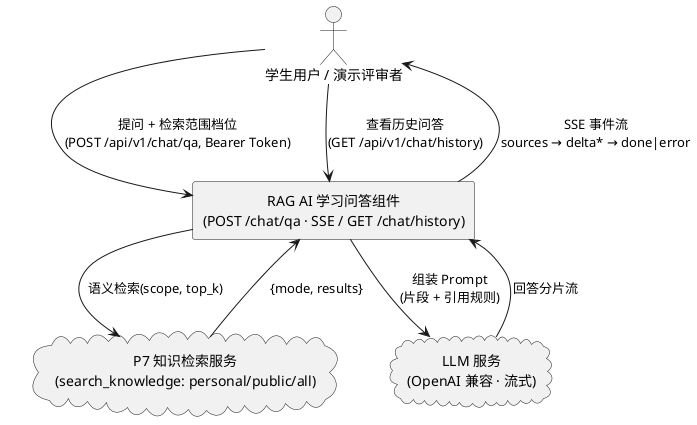
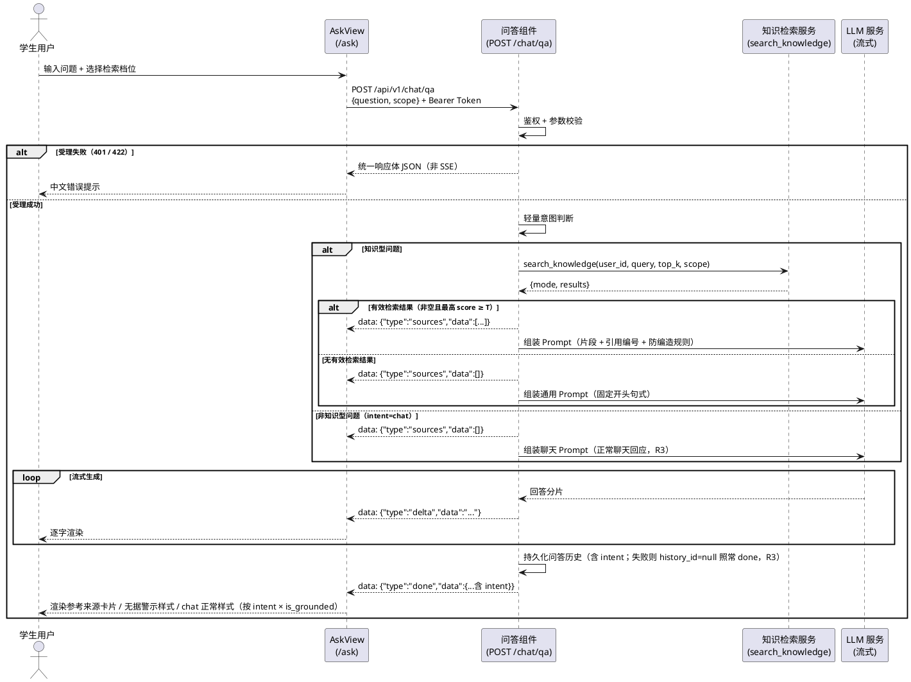
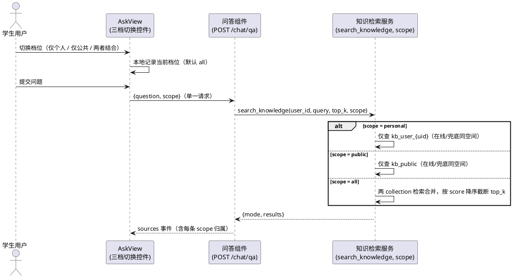
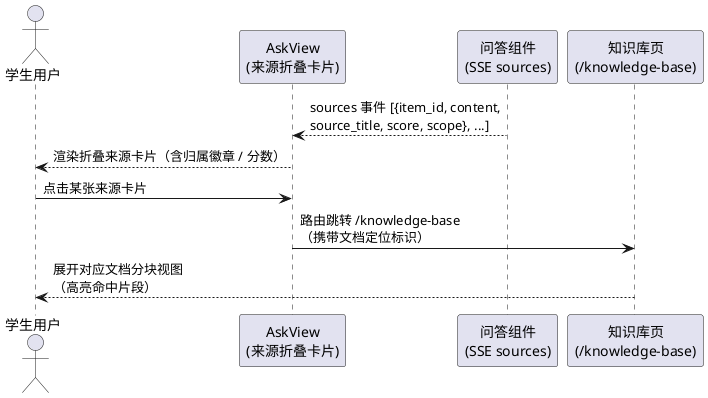
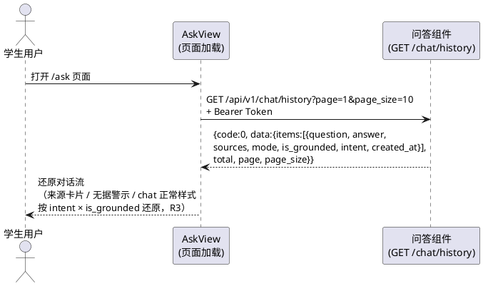

# RAG AI 学习问答需求规格（SPEC_RAG_QA）

| 项目 | 内容 |
|---|---|
| 所属项目 | 彭城智学 SmartLearn Agent |
| 阶段 | RAG AI 学习问答（基于 P7 知识库检索交付，需求文档第 11 章落地） |
| 文档状态 | **R3 定稿**——R2 三项决策维持；R3 增量裁定三项并落实：① done.data 增 `intent` 字段（四字段契约）+ 前端双信号样式规则；② 落库失败改判（done + history_id=null，不发 error）；③ 文档路径统一 docs/specs/ 与 docs/designs/。可进入 tasks.md 阶段 |
| 上游依据 | `docs/PROJECT_CONTEXT.md`（唯一技术契约）、`docs/需求文档.md` 第 11 章、P7 交付现状（`services/knowledge.search_knowledge`：4 篇公共文档 / 33 分块 / 在线与兜底向量各 33 条）、本阶段任务书 |
| 下游文档 | design.md（技术设计，已生成：`docs/designs/DESIGN_RAG_QA.md`，R3 同步修订）、tasks.md（任务规划，另行生成） |
| 验收方式 | 浏览器操作 `/ask` 页面 + `curl -N` 观测 SSE 事件序列 + 双账号对比，逐条核对第 8 章可量化验收标准 |

> **修订记录**：
> - **R1（初版）**：完成 11 项冲突裁决与完整规格，提出 3 项待确认决策（裁决 #5 QA 历史存储 / 裁决 #8 done 事件 data 契约 / 阈值 T 定值）。
> - **R2**：用户裁定 3 项决策**全部采纳**并定稿——① 裁决 #5：新增 `qa_history` 表（PROJECT_CONTEXT 表清单 15 → 16，已同步为 §6.16）；② 裁决 #8：`done` 事件固定携带 `data`（契约定稿）；③ 阈值 T = **0.55**（环境变量 `RAG_MIN_SCORE`，默认 0.55，已写入 `.env.example` 与 PROJECT_CONTEXT §2），并新增 Prompt 第二道防线（5.3.1 规则 7、裁决 #12）。其余各项（`/ask` 路由、scope 参数扩展、来源字段透出、SSE 四事件等）经用户复核**无异议**。
> - **R3（本版）**：design.md 三项开放决策点经用户裁定并落实（裁决 #13 / #14）——① **done.data 契约扩为四字段**：新增 `intent`（`knowledge | chat`），理由：仅 `is_grounded` 无法区分「没检索（chat）」与「检索无果（knowledge 无据）」两种 `false` 场景，前端对两者处理必须不同；前端规则定稿——`intent=knowledge 且 is_grounded=false → 无据警示样式`、`intent=chat → 正常回答不显示任何警示`；**intent 落库**（`qa_history` 新增 `intent` 列，6.3 / PROJECT_CONTEXT §6.16 已同步——chat 与 knowledge 无据字段同构，不落库则历史回放无法区分）；引申落地：chat 类回答走独立聊天模板，**无据固定句式仅出现在 knowledge 无据回答中**（5.1.1 规则 7、5.3.1 规则 2 验收口径已同步收窄）。② **落库失败改判**：正常发送 done（`data.history_id` 置 `null`）+ `logger.warning`（含 user_id，**不记录问题原文**，避免日志泄露用户内容）+ 前端 `history_id=null` 时不显示「已保存」相关状态；原则——**主链路（回答）成功，不被辅链路（历史保存）的失败拖垮**（4.2 规则、5.5.1 规则 2a、5.6.2 契约已同步）。③ **文档路径定稿**：规格与设计统一放 `docs/specs/` 与 `docs/designs/`；`.codeartsdoer/specs/` 历史 8 阶段文档在 P13 打包时复制补齐，本阶段不动历史文档。

> **裁决总纲**：本阶段任务书与 `PROJECT_CONTEXT.md` 存在若干冲突与空白（路由表未含 `/ask`、`search_knowledge` 签名稳定声明、SSE 事件契约无 error 事件、15 张表清单无 QA 历史表等），已全部裁决并记录于**第 7 章**（R1/R2 共 12 项 + R3 增量 2 项 = 14 项）。裁决依据链：① 用户当前明确指令（本阶段任务书含补充要求与决策）优先；② 其余冲突依 PROJECT_CONTEXT 声明「开发提示词与本文件冲突时以本文件为准」；③ 已交付代码现状（P7 检索能力）作为「复用不重写」的边界依据。凡本规格未覆盖的细节，以 PROJECT_CONTEXT 为准。
>
> **需求句式约定**：第 5 章业务规则均采用 EARS 句式的中文等价表达——「当〈触发条件〉时，系统应〈系统响应〉」；无条件规则表述为「系统应〈始终成立的行为〉」。每条规则附验收条件（触发场景 → 预期行为），可直接转化为测试用例。

---

# **1. 组件定位**

## **1.1 核心职责**

本组件负责基于双层知识库（个人库 + 公共库）的 AI 学习问答，实现「检索增强、流式生成、来源可溯、无据不答」的问答闭环。

## **1.2 核心输入**

1. 学生在 AI 问答页（`/ask`）提交的问题文本与检索范围档位（来源：AskView 页面，`POST /api/v1/chat/qa` 请求体）。
2. 有效 JWT Bearer Token（来源：前端请求头 `Authorization`，问答与历史接口均须携带）。
3. 历史问答查询请求（来源：AskView 页面，`GET /api/v1/chat/history` 分页参数）。
4. LLM 流式生成的回答分片（来源：OpenAI 兼容 `/v1/chat/completions` 流式接口，经 `services/llm.py` 的 `chat_stream` 能力接入）。

## **1.3 核心输出**

1. SSE 事件流：按固定顺序 `sources → delta(0..n) → done | error` 推送给前端（`POST /api/v1/chat/qa`，`text/event-stream`），见 5.6 契约。
2. 持久化的问答历史记录（每次成功完成的问答一条，供历史接口回放）。
3. 统一响应体 `{code, message, data}` 的历史问答分页 JSON（`GET /api/v1/chat/history`）。
4. 前端页面产物：流式逐字渲染的回答、参考来源折叠卡片、无据回答的差异化标注样式（对应验收 1/2/3）。

## **1.4 职责边界**

本组件**不负责**以下事项（防止职责蔓延）：

1. **不重新实现检索逻辑**：检索一律复用 P7 交付的 `services/knowledge.search_knowledge`；本阶段仅允许按裁决 #2（新增 `scope` 参数）与裁决 #3（透出 `item_id` / `scope` / `chunk_index` 字段）做**向前兼容的扩展**，禁止另写一套向量检索。
2. **不做文档上传 / 解析 / 切分 / 索引 / 删除**：知识库管理属 `/knowledge-base` 页面与 P7 模块，本组件只消费其检索结果。
3. **不做多轮对话上下文**：本阶段每次提问为独立单轮，不携带历史上下文（裁决 #6）；多轮能力留待后续阶段。
4. **不做 Agent 工具编排**：学习状态分析、计划生成 / 调整、学习报告等属需求文档第 12 章 AI Agent（`/ai-agent`，独立功能独立页面），本组件不调用任何 Agent 工具、不读写学习计划与任务数据。
5. **不检索学习记录等业务数据**：需求文档第 11 章链路中的「相关学习记录」理解为目标态；本阶段以「个人知识库 + 公共知识库」双层检索落地，学习记录融入回答属 Agent 阶段（裁决 #11）。
6. **不修改知识库既有端点行为**：`POST /api/v1/knowledge/search` 的对外契约不变（不新增必填参数、不改响应结构语义）；`scope` 扩展仅发生在服务层函数签名。
7. **不做问答内容的导出 / 分享 / 点赞等增值功能**。
8. **前端不使用 EventSource**（不支持 POST body），不轮询、不做假流式动画。

---

# **2. 领域术语**

**RAG 问答（检索增强问答）**
: 用户提问先经语义检索取得知识库片段，再将片段作为上下文交由 LLM 生成回答的问答模式；本组件的核心业务形态。

**SSE（Server-Sent Events）**
: 服务端向浏览器单向推送的事件流协议；本组件问答接口的传输载体，响应头 `Content-Type: text/event-stream`，每条事件以 `data: {JSON}\n\n` 格式推送。

**sources 事件**
: SSE 事件流的第一个事件，载荷为本次问答引用的全部知识库来源列表；有且仅有一次，必须先于所有 delta 事件。

**delta 事件**
: 承载 LLM 流式输出的单个回答分片的事件；一次问答可推送零至多条，顺序与 LLM 产出顺序一致。

**done 事件 / error 事件**
: SSE 流的两个互斥终结事件：`done` 表示本次问答成功完成；`error` 表示受理后发生异常（LLM 失败 / 检索失败 / 流中断）。一个连接**恰好推送其一**（裁决 #4）。

**检索范围（scope）**
: 一次问答的检索档位，取值 `personal`（仅本人个人库）/ `public`（仅公共库）/ `all`（两者结合，默认值）；由前端三档切换控件选择、随提问请求提交、由后端单次调用 `search_knowledge` 透传完成。

**问题意图（intent）**
: 后端规则式意图判断的判定结果，取值 `knowledge`（知识型，走检索路径）或 `chat`（非知识型——问候、闲聊、元问题，跳过检索直接回答）；经 `done` 事件 `data.intent` 透出并落库 `qa_history.intent`（R3 新增）。与 `is_grounded` 的分工：`is_grounded` 表达「回答是否基于检索」，`intent` 表达「是否走了检索路径」——仅 `is_grounded` 无法区分「没检索（chat）」与「检索无果（knowledge 无据）」两种 `false` 场景，前端样式判定必须双信号联合（见 5.3.1 规则 4）。

**有效检索结果 / 相似度阈值（T = 0.55）**
: 「有效」指检索命中非空且最高 `score ≥ T`；`score` 为余弦相似度（1 − cosine 距离）。阈值 T 定稿为 **0.55**，经环境变量 `RAG_MIN_SCORE` 配置（默认 0.55，`.env` 可覆盖，裁决 #12）；取值依据用户对当前知识库（bge-m3，33 分块）的实测分数分布——领域内 0.572–0.733、领域外 0.412–0.533，0.55 恰好挡住领域外最高分并保住领域内最低分，二者间隔仅 0.04，故另设 Prompt 第二道防线（见下述术语）。

**有据回答（grounded answer）**
: 存在有效检索结果、回答内容以来源片段为依据、带 `[n]` 编号引用、前端按常规样式渲染的回答。

**通用回答（无据回答，fallback answer）**
: 知识型问题（`intent=knowledge`）无有效检索结果时，以固定句式「你的知识库中没有找到相关内容，以下为基于通用知识的回答」开头、仅依赖 LLM 通用知识、前端按差异化警示样式渲染的回答；是防幻觉演示的核心场景。**不含 chat 类回答**（R3：chat 走独立聊天模板与正常样式，见「问题意图」术语）。

**Prompt 第二道防线**
: 系统 Prompt 中的固定逐字指令「如果检索片段与问题无关，直接说明知识库中没有相关内容，不要强行拼接」；与阈值 T 的分工——**阈值管「有没有召回」，Prompt 管「召回的能不能用」**（实测分数间隔仅 0.04，单靠阈值不够稳，见裁决 #12）。

**参考来源卡片（source card）**
: 回答下方按 sources 事件渲染的折叠卡片，展示来源标题、片段摘要、相似度与归属（个人库 / 公共库），点击可跳转知识库对应片段。

**问答历史记录（QA history）**
: 每次成功完成的问答落库形成的记录（`qa_history` 表，裁决 #5 定稿），含问题、完整回答、来源快照、向量模式与是否基于知识库，仅供本人回看；检索档位为当次请求参数，不落库。

**幻觉（hallucination）**
: LLM 编造用户知识库中不存在的内容并伪装为有据回答的现象；本组件通过「无据句式 + sources 空数组 + 前端差异化样式」三重信号使其对用户可见、可辨别。

**双层知识库**
: 沿用 P7 定义：个人库（`scope=personal`，仅本人可见）+ 公共库（`scope=public`，系统预置只读、全员可见）。

---

# **3. 角色与边界**

## **3.1 核心角色**

- **学生用户**：登录后在 `/ask` 页提问、切换三档检索范围、流式阅读回答、展开并点击参考来源、回看历史问答；仅能访问本人的问答历史与个人库检索结果。
- **演示评审者（评委）**：答辩场景下通过三档切换对比「有据回答 vs 通用回答」演示系统无幻觉；是三档切换与无据标注样式的直接受益角色（不单独建账号体系，复用学生用户身份）。

## **3.2 外部系统**

- **P7 知识检索服务（`services/knowledge.search_knowledge`，同进程已交付能力）**：接收带 `scope` 的检索请求，返回 `{mode, results}`；本组件的检索唯一入口，**不存在其他检索路径**。
- **LLM 服务（OpenAI 兼容 `/v1/chat/completions` 流式接口）**：接收组装后的 Prompt，流式返回回答分片；经 `services/llm.py` 的 `chat_stream` 异步流式能力调用。
- **Chroma 向量库 / SQLite（间接依赖）**：经 P7 检索服务与持久层间接使用，本组件**不直接**读写；用户隔离由 Chroma 物理分 collection（`kb_user_{uid}`）在 P7 层保证。

## **3.3 交互上下文**

---

# **4. DFX 约束**

## **4.1 性能**

1. SSE 连接建立到 `sources` 事件推送完成 ≤ **5 秒**（检索耗时主导；超时即按异常处理，禁止静默等待）。
2. `delta` 事件应随 LLM 产出**实时逐片推送**，两相邻 delta 到达间隔不得超过 LLM 实际产出间隔 + 1 秒的人为缓冲；**禁止先取回完整回答再切片返回**（任务书硬约束）。
3. 单次问答 LLM 侧总时长 ≤ 90 秒（复用 `services/llm.py` 既有超时常量，超时按 LLM 失败处理）。
4. `GET /chat/history` 响应 ≤ 2 秒（PROJECT_CONTEXT 普通页面红线）。

## **4.2 可靠性**

1. 每个 SSE 连接必须以 `done` 或 `error` **恰好一个**终结事件收尾，禁止连接悬挂、禁止无终结事件直接断开。
2. LLM 调用失败（超时 / 连接 / 鉴权 / 限流 / 上游 5xx）→ `error` 事件携带 `code=3000` 与中文可读提示；原始异常与堆栈不外透（沿用 `services/llm.py` 包装口径）。
3. 检索失败 → `error` 事件携带 `code=3001` 与中文可读提示。
4. 仅成功完成（`done`）的问答写入历史；`error` 终结的问答不落库（裁决 #7）。**落库失败的例外（R3 裁定③）**：回答已完整送达时正常发 done（`data.history_id=null`）收尾，不发 error——主链路（回答）成功，不被辅链路（历史保存）的失败拖垮；失败原因记 `logger.warning`（含 user_id，禁记问题原文）。
5. 流中途断开时，已推送的 delta 前端保留显示，并追加可读的错误提示，不清空已生成内容。

## **4.3 安全性**

1. `POST /chat/qa` 与 `GET /chat/history` 均须 JWT Bearer 鉴权；未携带 / 无效 token → HTTP 401 + 统一响应体 `code=1003`（受理阶段错误不走 SSE，裁决 #10）。
2. **用户隔离红线**：个人库检索只发生在当前用户的向量 collection 内（P7 物理隔离继承）；本组件所有检索调用必须携带当前认证用户的 `user_id`，禁止以任何形式接收客户端传入的 `user_id` / `item_id` 过滤参数作为检索边界。
3. 历史记录按 `user_id` 过滤，「不可见即不存在」。
4. 日志禁止打印用户问题与回答全文（隐私）；仅记录元数据（user_id、scope、事件计数、耗时、错误码）。
5. SSE 响应头必须包含 `Cache-Control: no-cache`，禁止中间层缓冲。

## **4.4 可维护性**

1. LLM / Embedding 调用点必须做超时与失败兜底（PROJECT_CONTEXT §8.4，对应错误码 3000 / 3001）。
2. 相似度阈值 T 经环境变量 `RAG_MIN_SCORE` 配置，默认 **0.55**（定稿值，取值依据与实测分数分布见裁决 #12）；调整阈值不得要求改前端。
3. Prompt 模板集中管理于后端单一位置（`app/rag/qa.py` 或既有 prompts 惯例位置），禁止散落硬编码、禁止前端拼 Prompt。
4. 检索档位、事件类型等枚举值前后端共用同一套字符串字面量（`personal / public / all`、`sources / delta / done / error`）。

## **4.5 兼容性**

1. `search_knowledge` 新增 `scope` 参数且默认 `all`：既有调用方（P9 Agent 工具 `search_knowledge_base`、`POST /knowledge/search` 端点）**零改动、行为不变**（裁决 #2）。
2. 检索命中结构扩展 `item_id / chunk_index / scope` 字段：以**新增可选字段**方式透出，既有消费方按原字段读取不受影响（裁决 #3）。
3. `done` 事件载荷 `data` **固定必推**（R3 四字段定稿：`{"is_grounded", "mode", "intent", "history_id"}`，`history_id` 落库失败时为 `null`，前端无需降级推断；裁决 #8 + R3 裁决①）。
4. 新增前端路由 `/ask` 与菜单项不改动既有路由表条目（仅插入，裁决 #1）。

---

# **5. 核心能力**

## **5.1 SSE 流式问答（主链路）**

### **5.1.1 业务规则**

1. **鉴权规则**：问答与历史接口必须登录。
   a. 验收条件：未携带 token 调用 `POST /chat/qa` → HTTP 401 + 统一响应体 `{code:1003, message:"Token 无效或已过期", data:null}`（JSON 响应，非 SSE 流）。
2. **事件顺序规则**：当问答受理成功（鉴权与参数校验通过）时，系统应按 `sources（恰 1 次）→ delta（0..n 次）→ done（恰 1 次）` 的固定顺序推送事件；`sources` 必须先于所有 `delta`。
   a. 验收条件：`curl -N` 观测任意一次成功问答的事件序列 → 首条为 `sources`、中间全为 `delta`、末条为 `done`，无乱序、无重复 `sources`。
3. **真实流式规则**：系统应边生成边推送，LLM 每产出一个分片即转发为一个 `delta` 事件；禁止在任何环节累积完整回答后一次性 / 定时切片返回。
   a. 验收条件：`curl -N` 观测 → 多条 `delta` 以不同时间戳陆续到达，首条 `delta` 到达时刻明显早于 `done` 时刻（差值 ≥ 数秒量级，与回答总时长正相关）。
   b. 验收条件：回答生成中途断开 LLM 连接 → 前端已收到部分 `delta`（证明非先算后发）。
4. **引用编号规则**：当存在有效检索结果时，系统应在 Prompt 中要求回答以 `[1]`、`[2]` 形式标注引用，编号与 `sources` 事件中来源条目的数组顺序一一对应。
   a. 验收条件：对「什么是 Transformer」提问且命中公共库文档 → 回答正文含 `[1]` 等编号，`[1]` 的内容能在 sources 第 1 条的 `content` 中找到依据。
5. **防编造规则**：Prompt 必须指示 LLM 仅依据所提供的知识库片段与通用知识回答，**禁止编造用户笔记 / 知识库中不存在的内容并声称为其所有**。
   a. 验收条件：向仅上传过《线性代数要点》的账号提问其文档未覆盖的内容 → 回答不得出现「根据你的笔记 / 你的文档」类有据口吻（应走无据句式）。
6. **输入校验规则**：请求体必须经 Pydantic v2 校验——`question` 非空且 ≤ 500 字符（与检索入参上限一致）；`scope ∈ {personal, public, all}` 且默认 `all`。
   a. 验收条件：提交空 `question` 或 501 字符问题或 `scope="foo"` → HTTP 422 + `code=1001` 中文提示（受理阶段统一响应体）。
7. **轻量意图判断规则**（裁决 #9；R3 修订）：当问题被后端极简规则判定为非知识型（`intent=chat`，如问候、闲聊、关于系统本身的元问题）时，系统应跳过检索直接进入**聊天回答路径**——`sources` 为空数组、回答为正常聊天式（**不以无据固定句式开头**——该句式语义是「知识库无相关内容」，对问候类不适用）、前端按正常样式渲染**不显示任何警示**（R3 裁定①：chat 是正常聊天，非「检索无果」）；不得发起无意义的向量检索。
   a. 验收条件：提问「你好」→ 事件序列为 `sources(空) → delta* → done`，`done.data.intent="chat"` 且 `is_grounded=false`，回答为自然聊天回应（不以「你的知识库中没有找到相关内容」开头），前端无警示样式；规则集与判定细节由 design 阶段定义（已定稿：`classify_intent` 四类正则，见 design.md 2.4.1）。
8. **SSE 传输格式规则**：系统应以标准 SSE 格式推送（每条事件 `data: {JSON}\n\n`），响应头 `Content-Type: text/event-stream` 且禁缓存。
   a. 验收条件：浏览器 / curl 均能按 SSE 解析；代理与开发服务器不缓冲事件流。

### **5.1.2 交互流程**

### **5.1.3 异常场景**

1. **LLM 服务不可用（未配置 / 超时 / 上游 5xx）**
   a. 触发条件：`.env` LLM 配置缺失，或调用超时（>90s），或上游返回 5xx / 限流。
   b. 系统行为：停止等待，立即推送 `{"type":"error","data":{"code":3000,"message":"AI 服务暂时不可用，请稍后重试"}}` 并关闭 SSE 连接；不落库；日志记录错误码与异常类型摘要。
   c. 用户感知：回答区显示中文错误提示（如「AI 服务暂时不可用，请稍后重试」），页面不崩溃、不白屏，可重新提问。
2. **向量检索失败**
   a. 触发条件：查询向量化彻底失败或 Chroma 查询异常（P7 既有 3000 / 3001 口径）。
   b. 系统行为：推送 `{"type":"error","data":{"code":3001,"message":"检索失败请稍后重试"}}` 并关闭连接；不落库。
   c. 用户感知：中文错误提示「检索失败请稍后重试」；**不得**把检索失败伪装成「知识库中没有相关内容」的正常降级（二者语义严格区分）。
3. **LLM 流中途断开**
   a. 触发条件：首个 delta 已推送后连接中断 / 流异常终止。
   b. 系统行为：推送 `error` 事件（code=3000，message 如「回答生成中断，请重试」）收尾；不落库。
   c. 用户感知：已流式出现的部分回答保留显示，其后附错误提示；不出现无限转圈。
4. **Token 无效或过期**
   a. 触发条件：请求未带 / 带无效 Bearer Token。
   b. 系统行为：HTTP 401 + 统一响应体 `code=1003`（JSON，不进入 SSE 阶段）。
   c. 用户感知：前端拦截器清 token 并跳转 `/login`（沿用既有约定）。

## **5.2 检索范围三档切换**

### **5.2.1 业务规则**

1. **档位定义规则**：系统应提供三档检索范围——`personal`（仅本人个人库）、`public`（仅公共库）、`all`（两者结合，默认档）。
   a. 验收条件：切到「仅个人库」提问 → sources 只含本人上传文档的条目；切到「仅公共库」→ sources 只含 `scope=public` 条目；切到「两者结合」→ 两类均可出现且按相似度统一排序。
2. **单次调用规则**：三档必须由后端将 `scope` 透传给 `search_knowledge` **单次调用**完成；禁止前端发起两路请求再拼接（任务书明确约束：排序与去重会出问题）。
   a. 验收条件：网络面板观测一次提问只产生一个 `POST /chat/qa` 请求（检索在后端内部完成）。
3. **向后兼容规则**：`search_knowledge` 不传 `scope` 时行为与 P7 现状完全一致（默认 `all`）；既有调用方零改动。
   a. 验收条件：`POST /api/v1/knowledge/search`（P7 端点）响应结构与检索结果与扩展前一致。
4. **档位即时生效规则**：档位随每次提问请求提交，切换后下一次提问立即按新档检索，无需刷新页面。
   a. 验收条件：连续两次提问分别选 `personal` 与 `public` → 两次 sources 的归属集合分别满足对应档位。
5. **隔离保持规则**：任何档位下，个人库检索边界恒为当前认证用户；`personal` 档不得命中其他用户的任何内容。
   a. 验收条件：用户 A 上传文档后，用户 B 选「仅个人库」提问相同问题 → B 的 sources 为空（或不含 A 的文档）且不得出现 A 的文档标题（验收标准 D4）。

### **5.2.2 交互流程**

### **5.2.3 异常场景**

1. **非法档位值**
   a. 触发条件：请求体 `scope` 不属于枚举（含大小写变体）。
   b. 系统行为：HTTP 422 + `code=1001`「检索范围参数不合法」类中文提示。
   c. 用户感知：前端表单校验先行拦截（下拉 / 分段控件不可输入非法值），后端校验为兜底。
2. **所选档位知识库为空**（如新用户选「仅个人库」）
   a. 触发条件：该档位下向量 collection 无数据。
   b. 系统行为：属**正常业务态**（非异常）——sources 为空数组，走 5.3 无据降级路径，正常流式回答。
   c. 用户感知：回答以固定句式开头 + 警示样式标注，无报错。

## **5.3 无有效检索结果的降级与防幻觉标注（验收重点）**

### **5.3.1 业务规则**

1. **无据判定规则**：当检索结果为空，**或**最高 `score < 阈值 T` 时，系统应判定为「无有效检索结果」，进入通用回答路径；阈值 T = **0.55**，经环境变量 `RAG_MIN_SCORE` 配置（默认 0.55，定稿见裁决 #12）。
   a. 验收条件：构造「知识库完全没有的内容」提问（实测领域外样例：股票K线怎么看 ≈0.484、红烧肉怎么做 ≈0.412）→ 即使向量检索返回若干低分命中，只要最高分 < 0.55，sources 事件 `data` 为空数组。
   b. 验收条件：正常命中（实测领域内样例：Transformer 注意力机制 ≈0.733、Dijkstra 算法 ≈0.572）→ 最高分 ≥ 0.55，sources 携带命中条目。
2. **固定开头句式规则**：无有效检索结果时（`intent=knowledge` 且检索无果），回答必须以逐字句式开头：**「你的知识库中没有找到相关内容，以下为基于通用知识的回答」**（句式逐字锁定，任务书硬约束，答辩必测）。
   a. 验收条件：无据场景下 SSE 拼接的完整回答文本 `startsWith` 上述句式。
   b. 验收条件：该句式**仅**出现在 knowledge 无据回答中；有据回答禁止使用此句式；chat 类回答不使用此句式（R3 收窄——chat 走独立聊天模板，句式语义「知识库无相关内容」对问候闲聊不适用）。
3. **sources 空数组规则**：无据场景下 `sources` 事件的 `data` 恒为 `[]`（不得返回被阈值丢弃的低分条目，避免前端误渲染为参考来源）。
   a. 验收条件：无据回答下方无任何参考来源卡片。
4. **权威信号规则**（R3 修订：双信号联合）：无据警示样式的判定以服务端信号为准——**`done` 事件 `data.intent="knowledge" 且 data.is_grounded=false` 时渲染无据警示样式；`data.intent="chat"` 时按正常回答渲染、不显示任何警示**（裁决 #8 + R3 裁决①）。理由：① 阈值判定在服务端，被丢弃的低分命中前端根本看不到，无法自行推导 `is_grounded`；② 仅 `is_grounded` 无法区分「没检索（chat）」与「检索无果（knowledge 无据）」两种 `false` 场景，前端对两者处理必须不同——前者是正常聊天，后者才该显示「知识库无相关内容」的警示，单信号只能二选一必然有一边是错的。前端不得仅凭「回答文本开头句式」做样式判断的**唯一**依据（文本可能被 LLM 意外改写），但可句式辅助。
   a. 验收条件：构造 `intent="knowledge"` 且 `is_grounded=false` 的回答 → 前端渲染差异化警示样式；构造 `is_grounded=true` → 常规样式；构造 `intent="chat"` → 正常样式无警示（R3 新增）。
5. **前端差异化样式规则**：无据回答必须以**显著不同**的视觉样式呈现（如警示色边框 / 灰底卡片 / 「未引用知识库」徽章），让评委一眼看出该回答不是来自用户笔记。
   a. 验收条件：同屏对比有据回答（常规气泡 + 来源卡片）与无据回答（警示样式 + 无来源卡片），二者样式差异肉眼可辨。
6. **禁止伪装规则（禁止项）**：禁止把通用回答内容标注为知识库引用；禁止在有据回答中混入无据句式；禁止把检索失败（异常）当作无据降级处理。
   a. 验收条件：检索失败场景 → 用户看到的是 error 事件的错误提示，而非固定句式的通用回答。
7. **Prompt 第二道防线规则（裁决 #12 定稿）**：系统 Prompt 必须包含逐字指令——「如果检索片段与问题无关，直接说明知识库中没有相关内容，不要强行拼接」。与阈值 T 的分工：**阈值管「有没有召回」，Prompt 管「召回的能不能用」**——实测分数分布中领域内最低分（0.572）与领域外最高分（0.533）仅隔 0.04，单靠阈值不够稳；召回片段与问题无关时由本指令兜底。
   a. 验收条件：将 `RAG_MIN_SCORE` 临时调低（如 0.30）后提问领域外问题（召回无关片段但 score ≥ T）→ 回答明确说明知识库中没有相关内容，不强行拼接无关片段的论述。

### **5.3.2 交互流程**

交互流程并入 5.1.2 时序图「无有效检索结果」`alt` 分支：`sources(空数组) → 通用 Prompt（固定句式）→ delta* → done(is_grounded=false) → 前端警示样式渲染`。

### **5.3.3 异常场景**

1. **阈值边界抖动**
   a. 触发条件：最高分在 T 附近浮动的相似问题反复提问。
   b. 系统行为：每次问答独立判定，允许相邻两次问答有据 / 无据结论不同；不做跨请求的状态记忆。
   c. 用户感知：每次回答的标注与该次 sources 状态自洽（有 sources → 有据样式；无 sources → 警示样式），无矛盾呈现。
2. **无据场景下 LLM 未遵守句式**
   a. 触发条件：LLM 输出未以固定句式开头（偶发）。
   b. 系统行为：前端以 `done.data.intent="knowledge"` 且 `is_grounded=false` 为权威信号仍渲染警示样式（句式与信号双保险，R3 双信号口径）；句式本身作为 Prompt 硬要求尽力保证。
   c. 用户感知：无论文本如何，knowledge 无据回答始终带差异化样式，不会被误认为有据回答；chat 回答始终正常样式。

## **5.4 参考来源展示与跳转**

### **5.4.1 业务规则**

1. **来源先渲染规则**：`sources` 事件到达即渲染折叠卡片（可展开 / 收起），先于回答生成完成；回答完成后卡片保持可见于回答下方。
   a. 验收条件：提问后来源卡片先于回答文本完成前出现（观感：先见来源、后见逐字回答）。
2. **来源内容规则**：每张来源卡应展示——来源标题（文档标题 » 标题路径，沿用 P7 `source_title` 拼接格式）、片段摘要（`content` 截断展示，展开可见全文）、相似度分数（`score`）、归属徽章（个人库 / 公共库，取自来源条目 `scope`）。
   a. 验收条件：对「什么是 Transformer」提问 → 卡片标题指向公共库文档（如《机器学习基础 » Transformer》），分数与 SSE 原始 `score` 一致。
3. **跳转规则**：点击来源卡 → 跳转知识库页（`/knowledge-base`）并定位到对应文档的分块视图（携带文档标识定位；分块高亮由知识库页承接）。
   a. 验收条件：点击某来源卡 → 路由跳转至知识库页，自动展开 / 高亮该来源所属文档的分块列表，可看到与 `content` 一致的片段原文。
4. **来源数据完整性规则**：`sources` 每条必须携带 `item_id`（跳转定位依据）与 `scope`（归属徽章依据）——现有 `KnowledgeSearchHit` 未透出，按裁决 #3 扩展。
   a. 验收条件：SSE 原始事件流中每条来源含非空 `item_id` 与合法 `scope`。
5. **编号对应规则**：回答中的 `[n]` 引用编号与来源卡序号（sources 数组顺序）一致。
   a. 验收条件：回答 `[2]` 处的论述内容与第 2 张来源卡的片段语义对应。
6. **同文档多片段规则**：同一文档命中多个片段时，各片段作为独立来源条目展示（不去重合并），保证编号与引用一一对应。
   a. 验收条件：一次命中 3 个片段（含同文档 2 个）→ 渲染 3 张卡片、编号连续。

### **5.4.2 交互流程**

### **5.4.3 异常场景**

1. **来源指向的文档已被删除**
   a. 触发条件：历史问答回放（或长会话期间）点击来源卡，其 `item_id` 对应文档已删除。
   b. 系统行为：知识库页按既有「不可见即不存在」口径给出「文档不存在或已删除」提示（404 语义）。
   c. 用户感知：明确中文提示，不白屏、不报原始错误堆栈。
2. **历史回放的来源快照过期**
   a. 触发条件：历史记录中的来源 `content` 是落库时快照，与当前库内容可能不一致。
   b. 系统行为：历史回放展示**落库快照**（保证与当时回答一致，可复现答辩演示），跳转按 `item_id` 尽力定位。
   c. 用户感知：快照内容始终可读；跳转失败时得到明确提示。

## **5.5 历史问答记录**

### **5.5.1 业务规则**

1. **落库规则**：当一次问答成功完成（`done`）时，系统应持久化完整记录（`qa_history` 表，字段定稿见 6.3 与裁决 #5、R3）：问题（`question`）、完整回答（`answer`）、来源快照（`sources`，JSON 数组原样）、向量模式（`mode`）、是否基于知识库（`is_grounded`）、问题意图（`intent`，R3 新增——历史回放样式判定的必要信号，chat 与 knowledge 无据字段同构、不落库则回放无法区分）；检索档位（`scope`）为当次请求参数，**不落库**。
   a. 验收条件：完成一次问答后 `GET /chat/history` 新增一条记录，字段值与该次 SSE 流内容一致（拼接后的回答 = 记录 `answer`，`intent` 与 `done.data.intent` 一致）。
2. **失败不落库规则**：`error` 终结的问答（LLM 失败 / 检索失败 / 流中断）不写入历史；**落库失败例外（R3 裁定③）**——回答已完整送达时正常发 done（`data.history_id=null`）收尾、不发 error，落库失败原因记 warning 日志（含 user_id、禁记问题原文），原则：主链路（回答）成功不被辅链路（历史保存）的失败拖垮。
   a. 验收条件：制造 LLM 失败后提问 → 历史列表不新增记录；制造落库失败（如临时锁库）→ 事件流仍以 done 收尾且 `history_id=null`、回答完整显示、历史不新增（R3 新增）。
3. **隔离规则**：历史记录仅本人可见，按 `user_id` 过滤；「不可见即不存在」。
   a. 验收条件：用户 B 查询历史 → 不含用户 A 的任何问答记录（验收标准 D4 的历史维度）。
4. **分页规则**：`GET /chat/history` 按 `page / page_size`（默认 10、上限 100）分页，按提问时间**倒序**排列，响应为统一响应体分页结构 `{items, total, page, page_size}`。
   a. 验收条件：第 1 页首条为最近一次问答。
5. **回放规则**：进入 `/ask` 页加载历史时，应还原对话流（用户问题 + 回答 + 来源卡片 + 无据警示样式 / chat 正常样式——按落库的 `intent` 与 `is_grounded` 双信号判定），与实时问答的最终呈现一致。
   a. 验收条件：完成含来源的一次问答后刷新页面 → 历史中该条问答含完整回答与来源卡片；knowledge 无据问答 → 还原警示样式；chat 问答 → 还原正常样式且无警示（R3 新增，依赖 `intent` 落库）。
6. **只读规则（禁止项）**：本阶段历史不可编辑、不可删除、不可搜索过滤（防范围蔓延；后续阶段再议）。
   a. 验收条件：前端无删除 / 编辑入口；后端不提供相应端点。

### **5.5.2 交互流程**

### **5.5.3 异常场景**

1. **无历史记录**
   a. 触发条件：新用户首次进入。
   b. 系统行为：返回空列表 `items=[]`、`total=0`（不报错）。
   c. 用户感知：页面显示空状态引导（如「暂无问答记录，开始提问吧」）。
2. **历史接口异常**
   a. 触发条件：数据库不可用等。
   b. 系统行为：统一响应体 `code=5000`（全局异常处理器兜底）。
   c. 用户感知：中文错误提示，问答主功能不受历史加载失败影响。

## **5.6 接口清单与 SSE 事件契约（汇总）**

### **5.6.1 接口清单**

| 接口 | 方法 | 鉴权 | 请求 | 响应 | 说明 |
|---|---|---|---|---|---|
| `/api/v1/chat/qa` | POST | Bearer JWT | `{"question": str, "scope": "personal"\|"public"\|"all"(默认)}` | SSE 事件流（见 5.6.2）；受理阶段错误返回统一响应体 | 流式问答 |
| `/api/v1/chat/history` | GET | Bearer JWT | `page`（默认 1）、`page_size`（默认 10，上限 100） | 统一响应体 `data = {items, total, page, page_size}` | 历史问答分页 |

> 服务层内部扩展（非 HTTP 接口）：`search_knowledge(db, user_id, query, top_k, scope="all")` 新增 `scope` 参数（裁决 #2），`results` 条目新增 `item_id / chunk_index / scope` 字段（裁决 #3）；`POST /knowledge/search` 端点对外契约不变。

### **5.6.2 SSE 事件契约**

| 事件 | 顺序与次数 | `data` 载荷 | 必推条件 |
|---|---|---|---|
| `sources` | 第 1 条，恰 1 次 | `[{"item_id": int, "chunk_index": int, "content": str, "source_title": str, "score": float, "scope": "personal"\|"public"}, ...]`；无据时 `[]` | 受理成功后必推 |
| `delta` | sources 之后、终结之前，0..n 次 | 单个回答文本分片（`str`） | 有回答内容即推 |
| `done` | 终结事件，与 error 互斥，恰 1 次 | `{"is_grounded": bool, "mode": "online"\|"offline", "intent": "knowledge"\|"chat", "history_id": int\|null}`（**R3 四字段定稿**，`data` 必推；`history_id` 落库失败时为 `null`——R3 裁定③；裁决 #8 + 裁决 #13） | 成功完成必推 |
| `error` | 终结事件，与 done 互斥，恰 1 次 | `{"code": int(3000/3001), "message": str(中文可读)}`（R3 收窄：仅检索 / LLM 失败路径，落库失败不走 error） | 流内异常必推 |

**契约细则**：
1. 传输格式：标准 SSE（`data: {JSON}\n\n`），响应头 `Content-Type: text/event-stream` + `Cache-Control: no-cache`。
2. `sources` 条目数组顺序即引用编号顺序（第 i 条 ↔ 回答中 `[i]`）。
3. `score` 保留 4 位小数、降序排列（沿用 P7 口径）。
4. `done.data` 契约 **R3 四字段定稿**为 `{"type":"done","data":{"is_grounded":true,"mode":"online","intent":"knowledge","history_id":123}}` 形态（裁决 #8 + R3 裁决①）：`is_grounded` 是「是否基于检索」的权威信号（阈值判定在服务端，被丢弃的低分命中前端不可见、无法自行推导）；`intent` 是「是否走了检索路径」的权威信号（R3 新增）——**前端样式判定双信号联合**：`intent="knowledge" 且 is_grounded=false → 无据警示样式`；`intent="chat" → 正常回答，不显示任何警示`；`history_id` 供前端定位该次问答的历史记录（落库失败时为 `null`，前端不显示「已保存」相关状态）。
5. 前端以 `fetch` + `ReadableStream` 解析（携带 POST body 与 Authorization 头），禁用 EventSource（任务书硬约束）。

---

# **6. 数据约束**

> 本章定义核心领域对象的**逻辑约束**；存储方案已定稿为 `qa_history` 独立表（PROJECT_CONTEXT §6.16，裁决 #5），DDL 细节（索引等）属 design 阶段范畴。

## **6.1 问答请求入参（ChatQAIn）**

1. **question**：用户问题文本；非空、≤500 字符（与检索入参上限一致）；去除首尾空白后判定非空。
2. **scope**：检索范围；枚举 `personal / public / all`；默认 `all`；大小写敏感（小写字面量）。

## **6.2 检索来源条目（sources 数组元素）**

1. **item_id**：来源所属知识库文档 id；正整数；跳转定位的唯一依据；必填。
2. **chunk_index**：命中分块在文档内的序号（从 0 起）；整数；用于分块定位；必填。
3. **content**：命中片段正文；非空字符串；与知识库分块原文一致（不得截断改写后误导）。
4. **source_title**：来源展示名，格式「文档标题 » 标题路径」（沿用 P7 拼接口径；无标题路径时仅文档标题）；非空。
5. **score**：相似度分数 = 1 − cosine 距离；保留 4 位小数；数组内按降序排列。
6. **scope**：来源归属；枚举 `personal / public`（来源条目无 `all` 值——`all` 是检索档位而非归属）；前端据此渲染归属徽章。

## **6.3 问答历史记录（qa_history 表字段，裁决 #5 定稿 + R3 扩展）**

1. **user_id**：归属用户 id；非空；查询与写入均以服务端认证结果为准。
2. **question**：本次提问原文；非空、≤500 字符。
3. **answer**：完整回答文本（所有 delta 拼接结果）；非空。
4. **sources**：来源快照（6.2 结构的 JSON 数组原样落库，`JSONType` 存储）；无据与 chat 时为 `[]`；语义为「落库时刻快照」，不随后续库变化更新。
5. **mode**：本次检索的向量模式；枚举 `online / offline`；offline → 前端还原时显示离线警示条（P7 惯例）；chat 路径无检索，约定落 `"online"`。
6. **is_grounded**：本次回答是否基于知识库（无据判定结果）；布尔；前端还原样式的权威信号之一。
7. **intent**：本次提问的意图判定结果（R3 新增，裁定①）；枚举 `knowledge / chat`；与 `is_grounded` 双信号联合决定前端还原样式（`knowledge + is_grounded=false → 警示`；`chat → 正常`）——chat 与 knowledge 无据两种记录的其余字段完全同构，不落库则历史回放无法区分（PROJECT_CONTEXT §6.16 已同步新增本字段）。
8. **created_at**：提问时间（UTC，沿用全库口径）；倒序排列依据。

> 检索档位 `scope` 为当次请求参数，**不落库**（用户裁定字段清单不含 scope）；主键 `id` 为 INTEGER 自增（全库通用约定），故二者不再单列。

## **6.4 SSE 事件载荷（事件级）**

1. **type**：事件类型；枚举 `sources / delta / done / error`；每连接 `sources` 恰 1 次、终结事件（`done` 或 `error`）恰 1 次。
2. **data**：载荷结构见 5.6.2 契约表；`delta.data` 为字符串分片；`error.data.code` 取值范围对齐全局错误码表（3000 / 3001 / 5000 等）。

---

# **7. 冲突点裁决记录（12 项）**

| # | 冲突 / 空白 | 裁决 | 依据 |
|---|---|---|---|
| 1 | PROJECT_CONTEXT §7.1 路由表无 `/ask`（AI 问答与 AI Agent 需求文档分列第 11 / 12 章） | **【用户已确认】新增** `/ask`（needsAuth）+ `AskView.vue` + 侧边菜单「AI 问答」插在「知识库」之后；同步更新 PROJECT_CONTEXT §7.1 / §7.2（R2 已同步，另含 §3 目录树与 §6.16） | 用户明确指令（补充要求 #1）优先于契约文档滞后 |
| 2 | `search_knowledge` docstring 声明「签名保持稳定」（P9 Agent 工具底座）vs 需新增 `scope` 参数 | **【用户已确认】新增带默认值的 `scope="all"` 参数**：向前兼容扩展，既有调用方零改动、行为不变；禁止重写检索逻辑 | 用户补充要求 #2 / #3；默认值保证兼容 |
| 3 | 前端跳转需要 `item_id / scope`，现有 `KnowledgeSearchHit` 仅含 `content / source_title / score`（底层 `query_visible` 已产出 `item_id / chunk_index / scope` 但被丢弃） | **【用户已确认】扩展返回结构透出** `item_id / chunk_index / scope`（新增字段，不删不改既有字段）；属数据透出而非逻辑重写 | 用户验收 2 / 补充要求 #2；代码现状（metadata 已含） |
| 4 | 任务书 SSE 契约仅 `sources / delta / done` 三种事件 vs「异常时给用户可读的错误提示而非中断」约束 | **【用户已确认】新增第四种事件 `{"type":"error","data":{"code","message"}}`**；`done` 与 `error` 互斥、每连接恰一个终结事件 | 约束的逻辑必然；带内信令是 SSE 场景唯一可读错误通道 |
| 5 | QA 历史存储：PROJECT_CONTEXT 定稿 15 张表无 QA 表 vs 复用 `agent_conversations / agent_messages`（属第 12 章 Agent 功能） | **【用户裁定：采纳】新增 `qa_history` 表**（PROJECT_CONTEXT 已同步为 §6.16，表清单 15 → 16），字段定稿：`id / user_id / question / answer / sources(JSON) / mode / is_grounded / created_at`；检索档位 scope 不落库。采纳理由（用户原意）：复用 `agent_messages` 会产生**用户可见的错误**——该表是 P11 Agent 会话的消息表、Agent 页会列出 conversations，把 RAG 问答塞进去会让用户在 AI Agent 页看到「Transformer 的注意力机制」这类问答记录，两个功能的历史混成一团；`qa_history` 是独立功能实体、有用户可见的历史列表，值得一张表 | 用户裁定（R2）；需求文档 11 / 12 章为独立功能 |
| 6 | 需求文档第 11 章未明确单轮 / 多轮 | **本阶段单轮**：每次提问独立、不携带对话上下文；多轮留后续阶段 | 控制范围；验收标准均以单轮表述 |
| 7 | 流中断 / 失败的问答是否落库 | **仅成功完成（done）的问答落库**；error 终结不落库（半截回答无回放价值且可能误导） | 历史记录完整性与演示一致性 |
| 8 | 无据样式的前端判定信号 + `done` 事件 data 契约 | **【用户裁定：采纳】`done` 事件固定携带 data**，契约定稿为 `{"type":"done","data":{"is_grounded":true,"mode":"online","history_id":123}}`（最小扩展、三字段齐全，不再是可选项）。理由（用户原意）：阈值判定在服务端，被丢弃的低分命中前端根本看不到、无法自行推导，`is_grounded` 必须服务端权威下发。阈值 T 定值部分拆分至裁决 #12。**R3 注：本契约经裁决 #13 扩展为四字段（增 intent），现行契约以 5.6.2 为准** | 用户裁定（R2）；服务端单点判定避免前后端口径漂移 |
| 9 | 任务书链路首步「判断是否需要个人知识（规则 + 轻量判断）」的落地边界 | **极简规则判断**（非知识型问题跳过检索直接通用回答路径），**不引入额外 LLM 判断调用**（控制延迟与成本）；规则集由 design 阶段定义并保持可关停（异常时退化为「始终检索」） | 用户链路描述 + 性能红线；避免为判断而引入第二次 LLM 调用 |
| 10 | SSE 端点的受理阶段错误（鉴权 / 参数校验）返回形态 vs 全局统一响应体铁律 | **受理阶段错误走统一响应体 JSON**（HTTP 401 / 422 + code），**流内错误走 error 事件**；二者以「SSE 流是否已开始」为分界 | PROJECT_CONTEXT §5.2 / §5.4 全局铁律；SSE 语义 |
| 11 | 需求文档第 11 章链路含「相关学习记录」 vs 本阶段任务书仅个人库 + 公共库 | **本阶段不检索学习记录 / 任务等业务数据**；双层知识库检索即第 11 章的 MVP 落地，学习记录融入回答属 Agent 阶段编排 | 任务书范围明确；闭环演进留给 Agent |
| 12 | 阈值 T 定值（R1 留白，本条为 R2 用户裁定补齐） | **【用户裁定】T = 0.55**，环境变量 `RAG_MIN_SCORE`（默认 0.55，`.env` 可覆盖；已写入 `.env.example` 与 PROJECT_CONTEXT §2）。取值依据用户对当前知识库（bge-m3，33 分块）的实测分数分布：领域内 0.572–0.733（Transformer 注意力 0.733 / 贝叶斯公式 0.664 / 过拟合 0.637 / Dijkstra 0.572），领域外 0.412–0.533（量子计算 0.533 / 股票K线 0.484 / C++ 模板元编程 0.481 / 留学签证 0.478 / 红烧肉 0.412）；0.55 挡住领域外最高分、保住领域内最低分。二者间隔仅 0.04，**单靠阈值不够稳**，故加第二道防线：系统 Prompt 必须包含「如果检索片段与问题无关，直接说明知识库中没有相关内容，不要强行拼接」——**阈值管「有没有召回」，Prompt 管「召回的能不能用」**（5.3.1 规则 7） | 用户实测分数分布 + 用户裁定（R2） |
| 13 | done.data 契约是否足以支撑前端样式判定（design 阶段开放决策点①，R3 用户裁定补齐） | **【用户裁定：mode 采纳并扩展】done.data 增至四字段** `{is_grounded, mode, intent, history_id}`，`intent ∈ {knowledge, chat}`（意图判断结果透出，成本为零）。理由（用户原意）：仅 `is_grounded` 无法区分「没检索（chat）」与「检索无果（knowledge 无据）」两种 `false` 场景，前端对两者处理必须不同——前者是正常聊天，后者才该显示「知识库无相关内容」的警示，单信号只能二选一必然有一边是错的。前端规则定稿：`intent=knowledge 且 is_grounded=false → 无据警示样式`；`intent=chat → 正常回答，不显示任何警示`。**intent 落库**（qa_history 新增列，6.3；chat 与 knowledge 无据字段同构，不落库则历史回放无法区分）。引申落地：chat 类走独立聊天模板，无据固定句式仅出现在 knowledge 无据回答中 | 用户裁定（R3，design.md 三项开放决策点评审） |
| 14 | 落库失败时的终结事件形态（design 阶段开放决策点③，R3 用户裁定改判） | **【用户裁定：不采纳 error 方案】落库失败 → 正常发送 done（`data.history_id` 置 `null`）+ `logger.warning`（含 user_id，禁记问题原文，避免日志泄露用户内容）+ 前端 `history_id=null` 时不显示「已保存」相关状态**。理由（用户原意）：落库失败时用户已看到完整答案，此时发 error 前端会把已显示的回答标记为失败，用户以为回答出错了——为后台记录失败牺牲了正确的主结果。原则：**主链路（回答）成功，不被辅链路（历史保存）的失败拖垮**。error 事件仅保留给检索 / LLM 失败路径 | 用户裁定（R3，design.md 三项开放决策点评审） |

---

# **8. 验收标准（可量化）**

## **8.1 验收项**

| # | 验收项 | 判定标准（可观测） |
|---|---|---|
| D1 | 流式逐字渲染 | 提问「什么是 Transformer」，回答以多条 `delta` 陆续到达并逐字渲染；首条 `delta` 时刻早于 `done` 时刻（`curl -N` 时间戳可证）；无整段一次性出现 |
| D2 | 参考来源正确 | sources 每条 `item_id` 正确指向上传文档；`source_title` 与知识库文档标题 / 标题路径一致；点击来源卡跳转 `/knowledge-base` 并定位该文档分块，片段原文可见 |
| D3 | 无据标注（答辩必测） | 提问知识库完全没有的内容（且切换「仅个人库」用空个人库账号更佳）→ ① 完整回答以「你的知识库中没有找到相关内容，以下为基于通用知识的回答」开头；② sources 为 `[]`；③ 前端以差异化警示样式渲染；④ `done.data.is_grounded=false`；⑤ `done.data.intent="knowledge"`（R3）；另提问「你好」→ 正常聊天回答（无固定句式、无警示样式、`intent="chat"`，R3） |
| D4 | 用户隔离 | 用户 A 上传文档并提问命中；用户 B 同问题提问（任意档位）→ B 的 sources 不含 A 的任何文档内容 / 标题；B 查询历史不含 A 的记录 |
| D5 | 三档切换 | 同一问题分别在 personal / public / all 三档提问 → sources 归属集合分别满足：仅本人文档 / 仅公共文档 / 二者混合按 score 降序；仅产生单次 `POST /chat/qa` 请求 |
| D6 | 历史记录 | 完成问答后 `GET /chat/history` 返回该记录（question / answer / sources / mode / is_grounded / intent 与该次问答一致，时间倒序、分页正确）；刷新页面对话流完整还原（chat 类记录按正常样式还原，R3） |
| D7 | 异常可读提示 | 将 LLM 配置改错并重启后提问 → 前端显示中文错误提示（如「AI 服务暂时不可用，请稍后重试」），页面不中断、可再次提问；该次问答不入历史 |
| D8 | 兼容性回归 | `POST /api/v1/knowledge/search`（P7 端点）行为与响应结构不变；既有 `search_knowledge` 调用方（不传 scope）行为不变 |
| D9 | 阈值与第二道防线 | 默认 `RAG_MIN_SCORE=0.55` 下提问领域外问题（实测 ≈0.48 / 0.41 量级）→ sources 为空且走无据句式；临时调低至 0.30 后同问题提问（无关片段被召回且 score ≥ T）→ 回答依 Prompt 第二道防线明确说明知识库中没有相关内容，不强行拼接无关片段；恢复 0.55 后行为复原 |

## **8.2 验证步骤**

1. **环境**：启动后端（`uvicorn`）与前端（Vite，端口 5173）；确认 `.env` LLM / Embedding 配置有效；确认 4 篇公共文档 33 分块已索引（P7 现状）。
2. **D1/D5（流式 + 三档）**：登录 → 进入 `/ask` → 选「两者结合」→ 提问「什么是 Transformer」→ 观察逐字渲染；分别切「仅个人库」「仅公共库」重复提问，对比来源归属；另开终端 `curl -N -H "Authorization: Bearer <token>" -d '{"question":"什么是 Transformer"}' -H "Content-Type: application/json" http://localhost:8000/api/v1/chat/qa` 观测事件序列与到达时间戳。
3. **D2（来源正确）**：先在 `/knowledge-base` 上传一篇含目标知识的文档并等待 `indexed` → `/ask` 提问相关内容 → 核对 sources 的 `item_id / source_title` 指向该文档 → 点击来源卡 → 验证跳转与分块定位。
4. **D3（无据标注 + chat 区分）**：注册全新账号（个人库为空）或提问完全无关内容（如「法国大革命的历史背景」若库中无此内容）→ 核对固定开头句式、空 sources、警示样式、`is_grounded=false`、`intent="knowledge"` 五要素；再提问「你好」→ 核对正常聊天回答、无句式、无警示、`intent="chat"`（R3 新增）。
5. **D4（隔离）**：账号 A 上传文档 X 并提问命中；账号 B 登录后同问题提问 → 核对 B 无 A 的来源；`GET /chat/history` 双账号互查比对。
6. **D6（历史）**：完成数条问答 → 刷新 `/ask` 页面核对还原 → `curl` 调 `GET /chat/history?page=1&page_size=10` 核对分页与倒序。
7. **D7（异常）**：临时改错 `.env` 的 `LLM_BASE_URL` → 重启后端 → 提问 → 核对中文错误提示与历史不落库 → 还原配置验证恢复。
8. **D8（回归）**：调用 `POST /api/v1/knowledge/search`（P7 契约）核对响应结构不变；检查 `search_knowledge` 既有调用点（不传 scope）行为一致。
9. **D9（阈值与第二道防线）**：默认配置下提问「股票K线图怎么看」（实测 ≈0.484 < 0.55）→ 核对空 sources + 无据句式 + 警示样式；再在 `.env` 临时设置 `RAG_MIN_SCORE=0.30` 并重启 → 同问题提问（此时无关片段被召回且 score ≥ T）→ 核对回答明确说明知识库中没有相关内容、不强行拼接无关片段 → 恢复 0.55 验证行为复原。

---

> **下游交接说明（R3）**：本规格与 design.md（`docs/designs/DESIGN_RAG_QA.md`，R3 同步修订）均已按用户裁定定稿，可进入 tasks.md 阶段。R3 增量要点：① done.data 四字段契约（intent 透出 + 前端双信号样式规则，5.6.2 / 裁决 #13）；② 落库失败 done + history_id=null（4.2 规则 4 / 5.5.1 规则 2 / 裁决 #14）；③ intent 落库（6.3 / PROJECT_CONTEXT §6.16 已同步）；④ chat 类独立聊天模板、无据句式仅出现在 knowledge 无据回答（5.1.1 规则 7 / 5.3.1 规则 2）；⑤ 文档路径统一 docs/specs/ 与 docs/designs/（P13 补齐历史阶段文档）。再由 spec-task-agent 生成 tasks.md。